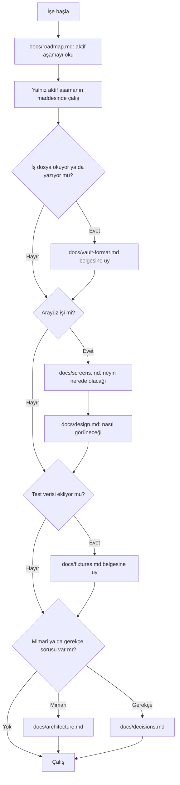
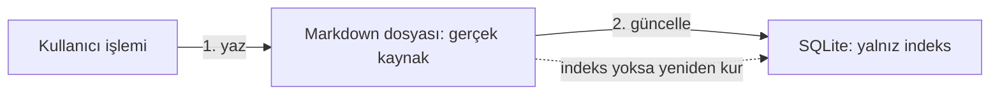
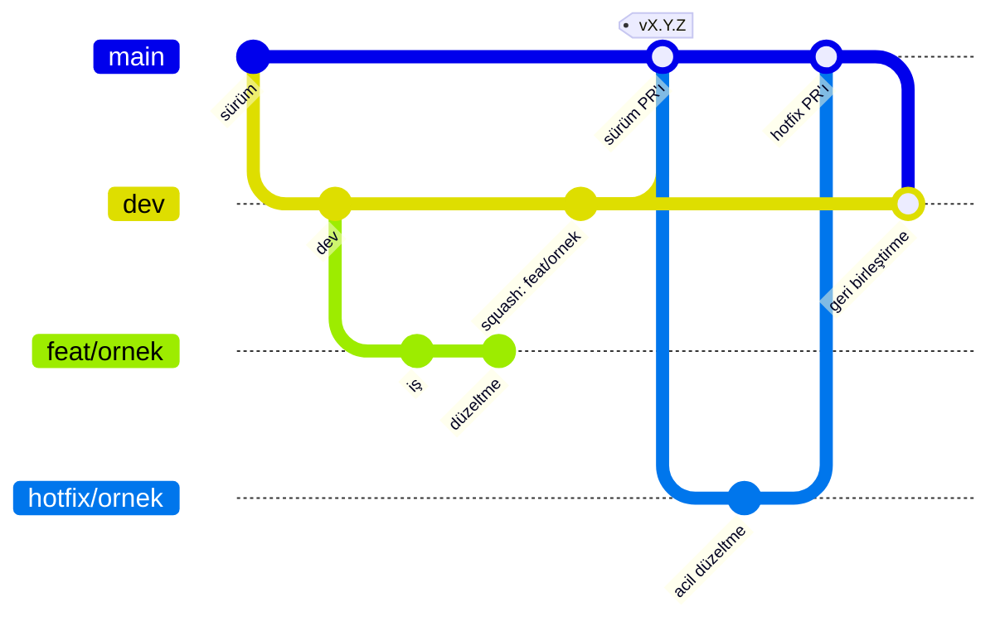
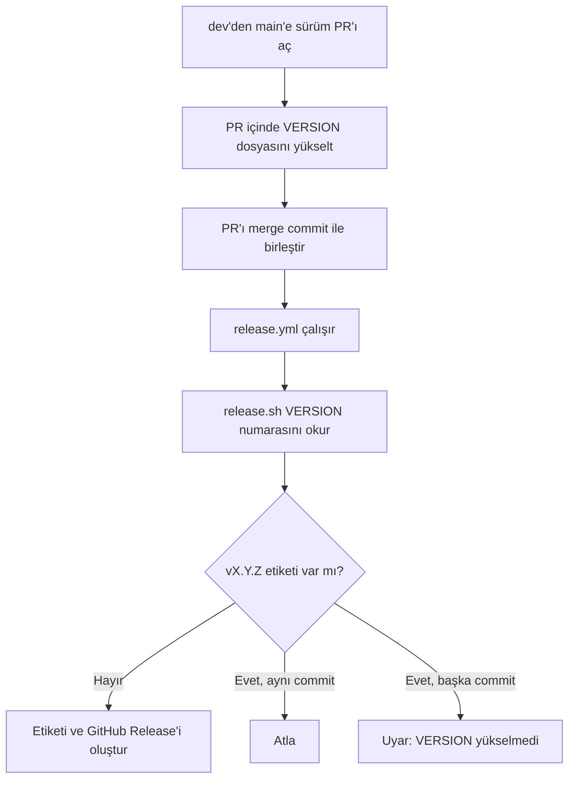

# Ajan kuralları

**Amaç:** Bu belge depoda çalışan her ajanın uyacağı kuralları tek kaynakta toplar.

**Kapsam:**
- Claude Code ve öteki CLI (komut satırı arayüzü) ajanları.
- Proje, belge, kod, git, sürüm, gizlilik ve onay kuralları.
- `CLAUDE.md` yalnız bu dosyayı içe aktarır; ayrı kural taşımaz.

## Proje özeti

| Konu | Değer |
|---|---|
| Ad | Kenet. Şema, hedef ve modül adlarında kod adı `Journal` kalır. |
| Platform | iPhone, iPad ve Mac, SwiftUI |
| Temel iş | Kullanıcı gün içinde kısa olaylar yazar. Uygulama metindeki kişi ve konumları tanır. Uygulama tanıdığı adları olaya kendiliğinden bağlar. |
| Ek özellikler | Görevler, hedefler ve zincir, widget'lar, kanban, zaman çizelgesi |
| Gerçek kaynak | Obsidian uyumlu Markdown dosyaları |
| İndeks | SQLite |

Widget'lar henüz yok. Widget maddeleri Aşama 11'dedir ve iCloud kapsayıcısı ile App Group kararını bekler.

## Başlangıç akışı

**Bir işe başlarken hangi belgeyi hangi durumda okuyacağını gösterir.**



1. `docs/roadmap.md` içindeki **aktif aşamayı** oku.
2. Yalnız aktif aşamanın maddeleri üzerinde çalış.
3. Dosya okuyan ya da yazan her işte `docs/vault-format.md` belgesine uy.
4. Arayüz işine `docs/screens.md` belgesiyle başla.
5. Arayüzün görünümü için `docs/design.md` belgesine uy.
6. Test verisi eklerken `docs/fixtures.md` belgesine uy.
7. Mimari sorular için `docs/architecture.md` belgesine bak.
8. Gerekçeler için `docs/decisions.md` belgesine bak.

`docs/screens.md` neyin nerede olacağını tarif eder, nasıl görüneceğini tarif etmez. Görünümü `docs/design.md` tarif eder.

## Serbest alanlar

| Alan | Senin kararın | Koşul |
|---|---|---|
| Kodun iç yapısı | Modül ve tip tasarımı, adlandırma, algoritmalar, veri yapıları, indeks şemasının ayrıntıları, performans iyileştirmeleri | Yok |
| Arayüz ayrıntıları | Görsel tasarım, yerleşim, animasyon, etkileşim, erişilebilirlik | `screens.md` bir taslaktır. Daha iyi bir çözüm görürsen uygula. Nedenini PR açıklamasına yaz. |
| Araç ve kütüphane seçimi | İşi belirgin biçimde iyileştiren bir bağımlılık | Gerekçesini PR açıklamasına yaz. |
| Test yaklaşımı | Zorunlu testlerin ötesinde neyi nasıl test edeceğin | Yok |

- Belgede hata, çelişki ya da daha iyi bir yol görürsen körü körüne uygulama.
- Sorunu söyle.
- Önerini yaz.
- Bir kuralın gerekçesi o durumda geçerli değilse gerekçenin neden geçmediğini belirt.

"Değişmez kurallar" dışındaki her şey senin kararındır. Belgeler neyi yapacağını ve hangi sınırı aşmayacağını söyler. Yöntemi sen seçersin. Belgeler de değişir.

## Değişmez kurallar

**Verinin yönünü gösterir: kullanıcı işlemi önce dosyaya, sonra indekse gider.**



| Kural | Ayrıntı |
|---|---|
| **Markdown dosyalarını gerçek kaynak say.** | SQLite yalnız indekstir. Uygulama indeksi her an yalnız dosyalardan eksiksiz yeniden kurabilmeli. Dosyada olmayan bilgiyi indekste tutma. |
| **Önce dosyaya yaz. Sonra indeksi güncelle.** | Tersini yapma. |
| **Tanımadığın içeriğe dokunma.** | Uygulama bir dosyada yalnız kullanıcı işleminin hedeflediği satırı ya da alanı değiştirir. Uygulama dosyanın geri kalanını bayt düzeyinde korur. |
| **Core paketinde Apple çerçevesi kullanma.** | `Core` içinde SwiftUI, UIKit, AppKit, EventKit, CoreLocation, WidgetKit ya da iCloud API'si kullanma. `Core` yalnız Foundation ve SQLite katmanını kullanır. |
| **Format değişikliğini önce belgeye yaz.** | `docs/vault-format.md` belgesini güncellemeden ayrıştırıcı ya da yazıcı davranışını değiştirme. |
| **Sonraki aşamaların özelliklerini erken yazma.** | Aktif aşama bitmeden ileriki özellikleri ekleme. İleriki özellikleri kolaylaştıran tasarım tercihleri serbesttir. Proje bu tercihleri teşvik eder. |
| **Arayüz metnini koda gömme.** | String Catalog kullan: `App/Resources/Localizable.xcstrings`. Her anahtara Türkçe ve İngilizce çeviri yaz. |

Değişmez kurallar zevk değil, ürünün temel vaatleridir. Veri kullanıcınındır, hiçbir şey kaybolmaz, kullanıcı veriyi başka platforma taşıyabilir. CI (sürekli bütünleştirme) Core kuralını `.github/scripts/check-core-imports.sh` ile denetler. Yol haritası sonraki aşamanın bir dilimini açıkça aktif aşamayla birlikte yürütebilir. Örnek: Aşama 11'in kimlik gerektirmeyen dilimleri ve Aşama 14 ile 15 birlikte yürür.

## Belge kuralları

| Durum | Kural |
|---|---|
| Yeni bilgi | Önce mevcut belgelere bak. Bilgi bir belgeye aitse bilgiyi o belgeye ekle. Aynı konuyu iki yerde anlatma. |
| Mevcut belgelere sığmayan ayrı konu | `docs/` altında yeni belge aç. Yeni belgeyi `README.md` içindeki belge tablosuna ekle. Örnek konu: bir aşamanın ayrıntılı tanımı. |
| Belgenin yeri | Yeni belgeyi yalnız `docs/` altında aç. Kök dizine ya da kod klasörlerine `.md` dosyası koyma. |
| Rapor ve not | Rapor, denetim çıktısı, geçici plan ya da not dosyasını repoya koyma. |
| Yeni karar | `docs/decisions.md` karar tablosuna tek satır ekle. |
| Kapanan açık soru | Soruyu `docs/decisions.md` içinden sil. |
| Biten aşama maddesi | `docs/roadmap.md` içindeki kutuyu işaretle. |

CI belge yerini `.github/scripts/check-doc-locations.sh` ile denetler. Betik `docs/` ve `Fixtures/` dışında yalnız kökteki `README.md`, `AGENTS.md` ve `CLAUDE.md` dosyalarını kabul eder. `.github/scripts/check-docs.sh` README belge tablosunun `docs/` klasörüyle aynı olduğunu denetler.

## Kod kuralları

| Konu | Kural |
|---|---|
| Dil | Swift'in güncel kararlı sürümünü ve SwiftUI'yi kullan. |
| Adlar | Kod, tip ve dosya adlarını İngilizce yaz. |
| Arayüz metni | Kullanıcıya görünen metni yerelleştir. |
| Ayrıştırıcı ve yazıcı testi | Her davranışı `Fixtures/` altında bir örnek Markdown dosyası ve beklenen çıktıyla test et. |
| Gidiş dönüş testi | Gidiş dönüş testini her zaman yaz. Uygulama bir dosyayı okur ve değiştirmeden yazarsa dosya birebir aynı kalmalı. |
| İndeks şeması | Şema değişirse şema sürümünü artır. Göç yazma. Uygulama eski indeksi siler ve dosyalardan yeniden kurar. |
| Belge biçim denetimi | `sh .github/scripts/check-docs.sh` komutunu çalıştır. |

`Fixtures/` dosyaları dilden bağımsızdır; ileride başka platformlar bu dosyaları yeniden kullanır. `project.yml` Swift 6 dil kipini ve tam eşzamanlılık denetimini açar; derleyici uyarıyı hata sayar. `check-docs.sh` karar tablosunu, README belge tablosunu ve String Catalog'u denetler. CI aynı betiği "Biçim ve kurallar" işinde çalıştırır.

## Git kuralları

### Dallar

**Her dalın kaynağını ve birleşme yolunu gösterir.**



| Dal | Açıldığı dal | Hedef | Birleştirme | Rol |
|---|---|---|---|---|
| `main` | Yok | Yok | Yok | Yalnız yayımlanan sürümler. Her birleştirme bir sürümdür. Ürünün aldığı sürüm; mağaza yapıları `main`'den gelir. |
| `dev` | `main` | `main` | Merge commit | Geliştirme dalı ve reponun varsayılan dalı. Derleme ve testler her zaman geçer. TestFlight yapıları `dev`'den gelir. |
| `feat/...`, `fix/...`, `docs/...`, `test/...`, `chore/...` | `dev` | `dev` | Squash | İş dalı |
| `hotfix/...` | `main` | `main` | `main`'e PR; sonra `main` `dev`'e merge commit ile döner | Acil düzeltme |

Hotfix sonrası `main` dalını `dev` dalına merge commit ile geri birleştir. Bu geri birleştirmede squash kullanma; squash iki dalın ortak geçmişini koparır. GitHub ruleset iki dalı da korur: PR ve yeşil `ci` denetimi zorunludur, force push ve dal silme kapalıdır.

### Akış

1. `dev`'den iş dalı aç.
2. Değişikliği yap.
3. PR'ı tek bir yol haritası maddesiyle sınırla.
4. `dev`'e PR aç.
5. PR'ı squash ile birleştir.
6. Karar ya da format değiştiren PR'da ilgili belgeyi aynı PR içinde güncelle.

### Sürüm

**Sürüm PR'ından GitHub Release'e kadar olan yolu gösterir.**



| Durum | Numara | Örnek |
|---|---|---|
| 1.0 öncesi | `0.<aşama>.<yama>` | Aşama 1 bitince `v0.1.0`; o aşamadaki düzeltme `v0.1.1` |
| İlk sürüm | `v0.9.0` | 2026-10-07'de `main`'e çıktı |
| İlk mağaza yayını | `v1.0.0` | Henüz yok |
| Yapı numarası | `git rev-list --count HEAD` | `CFBundleVersion` alanı; elle yazma |

- Sürüm numarasını kök dizindeki `VERSION` dosyasında tut: tek satır, `X.Y.Z`.
- Yapı numarasını elle yazma.
- Mağazaya yükleyeceğin yapıyı commit'lenmiş bir `dev` ya da `main` durumundan arşivle.
- Sürümü `dev`'den `main`'e bir PR ile kes.
- Sürüm PR'ında `VERSION` dosyasını yükselt.
- Sürüm PR'ını squash ile değil, merge commit ile birleştir.
- Sürüm kesme kararını kullanıcıya bırak.
- `main`'e PR açma.
- `main`'e birleştirme yapma.
- Sürüm PR'ını yalnız kullanıcı isteyince hazırla.

Xcode projesi ve iş akışları sürüm numarasını `VERSION` dosyasından okur. Derleme yapı numarasını `.github/scripts/build-number.sh` ile git geçmişinden üretir. `main`'e birleştirme `.github/workflows/release.yml` iş akışını başlatır; kararı `.github/scripts/release.sh` verir.

### Commit

| Kural | Örnek |
|---|---|
| Conventional Commits öneklerini kullan. | `feat:`, `fix:`, `docs:`, `test:`, `refactor:`, `chore:` |
| Öneki İngilizce, açıklamayı Türkçe yaz. | `feat: olay satırı ayrıştırıcısı` |
| Commit'i küçük ve tek amaçlı tut. | Bir commit, bir değişiklik |
| Commit mesajına ve PR açıklamasına yapay zeka imzası ekleme. | `Co-Authored-By`, "Generated with" ve benzeri satırlar |

İmza yasağı hangi ajan çalışırsa çalışsın geçerlidir.

### Yasaklar

- `main` ve `dev` dallarına doğrudan push yapma.
- Her değişikliği PR ile getir.
- Force push yapma.
- Testler geçmeden birleştirme yapma.

## Gizlilik

- Repo herkese açıktır.
- Gerçek kişilere, konumlara ya da kişisel günlüğe ait veriyi repoya koyma.
- `Fixtures/` altındaki örnek kasayı tamamen kurgusal adlarla yaz.
- Gerçek takım kimliğini repoya koyma.

Takım kimliği `Config/Local.xcconfig` dosyasında durur; git bu dosyayı izlemez. CI belgelerdeki takım kimliğini `.github/scripts/check-team-id.sh` ile arar.

## Onay gerektiren işler

| İş | Örnek |
|---|---|
| Kendi oluşturmadığın dosya ya da klasörü silmek | Yok |
| Dosya ya da klasörleri toplu yeniden adlandırmak | Yok |
| Uygulamanın ana gezinme düzenini değiştirmek | Sekme yapısı |
| Kasa formatını geriye uyumsuz değiştirmek | Yok |
| Sonradan değiştirmesi zor değerleri belirlemek | Bundle kimliği, iCloud kapsayıcı kimliği, App Group kimliği |

Tablodaki bir işi yapmadan önce dur. Kullanıcıya sor. Kullanıcı bundle kimliğini 2026-10-07'de `com.dogancanyildiz.kenet` olarak seçti. iCloud kapsayıcısı ve App Group kimliği hâlâ açıktır.

## Dizin yapısı

**Depodaki ana klasörleri ve her klasörün işini gösterir.**

```
App/                      iOS ve macOS SwiftUI uygulaması
  Design/                 Tasarım belirteçleri ve ortak bileşenler (Components/)
  Intents/                App Intents ve Kestirmeler
  Mac/                    Yalnız Mac'te olan parçalar (hızlı giriş paneli, genel kısayol)
  Model/                  Ekran modelleri ve indeks erişimi (IndexStore)
  Navigation/             iPhone ve Mac gezinmesi
  Resources/              String Catalog'lar, varlıklar, gizlilik bildirimi
  Screens/                Ekranlar
  Services/               Sistem hizmetleri (takvim, konum, bildirim, kilit)
  Support/                Entitlements, plist ekleri, küçük yardımcılar, simge kaynağı (AppIcon/)
Widgets/                  WidgetKit hedefi (henüz yok)
Packages/Core/            Ayrıştırıcı, modeller, indeksleyici (Apple'a bağımsız): VaultFormat,
                          VaultIndex, VaultStore, EntityRecognition, DateParsing, GoalTracking,
                          Summaries, ForceLayout
Fixtures/                 Örnek kasalar (vaults/) ve test dosyaları
Tests/JournalTests/       Uygulama katmanı birim testleri (macOS ve iOS simülatörü);
                          Snapshots/: ekran görüntüsü testleri
Tests/JournalUITests/     XCUITest duman testi, erişilebilirlik denetimi, ekran turu (iOS)
Tests/JournalMacUITests/  Mac ekran turu (yalnız screen-tour.sh --mac; CI'da koşmaz)
Config/                   İmzalama ayarı (Signing.xcconfig); Local.xcconfig repoya girmez
docs/                     Belgeler
.github/                  CI iş akışları (workflows/), ortak eylem (actions/), betikler (scripts/)
project.yml, VERSION      XcodeGen tanımı ve sürüm numarası; Journal.xcodeproj üretilir, repoya girmez
```

| Denetim betiği | Ne denetler |
|---|---|
| `.github/scripts/check-docs.sh` | Karar tablosu, README belge tablosu, String Catalog tamlığı ve biçimi |
| `.github/scripts/check-doc-locations.sh` | `docs/` dışındaki `.md` dosyaları |
| `.github/scripts/check-core-imports.sh` | `Core` içindeki yasak import'lar |
| `.github/scripts/check-team-id.sh` | Belgelerdeki gerçek takım kimliği |

CI dört betiği de "Biçim ve kurallar" işinde çalıştırır. Öteki betiklerin kullanımını `README.md` içindeki Kurulum bölümü anlatır. CI işlerinin ayrıntısını `docs/architecture.md` anlatır.
