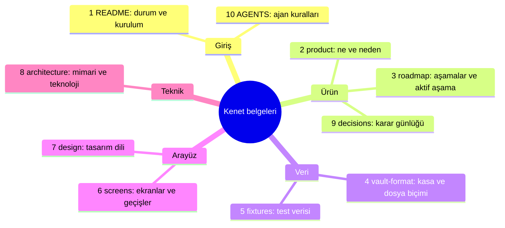
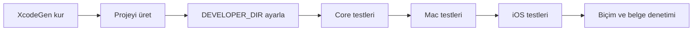
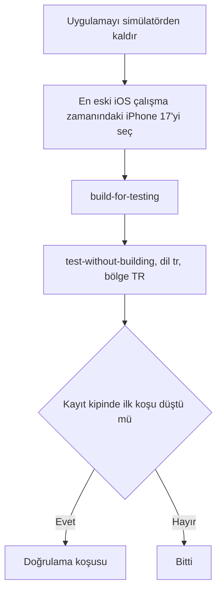
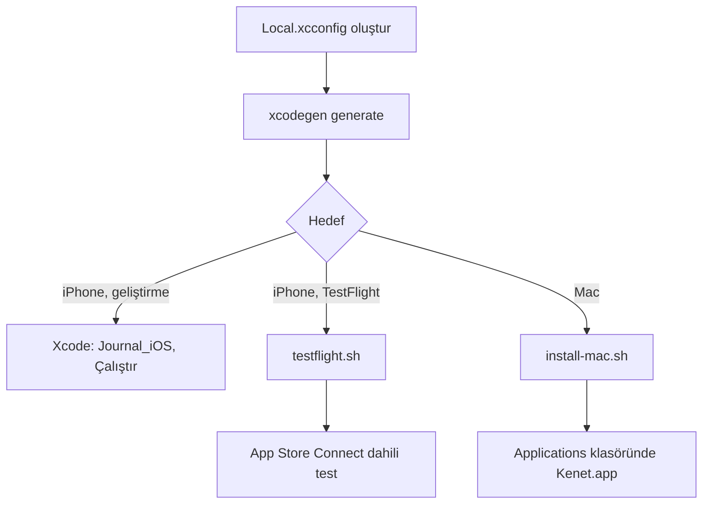
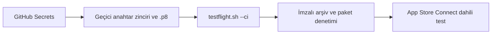
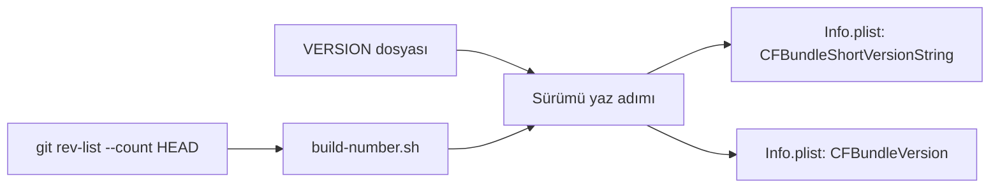
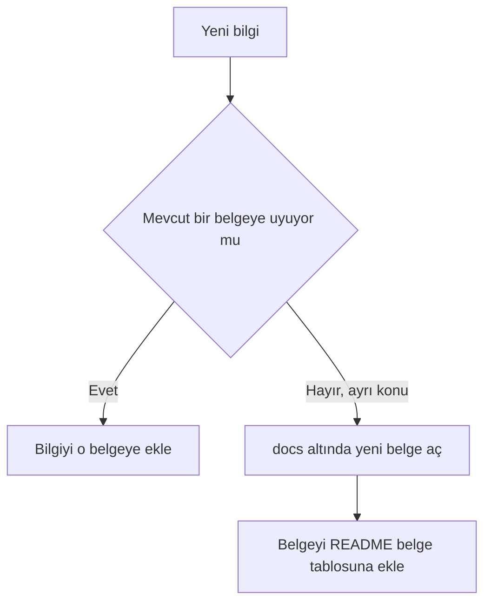

# Kenet

**Amaç:** README depoya giriş noktasıdır: uygulamayı, proje durumunu, kurulumu ve belge haritasını tek sayfada verir.

**Kapsam:**

- Belge haritası, ürün özeti, proje durumu ve platformlar
- Geliştirme ortamı, kurulum, test ve cihaza kurulum adımları
- Belge tablosu, belge kuralı ve lisans

## Belge haritası

**Harita, her belgenin konusunu ve okuma sırasını gösterir.**



**Tablo, iş türüne göre önce okunacak belgeleri verir.**

| İş türü | Önce oku | Sonra oku |
|---|---|---|
| Her iş | `docs/roadmap.md`: aktif aşama | `AGENTS.md`: değişmez kurallar |
| Dosya okuyan ya da yazan iş | `docs/vault-format.md` | `docs/fixtures.md` |
| Arayüz işi | `docs/screens.md`: ekranda ne olur | `docs/design.md`: ekran nasıl görünür |
| Mimari soru | `docs/architecture.md` | `docs/decisions.md`: kararların gerekçesi |

Yeni okur numara sırasını izler. Ajan önce aktif aşamayı okur, sonra işinin türüne göre tablodaki belgeleri okur.

## Ürün özeti

**Tablo, uygulamanın adını, kod adını ve temel yapısını verir.**

| Konu | Bilgi |
|---|---|
| Uygulama adı | Kenet |
| Kod adı | `Journal`: Xcode şemaları, hedefler ve modül bu adı taşır |
| Depo | `github.com/dogancanyildiz/kenet` |
| Arayüz | SwiftUI; iPhone, iPad ve Mac |
| Veri | Obsidian uyumlu düz Markdown dosyaları; SQLite yalnız indeks |
| Ad kararı | Karar günlüğü, 2026-10-07 |

Kenet, kişiler, konumlar ve olaylar üzerine kurulu bir kişisel günlük uygulamasıdır. Uygulama görevleri, hedefleri ve hedef zincirlerini aynı yerde toplar.

## Proje durumu

**Tablo, 2026-10-20 tarihindeki durumu verir.**

| Konu | Durum |
|---|---|
| Son sürüm | `v0.9.0`, `main` dalında |
| Test dağıtımı | `dev` dalındaki yapılar TestFlight'ta dahili testte; iPhone ve iPad |
| Aşama 0–10 | Kullanıcı kararı gerektirmeyen teknik maddeler tamam. Mürekkep tasarım dili ve denetim kalıpları bütün iPhone, iPad ve Mac ekranlarında |
| Aktif aşama | Aşama 11. Kimlik gerektirmeyen dilimler bitti; kalan maddeler iCloud kapsayıcısı ve App Group kararını bekler |
| Aşama 12–15 | Aşama 12 (yayın) hazırlık aşamasındadır. Aşama 13 (uyarlanır düzen), 14 (görselleştirme) ve 15 (kullanım kolaylığı) Aşama 11 ile birlikte yürür; Aşama 14 ve 15 bitti |
| Açık işler | Gerçek cihazda gözle doğrulama; iPhone Duo iOS 27.1 uyarlaması; mağaza sayfası |
| Bekleyen kimlik kararları | iCloud kapsayıcısı ve App Group. iCloud eşitlemesi ve widget'lar kimlik kararlarını bekler |
| Dal rolleri | `main`: ürünün aldığı sürüm. `dev`: test |

Ayrıntılı durum `docs/roadmap.md` belgesindedir.

## Platformlar

**Tablo, desteklenen platformları ve dağıtım yollarını verir.**

| Platform | En düşük sistem | Düzen | Dağıtım |
|---|---|---|---|
| iPhone | iOS 26.0 | Sekmeli | TestFlight dahili test; cihaz ailesi `TARGETED_DEVICE_FAMILY: "1,2"` |
| iPad | iPadOS 26.0 | Dar pencerede sekmeli; 1000 pt ve üstünde 3 sütun | TestFlight dahili test; iPhone ile aynı uygulama |
| Mac | macOS 26.0 | Kenar çubuklu | `.github/scripts/install-mac.sh`; TestFlight ve mağaza yolu yok |

**NOT:** iPad desteği 2026-10-16 kararıyla açıldı; cihaz ailesine iPad girdi ve geri alınamaz. Mağaza listesindeki iPad ekran görüntüleri sürümde gelir.

## Geliştirme ortamı

**Tablo, gereken araçları ve sürümleri verir.**

| Araç | Sürüm | Kullanım |
|---|---|---|
| Xcode | 26 ya da üstü | Uygulama derlemesi ve testleri |
| CI (sürekli bütünleştirme), macOS | macOS 26, Xcode 26.6 (`.github/actions/xcode` seçer) | Core ve uygulama testleri; iPhone ve iPad ayrı işlerde |
| CI, Linux | Swift 6.4 | Core derlemesi, biçim ve belge denetimi |
| XcodeGen | Homebrew | `project.yml` dosyasından Xcode projesi üretimi |
| python3 | Sistem sürümü | `.github/scripts/check-docs.sh`, `check-catalog-keys.py` (koddaki sabit metin katalogda var mı) ve `test-check-catalog-keys.py` |

**DİKKAT:** `xcodebuild` ve `swift` komutlarından önce `DEVELOPER_DIR` değişkenini ayarla.

**Tablo, Xcode projesindeki şemaları verir.**

| Şema | İçerik |
|---|---|
| `Journal_iOS` | iPhone ve iPad uygulaması; test eylemi `JournalTests_iOS` ve `JournalUITests` hedeflerini koşar |
| `Journal_macOS` | Mac uygulaması; test eylemi `JournalTests_macOS` hedefini koşar |
| `Journal_macOS_ScreenTour` | Mac ekran turu; yalnız `screen-tour.sh --mac` kullanır |
| `VaultFormat` | Core testleri |
| `VaultIndex`, `VaultStore`, `EntityRecognition`, `DateParsing`, `GoalTracking`, `Summaries`, `ForceLayout` | Core paketinin öteki ürün şemaları; Xcode yerel paketten üretir |

Core testlerinin tamamı için `swift test` komutunu kullan. Komut aşağıdaki adımlarda yazılıdır.

## Kurulum adımları

**Şema, ilk kurulumdan ilk test koşusuna kadar olan sırayı gösterir.**



1. Xcode projesini üret. XcodeGen, projeyi `project.yml` dosyasından üretir. `Journal.xcodeproj` repoya girmez.

```sh
brew install xcodegen
xcodegen generate
open Journal.xcodeproj
```

2. Komut satırı için Xcode'u seç.

```sh
export DEVELOPER_DIR=/Applications/Xcode.app/Contents/Developer
```

3. Core testlerini koş: `swift test --package-path Packages/Core -Xswiftc -warnings-as-errors`
4. Mac uygulama testlerini koş: `xcodebuild test -project Journal.xcodeproj -scheme Journal_macOS -destination 'platform=macOS' CODE_SIGNING_ALLOWED=NO`
5. iOS birim testlerini koş. Komut, CI gibi ekran görüntüsü kümelerini atlar.

```sh
xcodebuild test -project Journal.xcodeproj -scheme Journal_iOS \
  -destination 'platform=iOS Simulator,name=iPhone 17' \
  -only-testing:JournalTests_iOS \
  $(sh .github/scripts/snapshot-suites.sh | sed 's#^#-skip-testing:JournalTests_iOS/#' | tr '\n' ' ') \
  CODE_SIGNING_ALLOWED=NO
```

6. iOS arayüz testlerini koş: `Journal_iOS` şemasına `-only-testing:JournalUITests` ekle.
7. Biçimi denetle: `swift format lint --strict --recursive Packages App Tests Widgets ShareExtension Shared`
8. Belgeleri denetle: `sh .github/scripts/check-docs.sh`

**NOT:** CI ve yerel testler `CODE_SIGNING_ALLOWED=NO` ile imzasız koşar; takım kimliği gerekmez.

## Ekran görüntüsü testleri

Açık görüntü her iOS kümesinde kalır; koyu, AX3 ve kontrast temsilci kümelerde tutulur. Küme listesi ve varyanta özgü istisnalar [Mimari](docs/architecture.md#ekran-görüntüsü-ve-duman-testleri) belgesindedir.

**Tablo, iki görüntü kümesi türünü ve komutlarını verir.**

| Küme | Ad kuralı | CI | Komut |
|---|---|---|---|
| iOS | `…SnapshotTests` | Koşar ve PR'ı durdurur | Doğrula: `SNAPSHOT_TESTING_RECORD=never sh .github/scripts/record-screen-snapshots.sh`. Yenile: `sh .github/scripts/record-screen-snapshots.sh` (yalnız eşleşmeyen ya da eksik referansları yazar; hepsini yeniden yazmak için `SNAPSHOT_TESTING_RECORD=all`). Değişen küme yalnız gerekli görüntüyü kaydeder (`SNAPSHOT_SUITES="Ad…"`); yeni vaka eklerken açık/koyu/AX3 üçlüsü yalnız 10 temsilci kümede (#285). Sayı ve boyut tavanı: `check-snapshot-budget.sh` |
| Mac | `…MacSnapshotTests` | `ci` içinde koşmaz; haftalık `mac-snapshots` kapı olmadan ölçer. Yetkili ortam macOS 26 / Xcode 26.6 CI | Kayıt: `record-snapshots` iş akışı, `target=mac`; çıktı `mac-snapshot-references`. Yerelde varsayılan atlanır; incelemek için `SNAPSHOT_MAC_LOCAL=1 SNAPSHOT_TESTING_RECORD=all xcodebuild test -project Journal.xcodeproj -scheme Journal_macOS -destination 'platform=macOS' -only-testing:JournalTests_macOS/<Küme> CODE_SIGNING_ALLOWED=NO`. Yerel PNG’leri commit etme |

CI kayıt iş akışında `target`: `ios` (varsayılan), `mac` ya da `both` seçilir. `open_pr=false` varsayılandır; `true` seçilirse doğrulanan Mac referansları için `chore/mac-referanslar-<run>` dalından `dev`’e PR açılır. Mac kaydı bütün referansları `all` ile yeniler ve `never` ile doğrular. Yerel Mac kümeleri yalnız `SNAPSHOT_MAC_LOCAL=1` ile açılır; `CI=true` ortamında kendiliğinden koşar.

**Şema, iOS kayıt betiğinin adımlarını gösterir.**



**DİKKAT:** Referansları CI ile aynı cihazda ve çalışma zamanında üret: iPhone 17, iOS 26.5.

Referansı başka cihazda kaydedersen CI'da test düşer. Betik kümeleri ad kuralından bulur: `.github/scripts/snapshot-suites.sh`. Betik önce uygulamayı simülatörden kaldırır. Kurulu kalan uygulamanın kayıtlı durumu görüntüleri kaydırır. GitHub'daki "Ekran görüntüsü referansları" iş akışı da referansları üretir ve iş akışı çıktısı olarak yükler.

## Ekran turu

**Tablo, iPhone, iPad ve Mac ekran turlarını karşılaştırır.**

| Konu | iPhone | iPad | Mac |
|---|---|---|---|
| Komut | `sh .github/scripts/screen-tour.sh <çıktı klasörü> [simülatör kimliği]` | `sh .github/scripts/screen-tour.sh --pad <çıktı klasörü> [simülatör kimliği]` | `sh .github/scripts/screen-tour.sh --mac <çıktı klasörü>` |
| Test | `ScreenTourUITests` | `ScreenTourUITests`; sekme yerine kenar çubuğu satırları (`sidebar.<key>`) | `ScreenTourMacUITests` |
| Şema | `Journal_iOS` | `Journal_iOS` | `Journal_macOS_ScreenTour` |
| Aygıt | En eski iOS runtime'ındaki iPhone 17 | `record-screen-snapshots.sh --pad` ile aynı: iPad Pro 13 inç (M5) önce; yatay | Ana ekranda 1280x800 pencere |
| Çıktı | Her ekran için `NN-ekran-durum.png` | iPhone ile aynı adlar; ayrı klasöre yaz | Aynı adlarla pencere görüntüleri; yalnız Mac'te olan ekranlar 30'dan başlar |
| Ulaşılamayan adım | `atlananlar.txt` dosyasına düşer; test düşmez | Aynı | Aynı |
| Koşu | Yalnız betikle; olağan arayüz testi koşusu ve CI turu atlar | Aynı; koşu bitince aygıt dik yöne döner | Yalnız betikle; tur sürerken fare ve klavye testin elindedir |

**Tablo, turu ayarlayan ortam değişkenlerini verir.**

| Değişken | Etki |
|---|---|
| `SCREEN_TOUR_SIMULATOR` | Simülatör kimliği; ikinci bağımsız değişkenin yerine geçer |
| `SCREEN_TOUR_PLATFORM=mac`, `=pad` | `--mac`, `--pad` ile aynı |
| `SCREEN_TOUR_ORIENTATION=portrait` | iPad turunu dik koşturur; varsayılan yatay |
| `SCREEN_TOUR_DERIVED_DATA` | iPhone ve iPad turunun derleme klasörü; varsayılan `.dd/screen-tour` |
| `SCREEN_TOUR_WINDOW=1000x700` | Mac penceresinin boyutu; varsayılan 1280x800 |
| `SCREEN_TOUR_ONLY=ayarlar,koyu` | Mac turunda yalnız adı verilen bölümleri koşar |
| `SCREEN_TOUR_TREE=1` | Her görüntünün yanına erişilebilirlik ağacını `<çıktı>/agac/` altına yazar |

Tur, tasarım işinde önce ve sonra karşılaştırması içindir. iPhone turu uygulamayı örnek kasayla simülatörde gezer. Mac turunda uygulama ayrı bir bundle kimliği ve geçici bir ev klasörü kullanır. Mac turu gerçek kasaya ve ayarlara dokunmaz.

**NOT:** Çıktı klasörünü depo dışında seç; Kasa ayar sayfası görüntüsü makine yolunu gösterebilir, görüntüleri depoya ve PR'a ekleme.

## Cihaza kurulum ve TestFlight

**Şema, imza hazırlığından üç kurulum yoluna kadar olan akışı gösterir.**



**Tablo, kalıcı kimlik değerlerini verir.**

| Değer | Bilgi |
|---|---|
| Bundle kimliği | `com.dogancanyildiz.kenet`; `project.yml` içinde `APP_BUNDLE_IDENTIFIER` |
| Görünen ad | Kenet |
| Kod adı | `Journal` |
| Cihaz ailesi | iPhone ve iPad (`1,2`); karar 2026-10-16 |

1. Yerel imza dosyasını oluştur: `cp Config/Local.xcconfig.example Config/Local.xcconfig`. Dosyada `XXXXXXXXXX` yerine kendi takım kimliğini yaz. Takım kimliği repoya girmez; dosya `.gitignore`'dadır.
2. Projeyi üret: `xcodegen generate`. Xcode takımı yerel dosyadan okur. XcodeGen projeyi yeniden üretince takım seçimi kaybolmaz.

   **DİKKAT:** Xcode'da takımı elle seçme; Xcode seçimi `Journal.xcodeproj` içine yazar ve XcodeGen seçimi siler.

3. Cihaza kur. `Journal_iOS` şemasını seç. Hedef olarak iPhone'u seç. Çalıştır'a bas. Xcode imzalamayı otomatik yapar.
4. TestFlight'a yükle: `dev` dalında `sh .github/scripts/testflight.sh` komutunu çalıştır.

   | Seçenek | Ne yapar |
   |---|---|
   | Seçeneksiz | Arşivler, özeti gösterir, onay gelince yükler |
   | `--yes` | Onay sormadan yükler |
   | `--check` | İmzasız arşivler ve yalnız denetler; yükleme yok |
   | `--ci` | CI'da API anahtarıyla onaysız yükler; "CI'dan TestFlight (CD)" bölümü |

   Betik HEAD'i geçici bir kopyaya çıkarır ve arşivi oradan alır. Xcode'un çalışma klasöründe yeniden yazdığı dosyalar böylece yapıya girmez. Betik paketteki kimliği, sürümü, yapı numarasını ve belge paylaşımı anahtarlarını denetler. Koşullar: yerel `dev`, `origin/dev` ile aynıdır; Xcode'da aynı Apple hesabıyla oturum açıktır. `dev` dalına itme olunca `.github/workflows/testflight-check.yml` aynı `--check` denetimini koşar ve yükleme yapmaz.

   Elle yol: `Journal_iOS` şeması, hedef "Any iOS Device", Product → Archive, Organizer'da Distribute App → TestFlight Internal Only.

   **DİKKAT:** Elle yolda Xcode'un değiştirdiği dosyalar arşive girer; önce `git status` çıktısının temiz olduğunu denetle.

5. Mac'e kur: `sh .github/scripts/install-mac.sh`. Betik HEAD'i geçici bir kopyaya çıkarır ve Release derler. Betik kimliği, sürümü ve imzayı denetler. Sonra uygulamayı `/Applications/Kenet.app` olarak kopyalar. Kenet açıksa betik durur. `/Applications/Kenet.app` başka bir uygulamaysa da betik durur.

Mac için TestFlight ya da mağaza yolu yok. Mac uygulaması geliştirici imzalıdır ve yalnız derlendiği Mac'te çalışır.

## CI'dan TestFlight (CD)

**Şema, gizli değerlerden TestFlight yüklemesine kadar olan CI yolunu gösterir.**



`.github/workflows/testflight.yml` yerel yolu CI'da koşar: `testflight.sh --ci`. Betik aynı denetimleri yapar ve aynı dışa aktarma ayarıyla yükler. Betik Xcode hesabının yerine App Store Connect API anahtarını kullanır. Betik takım kimliğini anahtar zincirindeki Apple Distribution kimliğinden okur. Repoya ve günlüğe kimlik yazılmaz.

**Tablo, iş akışının beklediği Secrets değerlerini ve kaynaklarını verir.**

| Secret | İçerik | Kaynak |
|---|---|---|
| `ASC_KEY_ID` | API anahtarının kimliği, 10 karakter | App Store Connect, anahtar satırı |
| `ASC_ISSUER_ID` | Yayıncı kimliği, UUID | App Store Connect, anahtar tablosunun üstü |
| `ASC_KEY_P8` | `AuthKey_<kimlik>.p8` dosyası, base64 | Anahtar oluşunca bir kez indirilir |
| `DIST_CERT_P12` | Apple Distribution ve Apple Development kimlikleri, tek `.p12`, base64 | Anahtar Zinciri Erişimi, dışa aktarma |
| `DIST_CERT_PASSWORD` | `.p12` parolası | Dışa aktarırken sen seçersin |

1. API anahtarını oluştur. App Store Connect → Users and Access → Integrations → App Store Connect API → Team Keys → `+`. Ad: `Kenet CI`. Erişim: App Manager. `.p8` dosyasını indir; Apple dosyayı yalnız bir kez verir. Key ID ve Issuer ID değerlerini not et.
2. Dağıtım sertifikasını hazırla. Xcode → Settings → Accounts → takım → Manage Certificates. Listede Apple Distribution yoksa `+` → Apple Distribution.
3. Kimlikleri dışa aktar. Anahtar Zinciri Erişimi → login → My Certificates. "Apple Distribution: …" ve "Apple Development: …" satırlarını birlikte seç → Export 2 items → `.p12`, güçlü bir parolayla.

   **NOT:** Otomatik imzalamada arşiv adımı geliştirme kimliğiyle imzalar; dışa aktarma dağıtım kimliğiyle yeniden imzalar. `.p12` içinde Apple Development yoksa Xcode her koşuda API anahtarıyla yeni bir geliştirme sertifikası oluşturabilir. Betik bu durumda uyarı yazar.

4. Secrets değerlerini yaz. Depo kökünde:

   ```sh
   # Önce "testflight" ortamını yalnız dev dalına açık olarak oluştur (Settings → Environments:
   # Deployment branches → Selected branches → dev); Secrets bu ortama yazılır, başka dal okuyamaz.
   gh api -X PUT repos/dogancanyildiz/kenet/environments/testflight \
     -F 'deployment_branch_policy[protected_branches]=false' \
     -F 'deployment_branch_policy[custom_branch_policies]=true'
   gh api -X POST repos/dogancanyildiz/kenet/environments/testflight/deployment-branch-policies -f name=dev
   gh secret set ASC_KEY_ID --env testflight
   gh secret set ASC_ISSUER_ID --env testflight
   base64 -i AuthKey_<Key ID>.p8 | gh secret set ASC_KEY_P8 --env testflight
   base64 -i Kenet-imza.p12 | gh secret set DIST_CERT_P12 --env testflight
   gh secret set DIST_CERT_PASSWORD --env testflight
   ```

   Son komut parolayı gizli girişle sorar. Sonra `.p8` ve `.p12` dosyalarını parola yöneticisine taşı ve diskten sil.

5. İlk koşuyu başlat: `gh workflow run testflight.yml --ref dev -f notes='ilk CD denemesi'`. Not koşu adında ve özetinde görünür; TestFlight'a gitmez.
6. İsteğe bağlı olarak `dev`'e her itmede yüklemeyi aç: `gh variable set KENET_CD_ON_PUSH --body true`. Varsayılan kapalıdır. Değişken açıkken `testflight-check` atlanır; yükleme koşusu aynı denetimi imzalı arşivde yapar.

**Tablo, CD'nin sınırlarını ve bakımını verir.**

| Konu | Bilgi |
|---|---|
| Dal | Yalnız `dev`. Betik başka dalı ve `origin/dev` geçmişinde olmayan commit'i reddeder |
| Kuyruk | Aynı anda tek yükleme. Yükleme yarıda kesilmez; bekleyen koşu yenisi gelince iptal olur |
| Yapı numarası | Commit sayısı. Aynı commit'ten ikinci yükleme reddedilir |
| Sertifika süresi | Apple Distribution bir yıl geçerlidir. Yenileyince `DIST_CERT_P12` ve `DIST_CERT_PASSWORD` değerlerini güncelle |
| API anahtarı | Süresi dolmaz. Sızarsa App Store Connect'te iptal et ve yenisini yaz. İki adımlı doğrulama istemez |
| Düşen koşu | `testflight-logs` artifact'ı arşiv ve yükleme günlüğünü taşır. Takım, anahtar ve yayıncı kimliği günlükte yer tutucuyla değişir |

## Yapı numarası

**Şema, sürüm ve yapı numarasının kaynağını gösterir.**



**Tablo, yapı numarasının durumlara göre değerini verir.**

| Durum | Sonuç |
|---|---|
| Tam git geçmişi | Numara commit sayısıdır; iOS ve Mac aynı numarayı alır |
| Git yok ya da sığ kopya: `fetch-depth: 1` | Numara `1` kalır ve derleme uyarı verir; o yapıyı yükleme |
| Aynı sürümde aynı numara | App Store Connect ikinci yüklemeyi kabul etmez; yeni yükleme için en az bir yeni commit gerekir |
| İş dalı | Sayı squash sonrası `dev`'dekinden büyük olabilir; arşivi `dev` ya da `main` üzerinden al |

`CFBundleVersion` yapı numarasını elle yazma. Sürüm numarası kökteki `VERSION` dosyasından gelir.

## Belgeler

**Tablo, `docs/` altındaki her belgeyi ve konusunu verir.**

| Belge | İçerik |
|---|---|
| [docs/product.md](docs/product.md) | Ürünün amacı, gerekçesi, ilkeleri ve kapsam dışı işler |
| [docs/roadmap.md](docs/roadmap.md) | Aşamalar, aşama içerikleri ve çıkış ölçütleri |
| [docs/vault-format.md](docs/vault-format.md) | Kasa ve dosya biçimi; platformlar arası sözleşme |
| [docs/screens.md](docs/screens.md) | Ekranlar, ekran içerikleri ve geçişler |
| [docs/design.md](docs/design.md) | Tasarım dili: yön, belirteçler, kurallar ve sıradaki seçenekler |
| [docs/architecture.md](docs/architecture.md) | Teknik mimari ve teknoloji seçimi |
| [docs/decisions.md](docs/decisions.md) | Karar günlüğü ve açık sorular |
| [docs/fixtures.md](docs/fixtures.md) | Test verisi klasörü: kurallar, kategoriler, kurgusal adlar |

Claude Code ve öteki ajanlar için kurallar: [AGENTS.md](AGENTS.md)

## Belge kuralı

**Şema, yeni bilginin hangi belgeye gideceğini gösterir.**



Yeni bilgiyi önce mevcut belgelerden uygun olana ekle. Bilgi gerçekten ayrı bir konuysa `docs/` altında yeni belge aç. Yeni belgeyi yukarıdaki tabloya ekle. `.github/scripts/check-docs.sh` tabloda olmayan belgeyi reddeder.

## Lisans

Tüm hakları saklıdır; ayrıntı `LICENSE` dosyasında. Depo incelenmek üzere herkese açıktır, açık kaynak lisansı verilmemiştir.
