# Mimari

**Amaç:** Bu belge uygulamanın katmanlarını, veri yollarını ve teknik kurallarını tanımlar.

**Kapsam:**

- Katmanlar, modüller ve proje ayarları.
- Yazma, okuma, dosya koordinasyonu ve indeks.
- Eşitleme, widget, platform düzeni, taşınabilirlik ve test.

## Teknoloji yığını

**Tablo her katman için seçilen teknolojiyi gösterir.**

| Katman | Seçim |
|---|---|
| Arayüz | SwiftUI, tek projeden iOS ve macOS |
| Çekirdek | `Core` Swift paketi; Apple arayüz ve sistem çerçevelerine bağımsız |
| Veri | Markdown dosyaları; gerçek kaynak |
| İndeks | SQLite, GRDB, FTS5 |
| Eşitleme | iCloud Drive, uygulamanın kendi kapsayıcısı. Planlandı; kimlik kararını bekliyor |
| Widget | WidgetKit. Planlandı; kimlik kararını bekliyor |
| Sistem girişleri | App Intents: Kısayollar ve Siri |
| Takvim | EventKit, salt okunur |
| Konum | CoreLocation; harita için MapKit |
| Bildirim ve kilit | UserNotifications, LocalAuthentication |
| Rehber | ContactsUI kişi seçicisi, yalnız iOS. Uygulama rehber izni istemez |
| Yerelleştirme | String Catalog: tr, en |

## Modül düzeni

**Şema depo klasörlerini ve aralarındaki bağımlılığı gösterir.**

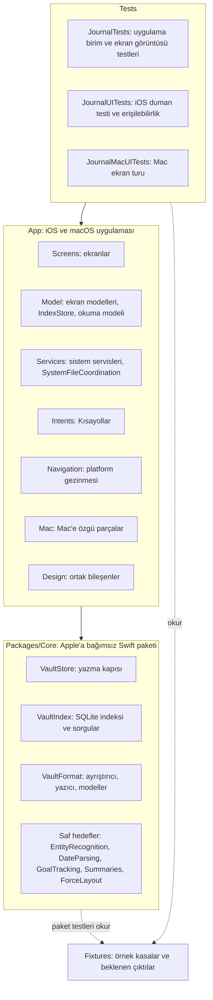

**Tablo uygulama klasörlerinin içeriğini gösterir.**

| Klasör | İçerik |
|---|---|
| `App/Screens` | Konuya göre ekranlar: `Today`, `Days`, `Summaries`, `Tasks`, `Entities`, `Goals`, `Graph`, `Map`, `Onboarding`, `Settings` |
| `App/Screens/Shared` | Ortak görünüm parçaları |
| `App/Navigation` | Platform gezinmesi |
| `App/Model` | Ekran modelleri |
| `App/Services` | Sistem servisleri |
| `App/Intents` | Kısayollar |
| `App/Mac` | Mac'e özgü parçalar |
| `App/Design` | Ortak bileşenler ve tasarım belirteçleri |
| `App/Resources` | String Catalog, lisans metinleri, gizlilik bildirimi |
| `App/Support` | Yetki dosyaları ve plist ekleri |

## Proje ayarları

**Tablo proje ve paket ayarlarının kurallarını gösterir.**

| Konu | Kural |
|---|---|
| Proje üretimi | `project.yml` projeyi tanımlar. XcodeGen `Journal.xcodeproj` dosyasını üretir. Git `Journal.xcodeproj` dosyasını izlemez |
| Hedef ve şema | Tek `Journal` hedefi iOS ve macOS için iki şema üretir. Hedef kaynakları `App/` klasöründen alır. Proje `Core` paketini yerel yoldan bağlar |
| Bundle kimliği | `com.dogancanyildiz.kenet`; kalıcı, iOS ve Mac için ortak. Değer `project.yml` içinde tek yerde durur: `APP_BUNDLE_IDENTIFIER`. Test hedefleri sonek ekler: `.tests`, `.uitests`. Betikler aynı satırı okur |
| Görünen ad | Kullanıcı Kenet adını görür: `CFBundleDisplayName`, `CFBundleName`. Hedef, modül ve `.app` dosyası kod adı `Journal` ile kalır |
| Cihaz | iOS hedefi iPhone, iPhone Duo ve iPad içindir: `TARGETED_DEVICE_FAMILY: "1,2"`. iPhone dikey kilitlidir; iPad dört yöne döner (`UISupportedInterfaceOrientations~ipad`); `testflight.sh` arşivde ikisini de denetler. iPad uygulaması Apple Silicon Mac'te listelenmez (`SUPPORTS_MAC_DESIGNED_FOR_IPHONE_IPAD: NO`): yerel Mac hedefi ayrıdır. Duo dış ekranı yalnız dikeydir; iç ekran yön kilidini yok sayar. İç ekran bölünmüş kabuğu açar: `AdaptiveNavigation` iki boyut sınıfı da düzenliyse `MacNavigation`, öteki durumda `PhoneNavigation` seçer. Kabuk durumu `AdaptiveNavigation` üstünde tek `ShellNavigationState` nesnesidir; seçim, sheet'ler ve taslaklar kabuk değişiminde korunur. Kapı cihaz türüne ve ekran boyuna bakmaz. Mac hedefi ayrıdır |
| iCloud ve App Group | iCloud kapsayıcısı ve App Group henüz yok. İkisi de kullanıcı kararıyla gelir |
| İmza | Takım kimliği repoya girmez. `Config/Signing.xcconfig`, varsa izlenmeyen `Config/Local.xcconfig` dosyasını içerir. Örnek dosya: `Config/Local.xcconfig.example`. Dosya yoksa Xcode projeyi `CODE_SIGNING_ALLOWED=NO` ile imzasız derler |
| Yetki dosyaları | Her platformun kendi dosyası var. `App/Support/Journal-macOS.entitlements`: sandbox, kullanıcının seçtiği dosyalar, takvim, konum. `App/Support/Journal-iOS.entitlements`: boş; iOS'a özgü yetenek yok |
| Sürüm numarası | Derleme numarayı kök dizindeki `VERSION` dosyasından okur ve Info.plist'e yazar |
| Yapı numarası | Derleme `CFBundleVersion` değerini git geçmişinden üretir: `git rev-list --count HEAD`, `.github/scripts/build-number.sh`. iOS ve Mac aynı numarayı alır. Git yoksa ya da kopya sığsa yedek değer `1` kalır ve derleme uyarı verir |
| Lisanslar | Uygulamaya bağlanan her uzak paketin LICENSE dosyası `App/Resources` altına olduğu gibi girer. Kullanıcı metni Ayarlar → Tanılama içinde okur. Test hedefinin paketleri bildirime girmez: `ThirdPartyLicenseTests` |
| Gizlilik bildirimi | `App/Resources/PrivacyInfo.xcprivacy` iki platformun paketine girer. İzleme ve toplanan veri yok. Neden bildirimi isteyen API'ler: UserDefaults `CA92.1`; dosya zaman damgası `C617.1` kapsayıcıdaki kasa için, `3B52.1` kullanıcının seçtiği klasör için |
| Gizlilik bildiriminin bakımı | Yeni bir API kümesi kullanan PR bildirimi aynı PR'da günceller. `ReleaseConfigurationTests` iki yönü de denetler |
| Şifreleme | Uygulama şifreleme kullanmaz, yalnız SHA-256 özeti alır. `ITSAppUsesNonExemptEncryption` değeri `NO` |
| Arayüz metinleri | `App/Resources/Localizable.xcstrings`. Kaynak dil Türkçe, çeviri İngilizce |

## Veri akışı

**Şema iki girişin dosyadan indekse, indeksten ekrana yolunu gösterir.**

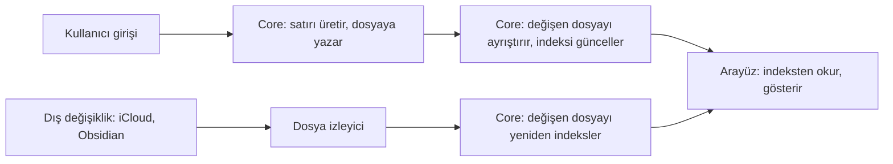

Yazma yönü her zaman dosyadan indekse doğrudur.

## Kasa konumu

**Şema uygulamanın açılışta kasayı nasıl seçtiğini gösterir.**

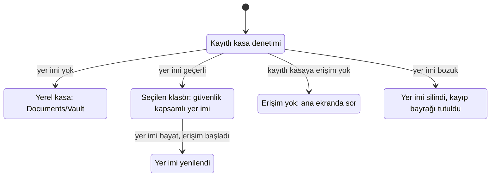

Aşama 0'dan beri uygulama varsayılan kasayı yerel `Documents/Vault/` klasöründe oluşturur. Kullanıcı başka klasör seçerse uygulama güvenlik kapsamlı yer imini cihazda saklar. Kayıtlı kasaya erişim yoksa uygulama yerel kasaya geçmez ve durumu ana ekranda sorar. Kayıp bayrağı sonraki açılışların `Documents/Vault` açmasını önler. iCloud konumu kullanıcı kararından sonra gelir.

## Dosya izleyici

**Şema yenilemeyi başlatan üç tetiği gösterir.**

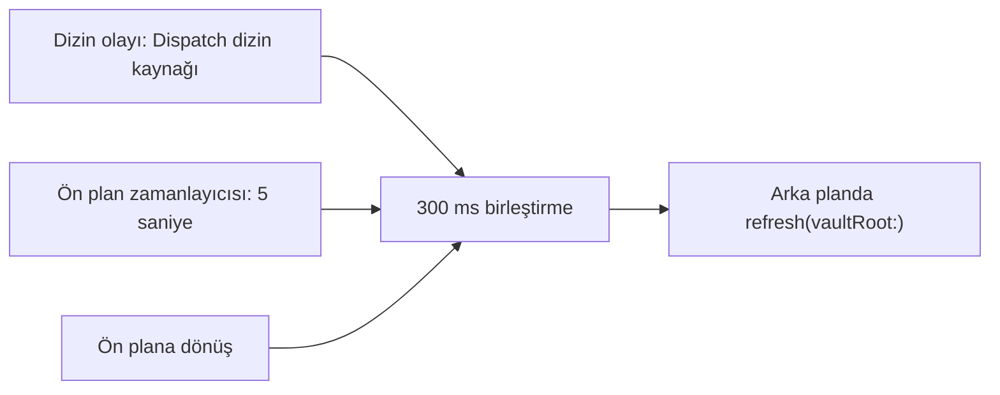

**Tablo izleyicinin sınırlarını gösterir.**

| Değer | Anlam |
|---|---|
| Dispatch dizin kaynakları | Kök ve taranan alt dizinler |
| 5 saniye | Ön plan zamanlayıcısının aralığı |
| 300 ms | Bildirimlerin birleştirme süresi |
| 256 | En çok dizin kaynağı sayısı |

Dizin kaynakları dosya içeriğinin yerinde düzenlenmesini güvenilir biçimde görmez. Ön plan zamanlayıcısı ve ön plana dönüş yenilemesi bu düzenlemeyi yakalar. Arka planda dizin olayları yenilemeyi tetiklemeye devam eder. İzleyici 256 kaynaktan sonraki dizinleri ve kaynak açamadığı dizinleri yalnız ön plan zamanlayıcısıyla denetler. Arayüz bu dizinlerin sayısını gösterir. `VaultWatcher` yol bildirmez; her olayda `IndexStore` tam `refresh` çağırır.

## Yazma sırası

**Şema bir yazmanın ekrandan dosyaya, dosyadan indekse ve okuma modeline yolunu gösterir.**

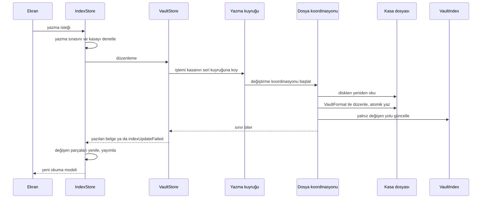

`VaultStore` uygulamanın kasa belgelerini düzenleyen tek kapıdır. `VaultStore` aynı kasa kökündeki yazmaları ortak seri bir Foundation işlem kuyruğunda sıralar. Her işlem belgeyi diskten yeniden okur, `VaultFormat` ile düzenler ve dosyaya yazar. Sonra `VaultStore` yalnız değişen yolu `VaultIndex` ile günceller. İndeks hatası yazılmış dosyayı geri almaz; `indexUpdateFailed(path:underlying:)` dosyanın yazıldığını açıkça bildirir.

`VaultStore` yeni baytları önce hedefin klasöründe geçici bir dosyaya yazar. `VaultStore` geçici dosyayı yayımlamadan önce diske eşitler (`FileHandle.synchronize()`). Eşitleme hata verirse `VaultStore` hiçbir şey yayımlamaz ve geçici dosyayı siler. Eşitleme `fsync` düzeyindedir. Apple aygıtlarında sürücü önbelleğini de boşaltan `F_FULLFSYNC` kullanılmaz.

**Tablo atomik yazmanın yollarını ve tek istisnayı gösterir.**

| Durum | Yazma yolu | Kesintide kalan |
|---|---|---|
| Dosya var | `VaultStore` var olan dosyayı eşitlenmiş geçici dosyayla atomik değiştirir. | Eski ya da yeni baytların tamamı |
| Dosya yok | `VaultStore` geçici dosyayı dışlayıcı sabit bağlantıyla yayımlar. Başka sürecin dosyasının üzerine yazmaz. | Dosya yok ya da yeni baytların tamamı |
| Birim sabit bağlantıyı desteklemiyor | `VaultStore` geçici dosyayı dışlayıcı adlandırmayla yayımlar (`renamex_np`, `RENAME_EXCL`). Hedef varsa adlandırma reddedilir. | Dosya yok ya da yeni baytların tamamı |
| Birim dışlayıcı adlandırmayı da desteklemiyor | `VaultStore` yeni dosyayı doğrudan dışlayıcı oluşturur. Bu ilk yazma atomik değildir. Linux'ta `Core` dışlayıcı adlandırma kullanmaz ve bu yolu izler. | Yarım dosya kalabilir |

## Okuma modeli

**Şema okuma modelinin parçalardan nasıl kurulduğunu gösterir.**

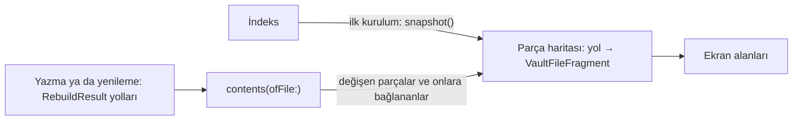

Okuma modeli dosya başına parça tutar: `[yol: VaultFileFragment]`. İlk kurulumda `snapshot()` parça haritasını doldurur. Yazma ve yenileme `RebuildResult` yollarının parçalarını yeniler. Bağlantısı bu yollara çözülen dosyaların parçalarını da yeniler. Ekran alanları parçalardan türer. Ekranlar okuma modelinden Core sorgularına dilim dilim geçer.

**Tablo bir parçanın taşıdığı veriyi ve bu veriyi kullanan alanı gösterir.**

| Parça verisi | Kullanan |
|---|---|
| Dosya satırı | `counts.filesByKind` |
| Varlık ve takma adlar | `entities`, `goals`, `reservedGoalKeys` |
| Bağlantılar | Gelen bağlantı sayısı, hedefin konumu, `counts.links`, silinen dosyaya çözülen kaynaklar |
| Hedef değerleri | `goalLogs`, `reservedGoalKeys` |
| Olay ve görev blok sayısı | `counts.events`, `counts.tasks` |

Parça blok metnini taşımaz: paragraf, başlık, görev ve olay metni indekste kalır. Ekranlar blok metnini sorgudan okur. Blok kimliği sahipliği de parçaya ulaşmaz. Bu yüzden artımlı yol kimlik başına bütün parçaları taramaz.

## Ekran sorguları

**Tablo okuma modelinden çıkan altı dilimi sırasıyla gösterir.**

| Sıra | Dilim | Core sorgusu | `IndexStore` yöntemi | Ekran |
|---|---|---|---|---|
| 1 | Graph | `graphMentions(kinds:)` | `computeGraphInput` | Graph |
| 2 | Varlık zaman akışı | `entityTimeline(for:)` | `computeEntityTimeline(for:)` | Varlık sayfası, içgörü kartı |
| 2 | Son görüşme | `lastEncounters(asOf:)` | `computeLastEncounters(asOf:)` | "Bir süredir görüşmediklerin", haftalık inceleme, görüşme ritmi hatırlatması |
| 3 | Gün listesi | `daySummaries(from:to:)` | `computeDaySummaries(from:to:)` | Günlük listesi, takvim |
| 3 | Tek gün | `day(on:)` | `computeDay(on:)` | Gün sayfası, içgörü kartının "o gün geçenler" bölümü |
| 4 | Görevler | Görev sorguları tablosu | `IndexStore.compute…Tasks` | Görevler, kanban, zaman çizelgesi, proje, gün sayfası, haftalık inceleme |
| 5 | Hedef durumu | `goalStatuses(today:)` | `computeGoalStatuses(today:)` | Hedefler listesi, gün sayfası |
| 6 | Proje adları | `taskProjects()` | `computeProjects()` | Mac kenar çubuğu, kanban ve zaman çizelgesi proje sütunları, süzgeç menüsü, hızlı giriş proje önerisi |
| 6 | Varlığın açık işleri | `taskGroups(today:scope:)`, varlığa bağlı kapsam | `computeTaskGroups(today:scope:)` | Varlık sayfası |
| 6 | Bildirim haftası | `taskGroups(today:)`, `daySummaries(from:to:)` | `computeNotificationDays(from:through:)` | Bildirim planlayıcı |

Aynı kalıp dilimlerden önceki istek üzerine sorgular için de geçerlidir: `computeSummary`, `computeOnThisDay`, `computeImportantDates`, `computeDayBacklinks`, `computeUnlinkedMentions`.

### Sorgu kalıbı

**Şema bir ekran sorgusunun kuşak ve iptal denetimini gösterir.**

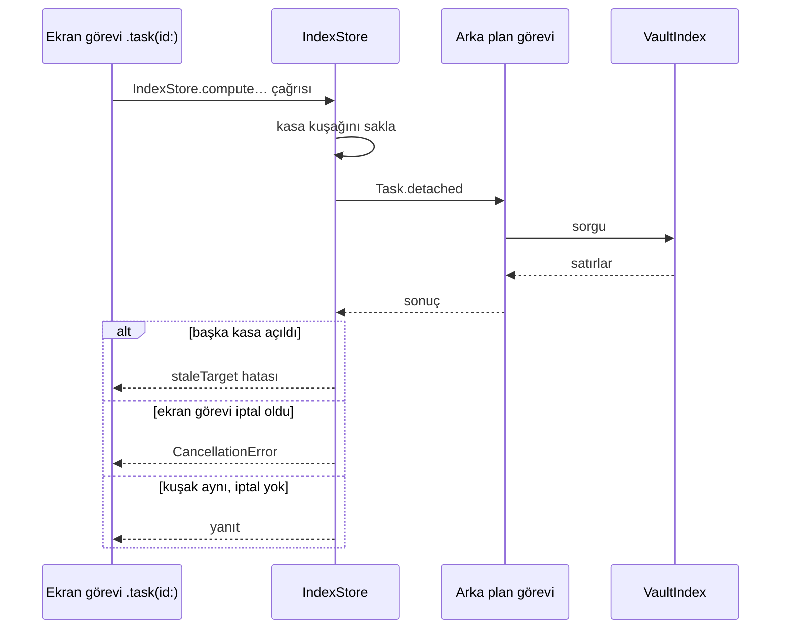

Her ekran sorgusu başlarken kasa kuşağını saklar ve indeksi arka plan görevinde okur. Yanıt gelince sorgu önce kuşağı denetler: başka kasa açıldıysa `staleTarget` atar. Sonra sorgu iptali denetler: çağıranın görevi iptal olduysa `CancellationError` atar. Arka plan görevi iptalde durmaz. Bu denetim yalnız eski yanıtın yenisinin üstüne yazmasını önler. İndeks açık değilse sorgu boş sonuç döner.

**Tablo ekranların yanıt beklerken ne çizdiğini gösterir.**

| Durum | Ekran davranışı |
|---|---|
| İlk yanıt gelmedi | Ekran kendi bölümlerini ve boş durumu çizmez. Gün sayfası takvim günlerini de çizmez |
| Yeniden yükleme sürüyor | Ekran eski yanıtı tutar. Yüklenen gün bir an boş görünmez |
| Yeni istek eskisinin yerini aldı | `.task(id:)` eski görevi iptal eder; ekran eski yanıtı atar |
| Yanıttan önce başka kasa seçildi | Sorgu sonucu kasa kuşağına bağlıdır; ekran sonucu atar |
| Gün sayfası açılıyor | Sayfa günün kendi bölümlerini gün ve görev yanıtlarının ikisi de gelince çizer |
| Akşam hatırlatması geldi | Uygulama günü kapatma akışını görevlerin o yayıma ait yanıtı gelmeden açmaz |
| Hedefler listesi yükleniyor | Liste ilk yanıta kadar satır çizmez. Yeniden yüklemede ve gece yarısı yeniden kurulumda eski durumları tutar |

### Graph

Okuma modeli Graph alanı tutmaz. Ekran açıkken ve her indeks yayımında `.task(id:)` sorguyu arka planda yeniden çalıştırır. Sorgu bağlantı toplamlarını ve gün başına anmaları getirir. Düğüm olacak varlıklar okuma modelinden gelir.

### Varlık zaman akışı ve son görüşme

Okuma modeli zaman akışı tutmaz. Varlık sayfası açıkken ve her indeks yayımında sayfa o varlığa bağlanan gün dosyası olaylarını ve Journal paragraflarını sorgular. İçgörü kartı aynı sonucu kullanır. `lastEncounters(asOf:)` kişi başına son görüşme gününü verir ve zaman akışıyla aynı kayıtları sayar. Bu sorgu görevleri ve frontmatter'ı saymaz; `entityUsage().lastDate` ise ikisini de sayar.

### Günler

Okuma modeli gün listesi tutmaz. Günlük listesi bütün günleri sorgular: iPhone'da `DaysView`, Mac'te gün sütunu. Takvim yalnız gösterdiği ayı sorgular. Yanıt gün başına olay sayısını, Journal paragraf ve başlık sayısını, ilk Journal paragrafını ve hedef kaydını taşır. İlk paragraf önizleme olarak görünür.

### Görevler

**Tablo her görev ekranının sorgusunu ve getirdiği satırları gösterir.**

| Ekran | Sorgu | Getirdiği satırlar |
|---|---|---|
| Görevler listesi | `taskGroups(today:scope:)` | Bugüne göre gruplanmış açık görevler |
| Görevler listesi | `completedTasks(limit:scope:)` | Son 50 tamamlanan görev |
| Görevler listesi | `openTaskCounts()` | Proje başına açık görev sayısı |
| Kanban | `boardTasks` | Açık görevler, son 30 günde tamamlananlar ve iptaller. "İptal edilenleri göster" yeni sorgu açmadan süzer |
| Zaman çizelgesi | `timelineTasks` | Bugünün ±365 günüyle kesişen görevler ve tarihsiz görevler. Görünen pencere bu satırlar içinde kayar |
| Proje sayfası | `tasks(inProject:)` | Projenin bütün görevleri |
| Gün sayfası, günü kapatma akışı | `dayTasks(on:)` | O günün adayları: önceki açıklar, o güne düşenler, o gün dosyasına yazılan tarihsizler, o gün tamamlananlar |
| Haftalık inceleme | `openTasks(dueBy:orWrittenFrom:)` | İki haftanın açık işleri |
| Görev ayrıntısı | `task(id:)` | Seçilen görev; sorgu görevi kimliğiyle yeniden okur |

Kişi ve proje süzgeci sorguya gider: `TaskScope`. Sorgu projeyi anahtarla karşılaştırır. Bütün görev sorguları `IndexStore.compute…Tasks` ile arka planda çalışır. Her yazmadan sonra `.task(id:)` sorguları yeniden çalıştırır. Gruplamayı ve sıralamayı ekran modelleri eskisi gibi yapar. Okuma modeli görev tutmaz.

**Tablo proje adlarının ve varlığın açık işlerinin kaynağını gösterir.**

| Yer | Kaynak | Yükleme davranışı |
|---|---|---|
| Mac kenar çubuğu | `computeProjects()` | Kenar çubuğu yeni yanıt gelene kadar eski listeyi tutar |
| Kanban ve zaman çizelgesi proje sütunları | `computeProjects()` | Model adları satırlarla birlikte atar. Bir sütun görevlerinden önce görünmez |
| Süzgeç menüsü, Görevler › Projeler | `computeProjects()` | Liste yüklemesi adları da getirir |
| Hızlı giriş `#project/` önerileri | `computeProjects()` | Giriş çubuğu her yayımda adları yeniden okur |
| Varlık sayfasının açık işleri | `computeTaskGroups(today:scope:)`, varlığa bağlı kapsam | Sayfa açık işleri zaman akışıyla aynı görevde sorgular |

`taskProjects()` her proje anahtarı için bir yazılış verir. Sorgu açık, tamamlanmış ve iptal görevlerin hepsini sayar. Eşit iki yazılıştan dosya ve satır sırasında önce gelen kazanır.

### Hedef durumu

Okuma modeli hedef durumu tutmaz. Hedefler listesi ve gün sayfası durumları `goalStatuses(today:)` sorgusundan alır. Gün sayfası o günün durumunu günle aynı görevde, o güne kadarki kayıtlarla sorgular. Sorgu durumu hedefin o güne kadarki bütün kayıtlarından hesaplar; bir yıldan eski zincir ve en uzun seri de kesintisiz kalır. Sorgu kayıtlardan yalnız anahtar, gün, tür ve değer sütunlarını okur.

**Şema hedef işaretlemede iyimser çizimi gösterir.**

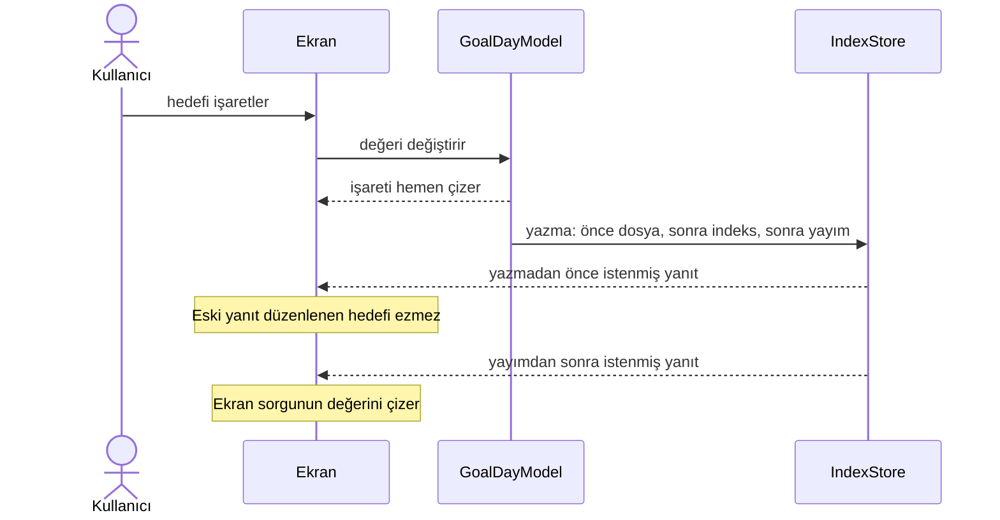

Kullanıcı hedefi işaretlediği anda ekran işareti o ekranın düzenleme modelinden çizer: `GoalDayModel`. Örnekler: listede kilometre taşı, şeritte artı ya da miktar. İkinci dokunuş ekranda görünen duruma göre işler. Yazma hiçbir şey kaydetmezse ekran işareti geri alır. Gün sayfasında şerit ve hedef sayacı aynı modeli paylaşır.

**Tablo gün sayfasının ve "Günü kapat" akışının hedef kaynaklarını gösterir.**

| Yer | Kaynak |
|---|---|
| Gün sayfası hedef sayacı, durumlar gelmeden | Şeridin kendi modeli. Bir an `0/0` ya da önceki günün sayısı görünmez |
| "Günü kapat" bekleyen hedefler | Açılışta şeridin modeli |
| Kopya anahtarlı hedef tanımı | Adı önce gelen tanım; gün sayfasıyla aynı kural |
| `GoalDayModel` ilk çizim | Okuma modelindeki `goalLogs` |
| `GoalDayModel` açıldıktan sonra | İndeksteki bütün geçmiş: `goalHistory` |

`GoalDayModel` gün sayfasının hedef şeridini, "Günü kapat" akışını ve hedef ayrıntısını sürer. Okuma modelindeki `goalLogs` bugünden 399 gün geri ve 6 gün ileri kayıt tutar. `goalLogs` listesi yalnız bildirim planlayıcı ve konum izleme içindir. Widget bağlantısı açık bir iştir.

### Okuma modelinde kalan alanlar

**Tablo okuma modelinde kalan alanları ve onları kullananları gösterir.**

| Alan | Kullanan |
|---|---|
| `entities` | Graph düğümleri |
| `goalLogs` | Bildirim planlayıcı, konum izleme, `GoalDayModel` ilk çizimi |

## Bayat yanıt ve kasa değişimi

**Tablo kasa değişince ya da istek iptal olunca uygulamanın davranışını gösterir.**

| Durum | Davranış |
|---|---|
| Ekran sorgusunun yanıtından önce başka kasa açıldı | Sorgu `staleTarget` atar; ekran sonucu atar |
| Ekran görevi yenisiyle değişti | Sorgu `CancellationError` atar; eski yanıt yenisinin üstüne yazmaz |
| Yazma sırasını ya da yenilemeyi beklerken başka kasa seçildi | `IndexStore` yazmayı `staleTarget` ile reddeder; hiçbir dosya değişmez |
| Tanıma yenilemesi sürerken başka kasa açıldı | Yenileme hiçbir alana atama yapmaz: tipler, varlıklar, kullanım, yakın yerler, harita yerleri |
| Yazma sonrası yayım sürerken başka kasa açıldı | Yayım içeriği atamaz ve hatayı göstermez |
| Yenileme sürerken başka kasa açıldı | Yenileme yeni kasanın `lastUpdated`, `errorText` ve `isProcessing` değerlerine dokunmaz |
| Eski kasaya varlık kaydedildi | Yeni kasanın varlık listesi o varlığı göstermez |
| Yayımda tanıma yenilemesi hata verdi | `lastUpdated` yine ilerler; ekranlar yeni içeriği çizer |
| Ayarlar ekranının görevi plan sürerken iptal oldu | Bildirim planı son görüşme sorgusunu iptalden ayırır; plan yarıda kalmaz |

`IndexStore` üzerinden yapılan her yazma çağrıldığı anda seçili olan kasaya aittir. Bu kural olay eklemeyi, `performEdit` düzenlemelerini, varlık oluşturmayı ve yeniden adlandırmayı kapsar. Olay eklemede taslak hızlı girişte kalır ve ekran var olan `staleTarget` iletisini gösterir. Öteki yollar hatayı çağırana atar. Bağlanmamış anma bağlama, satırı okuduğu kasayı bu denetime verir.

## Bildirimler ve App Intents

**Tablo bildirim ve sistem girişi parçalarını gösterir.**

| Parça | Görev |
|---|---|
| `NotificationPlanner` | Planı okuma modelinin hedeflerinden, bildirim haftasından, cihaz tercihlerinden ve yerel saatten üretir. Yalnız App katmanında çalışır |
| `NotificationService` | Yeniden planlamayı sırayla uygular ve izin durumunu yönetir. `UserNotifications` merkezine bir protokol üzerinden erişir |
| `CadenceReminderPlan` | Bugünün kişi, ritim ve son görüşme verisinden pencere içindeki görüşme ritmi günlerini hesaplar |
| `IntentActions` | Yer imi kapsamını ve indeksi açar; `IndexStore` üzerinden olay, görev ve hedef kaydı yazar |
| `AppShortcutsProvider` | tr ve en Siri cümlelerini sunar |
| `IntentNavigation` | Kullanıcıyı Bugün ekranına götürür |

**Tablo planlayıcının her hatırlatma için okuduğu kaynağı gösterir.**

| Hatırlatma | Kaynak |
|---|---|
| Görev sabahı | Bildirim haftası: son güne kadar vade günü başına açık görev sayısı ve haftaya düşen açık görevler |
| Günlük hatırlatması | Bildirim haftası: olayı ya da Journal paragrafı veya başlığı olan günler |
| Hedef hatırlatması | Okuma modelindeki `goals` ve `goalLogs` |
| Görüşme ritmi hatırlatması | `cadenceReminderPeople(today:)` |

`NotificationService` bildirim haftasını `computeNotificationDays(from:through:)` ile bugünden 6 gün sonrasına kadar okur. Görev ve günlük hatırlatması kapalıysa servis haftayı okumaz. Servis okumayı iptale karşı korur: plan yarıda kalmaz. Servis haftayı okuyamazsa planlayıcı görev ve günlük hatırlatması planlamaz. Planlayıcı hedef hatırlatmasını yine planlar.

`NotificationService` indeks yayımlarını 2 saniye birleştirir. Uygulama kapalıyken planlayıcı yedi günlük planın içeriğini yeniden hesaplamaz. Görüşme ritmi hatırlatması aynı plandadır. Uygulama son bildirim gününü kasaya yazmaz; günü cihazda kasa yoluna göre saklar.

## Core paketi

**Şema `Core` paketinin hedeflerini ve bağımlılıklarını gösterir.**

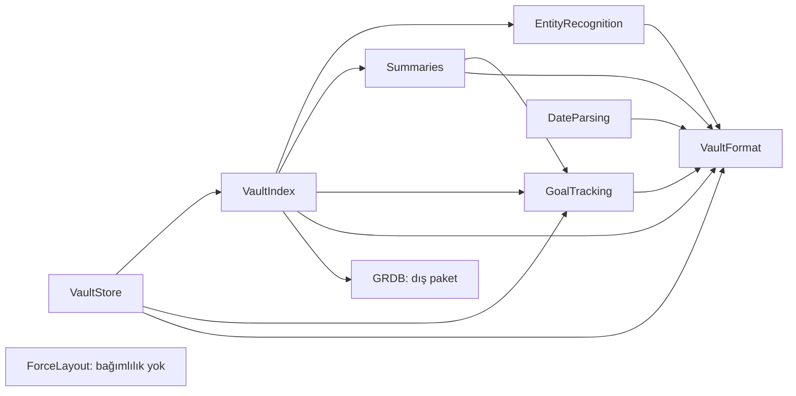

**Tablo `Core` sorumluluklarını ve onları taşıyan hedefi gösterir.**

| Sorumluluk | Hedef | İçerik |
|---|---|---|
| Ayrıştırıcı | `VaultFormat` | Frontmatter, bölümler, olay ve görev satırları, bağlantılar, blok kimlikleri |
| Yazıcı | `VaultFormat` | Yalnız hedef satırı değiştiren, dosyanın geri kalanını birebir koruyan düzenleme |
| Birleştirme | `VaultFormat` | Çakışan iki sürümü tek içerikte birleştiren saf işlev. Kurallar: `vault-format.md` |
| Modeller | `VaultFormat` | Gün, olay, görev, varlık, hedef. Varlık türleri: kişi, konum |
| Yeniden adlandırma | `VaultStore` | Varlık dosyasını yeniden adlandırma ve kasadaki tüm bağlantıları güncelleme |
| Varlık tanıma | `EntityRecognition` | Metinde bilinen adları ve takma adları bulma. Birden fazla aday varsa bağlama göre sıralama: konum, yakınlık, sıklık. Emin olmadığı durumu arayüze bildirme |
| İndeksleyici | `VaultIndex` | Tam ve artımlı indeksleme |
| Sorgular | `VaultIndex` | Bugün, gün listesi ve tek gün, güne bağlananlar, varlık zaman akışı ve son görüşme, Graph anmaları, zincir hesabı, hedef durumu, görev görünümleri, özet girdisi, bu gün geçmişte, varlık alanları, bağlanmamış anmalar, arama |
| Tarih ayrıştırma | `DateParsing` | Doğal dil tarih ifadeleri; hızlı girişte tekrar ve öncelik |
| Hedef hesapları | `GoalTracking` | Dönem ve yıl ilerlemesi, zincir, en uzun seri, ısı haritası. Günlük hedefte tek kaçırma affı ve kısmi af işareti |
| Özetler | `Summaries` | Haftalık, aylık ve yıllık sayılar, ritim birimleri, ilk beş kişi ve konum, ilk kez geçenler, hedef ve görev durumu, önceki dönem farkları. Süren dönemin karşılaştırması aynı tarihe kadardır. Aynı hedefte bu gün geçmişte, önemli tarihler, görüşme ritmi ve haftalık inceleme metni |
| Kuvvet yerleşimi | `ForceLayout` | Graph'ın canlı kuvvet benzetimi: Barnes-Hut itmesi, yay, merkez çekimi, çarpışma, sönümleme. Sabit tohumlu ve belirlenimci |
| Yazma kapısı | `VaultStore` | Kasa yazmalarını sıralama, dosya koordinasyonu, indeks güncellemesi |

Kısıt: `Core` yalnız Foundation ve SQLite katmanını kullanır. Bu sayede aynı kod uygulamada, widget'ta ve testlerde çalışır. Kodu ileride başka dile çevirmek de kolay olur. `VaultFormat` hedefinin paket bağımlılığı yoktur ve Foundation dışında bir çerçeve kullanmaz. `VaultIndex` dosyalara yazmaz; tam yeniden üretim ve küçük bir sorgu API'si sunar.

### Bağlanmamış anmalar

`VaultIndex.unlinkedMentions` önce arama indeksiyle aday gün dosyalarını daraltır. Sonra sorgu dosyaları diskten okur ve olay ile görev ilk satırlarını var olan tanıyıcıyla tarar. `VaultStore.linkingMention` onaylanan tek anmayı yazma kuyruğunda bağlar. Yazıcı dosyayı yeniden okur ve bayat hedefi denetler. Önce dosyaya yazar, sonra indeksi günceller.

### Journal sonuna ekleme ve ilk kullanım

Journal sonuna ekleme, `VaultStore`'un dosya-önce atomik yazma yolunu ve `RawDocument` bölüm ekleme altyapısını kullanır. `Summaries` içindeki saf `WeeklyReviewText`, çağıranın yerelleştirdiği özet cümlelerini ve cevapları güvenli düz satırlara birleştirir.

İlk kullanımda ve kasa hazırlamada App katmanındaki `VaultImportBootstrap` yalnız eksik klasörü, şablonu ve `.app/vault.json` dosyasını oluşturur. `VaultImportBootstrap` var olan dosyaları değiştirmez. `Core`'un genel belge yazıcısı bu yapısal yolları kabul etmez. Bu yüzden `VaultImportBootstrap` yeni dosyaları geçici dosya ve dışlayıcı sabit bağlantıyla yayımlar. Birim sabit bağlantıyı desteklemiyorsa `VaultImportBootstrap` dışlayıcı oluşturmayı kullanır. Eksik `type` eklemelerini `VaultStore` yapar.

### Hedef hesapları

`GoalTracking` yalnız `VaultFormat` importu olan saf hedef katmanıdır. Katman tanımı, gün kaydını, dönem ve yıl ilerlemesini, zinciri, en uzun seriyi ve ısı haritasını taşır. İndeks tipleri kaynak alanlarından kurar. `VaultStore.settingGoalValue` kaydı dosya-önce yazar. Takvim aritmetiği `CalendarDate` üzerinde ortaktır; `DateParsing` de aynı aritmetiği kullanır.

### Özetler

**Tablo özet hesabının parçalarını gösterir.**

| Konu | Kural |
|---|---|
| Bağımlılık | `Summaries` yalnız `VaultFormat` ve `GoalTracking` bağımlılığı ve importu olan saf değer hesaplarıdır. Saat, dosya ya da indeks erişimi yok |
| Girdi | `VaultIndex.summaryInput(from:to:)` tek okuma işleminde dönem günlerini ve bağlantılarını, görevleri, hedef tanımlarını ve dönem sonuna kadarki hedef geçmişini toplar |
| Hesaplama | App seçilen ve önceki dönemi arka planda hesaplatır. Süren dönemde `PeriodSummary` sayıları bugünde, önceki dönemi aynı tarihte bitirir |
| Kasa değişimi | App özeti yeniden yükler ve eski isteklerin sonuçlarını eler |
| Depolama | Özet için ayrı dosya ya da indeks şeması yok |

Sayıların kapsamı `screens.md`, sabit beklentiler `fixtures.md` içindedir.

### Kuvvet yerleşimi

**Tablo Graph yerleşiminin parçalarını gösterir.**

| Parça | Görev |
|---|---|
| `ForceSimulation` | Gövde yarıçapları ve yaylar girer, adım adım konumlar çıkar. Saat, rastgelelik ya da arayüz bilgisi yok |
| `GraphScene` | Uygulama graph'ı kimlik sırasına dizer ve benzetime çevirir |
| `GraphMotion` | Ekran benzetimi kare başına sabit adımla ilerletir. Benzetim durunca ekran kareleri keser |

`ForceLayout` başka hiçbir modüle bağlı olmayan saf değer tipidir. Aynı girdi ve tohum her zaman aynı düzeni verir. Bu yüzden canlı düzen, arka planda oturtulan düzenle aynı resimde biter. Kamera da baştan oturmuş düzene göre çerçeveler.

### Tarih ayrıştırma

**Tablo `DateParsing` hedefinin iki giriş noktasını gösterir.**

| Parça | Girdi | Çıktı |
|---|---|---|
| `QuickEntryAnalysis.analyze` | Hızlı giriş metni | Tekrar, öncelik ve tarih zincirini sırayla çalıştırır ve sonucu özgün UTF-8 baytlarına eşler. Tür, değer ve güven taşıyan çakışmasız simgeler ve kalan metin |
| `DateExpressionParser` | Çağıranın yerel günü ve sıralı dil tercihleri | Tek tarih, UTF-8 ifade aralığı, kalan metin ve güven. Foundation, saat ya da dosya erişimi yok |

`DateParsing` yalnız `VaultFormat` importu olan saf metin hedefidir. Ayrıştırıcı özgün aralıklarla bastırılan ifadeleri taramaz. Önceki çıkarma bir ifadeyi birleştirmişse özgün parçalar aynı değerle ayrı simgeler olur. `PriorityParse.byteRanges` baştaki ve sondaki işaretleri ayrı gösterir.

**Tablo tarih ayrıştırma kurallarını gösterir.**

| Konu | Kural |
|---|---|
| Çıplak hafta günü | Bugünden sonraki ilk gün. Gün bugünse yedi gün sonrası |
| `gelecek/next` | Çıplak hafta gününün sonraki haftası |
| `bu/this` | Mevcut haftadaki gün. Gün geçtiyse sonraki hafta |
| Hafta başı | Varsayılan pazartesi. `weekStartsOnMonday=false` haftayı ve `next week` sonucunu pazardan başlatır |
| Hafta sonu | Cumartesi. Geçtiyse gelecek cumartesi |
| Yılsız mutlak tarih | Bugün dahil en yakın geçerli tarih. 29 Şubat için ayrıştırıcı sonraki artık yıla kadar arar |
| Noktalı yazım | Gün/ay |
| Eğik çizgi | Dil sırasına göre: Türkçe gün/ay, İngilizce ay/gün |
| Yılsız noktalı, ay tek haneli, gün 13–31 dışında | Ondalık sayıyla karışır; aday yok: `2.5`, `5.3`, `12.3` |
| Yılsız noktalı, gün 13–31 ya da ay iki haneli | Geçerli gün/ay yazımı varsayımlı adaydır: `15.3`, `2.05`, `5.10` |
| Yılsız eğik çizgi, iki parça tek haneli | Kesirle karışır; aday yok: `1/2`, `2/3` |
| Yılsız eğik çizgi, en az bir parça iki haneli | Varsayımlı aday: `5/10`, `10/5`, `2/03` |
| Miktar birimi | Birimli yılsız sayı aday değildir. Örnek birimler: kg, km, cup, litre, su bardağı |
| Yüzde, oran, sürüm | Bitişik önde ya da sonda yüzde işareti aday değildir: `%15.10`, `15.10%`. Oran ya da sürüm bağlamı da aday değildir |
| Saat eki | İlk parça 0–23, ikinci parça 0–59 ise bitişik Türkçe saat eki adayı engeller: `1.10'da`, `23.10'da`. Bu aralık dışındaki tarihler varsayımlı adaydır: `25.10'da`, `31.12'de` |
| Önceki sözcük `saat` | Noktalı sayının hemen önceki sözcüğü `saat` ise aday yok |
| Bağlam elemelerinin kapsamı | Ayrıştırıcı yukarıdaki bağlam elemelerini tek haneli ayı olan 13–31 gün yazımlarına da uygular |
| Açık yıllı tarih | Yılsız sayı elemesine girmez |
| Hafta ve hafta günü | `haftaya`, `gelecek hafta` ve `next week` ardından hafta günü gelirse ayrıştırıcı ifadeyi bütünüyle seçer. Gün, sonraki haftanın içinden gelir: pazartesi 2026-10-05 → `haftaya salı` 2026-10-13 |
| Kesme işaretli ek | Türkçe gün ya da ay adından sonra kesme işaretiyle bitişik yönelme ya da çıkma eki ifadeye dahildir: `Cuma'ya`, `5 Ekim'e`, `15 Mart'tan` |
| Güven | Göreli ifadeler ve açık yıl kesin: `exact`. Çıplak gün, çıplak hafta sonu ve yılsız mutlak tarih varsayım: `assumed`. İki yönde de geçerli eğik çizgi yazımı da varsayımdır |
| Seçim | İlk konumdaki en uzun geçerli ifade. Eşit uzunlukta dil sırası |
| Taranmayan yerler | Sözcük içi, `@` anması, kod ve bağlantı içi |
| Kalan metin | İfade çıkınca bitişik boşluklar tek birleşme boşluğuna iner. Kalan metnin diğer baytları değişmez |

Birimsiz `5/10` gibi yazımların tarih mi miktar mı olduğu metinden kesinleşmez. Çağıran, varsayımlı adayın tarihini ve kalan metnini yalnız kullanıcı onayıyla uygular.

### Varlık tanıma

`EntityRecognition` yalnız `VaultFormat` bağımlılığı ve importu olan saf metin işleme hedefidir. Çağıran bilinen kişileri, konumları ve kullanım verilerini değer olarak verir. Hedef dosya okumaz ve dosyaya yazmaz. Hedef, tanıma sonucundan ve kullanıcı seçimlerinden bağlantılı metin üretir. Çağıran bu metni `VaultStore` üzerinden kaydeder.

**Tablo tanıma ve sıralama kurallarını gösterir.**

| Konu | Kural |
|---|---|
| Kullanıcı metni | Satırın hangi baytlarının kullanıcı metni olduğunu `VaultFormat` içindeki tek tanım söyler: `LineTextRegion`. Kullanıcı metni liste işareti, kutu, görev alanları, olay saati ve kimlik dışında kalan kısımdır. Bağlanmamış anmalar sorgusu da aynı tanımı kullanır |
| Takvim katılımcıları | Aynı hedefteki `AttendeeMatching` katılımcı adlarını kesin, belirsiz ve bilinmeyen diye ayırır. Uygulama adları EventKit'ten okur ve değer olarak verir. `AttendeeMatching` tanıyıcının karşılaştırma anahtarlarını kullanır ve takvim çerçevesini görmez |
| Harf boyu | İlk harfin büyük ya da küçük harfi farklı olan tek adaylı yazım öneridir. Tanıyıcı bu yazımı açık `@` dışında kesin bağlam varlığı saymaz |
| Rakam ad | Tanıyıcı yalnız rakamlardan oluşan adı, örneğin `12`, yalnız `@` ile tanır |
| Puan saklama | Sıralama her çağrıda farklı adayın puanını bir kez hesaplar ve saklar. Sıralama aynı adayın puanını başka anmalarda ya da karşılaştırmalarda yeniden hesaplamaz |
| Bağlam puanı | Belirsiz aday ile aynı metinde kesin tanınan ve çağıranın bağlama eklediği farklı varlıkların birlikte geçtiği gün sayılarının toplamı. Ağırlık: konum 4, kişi 1. Puan adayın kendisini saymaz |
| Sıralama | Önce bağlam puanı, sonra son geçiş günü: yeni önce. Sonra toplam bağlantı sayısı: çok önce. Son olarak dosya yolunun Unicode kod noktası sırası |
| Eksik veri | Sıralama eksik kullanımı sıfır sayar ve eksik tarihi bilinmeyen kabul eder. Belirsiz eşleşme puanla kesinleşmez |
| Veri kaynağı | `VaultIndex` bütün kişileri ve konumları takma adlarıyla tek sorguda getirir |
| Kullanım | Kullanım toplamı bütün çözülen bağlantıları sayar. Son gün, kaynak gün dosyasının tarihidir |
| Birlikte geçiş | Puan birlikte geçişi yalnız gün dosyalarında, aynı gün ve varlık çifti için bir kez sayar. Tekrar bağlantılar bu puanı artırmaz |
| Şema | Bu veriler dosyalardan üretilen sorgu sonuçlarıdır; şema değişmez |
| Unicode | Foundation kullanmayan tanıma katmanında küçük harfli `String` anahtarların kanonik Unicode eşitliği ve hash davranışı NFC karşılaştırmasını sağlar. Anahtarın saklanan baytları normalleşmez. İndeksin fiziksel anahtarları NFC kuralıyla kalır |

### Varlık tipleri

**Tablo varlık tipi parçalarının yerini gösterir.**

| Parça | Yer |
|---|---|
| Değer modeli | `VaultFormat`, importsuz |
| Ek tanımlar | İsteğe bağlı `.app/types.json` dosyası yerleşik kişi ve konum tanımlarına yeni tanımlar ekler. Dosya sözleşmesi `vault-format.md` içindedir |
| JSON okuma | `VaultIndex.EntityTypeReader`, Foundation ile |
| Yazma | `VaultStore`; atomik, hedef dışı baytları korur |

İndeks yalnız geçerli tanımlı tipleri varlık olarak sınıflandırır. Tanımlı id kümesi değişince dosyadan türeyen tip imzası bütün Markdown dosyalarını yeniden sınıflandırır. Tanıyıcı özel tipleri kişi ağırlığıyla tanır. Şirket şema paketi kapsam dışıdır.

## Dosya koordinasyonu

**Şema `Core` arayüzünün App katmanında `NSFileCoordinator`'a bağlanmasını gösterir.**

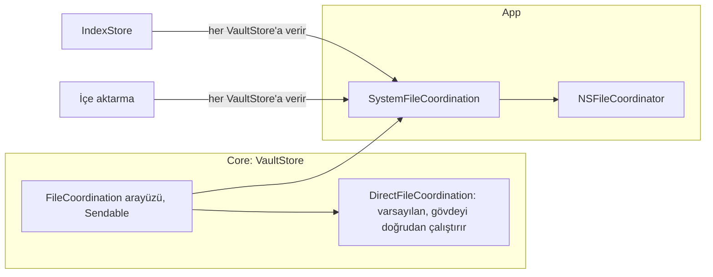

`Core`'daki `FileCoordination` arayüzü okuma, değiştirme, iki URL'li taşıma, iki URL'li birleştirme ve silme niyetlerini host katmanına iletir. Varsayılan `DirectFileCoordination` gövdeyi doğrudan çalıştırır. App arayüzü `SystemFileCoordination` ile `NSFileCoordinator` üzerinde uygular. `IndexStore` ve içe aktarma, açtıkları her `VaultStore`'a bu uygulamayı verir.

**Tablo her niyetin `NSFileCoordinator` seçeneğini gösterir.**

| Niyet | `NSFileCoordinator` çağrısı | Neden |
|---|---|---|
| Okuma | Seçeneksiz okuma koordinasyonu | Dosyayı sunan uygulama güncel baytları verir |
| Değiştirme | `.forMerging` yazması | Dosyayı sunan uygulamalar önce kaydeder; gövde güncel baytları okur |
| Taşıma | İki URL'li tek yazma: kaynak `.forMerging`, hedef `.forReplacing` | Kaynak düz dosyadır ve taşımadan önce gövde içeriği yeniden yazar. `.forMoving` düz dosyada etkisizdir ve iki seçenek birbirini dışlar |
| Taşıma, hedef kaynağın kendisi | Hedef seçeneksiz | Büyük ve küçük harf duyarsız birimde yalnız harf boyu değişen ad. `.forReplacing` dosyayı sunan uygulamaya silinme bildirirdi |
| Birleştirme | İki URL'li tek yazma: kaynak `.forDeleting`, hedef `.forMerging` | Gövde kaynağı okur ve en son siler; kaynağı sunan uygulama silinmeye yol verir. Gövde hedefi güncel baytlarından yeniden yazar; hedefi sunan uygulama önce kaydeder |
| Silme | `.forDeleting` yazması | Tek URL'li silme niyeti |

**Tablo hangi zincirin hangi koordinasyon sınırında çalıştığını gösterir.**

| Zincir | Sınır |
|---|---|
| Oku → dönüştür → atomik yaz → indeks güncellemesi | Tek değiştirme koordinasyonu |
| Yeniden adlandırmanın kaynak ve hedef yazması ve geri alması | Tek taşıma koordinasyonu |
| Yeniden adlandırmanın bağlantı güncellemeleri | Dosya başına değiştirme koordinasyonu |
| Taşıma bildirimi | Sınırın içinden: taşımadan hemen önce `item(at:willMoveTo:)`, yalnız başarılı taşımadan sonra `item(at:didMoveTo:)` |
| Gün kopyası birleştirme | Gün dosyası varsa tek `.merge(kopya → gün)` sınırı. Gün dosyası yoksa tek `.move(kopya → gün)` sınırı. Gün dosyası `.merge` içinde yok olursa taşıma aynı sınırda yapılır |

Taşıma bildirimi sınırın içinden gider, çünkü `NSFileCoordinator` dosya sunucularına bu bildirimi aynı koordineli bloktan ister. İndeks güncellemesi yazmayla aynı sınırdadır. Bu yüzden `VaultIndex` ve `VaultStore`'a verilen dosya okuyucuları koordinasyon başlatmaz.

### Yeniden adlandırmanın koordinasyon kapsamı

**Tablo bağlantı güncellemesinin hangi dosyaları koordine ettiğini gösterir.**

| Dosya grubu | Bulan | Ne olur |
|---|---|---|
| İndeksin, yeniden adlandırılan dosyaya bağlantı satırı tuttuğu dosyalar | İndeks | Dosya başına değiştirme koordinasyonu; güncelleme yazar |
| Ham frontmatter alanında eski adı anan dosyalar | Koordinasyonsuz okuma | Güncelleme dosyayı yazmaz. Yalnız `rawField` olarak bildirir. Bildirimi koordineli okumanın baytlarından üretir |

Ham alanlar bağlantı satırı değildir; bu yüzden tarama onları koordinasyonsuz okur. Kök dizinin okuma koordinasyonu içindeki dosyaların sunucularına ulaşmaz. Ölçüm: ne kaydetme ne okuma bildirimi gider. Bu yüzden tarama kök koordinasyonunu kullanmaz. Bedeli: başka bir düzenleyicide kaydedilmemiş ham alan değişikliği bildirimde görünmeyebilir.

### Çağrı kuralları

**Tablo `SystemFileCoordination` çağrılarının kurallarını gösterir.**

| Kural | Neden |
|---|---|
| Çağrılar eşzamanlıdır ve gövdeyi çağıran iş parçacığında bir kez çalıştırır | Gövde yazma kuyruğunda ya da okuma kuyruğunda kalır |
| Zaman uyumsuz `coordinate(with:queue:byAccessor:)` kullanma | Kuyrukta beklemek kilitlenmeye yol açar |
| İleride eklenecek `NSFilePresenter`'ın `presentedItemOperationQueue` değeri asla kasa yazma kuyruğu olmasın | Sunucu yazma kuyruğunu beklerse kilitlenme olur |
| `VaultIndex`'e koordine eden okuyucu verme | İndeks güncellemesi yazmanın sınırı içindedir; iç içe koordinasyon kilitlenmeye yol açar |
| Koordinatörün verdiği yeni URL'yi kullanma | `Core` istediği URL'leri kullanmaya devam eder |
| Sunucu kaydedemezse ya da host erişimi reddederse gövde çalışmasın | Çağrı koordinatörün hatasını atar. `VaultStore` indeksi hiçbir zaman dosyadan önce güncellemez |
| `persist` ve `atomicWrite` içinde iç içe koordinasyon başlatma | Bu ikisi zaten açık sınırın içinde çalışır |
| İndeks veritabanını koordine etme | Veritabanı kasa dışında, uygulamaya özel konumdadır |

Uygulamanın kendi dosya sunucusu henüz yoktur. İndeks taraması ve yenileme dosyaları koordinasyonsuz okur.

### Okuma kuyruğu

**Şema kasa başına iki kuyruğu gösterir.**

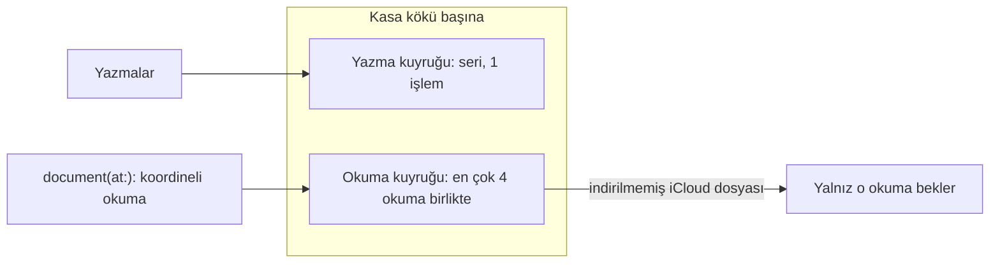

Yazmalar kasanın yazma kuyruğunda, `document(at:)` okuması kasanın okuma kuyruğunda bekler. Okuma kuyruğu bir Foundation işlem kuyruğudur; aktör, Swift eşzamanlılık havuzu ya da yazma kuyruğu değildir. İndirilmemiş bir iCloud dosyasının okuma koordinasyonu indirme bitene kadar sürer. Bu sürede yalnız o okuma bekler; aynı kasanın yazmaları, öteki okumaları ve ana iş parçacığı çalışmaya devam eder. Okumaların birbirine göre sırası yoktur. 4 okumalık sınır, art arda bekleyen indirmelerin her birinin bir iş parçacığı tutmasını önler.

**NOT:** Dört okuma indirme beklerken beşinci okuma sıra bekler, örneğin günün sayfası.

### Konum dosyası önbelleği

**Şema yer dosyasının ne zaman yeniden okunduğunu gösterir.**

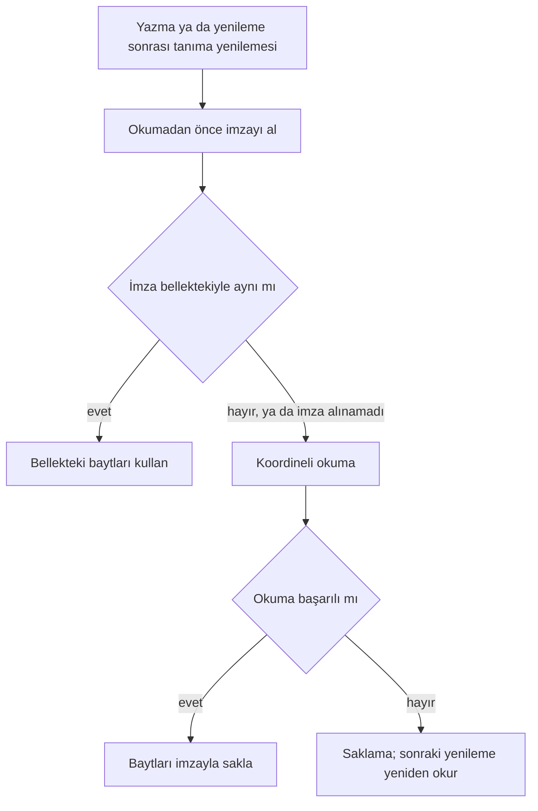

`IndexStore` her yazma ve yenilemeden sonra konum dosyalarını koordinatlar için okur. İmza şunları içerir: aygıt, inode, boyut, içerik değişiklik zamanı, öznitelik değişiklik zamanı. Dışarıdan değişen, yeniden adlandırmayla yola gelen ya da imzası alınamayan dosyayı `IndexStore` yeniden okur. Değişmeyen dosyanın okuması koordinasyondan geçmez. Bu yüzden dosyayı sunan bir uygulamanın kaydedilmemiş değişikliği, o uygulama kaydedip imza değişince görünür. İmza ve okuma aynı kasaya aittir: yenileme sürerken başka kasa açılırsa `IndexStore` dosyayı yenilemenin başladığı kasadan okur.

## İndeks

**Şema indeks tablolarını ve aralarındaki ilişkiyi gösterir.**

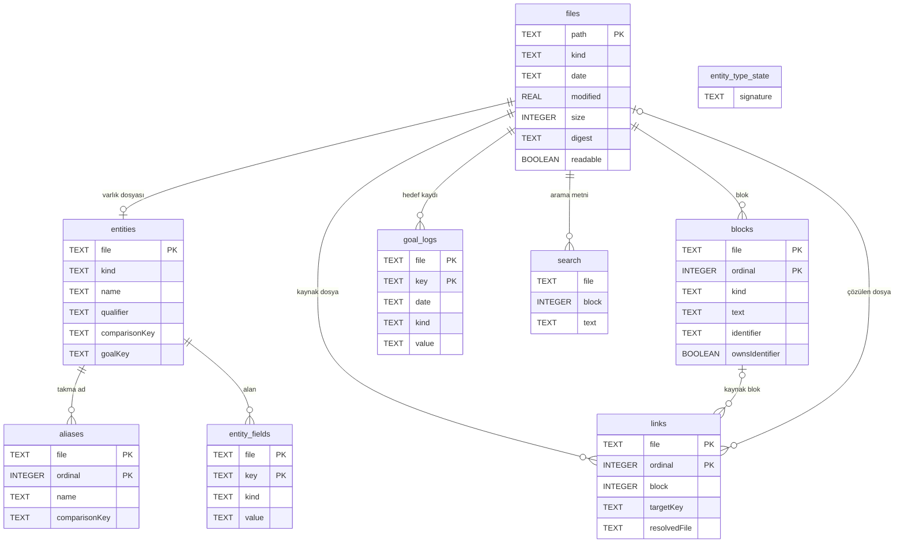

**Tablo indeksin genel kurallarını gösterir.**

| Konu | Kural |
|---|---|
| Konum | Her cihazda yerel, kasanın dışında. Eşitleme indeksi taşımaz |
| Yeniden üretim | Uygulama indeksi dosyalardan eksiksiz yeniden üretebilir. İndeks bozulursa uygulama indeksi siler ve yeniden kurar |
| Dosya adı | İndeks kasa yolunun SHA-256 özetiyle adlandırılmış ayrı bir Application Support veritabanındadır |
| Şema sürümü | Veritabanı sürümü tutar: `PRAGMA user_version = 7`. Uygulamanın beklediği sürümle uyuşmazsa uygulama bütün tabloları siler ve güncel boş şemayı kurar. Şema göçü yok |
| Doldurma | Çağıran indeksi `rebuild(vaultRoot:)` ile ya da boş indekste tam kurulum yolunu kullanan `refresh(vaultRoot:)` ile dosyalardan doldurur |
| Bozuk veritabanı | Açılışta SQLite NOTADB ya da CORRUPT hatası gelirse uygulama dosyayı ve `-wal`/`-shm`/`-journal` yardımcılarını siler ve boş şemayı kurar. Diğer hataları fırlatır |

**Tablo her indeks tablosunun içeriğini gösterir.**

| Tablo | Anahtar | İçerik |
|---|---|---|
| `files` | NFC yol birincil anahtarı; tarih indeksi | Tür, gün tarihi, değişiklik zamanı, bayt boyutu, SHA-256, UTF-8 okunabilirliği |
| `entities` | Dosya | Tip, görünen ad, ayırt edici, karşılaştırma anahtarı, hedef alanları |
| `aliases` | Dosya + sıra | Takma ad ve karşılaştırma anahtarı |
| `entity_fields` | Varlık dosyası + üst düzey anahtar, bayt karşılaştırmalı | Kişi, konum ve kayıtlı özel tip dosyalarının yalnız tarih `date`, sayı `number` ve evet/hayır `boolean` alanları |
| `blocks` | Dosya + sıfır tabanlı sıra | Tür, bir tabanlı dahil satır aralığı, metin, bölüm, saat, görev durumu ve ham durum, isteğe bağlı kimlik, başlık düzeyi, sahiplik |
| `links` | Kaynak dosya + sıra | Kaynak blok ya da frontmatter anahtarı ve kaydı, fiziksel satır ve bayt aralığı, hedef, indeksli `targetKey` karşılaştırma anahtarı, çapa türü ve metni, görünen metin, gömme, çözülen dosya |
| `goal_logs` | Dosya + hedef anahtarı; hedef anahtarı indeksi | Gün, değer türü, kaynak değer yazımı |
| `search` | FTS5 | Blok metinleri, varlık adları, takma adlar |
| `entity_type_state` | Tek satır | Dosyadan türeyen tip id imzası |

**Tablo tablo ayrıntılarını gösterir.**

| Tablo | Ayrıntı |
|---|---|
| `entity_fields` | Tür, `vault-format.md` tür kurallarıyla değerin yazımından gelir; indeks tip tanımındaki alan türüne bakmaz. Kaynak değer yazımı aynen kalır: `29.0290`, `TRUE`, `+5` |
| `entity_fields` | Dışarıda kalanlar: metin, tırnaklı her değer, boş, liste, eşlem, ham alanlar ve `type/name/qualifier/aliases`. Hedef, gün ve not dosyaları ile çözülemeyen frontmatter satır üretmez |
| `entity_fields` | İndeksleyici satırları öteki tablolar gibi açık silme listesiyle temizler: tam kurulumda ve artımlı güncellemede. Satırlar `snapshot()` sonucunun `entityFields` dizisinde yer alır |
| `entity_fields` | `entityFields(kinds:)` türleri süzer: nil tümünü, boş küme hiçbirini verir. Sonuç dosya ve anahtar bayt sırasındadır |
| `blocks` | Benzersiz kısmi indeks sahip kimlikleri korur. Tüm kimlikleri kapsayan `block_identifiers` indeksi artımlı sahiplik sorgusunu hızlandırır |
| `blocks` | Görev blokları geçerli bitiş, başlangıç ve tamamlanma tarihlerini, öncelik belirtecini, projeyi ve tekrarı taşır. Bitiş ve tamamlanma tarihleri indekslidir. Görev metni tanınan alanlardan arınmıştır |
| `links` | Çözülemeyen hedefin çözülen dosyası `NULL` kalır |
| `goal_logs` | Boolean değerler `true`/`false`, sayılar kaynak yazımı, diğer türler ham yazım taşır |
| `search` | NFC metin üzerinde `unicode61 remove_diacritics 0`. Arama kullanıcı sorgusunu boşluklarda böler; her parça çift tırnaklı deyimdir, son parça önek eşleşmesidir. Arama dosya ve blok sütunlarına bakmaz |

### Bağlantı çözümü

`VaultIndex` karşılaştırma anahtarını ve bağlantı çözümünü kendisi yapar: NFC ve yerelden bağımsız Unicode küçük harf.

**Tablo bağlantı hedefinin nasıl çözüldüğünü gösterir.**

| Hedef | Çözüm |
|---|---|
| Boş hedef | Kaynak dosya |
| `/` içeren hedef | Köke göre uzantısız yol. Baştaki `/` ve `./` düşer |
| Diğer hedefler | Uzantısız dosya adı |
| Çakışma | Kod noktası sırasındaki ilk yol |
| `name` ve `aliases` | Yalnız varlık aramasında |

### Tam yeniden üretim

**Şema `rebuild` adımlarını gösterir.**

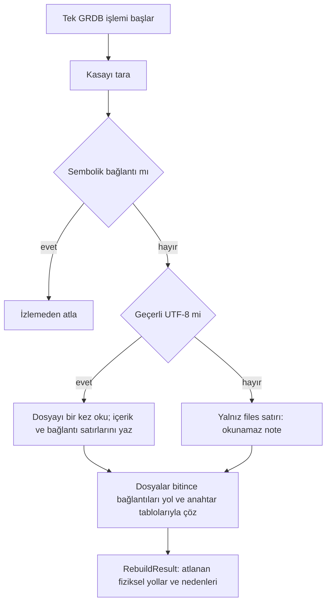

Tam yeniden üretim tek GRDB işlemi içinde tarar ve doldurur; hata eski içeriği korur. İndeksleyici okuma, tarama ve veritabanı hatalarını fırlatır. Aynı NFC yola dönüşen iki dosyadan fiziksel yolu bayt sırasında önce gelen girer. İndeksleyici belgeyi bellekte tutmaz.

**Tablo blok ayrıştırma kurallarını gösterir.**

| Konu | Kural |
|---|---|
| Paragraf | Olay ve görev aralıkları ve başlıklar dışındaki ardışık boş olmayan gövde satırları. Kod çitleri metin olarak dahildir |
| Başlık | Başlık paragrafı böler. Tanınan bölüm başlıkları blok üretmez. Diğer başlıklar `heading` bloğu olarak işaretsiz metin ve düzey taşır |
| Tanınmayan içerik | Tanınmayan bölüm ve ön içerik `other` taşır |
| İç içe görev | İndeks bağlantıyı en içteki bloğa bağlar |

### Artımlı güncelleme

**Şema `refresh` ve `update` yollarını gösterir.**

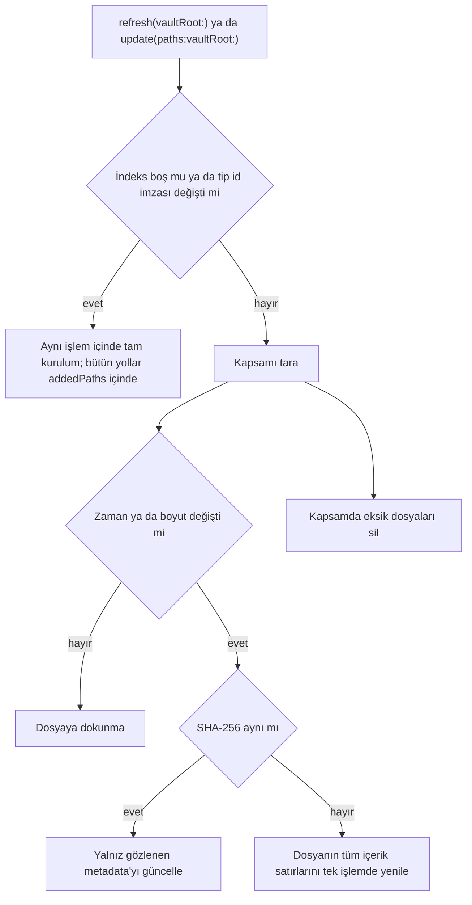

**Tablo tarama kapsamını gösterir.**

| Çağrı ya da bildirilen yol | Taranan kapsam |
|---|---|
| `refresh(vaultRoot:)` | Bütün kasa |
| `update(paths:vaultRoot:)`, dizin | Alt ağaç |
| `update(paths:vaultRoot:)`, dosya ya da silinmiş yol | Üst dizinin tek düzeyi |
| `update(paths:vaultRoot:)`, kök `""` | Bütün kasa |
| Harfe duyarsız ya da NFC eşleşen indeksli yol | Diskteki üst dizini ve aynı karşılaştırma anahtarındaki kardeş üst dizinleri, tek düzey |

`refresh(vaultRoot:)` boş indekste tam kurulum yolunu kullanır. `refresh` ve `update` tip id imzası değişince aynı yolu kullanır; sonuç `rebuild` ile aynıdır. `update(paths:vaultRoot:)` bildirilen NFC kasa içi dosyalarla ve dizinlerle hem taramayı hem içeriği sınırlar. Silinen yollar gerçekten dolaşılan kapsamın alt kümesidir. Ayrıştırma ve indeks yazımı artımlıdır. Güncelleme kapsam dışı `files` satırlarına dokunmaz; `skippedPaths` yalnız tarama kapsamında görülenleri bildirir.

Birleşmiş gün dosyası belirlenimci zaman taşır; aynı boyutlu farklı içerik artımlı taramada atlanabilir. B5 bağlaması (yol haritasında açık) birleştirme sonrası dosyayı zorla yeniden okuyacaktır. Core sonucu `dayFileChanged` alanıyla gün dosyasının yazıldığını ya da taşındığını bildirir.

Güncelleme değişen yolların dosya adı ve yol anahtarlarına sahip bağlantıları yeniden çözer. Çözülmüş yinelenen adlar ve yeni içerikteki bağlantılar da bu kümeye girer; `name` ve `aliases` varlık araması içindir. Güncelleme eski ve yeni blok kimliklerinin sahipliğini yol ve dosya içi sıra üzerinden yeniden hesaplar. Hata tüm değişiklikleri geri alır. Ortak `RebuildResult` eklenen, güncellenen ve silinen NFC yolları ve kapsamda atlanan fiziksel yolları bildirir.

### Dosya başına okuma ve bildirim kapsamı

`blocks(inFile:)` ve `links(inFile:)` bir dosyanın blok ve bağlantı satırlarını kaynak sırasıyla döner. `contents(ofFile:)` aynı dosya için `files` / `entities` / `aliases` / `blocks` / `links` / `goal_logs` / `entity_fields` dilimini tek okuma işleminde verir. Dosya yoksa sonuç `nil` olur. Şema değişmez.

`update` bildirim kapsamını kasa köküne göre NFC ve yerelden bağımsız küçük harf anahtarıyla karşılaştırır. Yol bildiren bir izleyici yeniden adlandırmada eski ve yeni yolu bildirir. Eksik bildirimleri sonraki `refresh` düzeltir. İndeks kökü bir kez gerçek yola çözer. Silinmiş bildirimlerde indeks en yakın mevcut üst dizinin gerçek yoluna kayıp kuyruğu ekler. Böylece `/private` yol yazımları aynı kasa kimliğinde birleşir.

## Eşitleme

**Durum: tasarım, henüz uygulanmadı.** Eşitleme kimlik kararını bekliyor.

**Tablo eşitlemenin bugünkü durumunu gösterir.**

| Parça | Durum |
|---|---|
| Kasa konumu | Uygulamanın yerel `Documents/Vault` klasörü ya da kullanıcının seçtiği klasör |
| `VaultStore` yazmaları ve belge okumaları | `NSFileCoordinator` ile koordineli: `SystemFileCoordination` |
| İndeks taraması | Koordinasyonsuz |
| İçe aktarmanın klasör, şablon ve ayar dosyası oluşturması | Koordinasyonsuz |
| Dosya sunucusu `NSFilePresenter` | Yok |
| İndirilmemiş dosya için açık indirme isteği `startDownloadingUbiquitousItem` | Yok |
| Çakışma birleştirme işlevi | `VaultFormat` içinde hazır ve sınanmış; uygulamaya bağlı değil |
| Yer tutucu tanıma | `Core` içinde hazır; App bağlantısı sonraki dilim |
| Gün kopyası birleştirme | `Core` içinde hazır; App bağlantısı sonraki dilim |
| Eşitlenen klasör tespiti | `SyncedFolderKind`: yol kalıpları ve `isUbiquitousItemKey`. Sağlayıcılar: iCloud Drive, Dropbox, OneDrive, Google Drive, File Provider |
| Çakışan sürüm `NSFileVersion` | Var: tespit ve listeleme; çözümleme yok. Yalnız iCloud Drive kasasında. `ConflictVersionSource` |
| Çakışma kopyası listesi | `VaultIndex.conflictCopies(vaultRoot:)`; her kasada. Ad kuralı `ConflictCopyName` |

**UYARI:** Eşitlenen bir klasörü kasa olarak seçme; uygulama bu klasörü şimdilik tam korumaz.

### Eşitleme güvenliği

**Şema tarama sonucunun eşitleme dosyalarını nasıl ayırdığını gösterir.**

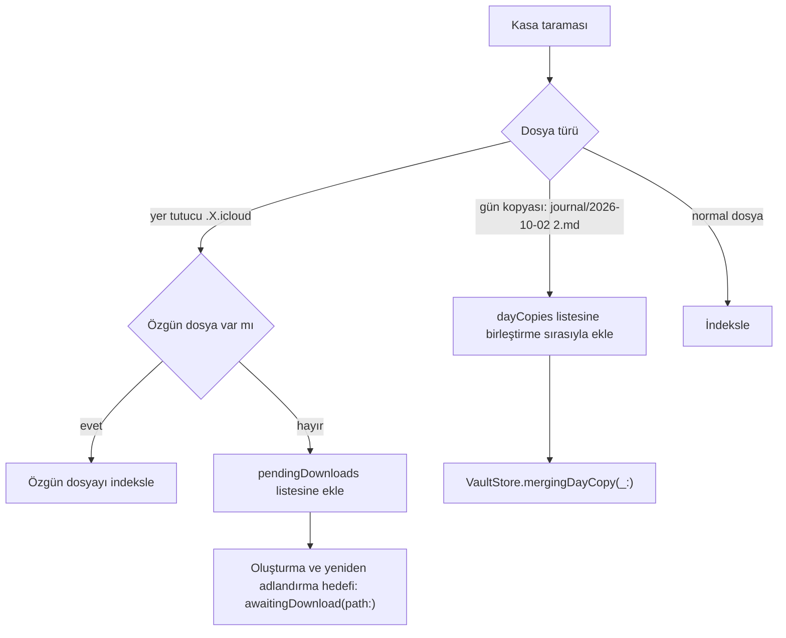

`Core` `.X.icloud` yer tutucularını indekslemez; tarama sonucunun `pendingDownloads` alanında bildirir. Özgün dosya varsa `Core` özgün dosyayı kullanır. Özgün dosya yoksa `Core` oluşturma ve yeniden adlandırma hedeflerini koordinasyon sınırında `awaitingDownload(path:)` ile reddeder. İndirme isteği App katmanının sonraki dilimidir. İndirilmemiş dosyaları okuma kuyruğu karşılar: indirme bekleyen okuma yalnız kendini bekletir.

`Core` gün kopyalarını indekslemez. Örnek ad: `journal/2026-10-02 2.md`; ad kuralı `DayCopyName`. Tarama sonucu kopyaları `dayCopies` alanında birleştirme sırasıyla bildirir. Tanılama gün kopyalarını ve varlık kopyalarını `VaultIndex.dayCopies(vaultRoot:)` ve `entityCopies()` ile listeler; kopya kuralı `EntityCopyName`. Uygulama bu listeden hiçbir dosyayı birleştirmez, taşımaz ya da silmez.

**Şema bir gün kopyasının tek koordinasyon sınırında birleşmesini gösterir.**

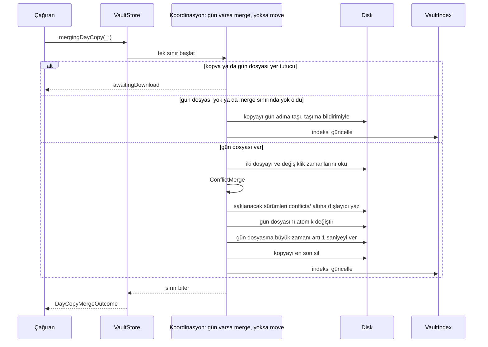

`VaultStore.mergingDayCopy(_:)` gün dosyası varsa kopyayı tek `.merge(kopya → gün)` sınırında birleştirir. Gün dosyası yoksa kopyayı tek `.move(kopya → gün)` sınırında gün adına taşır. `VaultStore` taşıma sınırını seçtikten sonra gün dosyası oluşursa `VaultStore` taşıma sınırını değişiklik yapmadan bitirir. Sonra kopyayı yeni bir `.merge` sınırında birleştirir. Gün dosyası `.merge` sınırı içinde yok olursa kopyayı aynı sınırda gün adına taşır.

Gün dosyası değişmeden önceki her hata, o çağrının yazdığı çakışma kopyalarını geri alır. Yalnız zaman verme ya da silme başarısızsa gün dosyası birleşmiş kalır. Sonraki çağrı aynı içeriğe varır ve kopyayı siler. App bağlantısı sonraki dilimdir: taramadan sonra kopyaları sırayla birleştirme ve sonucu kullanıcıya gösterme.

### Çakışan sürümler

**Şema çakışan sürümlerin Tanılama'ya hangi yoldan geldiğini gösterir.**

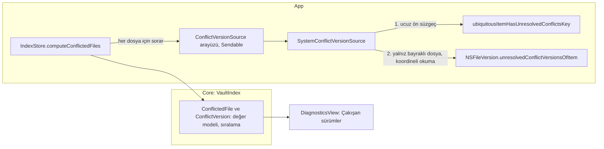

`Core` Apple çerçevesi kullanmaz; bu yüzden `NSFileVersion` yalnız `App/Services` altındaki `SystemConflictVersionSource` içindedir. `IndexStore` kaynağı `conflictVersions` başlatma parametresiyle alır; varsayılan sistem kaynağıdır, testler sahte kaynak verir. `computeConflictedFiles` yalnız `syncedFolder == .iCloudDrive` iken çalışır; öteki kasada hiçbir dosyaya sormadan boş döner. Aday yollar indeksteki dosyalar ve `VaultIndex.dayCopies(vaultRoot:)` listesidir. Sorgu `taskQuery` deseniyle ayrık görevde koşar ve kasa kuşağına bağlıdır. Sistem kaynağı sürümleri `SystemFileCoordination` okuma koordinasyonu içinde okur. Uygulama hiçbir sürümü birleştirmez, seçmez ya da silmez: `NSFileVersion.removeOtherVersionsOfItem`, `replaceItem` ve `isResolved` kullanılmaz.

Tanılama listeyi `store.lastUpdated` değişince ve sahne ön plana her dönünce yeniden okur. Bir iCloud çakışması kasa klasöründe izleyicinin göreceği bir olay üretmeyebilir.

### Hedeflenen davranış

**Tablo eşitlemenin hedeflenen davranışını gösterir.**

| Konu | Hedef |
|---|---|
| Kasa konumu | Kasa uygulamanın iCloud kapsayıcısındadır ve Dosyalar ile Finder'da görünür |
| Sunucu | Sunucu, hesap ya da özel eşitleme servisi yoktur |
| iCloud kapalı | Kasa yerelde durur |
| İlk açılış | Uygulama kasa konumunu ilk açılışta belirler ve cihazda kaydeder: iCloud açıksa kapsayıcı, değilse yerel |
| iCloud durumu değişti | Uygulama kendiliğinden diğer konuma geçmez. Kayıtlı konuma erişim yoksa yeni kasa açmaz, durumu bildirir |
| Konumlar arası taşıma | Kullanıcının başlattığı ayrı bir işlem |
| Çakışma | Birleştirme satırları blok kimliğine göre birleştirir. Birleşmeyen içerik kopya olarak kalır. iCloud'un aynı gün için ayırdığı kopya dosyalar da aynı işlevle birleşir. Kurallar: `vault-format.md` |
| İndirme | Kasadaki tüm dosyalar cihazda durur. Uygulama indirilmemiş dosya için indirme ister ve dosya geldikçe indeksler |
| Arayüz | Arayüz eldeki içeriği gösterir ve eşitlemenin sürdüğünü belirtir |

## Widget'lar

**Durum: tasarım, henüz uygulanmadı.** Widget'lar App Group kimliği kararını bekliyor.

| Konu | Hedef |
|---|---|
| Paket | Widget hedefi `Core` paketini kullanır |
| Veri paylaşımı | Uygulama ve widget ortak bir App Group üzerinden veri paylaşır |
| İşaretleme | Widget'tan yapılan işaretleme App Intent ile `Core` yazıcısını çağırır. Mantık tek yerdedir |
| Kasa erişimi | Widget'ların iCloud'daki kasaya doğrudan mı, App Group'taki bir okuma modeli kopyası üzerinden mi erişeceği açıktır. Kimlik kararından sonra deneme karar verir |

## Platform düzeni

**Tablo iki platformun düzenini gösterir.**

| Platform | Düzen |
|---|---|
| iPhone | Alt sekmeler. Öncelik hızlı giriş ve hızlı bakış |
| Mac | Kenar çubuğu ve çok sütunlu düzen. Kanban, zaman çizelgesi ve not düzenleme burada |
| iPad | Boyut sınıfına göre: düzenli × düzenli sahnede Mac'in bölünmüş kabuğu (1000 pt ve üstünde üç sütun, altında iki), sıkışık sahnede (Split View, Slide Over) iPhone sekmeleri. Kanban ve zaman çizelgesi bölünmüş kabukta Mac biçimindedir; dokunarak sürükle bırak |
| iPhone Duo iç ekranı | iPad ile aynı bölünmüş kabuk, iki sütun kademesinde; dış ekran iPhone sekmeleri |
| Mac hızlı giriş | MenuBarExtra ve Carbon `RegisterEventHotKey` nonactivating bir `NSPanel` açar. Panel ortak `QuickEntryBar`, `QuickEntryModel` ve `IndexStore` kullanır. Kısayol UserDefaults'ta durur. Uygulama Dock'ta kalır |
| Ortak | Ekranlar ortak SwiftUI görünümleridir; düzen platforma göre değişir |

Ekranların ayrıntısı için bkz. [Ekranlar](screens.md).

## Taşınabilirlik

Android ve Windows şu an kapsam dışı. İleride mümkün kalması için:

1. Format `vault-format.md` belgesinde eksiksiz tanımlıdır.
2. `Core`, Apple çerçevelerine bağımlı değildir.
3. `Fixtures/` altındaki örnek dosyalar ve beklenen çıktılar dilden bağımsızdır.

Proje çekirdeği şimdiden ortak bir teknolojiyle yazmaz. Örnek teknolojiler: Rust, Kotlin Multiplatform.

## Test

**Tablo test katmanlarını ve beklentilerini gösterir.**

| Katman | Beklenti |
|---|---|
| Ayrıştırıcı ve yazıcı | Örnek dosya tabanlı testler |
| Gidiş dönüş | Oku ve değiştirmeden yaz; çıktı birebir aynı kalsın |
| İndeks | Örnek kasadan üretilen indeks beklenen sorgu sonuçlarını versin |
| Birleştirme | Sonuç sürümlerin sırasından bağımsız kalsın, tekrarda değişmesin, hiçbir satırı kaybetmesin |
| Dayanıklılık | Bozuk frontmatter, tanınmayan sözdizimi ve boş dosya hata üretmesin |
| Biçim | `swift format lint --strict --recursive Packages App Tests` |
| Belge biçimi | `sh .github/scripts/check-docs.sh`: karar tablosu, README belge tablosu, String Catalog |
| Uygulama testleri | `JournalTests`, `Journal_macOS` ve `Journal_iOS` şemalarında koşar |
| Ekran görüntüsü testleri | `Tests/JournalTests/Snapshots` altındaki `*SnapshotTests` kümeleri; iOS birim katmanı |
| XCUITest dumanı ve erişilebilirlik | `JournalUITests`, `bundle.ui-testing`; `Journal_iOS` şemasında |
| Mac ekran turu | `JournalMacUITests`; Debug yapılandırmasında, kendi `….screentour` kimliğiyle |

iOS uygulama testleri için komut:

```sh
xcodebuild test -scheme Journal_iOS -destination 'platform=iOS Simulator,name=<simctl available iPhone>' -only-testing:JournalTests_iOS
```

### Test kimliği

Birim ve arayüz testleri uygulamayı `DebugTest` yapılandırmasıyla koşar. Bu yapılandırmanın paket kimliği `$(APP_BUNDLE_IDENTIFIER).testhost`, görünen adı "Kenet Test"tir. Mac ekran turu Debug'da kalır ve kendi `….screentour` kimliğini kullanır. Debug ve Release gerçek kimliği taşır: `com.dogancanyildiz.kenet`, "Kenet". Ayrı kimlik, test konağının pencere çerçevesini ve tercihlerini kullanıcının alanına yazmasını önler. Ayrı kimlik ayrıca çökme penceresinin gerçek uygulamayla karışmasını önler.

### Ekran görüntüsü ve duman testleri

Ekran görüntüsü testleri SwiftUI görünümünü sabit ortamda çizer ve `SnapshotTesting` ile karşılaştırır. Açık görüntü her kümede; koyu, AX3 ve Kontrastı Artır yalnız temsilci kümelerde kalır: `TodayScreenSnapshotTests`, `TodayContextSnapshotTests`, `TasksSnapshotTests`, `EntitiesSnapshotTests`, `JournalSheetSnapshotTests`, `ShellSheetSnapshotTests`, `QuickEntryChipsSnapshotTests`, `QuickEntryNameChipSnapshotTests`, `MentionCreatedSnapshotTests`, `ComponentSnapshotTests`. Varyanta özgü yerleşim kurallarını korumak için küme başına en çok bir istisna tutulur: `PadShellSnapshotTests.todayLandscapeAX3` (geniş kenar çubuğu), `GoalsSummarySnapshotTests.goalDetailAX3` ve `GoalChartSnapshotTests.dailyAX3` (hedef grafiği aralığı ve eksen etiketleri), `SummariesSnapshotTests.weekAX3` (grafik yerine sayı listesi), `WeeklyReviewSnapshotTests.numbersAX3` (kısa ritim şeridinin satırlara dönüşmesi). Referans PNG'ler `Tests/JournalTests/Snapshots/__Snapshots__/` altındadır. Yenileme için `sh .github/scripts/record-screen-snapshots.sh` ya da CI `record-snapshots` işini kullan. Mac görüntü kümeleri görünümü `NSHostingView` ile çizer. Adı `MacSnapshotTests` ile biten kümeler yalnız macOS hedefinde yer alır ve yalnız yerelde koşar; CI bu kümeleri atlar. CI kapısı iOS'tur.

**Tablo, iOS görüntü testlerinin tuvallerini gösterir: `SnapshotSupport.swift` içindeki `ShellCanvas`.**

| Tuval | Boyut, pt | Boyut sınıfı | Güvenli alan, pt | Kullanım |
|---|---|---|---|---|
| `.phone` | 390×844 | sıkışık × düzenli | Üst 47, alt 34 | Bütün iOS kümeleri. Varsayılan. |
| `.duoOuter` | 466×678 | sıkışık × düzenli | Üst 47, alt 34 | iPhone Duo dış ekranı, dikey |
| `.duoInner` | 890×626 | düzenli × düzenli | Üst 24, alt 20; sol ve sağ parametre, varsayılan 0 | iPhone Duo iç ekranı, açık |
| `.pad13Landscape` | 1376×1032 | düzenli × düzenli | Üst 24, alt 20 | iPad Pro 13 inç, yatay |
| `.pad13Portrait` | 1032×1376 | düzenli × düzenli | Üst 24, alt 20 | iPad Pro 13 inç, dikey |
| `.pad11Portrait` | 834×1210 | düzenli × düzenli | Üst 24, alt 20 | iPad Pro 11 inç, dikey |
| `.padCompact` | 440×1032 | sıkışık × düzenli | Üst 24, alt 20 | 13 inçte Split View dar yuvası, yatay |

Adı `DuoSnapshotTests` ile biten kümeler Duo tuvallerini çizer. Bu kümeler henüz CI kapısı değildir. Test konağı `SNAPSHOT_DUO=1` görmezse bu kümeler koşmaz. Kayıt için `sh .github/scripts/record-screen-snapshots.sh --duo` komutunu kullan. Betik değişkeni `TEST_RUNNER_SNAPSHOT_DUO=1` olarak geçirir.

**NOT:** Duo ölçüleri ve güvenli alanları tahmindir: piksel ölçüsü 3× ölçekle bölünür. Tuval iPhone simülatöründe çizer ve boyut sınıfını trait geçersiz kılmayla verir. Tuval Duo simülatörünün yerine geçmez.

Adı `Pad` ile başlayan kümeler iPad tuvallerini çizer: `PadShellSnapshotTests`, `PadBoardSnapshotTests`, `PadSheetSnapshotTests`, `PadCompactSnapshotTests`. Bu kümeler yalnız iPad simülatöründe koşar. iPhone'da kendini atlar; bu yüzden iOS birim işi onları ayrıca dışlamaz. Kümeler içeriği tuval boyutunda bir pencerede barındırır ve pencerenin kendisini çizer. Boyut sınıfı ve Dynamic Type pencerenin trait geçersiz kılmasından gelir; açılan sheet de bunları alır. Kabuk vakaları gerçek `AdaptiveNavigation`'ı çizer. Kayıt ve doğrulama için `sh .github/scripts/record-screen-snapshots.sh --pad` komutunu kullan. Betik iPad Pro 13 inç (M5) simülatörünü seçer; yoksa sırayla M4, iPad Air 13 inç (M4), (M3), iPad Pro 13 inç. Referanslar `__Snapshots__/Pad…` klasörlerindedir.

**NOT:** Kabuğun kendi görev modeli ve hedef sayfası duvar saatinin gününü alır; donmuş günü almaz. Bu yüzden Kanban, zaman çizelgesi ve hedef ayrıntısı kabuksuz sayfa olarak, donmuş günle çizilir. Kabuktaki Hedefler vakası hedef seçmez.

**NOT:** iPad referansları dik duran simülatörde çizilir. Bölünmüş görünüm sütunlarını pencereden değil sahnenin yönünden de seçer; birim testi aygıtı döndüremez. Döndürülmüş simülatörde kümeler piksel karşılaştırmak yerine açık bir hatayla düşer. Kayıt betiği iPad simülatörünü yeniden başlatır; yeniden başlayan simülatör dik açılır. iOS 26'nın cam denetimleri, yani kenar çubuğu düğmesi ve sekme çubuğu, her koşuda biraz farklı çizilir; yakalama onların karesini gri boyar. Ara sheet'i barındırılır ama çizilmez: alanı odak alır ve klavye sheet'i kaydırır.

Tam uygulama akışı için XCUITest dumanı kalır. CI dumanı `-only-testing:JournalUITests` ile koşturur. DEBUG derlemede `JOURNAL_UITEST_VAULT` verilen klasörü kasa olarak açar; otomatik gerçek kasa, bildirim ya da kilit başlamaz.

Ekran turu (`ScreenTourUITests`, `sh .github/scripts/screen-tour.sh`) aynı testle iPhone'da ve `--pad` ile iPad simülatöründe koşar. iPad'de bölünmüş kabukta sekme yoktur: `UITestSupport` her sekme kimliğini kenar çubuğu satırına eşler (`tab.entities` → `sidebar.people`), Kanban, zaman çizelgesi, proje, Konumlar, Özetler, Graph ve harita kendi satırından açılır. iPad turu yatay koşar; `SCREEN_TOUR_ORIENTATION=portrait` dik koşturur. Erişilebilirlik denetimi (`AccessibilityAuditUITests`) aynı eşlemeyle iPad'de de koşar; bölünmüş kabukta aygıtı yatay döndürür ve bitince dik bırakır.

### CI

**Tablo CI (sürekli bütünleştirme) işlerini, adımlarını ve tetiklerini gösterir.**

| İş | Runner | Adımlar | Ne zaman | İş sınırı |
|---|---|---|---|---|
| Değişen dosyalar | Linux | Belge PR'ı mı: `.github/scripts/ci-changes.py` | Her zaman | 5 dk |
| Biçim ve kurallar | Linux kabı, Swift 6.4 | `swift format lint`, dört denetim betiği, CI betiklerinin testleri | Her zaman; belge PR'ında da | 15 dk |
| Core (Linux) | Linux kabı, Swift 6.4 | `swift test` | Belge dışı her koşu | 20 dk |
| Uygulama (macOS ve Core) | macOS | Core `swift test`, ölçek bütçesi, Mac testleri `TZ=UTC`, Mac testleri `TZ=Pacific/Auckland` | Belge dışı her koşu; ölçek bütçesi ve Auckland yalnız `dev`'e birleşince | 35 dk |
| Uygulama (iPhone) | macOS | Derle, iPhone simülatörünü aç, birim testleri, iPhone görüntü kümeleri, arayüz dumanı | Belge dışı her koşu | 45 dk |
| Uygulama (iPad) | macOS | Derle, iPad simülatörünü aç, iPad görüntü kümeleri (`--pad`), iPad erişilebilirlik denetimi (`AccessibilityAuditUITests`, yatay) | Belge dışı her koşu | 35 dk |
| ci | Linux | Bütün işlerin sonucu: `.github/scripts/ci-gate.py` | PR'da her zaman; `dev`'e itmede koşu iptal edilmediyse | 5 dk |
| `testflight-check` (ayrı iş akışı) | macOS | İmzasız arşiv ve paket denetimi: `sh .github/scripts/testflight.sh --check`. Yükleme yapmaz. Arşiv düşerse günlüğü yükler | `dev`'e her itmede | 30 dk |

İş sınırı beklenen sürenin yaklaşık 1,5 katıdır. Bir PR dört macOS işi değil üç macOS işi tutar; `dev` itmesi TestFlight denetimiyle dört tutar. GitHub aynı anda en çok beş macOS işi koşturur; iş sayısı kuyruğu belirler.

- **Xcode:** macOS işleri, `ios-build` ve `testflight-check` Xcode'u `.github/actions/xcode` eylemiyle seçer. Sürüm yalnız orada yazılıdır: Xcode 26.6. Eylem sürümü günlüğe yazar; sürüm imajdan kalkarsa iş açık bir hatayla düşer.
- **Cihaz ailesi:** Her iOS işi tek simülatör kullanır. Her iş kendi derlemesini yapar, simülatörü derlemeden sonra açar ve testleri derlemesiz koşar. Ortak başlangıç `.github/actions/ios-build` içindedir; `family` girdisi `iphone` ya da `ipad` alır. Derleme sırasında açılan simülatör 3 çekirdekli runner'da derlemeyi 4 dk'dan 10–19 dk'ya uzatıyordu. Bir runner'daki iki simülatör "Unable to find a device" ve asılma hatalarını üretiyordu.
- **Sıra:** Arayüz dumanı yeni açılmış simülatörde 2 kattan fazla yavaş koşar; bu yüzden iPhone işinde birim testlerinden sonra koşar. iPhone görüntü adımı önce uygulamayı simülatörden kaldırır: birim testlerinin bıraktığı durum görüntüleri kaydırır. iPad işinde görüntüler erişilebilirlik denetiminden önce koşar: denetim aygıtı döndürür. Bir test adımı düşse de aynı simülatördeki sonraki test adımları koşar; Core düşse de Mac testleri koşar.
- **Yeniden deneme:** iOS test adımları iki simülatör altyapı hatasında bir kez yeniden dener: “Unable to find a device matching the provided destination specifier” ve “hung before establishing connection”. Betik aygıtın hazır olmasını bekler ve testi bir kez daha koşar: `.github/scripts/xcodebuild-retry.sh`. Bu hatalar test beklentilerinden kaynaklanmaz. Öteki her hata adımı düşürür.
- **Zaman aşımı:** Her test adımının kendi zaman aşımı vardır: birim 20 dk, görüntü ve arayüz adımları 20 dk, iPad erişilebilirlik 15 dk, simülatör açılışı 10 dk. Birim ve arayüz adımlarında test başına sınır 300 sn'dir (`-test-timeouts-enabled YES`). Sessiz asılma adımı öldürmek yerine test adıyla düşer.
- **Önbellek:** CI SwiftPM paket indirmelerini önbelleğe alır. iOS ve macOS işleri tek anahtarı paylaşır; anahtar `Packages/Core/Package.resolved` ve `project.yml` dosyalarından türer. Uygulama paketlerinin kilit dosyası repoya girmez: proje üretilir. Bu yüzden `project.yml` SnapshotTesting'i tam sürümle sabitler.
- **Sonuç paketleri:** Test adımı düşünce CI sonuç paketini yükler: `mac-test-results`, `ios-test-results`, `screen-snapshot-diffs`, `ui-test-results`, `pad-snapshot-diffs`, `pad-a11y-results`. İptal edilen koşu paket yüklemez.

Yalnız belge değiştiren PR'da CI Core ve uygulama işlerini atlar. Belge yolları: `docs/**`, kökteki `*.md`, `LICENSE`. Kararı `.github/scripts/ci-changes.py` verir; bilinmeyen her yol koddur. `dev`'e itmede atlama yoktur. Zorunlu `ci` denetimi atlanan işi yalnız bu durumda başarı sayar. Düşen ya da iptal olan işi hiçbir zaman başarı saymaz: `.github/scripts/ci-gate.py`.

**İptal kuralı:** Art arda birleştirmede `concurrency` önceki `dev` koşusunu iptal eder. `ci` işi iptal edilen `dev` koşusunda koşmaz; commit kırmızı yerine gri görünür. Ruleset `dev` itmesini denetlemez; son koşu ağacın tamamını sınar. PR'da `ci` her zaman koşar: iptal edilen PR koşusu kırmızı kalır ve birleşme kapısı kapanır.

### iOS test asılması

**Tablo iOS birim testleri asılınca toplanan teşhis verisini gösterir.**

| Veri | Yer |
|---|---|
| Başlayıp bitmeyen test | `ios-test-diagnostics/xcodebuild.log`, günlüğün sonu |
| Süreç yığın örnekleri | CI örnekleri 12. dakikada alır: `.github/scripts/ios-test-diagnostics.sh` |
| Sonuç paketi | `IOSTests.xcresult` |

CI'da iOS birim testleri adımı ara sıra asılı kalır. Kök neden henüz belli değil. Adımın kendi zaman aşımı 20 dk'dır. Adım düşünce ya da süre dolunca CI `ios-test-results` paketini yükler. Simülatör derlemeden sonra açılır ve ayrı adım hazır olmasını bekler. Adım süreleri asılmanın açılışta mı testte mi olduğunu gösterir.

## İlgili belgeler

- [Kasa biçimi](vault-format.md)
- [Ekranlar](screens.md)
- [Örnek dosyalar](fixtures.md)
- [Kararlar](decisions.md)
