# Mimari

**Amaç:** Bu belge uygulamanın katmanlarını, veri yollarını ve teknik kurallarını tanımlar.

**Kapsam:**

- Katmanlar, modüller ve proje ayarları.
- Yazma, okuma, dosya koordinasyonu ve indeks.
- Eşitleme, widget, platform düzeni, taşınabilirlik ve test.

## Teknoloji yığını

**Tablo her katman için seçilen teknolojiyi gösterir.**

| Katman | Seçim |
|---|---|
| Arayüz | SwiftUI, tek projeden iOS ve macOS |
| Çekirdek | `Core` Swift paketi; Apple arayüz ve sistem çerçevelerine bağımsız |
| Veri | Markdown dosyaları; gerçek kaynak |
| İndeks | SQLite, GRDB, FTS5 |
| Eşitleme | iCloud Drive, uygulamanın kendi kapsayıcısı (`Documents/Kenet`); kasa konumu bölümü. Eşitlenen kasada güvenli yazmanın kalanı açık: indirme isteği, gün kopyası birleştirmesinin bağlanması, eşitleme göstergesi |
| Widget | WidgetKit. Ana ekran zincir widget'ı, yalnız iOS: `JournalWidgets` hedefi. Veriyi App Group'taki anlık görüntüden okur. iCloud kasasında açık evet/hayır hedefini kendi sürecinde işaretler |
| Paylaşım uzantısı | Share extension, yalnız iOS: `JournalShare` hedefi. Paylaşılan metni ya da sayfa bağlantısını olay olarak ekler |
| Sistem girişleri | App Intents: Kısayollar ve Siri |
| Takvim | EventKit, salt okunur |
| Konum | CoreLocation; harita için MapKit |
| Bildirim ve kilit | UserNotifications, LocalAuthentication |
| Rehber | ContactsUI kişi seçicisi, yalnız iOS. Uygulama rehber izni istemez |
| Günlük önerileri | JournalingSuggestions seçicisi, yalnız iPhone. Çerçeve cihaz SDK'sındadır; simülatör ve Mac derlemesinde kod `canImport` ile dışarıda kalır. iPad'de çerçeve vardır; seçici ürün kararıyla yalnız iPhone'da açılır ve kapıyı çalışma anındaki cihaz türü tutar. Seçici ayrı süreçte açılır; uygulama yalnız kullanıcının seçtiği öneriyi alır (`JournalingSuggestionsService`) |
| Yerelleştirme | String Catalog: tr, en |

## Modül düzeni

**Şema depo klasörlerini ve aralarındaki bağımlılığı gösterir.**

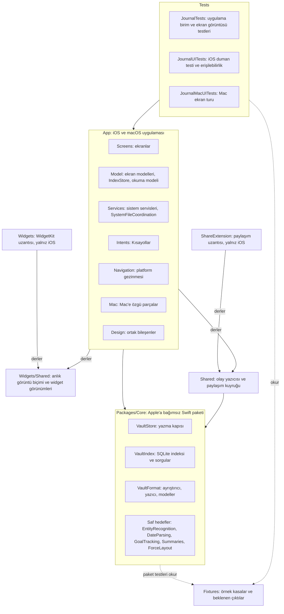

**Tablo uygulama klasörlerinin içeriğini gösterir.**

| Klasör | İçerik |
|---|---|
| `App/Screens` | Konuya göre ekranlar: `Today`, `Days`, `Summaries`, `Tasks`, `Entities`, `Goals`, `Graph`, `Map`, `Onboarding`, `Settings` |
| `App/Screens/Shared` | Ortak görünüm parçaları |
| `App/Navigation` | Platform gezinmesi |
| `App/Model` | Ekran modelleri |
| `App/Services` | Sistem servisleri |
| `App/Intents` | Kısayollar |
| `App/Mac` | Mac'e özgü parçalar |
| `App/Design` | Ortak bileşenler ve tasarım belirteçleri |
| `App/Resources` | String Catalog, lisans metinleri, gizlilik bildirimi |
| `App/Support` | Yetki dosyaları ve plist ekleri |
| `Widgets` | Widget hedefi: `WidgetBundle`, zaman çizelgesi, widget içi işaretleme niyeti (`MarkGoalInWidgetIntent`) ve yetki dosyası. String Catalog uygulamanınkidir: `App/Resources/Localizable.xcstrings` |
| `Widgets/Shared` | Uygulamayla ortak: anlık görüntü biçimi, widget bağlantısı, widget içi işaretleme (`WidgetGoalMarker`), görünümler, renk belirteçleri |
| `ShareExtension` | Paylaşım uzantısı hedefi: giriş noktası (`ShareViewController`), form modeli, Info.plist ve yetki dosyası |
| `ShareExtension/Form` | Paylaşım formu (`ShareFormView`); uygulama da derler, ekran görüntüsü testleri çizer |
| `Shared` | Uygulama ve paylaşım uzantısıyla ortak: olay yazıcısı ve App Group listeleri (`EntryWriting.swift`). Yalnız Foundation ve `Core` |

## Proje ayarları

**Tablo proje ve paket ayarlarının kurallarını gösterir.**

| Konu | Kural |
|---|---|
| Proje üretimi | `project.yml` projeyi tanımlar. XcodeGen `Journal.xcodeproj` dosyasını üretir. Git `Journal.xcodeproj` dosyasını izlemez |
| Hedef ve şema | Tek `Journal` hedefi iOS ve macOS için iki şema üretir. Hedef kaynakları `App/`, `Widgets/Shared`, `Shared` ve `ShareExtension/Form` klasörlerinden alır. Proje `Core` paketini yerel yoldan bağlar. iOS uygulaması `JournalWidgets` ve `JournalShare` uzantılarını gömer; Mac uygulaması gömmez |
| Bundle kimliği | `com.dogancanyildiz.kenet`; kalıcı, iOS ve Mac için ortak. Değer `project.yml` içinde tek yerde durur: `APP_BUNDLE_IDENTIFIER`. Test hedefleri ve uzantılar sonek ekler: `.tests`, `.uitests`, `.widgets`, `.share`; test konağının uzantıları `.testhost.widgets` ve `.testhost.share`. Betikler aynı satırı okur |
| Görünen ad | Kullanıcı Kenet adını görür: `CFBundleDisplayName`, `CFBundleName`. Hedef ve modül kod adı `Journal` ile kalır. iOS paketi `Journal.app`'tir (iOS görünen adı gösterir); Mac paketi `Kenet.app`'tir (`PRODUCT_NAME: Kenet`, `PRODUCT_MODULE_NAME: Journal`): Finder, Dock ve TestFlight Mac'te dosya adını gösterir |
| Cihaz | iOS hedefi iPhone, iPhone Duo ve iPad içindir: `TARGETED_DEVICE_FAMILY: "1,2"`. iPhone dikey kilitlidir; iPad dört yöne döner (`UISupportedInterfaceOrientations~ipad`); `testflight.sh` arşivde ikisini de denetler. iPad uygulaması Apple Silicon Mac'te listelenmez (`SUPPORTS_MAC_DESIGNED_FOR_IPHONE_IPAD: NO`): yerel Mac hedefi ayrıdır. Duo dış ekranı yalnız dikeydir; iç ekran yön kilidini yok sayar. İç ekran bölünmüş kabuğu açar: `AdaptiveNavigation` iki boyut sınıfı da düzenliyse `MacNavigation`, öteki durumda `PhoneNavigation` seçer. Kabuk durumu `AdaptiveNavigation` üstünde tek `ShellNavigationState` nesnesidir; seçim, sheet'ler ve taslaklar kabuk değişiminde korunur. Kapı cihaz türüne ve ekran boyuna bakmaz. Mac hedefi ayrıdır |
| iCloud ve App Group | iCloud kapsayıcısı `iCloud.com.dogancanyildiz.kenet`, App Group `group.com.dogancanyildiz.kenet`; kalıcı, iOS ve Mac için ortak (kullanıcı kararı, 2026-10-21). `project.yml` değerleri `KENET_ICLOUD_CONTAINER` ve `KENET_APP_GROUP` ayarlarında tek yerde tutar; yetki dosyaları bu ayarları `$(…)` ile okur. İstisna: `NSUbiquitousContainers` sözlük anahtarı aynı kapsayıcı kimliğini düz metinle tekrarlar; Xcode sözlük anahtarlarında yapı ayarını genişletmez. Derlenmiş plist, yapı ayarları ve Swift tanımı arasındaki eşitliği `ReleaseConfigurationTests` korur. Swift karşılığı `App/Support/AppIdentifiers.swift`. `ReleaseConfigurationTests` iki tanımı eşit tutar. Kimlikler bundle kimliğinden türetilmez: betikler bundle kimliğini geçersiz kılsa da kapsayıcı aynı kalır. Kasa konumu iCloud kimliğini kullanır; iOS widget'ı da iCloud kasasında işaretlemek için kullanır; App Group'u iOS'ta widget anlık görüntüsü ve paylaşım uzantısının kuyruğu kullanır, Mac henüz kullanmaz |
| İmza | Takım kimliği repoya girmez. `Config/Signing.xcconfig`, varsa izlenmeyen `Config/Local.xcconfig` dosyasını içerir. Örnek dosya: `Config/Local.xcconfig.example`. Dosya yoksa Xcode projeyi `CODE_SIGNING_ALLOWED=NO` ile imzasız derler |
| Yetki dosyaları | Her platformun kendi dosyası var. İki dosyada da iCloud Documents (`icloud-services: CloudDocuments`, kapsayıcı ve ubiquity kapsayıcısı) ve App Group durur. `App/Support/Journal-macOS.entitlements` bunlara ek olarak sandbox, kullanıcının seçtiği dosyalar, uygulama kapsamlı yer imi (`files.bookmarks.app-scope`; kasa yer imi `.withSecurityScope` ile yazılır ve çözülür), takvim ve konum taşır. Günlük önerileri yetkisi (`com.apple.developer.journal.allow`) yalnız `Journal-iOS.entitlements` içindedir. Mac Debug ve DebugTest ad hoc imzalanır; ad hoc imza iCloud ve App Group taşıyamaz, Xcode derlemeyi durdurur. Bu iki yapılandırma `App/Support/Journal-macOS-AdHoc.entitlements` dosyasını kullanır: yalnız sandbox anahtarları. Release, arşiv ve `install-mac.sh` tam dosyayla geliştirme imzası ister; App ID'de iki yetenek açık olmalıdır. Widget'ın dosyası `Widgets/Support/JournalWidgets.entitlements` iOS uygulamasınınkiyle aynı dört anahtarı taşır: App Group ve iCloud Documents. Widget iCloud kasasına aynı kapsayıcıdan erişir. Widget'ın App ID'sinde de iki yetenek açık olmalıdır. Paylaşım uzantısının dosyası `ShareExtension/Support/JournalShare.entitlements` iOS uygulamasınınkiyle aynı dört anahtarı taşır: iCloud Documents (kasa iCloud'daysa gün dosyasına yazar) ve App Group (kuyruk). Uzantının App ID'sinde iki yetenek de açık olmalıdır |
| Sürüm numarası | Derleme numarayı kök dizindeki `VERSION` dosyasından okur ve Info.plist'e yazar |
| Yapı numarası | Derleme `CFBundleVersion` değerini git geçmişinden üretir: `git rev-list --count HEAD`, `.github/scripts/build-number.sh`. iOS ve Mac aynı numarayı alır. Git yoksa ya da kopya sığsa yedek değer `1` kalır ve derleme uyarı verir |
| Lisanslar | Uygulamaya bağlanan her uzak paketin LICENSE dosyası `App/Resources` altına olduğu gibi girer. Kullanıcı metni Ayarlar → Tanılama içinde okur. Test hedefinin paketleri bildirime girmez: `ThirdPartyLicenseTests` |
| Gizlilik bildirimi | `App/Resources/PrivacyInfo.xcprivacy` iki platformun paketine girer. İzleme ve toplanan veri yok. Neden bildirimi isteyen API'ler: UserDefaults `CA92.1`; dosya zaman damgası `C617.1` kapsayıcıdaki kasa için, `3B52.1` kullanıcının seçtiği klasör için. Günlük önerileri seçicisi neden bildirimi istemez: uygulama seçici dışından veri almaz, seçilen öneriden yalnız metne giren adları ve sözcükleri okur, fotoğraf ve video dosyasını açmaz; hiçbir veri cihazdan çıkmaz |
| Gizlilik bildiriminin bakımı | Yeni bir API kümesi kullanan PR bildirimi aynı PR'da günceller. `ReleaseConfigurationTests` iki yönü de denetler |
| Şifreleme | Uygulama şifreleme kullanmaz, yalnız SHA-256 özeti alır. `ITSAppUsesNonExemptEncryption` değeri `NO` |
| Arayüz metinleri | `App/Resources/Localizable.xcstrings`. Kaynak dil Türkçe, çeviri İngilizce |

## Veri akışı

**Şema iki girişin dosyadan indekse, indeksten ekrana yolunu gösterir.**

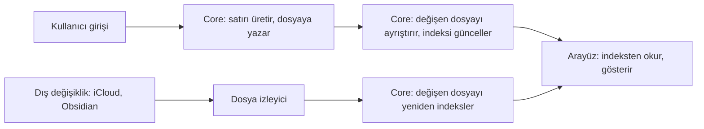

Yazma yönü her zaman dosyadan indekse doğrudur.

## Kasa konumu

**Şema kayıtlı kasa türünün açılışta nasıl çözüldüğünü gösterir.**

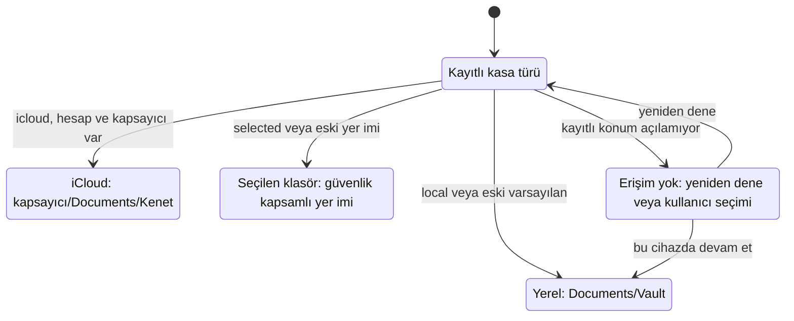

| Tür | Kalıcı kayıt | Çözüm |
|---|---|---|
| Yerel | UserDefaults `vaultKind = local`; eski kayıtsız kasa da yereldir | Uygulamanın `Documents/Vault` klasörü |
| iCloud | UserDefaults `vaultKind = icloud`; yer imi tutulmaz | `UbiquityContainerProviding` her açılışta hesap ve kapsayıcıyı yeniden çözer. Gerçek sağlayıcı `ubiquityIdentityToken` ve `url(forUbiquityContainerIdentifier:)` çağrılarını ana aktör dışında yapar. Kök `<kapsayıcı>/Documents/Kenet` olur. |
| Seçilen klasör | `vaultKind = selected` ve güvenlik kapsamlı yer imi | Bayat yer imi yenilenir; erişilemeyen kasa yerine başka kasa açılmaz. Bozuk yer imi temizlendiğinde kayıp bayrağı sonraki açılışta yerel kasaya geçişi engeller. |

Var olan yerel veya seçilen kasa önce çözülür, açılır ve indekslenir. Varsayılan yerel kasa açıldıktan sonra iCloud kullanılabilirliği ve tek seferlik taşıma sorusu değerlendirilir; soru ana ekranın üstünde sheet olarak görünür, onboarding durumunu değiştirmez. XCTest/UI test süreçlerinde varsayılan kapsayıcı sağlayıcısı AppLaunchPolicy tanımasına göre nil döndürür; iCloud testleri açıkça sahte sağlayıcı enjekte eder. Yerel/seçilen kasanın arka plan, intent ve yeniden deneme yolları kapsayıcı aramaz.

İlk açılışta iCloud kullanılabiliyorsa ilk seçenek iCloud'da saklamaktır; yerel kasa ve klasör seçimi de vardır. Kapsayıcıdaki `.app/vault.json` taşıyan mevcut kasa hazırlama yapılmadan açılır. Başka cihazın kasasında bu dosya henüz inmemiş olabilir: `.app/.vault.json.icloud` yer tutucusu da kasa sayılır (`CloudVaultMarker`, Core `PlaceholderName` kuralı). Uygulama kasa kökü ve `.app` için `startDownloadingUbiquitousItem(at:)` ile indirme ister ve koordineli okumayla `vault.json` inene kadar en çok 20 sn bekler. Süre dolarsa "Kasa iCloud’dan iniyor" hatası görünür; hiçbir şey oluşturulmaz, taşınmaz ya da kaydedilmez, kullanıcı yeniden dener. iCloud yoksa iCloud seçeneği görünmez; kayıtlı tür iCloud ise erişim ekranı gösterilir, tür ve dosyalar korunur. iCloud yanıt verir ama `Kenet` klasörü yoksa ya da açılmıyorsa ekran "iCloud kapalı" yerine "iCloud’daki kasaya erişilemiyor" der. Kullanıcı açıkça bu cihazda devam etmeyi seçince yerel kasa açılır. Mac ad hoc imza kapsayıcı yetkisi taşımadığından yerel akış çalışır. `NSUbiquitousContainers` hedefin `project.yml` info özelliklerinde tanımlanır; Dosyalar'daki yol iCloud Drive → Kenet → Kenet'tir. Üretilen plist `.dd` altındadır; dosya paylaşımı ve iPad tek pencere özellikleri aynı info tanımında korunur.

**Şema yerel kasanın kullanıcı onayıyla taşınmasını gösterir.**

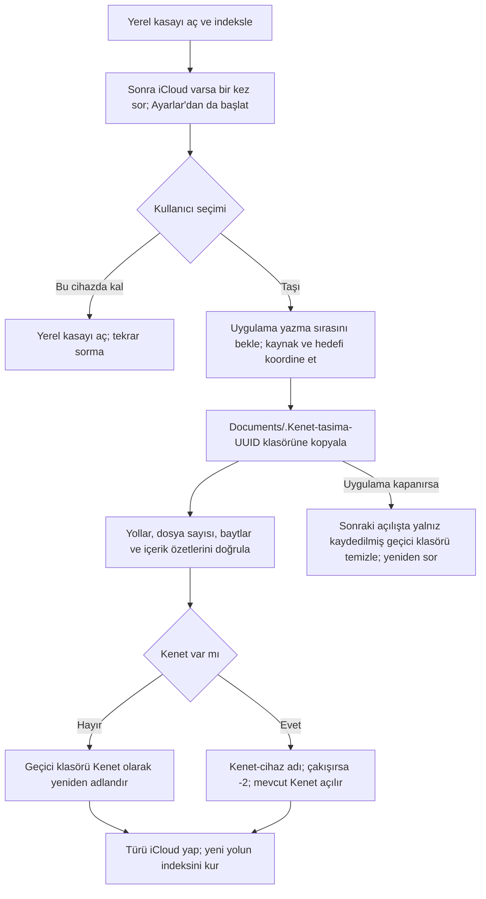

Taşıma kaynak dosyaları silmez ve kasaları birleştirmez. Kopya doğrulaması gizli dosyalar, Markdown dışı içerik ve boş klasörleri kapsar; kaynak yeniden ölçülür. Sembolik bağlantı ve `.icloud` yer tutucusu varsa taşıma reddedilir. Var olan hedefin üzerine yazılmaz; tanınmayan `Kenet` klasörü hata verir. `vault.json` yer tutucusu taşıyan `Kenet` de var olan kasadır: önce indirilir, sonra yerel kopya yanına konur. iOS 16 ve sonrası cihaz adını ek yetki olmadan genel adla ("iPhone", "iPad") verir; ikinci iPhone'un kopyası bu yüzden `Kenet-iPhone-2` olur. Başka cihazın ya da sürecin geçici klasörüne dokunulmaz. Taşıma hata verdikten sonra kullanıcı "Vazgeç" ya da "Bu cihazda devam et" derse uygulama kendi geçici klasörünü hemen siler. Kopyalanan ve açılan kasa farklıysa iki yol kullanıcıya bildirilir; yerel kasanın korunduğu Ayarlar'da da görünür. Kullanıcının yer imiyle seçtiği kasaya otomatik taşıma sorusu sorulmaz.

## Dosya izleyici

İzleyicinin kaynağı platforma göre değişir. Mac'te kasa kökü için tek bir FSEvents akışı dosya düzeyinde olay verir. iPhone'da FSEvents yoktur; her dizin bir Dispatch dizin kaynağı alır. Mac'te akış başlamazsa izleyici dizin kaynaklarına döner. İki kaynak da aynı bildirimi üretir: değişen dizinlerin listesi ya da tam istek.

**Şema yenilemeyi başlatan tetikleri ve her tetiğin tarama kapsamını gösterir.**

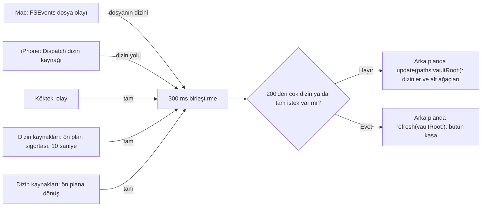

**Tablo izleyicinin sınırlarını gösterir.**

| Değer | Anlam |
|---|---|
| Mac: 1 FSEvents akışı | Kasa kökü ve bütün alt ağaç. Dosya tanıtıcısı tutmaz; dizin sınırı yoktur |
| Mac: 0,3 saniye | FSEvents gecikmesi; bu süredeki olaylar tek geri çağrıda gelir |
| iPhone: Dispatch dizin kaynakları | Kök ve taranan alt dizinler |
| iPhone: 256 | En çok dizin kaynağı sayısı |
| 10 saniye | Ön plan sigortasının aralığı; dizin kaynaklarında ve ağ birimindeki akışta |
| 300 ms | Bildirimlerin birleştirme süresi |
| 200 | Bir yenilemedeki en çok dizin sayısı; fazlası tam yenilemedir |

**Tablo her tetiğin ne bildirdiğini gösterir.**

| Tetik | Bildirim | `IndexStore` çağrısı |
|---|---|---|
| Mac: bir alt dizindeki dosya eklendi, silindi, yeniden adlandırıldı ya da yerinde yazıldı | Dosyanın bulunduğu dizin | `refresh(directories:)`; Core `update(paths:)` o dizini alt ağacıyla tarar |
| Mac: bir dizin eklendi, silindi ya da yeniden adlandırıldı | Üst dizin | `refresh(directories:)` |
| iPhone: alt dizin olayı, yani dosya ya da dizin eklendi, silindi, yeniden adlandırıldı | Kasa içi göreli dizin yolu | `refresh(directories:)` |
| Kökteki olay, kökün kendisi | Tam | `refresh()` |
| Mac: FSEvents olay kaybı bildirdi (`MustScanSubDirs`, çekirdek ya da kullanıcı kaybı) | Tam | `refresh()` |
| Dizin kaynakları ya da ağ birimindeki akış: ön plan sigortası ve ön plana dönüş | Tam | `refresh()` |
| Son yenileme hata verdi: ön plana dönüş | Tam | `refresh()` |
| iPhone: kaynak sayısı sınırdayken bir kaynak kapandı | Tam | `refresh()` |

İzleyici 300 ms içinde gelen bildirimleri birleştirir. Dizin listeleri birleşir. Tam istek listeyi yutar. 200'den çok dizin tam isteğe döner. `IndexStore` de süren bir yenilemenin arkasında bekleyen istekleri aynı kuralla birleştirir. Bu yüzden hiçbir istek kaybolmaz: bekleyen istek ya bütün dizinleri ya bütün kasayı tarar.

Dışlamalar iki kaynakta aynıdır: adı nokta ile başlayan dizinler ve kökteki `templates/` ile `conflicts/`. Mac'te izleyici bu dizinlerin içindeki olayları yok sayar. Mac'te izleyici kökteki `.DS_Store` dosyasının olaylarını da yok sayar. Finder bu dosyaya görünüm ayarlarını yazar; kökteki her olay tam yenilemedir. Başka nokta ile başlayan dosya dışlanmaz; Core `.hidden.md` dosyasını okur.

Mac'te akış dosya içeriğinin yerinde düzenlenmesini de görür. Ölçüm: yerinde ekleme, kesip yeniden yazma, atomik olmayan `Data.write`, `touch` ve atomik kaydetme birer dosya olayıdır. 5 yıllık sentetik kasada yerinde düzenleme 0,4–0,6 saniyede indekse girer; aynı anda süren tam yenileme varsa 1,6 saniyeye çıkar. FSEvents akış başlamadan birkaç milisaniye önceki bir yazmayı da bildirebilir. Akış bu yüzden kasa dışındaki geçici bir klasöre bir işaret dosyası yazar ve olay sırasında işaretin olayından önce gelen kasa olaylarını atar. Açılış taraması bu yazmaları zaten görür.

Akış yerel bir birimde başladıysa Mac'te ön plan sigortası kurulmaz ve ön plana dönüş tarama istemez. Sigorta dizin kaynaklarının görmediği yerinde düzenlemeyi ve kaynaksız dizinleri yakalamak içindir; akış ikisini de kendisi bildirir. Akış uygulama arka plandayken de olay bildirir. Kaybolan olayı akış kendisi tam istek olarak bildirir. Sigorta her 10 saniyede bütün kasayı tarıyordu: tarama indeks veritabanının tek yazma sırasını tutar, ekran sorguları ve yazmalar onu bekler. iCloud kasasında dizin gezmek daha yavaştır ve kullanıcı bunu kasma olarak gördü. Akış başlamazsa Mac de dizin kaynaklarına döner ve sigorta iPhone'daki gibi kurulur (`VaultWatcher.setForeground`).

İki durumda ön plana dönüş akışta da tam tarama ister:

| Durum | Neden | Davranış |
|---|---|---|
| Kasa ağ biriminde (SMB, NFS; `volumeIsLocal` yanlış) | FSEvents ağ biriminde yalnız bu Mac'in yazdığını bildirir; başka makinenin yazdığını bildirmez | Akış çalışır; sigorta ve dönüş taraması da dizin kaynaklarındaki gibi kurulur |
| Son yenileme hata verdi (`needsFullRefresh`) | Hata kendiliğinden kalkmaz; akışta sonraki dosya olayı gelmeyebilir. Örnek: çevrimdışı okunamayan iCloud dosyası, ağ dönünce olay üretmez | `IndexStore.setForeground(true)` izleyiciden tek bir tam tarama ister |

Bu iki durum dışında akışta ön plana dönüşte kaçırılmış değişiklik yoktur.

Mac'in hızlı giriş paneli indeksi yalnız ön plana alır (`MacQuickEntryController.present`); kendi taramasını istemez. Uygulama zaten öndeyse panel tarama başlatmaz. Uygulama arka plandaysa ön plana dönüş kuralı geçerlidir: dizin kaynaklarında bir tam tarama, yerel birimdeki akışta (son yenileme başarılıysa) hiç tarama.

iPhone'da dizin kaynakları yerinde düzenlemeyi görmez. Bir düzenleyici dosyayı yerinde yazarsa, örneğin `FileHandle` ya da `>>` ile, indeks bu düzenlemeyi ön plan sigortasında ya da ön plana dönüşte görür; gecikme en çok 10 saniyedir. Atomik kaydetme, yani geçici dosya ve yeniden adlandırma, bir dizin olayıdır; indeks bu düzenlemeyi 1 saniye içinde görür. iPhone'da dış düzenleme pratikte iCloud'dan gelir ve atomiktir. İzleyici bir dizin olayından sonra yalnız o dizinin alt ağacını dolaşır. Yeni alt dizinler kaynak alır. Silinen ya da taşınan dizinlerin kaynakları kapanır. Bütün ağacı yalnız tam istek dolaşır. İzleyici 256 kaynaktan sonraki dizinleri ve kaynak açamadığı dizinleri yalnız ön plan sigortasıyla denetler. Arayüz bu dizinlerin sayısını gösterir; Mac'te bu sayı 0'dır.

Arka planda olaylar yenilemeyi tetiklemeye devam eder.

Yenileme hata verirse `IndexStore` sonraki isteği dizin listesiyle değil bütün kasayla yapar. Başarısız yenilemenin kaçırdığı değişiklik başka bir dizinde olabilir.

Kapsamlı yenilemede Core `skippedPaths` değerini yalnız taranan dizinler için bildirir. `IndexUpdate` taranan dizinlerin dışındaki eski kayıtları korur ve listeyi Core sırasıyla birleştirir. Liste değişmezse yayım olmaz.

**Tablo izleyicinin ana aktörle ilişkisini gösterir.**

| İş | Nerede çalışır |
|---|---|
| Mac'te akışın başlaması; iPhone'da ilk dolaşma ve kaynak kurulumu | İzleyici kuyruğu. `IndexStore.open` yalnız `waitUntilReady()` ile bekler; ana aktör serbesttir |
| `setForeground` ve `stop` | İzleyici kuyruğuna iş bırakır; ana aktör beklemez |
| Olayların dizine çevrilmesi, dizin dolaşması ve birleştirme | İzleyici kuyruğu |
| İndeks taraması ve okuma modeli | `Task.detached` |

Kasa bir oturumda bir kez açılır. Mac'te pencere ve hızlı giriş paneli `startAutomatically()` çağrısını ayrı ayrı yapar; iCloud kasasında ilk çağrı kapsayıcıyı beklerken ikincisi gelir. `IndexStore.start()` süren çağrı varken yenisini onun bitişine bağlar: ikinci çağrı kasayı yeniden açmaz, açılış taraması bir kez koşar.

`IndexStore.open` açılış yenilemesinden önce izleyicinin hazır olmasını bekler: Mac'te akış başlamıştır, iPhone'da ilk dolaşma bitmiştir. Böylece izleme açılış taramasından önce başlar; ikisinin arasında yapılan bir düzenleme kaybolmaz. Bu bekleme sürerken `isProcessing` açık kalır; gelen yenileme istekleri açılış yenilemesinin arkasında birleşir. Kasa bu sırada değişirse ya da erişim kaybolursa `generation` denetimi eski açılışı durdurur. Eski izleyicinin bildirimleri de aynı denetimle düşer.

## Yazma sırası

**Şema bir yazmanın ekrandan dosyaya, dosyadan indekse ve okuma modeline yolunu gösterir.**

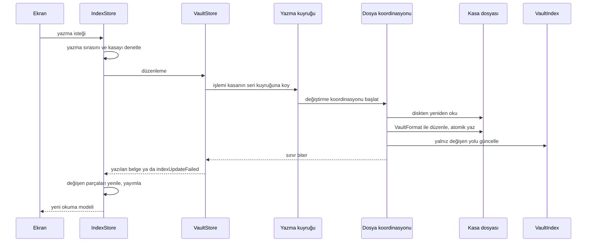

`VaultStore` uygulamanın kasa belgelerini düzenleyen tek kapıdır. `VaultStore` aynı kasa kökündeki yazmaları ortak seri bir Foundation işlem kuyruğunda sıralar. Her işlem belgeyi diskten yeniden okur, `VaultFormat` ile düzenler ve dosyaya yazar. Sonra `VaultStore` yalnız değişen yolu `VaultIndex` ile günceller. İndeks hatası yazılmış dosyayı geri almaz; `indexUpdateFailed(path:underlying:)` dosyanın yazıldığını açıkça bildirir.

`VaultStore` yeni baytları önce hedefin klasöründe geçici bir dosyaya yazar. `VaultStore` geçici dosyayı yayımlamadan önce diske eşitler (`FileHandle.synchronize()`). Eşitleme hata verirse `VaultStore` hiçbir şey yayımlamaz ve geçici dosyayı siler. Eşitleme `fsync` düzeyindedir. Apple aygıtlarında sürücü önbelleğini de boşaltan `F_FULLFSYNC` kullanılmaz.

**Tablo atomik yazmanın yollarını ve tek istisnayı gösterir.**

| Durum | Yazma yolu | Kesintide kalan |
|---|---|---|
| Dosya var | `VaultStore` var olan dosyayı eşitlenmiş geçici dosyayla atomik değiştirir. | Eski ya da yeni baytların tamamı |
| Dosya yok | `VaultStore` geçici dosyayı dışlayıcı sabit bağlantıyla yayımlar. Başka sürecin dosyasının üzerine yazmaz. | Dosya yok ya da yeni baytların tamamı |
| Birim sabit bağlantıyı desteklemiyor | `VaultStore` geçici dosyayı dışlayıcı adlandırmayla yayımlar (`renamex_np`, `RENAME_EXCL`). Hedef varsa adlandırma reddedilir. | Dosya yok ya da yeni baytların tamamı |
| Birim dışlayıcı adlandırmayı da desteklemiyor | `VaultStore` yeni dosyayı doğrudan dışlayıcı oluşturur. Bu ilk yazma atomik değildir. Linux'ta `Core` dışlayıcı adlandırma kullanmaz ve bu yolu izler. | Yarım dosya kalabilir |

## Okuma modeli

**Şema okuma modelinin parçalardan nasıl kurulduğunu gösterir.**

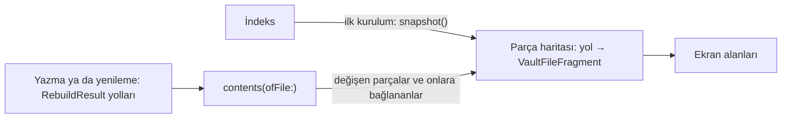

Okuma modeli dosya başına parça tutar: `[yol: VaultFileFragment]`. İlk kurulumda `snapshot()` parça haritasını doldurur. Yazma ve yenileme `RebuildResult` yollarının parçalarını yeniler. Bağlantısı bu yollara çözülen dosyaların parçalarını da yeniler. Ekran alanları parçalardan türer. Ekranlar okuma modelinden Core sorgularına dilim dilim geçer.

**Tablo bir parçanın taşıdığı veriyi ve bu veriyi kullanan alanı gösterir.**

| Parça verisi | Kullanan |
|---|---|
| Dosya satırı | `counts.filesByKind` |
| Varlık ve takma adlar | `entities`, `counts.entities` |
| Bağlantılar | Gelen bağlantı sayısı, `counts.links`, silinen dosyaya çözülen kaynaklar |
| Olay ve görev blok sayısı | `counts.events`, `counts.tasks` |

Parça blok metnini taşımaz: paragraf, başlık, görev ve olay metni indekste kalır. Ekranlar blok metnini sorgudan okur. Blok kimliği sahipliği de parçaya ulaşmaz. Bu yüzden artımlı yol kimlik başına bütün parçaları taramaz. Hedef değerleri de parçaya ulaşmaz; hedef ekranları ve servisler onları sorgudan okur. Hiçbir alan güne bağlı değildir: yeni gün de öteki yayımlar gibi yamayla işler.

## Ekran sorguları

**Tablo okuma modelinden çıkan yedi dilimi sırasıyla gösterir.**

| Sıra | Dilim | Core sorgusu | `IndexStore` yöntemi | Ekran |
|---|---|---|---|---|
| 1 | Graph | `graphMentions(kinds:)`, `explicitRelations(kinds:)` | `computeGraphInput`, `computeExplicitRelations` | Graph |
| 2 | Varlık zaman akışı | `entityTimeline(for:)` | `computeEntityTimeline(for:)` | Varlık sayfası, içgörü kartı |
| 2 | Son görüşme | `lastEncounters(asOf:)` | `computeLastEncounters(asOf:)` | "Bir süredir görüşmediklerin", haftalık inceleme, görüşme ritmi hatırlatması |
| 3 | Gün listesi | `daySummaries(from:to:)` | `computeDaySummaries(from:to:)` | Günlük listesi, takvim |
| 3 | Tek gün | `day(on:)` | `computeDay(on:)` | Gün sayfası, içgörü kartının "o gün geçenler" bölümü |
| 4 | Görevler | Görev sorguları tablosu | `IndexStore.compute…Tasks` | Görevler, kanban, zaman çizelgesi, proje, gün sayfası, haftalık inceleme |
| 5 | Hedef durumu | `goalStatuses(today:)` | `computeGoalStatuses(today:)` | Hedefler listesi, gün sayfası |
| 6 | Proje adları | `taskProjects()` | `computeProjects()` | Mac kenar çubuğu, kanban ve zaman çizelgesi proje sütunları, süzgeç menüsü, hızlı giriş proje önerisi |
| 6 | Varlığın açık işleri | `taskGroups(today:scope:)`, varlığa bağlı kapsam | `computeTaskGroups(today:scope:)` | Varlık sayfası |
| 6 | Bildirim haftası | `taskGroups(today:)`, `daySummaries(from:to:)` | `computeNotificationDays(from:through:)` | Bildirim planlayıcı |
| 7 | Hedef tanımları | `goalDefinitionsByName()` | `computeGoalDefinitions()` | `GoalDayModel` (gün sayfası şeridi, "Günü kapat", hedef ayrıntısı, liste düzenlemesi), Mac hedef sütunu, tanım formunun ad denetimi, App Intents, konum izleme |
| 7 | Ayrılmış hedef anahtarları | `reservedGoalKeys()` | `computeReservedGoalKeys()` | Yeni hedef formunun anahtar önizlemesi |
| 7 | Hedef kayıtları aralığı | `goalLogsByKey(from:through:keys:)` | `computeGoalLogs(from:through:keys:)` | Konum izleme: o günün kaydı |
| 7 | Günlük hedef hatırlatması | `notificationGoals(from:through:)` | `computeNotificationGoals(from:through:)` | Bildirim planlayıcı |

Aynı kalıp `IndexStore`'un öteki istek üzerine okumaları için de geçerlidir: `computeSummary`, `computeOnThisDay`, `computeImportantDates`, `computeDayBacklinks`, `computeUnlinkedMentions`, `computeYearWritingCalendar`, `search`, `goalHistory`, `personCadences`, `weeklyReviewInput`, `summaryTasks`, kopya ve eşleme sorguları (`computeCopyFiles`, `computeConflictCopies`, `computeConflictedFiles`) ve diskten belge okumaları (`document(at:)`, `dayDocument(for:)`).

### Sorgu kalıbı

**Şema bir ekran sorgusunun kuşak ve iptal denetimini gösterir.**

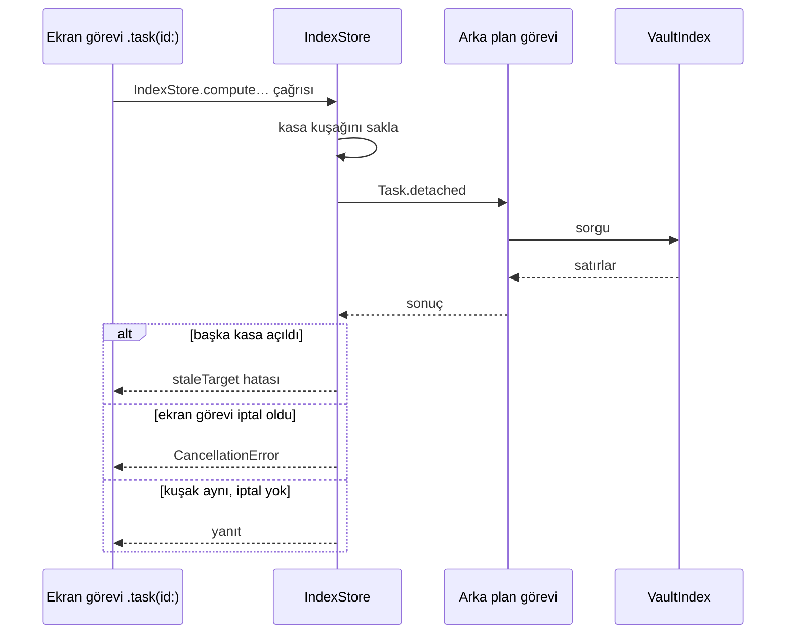

Her istek üzerine okuma tek bir yardımcıdan geçer: `IndexStore.answer(seam:_:)`. İndeks sorguları `indexQuery` ile arka plan görevinde çalışır. Belge okumaları dosyayı `VaultStore` üzerinden diskten okur. Okuma başlarken kasa kuşağını saklar. Yanıt gelince önce okumanın test kancası çalışır. Sonra okuma kuşağı denetler: başka kasa açıldıysa `staleTarget` atar. Sonra okuma iptali denetler: çağıranın görevi iptal olduysa `CancellationError` atar. Arka plan görevi iptalde durmaz. Bu denetim yalnız eski yanıtın yenisinin üstüne yazmasını önler.

İndeks açık değilse sorgu iki yoldan birini izler:

- Liste ve sayı sorguları boş sonuç döner: görev, gün, Graph, zaman akışı, son görüşme, hedef durumu, yıl takvimi ve arama sorguları.
- Boş yanıtı olmayan sorgular `staleTarget` atar: özet, "Geçen yıl bugün", önemli tarihler, gün geri bağlantıları, bağlanmamış anmalar, hedef geçmişi, görüşme ritmi, haftalık inceleme girdisi ve görev akışı.

Ekran tarafında `QueryOutcome` okumanın nasıl bittiğini ayırır: yanıt, iptal, bayat yanıt ya da hata. `QueryState` bir sorgunun son yanıtını ve son hatasını tutar. İptal ve bayat yanıt ekranı değiştirmez ve hata göstermez. Hata ekranın son yanıtını tutar ve "Kasa okunamadı" bandını gösterir. Sonraki yanıt bandı kaldırır. Bu ayrımı Görevler listesi, "Bir süredir görüşmediklerin" bölümü ve varlık sayfasının görüşme ritmi satırları kullanır. App Intents de aynı ayrımı kullanır: sistemin iptal ettiği kısayol iptal olarak biter, "kasaya erişilemiyor" hatası vermez.

**Tablo ekranların yanıt beklerken ne çizdiğini gösterir.**

| Durum | Ekran davranışı |
|---|---|
| İlk yanıt gelmedi | Ekran kendi bölümlerini ve boş durumu çizmez. Gün sayfası takvim günlerini de çizmez |
| Yeniden yükleme sürüyor | Ekran eski yanıtı tutar. Yüklenen gün bir an boş görünmez |
| Yeni istek eskisinin yerini aldı | `.task(id:)` eski görevi iptal eder; ekran eski yanıtı atar |
| Yanıttan önce başka kasa seçildi | Sorgu sonucu kasa kuşağına bağlıdır; ekran sonucu atar |
| Okuma hata verdi | `QueryOutcome` kullanan ekran son yanıtı tutar ve hata bandı gösterir. Bant sonraki yanıtta kalkar |
| Gün sayfası açılıyor | Sayfa günün kendi bölümlerini gün ve görev yanıtlarının ikisi de gelince çizer |
| Akşam hatırlatması geldi | Uygulama günü kapatma akışını görevlerin o yayıma ait yanıtı gelmeden açmaz |
| Hedefler listesi yükleniyor | Liste ilk yanıta kadar satır ve boş durum çizmez. Satırlar ve tanımlar yanıttan gelir. Yeniden yüklemede ve gece yarısı yeniden kurulumda eski satırları tutar |

### Graph

Okuma modeli Graph alanı tutmaz. Ekran açıkken ve her indeks yayımında `.task(id:)` sorguyu arka planda yeniden çalıştırır. Sorgu bağlantı toplamlarını, gün başına anmaları ve aynı olay, görev ya da paragraf bloğundaki çözülmüş varlık gruplarını getirir. Gruplar dosya ve blok sıra numarasıyla ayrılır. Gün dosyasının çok satırlı paragraf bloğu ayrıca segmentlere bölünür: Core'daki saf `ParagraphSegments` blok metnini satırlara ayırır; her madde satırı (girintili devam satırlarıyla), her ardışık `>` öbeği ve madde ya da alıntı olmayan her ardışık satır öbeği bir segmenttir. Sorgu bağlantının satırını (`links.line - blocks.firstLine`) bu segmente eşler; şema ve blok tablosu değişmez. Başlık ve frontmatter birlikte geçme üretmez. Alt satırlar indeksin atadığı en içteki bloğa aittir. Core'daki saf `GraphMentions.cooccurrenceWeights(days:including:)` hesabı her çifti ortak bloğu olan farklı tarihler kadar sayar. Graph bu grupları ve hesabı artık kullanmaz (kullanıcı kararı 83, 2026-10-30: gün merkezli Graph); Core sorgusu grupları şimdilik üretmeye devam eder. App dönem ve tür süzgeçlerini uygular; gün düğümleri her zaman çizilir ve kenarları bütün gün anmalarından gelir; varlıklar arasındaki tek kenar açık bağdır. Düğüm olacak varlıklar okuma modelinden gelir. Düğüm boyutu, ad tanımadaki gün düzeyli bağlam puanı ve içgörü kartı değişmez.

Özel tipler ana Graph'a süzgeçle girer: `computeGraphInput(customTypes:)` kişi ve konuma yalnız süzgeçte açılan tipleri ekler ve sorgu o türleri okur; varsayılan sorgu kişi ve konumdur. Düğüm türü `GraphNode.Kind.custom(tip kimliği)`, tip adı kasanın tip kataloğundan gelir. Günün grafiği (`GraphFilter.scope == .day`) ayrı ve ucuz bir sorgu kullanır: `VaultIndex.dayGraphMentions(on:kinds:)` yalnız o tarihin gün dosyalarını okur (`files.date = ?`, `file_dates` indeksi) ve ana sorgunun gün anmaları ile blok ve segment gruplarını döndürür; günün grafiği de grupları okumaz. İki sorgu tek satır yürüyüşünü paylaşır (`graphRows(kinds:date:)`); gün sorgusu yalnız tarih koşulunu ekler. `IndexStore.computeDayGraphInput(on:)` kişi, konum ve kasanın bütün özel tiplerini ister. Gün sayfası aynı sorguyu gün yanıtıyla birlikte çalıştırır ve Graph simgesini yalnız grafikte gün dışında düğüm varken gösterir (`DayGraphEntry`). `DayGraphMentionsTests` her günün yanıtını bütün kasa sorgusunun o günüyle karşılaştırır.

### Varlık zaman akışı ve son görüşme

Okuma modeli zaman akışı tutmaz. Varlık sayfası açıkken ve her indeks yayımında sayfa o varlığa bağlanan gün dosyası olaylarını ve Journal paragraflarını sorgular. İçgörü kartı aynı sonucu kullanır. `lastEncounters(asOf:)` kişi başına son görüşme gününü verir ve zaman akışıyla aynı kayıtları sayar. Bu sorgu görevleri ve frontmatter'ı saymaz; `entityUsage().lastDate` ise ikisini de sayar.

### Günler

Okuma modeli gün listesi tutmaz. Günlük listesi bütün günleri sorgular: iPhone'da `DaysView`, Mac'te gün sütunu. Takvim yalnız gösterdiği ayı sorgular. Yanıt gün başına olay sayısını, Journal paragraf ve başlık sayısını, ilk Journal paragrafını ve hedef kaydını taşır. İlk paragraf önizleme olarak görünür.

### Görevler

**Tablo her görev ekranının sorgusunu ve getirdiği satırları gösterir.**

| Ekran | Sorgu | Getirdiği satırlar |
|---|---|---|
| Görevler listesi | `taskGroups(today:scope:)` | Bugüne göre gruplanmış açık görevler |
| Görevler listesi | `completedTasks(limit:scope:)` | Son 50 tamamlanan görev |
| Görevler listesi | `openTaskCounts()` | Proje başına açık görev sayısı |
| Kanban | `boardTasks` | Açık görevler, son 30 günde tamamlananlar ve iptaller. "İptal edilenleri göster" yeni sorgu açmadan süzer |
| Zaman çizelgesi | `timelineTasks` | Bugünün ±365 günüyle kesişen görevler ve tarihsiz görevler. Görünen pencere bu satırlar içinde kayar |
| Proje sayfası | `tasks(inProject:)` | Projenin bütün görevleri |
| Gün sayfası, günü kapatma akışı | `dayTasks(on:)` | O günün adayları: önceki açıklar, o güne düşenler, o gün dosyasına yazılan tarihsizler, o gün tamamlananlar |
| Haftalık inceleme | `openTasks(dueBy:orWrittenFrom:)` | İki haftanın açık işleri |
| Görev ayrıntısı | `task(id:)` | Seçilen görev; sorgu görevi kimliğiyle yeniden okur |

Kişi ve proje süzgeci sorguya gider: `TaskScope`. Sorgu projeyi anahtarla karşılaştırır. Bütün görev sorguları `IndexStore.compute…Tasks` ile arka planda çalışır. Her yazmadan sonra `.task(id:)` sorguları yeniden çalıştırır. Gruplamayı ve sıralamayı ekran modelleri eskisi gibi yapar. Okuma modeli görev tutmaz. Kanban sütunları önbelleklidir: `KanbanModel` sütunları satırlar, gruplama, iptal anahtarı, gün, proje adları ya da kişi listesi değişince bir kez kurar. Pano, kartların taşı menüsü ve VoiceOver eylemleri aynı sütunları okur; kart satırları gezmez, yalnız sütun adını ve hedefini (`moveTargets`) okur.

**Tablo proje adlarının ve varlığın açık işlerinin kaynağını gösterir.**

| Yer | Kaynak | Yükleme davranışı |
|---|---|---|
| Mac kenar çubuğu | `computeProjects()` | Kenar çubuğu yeni yanıt gelene kadar eski listeyi tutar |
| Kanban ve zaman çizelgesi proje sütunları | `computeProjects()` | Model adları satırlarla birlikte atar. Bir sütun görevlerinden önce görünmez |
| Süzgeç menüsü, Görevler › Projeler | `computeProjects()` | Liste yüklemesi adları da getirir |
| Hızlı giriş `#project/` önerileri | `computeProjects()` | Giriş çubuğu her yayımda adları yeniden okur |
| Varlık sayfasının açık işleri | `computeTaskGroups(today:scope:)`, varlığa bağlı kapsam | Sayfa açık işleri zaman akışıyla aynı görevde sorgular |

`taskProjects()` her proje anahtarı için bir yazılış verir. Sorgu açık, tamamlanmış ve iptal görevlerin hepsini sayar. Eşit iki yazılıştan dosya ve satır sırasında önce gelen kazanır.

### Hedef durumu

Okuma modeli hedef alanı tutmaz: tanımlar, durumlar, ayrılmış anahtarlar ve kayıtlar sorgudan gelir. Hedefler listesi ve gün sayfası durumları ve tanımları `goalStatuses(today:)` sorgusundan alır. Gün sayfası o günün durumunu günle aynı görevde, o güne kadarki kayıtlarla sorgular. Sorgu durumu hedefin o güne kadarki bütün kayıtlarından hesaplar; bir yıldan eski zincir ve en uzun seri de kesintisiz kalır. Sorgu kayıtlardan yalnız anahtar, gün, tür ve değer sütunlarını okur.

**Şema hedef işaretlemede iyimser çizimi gösterir.**

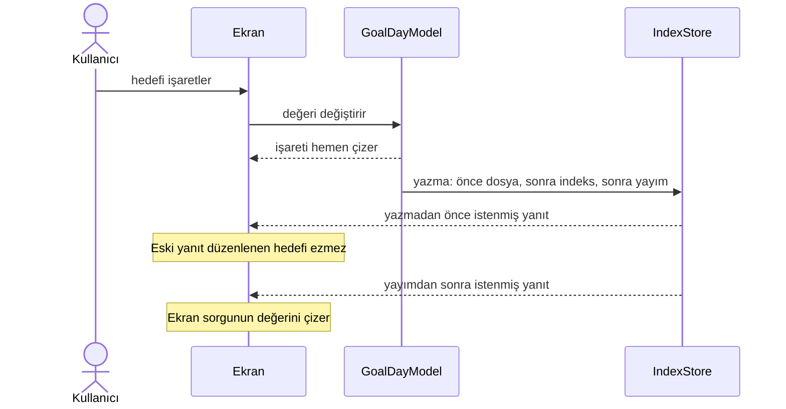

Kullanıcı hedefi işaretlediği anda ekran işareti o ekranın düzenleme modelinden çizer: `GoalDayModel`. Örnekler: listede kilometre taşı, şeritte artı ya da miktar. İkinci dokunuş ekranda görünen duruma göre işler. Yazma hiçbir şey kaydetmezse ekran işareti geri alır. Gün sayfasında şerit ve hedef sayacı aynı modeli paylaşır.

**Tablo gün sayfasının ve "Günü kapat" akışının hedef kaynaklarını gösterir.**

| Yer | Kaynak |
|---|---|
| Gün sayfası hedef sayacı, durumlar gelmeden | Şeridin kendi modeli. Bir an `0/0` ya da önceki günün sayısı görünmez |
| "Günü kapat" bekleyen hedefler | Açılışta şeridin yüklü modeli. Giriş satırı ve akşam hatırlatması şeridin o yayıma ait yanıtını bekler |
| Kopya anahtarlı hedef tanımı | Adı önce gelen tanım; gün sayfasıyla aynı kural |
| `GoalDayModel` ilk yükleme | Tanımlar ve indeksteki bütün geçmiş birlikte: `computeGoalDefinitions()` ve `goalHistory` |
| `GoalDayModel` yüklenmeden | Aynı kasada başka güne geçen sayfada önceki modelin tanımları ve geçmişi: ikisi de güne bağlı değil, şerit hemen çizilir. Sayfanın ilk açılışında ve kasa değişince boş: şerit hiçbir şey çizmez, boşluk da bırakmaz. Model yüklenmeden düzenleme almaz |

`GoalDayModel` gün sayfasının hedef şeridini, "Günü kapat" akışını ve hedef ayrıntısını sürer. Gün sayfası modeli her yayımda yeniden yükler; şerit kendisi yüklemez. Yükleme ekran görevinin iptaline karşı korunur: yerini alan istek yalnız yeniden yükleme ister, bu yüzden süren yükleme biter ve yeniden çalışır. Hedef ayrıntısı tanımın en yenisini kimlikle bu modelden okur.

**Tablo hedef tanımlarını okuyan öteki yerleri gösterir.**

| Yer | Kaynak | Yükleme davranışı |
|---|---|---|
| Mac hedef sütunu | `computeGoalDefinitions()`, seçili kimlik | Sütun ilk yanıta kadar boş kalır. Listede olmayan kimlik "Bir hedef seç" gösterir |
| Hedef tanım formu, ad çakışması | `computeGoalDefinitions()` | Form açılışta ve her yayımda adları okur. Adlar gelmeden "Kaydet" kapalıdır. Kaydetme adları yeniden okur |
| Yeni hedef formu, anahtar önizlemesi | `computeReservedGoalKeys()` | Önizleme yanıt gelene kadar ayrılmış anahtar görmez. Oluşturma diskteki anahtarları yine ayırır |
| App Intents hedef listesi ve işaretleme | `computeGoalDefinitions()` | Okuma hatası kasayı açılamamış sayar |
| Konum izleme hedefleri | `computeGoalDefinitions()`: tanım ve konum bağlantısının çözüldüğü dosya | Servis her yayımda tanımları yeniden okur. Sonraki okumanın yanıtı öncekini ezer. Arka plan girişi okumanın bitmesini bekler |
| Konum izleme "işaretli mi" | `computeGoalLogs(from:through:keys:)`, yalnız o gün | Okuma askıya alınır; denetim ile işi üstlenme arasında askı yoktur: ikinci giriş bekleyen işi görür |
| Widget anlık görüntüsü | `computeGoalStatuses(today:)`, bugün ve yarın | Her yayımda yeniden sorar. Başka kasa açıldıysa yanıtı atar; dosya son yanıtı tutar. Widget kendisi işaretlediyse önce `journal` klasörünü tarar. Ayrıntı: [Widget'lar](#widgetlar) |

Widget ekranlarla aynı hedef sorgusunu kullanır. Widget sorguyu kendisi çalıştırmaz: uygulama sonucu App Group'a yazar. Widget'ın kendi işaretlemesi yalnız gün dosyasına ve anlık görüntüye yazar.

### Okuma modelinde kalan alanlar

**Tablo okuma modelinde kalan alanları ve onları kullananları gösterir.**

| Alan | Kullanan |
|---|---|
| `entities` | Graph düğümleri, bağlantılı metin ve bağlantı hedefleri, varlık listesi ve sayfası, arama, görev süzgeci ve görev ayrıntısı, kanban ve zaman çizelgesi kişi sütunları, proje sayfası, haftalık inceleme, harita, gün bağlamı ve geri bağlantılar, görüşme ritmi hatırlatması |

## Bayat yanıt ve kasa değişimi

**Tablo kasa değişince ya da istek iptal olunca uygulamanın davranışını gösterir.**

| Durum | Davranış |
|---|---|
| Ekran sorgusunun yanıtından önce başka kasa açıldı | Sorgu `staleTarget` atar; ekran sonucu atar |
| Ekran görevi yenisiyle değişti | Sorgu `CancellationError` atar; eski yanıt yenisinin üstüne yazmaz |
| Yazma sırasını ya da yenilemeyi beklerken başka kasa seçildi | `IndexStore` yazmayı `staleTarget` ile reddeder; hiçbir dosya değişmez |
| Tanıma yenilemesi sürerken başka kasa açıldı | Yenileme hiçbir alana atama yapmaz: tipler, varlıklar, kullanım, yakın yerler, harita yerleri |
| Yazma sonrası yayım sürerken başka kasa açıldı | Yayım içeriği atamaz ve hatayı göstermez |
| Yenileme sürerken başka kasa açıldı | Yenileme yeni kasanın `lastUpdated`, `errorText` ve `isProcessing` değerlerine dokunmaz |
| Eski kasaya varlık kaydedildi | Yeni kasanın varlık listesi o varlığı göstermez |
| Yayımda tanıma yenilemesi hata verdi | `lastUpdated` yine ilerler; ekranlar yeni içeriği çizer |
| Ayarlar ekranının görevi plan sürerken iptal oldu | Bildirim planı son görüşme sorgusunu iptalden ayırır; plan yarıda kalmaz |

`IndexStore` üzerinden yapılan her yazma çağrıldığı anda seçili olan kasaya aittir. Bu kural olay eklemeyi, `performEdit` düzenlemelerini, varlık oluşturmayı ve yeniden adlandırmayı kapsar. Olay eklemede taslak hızlı girişte kalır ve ekran var olan `staleTarget` iletisini gösterir. Öteki yollar hatayı çağırana atar. Bağlanmamış anma bağlama, satırı okuduğu kasayı bu denetime verir.

## Bildirimler ve App Intents

**Tablo bildirim ve sistem girişi parçalarını gösterir.**

| Parça | Görev |
|---|---|
| `NotificationPlanner` | Planı bildirim haftasından, günlük hedeflerden, cihaz tercihlerinden ve yerel saatten üretir. Yalnız App katmanında çalışır |
| `NotificationService` | Yeniden planlamayı sırayla uygular ve izin durumunu yönetir. `UserNotifications` merkezine bir protokol üzerinden erişir |
| `CadenceReminderPlan` | Bugünün kişi, ritim ve son görüşme verisinden pencere içindeki görüşme ritmi günlerini hesaplar |
| `IntentActions` | Yer imi kapsamını ve indeksi açar; `IndexStore` üzerinden olay, görev ve hedef kaydı yazar |
| `AppShortcutsProvider` | tr ve en Siri cümlelerini sunar |
| `IntentNavigation` | Kullanıcıyı Bugün ekranına götürür |

**Tablo planlayıcının her hatırlatma için okuduğu kaynağı gösterir.**

| Hatırlatma | Kaynak |
|---|---|
| Görev sabahı | Bildirim haftası: son güne kadar vade günü başına açık görev sayısı ve haftaya düşen açık görevler |
| Günlük hatırlatması | Bildirim haftası: olayı ya da Journal paragrafı veya başlığı olan günler |
| Hedef hatırlatması | Günlük hedefler: `computeNotificationGoals(from:through:)`. Günlük tanımlar ve planlanan günlerin kayıtları |
| Görüşme ritmi hatırlatması | `cadenceReminderPeople(today:)` |

`NotificationService` bildirim haftasını `computeNotificationDays(from:through:)` ile bugünden 6 gün sonrasına kadar okur. Görev ve günlük hatırlatması kapalıysa servis haftayı okumaz. Günlük hedefleri aynı günler için `computeNotificationGoals(from:through:)` ile okur; hedef hatırlatması kapalıysa okumaz. Günlük hedefin bir gündeki ilerlemesi yalnız o günün kaydıdır; sorgu daha eski kayıt okumaz. Servis okumaları iptale karşı korur: plan yarıda kalmaz. Servis haftayı okuyamazsa planlayıcı görev ve günlük hatırlatması planlamaz; hedefleri okuyamazsa hedef hatırlatması planlamaz. İki okuma birbirinden bağımsızdır.

`NotificationService` indeks yayımlarını 2 saniye birleştirir. Kasa yüklenirken servis merkezdeki planı değiştirmez. Bu kural soğuk açılışı, arka plan açılışını ve aynı kasanın yeniden açılmasını kapsar. Eski plan kasanın ilk yayımından sonraki plana kadar kalır. Açılış yenilemesi hata verirse kasa yüklenmiş sayılmaz ve eski plan kalır. Servis eski planı yalnız iki durumda hemen kaldırır: başka bir kasa açıldı ya da kasaya erişim kayboldu. Servis önce yeni planı hesaplar ve ekler; aynı kimlikli istek eskisinin yerine geçer. Sonra servis yalnız yeni planda olmayan kendi isteklerini kaldırır. Böylece süreç plan sırasında askıya alınırsa hatırlatmalar kaybolmaz. Uygulama kapalıyken planlayıcı yedi günlük planın içeriğini yeniden hesaplamaz. Görüşme ritmi hatırlatması aynı plandadır. Uygulama son bildirim gününü kasaya yazmaz; günü cihazda kasa yoluna göre saklar.

## Core paketi

Açık ilişkiler `VaultIndex.relations(of:)` ile yönlü giden ve gelen listeler, `explicitRelations(kinds:)` ile Graph için yönsüz tekil çiftler olarak okunur. Şema 9 korunur: frontmatter bağlantılarının mevcut `links.key`, `block IS NULL` ve `resolvedFile` alanları kullanılır. `VaultStore.addRelation` ve `removeRelation` seri dosya yazma geçidinde yalnız ilgili frontmatter alanını düzenler, ardından indeksi günceller. Gelen bağlar dosyaya yazılmaz.

App katmanında `EntityRelationsModel` giden/gelen satırları ve bağ yazma hatalarını sunar; `IndexStore` mevcut dosya yazma geçidini kullanır. Yalnız çözülen ve görünen metin ya da çapa taşımayan wikilinklerden oluşan şema dışı alanlar `EntityDetailModel.reservedKeys` ile serbest alanlardan ayrılır; karışık metinli, çözülmeyen ya da sayfanın kendisine bağlanan değer içeren alan ile şema alanları görünür kalır. Graph girdisi açık bağları da taşır; `GraphModel` gün kenarlarından sonra görünür varlık çiftlerine sabit ağırlıklı yönsüz bağ ekler. Bağ dönemle süzülmez; iki varlık arasındaki tek kenar türüdür. Ana Graph ve günün grafiği aynı çizgi ve VoiceOver sunumunu kullanır; gün kipinde yalnız günün varlıkları arasındaki bağlar çizilir.

**Şema `Core` paketinin hedeflerini ve bağımlılıklarını gösterir.**

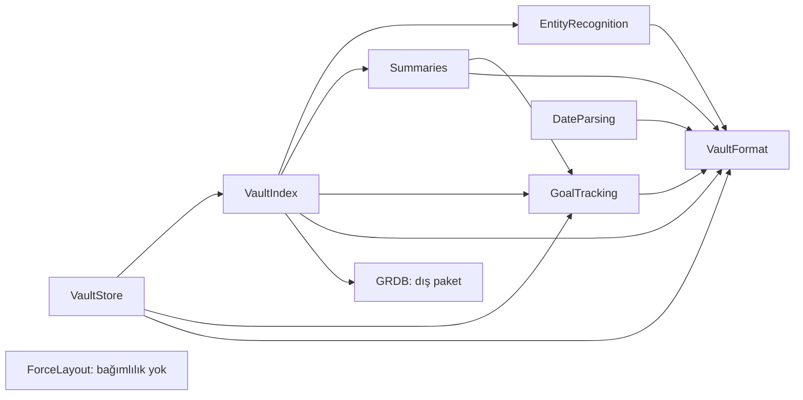

**Tablo `Core` sorumluluklarını ve onları taşıyan hedefi gösterir.**

| Sorumluluk | Hedef | İçerik |
|---|---|---|
| Ayrıştırıcı | `VaultFormat` | Frontmatter, bölümler, olay ve görev satırları, bağlantılar, blok kimlikleri |
| Yazıcı | `VaultFormat` | Yalnız hedef satırı değiştiren, dosyanın geri kalanını birebir koruyan düzenleme |
| Birleştirme | `VaultFormat` | Çakışan iki sürümü tek içerikte birleştiren saf işlev. Kurallar: `vault-format.md` |
| Modeller | `VaultFormat` | Gün, olay, görev, varlık, hedef. Varlık türleri: kişi, konum |
| Yeniden adlandırma | `VaultStore` | Varlık dosyasını yeniden adlandırma ve kasadaki tüm bağlantıları güncelleme |
| Varlık tanıma | `EntityRecognition` | Metinde bilinen adları ve takma adları bulma. Birden fazla aday varsa bağlama göre sıralama: konum, yakınlık, sıklık. Emin olmadığı durumu arayüze bildirme |
| İndeksleyici | `VaultIndex` | Tam ve artımlı indeksleme |
| Sorgular | `VaultIndex` | Bugün, gün listesi ve tek gün, güne bağlananlar, varlık zaman akışı ve son görüşme, Graph anmaları, zincir hesabı, hedef durumu, görev görünümleri, özet girdisi, bu gün geçmişte, varlık alanları, bağlanmamış anmalar, arama |
| Tarih ayrıştırma | `DateParsing` | Doğal dil tarih ifadeleri; hızlı girişte tekrar ve öncelik |
| Hedef hesapları | `GoalTracking` | Dönem ve yıl ilerlemesi, zincir, en uzun seri, ısı haritası. Günlük hedefte tek kaçırma affı ve kısmi af işareti |
| Özetler | `Summaries` | Haftalık, aylık ve yıllık sayılar, ritim birimleri, ilk beş kişi ve konum, ilk kez geçenler, hedef ve görev durumu, önceki dönem farkları. Süren dönemin karşılaştırması aynı tarihe kadardır. Aynı hedefte bu gün geçmişte, önemli tarihler, görüşme ritmi ve haftalık inceleme metni |
| Kuvvet yerleşimi | `ForceLayout` | Graph'ın canlı kuvvet benzetimi: Barnes-Hut itmesi, yay, merkez çekimi, çarpışma, sönümleme. Sabit tohumlu ve belirlenimci |
| Yazma kapısı | `VaultStore` | Kasa yazmalarını sıralama, dosya koordinasyonu, indeks güncellemesi |

Kısıt: `Core` yalnız Foundation ve SQLite katmanını kullanır. Bu sayede aynı kod uygulamada, widget'ta ve testlerde çalışır. Kodu ileride başka dile çevirmek de kolay olur. `VaultFormat` hedefinin paket bağımlılığı yoktur ve Foundation dışında bir çerçeve kullanmaz. `VaultIndex` dosyalara yazmaz; tam yeniden üretim ve küçük bir sorgu API'si sunar.

### Bağlanmamış anmalar

`VaultIndex.unlinkedMentions` önce arama indeksiyle aday gün dosyalarını daraltır. Arama belirteci yalnız `I` harfini `i` yapar; `İ`, `ı` ve birleşik noktayı korur. Bu yüzden arama ad anahtarındaki her `ı` için `ı` ve `i`, her `i` için `i`, `İ` ve `i` + U+0307 yazımlarını `OR` ile arar. Bir sözcüğün 81'den çok yazımı varsa sorgu bütün gün dosyalarını okur. Sonra sorgu dosyaları diskten okur ve olay ile görev ilk satırlarını var olan tanıyıcıyla tarar. `VaultStore.linkingMention` onaylanan tek anmayı yazma kuyruğunda bağlar. Yazıcı dosyayı yeniden okur ve bayat hedefi denetler. Önce dosyaya yazar, sonra indeksi günceller.

### Journal sonuna ekleme ve ilk kullanım

Journal sonuna ekleme, `VaultStore`'un dosya-önce atomik yazma yolunu ve `RawDocument` bölüm ekleme altyapısını kullanır. `Summaries` içindeki saf `WeeklyReviewText`, çağıranın yerelleştirdiği özet cümlelerini ve cevapları güvenli düz satırlara birleştirir.

İlk kullanımda ve kasa hazırlamada App katmanındaki `VaultImportBootstrap` yalnız eksik klasörü, şablonu ve `.app/vault.json` dosyasını oluşturur. `VaultImportBootstrap` var olan dosyaları değiştirmez. `Core`'un genel belge yazıcısı bu yapısal yolları kabul etmez. Bu yüzden `VaultImportBootstrap` yeni dosyaları geçici dosya ve dışlayıcı sabit bağlantıyla yayımlar. Birim sabit bağlantıyı desteklemiyorsa `VaultImportBootstrap` dışlayıcı oluşturmayı kullanır. Eksik `type` eklemelerini `VaultStore` yapar.

### Hedef hesapları

`GoalTracking` yalnız `VaultFormat` importu olan saf hedef katmanıdır. Katman tanımı, gün kaydını, dönem ve yıl ilerlemesini, zinciri, en uzun seriyi ve ısı haritasını taşır. İndeks tipleri kaynak alanlarından kurar. `VaultStore.settingGoalValue` kaydı dosya-önce yazar. Takvim aritmetiği `CalendarDate` üzerinde ortaktır; `DateParsing` de aynı aritmetiği kullanır.

### Özetler

**Tablo özet hesabının parçalarını gösterir.**

| Konu | Kural |
|---|---|
| Bağımlılık | `Summaries` yalnız `VaultFormat` ve `GoalTracking` bağımlılığı ve importu olan saf değer hesaplarıdır. Saat, dosya ya da indeks erişimi yok |
| Girdi | `VaultIndex.summaryInput(from:to:)` tek okuma işleminde dönem günlerini ve bağlantılarını, görevleri, hedef tanımlarını ve dönem sonuna kadarki hedef geçmişini toplar |
| Hesaplama | App seçilen ve önceki dönemi arka planda hesaplatır. Süren dönemde `PeriodSummary` sayıları bugünde, önceki dönemi aynı tarihte bitirir |
| Kasa değişimi | App özeti yeniden yükler ve eski isteklerin sonuçlarını eler |
| Depolama | Özet için ayrı dosya ya da indeks şeması yok |

Sayıların kapsamı `screens.md`, sabit beklentiler `fixtures.md` içindedir.

### Kuvvet yerleşimi

**Tablo Graph yerleşiminin parçalarını gösterir.**

| Parça | Görev |
|---|---|
| `ForceSimulation` | Gövde yarıçapları ve yaylar girer, adım adım konumlar çıkar. Saat, rastgelelik ya da arayüz bilgisi yok |
| `GraphScene` | Uygulama graph'ı kimlik sırasına dizer ve benzetime çevirir |
| `GraphMotion` | Ekran benzetimi kare başına sabit adımla ilerletir. Benzetim durunca ekran kareleri keser |

`ForceLayout` başka hiçbir modüle bağlı olmayan saf değer tipidir. Aynı girdi ve tohum her zaman aynı düzeni verir. Bu yüzden canlı düzen, arka planda oturtulan düzenle aynı resimde biter. Kamera da baştan oturmuş düzene göre çerçeveler.

### Tarih ayrıştırma

**Tablo `DateParsing` hedefinin iki giriş noktasını gösterir.**

| Parça | Girdi | Çıktı |
|---|---|---|
| `QuickEntryAnalysis.analyze` | Hızlı giriş metni | Tekrar, öncelik ve tarih zincirini sırayla çalıştırır ve sonucu özgün UTF-8 baytlarına eşler. Tür, değer ve güven taşıyan çakışmasız simgeler ve kalan metin |
| `DateExpressionParser` | Çağıranın yerel günü ve sıralı dil tercihleri | Tek tarih, UTF-8 ifade aralığı, kalan metin ve güven. Foundation, saat ya da dosya erişimi yok |

`DateParsing` yalnız `VaultFormat` importu olan saf metin hedefidir. Ayrıştırıcı özgün aralıklarla bastırılan ifadeleri taramaz. Önceki çıkarma bir ifadeyi birleştirmişse özgün parçalar aynı değerle ayrı simgeler olur. `PriorityParse.byteRanges` baştaki ve sondaki işaretleri ayrı gösterir.

**Tablo tarih ayrıştırma kurallarını gösterir.**

| Konu | Kural |
|---|---|
| Çıplak hafta günü | Bugünden sonraki ilk gün. Gün bugünse yedi gün sonrası |
| `gelecek/next` | Çıplak hafta gününün sonraki haftası |
| `bu/this` | Mevcut haftadaki gün. Gün geçtiyse sonraki hafta |
| Hafta başı | Varsayılan pazartesi. `weekStartsOnMonday=false` haftayı ve `next week` sonucunu pazardan başlatır |
| Hafta sonu | Cumartesi. Geçtiyse gelecek cumartesi |
| Yılsız mutlak tarih | Bugün dahil en yakın geçerli tarih. 29 Şubat için ayrıştırıcı sonraki artık yıla kadar arar |
| Noktalı yazım | Gün/ay |
| Eğik çizgi | Dil sırasına göre: Türkçe gün/ay, İngilizce ay/gün |
| Yılsız noktalı, ay tek haneli, gün 13–31 dışında | Ondalık sayıyla karışır; aday yok: `2.5`, `5.3`, `12.3` |
| Yılsız noktalı, gün 13–31 ya da ay iki haneli | Geçerli gün/ay yazımı varsayımlı adaydır: `15.3`, `2.05`, `5.10` |
| Yılsız eğik çizgi, iki parça tek haneli | Kesirle karışır; aday yok: `1/2`, `2/3` |
| Yılsız eğik çizgi, en az bir parça iki haneli | Varsayımlı aday: `5/10`, `10/5`, `2/03` |
| Miktar birimi | Birimli yılsız sayı aday değildir. Örnek birimler: kg, km, cup, litre, su bardağı |
| Yüzde, oran, sürüm | Bitişik önde ya da sonda yüzde işareti aday değildir: `%15.10`, `15.10%`. Oran ya da sürüm bağlamı da aday değildir |
| Saat eki | İlk parça 0–23, ikinci parça 0–59 ise bitişik Türkçe saat eki adayı engeller: `1.10'da`, `23.10'da`. Bu aralık dışındaki tarihler varsayımlı adaydır: `25.10'da`, `31.12'de` |
| Önceki sözcük `saat` | Noktalı sayının hemen önceki sözcüğü `saat` ise aday yok |
| Bağlam elemelerinin kapsamı | Ayrıştırıcı yukarıdaki bağlam elemelerini tek haneli ayı olan 13–31 gün yazımlarına da uygular |
| Açık yıllı tarih | Yılsız sayı elemesine girmez |
| Hafta ve hafta günü | `haftaya`, `gelecek hafta` ve `next week` ardından hafta günü gelirse ayrıştırıcı ifadeyi bütünüyle seçer. Gün, sonraki haftanın içinden gelir: pazartesi 2026-10-05 → `haftaya salı` 2026-10-13 |
| Kesme işaretli ek | Türkçe gün ya da ay adından sonra kesme işaretiyle bitişik yönelme ya da çıkma eki ifadeye dahildir: `Cuma'ya`, `5 Ekim'e`, `15 Mart'tan` |
| Güven | Göreli ifadeler ve açık yıl kesin: `exact`. Çıplak gün, çıplak hafta sonu ve yılsız mutlak tarih varsayım: `assumed`. İki yönde de geçerli eğik çizgi yazımı da varsayımdır |
| Seçim | İlk konumdaki en uzun geçerli ifade. Eşit uzunlukta dil sırası |
| Taranmayan yerler | Sözcük içi, `@` anması, kod ve bağlantı içi |
| Kalan metin | İfade çıkınca bitişik boşluklar tek birleşme boşluğuna iner. Kalan metnin diğer baytları değişmez |

Birimsiz `5/10` gibi yazımların tarih mi miktar mı olduğu metinden kesinleşmez. Çağıran, varsayımlı adayın tarihini ve kalan metnini yalnız kullanıcı onayıyla uygular.

### Varlık tanıma

`EntityRecognition` yalnız `VaultFormat` bağımlılığı ve importu olan saf metin işleme hedefidir. Çağıran bilinen kişileri, konumları ve kullanım verilerini değer olarak verir. Hedef dosya okumaz ve dosyaya yazmaz. Hedef, tanıma sonucundan ve kullanıcı seçimlerinden bağlantılı metin üretir. Çağıran bu metni `VaultStore` üzerinden kaydeder.

**Tablo tanıma ve sıralama kurallarını gösterir.**

| Konu | Kural |
|---|---|
| Kullanıcı metni | Satırın hangi baytlarının kullanıcı metni olduğunu `VaultFormat` içindeki tek tanım söyler: `LineTextRegion`. Kullanıcı metni liste işareti, kutu, görev alanları, olay saati ve kimlik dışında kalan kısımdır. Bağlanmamış anmalar sorgusu da aynı tanımı kullanır |
| Takvim katılımcıları | Aynı hedefteki `AttendeeMatching` katılımcı adlarını kesin, belirsiz ve bilinmeyen diye ayırır. Uygulama adları EventKit'ten okur ve değer olarak verir. `AttendeeMatching` tanıyıcının karşılaştırma anahtarlarını kullanır ve takvim çerçevesini görmez |
| Harf boyu | İlk harfin büyük ya da küçük harfi farklı olan tek adaylı yazım öneridir. Tanıyıcı bu yazımı açık `@` dışında kesin bağlam varlığı saymaz |
| Rakam ad | Tanıyıcı yalnız rakamlardan oluşan adı, örneğin `12`, yalnız `@` ile tanır |
| Puan saklama | Sıralama her çağrıda farklı adayın puanını bir kez hesaplar ve saklar. Sıralama aynı adayın puanını başka anmalarda ya da karşılaştırmalarda yeniden hesaplamaz |
| Bağlam puanı | Belirsiz aday ile aynı metinde kesin tanınan ve çağıranın bağlama eklediği farklı varlıkların birlikte geçtiği gün sayılarının toplamı. Ağırlık: konum 4, kişi 1. Puan adayın kendisini saymaz |
| Sıralama | Önce bağlam puanı, sonra son geçiş günü: yeni önce. Sonra toplam bağlantı sayısı: çok önce. Son olarak dosya yolunun Unicode kod noktası sırası |
| Eksik veri | Sıralama eksik kullanımı sıfır sayar ve eksik tarihi bilinmeyen kabul eder. Belirsiz eşleşme puanla kesinleşmez |
| Veri kaynağı | `VaultIndex` bütün kişileri ve konumları takma adlarıyla tek sorguda getirir |
| Kullanım | Kullanım toplamı bütün çözülen bağlantıları sayar. Son gün, kaynak gün dosyasının tarihidir |
| Birlikte geçiş | Puan birlikte geçişi yalnız gün dosyalarında, aynı gün ve varlık çifti için bir kez sayar. Tekrar bağlantılar bu puanı artırmaz |
| Şema | Bu veriler dosyalardan üretilen sorgu sonuçlarıdır; şema değişmez |
| Unicode | Tanıyıcı her karakteri `VaultFormat` içindeki `nameComparisonFold` ile karşılaştırır: Türkçe büyük harf eşlemesi (`İ` → `i`, `I` → `ı`), sonra yerelden bağımsız küçük harf. Bu katlama Foundation kullanmaz. Foundation kullanmayan tanıma katmanında `String` anahtarların kanonik Unicode eşitliği ve hash davranışı NFC karşılaştırmasını sağlar. Anahtarın saklanan baytları normalleşmez. İndeksin fiziksel anahtarları NFC kuralıyla kalır |

### Varlık tipleri

**Tablo varlık tipi parçalarının yerini gösterir.**

| Parça | Yer |
|---|---|
| Değer modeli | `VaultFormat`, importsuz |
| Ek tanımlar | İsteğe bağlı `.app/types.json` dosyası yerleşik kişi ve konum tanımlarına yeni tanımlar ekler. Dosya sözleşmesi `vault-format.md` içindedir |
| JSON okuma | `VaultIndex.EntityTypeReader`, Foundation ile |
| Yazma | `VaultStore`; atomik, hedef dışı baytları korur |

İndeks yalnız geçerli tanımlı tipleri varlık olarak sınıflandırır. Tanımlı id kümesi değişince dosyadan türeyen tip imzası bütün Markdown dosyalarını yeniden sınıflandırır. Tanıyıcı özel tipleri kişi ağırlığıyla tanır. Şirket şema paketi kapsam dışıdır.

## Dosya koordinasyonu

**Şema `Core` arayüzünün App katmanında `NSFileCoordinator`'a bağlanmasını gösterir.**

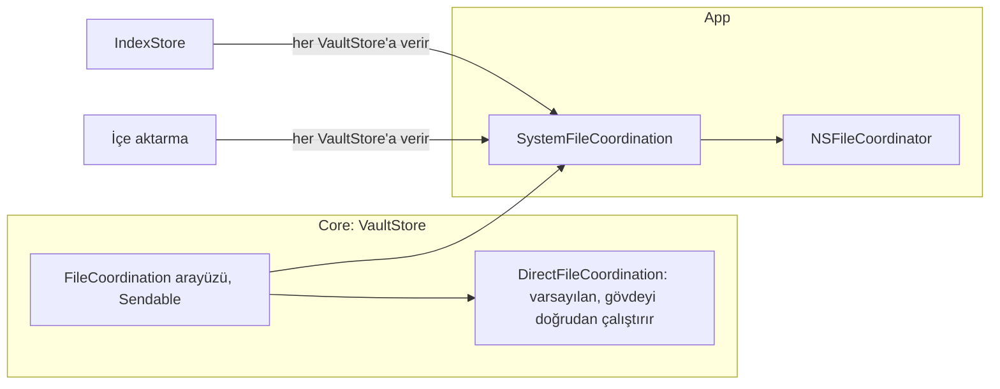

`Core`'daki `FileCoordination` arayüzü okuma, değiştirme, iki URL'li taşıma, iki URL'li birleştirme ve silme niyetlerini host katmanına iletir. Varsayılan `DirectFileCoordination` gövdeyi doğrudan çalıştırır. App arayüzü `SystemFileCoordination` ile `NSFileCoordinator` üzerinde uygular. `IndexStore` ve içe aktarma, açtıkları her `VaultStore`'a bu uygulamayı verir.

**Tablo her niyetin `NSFileCoordinator` seçeneğini gösterir.**

| Niyet | `NSFileCoordinator` çağrısı | Neden |
|---|---|---|
| Okuma | Seçeneksiz okuma koordinasyonu | Dosyayı sunan uygulama güncel baytları verir |
| Değiştirme | `.forMerging` yazması | Dosyayı sunan uygulamalar önce kaydeder; gövde güncel baytları okur |
| Taşıma | İki URL'li tek yazma: kaynak `.forMerging`, hedef `.forReplacing` | Kaynak düz dosyadır ve taşımadan önce gövde içeriği yeniden yazar. `.forMoving` düz dosyada etkisizdir ve iki seçenek birbirini dışlar |
| Taşıma, hedef kaynağın kendisi | Hedef seçeneksiz | Büyük ve küçük harf duyarsız birimde yalnız harf boyu değişen ad. `.forReplacing` dosyayı sunan uygulamaya silinme bildirirdi |
| Birleştirme | İki URL'li tek yazma: kaynak `.forDeleting`, hedef `.forMerging` | Gövde kaynağı okur ve en son siler; kaynağı sunan uygulama silinmeye yol verir. Gövde hedefi güncel baytlarından yeniden yazar; hedefi sunan uygulama önce kaydeder |
| Silme | `.forDeleting` yazması | Tek URL'li silme niyeti |

**Tablo hangi zincirin hangi koordinasyon sınırında çalıştığını gösterir.**

| Zincir | Sınır |
|---|---|
| Oku → dönüştür → atomik yaz → indeks güncellemesi | Tek değiştirme koordinasyonu |
| Yeniden adlandırmanın kaynak ve hedef yazması ve geri alması | Tek taşıma koordinasyonu |
| Yeniden adlandırmanın bağlantı güncellemeleri | Dosya başına değiştirme koordinasyonu |
| Taşıma bildirimi | Sınırın içinden: taşımadan hemen önce `item(at:willMoveTo:)`, yalnız başarılı taşımadan sonra `item(at:didMoveTo:)` |
| Gün kopyası birleştirme | Gün dosyası varsa tek `.merge(kopya → gün)` sınırı. Gün dosyası yoksa tek `.move(kopya → gün)` sınırı. Gün dosyası `.merge` içinde yok olursa taşıma aynı sınırda yapılır |

Taşıma bildirimi sınırın içinden gider, çünkü `NSFileCoordinator` dosya sunucularına bu bildirimi aynı koordineli bloktan ister. İndeks güncellemesi yazmayla aynı sınırdadır. Bu yüzden `VaultIndex` ve `VaultStore`'a verilen dosya okuyucuları koordinasyon başlatmaz.

### Yeniden adlandırmanın koordinasyon kapsamı

**Tablo bağlantı güncellemesinin hangi dosyaları koordine ettiğini gösterir.**

| Dosya grubu | Bulan | Ne olur |
|---|---|---|
| İndeksin, yeniden adlandırılan dosyaya bağlantı satırı tuttuğu dosyalar | İndeks | Dosya başına değiştirme koordinasyonu; güncelleme yazar |
| Ham frontmatter alanında eski adı anan dosyalar | Koordinasyonsuz okuma | Güncelleme dosyayı yazmaz. Yalnız `rawField` olarak bildirir. Bildirimi koordineli okumanın baytlarından üretir |

Ham alanlar bağlantı satırı değildir; bu yüzden tarama onları koordinasyonsuz okur. Kök dizinin okuma koordinasyonu içindeki dosyaların sunucularına ulaşmaz. Ölçüm: ne kaydetme ne okuma bildirimi gider. Bu yüzden tarama kök koordinasyonunu kullanmaz. Bedeli: başka bir düzenleyicide kaydedilmemiş ham alan değişikliği bildirimde görünmeyebilir.

### Çağrı kuralları

**Tablo `SystemFileCoordination` çağrılarının kurallarını gösterir.**

| Kural | Neden |
|---|---|
| Çağrılar eşzamanlıdır ve gövdeyi çağıran iş parçacığında bir kez çalıştırır | Gövde yazma kuyruğunda ya da okuma kuyruğunda kalır |
| Zaman uyumsuz `coordinate(with:queue:byAccessor:)` kullanma | Kuyrukta beklemek kilitlenmeye yol açar |
| İleride eklenecek `NSFilePresenter`'ın `presentedItemOperationQueue` değeri asla kasa yazma kuyruğu olmasın | Sunucu yazma kuyruğunu beklerse kilitlenme olur |
| `VaultIndex`'e koordine eden okuyucu verme | İndeks güncellemesi yazmanın sınırı içindedir; iç içe koordinasyon kilitlenmeye yol açar |
| Koordinatörün verdiği yeni URL'yi kullanma | `Core` istediği URL'leri kullanmaya devam eder |
| Sunucu kaydedemezse ya da host erişimi reddederse gövde çalışmasın | Çağrı koordinatörün hatasını atar. `VaultStore` indeksi hiçbir zaman dosyadan önce güncellemez |
| `persist` ve `atomicWrite` içinde iç içe koordinasyon başlatma | Bu ikisi zaten açık sınırın içinde çalışır |
| İndeks veritabanını koordine etme | Veritabanı kasa dışında, uygulamaya özel konumdadır |

Uygulamanın kendi dosya sunucusu henüz yoktur. İndeks taraması ve yenileme dosyaları koordinasyonsuz okur.

### Okuma kuyruğu

**Şema kasa başına iki kuyruğu gösterir.**

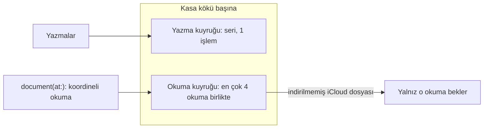

Yazmalar kasanın yazma kuyruğunda, `document(at:)` okuması kasanın okuma kuyruğunda bekler. Okuma kuyruğu bir Foundation işlem kuyruğudur; aktör, Swift eşzamanlılık havuzu ya da yazma kuyruğu değildir. İndirilmemiş bir iCloud dosyasının okuma koordinasyonu indirme bitene kadar sürer. Bu sürede yalnız o okuma bekler; aynı kasanın yazmaları, öteki okumaları ve ana iş parçacığı çalışmaya devam eder. Okumaların birbirine göre sırası yoktur. 4 okumalık sınır, art arda bekleyen indirmelerin her birinin bir iş parçacığı tutmasını önler.

**NOT:** Dört okuma indirme beklerken beşinci okuma sıra bekler, örneğin günün sayfası.

### Konum dosyası önbelleği

**Şema yer dosyasının ne zaman yeniden okunduğunu gösterir.**

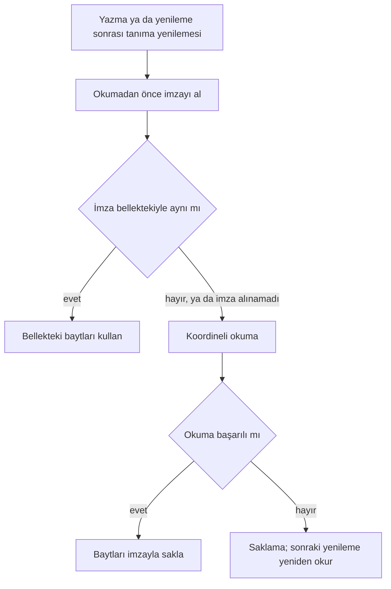

`IndexStore` her yazma ve yenilemeden sonra konum dosyalarını koordinatlar için okur. İmza şunları içerir: aygıt, inode, boyut, içerik değişiklik zamanı, öznitelik değişiklik zamanı. Dışarıdan değişen, yeniden adlandırmayla yola gelen ya da imzası alınamayan dosyayı `IndexStore` yeniden okur. Değişmeyen dosyanın okuması koordinasyondan geçmez. Bu yüzden dosyayı sunan bir uygulamanın kaydedilmemiş değişikliği, o uygulama kaydedip imza değişince görünür. İmza ve okuma aynı kasaya aittir: yenileme sürerken başka kasa açılırsa `IndexStore` dosyayı yenilemenin başladığı kasadan okur.

## İndeks

**Şema indeks tablolarını ve aralarındaki ilişkiyi gösterir.**

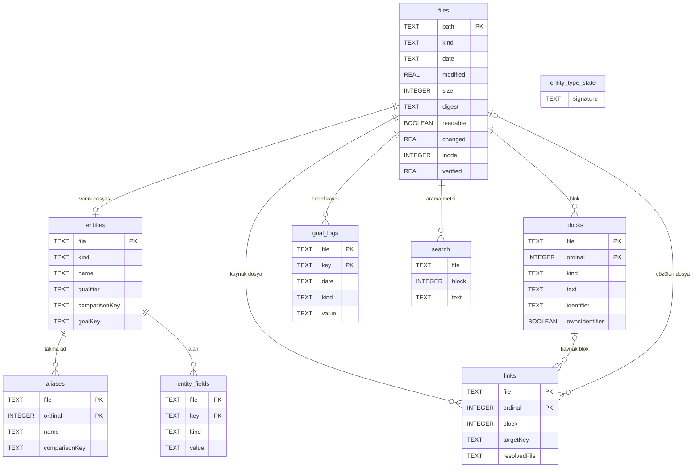

**Tablo indeksin genel kurallarını gösterir.**

| Konu | Kural |
|---|---|
| Konum | Her cihazda yerel, kasanın dışında. Eşitleme indeksi taşımaz |
| Yeniden üretim | Uygulama indeksi dosyalardan eksiksiz yeniden üretebilir. İndeks bozulursa uygulama indeksi siler ve yeniden kurar |
| Dosya adı | İndeks kasa yolunun SHA-256 özetiyle adlandırılmış ayrı bir Application Support veritabanındadır |
| Şema sürümü | Veritabanı sürümü tutar: `PRAGMA user_version = 9`. Sürüm 9 ad anahtarına Türkçe büyük harf eşlemesini ekledi; sürüm 8 indeksi silinir ve dosyalardan yeniden kurulur. Uygulamanın beklediği sürümle uyuşmazsa uygulama bütün tabloları siler ve güncel boş şemayı kurar. Şema göçü yok |
| Doldurma | Çağıran indeksi `rebuild(vaultRoot:)` ile ya da boş indekste tam kurulum yolunu kullanan `refresh(vaultRoot:)` ya da `update(paths:vaultRoot:)` ile dosyalardan doldurur |
| Bozuk veritabanı | Açılışta SQLite NOTADB ya da CORRUPT hatası gelirse uygulama dosyayı ve `-wal`/`-shm`/`-journal` yardımcılarını siler ve boş şemayı kurar. Diğer hataları fırlatır |

**Tablo her indeks tablosunun içeriğini gösterir.**

| Tablo | Anahtar | İçerik |
|---|---|---|
| `files` | NFC yol birincil anahtarı; tarih indeksi | Tür, gün tarihi, değişiklik zamanı (`mtime`), bayt boyutu, SHA-256, UTF-8 okunabilirliği, durum değişikliği zamanı (`ctime`), inode, son doğrulama anı |
| `entities` | Dosya | Tip, görünen ad, ayırt edici, karşılaştırma anahtarı, hedef alanları |
| `aliases` | Dosya + sıra | Takma ad ve karşılaştırma anahtarı |
| `entity_fields` | Varlık dosyası + üst düzey anahtar, bayt karşılaştırmalı | Kişi, konum ve kayıtlı özel tip dosyalarının yalnız tarih `date`, sayı `number` ve evet/hayır `boolean` alanları |
| `blocks` | Dosya + sıfır tabanlı sıra | Tür, bir tabanlı dahil satır aralığı, metin, bölüm, saat, görev durumu ve ham durum, isteğe bağlı kimlik, başlık düzeyi, sahiplik |
| `links` | Kaynak dosya + sıra | Kaynak blok ya da frontmatter anahtarı ve kaydı, fiziksel satır ve bayt aralığı, hedef, indeksli `targetKey` karşılaştırma anahtarı, çapa türü ve metni, görünen metin, gömme, çözülen dosya |
| `goal_logs` | Dosya + hedef anahtarı; hedef anahtarı indeksi | Gün, değer türü, kaynak değer yazımı |
| `search` | FTS5 | Blok metinleri, varlık adları, takma adlar |
| `entity_type_state` | Tek satır | Dosyadan türeyen tip id imzası |

**Tablo tablo ayrıntılarını gösterir.**

| Tablo | Ayrıntı |
|---|---|
| `entity_fields` | Tür, `vault-format.md` tür kurallarıyla değerin yazımından gelir; indeks tip tanımındaki alan türüne bakmaz. Kaynak değer yazımı aynen kalır: `29.0290`, `TRUE`, `+5` |
| `entity_fields` | Dışarıda kalanlar: metin, tırnaklı her değer, boş, liste, eşlem, ham alanlar ve `type/name/qualifier/aliases`. Hedef, gün ve not dosyaları ile çözülemeyen frontmatter satır üretmez |
| `entity_fields` | İndeksleyici satırları öteki tablolar gibi açık silme listesiyle temizler: tam kurulumda ve artımlı güncellemede. Satırlar `snapshot()` sonucunun `entityFields` dizisinde yer alır |
| `entity_fields` | `entityFields(kinds:)` türleri süzer: nil tümünü, boş küme hiçbirini verir. Sonuç dosya ve anahtar bayt sırasındadır |
| `blocks` | Benzersiz kısmi indeks sahip kimlikleri korur. Tüm kimlikleri kapsayan `block_identifiers` indeksi artımlı sahiplik sorgusunu hızlandırır |
| `blocks` | Görev blokları geçerli bitiş, başlangıç ve tamamlanma tarihlerini, öncelik belirtecini, projeyi ve tekrarı taşır. Bitiş ve tamamlanma tarihleri indekslidir. Görev metni tanınan alanlardan arınmıştır |
| `links` | Çözülemeyen hedefin çözülen dosyası `NULL` kalır |
| `goal_logs` | Boolean değerler `true`/`false`, sayılar kaynak yazımı, diğer türler ham yazım taşır |
| `search` | NFC metin üzerinde `unicode61 remove_diacritics 0`. Arama kullanıcı sorgusunu boşluklarda böler; her parça çift tırnaklı deyimdir, son parça önek eşleşmesidir. Arama dosya ve blok sütunlarına bakmaz |

### Bağlantı çözümü

`VaultIndex` bağlantı çözümünü kendisi yapar. Karşılaştırma anahtarı `VaultFormat` içindeki tek `nameComparisonKey` işlevidir: NFC, Türkçe büyük harf eşlemesi (`İ` → `i`, `I` → `ı`), yerelden bağımsız Unicode küçük harf ve yeniden NFC. `VaultStore` aynı anahtarla yeniden adlandırma hedeflerini bulur. Ad çakışması denetimleri (`filenameIsTaken`, yer tutucu kardeşi, hedef adı) `NameCollision` kullanır: anahtar ya da yalnız varsayılan küçük harf eşlemesi aynıysa ad doludur. Uygulamada rehberden içe aktarma planı (`ContactImportPlan`), ayırt edici sorusu (`MentionComposer`, `UnresolvedEntityModel`) ve hedef adı denetimi (`GoalDefinitionModel`) aynı `NameCollision` kuralını kullanır; dizin bildirimi kapsamı (`IndexUpdate`) indeks gibi `nameComparisonKey` ile karşılaştırır; arama varlık adı önekini, `@` önerisi (`MentionComposer`) ve varlık listesi süzgeci (`EntityListQuery`) ad içindeki parçayı iki okumadan biriyle eşler (`NameCollision.occurs(in:)`).

**Tablo bağlantı hedefinin nasıl çözüldüğünü gösterir.**

| Hedef | Çözüm |
|---|---|
| Boş hedef | Kaynak dosya |
| `/` içeren hedef | Köke göre uzantısız yol. Baştaki `/` ve `./` düşer |
| Diğer hedefler | Uzantısız dosya adı |
| Çakışma | Kod noktası sırasındaki ilk yol |
| `name` ve `aliases` | Yalnız varlık aramasında |

### Tam yeniden üretim

**Şema `rebuild` adımlarını gösterir.**

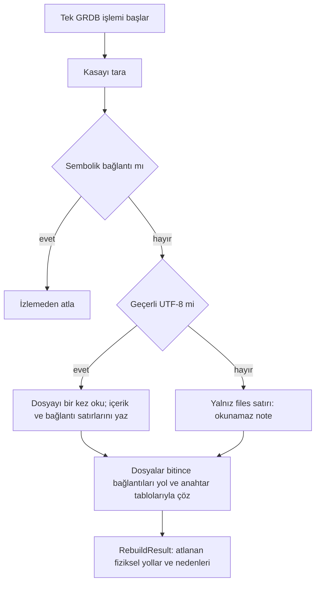

Tam yeniden üretim tek GRDB işlemi içinde tarar ve doldurur; hata eski içeriği korur. İndeksleyici okuma, tarama ve veritabanı hatalarını fırlatır. Aynı NFC yola dönüşen iki dosyadan fiziksel yolu bayt sırasında önce gelen girer. İndeksleyici belgeyi bellekte tutmaz.

**Tablo blok ayrıştırma kurallarını gösterir.**

| Konu | Kural |
|---|---|
| Paragraf | Olay ve görev aralıkları ve başlıklar dışındaki ardışık boş olmayan gövde satırları. Kod çitleri metin olarak dahildir |
| Başlık | Başlık paragrafı böler. Tanınan bölüm başlıkları blok üretmez. Diğer başlıklar `heading` bloğu olarak işaretsiz metin ve düzey taşır |
| Tanınmayan içerik | Tanınmayan bölüm ve ön içerik `other` taşır |
| İç içe görev | İndeks bağlantıyı en içteki bloğa bağlar |

### Artımlı güncelleme

**Şema `refresh` ve `update` yollarını gösterir.**

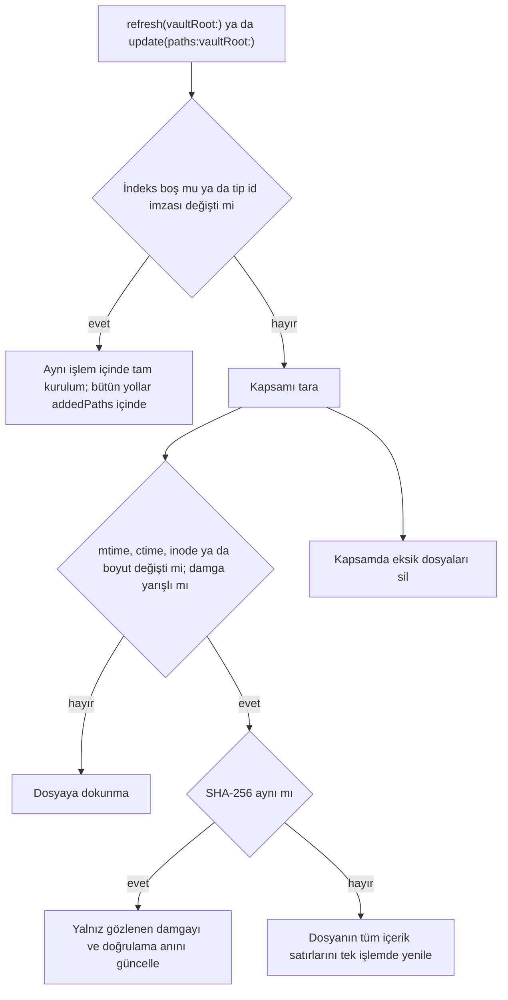

**Tablo, dosyayı yeniden okutan değişiklik işaretlerini gösterir.**

| İşaret | Yakaladığı durum |
|---|---|
| `mtime` ve boyut | Olağan düzenleme |
| `ctime` | Aynı boyutlu yerinde yazma. Kaba birimli diskte (FAT ve exFAT 2 sn, SMB ve NFS 1 sn) ya da geri alınmış `mtime` ile değişmeyen zaman |
| inode | Editörün yeni dosyayı eski dosyanın yerine taşıması |
| Yarışlı damga | Dosya son doğrulamadan önceki 2 sn içinde değişti. Aynı zaman adımındaki sonraki düzenleme hiçbir işareti değiştirmeyebilir. Bu yüzden indeks dosyayı damga aynı olsa da okur |

İndeks doğrulama anını ilk damgadan önce bir kez kaydeder. Her dosyanın damgasını dosyayı okumadan önce alır. Okuma sırasında gelen düzenleme bu yüzden eski bir damga bırakır ve sonraki tarama dosyayı yeniden okur. Yarışlı dosyanın özeti aynıysa indeks yalnız damgayı ve doğrulama anını yeniler. Dosya `mtime` değerinden 2 sn sonra doğrulanınca oturur ve yeniden okunmaz. Damga `stat` çağrısından gelir; Linux'ta da aynı alanlar okunur.

**Tablo tarama kapsamını gösterir.**

| Çağrı ya da bildirilen yol | Taranan kapsam |
|---|---|
| `refresh(vaultRoot:)` | Bütün kasa |
| `update(paths:vaultRoot:)`, dizin | Alt ağaç |
| `update(paths:vaultRoot:)`, dosya ya da silinmiş yol | Üst dizinin tek düzeyi |
| `update(paths:vaultRoot:)`, kök `""` | Bütün kasa |
| Harfe duyarsız ya da NFC eşleşen indeksli yol | Diskteki üst dizini ve aynı karşılaştırma anahtarındaki kardeş üst dizinleri, tek düzey |

`refresh(vaultRoot:)` ve `update(paths:vaultRoot:)` boş indekste tam kurulum yolunu kullanır: ilk açılış, şema sürümü değişimi ya da bozuk veritabanının silinmesi sonrasında bildirilen yol kasanın kalanını eksik bırakmaz. `refresh` ve `update` tip id imzası değişince aynı yolu kullanır; sonuç `rebuild` ile aynıdır. `update(paths:vaultRoot:)` bildirilen NFC kasa içi dosyalarla ve dizinlerle hem taramayı hem içeriği sınırlar. Silinen yollar gerçekten dolaşılan kapsamın alt kümesidir. Ayrıştırma ve indeks yazımı artımlıdır. Güncelleme kapsam dışı `files` satırlarına dokunmaz; `skippedPaths` yalnız tarama kapsamında görülenleri bildirir.

Birleşmiş gün dosyası belirlenimci zaman taşır; yazma `ctime` değerini değiştirdiği için artımlı tarama aynı boyutlu farklı içeriği de okur. B5 bağlaması (yol haritasında açık) birleştirme sonrası dosyayı zorla yeniden okuyacaktır. Core sonucu `dayFileChanged` alanıyla gün dosyasının yazıldığını ya da taşındığını bildirir.

Güncelleme değişen yolların dosya adı ve yol anahtarlarına sahip bağlantıları yeniden çözer. Çözülmüş yinelenen adlar ve yeni içerikteki bağlantılar da bu kümeye girer; `name` ve `aliases` varlık araması içindir. Güncelleme eski ve yeni blok kimliklerinin sahipliğini yol ve dosya içi sıra üzerinden yeniden hesaplar. Hata tüm değişiklikleri geri alır. Ortak `RebuildResult` eklenen, güncellenen ve silinen NFC yolları ve kapsamda atlanan fiziksel yolları bildirir.

### Dosya başına okuma ve bildirim kapsamı

`blocks(inFile:)` ve `links(inFile:)` bir dosyanın blok ve bağlantı satırlarını kaynak sırasıyla döner. `contents(ofFile:)` aynı dosya için `files` / `entities` / `aliases` / `blocks` / `links` / `goal_logs` / `entity_fields` dilimini tek okuma işleminde verir. Dosya yoksa sonuç `nil` olur. Şema değişmez.

`update` bildirim kapsamını kasa köküne göre ad karşılaştırma anahtarıyla (`nameComparisonKey`) karşılaştırır. Yol bildiren bir izleyici yeniden adlandırmada eski ve yeni yolu bildirir. Eksik bildirimleri sonraki `refresh` düzeltir. İndeks kökü bir kez gerçek yola çözer. Silinmiş bildirimlerde indeks en yakın mevcut üst dizinin gerçek yoluna kayıp kuyruğu ekler. Böylece `/private` yol yazımları aynı kasa kimliğinde birleşir.

## Eşitleme

**Durum: kısmen uygulandı.** Kasa iCloud kapsayıcısında durabilir (2026-10-22). Açık: indirme isteği, gün kopyası birleştirmesinin bağlanması, sürüm çözümleme ve eşitleme göstergesi.

**Tablo eşitlemenin bugünkü durumunu gösterir.**

| Parça | Durum |
|---|---|
| Kasa konumu | iCloud kapsayıcısında `Documents/Kenet`, uygulamanın yerel `Documents/Vault` klasörü ya da kullanıcının seçtiği klasör |
| `VaultStore` yazmaları ve belge okumaları | `NSFileCoordinator` ile koordineli: `SystemFileCoordination` |
| İndeks taraması | Koordinasyonsuz |
| İçe aktarmanın klasör, şablon ve ayar dosyası oluşturması | Koordinasyonsuz |
| Dosya sunucusu `NSFilePresenter` | Yok |
| İndirilmemiş dosya için açık indirme isteği `startDownloadingUbiquitousItem` | Yok |
| Çakışma birleştirme işlevi | `VaultFormat` içinde hazır ve sınanmış; uygulamaya bağlı değil |
| Yer tutucu tanıma | `Core` içinde hazır; App bağlantısı sonraki dilim |
| Gün kopyası birleştirme | `Core` içinde hazır; App bağlantısı sonraki dilim |
| Eşitlenen klasör tespiti | `SyncedFolderKind`: yol kalıpları ve `isUbiquitousItemKey`. Sağlayıcılar: iCloud Drive, Dropbox, OneDrive, Google Drive, File Provider |
| Çakışan sürüm `NSFileVersion` | Var: tespit ve listeleme; çözümleme yok. Yalnız iCloud Drive kasasında. `ConflictVersionSource` |
| Çakışma kopyası listesi | `VaultIndex.conflictCopies(vaultRoot:)`; her kasada. Ad kuralı `ConflictCopyName` |

**UYARI:** Eşitlenen bir klasörü kasa olarak seçme; uygulama bu klasörü şimdilik tam korumaz.

### Eşitleme güvenliği

**Şema tarama sonucunun eşitleme dosyalarını nasıl ayırdığını gösterir.**

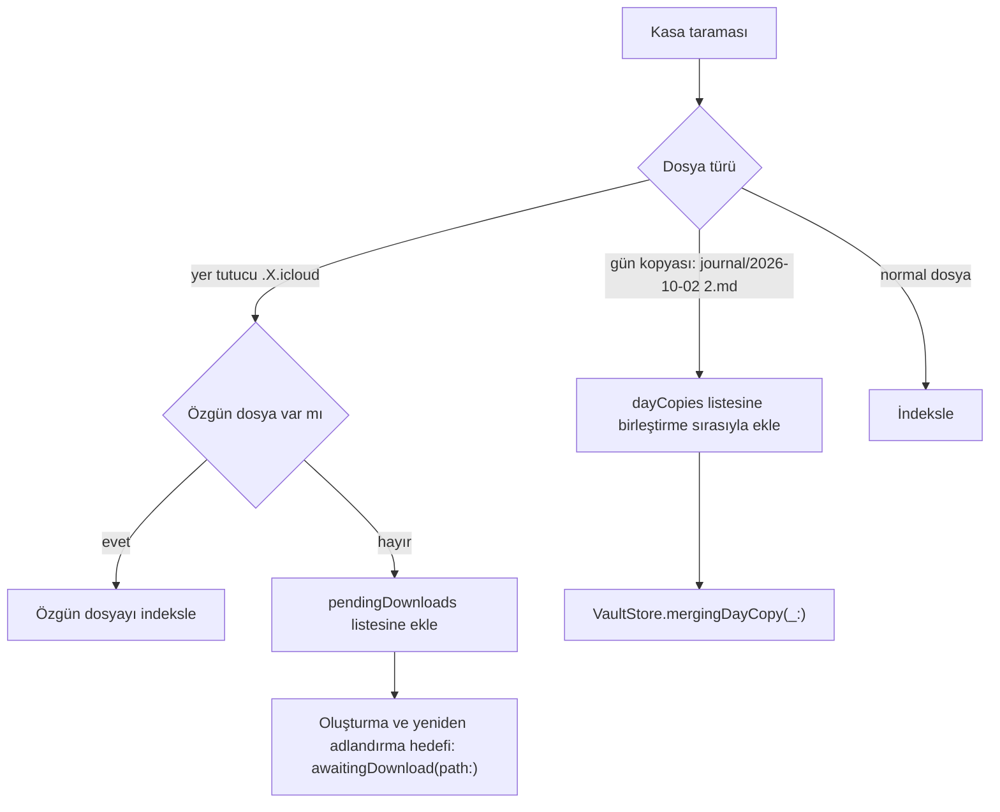

`Core` `.X.icloud` yer tutucularını indekslemez; tarama sonucunun `pendingDownloads` alanında bildirir. Özgün dosya varsa `Core` özgün dosyayı kullanır. Özgün dosya yoksa `Core` oluşturma ve yeniden adlandırma hedeflerini koordinasyon sınırında `awaitingDownload(path:)` ile reddeder. İndirme isteği App katmanının sonraki dilimidir. İndirilmemiş dosyaları okuma kuyruğu karşılar: indirme bekleyen okuma yalnız kendini bekletir.

`Core` gün kopyalarını indekslemez. Örnek ad: `journal/2026-10-02 2.md`; ad kuralı `DayCopyName`. Tarama sonucu kopyaları `dayCopies` alanında birleştirme sırasıyla bildirir. Tanılama gün kopyalarını ve varlık kopyalarını `VaultIndex.dayCopies(vaultRoot:)` ve `entityCopies()` ile listeler; kopya kuralı `EntityCopyName`. Uygulama bu listeden hiçbir dosyayı birleştirmez, taşımaz ya da silmez.

**Şema bir gün kopyasının tek koordinasyon sınırında birleşmesini gösterir.**

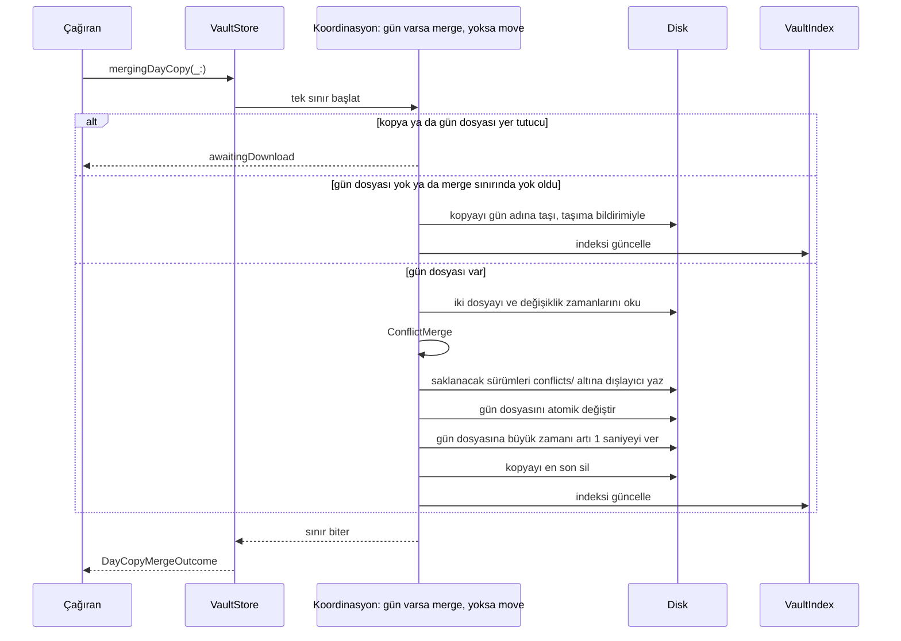

`VaultStore.mergingDayCopy(_:)` gün dosyası varsa kopyayı tek `.merge(kopya → gün)` sınırında birleştirir. Gün dosyası yoksa kopyayı tek `.move(kopya → gün)` sınırında gün adına taşır. `VaultStore` taşıma sınırını seçtikten sonra gün dosyası oluşursa `VaultStore` taşıma sınırını değişiklik yapmadan bitirir. Sonra kopyayı yeni bir `.merge` sınırında birleştirir. Gün dosyası `.merge` sınırı içinde yok olursa kopyayı aynı sınırda gün adına taşır.

Gün dosyası değişmeden önceki her hata, o çağrının yazdığı çakışma kopyalarını geri alır. Yalnız zaman verme ya da silme başarısızsa gün dosyası birleşmiş kalır. Sonraki çağrı aynı içeriğe varır ve kopyayı siler. App bağlantısı sonraki dilimdir: taramadan sonra kopyaları sırayla birleştirme ve sonucu kullanıcıya gösterme.

### Çakışan sürümler

**Şema çakışan sürümlerin Tanılama'ya hangi yoldan geldiğini gösterir.**

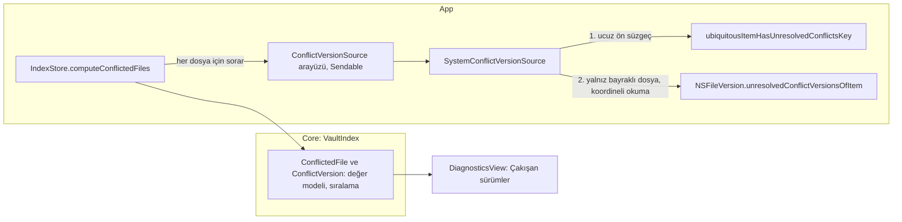

`Core` Apple çerçevesi kullanmaz; bu yüzden `NSFileVersion` yalnız `App/Services` altındaki `SystemConflictVersionSource` içindedir. `IndexStore` kaynağı `conflictVersions` başlatma parametresiyle alır; varsayılan sistem kaynağıdır, testler sahte kaynak verir. `computeConflictedFiles` yalnız `syncedFolder == .iCloudDrive` iken çalışır; öteki kasada hiçbir dosyaya sormadan boş döner. Aday yollar indeksteki dosyalar ve `VaultIndex.dayCopies(vaultRoot:)` listesidir. Sorgu `taskQuery` deseniyle ayrık görevde koşar ve kasa kuşağına bağlıdır. Sistem kaynağı sürümleri `SystemFileCoordination` okuma koordinasyonu içinde okur. Uygulama hiçbir sürümü birleştirmez, seçmez ya da silmez: `NSFileVersion.removeOtherVersionsOfItem`, `replaceItem` ve `isResolved` kullanılmaz.

Tanılama listeyi `store.lastUpdated` değişince ve sahne ön plana her dönünce yeniden okur. Bir iCloud çakışması kasa klasöründe izleyicinin göreceği bir olay üretmeyebilir.

### Hedeflenen davranış

**Tablo eşitlemenin hedeflenen davranışını gösterir.**

| Konu | Hedef |
|---|---|
| Kasa konumu | Hazır: iCloud kapsayıcısı, yerel kasa ve seçilen klasör. Dosyalar/Finder görünürlüğü gerçek cihazda doğrulanır. |
| Sunucu | Sunucu, hesap ya da özel eşitleme servisi yoktur |
| iCloud kapalı | Kayıtlı iCloud kasası erişilemez ekranında kalır; tür değiştirilmez ve dosyalar silinmez. Kullanıcı yerel kasayla devam etmeyi açıkça seçebilir. |
| İlk açılış | Uygulama kasa konumunu ilk açılışta belirler ve cihazda kaydeder: iCloud açıksa kapsayıcı, değilse yerel |
| iCloud durumu değişti | Uygulama kendiliğinden diğer konuma geçmez. Kayıtlı konuma erişim yoksa yeni kasa açmaz, durumu bildirir |
| Konumlar arası taşıma | Hazır: yerel varsayılan kasadan iCloud’a doğrulanmış kopya; kullanıcı onayı gerekir ve yerel kaynak korunur. İki cihaz iCloud yayılımından önce aynı anda taşırsa ikisi de `Kenet` adını alabilir; iCloud aynı adlı klasörleri birleştirir ve aynı yoldaki dosyalar çakışan sürüm olur. Kodla önlenemez; veri kaybolmaz, çakışma kuralları uygulanır. |
| Çakışma | Birleştirme satırları blok kimliğine göre birleştirir. Birleşmeyen içerik kopya olarak kalır. iCloud'un aynı gün için ayırdığı kopya dosyalar da aynı işlevle birleşir. Kurallar: `vault-format.md` |
| İndirme | Kasadaki tüm dosyalar cihazda durur. Uygulama indirilmemiş dosya için indirme ister ve dosya geldikçe indeksler |
| Arayüz | Arayüz eldeki içeriği gösterir ve eşitlemenin sürdüğünü belirtir |

## Widget'lar

**Durum:** ana ekran zincir widget'ı uygulandı: iOS, küçük ve orta boy. Orta boy widget iCloud kasasının açık evet/hayır hedefini kendi sürecinde işaretler. Kilit ekranı widget'ı sıradaki etkinlik ve görev sayısını üç accessory ailesinde gösterir. Hızlı giriş, Denetim Merkezi ve Mac widget'ları sonraki dalgadır.

**Şema widget'ın veri yolunu ve iki yazma yolunu gösterir.**

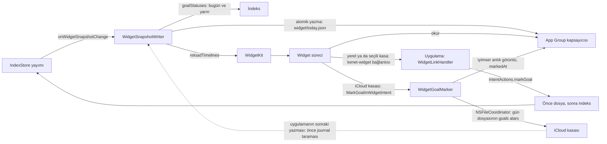

**Tablo widget'ın kurallarını gösterir.**

| Konu | Kural |
|---|---|
| Hedef | `JournalWidgets`: WidgetKit uzantısı, yalnız iOS, `Widgets/` klasörü. Uygulama uzantıyı gömer. Sürüm ve yapı numarası uygulamanınkiyle aynı yazılır |
| Kasa erişimi | Widget uygulamanın indeksini açmaz. Widget ayrı bir süreçtir ve belleği dardır (yaklaşık 30 MB). Süreç uygulamanın yer imini, `UserDefaults.standard` deposunu ve `Application Support` indeksini göremez. Widget gösterdiğini yalnız uygulamanın App Group'a yazdığı küçük anlık görüntüden okur. Kasaya yalnız iCloud kasasında ve yalnız işaretleme için erişir: aşağıda "Widget içinden yazma" |
| Ortak kaynak | `Widgets/Shared` iki hedefte derlenir: anlık görüntü biçimi (`WidgetSnapshot`, yalnız Foundation), widget bağlantısı (`WidgetLink`), widget içi işaretleme (`WidgetGoalMarker`; Core'un `VaultFormat`, `VaultIndex`, `VaultStore`, `GoalTracking` ürünleri ve `SystemFileCoordination`), görünümler ve renk belirteçleri (`WidgetTheme`). Testler işaretlemeyi de uygulama konağında koşar. Renkler uygulamanın varlık kataloğundaki adlardır; katalog widget hedefine de girer. Ekran görüntüsü testleri görünümleri uygulama konağında çizer |
| Anlık görüntü | `<grup>/widget/today.json` dosyası. İçerik: biçim sürümü, yazılma zamanı, kasa kimliği (kasa yolunun SHA-256 özeti; App Intents'in `IntentGoal.id` öneki), kasa türü (`vaultKind`: `local`, `selected`, `icloud`), iCloud kasasının kapsayıcı içindeki yolu (`cloudRelativePath`, `Documents/Kenet`; öteki kasada yok), widget'ın kendi işaretlemesinin zamanı (`markedAt`; uygulama yazınca yok), bugün ve yarın için günlük hedefler. Kök `hideContent: Bool?` bildirim gizlilik tercihidir (yoksa gizli). Gün başına `events: [Event]?` (title, start, end, isAllDay; başlangıca göre en çok 5) ve `openTaskCount: Int?` eklenir. Görev metni saklanmaz; gizliyken etkinlik başlığı boştur. Takvim izni yoksa `events` yazılmaz. Yeni alanlar isteğe bağlıdır; biçim sürümü 1 kalır. Hedef başına: anahtar, ad, tür (evet/hayır ya da sayı), hedef miktar, birim, günün değeri, bekliyor mu, zincir, zincir günü bakiyesi. Haftalık hedefler, yıllık hedefler ve kilometre taşları girmez. Bekleyen hedefler önce gelir, sonra ada göre sıralanır |
| Yazma | `WidgetSnapshotWriter` her yayımda çalışır (`IndexStore.onWidgetSnapshotChange`; bildirim servisinin `onSnapshotChange` dinleyicisinden ayrı). Sahne öne gelince ve kilit açılınca da çalışır. Yazıcı `goalStatuses(today:)` sorgusunu bugün ve yarın için ekranlarla aynı yoldan sorar. Görev sayısını `computeNotificationDays` kaynağındaki o güne vadesi gelen açık görevlerden alır (bildirimdeki “N görev bugün”; gecikmişler ayrı olduğundan bu sayıya girmez). Enjekte edilen `CalendarEventSource` uygulama sürecinde etkinlikleri okur; widget EventKit'e dokunmaz. Uygulama çalışmadan eklenen etkinlik widget'a yansımaz. `NotificationPreferences.hideContent` varsayılan true olarak dosyaya yazılır. Sonucu geçici dosyaya yazar ve yerine taşır (`Data.write(.atomic)`). Ardından `WidgetCenter.reloadTimelines(ofKind:)` çağırır. İçerik değişmediyse yazmaz ve yenilemez; `markedAt` ve yazılma zamanı içerik sayılmaz. Üst üste gelen yayımlar tek koşuda birleşir; son yayım kazanır |
| Silme | Kasa erişilemezken yazıcı dosyayı yazmaz, varsa siler. Widget "Kenet'i aç" gösterir. Kasa daha açılmamışken ya da açılırken yazıcı dosyaya dokunmaz; yalnız dosya başka kasanınsa siler. Böylece açılamayan yeni kasa eski kasanın hedeflerini widget'ta bırakmaz |
| Kilit | Uygulama kilitliyken yazıcı dosyaya dokunmaz: ne yazar ne siler. Kilit açılınca dosyayı bir kez yazar. Dosyayı yalnız uygulamanın çalışırken devreye soktuğu kilit siler: kilit gecikmesi "Hemen" iken uygulama arka plana geçtiği anda kilitlenir ve dosyayı siler (`WidgetSnapshotWriter.lockEngaged`). Gecikme daha uzunsa uygulama arka plana geçerken dosyaya kilidin devreye gireceği anı yazar (`lockedAfter`; `WidgetSnapshotWriter.lockDeferred`, an `AppLockService.locksAt`). Dosya kalır. `JournalApp` ön planı bırakan her sahne evresini yazıcıya verir (`WidgetSnapshotWriter.sceneLeftForeground`). Uygulama `.inactive` evresinde de anı yazar: süre o andan sayılır, "Hemen" kipinde an o andır. Arka plan evresi anı yeniden yazar. Öne dönüş anı siler. Widget'ı yalnız arka plan evresi yeniler: `.inactive` evresi ve öne dönüş dosyayı yeniden yüklemeden yazar. Bildirim Merkezi ve uygulama değiştirici `.inactive` evresinden sık geçer; her yenileme WidgetKit'in günlük bütçesinden düşer. Yenilenmemiş widget eski zaman çizelgesini gösterir, ama işaretleme dosyadaki anı okur ve o andan sonra yazmaz. An tam saniyeye aşağı yuvarlanır: dosyadan okunan an aynıdır ve arka plandaki yayım dosyayı yeniden yazmaz. Widget o andan sonra "Kenet'i aç" gösterir ve işaretlemez: uygulamanın kendi niyetleri gibi (karar 2026-10-06). Arka plandaki yayım anı korur. Uygulama öne gelince süresi dolmuş kilidi fark eder; dosyaya yine dokunmaz. Uygulama öne gelip kilidi açık olunca yazıcı anı siler. Böylece her açılışta "sil, sonra yeniden yaz" titremesi olmaz. Widget içeriği zaten `privacySensitive` taşır. Bilinen sınır: "Hemen" kipinde dosya yalnız uygulama çalışırken kilitlenince silinir. Süreç arka plan evresini görmeden sonlanırsa (çökme, uygulama değiştiricide kapatma) dosya kalır ve yalnız `.inactive` evresinde yazılan an widget'ı durdurur. Süreç `.inactive` evresini de görmeden sonlanırsa an yazılmaz: widget, uygulama açılıp kilit açılana kadar işaretler |
| Gün değişimi | Zaman çizelgesi bugünün girişini hemen, yarının girişini gece yarısından gösterir. Yarının girişi Core'un yarın için hesapladığı durumdur: bugün işaretlenmediyse zincir günü harcanır ya da zincir kırılır. Yarından sonra "Kenet'i aç" gelir |
| Dokunma | Küçük widget tek dokunma hedefidir ve uygulamayı Bugün'de açar. Orta widget'ta iCloud kasasının bekleyen evet/hayır hedefi widget içinde işaretlenir (aşağıda). Yerel ya da seçili kasada bu satır `kenet-widget://mark?goal=<kimlik>` bağlantısıyla uygulamayı açar. `WidgetLinkHandler` Bugün'e geçer ve `IntentActions.markGoal` ile hedefi o gün için işaretler. Sayı hedefinin ve yapılmış hedefin satırı Bugün'ü açar. Uygulama kilitliyse işaretleme kilit açılınca yapılır. Uygulama URL şeması kaydetmez: bağlantıyı yalnız kendi widget'ı açar (`ReleaseConfigurationTests`). Şema kaydedilirse `WidgetLinkHandler` önce kaynağı denetlemelidir |
| Widget içinden yazma | Yalnız iCloud kasasında: anlık görüntüde `vaultKind` `icloud` ve `cloudRelativePath` dolu. Satır `Button(intent:)` ile `MarkGoalInWidgetIntent` niyetini widget sürecinde çalıştırır (`openAppWhenRun = false`, Kısayollar'da görünmez). `WidgetGoalMarker` önce anlık görüntüyü okur: dosya yoksa (kasa erişilemez, uygulama çıkarken kilitlendi), kilidin devreye girme anı (`lockedAfter`) geçtiyse ya da hedef bugünün bekleyen evet/hayır hedefi değilse hiçbir şey yazmaz. Sonra kapsayıcıyı `url(forUbiquityContainerIdentifier:)` ile alır; iCloud kapalıysa, hesap yoksa ya da kasanın `.app/vault.json` dosyası cihazda değilse yazmaz. Anlık görüntü kasa klasörünün ve `.app/vault.json` dosyasının bu cihazdaki dosya numaralarını taşır (`cloudVaultIdentity`). Aynı yerde başka bir kasa varsa (başka hesabın kapsayıcısı, Dosyalar'da değiştirilmiş klasör) numaralar tutmaz ve widget yazmaz. Uygulama numaraları bulamazsa dokunma uygulamayı açar. Gün dosyasını Core'un yazıcısı yazar: `VaultStore.settingGoalValue`, `SystemFileCoordination` (`NSFileCoordinator`, `.forMerging`). Gün dosyası henüz inmediyse Core yazmaz (`awaitingDownload`). Sonra widget anlık görüntüde hedefi yapılmış, zinciri bir uzun gösterir (7'nin katında bir zincir günü ekler, en çok 3; dünkü kaçırmaya harcanan zincir günü uygulamanın sonraki yazmasında görünür), yarının girişine yeni zinciri taşır, `markedAt` yazar ve zaman çizelgesini yeniler. Yerel ve seçili kasa uygulamanın sandbox'ında ya da güvenlik kapsamlı yer iminde durur: widget erişemez, dokunma uygulamayı açar |
| Widget'ın indeksi | Core'un yazıcısı yazmadan sonra indeksini günceller; boş indeksi önce bütün kasadan kurar. Widget uygulamanın indeksini açmaz: bellekte atılacak bir indeks kurar. İndeks tek boş nottan ve kasanın `.app/types.json` dosyasından oluşan geçici bir kasadan başlar. Böylece güncelleme yalnız yazılan günü okur. Ölçüm, 5 yıllık sentetik kasa (2.271 dosya, iOS simülatörü): bu yolla 0,08 sn ve test konağında yaklaşık 0,2 MB; boş indeksle 7,5 sn ve yaklaşık 13 MB (`WidgetRefreshReliabilityTests.fiveYearVaultMarkCost`, `MEASURE_WIDGET=1`; simülatörde xcodebuild ortamında `TEST_RUNNER_MEASURE_WIDGET=1` ve `-only-testing` ile küme adı). Widget sürecinin kendi belleği cihazda ölçülür |
| Uzlaşma | Widget'ın yazdığı gün dosyasını uygulamanın indeksi henüz görmedi. Anlık görüntüde `markedAt` varsa yazıcı sorgudan önce `journal` klasörünü tarar (`refresh(directories:)`) ve taramanın bitmesini bekler. Sonra indeks yanıtını yazar: widget'ın işaretlemesi eski yanıtla ezilmez. İndeks ve widget aynıysa yazıcı yalnız `markedAt` alanını siler, zaman çizelgesini yenilemez. Dosyada işaret artık yoksa (başka cihaz, düzenleyici) indeks kazanır. Uygulama öne gelince, kilit açılınca ve izleyici gün dosyasındaki değişikliği görünce yazıcı çalışır |
| Aynı dosyaya iki süreç | Uygulama ve widget gün dosyasını aynı koordinasyonla yazar: biri dosyayı tutarken öteki bekler, sonra güncel baytları okur. Core yalnız hedeflenen satırı değiştirir. İki değişiklik de kalır, başka bayt değişmez (`WidgetMarkingTests`) |
| App Group deposu | `AppGroupStore` kapsayıcıyı verir. Kapsayıcı yoksa (imzasız derleme, test) yazıcı sessizce kapalıdır. Testler geçici klasör verir. Mac grubu henüz kullanmaz: imzasız Mac derlemesinde kapsayıcıya dokunmak kullanıcıdan izin ister |
| Gizlilik | Widget içeriği `privacySensitive` taşır: kilitli cihazda (StandBy, iPad kilit ekranı) sistem içeriği gizler |
| Yerelleştirme | Widget uygulamanın String Catalog'unu derler: `App/Resources/Localizable.xcstrings`, tr ve en. Tek katalog: CI'daki katalog denetimi (`check-catalog-keys.py`) `Widgets/` klasörünü de tarar |

Yerel ve seçili kasada dokunma App Intent düğmesi yerine bağlantı kullanır. `MarkGoalIntent` uygulamanın `IndexStore` nesnesine bağlıdır ve widget hedefinde derlenemez. `openAppWhenRun` değerini açmak Kısayollar'daki işaretlemeyi de uygulamayı açmaya zorlardı. Bağlantı aynı işaretleme yolunu kullanır: `IntentActions.markGoal`. iCloud kasasının niyeti ayrıdır (`MarkGoalInWidgetIntent`): yalnız widget hedefinde derlenir ve uygulamanın store'una bağlı değildir.

## Paylaşım uzantısı

**Durum:** iOS paylaşım sayfasında "Kenet" uygulandı: düz metin ve tek web bağlantısı (Safari sayfası). Mac paylaşım uzantısı yok.

**Şema paylaşılan metnin iki yazma yolunu gösterir.**

```mermaid
flowchart TD
  Form["Form: Ekle"] --> Hedef{"share/target.json: iCloud kasası ve uygulama kilidi kapalı mı?"}
  Hedef -- Evet --> Kap{"Kapsayıcı ve Documents/Kenet/.app/vault.json var mı?"}
  Kap -- Evet --> Yaz["Core VaultStore.addingEvent: NSFileCoordinator, bellekte boş indeks"]
  Yaz -- "baytlar kaydedildi" --> Isaret["share/written.json: işaret"]
  Yaz -- "kaydedilmedi" --> Kuyruk["share/pending.json: kuyruk"]
  Kap -- Hayır --> Kuyruk
  Hedef -- Hayır --> Kuyruk
  Isaret --> Uyg["Uygulama açılır, kasa açık, kilit açık"]
  Kuyruk --> Uyg
  Uyg -->|"işaret"| Yenile["IndexStore.refresh: journal klasörü"]
  Uyg -->|"kuyruk"| Ekle["IndexStore.addEvent: önce dosya, sonra indeks; ad tanıma"]
  Ekle --> Sil["Kayıt kuyruktan çıkar"]
```

**Tablo paylaşım uzantısının kurallarını gösterir.**

| Konu | Kural |
|---|---|
| Hedef | `JournalShare`: share extension, yalnız iOS, `ShareExtension/` klasörü. Uygulama uzantıyı gömer. Sürüm ve yapı numarası uygulamanınkiyle aynı yazılır. Etkinleştirme kuralı: düz metin ve en çok bir web bağlantısı |
| Giriş noktası | `ShareViewController` (`NSExtensionPrincipalClass`). Apple paylaşım uzantısını bir görünüm denetleyicisiyle başlatır; SwiftUI karşılığı yoktur. Denetleyici yalnız SwiftUI formunu barındırır ve isteği bitirir. Uzantının tek UIKit tipi budur |
| Form | `ShareFormView`: tek alan, önceden dolu (`ShareInput`, `EntryWriting.prefill`). Safari'den bağlantı geldiyse `<başlık> <bağlantı>`; başlık sayfadan gelir, işaretleri düz sözcük olur: `[[` tek köşeli ayraç, sözcük başındaki `@` ve `#` tam genişlikli biçim (Journaling Suggestions başlıklarıyla aynı kural). Bağlantı yoksa paylaşılan metin; ek yoksa öğenin kendi metni (`attributedContentText`). Kullanıcının metnine dokunulmaz. Satır sonları ve boşluk dizileri tek boşluk olur: olay tek satırdır. Gün bugün, saat şimdiki dakika. Uzantı uygulamanın bileşenlerini derlemez (kabuğa bağlılar); form sheet görünümünü tasarım belirteçleriyle kurar: `InkColors`, `InkFonts`, `InkMetrics`, `InkButtonChrome` |
| Uygulamanın notu | Uygulama `<grup>/share/target.json` dosyasına açık kasanın türünü (`icloud`, `local`, `selected`, `none`) ve uygulama kilidinin açık olup olmadığını yazar (`ShareTarget`). Yazma: kasa yayımlanınca, sahne öne gelince ve arka plana geçince, kilit ayarı değişince; değer değişmediyse yazmaz. Uzantı `UserDefaults.standard` deposunu göremez; not bu yüzden dosyadır. Not yoksa ya da okunamıyorsa uzantı kuyruğa yazar |
| Yol (a): iCloud | Not `icloud` ve kilit kapalıysa uzantı iCloud kapsayıcısını çözer ve `Documents/Kenet` kasasına kendisi yazar: Core `VaultStore.addingEvent`, `SystemFileCoordination` (`NSFileCoordinator`), bellekte boş `VaultIndex`. Yazıcı gün dosyasına yalnız yeni satırı ekler; dosyanın geri kalanı bayt düzeyinde kalır. Sonra `share/written.json` listesine işaret ekler. Kapsayıcı yoksa, kasanın ayar dosyası yoksa, gün dosyası henüz iCloud'dan inmediyse, kasa ya da gün salt okunursa uzantı hiçbir bayt yazmaz ve yol (b)'ye geçer |
| Yol (b): kuyruk | Yerel kasa (`Documents/Vault`) ve seçili klasör uzantıdan erişilemez. Uygulama kilidi açıksa iCloud kasasına da yazılmaz: içerik gün dosyasına uygulama açılıp kilit çözülünce girer. Uzantı metni `<grup>/share/pending.json` kuyruğuna ekler |
| Liste biçimi | `pending.json` ve `written.json`: `{"format":1,"entries":[…]}`. Kayıt: `id` (UUID), `text` (tek satır), `day` (`YYYY-MM-DD`), `time` (`HH:MM`), `sharedAt` (ISO 8601), isteğe bağlı `writing` (uygulamanın yazmakta olduğu satır metni). Her değişiklik koordineli okuma, değişiklik ve atomik yazmadır (`NSFileCoordinator`, `Data.write(.atomic)`): uzantının eklediği ve uygulamanın çıkardığı kayıt birbirini ezmez. Son kayıt çıkınca dosya silinir |
| Uygulamanın işlemesi | `ShareQueueProcessor`. Kasa açık, yazılabilir ve yayımlanmışken, uygulama kilitli değilken çalışır: kasa yayımlanınca, sahne öne gelince, kilit açılınca. Önce işaretler: `IndexStore.refresh(directories: ["journal"])`, sonra işaretler silinir. Sonra kuyruk: her kayıt `IndexStore.addEvent` ile kendi gününe ve saatine yazılır (önce dosya, sonra indeks). Yazmadan önce kayda `writing` alanı (bağlanmış satır metni) yazılır; işaret yazılamazsa kayıt yazılmaz, bekler. Kayıt, satırı kaydedilir kaydedilmez kuyruktan çıkar; ikinci koşu ya da sonraki açılış onu yeniden yazmaz. Koşu kayıttan sonra ve çıkarmadan önce durduysa sonraki koşu `writing` taşıyan kaydın gününde aynı metin ve saatte olay arar: varsa yazmadan çıkarır, yoksa yazar. Gün okunamazsa kayıt bekler. Yazma başarısız olursa kayıt geldiği gibi kalır: işaretli kayıt işaretini korur. Gün iCloud yer tutucusuna döndüyse arama satırı göremez, Core yazmayı reddeder; gün inince sonraki koşu satırı bulur. Üst üste gelen istekler tek koşuda birleşir |
| Ad tanıma | Uzantıda tanıma yok: bellek ve indeks yok. Kuyruktaki metin App Intent'teki gibi kesin adlarla bağlanır (`IntentText.linking`). Yol (a)'da satır yazıldığı gibi kalır; bağlanmamış anmalar indeks güncellenince her zamanki gibi önerilir |
| Bozuk kayıt | Okunamayan kayıt (eksik alan, geçersiz gün ya da saat, tek satıra sığmayan metin) kuyruktan çıkar; baytları `share/damaged-<UUID>.json` dosyasında kalır. Liste olmayan ya da okunamayan dosya da bu ada bütün olarak taşınır, sonra yeni liste yazılır; taşıma başarısızsa hiçbir şey değişmez. Silinmez, üzerine yazılmaz |
| Yazılamayan kayıt | `addEvent` satırı kaydedemezse (kasa ya da gün salt okunur, gün dosyası okunamaz) kayıt kuyrukta kalır; sonraki koşu yeniden dener |
| Bildirim bandı | Koşu bir şey yaptıysa ana ekranın üstünde bant: "N paylaşım eklendi.", "N paylaşım okunamadı.", "N paylaşım eklenemedi; sonra yeniden denenecek." Bant kapatılabilir |
| Kimlik | Uzantının yazıcısı yeni satırın kimliğini yalnız gün dosyasındaki kimliklere karşı denetler: indeks yok. Kasada aynı kimlik başka dosyada varsa [yinelenen kimlik](vault-format.md#blok-kimliği) kuralı geçerlidir: sahibi ilk geçen satırdır, uygulama öteki satırı değiştirdiğinde yeni kimlik verir. Çakışma olasılığı yeni satır başına kasadaki kimlik sayısı bölü 36⁶'dır: 10.000 kimlikte yaklaşık 200.000'de bir |
| Yerelleştirme | Uzantı uygulamanın String Catalog'unu derler. `check-catalog-keys.py` `ShareExtension/` ve `Shared/` klasörlerini de tarar |

Uzantı `AddEventIntent` çağırmaz: intent uygulamanın `IndexStore` nesnesine bağlıdır ve uzantı ayrı süreçtir. İki yol aynı Core yazıcısını kullanır: `VaultStore.addingEvent`. Olay satırının biçimi değişmez.

## Platform düzeni

**Tablo iki platformun düzenini gösterir.**

| Platform | Düzen |
|---|---|
| iPhone | Alt sekmeler. Öncelik hızlı giriş ve hızlı bakış |
| Mac | Kenar çubuğu ve çok sütunlu düzen. Kanban, zaman çizelgesi ve not düzenleme burada |
| iPad | Boyut sınıfına göre: düzenli × düzenli sahnede Mac'in bölünmüş kabuğu (1000 pt ve üstünde üç sütun, altında iki), sıkışık sahnede (Split View, Slide Over) iPhone sekmeleri. Kanban ve zaman çizelgesi bölünmüş kabukta Mac biçimindedir; dokunarak sürükle bırak |
| iPhone Duo iç ekranı | iPad ile aynı bölünmüş kabuk, iki sütun kademesinde; dış ekran iPhone sekmeleri |
| Mac hızlı giriş | MenuBarExtra ve Carbon `RegisterEventHotKey` nonactivating bir `NSPanel` açar. Panel ortak `QuickEntryBar`, `QuickEntryModel` ve `IndexStore` kullanır. Kısayol UserDefaults'ta durur. Uygulama Dock'ta kalır |
| Ortak | Ekranlar ortak SwiftUI görünümleridir; düzen platforma göre değişir |

Ekranların ayrıntısı için bkz. [Ekranlar](screens.md).

## Taşınabilirlik

Android ve Windows şu an kapsam dışı. İleride mümkün kalması için:

1. Format `vault-format.md` belgesinde eksiksiz tanımlıdır.
2. `Core`, Apple çerçevelerine bağımlı değildir.
3. `Fixtures/` altındaki örnek dosyalar ve beklenen çıktılar dilden bağımsızdır.

Proje çekirdeği şimdiden ortak bir teknolojiyle yazmaz. Örnek teknolojiler: Rust, Kotlin Multiplatform.

## Test

**Tablo test katmanlarını ve beklentilerini gösterir.**

| Katman | Beklenti |
|---|---|
| Ayrıştırıcı ve yazıcı | Örnek dosya tabanlı testler |
| Gidiş dönüş | Oku ve değiştirmeden yaz; çıktı birebir aynı kalsın |
| İndeks | Örnek kasadan üretilen indeks beklenen sorgu sonuçlarını versin |
| Birleştirme | Sonuç sürümlerin sırasından bağımsız kalsın, tekrarda değişmesin, hiçbir satırı kaybetmesin |
| Dayanıklılık | Bozuk frontmatter, tanınmayan sözdizimi ve boş dosya hata üretmesin |
| Biçim | `swift format lint --strict --recursive Packages App Tests Widgets ShareExtension Shared` |
| Belge biçimi | `sh .github/scripts/check-docs.sh`: karar tablosu, README belge tablosu, String Catalog; koddaki sabit arayüz metni katalogda yoksa düşer (`check-catalog-keys.py`; `verbatim:`, değişken ve enterpolasyonlu metin sayılmaz) |
| Uygulama testleri | `JournalTests`, `Journal_macOS` ve `Journal_iOS` şemalarında koşar |
| Ekran görüntüsü testleri | `Tests/JournalTests/Snapshots` altındaki `*SnapshotTests` kümeleri; iOS birim katmanı |
| XCUITest dumanı ve erişilebilirlik | `JournalUITests`, `bundle.ui-testing`; `Journal_iOS` şemasında |
| Mac ekran turu | `JournalMacUITests`; Debug yapılandırmasında, kendi `….screentour` kimliğiyle |

iOS uygulama testleri için komut:

```sh
xcodebuild test -scheme Journal_iOS -destination 'platform=iOS Simulator,name=<simctl available iPhone>' -only-testing:JournalTests_iOS
```

### Test kimliği

Birim ve arayüz testleri uygulamayı `DebugTest` yapılandırmasıyla koşar. Bu yapılandırmanın paket kimliği `$(APP_BUNDLE_IDENTIFIER).testhost`, görünen adı "Kenet Test"tir. Mac ekran turu Debug'da kalır ve kendi `….screentour` kimliğini kullanır. Debug ve Release gerçek kimliği taşır: `com.dogancanyildiz.kenet`, "Kenet". Ayrı kimlik, test konağının pencere çerçevesini ve tercihlerini kullanıcının alanına yazmasını önler. Ayrı kimlik ayrıca çökme penceresinin gerçek uygulamayla karışmasını önler.

### Ekran görüntüsü ve duman testleri

Ekran görüntüsü testleri SwiftUI görünümünü sabit ortamda çizer ve `SnapshotTesting` ile karşılaştırır. Açık görüntü her kümede; koyu, AX3 ve Kontrastı Artır yalnız temsilci kümelerde kalır: `TodayScreenSnapshotTests`, `TodayContextSnapshotTests`, `TasksSnapshotTests`, `EntitiesSnapshotTests`, `JournalSheetSnapshotTests`, `ShellSheetSnapshotTests`, `QuickEntryChipsSnapshotTests`, `QuickEntryNameChipSnapshotTests`, `MentionCreatedSnapshotTests`, `ComponentSnapshotTests`. Varyanta özgü yerleşim kurallarını korumak için küme başına en çok bir istisna tutulur: `PadShellSnapshotTests.todayLandscapeAX3` (geniş kenar çubuğu), `GoalsSummarySnapshotTests.goalDetailAX3` ve `GoalChartSnapshotTests.dailyAX3` (hedef grafiği aralığı ve eksen etiketleri), `SummariesSnapshotTests.weekAX3` (grafik yerine sayı listesi), `WeeklyReviewSnapshotTests.numbersAX3` (kısa ritim şeridinin satırlara dönüşmesi). Referans PNG'ler `Tests/JournalTests/Snapshots/__Snapshots__/` altındadır. Referans tavanı: `Tests/**/__Snapshots__/**/*.png` en çok 320 dosya ve 61 MiB olabilir (2026-10-21 ölçümü 261 dosya, 50,8 MiB; boyut bugünkü +%20; dosya tavanı 2026-10-23'te Mac sabit manşet ve günün grafiği referanslarıyla 300'den 320'ye çıktı). Her referans git geçmişinde kalır; bu yüzden yeni vaka tavanı zorlarsa önce açık/koyu/AX3 üçlüsünü temsilci kümelerin dışında tutarak yer aç. `.github/scripts/check-snapshot-budget.sh` tavanı CI "Biçim ve kurallar" işinde denetler, aşınca dosya listesiyle düşer; betiğin testi `test-check-snapshot-budget.sh`. Kayıt betiği yalnız verilen kümeleri (`SNAPSHOT_SUITES`) ve yalnız eşleşmeyen referansı yazar. Yenileme için `sh .github/scripts/record-screen-snapshots.sh` ya da CI `record-snapshots` işini kullan. Mac görüntü kümeleri görünümü `NSHostingView` ile çizer. Adı `MacSnapshotTests` ile biten kümeler yalnız macOS hedefinde yer alır; `ci` bu kümeleri atlar, haftalık `mac-snapshots` iş akışı kapı olmadan koşturur. CI kapısı iOS'tur.

Mac referanslarının tek yetkili ortamı CI’dır: macOS 26 / Xcode 26.6 (karar 68). `record-snapshots` iş akışında `target=mac` (`both` da seçilebilir) bütün Mac referanslarını `SNAPSHOT_TESTING_RECORD=all` ile baştan çizer; `failed` eski ortamdan tolerans içinde kalan PNG’leri koruyabileceği için kullanılmaz. Ardından `never` ile doğrular ve yalnız Mac referanslarını `mac-snapshot-references` artifact’ına yükler. `open_pr=true` ise ayrı, yazma yetkili iş bu çıktıyı `dev` üzerine uygular ve koşu bağlantısıyla PR açar; kayıt işleri yalnız okuma yetkilidir.

`MacSnapshotEnvironment.shouldRun(environment:)` saf işlevi yalnız `CI=true` ya da `SNAPSHOT_MAC_LOCAL=1` için koşmaya izin verir. Yedi Mac kümesinin Swift Testing koşulu aksi durumda gerekçeli atlama bildirir; görüntü dışı testler etkilenmez. Mac şeması bu iki değişkeni test konağına aktarır. Yerel kayıt yalnız inceleme içindir; yerel PNG’ler commit edilmez. `MacSnapshotWindow` ekran bulunmasa da 2× ölçeği ve Display P3 renk uzayını sabitler; şema overlay kaydırma çubuklarını seçer. Kümeler görünümü, takvimi ve saati gerektiği yerde sabitler; pencere/odak davranışı ilk CI kaydında ve ardından doğrulama koşusunda incelenmelidir.

**Tablo, iOS görüntü testlerinin tuvallerini gösterir: `SnapshotSupport.swift` içindeki `ShellCanvas`.**

| Tuval | Boyut, pt | Boyut sınıfı | Güvenli alan, pt | Kullanım |
|---|---|---|---|---|
| `.phone` | 390×844 | sıkışık × düzenli | Üst 47, alt 34 | Bütün iOS kümeleri. Varsayılan. |
| `.duoOuter` | 466×678 | sıkışık × düzenli | Üst 47, alt 34 | iPhone Duo dış ekranı, dikey |
| `.duoInner` | 890×626 | düzenli × düzenli | Üst 24, alt 20; sol ve sağ parametre, varsayılan 0 | iPhone Duo iç ekranı, açık |
| `.pad13Landscape` | 1376×1032 | düzenli × düzenli | Üst 24, alt 20 | iPad Pro 13 inç, yatay |
| `.pad13Portrait` | 1032×1376 | düzenli × düzenli | Üst 24, alt 20 | iPad Pro 13 inç, dikey |
| `.pad11Portrait` | 834×1210 | düzenli × düzenli | Üst 24, alt 20 | iPad Pro 11 inç, dikey |
| `.padCompact` | 440×1032 | sıkışık × düzenli | Üst 24, alt 20 | 13 inçte Split View dar yuvası, yatay |

Adı `DuoSnapshotTests` ile biten kümeler Duo tuvallerini çizer. Bu kümeler henüz CI kapısı değildir. Test konağı `SNAPSHOT_DUO=1` görmezse bu kümeler koşmaz. Kayıt için `sh .github/scripts/record-screen-snapshots.sh --duo` komutunu kullan. Betik değişkeni `TEST_RUNNER_SNAPSHOT_DUO=1` olarak geçirir.

**NOT:** Duo ölçüleri ve güvenli alanları tahmindir: piksel ölçüsü 3× ölçekle bölünür. Tuval iPhone simülatöründe çizer ve boyut sınıfını trait geçersiz kılmayla verir. Tuval Duo simülatörünün yerine geçmez.

Adı `Pad` ile başlayan kümeler iPad tuvallerini çizer: `PadShellSnapshotTests`, `PadBoardSnapshotTests`, `PadSheetSnapshotTests`, `PadCompactSnapshotTests`. Bu kümeler yalnız iPad simülatöründe koşar. iPhone'da kendini atlar; bu yüzden iOS birim işi onları ayrıca dışlamaz. Kümeler içeriği tuval boyutunda bir pencerede barındırır ve pencerenin kendisini çizer. Boyut sınıfı ve Dynamic Type pencerenin trait geçersiz kılmasından gelir; açılan sheet de bunları alır. Kabuk vakaları gerçek `AdaptiveNavigation`'ı çizer. Kayıt ve doğrulama için `sh .github/scripts/record-screen-snapshots.sh --pad` komutunu kullan. Betik iPad Pro 13 inç (M5) simülatörünü seçer; yoksa sırayla M4, iPad Air 13 inç (M4), (M3), iPad Pro 13 inç. Referanslar `__Snapshots__/Pad…` klasörlerindedir.

**NOT:** Kabuğun kendi görev modeli ve hedef sayfası duvar saatinin gününü alır; donmuş günü almaz. Bu yüzden Kanban, zaman çizelgesi ve hedef ayrıntısı kabuksuz sayfa olarak, donmuş günle çizilir. Kabuktaki Hedefler vakası hedef seçmez.

**NOT:** iPad referansları dik duran simülatörde çizilir. Bölünmüş görünüm sütunlarını pencereden değil sahnenin yönünden de seçer; birim testi aygıtı döndüremez. Döndürülmüş simülatörde kümeler piksel karşılaştırmak yerine açık bir hatayla düşer. Kayıt betiği iPad simülatörünü yeniden başlatır; yeniden başlayan simülatör dik açılır. iOS 26'nın cam denetimleri, yani kenar çubuğu düğmesi ve sekme çubuğu, her koşuda biraz farklı çizilir; yakalama onların karesini gri boyar. Ara sheet'i barındırılır ama çizilmez: alanı odak alır ve klavye sheet'i kaydırır.

Tam uygulama akışı için XCUITest dumanı kalır. CI dumanı `-only-testing:JournalUITests` ile koşturur. DEBUG derlemede `JOURNAL_UITEST_VAULT` verilen klasörü kasa olarak açar; otomatik gerçek kasa, bildirim ya da kilit başlamaz.

Ekran turu (`ScreenTourUITests`, `sh .github/scripts/screen-tour.sh`) aynı testle iPhone'da ve `--pad` ile iPad simülatöründe koşar. iPad'de bölünmüş kabukta sekme yoktur: `UITestSupport` her sekme kimliğini kenar çubuğu satırına eşler (`tab.entities` → `sidebar.people`), Kanban, zaman çizelgesi, proje, Konumlar, Özetler, Graph ve harita kendi satırından açılır. iPad turu yatay koşar; `SCREEN_TOUR_ORIENTATION=portrait` dik koşturur. Erişilebilirlik denetimi (`AccessibilityAuditUITests`) aynı eşlemeyle iPad'de de koşar; bölünmüş kabukta aygıtı yatay döndürür ve bitince dik bırakır.

### CI

**Tablo CI (sürekli bütünleştirme) işlerini, adımlarını ve tetiklerini gösterir.**

| İş | Runner | Adımlar | Ne zaman | İş sınırı |
|---|---|---|---|---|
| Değişen dosyalar | Linux | Belge PR'ı mı: `.github/scripts/ci-changes.py` | Her zaman | 5 dk |
| Biçim ve kurallar | Linux kabı, Swift 6.4 | `swift format lint`, dört denetim betiği (`check-docs.sh` kaynak–katalog denetimini de çalıştırır), CI betiklerinin testleri | Her zaman; belge PR'ında da | 15 dk |
| Core (Linux) | Linux kabı, Swift 6.4 | `swift test` | Belge dışı her koşu | 20 dk |
| Uygulama (macOS ve Core) | macOS | Core `swift test` yalnız Darwin dalı olan kümeler (tamamı Linux'ta), ölçek bütçesi, Mac testleri `TZ=UTC`, Mac testleri `TZ=Pacific/Auckland` (PR'da yalnız `timezone-suites.sh` kümeleri, `dev`'e itmede tam) | Belge dışı her koşu; ölçek bütçesi yalnız `dev`'e birleşince | 35 dk |
| Uygulama (iPhone) | macOS | Derle, iPhone simülatörünü aç, birim testleri, iPhone görüntü kümeleri | Belge dışı her koşu | 30 dk |
| Uygulama (iPhone arayüz) | macOS | Derle, iPhone simülatörünü aç, arayüz akışı (`JournalUITests`, `ui-audit-suites.sh` kümeleri hariç) | Belge dışı her koşu | 30 dk |
| Uygulama (iPhone arayüz denetimi) | macOS | Derle, iPhone simülatörünü aç, iPhone'a özgü erişilebilirlik denetimi kümeleri (`.github/scripts/ui-audit-suites.sh --iphone`: adı `AccessibilityUITests` ya da `AuditUITests` ile biten sınıflar, iPad'in koştuğu ortak küme hariç) | Belge dışı her koşu | 25 dk |
| Uygulama (iPad) | macOS | Derle, iPad simülatörünü aç, iPad görüntü kümeleri (`--pad`), ortak erişilebilirlik denetimi (`ui-audit-suites.sh --shared`: `AccessibilityAuditUITests`, yatay) | Belge dışı her koşu | 35 dk |
| ci | Linux | Bütün işlerin sonucu: `.github/scripts/ci-gate.py` | PR'da her zaman; `dev`'e itmede koşu iptal edilmediyse | 5 dk |
| `testflight-check` (ayrı iş akışı, iki iş) | macOS | İmzasız arşiv ve paket denetimi: iOS işi `sh .github/scripts/testflight.sh --check`, Mac işi `--check --mac`. Yükleme yapmaz. Arşiv düşerse günlüğü yükler | `dev`'e her itmede; `KENET_CD_ON_PUSH` açıksa atlanır | 30 dk (her iş) |
| `testflight` (ayrı iş akışı, CD) | macOS | Geçici anahtar zinciri ve API anahtarı kurar; imzalı arşiv, aynı paket denetimi ve TestFlight yüklemesi: `testflight.sh --ci`. Platform girdisi `ios` (varsayılan) ya da `mac` (`--mac`: `Journal_macOS` arşivi, Mac App Store paketi). Tek kuyruk, yükleme kesilmez. Düşerse kimlikleri çıkarılmış günlükleri `testflight-logs` olarak yükler. Kurulum ve Secrets: README, "CI'dan TestFlight (CD)" | Elle (`gh workflow run testflight.yml --ref dev`, Mac için `-f platform=mac`); `dev`'e itmede yalnız depo değişkeni `KENET_CD_ON_PUSH=true` ise | 45 dk |
| `mac-snapshots` (ayrı iş akışı) | macOS | Yalnız Mac görüntü kümeleri (`snapshot-suites.sh --mac`, Duo hariç), `SNAPSHOT_TESTING_RECORD=never`. Kapı değildir; düşerse farkları `mac-snapshot-diffs` olarak yükler. Referanslar CI’da macOS 26 / Xcode 26.6 ile kaydedilir (`record-snapshots target=mac`) | Haftada bir (pazartesi 05:00 UTC) ve elle | 40 dk |

Sonuç paketi üreten her test adımının ardından "Vaka süreleri" adımı koşar: `case-durations.py` xcresult paketindeki vaka sürelerini en uzun önce günlüğe ve iş özetine yazar. Adım ölçüm içindir; eşik koymaz ve test adımının sonucunu değiştirmez. Girdi tanınan şemada değilse (`testNodes` ya da "Test Case" düğümü yok) `::warning::` basar. Kısaltma kararları bu sayılarla verilir. `.github/scripts/` altında `test-` öneki yalnız betik testlerine ayrılmıştır; `test-*.py` ve `test-*.sh` yalnız testleri seçer.

İş sınırı beklenen sürenin yaklaşık 1,5 katıdır. Her `xcodebuild test-without-building` çağrısının kurulum ve ilk açılış için ~3–4 dk sabit maliyeti vardır; bu yüzden bir işi bölmek yalnız uzun test adımında kazandırır. iPhone arayüz testleri iki işe bölünür: tek iş 28 dk sürüyordu ve kritik yoldu. Bölme ad kuralıyla yapılır (alt klasörler dahil) ve süre dengesidir, anlam ayrımı değildir. Ortak küme (`AccessibilityAuditUITests`) aynı ekranları iPad'de bölünmüş kabukta denetler ve yalnız orada koşar; iPhone'da yinelemek denetim işine ~6 dk ekliyordu (koşu 40427534859: 6 vaka 370 sn). `test-ui-audit-suites.sh` üç adımın `run` bloğunu sahte depoda çalıştırıp `xcodebuild`'e giden seçimi ölçer: iPhone denetimi ortak küme dışındaki liste (`--iphone`, `-only-testing`), iPad denetimi yalnız ortak küme (`--shared`), akış `JournalUITests` eksi tam liste (`-skip-testing`); kendi listesi boşsa adım düşer. Denetim çağıran ama adı kurala uymayan kümeler akış işinde koşar. Bir PR beş macOS işi tutar; `dev` itmesi iki TestFlight denetimiyle (iOS ve Mac arşivi) yedi tutar. GitHub aynı anda en çok beş macOS işi koşturur; fazlası sıra bekler.

- **Xcode:** macOS işleri, `ios-build`, `testflight-check` ve `testflight` Xcode'u `.github/actions/xcode` eylemiyle seçer. Sürüm yalnız orada yazılıdır: Xcode 26.6. Eylem sürümü günlüğe yazar; sürüm imajdan kalkarsa iş açık bir hatayla düşer.
- **Cihaz ailesi:** Her iOS işi tek simülatör kullanır. Her iş kendi derlemesini yapar, simülatörü derlemeden sonra açar ve testleri derlemesiz koşar. Ortak başlangıç `.github/actions/ios-build` içindedir; `family` girdisi `iphone` ya da `ipad` alır. Derleme sırasında açılan simülatör 3 çekirdekli runner'da derlemeyi 4 dk'dan 10–19 dk'ya uzatıyordu. Bir runner'daki iki simülatör "Unable to find a device" ve asılma hatalarını üretiyordu.
- **Sıra:** Arayüz testleri yeni açılmış simülatörde 2 kattan fazla yavaş koşar; iki arayüz işi de bu bedeli öder ve yine de kısadır. iPhone görüntü adımı önce uygulamayı simülatörden kaldırır: birim testlerinin bıraktığı durum görüntüleri kaydırır. Bu yüzden ve süreç dili farkı yüzünden birim ve görüntü adımları tek `xcodebuild` çağrısında birleşmez: görüntüler Türkçe çizilir, birim testleri simülatörün dilinde koşar. iPad işinde görüntüler erişilebilirlik denetiminden önce koşar: denetim aygıtı döndürür. Bir test adımı düşse de aynı simülatördeki sonraki test adımları koşar; Core düşse de Mac testleri koşar.
- **Yeniden deneme:** iOS test adımları iki simülatör altyapı hatasında bir kez yeniden dener: “Unable to find a device matching the provided destination specifier” ve “hung before establishing connection”. Betik aygıtın hazır olmasını bekler ve testi bir kez daha koşar: `.github/scripts/xcodebuild-retry.sh`. Bu hatalar test beklentilerinden kaynaklanmaz. Öteki her hata adımı düşürür.
- **Zaman aşımı:** Her test adımının kendi zaman aşımı vardır: birim 20 dk, görüntü ve arayüz adımları 20 dk, iPad erişilebilirlik 15 dk, simülatör açılışı 10 dk. Birim ve arayüz adımlarında test başına sınır 300 sn'dir (`-test-timeouts-enabled YES`). Sessiz asılma adımı öldürmek yerine test adıyla düşer.
- **Önbellek:** CI SwiftPM paket indirmelerini önbelleğe alır. iOS ve macOS işleri tek anahtarı paylaşır; anahtar `Packages/Core/Package.resolved` ve `project.yml` dosyalarından türer. Uygulama paketlerinin kilit dosyası repoya girmez: proje üretilir. Bu yüzden `project.yml` SnapshotTesting'i tam sürümle sabitler.
- **Sonuç paketleri:** Test adımı düşünce CI sonuç paketini yükler: `mac-test-results`, `ios-test-results`, `screen-snapshot-diffs`, `ui-flow-results`, `ui-audit-results`, `pad-snapshot-diffs`, `pad-a11y-results`; haftalık iş akışı `mac-snapshot-diffs` yükler. İptal edilen koşu paket yüklemez.

Yalnız belge değiştiren PR'da CI Core ve uygulama işlerini atlar. Belge yolları: `docs/**`, kökteki `*.md`, `LICENSE`. Kararı `.github/scripts/ci-changes.py` verir; bilinmeyen her yol koddur. `dev`'e itmede atlama yoktur. Zorunlu `ci` denetimi atlanan işi yalnız bu durumda başarı sayar. Düşen ya da iptal olan işi hiçbir zaman başarı saymaz: `.github/scripts/ci-gate.py`.

**İptal kuralı:** Art arda birleştirmede `concurrency` önceki `dev` koşusunu iptal eder. `ci` işi iptal edilen `dev` koşusunda koşmaz; commit kırmızı yerine gri görünür. Ruleset `dev` itmesini denetlemez; son koşu ağacın tamamını sınar. PR'da `ci` her zaman koşar: iptal edilen PR koşusu kırmızı kalır ve birleşme kapısı kapanır.

### iOS test asılması

**Tablo iOS birim testleri asılınca toplanan teşhis verisini gösterir.**

| Veri | Yer |
|---|---|
| Başlayıp bitmeyen test | `ios-test-diagnostics/xcodebuild.log`, günlüğün sonu |
| Süreç yığın örnekleri | CI örnekleri 12. dakikada alır: `.github/scripts/ios-test-diagnostics.sh` |
| Sonuç paketi | `IOSTests.xcresult` |

CI'da iOS birim testleri adımı ara sıra asılı kalır. Kök neden henüz belli değil. Adımın kendi zaman aşımı 20 dk'dır. Adım düşünce ya da süre dolunca CI `ios-test-results` paketini yükler. Simülatör derlemeden sonra açılır ve ayrı adım hazır olmasını bekler. Adım süreleri asılmanın açılışta mı testte mi olduğunu gösterir.

## İlgili belgeler

- [Kasa biçimi](vault-format.md)
- [Ekranlar](screens.md)
- [Örnek dosyalar](fixtures.md)
- [Kararlar](decisions.md)
