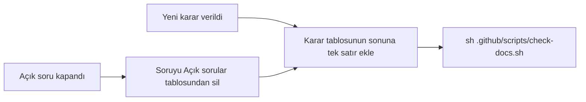
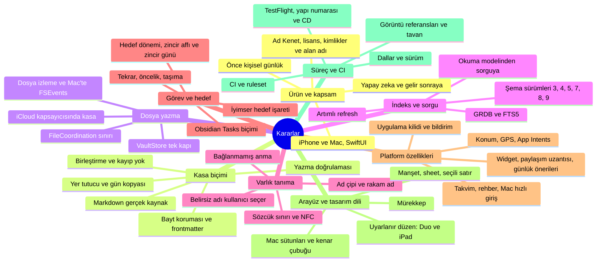

# Kararlar

**Amaç:** Projenin kararlarını ve gerekçelerini tek tabloda tutmak.

**Kapsam:**

- Karar günlüğü: her karar için tarih, karar ve gerekçe satırı.
- Açık sorular: kararı henüz verilmemiş konular.
- Karar haritası ve karar takvimi: kararların konuya ve tarihe göre dağılımı.

## Karar ekleme

**Yeni karar ve kapanan açık soru aynı satır ekleme adımına gider.**

Tablo başlığını değiştirme: `| Tarih | Karar | Gerekçe |`. Tablo satırlarının arasına boş satır koyma. Hücre içinde `|` gerekiyorsa `\|` yaz. CI (sürekli bütünleştirme) her PR'da (çekme isteği) `check-docs.sh` ile karar tablosunu denetler. Eski bir karar değişirse eski satırı silme; gerekçe hücresine değişikliğin tarihini yaz.

## Karar haritası

**Kararlar dokuz konu altında toplanır.**

Harita konuları gösterir; satırların tam metni karar günlüğündedir. Bir karar birden çok konuya değebilir. Harita her kararı en yakın tek konuya koyar.

## Karar takvimi

**Kararların tarih sırası ve her günün ana konuları.**

```mermaid
timeline
    title Karar takvimi, 318 karar
    2026-10-02 : 58 karar : Ürün kapsamı ve platform : Kasa biçimi ve ayrıştırıcı : Git, sürüm ve CI
    2026-10-03 : 19 karar : Yazma doğrulaması : İndeks ve arama : Varlık sayfası ve hızlı giriş
    2026-10-04 : 31 karar : Birleştirme ve kayıp yok : VaultStore ve dosya izleme : Görev, hedef ve otomasyon : Özet, graph ve harita
    2026-10-05 : 3 karar : Yol haritası işareti : Tasarım dili Mürekkep : Tanınmayan tekrar kuralı
    2026-10-06 : 5 karar : Harf farkı olan klasör : İndeks dizini koruması : Erişilemeyen kasa : Kilit ve bildirim gizliliği
    2026-10-07 : 24 karar : Ekran kalıpları ve renk : Ad Kenet, simge ve lisans : Bundle kimliği ve TestFlight : Yapı numarası
    2026-10-08 : 12 karar : Mac sütunları ve kenar çubuğu : Mac sheet ve Ayarlar : Test kimliği : Günlük kaydı temizliği
    2026-10-11 : 27 karar : Aşama 10 geçişi : Önemli tarihler ve bu gün geçmişte : Görüşme ritmi : Günü kapat : İndeks şeması 7
    2026-10-12 : 14 karar : Okuma modelinden sorguya : Ad çipi ve rakam ad : Yer tutucu ve gün kopyası : TestFlight denetimi
    2026-10-13 : 38 karar : Hedef ve görev sorguları : Özetler yeniden tasarımı : Aşama 10'un açık soruları : iPad ve iPhone Duo : Aşama 13 : Zincir affı B : Eşitlenen klasör ve kopya dosyalar : Birleşmiş gün zamanı : Duo kabuğu ve tuvalleri : Duo güvenli alan, krom ve köprü
    2026-10-15 : 5 karar : Görüntü referansı kayıt kipi : Aşama 14 grafikleri : Yıl haritası ve hedef grafiği : Kişi geçiş grafiği
    2026-10-16 : 15 karar : Grafikler 2 : Aşama 15 açılışı : Varlık ve hedef silme : Hedef düzenleme formu : iPad cihaz ailesi ve bölünmüş kabuk
    2026-10-17 : 9 karar : Hedef şablonları ve varlık tipi galerisi : Uzun basma menüsü : iPad klavye kısayolları ve işaretçi : iPad Kanban paneli ve sheet boyu
    2026-10-18 : 2 karar : Görüntü testi temsilci kümeleri : CI cihaz ailesi işleri ve yeniden deneme
    2026-10-20 : 8 karar : iCloud çakışma tespiti : Atomik yazmada fsync : Bildirim planı korunur : Okuma modelinden hedef verisi çıktı : Artımlı indeks ctime ve inode : Erişilebilirlik denetimi : Olay bekleyen testler
    2026-10-21 : 18 karar : İzleyici değişen dizini bildirir : Tek iptal ve kuşak sözleşmesi : Davranış ölçen arayüz testleri : Büyük yazıda sarma ve 44 pt hedef : Mac görüntüleri CI'da ve haftalık : Görüntü referansı tavanı : Bildirim içeriği varsayılan gizli : Türkçe büyük harf eşlemesi : Zincir günü : TestFlight CD : iCloud ve App Group kimlikleri : Mac'te FSEvents : Alan adı, gelir zamanı ve dalga 23 kapsamı
    2026-10-22 : 16 karar : Widget anlık görüntüsü : Kasa konumu iCloud : Günlük önerileri seçicisi : Paylaşım uzantısı : Widget içinden işaretleme, kilit ve kasa kimliği : Mac TestFlight ve kalite : Aşama 16 açılışı : Graph blokları ve segmentleri
    2026-10-23 : 4 karar : Görüntü referansı tavanı 320 : Günün grafiği : Açık bağ biçimi : CI kısaltması
    2026-10-26 : 4 karar : Açık bağ Core altyapısı : Açık bağ ekranları ve Graph : Açık bağın düğüm boyutu : Arayüz testleri iki işte
    2026-10-27 : 3 karar : Sheet dışı kontrast, gösterge rengi, ortak denetim iPad’de
    2026-10-30 : 3 karar : Kilit ekranı widget'ı: gizlilik ve takvim kaynağı, Graph gün merkezli
```

Sayılar karar günlüğündeki satır sayısıdır. Toplam 318 satırdır.

## Karar günlüğü

**Her satır bir kararı, tarihini ve gerekçesini gösterir.**

| Tarih | Karar | Gerekçe |
|---|---|---|
| 2026-10-08 | Mac sütun genişlikleri şunlardır. Kenar çubuğu: en az 180 pt, ideal 200 pt, en çok 240 pt. Liste sütunu: en az 280 pt, ideal 320 pt, en çok 400 pt. En küçük pencere: 1000 pt. Her liste sütunu serif manşetle başlar | Kullanıcı prototip görüntüleriyle onayladı. Kenar çubuğunda kesik ad sayısı 2'den 0'a indi. Görevler sekmeleri 3 satırdan 1 satıra indi. İlk altı görev 19 satırdan 10 satıra indi. Manşetli liste sütunu 3/5'ten 5/5'e çıktı |
| 2026-10-08 | Mac pencere araç çubuğu başlık yazmaz. Pencerenin adı seçili kenar çubuğu girdisidir. Ad yalnız Pencere menüsünde görünür | Onaylanan prototipte başlık vardı. Her sütuna manşet gelince başlık ve manşet aynı sözü iki kez yazdı, örneğin "Kişiler / Kişiler". Bugün seçiliyken başlık "Günlük" diyordu. Denetimin 11. bulgusu iki hatayı da kaydetti. Kullanıcı çift yazımı gidermek için değişikliği prototipten sonra istedi |
| 2026-10-08 | Mac kenar çubuğu uygulamanın vurgu rengini taşır, sistemin vurgu rengini taşımaz. Seçili satırda zemin mürdüm dolgu, yazı vurgu üstü mürekkeptir. Uygulama yalnız seçili girdiyi vurgular. Kanban, Zaman çizelgesi ve projeler ayrı satırdır. Seçim davranışı sistemindir | Kullanıcı onayladı. Koyu görünümde seçili satır kontrastı 2,03:1'den 9+:1'e çıktı. Görevler grubunda vurgulanan satır sayısı 10'dan 1'e indi |
| 2026-10-08 | "Notlar" girdisi Mac kenar çubuğundan kalkar. Not düzenleme gelince girdi geri döner. Kullanıcı notlara aramadan ulaşır | Kullanıcı onayladı. Girdinin işlevi yoktu. Girdi aynı "sonraki sürümde" cümlesini iki sütunda gösteriyordu |
| 2026-10-08 | Mac'te genel arama yalnız pencere araç çubuğundaki tek düğmededir. Manşet satırlarında büyüteç yoktur. Tek istisna Ara sheet'idir: kullanıcı sonuçlardan bir sayfa açınca manşet büyüteci sonuçlara döner. Pencerenin araç çubuğu o sırada sheet'in arkasında kalır. iPhone'da arama manşet satırının en sağında kalır | Kullanıcı onayladı. Büyütecin durduğu yer sayısı 3'ten 1'e indi. Altı ekranda çift büyüteç 2'den 1'e indi. Kullanıcı araç çubuğuna seçim olmadan da erişir |
| 2026-10-08 | macOS ve iOS test eylemi uygulamayı `$(APP_BUNDLE_IDENTIFIER).testhost` kimliği ve "Kenet Test" görünen adıyla derler. Debug ve Release derlemeleri gerçek kimliği taşır | Birim testleri gerçek tercih alanına pencere çerçevesi yazıyordu. Çökme penceresi gerçek uygulamanınki gibi görünüyordu |
| 2026-10-08 | Günlük kaydında uygulama `pendingAmbiguity`, `pendingUnknown` ve unbound `@` temizliğini yalnız iki yerde yapar: `JournalRecognition` adımının değiştirdiği satırlarda ve açık `@` anmalarda. Değişmeyen satırlar bayt düzeyinde aynı kalır | Çıplak belirsiz ad açık `@` anmayı gizliyordu. Uygulama eski satırlardaki `@` işaretini siliyordu ve kayıt kilitleniyordu. Uyulan kural: "tanımadığına dokunma" |
| 2026-10-07 | Olay düzenleme ve günlük yazısı `@` önerisini ve bağlamayı hızlı girişle ortak bileşenlerden alır: `MentionComposer` ve `MentionAssistStrip`. Günlükte uygulama kayıttan önce yalnız açık `@` ile yazılmış belirsiz ve bilinmeyen anmaları sorar. Çıplak belirsiz adlar eskisi gibi düz kalır | TestFlight'ta günlük yazarken `@` çalışmıyordu. Ortak bileşen ikinci bir kopyayı önler. Kullanıcıyı en az şaşırtan yol hızlı girişin davranışıdır |
| 2026-10-07 | Derleme `CFBundleVersion` yapı numarasını git geçmişinden üretir: `git rev-list --count HEAD`. iOS ve Mac aynı numarayı alır. Git yoksa ya da kopya sığsa yedek değer `1` kalır ve derleme uyarı verir. Derleme takım kimliğini izlenmeyen `Config/Local.xcconfig` dosyasından okur | Mağaza aynı sürümdeki ikinci yüklemeyi aynı yapı numarasıyla reddeder. Sayı her commit'te kendiliğinden artar ve kaynak ağacını kirletmez. Yüklenecek yapıyı commit'lenmiş `dev` ya da `main` durumundan arşivle. Neden: iş dalındaki sayı squash sonrasında `dev`'dekinden büyük olabilir |
| 2026-10-06 | Kasa hazırlığı harf farkı olan standart klasörü bildirir. Uygulama yalnız o klasörü hedefleyen yazmayı reddeder. Uygulama klasörü yeniden adlandırmaz | Sessiz çift klasör ve görünmeyen kayıt riski |
| 2026-10-04 | İsteğe bağlı `.app/types.json` dosyası, sürüm 1, özel varlık tiplerini tanımlar. Kişi ve konum sekmesi ile Mac kenar çubuğu değişmez. Listelerdeki tip seçici genişler. Proje şirket şema paketi eklemez | Markdown frontmatter'daki tür kaynak kalır. JSON bozuksa uygulama yerleşik tipleri ve bir uyarı gösterir. Tip silme dosyaları silmez. İndeks şeması 5, tip kimliği imzasını dosyadan yeniden üretir |
| 2026-10-04 | Uygulama kilidi cihazda saklanan tercihle LocalAuthentication `deviceOwnerAuthentication` yöntemini kullanır. Uygulama arka planda pencereleri ve sayfaları örter. Süre dolunca ve ilk açılışta uygulama doğrulama ister. Mac hızlı giriş de kilidi denetler | Face ID ya da Touch ID yoksa sistem cihaz parolasını kullanır. App Intents kilitten bağımsız yazabilir. Bildirim içeriğinin gizliliği sistem ayarındadır. 2026-10-06 kararıyla değişti: kilitliyken Intent yazmaz ve içerik gizleme seçeneği var. Uygulama kasayı şifrelemez. Entitlements değişmez |
| 2026-10-04 | Uygulama var olan kasayı yerinde hazırlar. Hazırlık kökteki ve `daily` klasöründeki günleri taşımaz. Hazırlık eksik kişi ve konum `type` alanlarını ayrı onayla ekler | Hazırlık Obsidian düzenini ve hedef dışındaki baytları korur. Atla seçeneği yalnız indeksler. Uygulama yeni yapı dosyalarını mevcut dosyayı değiştirmeden oluşturur |
| 2026-10-04 | Zaman çizelgesi tarihleri gün ızgarasına kaydırır. Çift tarihi iki mevcut yazıcı yazar. İkinci yazıcı hedefi ilk yazımdan sonra yeniden ayrıştırır | Kasa biçimi değişmez. Başlangıçsız görev tek gündür. Bitişsiz görev açık uçludur. Uygulama ters aralığı reddeder ve kısmi kaydı bildirir. İki davranış da dosya ile indeks farkını gizlemez |
| 2026-10-04 | Kanban kişi sütunlarında taşıma yoktur. Kanban kartları sıralar: bitiş tarihi, öncelik, metin, eşitlikte kimlik | Çok kişili görev her kişi sütununda görünür. Bağlantı metni ve dosya sırası değişmez. Durum ve proje taşıması mevcut atomik yazıcıları kullanır |
| 2026-10-04 | Tekrar, Obsidian Tasks biçiminin bir alt kümesini kullanır. Uygulama tamamlanan satırın üstüne yeni kimlikli açık satır yazar. Hızlı girişte `!` orta, `!!` yüksek önceliktir. Uygulama aynı gündeki listeleri önceliğe göre sıralar | Tamamlama geçmişi ve bilinmeyen yazım değişmez. Uygulama ay sonu tarihini sıkıştırır. Uygulama indeks şeması 4'ü dosyalardan yeniden kurar |
| 2026-10-04 | Uygulama projeleri görev etiketlerinden NFC ve harf duyarsız eşlemeyle türetir. Sayılamayan yıllık hedef milestone türüdür. Milestone hedefi tek `true` kaydının tarihini gösterir | Ek dosya ya da indeks şeması gerekmez. Uygulama görev gruplarını ve tamamlanmayı Markdown'dan yeniden üretebilir |
| 2026-10-04 | App Intents ortak `IntentActions` ve `IndexStore` ile uygulamayı açmadan mevcut kasaya yazar. Intent kesin anmaları bağlar. Belirsiz ve bilinmeyen anmalar düz kalır | Kısayollar ve Siri aynı dosya yazma yollarını kullanır. Intent soru şeridini açmaz. Kasa eksik ya da erişilemezse Intent yeni kasa oluşturmaz. Hedef seçimi kasa kimliğine bağlıdır |
| 2026-10-04 | iOS konum hedefleri açık "Her zaman" izni ister. Her hedefin kipi kapalı, bildir ya da otomatiktir. Uygulama en çok 20 bölge izler. Arka plan yazımı önce yer imi kapsamını ve indeksi açar | Sayısal hedefler kapsam dışıdır. Günde tek kayıt ve kasaya bağlı kimlikler tekrarı ve yanlış kasaya yazmayı önler. macOS özelliği gizler |
| 2026-10-04 | GPS önerisi yalnız ön planda ve tek seferliktir: dakikada en çok bir istek. Uygulama koordinatları kasa dosyalarından okur. Kullanıcı ad çipine dokununca uygulama sabit anma ekler | Uygulama izni kullanıcı düğmeye basınca ister. GPS gönderimi bekletmez. Arka plan izleme ve indeks şeması değişikliği gerekmez |
| 2026-10-02 | Öncelik kişisel günlüktür. Şirket paketi sonraya kalır | Çekirdek kullanımın önce kanıtı gerekir |
| 2026-10-02 | Mobil en önemli platformdur | Kullanıcı günlüğü gün içinde telefondan yazar |
| 2026-10-02 | Markdown gerçek kaynaktır, SQLite yalnız indekstir | Veri sahipliği, taşınabilirlik ve Obsidian uyumu |
| 2026-10-02 | Uygulama iPhone ve Mac için SwiftUI kullanır | Widget'lar ürünün merkezindedir. Widget yazmanın tek yolu Swift'tir. Tek kod tabanı iki platformu kapsar. iCloud eşitlemesi hazırdır |
| 2026-10-02 | Android ve Windows istemcisi şimdilik yoktur | Ürün tutarsa proje ayrı istemci yazar. Biçim açık olduğu için kilitlenme yoktur |
| 2026-10-02 | Uygulamanın kendi kasası vardır ve biçim Obsidian uyumludur: orta yol | Widget ve eşitleme güvenilirliği. Uygulama başkasının dağınık kasasında çalışma yükünü almaz. Kullanıcı kasayı Mac'te Obsidian ile açabilir |
| 2026-10-02 | Gün dosyası hızlı olayları ve serbest günlüğü birlikte taşır | Kullanıcı hem hızlı giriş hem uzun yazı ister |
| 2026-10-02 | Kişi sayfası düzenlenebilir bir şablon ve serbest ek alanlar taşır | Basit başlangıç, esneklik |
| 2026-10-02 | Alışkanlık ve hedef tek mekanizmadır: dönem ve miktar. Dönem gün, hafta ya da yıldır | Tek mekanizma kod ve kavram tekrarını önler |
| 2026-10-02 | Görevler Obsidian Tasks biçimindedir | Mevcut araçlarla uyum |
| 2026-10-02 | Uygulama takvimi yeniden yazmaz. Uygulama cihaz takvimini okur | Mevcut takvimler ek iş olmadan gelir |
| 2026-10-02 | Yapay zeka ertelendi. Uygulama yapay zeka olmadan tam çalışır | Maliyet. Karar aşama 6'ya kalmıştı. Güncel durum: Aşama 6 yapay zeka maddelerini "Sonraki fikirler" bölümüne devretti; karar açık sorulardadır |
| 2026-10-02 | Uygulama kilidi ertelendi | iOS'un kendi Face ID kilidi yeterlidir. 2026-10-04 kararıyla değişti: uygulamanın kendi kilidi var |
| 2026-10-02 | Dağıtım önce kişisel, sonra App Store'dur | Proje metinleri baştan yerelleştirilebilir yazar |
| 2026-10-02 | Belgeler `docs/` altındadır. Bilgiyi önce mevcut belgeye ekle. Gerekirse yeni belge aç ve README tablosuna yaz | Dağınıklığı ve tekrarı önlemek, ama esnek kalmak |
| 2026-10-02 | Repo klasörünün adı `journal` | Çalışma adı. Ürün adı henüz yoktu. 2026-10-07 kararlarıyla değişti: ürün adı Kenet, depo `dogancanyildiz/kenet` |
| 2026-10-02 | Dosyadaki yapı İngilizce ve sabittir: klasör, anahtar, `type` ve bölüm başlıkları. Arayüz kullanıcının dilindedir | Her dildeki uygulama kasayı aynı okur. Sonradan göç gerekmez |
| 2026-10-02 | Aynı adlı varlıklarda görünen ad `name` alanındadır. Uygulama dosya adını ayırt ediciyle üretir. Yazarken uygulama adayları bağlama göre sıralar. Uygulama emin değilse kullanıcıya sorar | Kullanıcı dosya adı düşünmez. Kural yanlış bağlamayı önler |
| 2026-10-02 | Tarihsiz görev yalnız oluşturulduğu gün Bugün ekranında görünür. Sonraki günlerde görev "tarihsiz" listesinde durur | Bugün ekranında görev birikmez |
| 2026-10-02 | Kullanıcı geçmiş güne olay ekleyebilir. Olayda saat isteğe bağlıdır | Kullanıcının sonradan yazma ihtiyacı |
| 2026-10-02 | Varlık adı değişince uygulama tüm bağlantıları otomatik günceller | Bağlantı kırılmamalıdır |
| 2026-10-02 | Eşitleme çakışmasında uygulama satırları blok kimliğine göre birleştirir. Uygulama birleşmeyen içeriği kopya olarak saklar | Hiçbir içerik kaybolmamalıdır |
| 2026-10-02 | Telefon sekmeleri: Bugün, Günlük, Görevler, Kişiler ve Konumlar, Hedefler. Arama üstte bir simgedir | Görevler ayrı bir ekran ister. Beş sekme üst sınırdır. 2026-10-07 kararıyla değişti: arama her kök ekranda manşet satırının en sağındadır |
| 2026-10-02 | Uygulama ilk ekran olarak Bugün'ü açar. En hızlı giriş yolu widget ve kilit ekranı kısayoludur | İlk sözcüğe kadar geçen süre kalıcılığı belirler |
| 2026-10-02 | Tek giriş kutusu ve olay ile görev arasında geçiş düğmesi var. Uygulama tarihi cümleden çıkarır | Mobil klavyede işaret yazmak zahmetlidir. Doğal dil girişi en hızlısıdır |
| 2026-10-02 | Serbest notlarda telefon okuma ve basit düzenleme sunar. Zengin düzenleme Mac'tedir | Benzer uygulamaların mobilde en zayıf noktası notlardır |
| 2026-10-02 | Kullanıcı geçmiş günlerin hedef kaydını düzeltebilir. Widget yapılmamış hedefi vurgular | Kullanıcıların alışkanlık uygulamalarında en çok şikâyet ettiği iki eksik |
| 2026-10-02 | Mac'te sistem genelinde bir hızlı giriş penceresi vardır | Masaüstünde hızlı girişin karşılığı |
| 2026-10-02 | Dallar: `main` sürümler içindir, `dev` geliştirme içindir ve varsayılandır. İş dallarını `dev`'den aç. İş dallarını PR ile birleştir | Ajanlarla çalışırken kontrol noktası. `main` her zaman yayımlanmış durumu gösterir |
| 2026-10-02 | `dev`'den `main`'e birleşme sürüm keser. İş akışı etiketi ve GitHub Release'i otomatik oluşturur | Sürüm geçmişi nettir. Numara `0.<aşama>.<yama>` biçimindedir. Mağaza yayını `1.0.0` olur |
| 2026-10-02 | Proje CI'ı aşama 0'da kod oluşunca kurar. CD (sürekli dağıtım) aşama 7'ye kaldı | Boş projede CI anlamsızdır. Kişisel kullanımda dağıtım yolu Xcode'dur. Güncel durum: CD Aşama 7'den Aşama 12'ye devretti |
| 2026-10-02 | CI `Core` paketini macOS ve Linux'ta derler ve sınar. Dal korumasının zorunlu tuttuğu tek denetim `ci` işidir | Linux derlemesi `Core`'un Apple çerçevelerinden bağımsız kalmasını zorlar. Tek kapı işi yol filtresi olmadan her PR'da sonuç verir |
| 2026-10-02 | Ruleset `dev` ve `main` dallarını korur: PR ve yeşil `ci` zorunludur, force push ve dal silme kapalıdır. `dev`'e squash ya da merge, `main`'e yalnız merge commit girer. Ruleset onay incelemesi aramaz | Tek geliştirici kendi PR'ını onaylayamaz. Kontrol noktası CI'dır. Ruleset kimseye istisna tanımaz |
| 2026-10-02 | Proje GitHub'ın açık repo hizmetlerini kullanır: gizli anahtar taraması ve push koruması, Dependabot, iş akışları için CodeQL. Dependabot güvenlik ve haftalık sürüm güncellemelerini açar. Swift için CodeQL uygulama kodu gelince açılacaktı | Hizmetler açık repoda ücretsizdir. Push koruması yanlışlıkla commit'lenen anahtarı push anında durdurur. Swift analizi her koşuda tam derleme ister ve o gün karşılığı yoktu. Güncel durum: `codeql.yml` Swift analizini `main`'e açılan PR'da, `main`'e itmede ve haftada bir koşturur |
| 2026-10-02 | Ajan kuralları yalnız ürün vaatlerini koruyan değişmez kurallardır. Gerçekleme, arayüz ayrıntısı ve kütüphane seçimi ajanın kararıdır | Gereksiz kısıt daha iyi çözümleri engeller |
| 2026-10-02 | Repo herkese açıktır | Projenin istediği GitHub özellikleri açık repoda ücretsizdir |
| 2026-10-02 | Gelir modeli kararı sonraya kalır: reklam ya da üyelik | Önce ürün |
| 2026-10-02 | "Tanımadığına dokunma" kuralının tanımı işlemin hedefine dayanır: yalnız hedef satır ya da alan değişir. Uygulama dışarıda yazılmış metni kendiliğinden yeniden yazmaz | Eski ifade "yalnızca kendi ürettiği satırlar" idi. Eski ifade kimlik ekleme, bağlama ve yeniden adlandırmayla çelişiyordu |
| 2026-10-02 | Okuyucu CRLF, BOM ve sonlanmamış son satırı korur. Frontmatter için desteklenen YAML alt kümesinin tanımı vardır. Yazıcı değerleri yeniden üretmez | Genel YAML ve Markdown kütüphaneleri dosyayı yeniden üretir ve bayt düzeyinde korumayı bozar |
| 2026-10-02 | Ad karşılaştırması NFC ve yerelden bağımsız küçük harf eşlemesi kullanır. Türkçeye özel eşleme yoktur | iPhone dosya sistemi harfe duyarlıdır. Mac ve Obsidian harfe duyarsızdır. Sonuç cihazın diline göre değişmemelidir. 2026-10-21 kararıyla değişti: ad anahtarı `İ`→`i` ve `I`→`ı` eşlemesini de yapar (PR #309) |
| 2026-10-02 | Gün dosyasının kimliği yoludur: `journal/YYYY-MM-DD.md`. Uygulama iCloud'un ayırdığı kopyayı ana dosyayla birleştirir, örneğin `… 2.md` | İki cihaz aynı günü çevrimdışı oluşturabilir. Widget ve kısayol dosyayı indeks olmadan bulabilmelidir |
| 2026-10-02 | Uygulama saatli olayı saat sırasındaki yerine, saatsiz olayı sona ekler. Gösterim sırası dosya sırasıdır | Kullanıcı dosyayı Obsidian'da da kronolojik okur. Sıranın tek kaynağı dosyadır |
| 2026-10-02 | Blok kimliği opak ve isteğe bağlıdır. İndekste bloğun anahtarı dosya ve sıradır | Dışarıda kopyalanan satır kimliği çoğaltır. İndeks kimliksiz satırları ve paragrafları da kapsar |
| 2026-10-02 | Ayrıştırıcı görev satırını aşama 0'da asgari düzeyde tanır: durum, metin, kimlik. Ayrıştırıcı öteki alanları kendi aşamasında ayrıştırır. O zamana kadar alanlar metin olarak kalır | Aşama 0'daki birleştirme görev satırlarını da kapsar |
| 2026-10-02 | Çakışma birleştirme yalnız iki sürüme bağlı saf bir işlevdir. Kapalı görev, `true` ve büyük sayı kazanır. Öteki farkta yeni sürüm kazanır. Uygulama kaybeden sürümü `conflicts/` altında saklar | Değişiklik zamanı satırın değil dosyanındır. "Son değiştiren kazanır" kuralı düzenlemeyi sessizce kaybediyordu |
| 2026-10-02 | Varlık tipleri şimdilik Core içinde bir veri tanımıdır. Kasadaki şema dosyası aşama 7'ye kaldı | Tipler koda dağılmaz ama özel tip özelliği erken gelmez. 2026-10-04 kararıyla şema dosyası geldi: `.app/types.json` |
| 2026-10-02 | Uygulama kasa konumunu kaydeder ve konum kendiliğinden değişmez. Uygulama tüm dosyaları cihaza indirir | Sessiz konum değişimi veriyi kaybolmuş gösterir. Metin dosyaları küçüktür |
| 2026-10-02 | Kasa biçim sürümünü `.app/vault.json` içinde taşır. Daha yeni sürümü gören istemci yazmaz | Cihazlardaki farklı uygulama sürümleri aynı kasayı paylaşır |
| 2026-10-02 | İndeks şeması değişikliği onay gerektirmez: şema sürümü artar ve uygulama indeksi yeniden kurar | Uygulama indeksi dosyalardan yeniden üretebilir. Geriye uyum kaygısı yoktur |
| 2026-10-02 | Hotfix'ten sonra `main` dalını `dev`'e merge commit ile geri birleştir | Squash iki dalın ortak geçmişini koparır |
| 2026-10-02 | Commit ve PR'larda yapay zeka imzası yoktur: `Co-Authored-By`, "Generated with" ve benzerleri | Proje sahibinin tercihi |
| 2026-10-02 | Core paketinde ayrıştırma katmanı, yani `VaultFormat` hedefi, paket bağımlılığı taşımaz. İndeks ayrı bir hedefte yer alır | Ayrıştırıcı GRDB'yi ve indeks hedefini bağımlılık bildirimi olmadan kullanamaz. Ayrıştırıcının derlemesi ve testi indeks gerektirmez |
| 2026-10-02 | Test için Swift Testing, biçim ve lint için `swift format` | İkisi de araç zinciriyle gelir. Ek bağımlılık gerekmez |
| 2026-10-02 | Belge modeli satır tabanlı ve kayıpsızdır: her satır ham baytlarını ve satır sonunu saklar. Model metni isteğe bağlı olarak baytlardan çözer. Serileştirme baytları birleştirir | Gidiş dönüş tasarımdan gelir. Ayrıştırıp yeniden üretme yaklaşımı bayt korumayı garanti edemez |
| 2026-10-02 | Ardından LF gelmeyen tek CR de satır sonudur | Obsidian ve CommonMark ile uyum. Yalnız CR kullanan dosyada ayrıştırıcı satırları, görevleri ve başlıkları doğru tanır. Bayt koruması değişmez |
| 2026-10-02 | Belge tek bir ilkeyle değişir: bir satır aralığının yerine yeni satırlar gelir. Yeniden yazılan satır kendi satır sonunu korur. Sonuç her zaman, baytların yeniden okunmasından çıkacak belgedir | Tek ilke değişmezleri tek yerde tutar ve test onları tek yerde sınar: satır sonu, BOM, salt okunurluk. Dokunulmayan satırlar bayt düzeyinde aynı kalır |
| 2026-10-02 | Okuyucu frontmatter'ı genel bir YAML ayrıştırıcısıyla işlemez. Okuyucu alt kümeyi satır satır tanır ve her alanın satırlarını bilir. Okuyucunun emin olmadığı yapı ham alan olur ya da bloğu çözülemez kılar. Düzenleme yalnız hedef satırları yeniden yazar. Düzenleme yorum ve boş satır silmez | Genel ayrıştırıcı yorumları, tırnakları ve yazımı korumaz. Yanlış yorumlamak tanımamaktan kötüdür |
| 2026-10-02 | Obsidian'ın reddettiği frontmatter bloğu bütünüyle çözülemezdir. Geçersiz YAML ve yinelenen anahtar bloğu çözülemez kılar. Ham alan yalnız geçerli ama desteklenmeyen yapılar içindir | İki uygulama aynı dosyayı aynı görür. Uygulama okunamayan bloğa yazmaz |
| 2026-10-03 | Satır yazma işlemleri sonucu seri hale getirir ve yeniden okur. İşlemler: olay ve görev ekleme, metin, durum, saat, silme. Okuma iki durumdan birini gösterirse işlem reddeder ve dosyaya dokunmaz. Birinci durum: hedef blok istenen değerleri aynen taşımıyor. İkinci durum: başka bir blok, bölüm, frontmatter ya da çit sınırı değişmiş | Yazıcı ve okuyucunun aynı kuralları paylaştığının kanıtı tek yerdedir. Genel denetim tek tek yasak listesinin yerini alır. Örneğin metnin saat, kutu ya da kimlik gibi okunmasını genel denetim yakalar |
| 2026-10-03 | Yazma işleminin hedefi, aynı belgenin okunmasından gelen bloktur. Belgede o konumda aynı tür, aynı ilk satır baytları, aynı kimlik ve metin yoksa işlem reddeder | Eski bir okumadan kalan hedef başka bir satırı silememelidir. Bayatlık denetimi üst katmana kalmaz |
| 2026-10-03 | Kullanıcı alt satırı olan bir görevi silebilir. İşlem yalnız görevin kendi satırlarını siler ve üst blok o kadar kısalır | Alt görev silme sıradan bir kullanıcı işlemidir. Davranış "yalnızca hedeflenen satır değişir" kuralına uyar |
| 2026-10-03 | Blok kimliği üretimi Core'dadır. Rastgeleliği ve "kimlik alınmış mı" sorusunun yanıtını çağıran verir | Core Foundation'sız kalır. Kasa genelinde benzersizlik indeksin bilgisidir |
| 2026-10-03 | Sürüm numarası kök dizindeki `VERSION` dosyasındadır. `main`'e push'ta iş akışı bu numarayla etiket ve Release oluşturur. Etiket varsa iş akışı atlar | Numara tek yerde durur. Proje Xcode projesinden önce de sürüm kesebilir. İş akışı yeniden çalışsa da ikinci etiket üretmez |
| 2026-10-03 | XcodeGen Xcode projesini `project.yml` dosyasından üretir. Git `Journal.xcodeproj` dosyasını izlemez. Bundle kimliği geçici olarak `com.dravcore.journal.dev`. En düşük sürüm iOS 26 ve macOS 26; ikisi de değişebilir | Proje dosyası çakışması olmaz ve ajanlar projeyi metinle düzenler. Kalıcı kimlik kullanıcı kararını bekliyordu. Geçici kimlik yalnız simülatördeydi. 2026-10-07 kararıyla değişti: kalıcı bundle kimliği `com.dogancanyildiz.kenet` |
| 2026-10-03 | İndeks `VaultIndex` hedefindedir: GRDB 7 ve FTS5. FTS5 `unicode61` belirteçleyicisini kullanır ve aksanları korur. Tam yeniden üretim tek işlemdir. Şema sürümü uyuşmazsa ya da dosya bozuksa uygulama veritabanını siler ve sıfırdan kurar | Göç yoktur. Uygulama indeksi her zaman dosyalardan yeniden üretebilir |
| 2026-10-03 | Tarama sembolik bağlantıları izlemez. Aynı NFC yola dönüşen dosyalardan tarama bayt sırasında ilkini alır. Tarama atlanan dosyaları bildirir ve indeksleme durmaz | Tek bozuk dosya kullanıcıyı indekssiz bırakmamalıdır. Kasa dışına çıkan bağlantı güvenlik riskidir |
| 2026-10-03 | Tanınan bölüm başlıkları blok üretmez: `## Tasks`, `## Events`, `## Journal`. Öteki başlıklar `heading` türünde bloktur. Paragraf, olay ve görev dışındaki ardışık boş olmayan satırlardır | Aramada "Events" her gün dosyasını döndürmemelidir. Bölüm bilgisi zaten sütunda durur |
| 2026-10-03 | Uygulama kullanıcı aramasını güvenli bir FTS5 ifadesine çevirir. Uygulama aramayı boşlukta böler ve her parçayı tırnaklı deyim yapar. Son parça önek eşleşmesi alır | Kesme işareti ve `AND` gibi girdiler sorgu hatası vermemelidir |
| 2026-10-03 | CI Linux kabına `libsqlite3-dev` kurar. CI indeksi Linux'ta da derler ve test eder | GRDB sistem SQLite'ına bağlanır. Linux derlemesi Core'un Apple'dan bağımsızlığını indeks dahil kanıtlar |
| 2026-10-03 | Artımlı indeks: `refresh` tüm kasayı tarar. `refresh` yalnız değişiklik zamanı ya da boyutu farklı dosyaların özetini hesaplar. Özeti değişen dosyaları yeniden yazar. Silinen ya da adı değişen dosyaların ve etkilenen anahtarların bağlantılarını ve kimlik sahipliğini yeniden hesaplar. Ölçü: artımlı sonuç sıfırdan üretimle birebir aynıdır | Doğruluk tek bir ölçüye bağlıdır. Tarama ucuzdur: dosya başına yaklaşık 20 µs. Ayrıştırma pahalıdır |
| 2026-10-03 | Dosya izleyici artımlı indekse yol bildirir. Yeniden adlandırmada izleyici eski ve yeni yolu bildirir. Bildirim kapsamı harfe duyarsız ve NFC'dir. Sonraki `refresh` eksik bildirimi düzeltir | APFS harfe duyarsızdır. İzleyici kaçırırsa indeks yine toparlanır |
| 2026-10-04 | Birleştirme saf bir işlevdir. Girdi: iki sürümün baytları ve değişiklik zamanları. Çıktı: birleşmiş baytlar, saklanacak sürümler ve `fellBack`. İşlev gövdeyi birinci ve ikinci düzey başlıklarla bölgelere ayırır. İşlev blokları kimlikle eşler; bir sürümde kimlik çoğulsa içerikle eşler. İşlev serbest yazıyı bölge başına sayımlı karşılaştırır | Bölge modeli sıradan bağımsızlığı ve yeniden birleştirme kararlılığını kanıtlanabilir kılar |
| 2026-10-04 | Kayıp yok değişmezi: bir sürümdeki blok, serbest yazı satırı, frontmatter alanı ya da yorum satırı sonuçta yoksa uygulama o sürümü saklar. Tek istisnalar: kapalı görevin aynı metinli açık görevi yenmesi; iki kapalı görevde yalnız `✅` tarihi farkı; `goals` ilerlemesi; yalnız yazım ve satır sonu farkı | Ürün vaadi: hiçbir içerik sessizce kaybolmaz. Fazladan kopya zararsızdır. Eksik kopya veri kaybıdır |
| 2026-10-04 | Son güvence: işlev sonucu yeniden okur. Kayıp yok değişmezi tutmazsa işlev birleştirmeyi yok sayar: yeni sürümü alır, eskisini saklar ve `fellBack` değerini doğru yapar. İşlev yarı birleşmiş sonuç döndürmez | Yarı sonuç yeniden birleştirmede kararsızdı. Geri dönüş yapısı gereği kararlıdır. Kapanmayan kod çiti gibi yapı bozan durumlarda işlev birleştirme yapmaz |
| 2026-10-04 | Varsayılan kasa uygulamanın `Documents/Vault/` klasörüdür. Kullanıcı güvenlik kapsamlı yer imiyle başka klasör seçebilir. Uygulama bayat yer imini yeniler. Klasör erişilemezse uygulama yer imini silmez ve yerel kasaya döner. 2026-10-06 kararıyla değişti: yerel kasaya dönüş yok. Uygulama yalnız bozuk veriyi siler. 2026-10-22 kararıyla değişti: iCloud kullanılabilirse ilk seçenek iCloud kapsayıcısıdır; yerel kasa seçenek olarak kalır (PR #319) | Geçici bir hata kullanıcının seçimini kalıcı unutturmamalıdır |
| 2026-10-04 | Dosya izleme dizin başına DispatchSource kullanır, en çok 256 dizin. Ek tetikler: 5 saniyelik ön plan zamanlayıcısı ve ön plana dönüş. 300 ms birleştirmeden sonra `refresh` çalışır. Uygulama yol bazlı `update(paths:)` kullanmaz | Dizin vnode'u dosya içeriği düzenlemesini göstermez. `refresh` ucuzdur ve bildirim eksiklerine dayanıklıdır. FSEvents yalnız macOS'ta var. 2026-10-21'de değişti: bkz. aynı tarihli izleyici satırı (PR #299) ve Mac'te FSEvents satırı (PR #317) |
| 2026-10-04 | Uygulama test altında indeksi otomatik başlatmaz. Test ölçütü: `XCTestConfigurationFilePath` ya da `JOURNAL_NO_AUTOSTART` ortam değişkeni | İmzasız test derlemesinde sandbox yoktur. Test geliştiricinin gerçek `Documents/Vault` klasörüne dokunmamalıdır |
| 2026-10-04 | Aşama 0 kapandı. İstisna iCloud kasa konumudur; madde aşama 1'e devretti. Proje sürüm kesmedi. Aşama 1 yerel kasayla başlar | Çıkış ölçütü sağlandı: uygulama örnek kasayı okuyor ve indeksliyor, değişiklikleri yansıtıyor ve 210 test geçiyor. iCloud kimlik kararı kullanıcıdadır. Kimlik geçici değer kabul etmez |
| 2026-10-04 | Uygulamanın dosyaya yazan tek kapısı `VaultStore`'dur. Her işlem dosyayı diskten yeni okur ve saf biçim işlemini uygular. Sonra işlem atomik yazar: geçici kardeş dosya ve meta veriyi koruyan yerine koyma. Yeni dosyada işlem dışlayıcı oluşturma kullanır; sabit bağlantı yoksa `O_EXCL` ile geri düşer. Sonra işlem yalnız o yolu indeksler. İndeks hatası dosyayı geri almaz; `VaultStore` hatayı ayrı bildirir: `indexUpdateFailed` | "Önce dosyaya yaz, sonra indeksi güncelle" kuralı tek yerdedir. Yeniden deneme olayı iki kez yazmamalıdır. Dış klasörler de çalışmalıdır: exFAT, SMB |
| 2026-10-04 | Çoğaltılmış kimlikte sahiplik iki kurala uyar. Aynı dosyada: diskten yeni okunan belgedeki ilk geçiş. Başka dosyada: yalnız yol sırası. Uygulama indeksteki satır numarasına güvenmez | İzleyici yerinde düzenlemeyi gecikmeli görür. Eski indeks sahibin kimliğini yenilememelidir |
| 2026-10-04 | Günlük yazısı değiştirme metnin sondaki boş satırlarını atar ve bölümün sondaki boş satırlarını korur. İşlem idempotenttir. Bölüm yokken boş metin dosyaya dokunmaz. Gövdedeki `---` serbesttir ve yatay çizgidir | Her kayıtta dosya büyümemelidir. Uygulama boş bölüm yazmaz. Kullanıcı Obsidian'da yatay çizgiyle yazılmış günü düzenleyebilmelidir |
| 2026-10-04 | Varlık tanıma `EntityRecognition` hedefindedir ve yalnız `import VaultFormat` kullanır. Kurallar: sözcük sınırı; NFC ve yerelden bağımsız küçük harf; Türkçe ek bağlantının dışında; en uzun eşleşme. Tanıyıcı şunları taramaz: bağlantı, satır içi kod, çit, frontmatter, URL, e-posta, alan adı, etiket, kimlik, Markdown bağlantısı ve sözdizimi komşuları `[ ! \ # ^ \|`, sonda `]`. Tablo satırında görünen metin ayırıcısı `\|` olur | Kullanıcı metni yalnız amaçlanan yerde değişir. Yanlış bağlama en kötü hatadır |
| 2026-10-04 | Yazımın ilk harfi varlık adının ilk harfinden farklı büyüklükteyse eşleşme kesin değildir, öneridir: `isCaseMismatch`. `@` ile yazılmış eşleşme kesindir. Uygulama belirsiz anmayı, yani birden çok adaylı anmayı, hiç otomatik bağlamaz. Aday sıralama ölçütleri sırasıyla: birlikte geçme, konum 4 ve kişi 1 ağırlıkla; son tarih; toplam; yol sırası | `deniz`, `su`, `ev` gibi gündelik sözcükler kendiliğinden bağlanmamalıdır. Uygulama emin değilse kullanıcı seçer |
| 2026-10-03 | Hızlı girişte tanıma gönderimde çalışır. Küçük harfli öneriler sessizce düz kalır. Kullanıcı belirsiz ve bilinmeyen anmaları kutunun üstündeki şeritte çözer. Uygulama öneriden seçilen varlığı metin aralığına sabitler | Aşama 1 kapsamı: yanlış otomatik bağlantıdan kaçınmak, aynı adlı varlık seçimini korumak, klavyeyi açık tutmak |
| 2026-10-03 | Günlük düzenleyicisi Journal gövdesini diskten okur. Düzenleyici kesin varlık bağlantısını yalnız eklenen ya da değişen satırlara uygular. Tanıma tüm gövdenin Markdown bağlamında çalışır | Amaç: değişmeyen yazıyı sonradan bağlamamak, kod çitlerini ve mevcut bağlantıları korumak. Ayrıca günlükte yazmayı belirsizlik sorusuyla bölmemek |
| 2026-10-03 | Varlık sayfası alanları diskten okur ve `VaultStore` üzerinden anahtar bazında yazar. Zaman akışı indekste çözülen bağlantıları günlük olay ve paragraf bloklarından toplar ve günlere gruplar. Aynı bloktaki tekrar bağlantılar tek satırdır | Amaç: kullanıcıya ait YAML yazımını korumak. Not ve görev bağlantılarını günlük zaman akışıyla karıştırmamak. Dosya kaynaktır; indeks yeniden üretilebilir kalır |
| 2026-10-03 | Varlık yeniden adlandırma aynı kasa yazma kuyruğunda şu sırayla çalışır: metadata, taşıma, güncel kaynak bağlantıları, indeks. Yalnız hedef değişir. İşlem ham alan ve kaynak hatalarını sonuçta bildirir. Taşıma başarısızsa işlem özgün belgeyi geri yazar. Geri yazma da başarısızsa kullanıcı kısmi değişikliği görür. Kaynak güncellemeleri için çok dosyalı geri alma yoktur | Amaç: dosya baytlarını ve kullanıcının gördüğü metni korumak. Kısmi başarının yeni yolunu kaybetmemek. Yeniden denemede yanlış dosyaya dokunmamak |
| 2026-10-03 | Mac hızlı giriş MenuBarExtra ve Carbon `RegisterEventHotKey` kullanır. Varsayılan kısayol ⌃⌥Space'tir; kullanıcı kısayolu Ayarlar'da kaydeder. Ortak giriş bileşeni etkinleştirmeyen bir NSPanel içinde durur | Erişilebilirlik izni, ek entitlement ve üçüncü taraf paket gerekmez. Kayıt uygulamayı öne getirmez |
| 2026-10-03 | Ayrıştırıcı görev alanlarını geçerli token aralıklarıyla okur ve yerinde düzenler. İlk yinelenen değer geçerlidir. Kaldırma tüm aynı alanları temizler. Tamamlama tarihini çağıran verir. İndeks şeması 3 | Amaç: tanınmayan yazımı ve hedef dışındaki baytları korumak. Saat bağımlılığını Core biçim katmanına taşımamak |
| 2026-10-04 | Doğal tarihte çıplak gün adı gelecekteki ilk o gündür. Sayısal eğik çizgili tarihte Türkçe gün/ay, İngilizce ay/gün okunur. Ayrıştırıcı dilleri dil sırasıyla dener | Varsayımlar çağıranın yerel günüyle taşınabilir. Uygulama varsayımları kullanıcıya gösterebilir |
| 2026-10-04 | Hızlı giriş doğal tarihi canlı önerir. Gönderimden önce uygulama ifadeyi metinden çıkarır. Kullanıcı bağlantılı görevi kutudan tamamlar | Kullanıcı tarih ya da yıl ifadesini yazmayı sürdürebilir. Anma aralıkları ve kişi ya da konum bağlantısının dokunma eylemi değişmez |
| 2026-10-04 | Uygulama takvim erişimini yalnız kullanıcı izin düğmesine basınca ister, açılışta istemez. EventKit verisi salt okunurdur. Uygulama EventKit verisini kasa dosyalarına aktarmaz | Takvimi göstermeyi kullanıcı kendisi seçer. Gün dosyaları gerçek kaynak olmayı sürdürür |
| 2026-10-04 | Hedef dönemi pazartesi başlayan hafta ya da takvim yılıdır. Kaldırma `goals` anahtarını siler. Güncel dönem bekliyorsa zincir önceki dönemden sürer | Tek alışkanlık ve hedef mekanizması ile geçmiş gün düzeltmesi için taşınabilir sözleşme |
| 2026-10-04 | Hedef oluşturma anahtarı ASCII kısa ad ve sayısal çakışma ekidir. Tanım düzenlemede anahtar ve dosya yolu sabit kalır | Anahtar geçmiş gün kayıtlarını ada bağlı taşımadan korur. Şerit günlük katkıyı dönem toplamından ayrı gösterir |
| 2026-10-04 | Yerel bildirimler yedi günlük tek seferlik bir plandır. Kategori ve gün kimliği deterministiktir. Uygulama izni yalnız açık izin eylemiyle ister. Saat ve kategori tercihleri cihazın UserDefaults deposundadır | Plan Core'u ve kasa biçimini sistem API'lerinden ayrı tutar. Yeniden planlama eski planı kaldırır. Uygulama kapalıyken son plan geçerlidir |
| 2026-10-04 | Haftalık ve aylık özetler saf `Summaries` katmanındadır. Katman özetleri indeksten tek okumayla yeniden hesaplar. Katman varlık oluşturulma tarihi yerine açık adlı bir ölçü sayar: ilk günlük geçişi. Katman görev envanterini kaynak gün ve tamamlanma tarihinden çıkarır | Uygulama Markdown'da bulunmayan oluşturulma ve değişiklik geçmişini uydurmaz. Şema ve biçim değişmez. Sayılar, önceki dönem farkları ve dönem sonu zinciri taşınabilir kalır |
| 2026-10-04 | Uygulama kişi ve konum içgörülerini günlük olay ve Journal geçişlerinden, farklı günler üzerinden hesaplar. "Görüşülmeyenler" eşiği cihaz tercihidir: varsayılan 30 gün, aralık 1–365 gün. Eşik dil nötrdür. Hiç geçmemiş varlıklar ayrı listededir | Uygulama günlükteki anmayı gerçek görüşme diye doğrulamadan hatırlatma sunar. Uygulama mevcut taslağa yol sabitli anma ekler. Özellik bildirim ve kasa biçimi eklemez |
| 2026-10-04 | Graph düğümleri aynı günün çözülen kişi ve konum bağlantılarından gelir. Kenar ağırlığı farklı ortak gün sayısıdır. Yerleşim sabit tohumlu, sınırlı bir kuvvet yerleşimidir. Harita App MapKit katmanında mevcut koordinat ve izni kullanır | Core ve kasa şeması değişmez. Uygulama birlikte geçmeyi karşılaşma diye yorumlamaz. Koordinat pini GPS önerisi yarıçapına bağlı değildir. Uygulama yeni izin istemez |
| 2026-10-05 | Yol haritasında `[x]` şu anlama gelir: kodda var, testlerden ve CI'dan geçti. Ayrı bir tablo aşamaların gerçek kullanım ölçütlerini izler. Heyet incelemesinin önerdiği sıra, Aşama 8–12, yol haritasına girdi. Devreden maddeler yeni aşamalara geçti. Başlamak kullanıcı onayına bağlıdır | Ajanlar Aşama 0–7'yi kullanıcı talimatıyla, ölçüt beklemeden art arda yazdı. Belge bu durumu gizlememelidir. İnceleme gerçek hatalar ve ölçek sorunları buldu. İnceleme bu sorunların yeni özellikten önce kapanmasını önerdi |
| 2026-10-05 | Tasarım dili Mürekkep'tir: kartsız kâğıt sayfa; kullanıcının sözü New York, uygulamanın sözü SF Pro; işaretler kenar sütununda; bağlantı alt çizgiyle. Sahibin iki değişikliği var. Birincisi: görev işareti köşeli kutudur ve öncelik kutunun içindedir. İkincisi: hızlı girişte "Olay" ve "Görev" sözcükleri. Tasarım Derkenar'ın imzasını almaz: kenar çizgisi, fosfor izi | İki turlu heyet incelemesinde kökenleri gizli 16 aday vardı. Mürekkep, hiçbir bakış açısının dördüncüden aşağı koymadığı tek adaydı. Tasarımı standart SwiftUI bileşenleri ve sistem yazı tipleri kurar. Ayrıntı ve sıradaki seçenekler `design.md` belgesindedir |
| 2026-10-05 | Uygulama tanınmayan tekrar kuralını değiştirmez ve kaldırmaz. İşlem reddeder ve dosya bayt bayt aynı kalır | Kural satır sonuna kadar uzanır ve kullanıcının metnini içerebilir. Eski davranış kullanıcının metnini sessizce siliyordu |
| 2026-10-06 | İndeks dizini, `Application Support/Journal/Indexes`, yedekten hariçtir. iOS'ta dizin koruma sınıfı `completeUntilFirstUserAuthentication` olur. Uygulama kasa dosyalarının sınıfına dokunmaz | Uygulama indeksi dosyalardan yeniden üretir. Kilitliyken bölge, bildirim ve Siri yazması `complete` sınıfını kırar |
| 2026-10-06 | Uygulama kayıtlı kasaya erişemezse hiçbir kasa açmaz. Erişememe nedenleri: yer imi çözülmüyor, erişim açılmıyor ya da yer imi bozuk. Durum ana ekranda görünür ve yazma kapalıdır. Kullanıcı yeniden dener ya da başka klasör seçer. Yerel kasaya sessiz ya da uyarılı geçiş yoktur | Yazılar iki kasaya bölünmemelidir. Kullanıcı neyin nerede olduğunu her zaman bilmelidir |
| 2026-10-06 | Bildirimlerde içeriği gizleme seçeneği vardır ve varsayılanı kapalıdır. Seçenek açıkken görev metni ve hedef adları bildirime girmez. Kilitli durum: kilit etkin ve kullanıcı doğrulanmamış. Uygulama kilitliyken Siri hedef adlarını listelemez. Kilitliyken Kısayollar ve bildirim eylemi yazmaz. Otomatik bölge işaretleme kilitliyken de yazar: işaretleme önceden kurulmuş bir otomasyondur ve kilit ekranında etkileşim gerektirmez | Kilit ekranı ve Siri uygulama kilidini dolanmamalıdır. Varsayılan davranış değişmemelidir. 2026-10-21 kararıyla değişti: içerik varsayılan gizlidir (PR #306) |
| 2026-10-06 | Proje ekran başına Core sorgusu işini Aşama 11'e taşıdı. Hedef: her ekran küresel okuma modeli yerine kendi Core sorgusunu çalıştırır | Yazmadan sonra okuma modeli 0,09 sn sürüyordu. Asıl kazanç widget bellek sınırındadır. Widget da Aşama 11'dedir |
| 2026-10-07 | Her ekranda sayfa adı sayfanın içinde serif manşettir. Uygulama sistem çubuğunda görünür büyük başlık kullanmaz. Bugün'de gezinme çubuğu gizlidir. Arama ve Ayarlar düğmeleri manşet satırında durur | Manşet kasa metniyle aynı yazı ailesini kullanır. Gizli çubuk ilk ekranda olaylara yer açar |
| 2026-10-07 | Devreden görevin tarihi her ekranda "14 Eyl'den" biçimindedir ve uyarı rengindedir. Uygulama Türkçe eki ayın okunuşuna göre üretir | Tek kalıp. "3 gün gecikti" suçlayıcı okunuyordu |
| 2026-10-07 | Görev kutusu düşük önceliği göstermez. Meta satırı düşük önceliği aşağı okla gösterir. Kutuda yalnız yüksek `!!` ve orta `!` öncelik durur | Kutu dikkat çekmesi gerekeni taşır |
| 2026-10-07 | Haftalık hedefler Bugün'de günlük hedeflerin altında görünür. Haftalık hedefler bölüm sayacına girmez: `m/n`. Halka dönemin ilerlemesini gösterir | Sayaç günün işini söyler. Kullanıcı haftalık hedefi her gün yapmak zorunda değildir |
| 2026-10-07 | Gösterimde uygulama yalnız kendi ürettiği biçimdeki blok kimliğini gizler: satır sonunda `^` ve altı küçük harf ya da rakam. Öteki `^` ifadeleri ve kod çiti içi aynen görünür. Dosya değişmez | Uygulama "E = mc ^2" gibi kullanıcı metnini silmemelidir |
| 2026-10-07 | Takvim etkinliğinin bitişi "Bitiş 11:00" biçimindedir | "11:00'e kadar" biçimi saate göre değişen ek ister. Biçim 12 saatlik gösterimde ve ertesi güne taşan etkinlikte yanlış çıkar |
| 2026-10-07 | Ekran görüntüsü referanslarını yalnız `record-screen-snapshots.sh` ile kaydet: tek standart simülatörde ve Türkçe süreç diliyle. CI Mac görüntü kümelerini atlar. Geliştirici Mac kümelerini yerelde doğrular | Cihaz, işletim sistemi sürümü ve dil çizimi değiştirir. Farklı ortamda kaydedilen referans CI'da düşer |
| 2026-10-07 | `.red` ve `.orange` izin listesi boşaldı. Uygulama kodunda renk yalnız `Color.ink.*` belirteçlerinden gelir. Bir test kuralı korur | Tek palet. Koyu mod ve Kontrastı Artır her ekranda aynı davranır |
| 2026-10-07 | Denetim kalıplarının tek tanımı `design.md` belgesindedir. Sayfa adı ve eylem simgeleri aynı satırdadır. Kök ekranda sistem gezinme çubuğu ve cam kapsül yoktur. Arama her kök ekranda manşet satırının en sağındadır | Denetimde arama iki, sheet başlığı üç, sheet zemini dört biçimde çıktı. Ekranlar ayrı uygulamalar gibi görünüyordu |
| 2026-10-07 | "Birini seç" için iki biçim vardır ve seçenek sayısı biçimi belirler. İki ya da üç seçenekte sekme, dört ve üstünde etiketli menü. Uygulama sistem segmentini, kutucuk dizisini ve gezinme çubuğundaki seçiciyi kullanmaz | Uygulama aynı işi beş ayrı denetimle yapıyordu. Sekme telefon genişliğinde üç kısa sözcükten fazlasını taşımıyor |
| 2026-10-07 | Görevler'de kullanıcı görünümü iki katmanda seçer. Üst katman sekmedir: Liste, Kanban, Zaman çizelgesi. Alt katman görünüme göre değişen menüdür: Bölüm, Grupla, Ölçek. Alt sekmeler değişmez | Altı seçenekli tek menüde Kanban ve Zaman çizelgesi saklı kalıyordu. Kullanıcı üç görünüme tek dokunuşla erişmelidir |
| 2026-10-07 | Sheet'lerde zemin kâğıt, başlık serif manşettir. Düzenleyen sheet'te solda "Vazgeç", sağda "Kaydet" durur; yeni kayıtta "Oluştur" durur. Yalnız okunan sheet'te sağda "Kapat" durur. Uygulama "Bitti" sözcüğünü kullanmaz | İptal ve onay sözcükleri sheet'ten sheet'e değişiyordu. Kullanıcı düğmenin kaydedip kaydetmediğini sözcükten anlamalıdır |
| 2026-10-08 | Mac sheet iskeleti: sistem pencere başlığı yoktur, tek serif manşet vardır. Kâğıt zemin tek parçadır. Alt çubukta solda "Vazgeç", sağda onay ya da "Kapat" durur. Ortak ideal boyut List gövdesinin 0 pt'ye çökmesini engeller. iPhone araç çubuğu yerleşimi aynı kalır | Mac denetiminde çift başlık, üç bant ve boş varlık düzenleme sheet'i vardı |
| 2026-10-07 | Manşet satırındaki yardımcı simgeler ikincil metin rengindedir: ara, sırala, filtrele, Ayarlar. Vurgu rengi kayıt açan ve içeriği değiştiren eylemlerindir. Açma kapama anahtarı vurgu rengindedir | Her simge vurgu renginde olunca vurgu ayırt edici olmaktan çıkıyor. Sistem yeşili palet dışıydı |
| 2026-10-07 | Uygulama simgesi "Geçme"dir: birbirinin içinden geçen iki şerit, mürdüm ve mürekkep. Simge tek bir kaynak koddan üretilen SVG'dir. Kaynak kod `design.md` belgesindedir | Kullanıcının seçimi: dört turda 34 fikir arasından. Simge uygulamanın kendi paletini kullanır. Simgede kurumsal mavi-yeşil havası yoktur |
| 2026-10-07 | Uygulamanın adı "Kenet"tir: iki parçayı birbirine geçirip tutan bağ. Kullanıcı 2026-10-02'deki "içinde core geçecek" yönünü ve Zincore, Ancore, Corenda adaylarını bıraktı. "Journal" çalışma adıdır ve mağazada yer almaz | Kullanıcının seçimi. İki ajan bağımsız taramada 75'ten fazla aday denetledi. Ad simgeyle, yani Geçme ile, ve iki vaatle örtüşür: bağ ve kalıcılık. App Store'da aynı adlı uygulama yok. Ad ASCII'ye kayıpsız iner. "Journal" Apple'ın kendi uygulamasıyla çakışır. Ajanlar marka sicilini tarayamadı. Adın boşta olduğunu App Store Connect kaydı kesinleştirir |
| 2026-10-07 | Kalıcı bundle kimliği `com.dogancanyildiz.kenet`tir; iOS ve Mac ortaktır. İlk TestFlight yüklemesinden önce kalıcı kimlik koddaki geçici `com.dravcore.journal.dev` kimliğinin yerini alır. Kullanıcı "kimliklerde nötr ad" kararını bıraktı. Takım kimliği repoya girmez. Uygulama takım kimliğini yerel ayar dosyasından okur | Kullanıcının kararı. Bundle kimliği ilk yüklemeden sonra değişmez. Repo herkese açıktır. Bu yüzden hesaba bağlı kimlik depoda durmaz. Güncel durum: `project.yml` kalıcı kimliği taşır |
| 2026-10-07 | İlk sürüm yalnız iPhone içindir: mağaza kaydına ve cihaz ailesine iPad girmez. Mac uygulaması geliştirmede kalır. Mac uygulaması mağazaya sonra girer | Proje iPad düzenini tasarlamadı. iPad hedefte kalırsa mağaza iPad ekran görüntüsü ve incelemesi ister. Geliştirici yayımlanan iPad desteğini kaldıramaz. Sonradan eklemek serbesttir. 2026-10-16 kararıyla değişti: iOS hedefi iPad'i de kapsar |
| 2026-10-07 | Lisans: tüm hakları saklıdır, `LICENSE`. Depo herkese açık kalır. Yazılı izin olmadan kimse kodu, belgeleri ve görselleri kullanamaz. Proje açık kaynak lisansı vermedi. Proje depoyu `dogancanyildiz/kenet` adresine taşıdı | Kullanıcının kararı. Gelir modeli belli değilken verilen açık lisansı proje geri alamaz. Proje saklı hakları sonradan gevşetebilir. Uygulama bireysel hesapla yayımlanıyor ve adı Kenet |
| 2026-10-07 | İlk sürüm `v0.9.0` 2026-10-07'de `main`'e çıktı. Dal rolleri: `main` ürünün aldığı sürümdür, yani mağaza. `dev` test içindir. TestFlight dahili test yapıları `dev`'den, mağaza yapıları `main`'den gelir | Kullanıcının kararı. Yapı numarası commit sayısından gelir. Bu yüzden mağaza yüklemesi başlamadan önce iki dalın aynı sürümde çakışmaması ayrı bir iştir |
| 2026-10-07 | TestFlight yüklemesini Xcode penceresinden yapma. `.github/scripts/testflight.sh` ile HEAD'in temiz bir kopyasından yükle | Xcode açıkken çalışma klasöründeki dosyaları yeniden yazabiliyor. Temiz kopya, yüklenen yapının depodaki kodla aynı olmasını sağlar. Betik paketi yüklemeden önce denetler |
| 2026-10-07 | Kullanıcı konumun koordinatını düzenleme sheet'indeki Koordinat bölümünde girer. Kullanıcı enlem ve boylamı elle yazar ya da "Şu anki konumumu kullan" alanları doldurur. Uygulama dosyaya yalnız Kaydet ile `coordinates: [enlem, boylam]` yazar. Kullanıcının dokunduğu konum düğmeleri dakikada bir sınırına bağlı değildir: Beni göster, Şu anki konumumu kullan. Bekleyen istek ya da taze ölçüm varken düğme yeniden istemez. Boş harita koordinatı olmayan konumları listeler | Uygulamada koordinat eklemenin yolu yoktu. Konum izni açıkken harita "Koordinatlı konum yok" diyordu ve kullanıcı bunu izin hatası sandı. Biçim değişmez. Dakika sınırı otomatik öneri içindi. Başarısız ilk ölçümden sonra düğme bir dakika tepkisiz kalıyordu |
| 2026-10-07 | Graph yerleşimi canlı bir kuvvet benzetimidir. Düğümler birbirini iter, bağlantılar yay gibi çeker, düzen ekranda oturur ve durur. Kullanıcı düğümü sürükleyince komşuları peşinden gelir. Çekirdek Core'daki saf, sabit tohumlu `ForceLayout` modülüdür. Benzetim 2026-10-04'teki tek seferlik sabit yerleşimin yerini alır. Hareketi Azalt açıkken ve görüntü testlerinde benzetim arka planda oturur ve sonuç tek seferde görünür | Kullanıcı Graph'ın Obsidian'daki gibi esnek ve hareketli olmasını istedi. Benzetim Apple'a bağımsızdır. Bu yüzden benzetim Core'da durur ve CI onu Linux'ta da test eder. Benzetim belirlenimcidir; canlı düzen ile oturmuş düzen aynı resimde biter |
| 2026-10-08 | Mac Ayarlar penceresi alt sayfayı itmez. Pencere Kasa sekmesinin alt sayfalarını sekme içeriğinin yerine açar: Varlık tipleri, Kasa hazırlığı. Üstteki "Kasa" düğmesi geri döner. iPhone'da itme aynı kalır | Sekme içindeki `NavigationStack` itmesi pencere araç çubuğunun başına geri oku ekliyor. Ayarlar sekme şeridi vurguyu sıraya göre çiziyor. Bu yüzden vurgu bir sekme sola kayıyordu: Kasa yerine Takvim ve Konum |
| 2026-10-08 | Graph'ta düğüm sürükleme tutuşu dardır: çizilen düğümün çevresinde 8 pt. Dokunarak seçme 44 pt hedefle çalışır. Telefonda zor gelirse tasarım "önce dokunup seç, sonra geniş alandan sürükle" biçimine geçer | Geniş tutuş alanı yoğun graph'ta tuvali kaydırılamaz kılıyordu. Örnek: 300 düğüm ve 2× yakınlaştırmada ekranın %93'ü düğüm tutuşuydu. 8 pt ile oran %31 oldu |
| 2026-10-08 | "Şu anki konumumu kullan" düğmesi kullanıcı onayıyla kalır. Konum izni metinleri buna göre değişti: kullanırken ve her zaman, tr ve en. Uygulama konumu yalnız kullanıcı Kaydet deyince o konumun dosyasına yazar. Uygulama konumu hiçbir yere göndermez | Eski metindeki "Konum bilgin kaydedilmez" cümlesi düğmeyle çelişiyordu. İzin metni uygulamanın gerçekte yaptığını söylemelidir |
| 2026-10-08 | Mac'te seçili satırın görünümü kullanıcı onayıyla kuraldır. Liste sütunlarında ve arama sonuçlarında: çukur zemin, satır içinde yuvarlatılmış köşe, solda 2 pt vurgu çizgisi. Kenar çubuğunda: kenarlardan 10 pt içeride, 8 pt köşeli mürdüm dolgu. Aynı onayla üç öğe daha kalır: Kanban ve Zaman çizelgesi'nde panoyu örtmeyen sağ görev ayrıntısı paneli, manşet simgeleri, ayrıntı sayfalarındaki kâğıt araç çubuğu bandı | Bu görünümler denetim düzeltmeleriyle kodda belirdi. `docs/design.md` onları "onaylanmış kural değil" diye gösteriyordu. Kullanıcı önce ve sonra görüntülerine baktı ve itiraz etmedi |
| 2026-10-11 | Proje Aşama 10'a geçti. Aşama 8 ve 9'un gerçek cihaz doğrulaması bekleyen maddeleri açık kalır. Açık maddeler geçişi tutmaz | Mac denetimi ve denetim kalıplarının Mac'e taşınması bitti. Kullanıcı ekranları gördü ve onayladı. Kalan maddeler kod değildir: sahibin cihazda bakması gerekir |
| 2026-10-11 | Günlük takviminde yoğunluk puanı: olay sayısı, artı günlük yazısı varsa 1. Puan 1 ise bir nokta, 2–4 ise iki nokta, 5 ve üstü ise üç nokta. Boş gün işaretsizdir | Düzeyi renk değil nokta sayısı ayırır: renge ek bir biçim. Boş günler temiz kalır. VoiceOver düzeyi sözle okur |
| 2026-10-11 | "Bu gün geçmişte" Bugün'de Olaylar'dan sonra gelen başlıksız tek satırdır. Satır önceki yıllarda aynı ay ve günde kişi ya da konum bağlantısı olan en yakın yılı gösterir. Satırda o günün ilk iki kişisi, ilk konumu ve "ve N yıl daha" durur. Bağlantısız gün ve bugünün kendisi satır üretmez. 29 Şubat yalnız artık yılda görünür. Uygulama sorguyu istek üzerine indekste çalıştırır ve okuma modeline alan eklemez | Bugün sade kalmalıdır: tek satır ve yalnız veri varken. Kişi ve konum şartı satırı uygulamanın asıl bağına bağlar: kiminle, nerede. Geçmiş yıllar okuma modelinin sınırlı penceresinin dışındadır. Bu yüzden indeks sorgusu şarttır. Şema değişmedi |
| 2026-10-11 | Ayarlar → Hızlı giriş bölümü var olan Siri cümlelerini, Kısayolları ve Eylem düğmesini gösterir. Bölüm iPhone'da altıncı bölümdür; Mac'te kısayol sekmesinin altındadır. Bir ilk kullanım ipucu da aynı yolları gösterir. Kullanıcı ipucunu kapatınca ipucu bir daha görünmez. Uygulama yeni giriş yolu eklemez. İpucu cihaz tercihidir | Kullanıcı var olan yolları aramak zorunda kalmamalıdır. Mac'te Eylem düğmesi yoktur. Cümleler sayfada ayrı listede durur. Bir test listenin kayıtlı kısayollarla eşitliğini denetler, çünkü `AppShortcut` cümlelerini dışarı vermez |
| 2026-10-11 | İndeks şeması 7: `entity_fields` tablosu kişi, konum ve özel tip dosyalarının üst düzey tarih, sayı ve evet/hayır alanlarını özgün yazımlarıyla tutar. Tür tip tanımından değil, değerin yazımından gelir. Kapsam dışı: hedef, gün ve not dosyaları; `type`, `name`, `qualifier`, `aliases` alanları. Aşama 10'da şemayı yalnız bu değişiklik artırır | Önemli tarihler ve görüşme ritmi tek bir skaler kaynağa dayanır. Uygulama skaler kaynağı dosyalardan yeniden üretebilir. Tip tanımı olmayan serbest alanlar da girer, örneğin `doğum günü` |
| 2026-10-11 | Gün sayfasındaki "Bu güne bağlananlar" bölümü o güne gövde bağlantısı veren notları, varlıkları ve başka günleri gösterir. Kapsam dışı: günün kendi dosyası ve bitiş tarihi o gün olan görevler. Uygulama bölümü istek üzerine indeksten sorgular ve okuma modeline alan eklemez. Bölüm boşken yer kaplamaz | Amaç: okuma modelini büyütmemek ve "bu gün geçmişte" ile aynı kalıbı kullanmak. Görevler zaten Görevler bölümündedir |
| 2026-10-11 | Kullanıcı açık görevi tek eylemle Bugüne, Yarına ya da Haftaya taşır. Menü görevin zaten olduğu günü sunmaz. Haftaya, hızlı girişte yazılan "haftaya" ile aynı kuraldan gelir: sonraki pazartesi. Kullanıcı devredenlerin tümünü tek eylemle bugüne alır. Uygulama her görevi yazmadan önce yeniden okur. Biri değişmişse uygulama kalanları yazar ve sonucu sayılarla bildirir | Suçlamasız taşıma. Menü ile yazılan ifade ayrışmamalıdır. Dosyada yalnız 📅 değişmelidir. Uygulama belirsiz hedefe tahminle yazmaz |
| 2026-10-11 | Hızlı girişte, görev kipinde, uygulama tanınan tarih, öncelik ve tekrar ifadelerini ifade çipi olarak gösterir. Çipler kutunun üstünde, tarih denetimiyle aynı satırdadır. Kullanıcı çipe dokununca tanıma geri döner ve ifade görev metninde düz kalır. Kutu içinde vurgu yoktur | SwiftUI `TextField` biçimli metin almıyor. `TextEditor` tek satır, Return ile gönderim ve var olan arayüz testleriyle uyuşmuyor. Ekip `TextEditor`'ü iOS klavyesinde doğrulayamadı. Proje yeni UIKit ya da AppKit metin görünümü yazmaz |
| 2026-10-11 | Önemli tarihler, kişi ve kayıtlı özel tip dosyalarındaki her tarih alanıdır. Etiket alanın kendi adıdır. Pencere bugün dahil 7 gündür. Bugün'de en çok üç satır görünür; fazlası "ve N tarih daha" olur. Konum kapsam dışıdır. 29 Şubat, artık olmayan yılda 28 Şubat'ta görünür. Kaynak yılı gelecekteyse ya da gün kaynağın kendisiyse satır yoktur, yani 0. yılda. Bildirim yoktur | Uygulama anlam çıkarmaz ve anahtar adına göre dallanmaz. Tip tanımı olmayan serbest alanlar da çalışır |
| 2026-10-11 | Uygulama eski metindeki adı yalnız kullanıcının o geçiş için verdiği onayla, tek tek bağlantıya çevirir. Varsa adın önündeki `@` da bağlantıya girer. Kapsam: gün dosyalarındaki olay ve görev ilk satırlarının metni. Eşleşme kuralı tanıyıcınınkiyle aynıdır. Uygulama belirsiz ve harf büyüklüğü farklı eşleşmeleri işaretli listeler. Toplu çevirme yoktur | "Tanımadığına dokunma" kuralının tek istisnası dar kalmalıdır. Yazıcı diskten yeniden okur ve satır değişmişse yazmaz. Saat, görev alanı ve kimlik hiç aday olmaz. Yazımdan sonra tek bağlantı dışında bayt değişmişse yazıcı yazmaz |
| 2026-10-11 | Uygulama hafta ifadelerini cihaz takviminin hafta başına göre çözer: "haftaya", "next week", menüdeki Haftaya. Hızlı giriş, App Intent ve görev menüsü hafta başını tek yardımcıdan okur: `WeekStart`. Ayrıştırıcı iki hafta başı bilir: `firstWeekday == 2` pazartesidir, öteki değerler pazardır | Pazar başlangıçlı takvimde "haftaya" pazartesi haftasına göre çıkıyordu. Üç yol ayrı ayrı çağırınca sonuçlar ayrışabiliyordu |
| 2026-10-11 | CI'da iOS birim testleri adımının kendi zaman aşımı vardır: 20 dk. Adım düşünce ya da süre dolunca CI tam günlüğü, asılıyken alınan yığın örneklerini ve sonuç paketini `ios-test-results` adıyla yükler. CI simülatörü ayrı adımda açar. Otomatik yeniden deneme yoktur | Adım %2,5 sıklıkla, 5/202 koşuda, çıktısız asılıyordu ve işi 40 dk tutuyordu. Günlük asılan testi göstermiyordu. Yeniden deneme asılmayı gizler 2026-10-18'de değişti: yeniden deneme, cihaz ailesine göre iki iOS işi ve derlemeden sonra açılan simülatör için bkz. 2026-10-18 CI satırı. |
| 2026-10-11 | Takvim etkinliğinden olay taslağı kuralları. Katılımcı kasada tek varlığa uyuyorsa sabitlenmiş `@Ad` olur. Birden çok varlığa uyan katılımcıyı uygulama sorar. Bilinmeyen katılımcı metne girmez; dokunulacak bir ad çipi olur. Uygulama dolu taslağı ezmez ve eylemi reddeder. Tüm gün ve başka gün başlamış etkinlik saatsizdir. Uygulama takvime yazmaz. Takvim izin metni ve Ayarlar'daki cümle buna göre değişti | Uygulama sormadan kişi oluşturmamalı ve yanlış kişiye bağlamamalıdır. Yazılmış taslağı kaybetmenin geri dönüşü yoktur. Reddetmek en yalın güvenli yoldur. Kaydı kullanıcı gönderir. Bu yüzden dosya-önce kuralı ve var olan olay yazma yolu aynı kalır |
| 2026-10-11 | Bağlanmamış anma: uygulama ilk satırı dosyada yinelenen olayı ya da görevi yalnız bir koşulda bağlar. Koşul: dosya, sorgunun okuduğu haliyle duruyor. Sorgu yazıcının reddedeceği anmayı listelemez. Son kapı seçilen varlığın tam bağlantısını ve alan türlerini karşılaştırır | Dosya değişince özdeş iki satırı ayırt etmenin yolu yoktur. Yanlış olaya yazmaktansa yazmamak iyidir. Listelenen her anma bağlanabilmelidir. Kapı tanıyıcıdan bağımsız son savunmadır |
| 2026-10-11 | "Günü kapat" akışı kasaya işaret yazmaz. Akış yalnız seçilen görev ve hedef değişikliklerini var olan yazma yollarıyla yazar. Akışın girişi Bugün sayfasının son satırıdır. Akış çubuğunda "Vazgeç" değil "Kapat" durur | Kasa biçimi değişmez. Görevlerin altındaki satır ilk olay satırını ilk ekrandan itiyordu. Akış adımları ayrı ayrı yazar. Bu yüzden geri alınacak taslak yoktur. Var olan günlük yazma yolu bölümü silip yeniden yazar |
| 2026-10-11 | Rehberden kişi aktarımı tek yönlü ve bir keredir. Uygulama sistemin süreç dışı seçicisini kullanır ve rehber izni istemez. Uygulama yalnız kişinin tam adını ve lakabını alır. Uygulama şirket kartını ve adsız kartı aktarmaz. Uygulama kasada adı, takma adı ya da dosya adı olan kişiyi atlar. Giriş Kişiler sayfasında bir satırdır ve yalnız iPhone'da vardır | Kullanıcının seçtiği adlar yeter; izin ve rehber kimliği saklamak gerekmez. Uygulama var olan dosyanın üzerine yazmaz. Manşet satırındaki üçüncü simge sayfa adını keserdi |
| 2026-10-11 | Görüşme ritmi kişi dosyasında üç düz alandır: `cadence_days`, `cadence_snoozed_until`, `cadence_paused`. Alanlar yalnız kişide anlam taşır. Ritmi olmayan kişi genel eşiğe düşer. Erteleme günü dahildir. Bir ay erteleme takvim ayıdır. Uygulama duraklatılan kişiyi listelemez. Uygulama dolmuş ertelemeyi ve yok sayılan değeri kendiliğinden silmez. Üç anahtar hiçbir dosyada yıl dönümü üretmez. Uygulama ritim seçimini düzenleme sheet'inde yalnız "Kaydet" ile yazar | Hatırlatma kişiye aittir ve kasayla taşınır. Cihaz tercihi yalnız yedek eşiktir. Okurken dosyaya yazmamak "tanımadığına dokunma" kuralını korur |
| 2026-10-11 | Kullanıcı bağlanmamış anmayı varlık sayfasında tek tek onayla bağlar. Her yazmadan sonra uygulama listeyi yeniden sorgular. Taze liste gelene kadar bütün Bağla düğmeleri kapalıdır. Satır değişmişse uygulama yazmaz ve bunu söyler. "Hepsini bağla" ve geri alma yoktur | Yazma öteki anmaların bayt aralığını kaydırır. Eski satırla ikinci yazma bayat hedef verir |
| 2026-10-11 | Journal sonuna ekleme metin yazar. Var olan baytlar aynı kalır. Uygulama yeni bloğu bir boş satırla ayırır. Görev, üst düzey başlık ya da kod çiti olarak okunacak satırın başına uygulama `· ` koyar. Uygulama kapanmamış kod çiti olan dosyaya eklemez. Uygulama haftalık incelemeyi bu yolla ekler: kullanıcının dilinde `###` başlık ve `· ` önekli satırlar. Tekrar yazma yeni blok ekler | Kullanıcının cümlesi içerik kaybetmeden yazıdır. Ekleme kayıt üretmez, var olan görevin bloğuna katılmaz ve eski günlük yazısına dokunmaz |
| 2026-10-11 | CI yalnız belge değiştiren PR'da Core ve uygulama işlerini atlar; `dev`'e itmede atlamaz. iOS iki iştir. Birinci iş: birim testleri ve arayüz dumanı aynı simülatörde sırayla. İkinci iş: ekran görüntüleri ayrı makinede. Simülatör açılışı derlemeyle aynı anda başlar. Zorunlu `ci` denetimi atlanan işi yalnız belge PR'ında başarı sayar | Belge PR'ı 24 dk, kod PR'ı 19-27 dk bekliyordu. Üç ayrı iOS işi soğuk simülatör bedelini üç kez ödedi: arayüz dumanı 302 sn'den 682 sn'ye çıktı. İtmede atlama, art arda birleştirmede iptal edilen kod koşusunu sınanmamış bırakırdı 2026-10-18'de değişti: yeniden deneme, cihaz ailesine göre iki iOS işi ve derlemeden sonra açılan simülatör için bkz. 2026-10-18 CI satırı. |
| 2026-10-11 | Görüşme ritmi hatırlatması cihaz tercihidir ve varsayılanı kapalıdır. Günde en çok bir bildirim ve en çok üç ad. Yalnız ritmi olan ve vadesi gelen kişiler girer. Kullanıcı kişiyle görüşmediyse uygulama ritmin dörtte biri dolmadan aynı kişiyi yeniden bildirmez. Dörtte bir tam bölmedir ve en az 3 gündür. Uygulama her bildirimin çalma anını cihazda kasa yoluna göre tutar. Uygulama anı geçen bildirimi çalmış sayar | Kullanıcı ritim seçmeden ad görmez. Kasa biçimi değişmez. Uygulama kapalıyken teslimi gözleyemez. Bu yüzden tek tutarlı ölçü çalma anıdır: saat ya da kasa değişse de tutarlı kalır |
| 2026-10-11 | Günlük hedefte tek başına kalan kaçırma zinciri ve en uzun zinciri kırmaz ve zincir sayısına girmez. Tek başına kaçırma: iki yanı yapılmış geçmiş gün. Art arda iki kaçırma zinciri kırar. Ardışık tekil kaçırmalarda zincir sürer. Bugün beklerken dünkü tek kaçırma zinciri düşürmez, önceki gün yapılmışsa. Harita ve en uzun zincir yalnız kesinleşmiş affı sayar. Affedilen kısmi gün dolgusunu korur. Af işareti kesik çizgili çerçevedir. Skor son 30 günün 0–100 başarı yüzdesidir ve hesap kesri atar. Paydaya ilk kayıttan önceki günler ve yapılmamış bugün girmez. Ölçülen gün yoksa skor görünmez. Özette zincir ve skor bitmiş dönemi son gününe, süren dönemi bugüne göre ölçer. Dinlenme günü, yeni kasa alanı ve ayar yoktur | Affeden zincir yalnız dosyadaki kayıtlardan gelir. Haftalık ve yıllık hedef hesabı aynı kalır. Af kuralı 2026-10-13'te değişti: önceki iki gün şartı; bkz. 2026-10-13 satırı |
| 2026-10-11 | Haftalık inceleme haftası cihaz takviminin hafta başına göre yedi gündür. Sayılar ve haftalık hedef miktarı bu yedi günden gelir. Pazartesi takviminde sayılar Özetler'deki ile aynıdır. İnceleme kişileri düz adla yazar; niteliği varsa `Ad (nitelik)` biçiminde yazar. Uygulama çıktıyı yalnız bugünün Journal bölümünün sonuna ekler. Çıktı önizlemeyle bayt bayt aynıdır | Hafta kullanıcının haftasıdır. Core `SummaryPeriod.week` ve `GoalPeriod.week` pazartesiye sabittir. Aynı adlı kişiler Özetler'deki gibi ayrışır |
| 2026-10-11 | Akşamki günlük hatırlatması, `journal-<gün>`, bugünün "günü kapat" akışını günlük adımından açar. Her dokunuş akışı bir kez açar. Uygulama bildirimdeki günü kullanmaz. Giriş satırı üç durumda görünür: açık görev var, işaretlenmemiş günlük hedef var ya da Journal'da düz metin yok. Uygulama yalnız başlığı yazı saymaz | Akış açıldığı günü kapatır. Uygulama satırı sayfadaki "Günlük yazısı ekle…" önizlemesiyle aynı ölçüyle önerir. Hatırlatma bir giriş kapısıdır. Yeniden kurulan ekran akışı tekrar açmamalıdır |
| 2026-10-11 | Uygulama seçilen kasanın eşitlenen bir klasörde olup olmadığını `SyncedFolderKind` ile tespit eder. Tespit saf yol kalıplarını ve `isUbiquitousItemKey` okumasını kullanır. Kalıplar: `Library/Mobile Documents`, `Library/CloudStorage/{Dropbox,OneDrive,GoogleDrive}`, `File Provider Storage`. Uyarı metni ve sunumu ayrı bir iştir | Tespit bağlamdan bağımsız kalır. Bir tablo testi tespiti sınar. Uyarının sunumu kullanıcı kararıdır |
| 2026-10-11 | Ayarlar → Tanılama sonundaki salt okunur alt sayfa üçüncü taraf lisanslarını gösterir. Metin paketlenmiş LICENSE dosyasıdır. Uygulama metni çevirmez. Bildirim uygulamanın bağladığı uzak paketleri kapsar. Test hedefinin paketleri bildirime girmez | Mağaza bildirimi ikiliye giren kodu söyler. Ayarlar merkezine yeni bölüm girmez. Bir test `Package.resolved` ile bildirimi karşılaştırır |
| 2026-10-11 | Core yazmaları enjekte edilen senkron bir `FileCoordination` sınırında çalışır. Sıra: oku, dönüştür, atomik yaz, indeksle; hepsi tek sınırda. Yeniden adlandırma iki URL'li tek bir taşıma sınırındadır. Taşıma bildirimi sınırın içinden gider. İç içe koordinasyon yoktur. Uygulama indeks veritabanını koordine etmez. Varsayılan `FileCoordination` gerçeklemesi doğrudan çalışır | `NSFileCoordinator` yalnız Apple'da vardır. Bu yüzden App katmanı arayüzü gerçekler ve Core Linux'ta derlenmeyi sürdürür. İç içe koordinasyon kilitlenir. İndeks kasanın dışında durur ve yeniden üretilebilir |
| 2026-10-12 | Graph girdisi okuma modelinden çıktı. Ekran açıkken `VaultIndex.graphMentions(kinds:)` sorgusu çalışır: `IndexStore.computeGraphInput`, kuşak denetimli. Düğüm olacak varlıklar okuma modelinden gelir | Graph `rederive` süresinin %1'ini tutuyordu. Ama okuma modelinde 447 KB yer kaplıyordu ve kendi artımlı yamasını istiyordu. Sorgu indeksten okur; bu yüzden yama gerekmez. Graph kapalıyken maliyet sıfırdır. 5 yıllık kasada bir yükleme 42 ms sürer ve arka planda çalışır |
| 2026-10-12 | Hızlı girişte `@` olmadan tanınan her ad, kesin ya da belirsiz, olay ve görev kipinde ad çipidir. Ad çipleri tek, yana kayan bir satırdadır. Kullanıcı ad çipine dokununca uygulama o geçişi bu girişte bağlamaz ve sormaz. `@` ile yazılmış ya da sabitlenmiş ad çip almaz. Sabitleme yolları: öneri, şerit seçimi, takvim, konum. Görev kipinde etkin bir ifadenin içindeki ad, kullanıcı ifadeyi geri alana kadar çip almaz. İfade çıkınca geri dönen ad daha uzun bir ada birleşirse uzun ad da düz kalır | Kullanıcı yanlış tanınan adı metni bozmadan düz bırakır. Çip satırı gönderimde olmayacak bir bağlantıyı vaat etmez. Bastırma yokken yazılan satır değişmez: `dev` ile 6.598 satırlık farklılık sondası bunu gösterdi |
| 2026-10-12 | Tamamı rakam olan ad ya da takma ad çıplak yazımda hiçbir yolda anma değildir, örneğin `12`, `2026`, `34`. Uygulama böyle bir adı yalnız `@12` biçiminde bağlar. Kullanıcı öneriden seçince uygulama metne `@12` yazar. Bağlanmamış anmalar listesi yalnız `@` ile yazılmış olanları gösterir. Karışık adlar ve aynı varlığın rakam olmayan yazımları değişmez, örneğin `Daire 12`. Kural #183'teki dar kuralın yerini alır: ayırıcıya bitişik sayı. Satır yapısı kuralı `LineTextRegion` geçerli kalır | Ayırıcı listesi bitmiyordu. Bağlanan örnekler: `12 Ekim 2026`, `1. Elma`, telefon numarası, `12—14`, `12+5`. `1. Elma` örneğinde liste bozuluyordu. Bedel bilinçlidir: `34 plakalı` artık kendiliğinden bağlanmaz |
| 2026-10-12 | Aşama 11'in kimlik gerektirmeyen dilimleri Aşama 10 ile birlikte yürür: Core sorguları, dosya koordinasyonu altyapısı, eşitlenen klasör tespiti, lisans bildirimi. Kasa konumu ve widget'lar kimlik kararını bekler | Kimlik kararı yalnız iCloud kapsayıcısına ve App Group'a bağlı maddeleri tutar. Geri kalanı beklemek dalgaları boşa geçirirdi. Kimlikler 2026-10-21'de karara bağlandı (PR #314) |
| 2026-10-12 | `dev`'e her itmede `testflight-check` iş akışı TestFlight paketini imzasız arşivle denetler: `testflight.sh --check`. Yükleme yoktur. Arşiv düşerse iş akışı günlüğü artifact olarak yükler | Kimlik, sürüm, yapı numarası ve belge paylaşımı hatası yüklemeden önce görünür. İmza ve App Store Connect anahtarı gerekmez |
| 2026-10-12 | Türkçe gün ya da ay adından sonra kesme işaretiyle bitişik yönelme ve çıkma eki tarih ifadesinin parçasıdır. Kesme işareti ' ya da ’ olabilir. Ekler: 'a, 'e, 'ya, 'ye, 'dan, 'den, 'tan, 'ten. Ayrıştırıcı eki ifadeyle birlikte çıkarır: "Cuma'ya kadar bitir" → metin "kadar bitir". Öteki ekler, göreli sözcükler ve sayısal tarihler değişmez | Ek görev metninde "'ya kadar" gibi anlamsız bir artık bırakıyordu. En dar kural yalnız özel ad gibi kesmeyle yazılan gün ve ay adlarını kapsar |
| 2026-10-12 | Görev taşıma menüsünde aynı güne düşen seçeneklerden yalnız ilki kalır. Sıra: Bugüne, Yarına, Haftaya. Pazar başlangıçlı takvimde cumartesi günü menü yalnız Yarına seçeneğini sunar. Hızlı giriş ve App Intent tarih dili sırasını tek yardımcıdan ve uygulama dilinden alır: `DateParsingLanguages` | İki eylem aynı tarihi yazıyordu. Kural "görevin zaten olduğu gün sunulmaz" kuralının uzantısıdır. Intent'in sabit `[tr, en]` sırası İngilizce kullanıcıda `10/11`'i ters okuyordu |
| 2026-10-12 | Uygulama `.X.icloud` yer tutucularını indekslemez ve `pendingDownloads` ile bildirir. Uygulama indirilmemiş dosyanın indeks satırını siler. Ad kuralıyla eşleşen yer tutucu kardeş varken bazı işlemler koordinasyon içinde `awaitingDownload` ile reddeder. Bu işlemler: eksik gün, varlık, hedef ya da `types.json` oluşturma ve yeniden adlandırma hedefi. Ad kuralı: NFC ve küçük harf. İndirilmiş özgün dosya kazanır | Kural indirilmemiş verinin yanında yeni dosya oluşmasını önler. Böyle bir dosya iCloud çakışması ya da tip tanımı kaybı doğurur. Kural büyük ve küçük harfe duyarlı iOS biriminde de geçerlidir. İndeks dosyalardan yeniden üretilebilir kalır |
| 2026-10-12 | Varlık zaman akışı okuma modelinden çıktı. Varlık sayfası `entityTimeline(for:)` sorgusunu çalıştırır. "Görüşmediklerin", haftalık inceleme ve ritim hatırlatması `lastEncounters(asOf:)` Core sorgusunu çalıştırır. Kapılar kuşak denetimlidir: `IndexStore.computeEntityTimeline` ve `computeLastEncounters`. İçgörü kartı sayfanın sorgusunu kullanır | Zaman akışı 5 yıllık kasada `rederive` süresinin üçte biriydi: 503 ms. Okuma modelinde 1,56 MB yer tutuyordu. Kaldırınca `rederive` 1557 ms'den 1056 ms'ye indi. Ayrı artımlı yama gerekmez. Bedel: sayfa açıkken 29 ms, liste için 16 ms, arka planda |
| 2026-10-12 | App, Core'un `FileCoordination` sınırını `SystemFileCoordination` ile `NSFileCoordinator` üzerinde eşzamanlı gerçekler. Okuma seçeneksizdir. Değiştirme `.forMerging` kullanır. Taşıma kaynakta `.forMerging`, hedefte `.forReplacing` kullanır; hedef kaynağın kendisiyse seçeneksizdir. Silme `.forDeleting` kullanır. `IndexStore`'un her yazması çağrıldığı andaki kasaya aittir: olay, adlandırma, varlık oluşturma, `performEdit`. Sıra beklerken kasa değişirse yazma `staleTarget` döner | `.forMoving` düz dosyada etkisizdir ve uygulama kaynağı taşımadan önce yeniden yazar. Harf boyu adlandırmada `.forReplacing` dosyanın kendi sunucusuna silinme bildirir. Sıra beklerken kasa değişirse yazma yeni kasaya gidiyordu |
| 2026-10-12 | Uygulama hedef durumunu `VaultIndex.goalStatuses(today:)` ile okur. Kayıt penceresi bugün−399…bugün+6 aralığıdır ve sıra dosya sırasıdır | Ekran ve widget aynı sorguyu kullanacak. Pencere okuma modelinin `goalLogs` aralığıyla aynıdır. Gün içinde son dosya kazanır. 2026-10-13 kararıyla değişti: pencere kalktı ve sorgu bugüne kadarki bütün kayıtları okur |
| 2026-10-12 | Uygulama gün kopyasını indekslemez: `journal/YYYY-MM-DD N.md`, N≥2. Uygulama gün kopyalarını `dayCopies` ile birleştirme sırasıyla bildirir. `mergingDayCopy` tek bir `.move(kopya → gün)` sınırında çalışır. İşlem okur, birleştirir ve saklanan sürümü `conflicts/` altına dışlayıcı yazar. Ad alınmışsa işlem ada parantez içinde bir sayı ekler. Sonra işlem günü atomik değiştirir ve kopyayı en son siler | İki dosyayı yazma için tutan tek niyet `.move`'dur. Ayrı silme sınırı, kopyanın birleştirme ile silme arasında değişmesine pencere açar. Hata yolunda hiçbir sürüm değişmez. App eşlemesi birleştirme için ideal değildir: gün `.forReplacing`, kopya `.forMerging`. İki URL'li birleştirme niyeti B5'tedir |
| 2026-10-12 | `VaultStore.document(at:)` koordineli okumayı aktörde değil, kasa başına en çok 4 eşzamanlı okuma kuyruğunda yapar. `IndexStore` yer dosyalarını `stat` imzasıyla önbelleğe alır: aygıt, inode, boyut, mtime ns, ctime ns. İmza ve okuma aynı kasadan gelir. Yeniden adlandırma yalnız bağlantı kaynaklarını ve ham alanda eski adı anan dosyaları koordine eder. Yeniden adlandırma öteki dosyaları koordinasyonsuz okuyarak bulur | Bekleyen okuma aktörü tutunca yazmalar sıraya giremiyordu. 100 olay: 63 sn'den 55 sn'ye. Yeniden adlandırma: 5,4 sn'den 3,5 sn'ye. Kök dizinin okuma koordinasyonu alt dosyaların sunucularına mesaj göndermiyor; ekip bunu ölçtü. Bu yüzden kök koordinasyonu daraltmanın yerini tutamaz |
| 2026-10-12 | Günler okuma modelinden çıktı. Günlük listesi ve Mac gün sütunu bütün günleri `daySummaries(from:to:)` sorgusundan alır. Takvim aynı sorgudan yalnız gösterdiği ayı alır. Gün sayfası tek günü `day(on:)` sorgusundan alır. Kapılar kuşak denetimlidir: `IndexStore.computeDaySummaries` ve `computeDay`. Son istek kazanır: uygulama iptal edilmiş çağırana yanıt vermez. Takvim istenen aydan ilerler ve günleri ilk yanıta kadar çizmez. Varlık içgörü kartındaki "o gün geçenler" son görüşme gününün sorgusundan gelir. Bildirim planlayıcı yedi günü parça haritasından okur: `VaultReadModel.day(on:)` | Günler 5 yıllık kasada `rederive` süresinin beşte dördüydü: 818 ms. Okuma modelinde 2,62 MB yer tutuyordu. Kaldırınca `rederive` 1050 ms'den 207 ms'ye, model 8,76 MB'den 6,14 MB'ye indi. Bedel: liste 46 ms, ay 0,8 ms, gün 1,1 ms, arka planda. `Task.detached` iptalle durmuyordu. Bu yüzden geç gelen eski yanıt yenisinin üstüne yazabiliyordu |
| 2026-10-13 | Hedef durumu okuma modelinden çıktı. Hedefler listesi ve gün sayfası durumu `goalStatuses(today:)` sorgusundan alır. Sorgu o güne kadarki bütün kayıtları okur. A6'nın 400 günlük penceresi kalktı. Gün sayfası, o günün durumu gelene kadar sayacı şeridin modelinden sayar. `goalLogs` yalnız bildirim ve konum içindir | Liste ve ayrıntı zaten bütün geçmişi gösteriyordu. Pencere yalnız eski ve uzak gelecekteki gün sayfalarının sayacını bozuyordu. Bedel arka planda bir sorgudur: 5 yılda 12 ms, 10 yıl ve 20 hedefte 81 ms, Release |
| 2026-10-13 | Görev ekranları okuma modelinin `tasks` alanını bıraktı. Liste, Kanban, zaman çizelgesi, proje, gün sayfası, günü kapat, haftalık inceleme ve Mac ayrıntısı kendi Core sorgusunu `IndexStore.compute…` ile çalıştırır. Süzgeçler sorguya gitti. Gruplama ve sıra Swift'te kaldı. Uygulama ilk yanıta kadar boş durumu çizmez. Kanban iptal edilmiş görevleri her zaman alır; seçenek yalnız süzer. Hatırlatma günü kapat akışını yalnız o yayıma ait görev yanıtıyla açar. `tasks` alanı planlayıcı ve Intent için kalır | Değişiklik A5'te alanın kaldırılmasının ön koşuludur. Sıra birebir aynıdır: NFC yollarda SQL sırası Swift sırasına eşittir; ekip bunu ölçtü. Gün sayfası iki yanıtı bekler: 5 yıllık kasada yaklaşık 90 ms, arka planda |
| 2026-10-13 | Kasa değişince eski kasanın yenilemesi, yayımı, varlık kaydı ve başarısız yenilemesi yeni kasaya hiçbir şey yazmaz. Mekanizma: `writer` ve `generation` kimliği. `isProcessing` ve `errorText` yeni kasanındır. Ekran sorguları iptal edilen çağırana `CancellationError` döner. Bildirim planı yalnız kişi sorgusunu çağıranın iptalinden ayırır: `Task {}` | Eski kasanın verisi yeni kasada kalıyordu ve meşgul göstergesi takılı kalabiliyordu. Yeni istek eski yanıtın üstüne yazmamalıdır. Başlamış bir plan kişi hatırlatmalarını silip yarıda kalmamalıdır |
| 2026-10-13 | Hedef işaretlemede iyimser güncelleme. Kullanıcı listede ya da gün sayfasında hedefi işaretleyince ekran hedefi dokunuş anında o ekranın `GoalDayModel` modelinden çizer. Yazmanın yayımından sonra istenmiş bir `goalStatuses` yanıtı gelince ekran yine sorgu sonucunu çizer. "Sonra" ölçüsü duvar saati değildir: model `lastUpdated` değişimlerini tekdüze bir sayaçla sayar. Uygulama kaydedilmeyen işareti geri alır. Gün sayfasında şerit ve sayaç aynı modeli paylaşır. Sorgu `goalStatuses` kayıtlarını yalnız `key, date, kind, value` sütunlarıyla okur | Sayaç ve liste satırı sorgu yanıtını bekliyordu. 5 yıllık kasada dokunuştan çizime süre Release 306 ms, Debug 818 ms idi; şimdi 58 ms ve 163 ms. Yanıttan önceki ikinci dokunuş görünmeyen işareti kaldırabiliyordu. Sorgu 10 yıl ve 20 hedefte Release 60 ms'den 35 ms'ye indi |
| 2026-10-13 | Okuma modelinden `tasks` ve `projects` çıktı. Parçalar blok metni taşımaz; yalnız dosya, varlık, takma ad, bağlantı, hedef değeri, olay ve görev sayısı tutar. Bildirim planlayıcı haftasını `computeNotificationDays` sorgusundan alır; hafta okunamazsa görev ve günlük hatırlatmasını planlamaz. Proje adları `taskProjects()` sorgusundan gelir. Varlık ekranının açık işleri zaman akışıyla aynı görevde `taskGroups(scope: linkedTo)` sorgusundan gelir. Artımlı yol blok kimliği taramaz | Son görev tüketicileri gidince blokları tutmanın nedeni kalmadı. 5 yıllık kasada model 6,14 MB'tan 2,35 MB'a, yeniden türetme 168 ms'den 50 ms'ye, artımlı uygulama 50 ms'den 14 ms'ye indi. Plan eşitliği testle kanıtlandı. Bedel: her yeniden planlamada 49 ms arka plan sorgusu |
| 2026-10-13 | Hedef oluşturma vakaları `Fixtures/goals/creation/cases.json` dosyasından okunur; koddaki kopyalar kalktı. `recognition/custom-book` fixture'ı tanıma testlerinde koşar | Belge yeniden yazımı iki fixture'ın hiçbir testte okunmadığını gösterdi. Fixture dilden bağımsız sözleşmedir; test onu okumalı |
| 2026-10-13 | Özetler'e Yıl sekmesi girer. Süren dönem önceki dönemle aynı tarihe kadar karşılaştırılır; sayılar, ilk beş, ilk kez ve açık envanter bugünde biter. Fark yazıyla verilir, ok yoktur. Ritim birimi hafta için gün, ay için ayın 1'inden 7 günlük dilim, yıl için aydır. Boş dönemde açık görevler tek satırda kalır. Devreden parça mürekkep tonundadır. Mac'te hedefler sol sütundadır. Dönem değişince eski içerik ilk yanıta kadar kalır | Kullanıcı prototipi onayladı. Süren yılı geçen yılın tamamıyla karşılaştırmak yanıltıcıydı; aynı tarihli dilimler iki dönemi aynı günlerle karşılaştırır. Tek sayı listesi yerine ritim şeridi, çipler ve çubuklar: ilk ekranda görünen değer 11'den 30'a çıktı, kaydırma 2.573 pt'den 1.646 pt'ye indi |
| 2026-10-13 | Hedef düzenleme modeli (`GoalDayModel`) her hedefin durumunu bir kez hesaplar ve tutar. Tutulan durum yalnız o hedefin anahtarındaki geçmiş değişince ya da hedef tanımı değişince düşer. Model önbelleğe bakmadan önce geçmişi okur; böylece SwiftUI şeridi geçmiş değişince yeniden çizer. Şerit sırayı hazır durumlardan kurar | Gün sayfasında şeridin her çizimi her karşılaştırmada bütün geçmişi yeniden hesaplıyordu: 5 yıllık kasada bir çizim 129 ms (Debug) ve 22 ms (Release), 16 hesap. Şimdi 6 ve 5 ms, 0 hesap. Dokunuştan işarete süre Debug'da 153 ms'den 50 ms'ye indi |
| 2026-10-13 | Aşama 10 incelemesinin açık bıraktığı 8 soru koddaki davranışla kapandı: bağlam satırları Olaylar'ın altında başlıksızdır; "Hepsini bugüne" ve "Olay taslağı" yalnız bağlam menüsünde ve VoiceOver'dadır; "Günü kapat" sayfanın son satırıdır; bağlanmamış anma bağlanınca `@` silinir; görüşme ritminde geri alma, geçersiz değer uyarısı ve üst sınır yoktur; rakam adlı varlık oluştururken ipucu yoktur; haftalık inceleme satırları Obsidian için değişmez; "Günü kapat"ta uygulanmamış seçimler sessizce düşer | Kullanıcı 2026-10-13'te her soruda bugünkü davranışı seçti. Davranışların hiçbiri veri kaybetmez; ek görünür öğe karmaşıklık ekler |
| 2026-10-13 | Hızlı girişte tanınan tarih, öncelik, tekrar ve adlar kutunun üstünde çiple gösterilir. Kutu içi vurgu yoktur. Aşama 10'un "hızlı giriş vurgusu" maddesi bu biçimle kapanır | Çipler geri almayı da taşır. Kutu içi vurgu `TextEditor` tabanlı ayrı bir bileşen ister; kazancı küçüktür |
| 2026-10-13 | Mac kenar çubuğu dikey kaydırma göstergesini çizmez. Seçili satırın dolgusu iki kenardan 10 pt içeridedir. Liste tekerlek, izleme dörtgeni ve ok tuşlarıyla kayar: #159 | Fare bağlıyken AppKit yer kaplayan çubuğa geçiyor ve seçili satırın dolgusunu sağdan 27 pt kısaltıyordu |
| 2026-10-13 | Çalma anı geçen bildirim görülmese de bildirilmiş sayılır. Uygulama teslimi ayrıca doğrulamaz | Sistem teslimi bildirmez. En kötü sonuç birkaç gün sessizliktir; yeniden bildirmek yinelenen bildirim üretir |
| 2026-10-13 | Uygulama gün kopyası birleştirmesini gerçek kasada çağırmaz. Kullanıcı iki cihazda bir haftalık denemeden sonra birleştirmenin açılmasına karar verir | Birleştirme kullanıcı dosyasını siler. Önce gerçek eşitleme davranışı görülmelidir. Core işlevi hazırdır: #206 |
| 2026-10-13 | Kasa biçimi yalnız iCloud'un gün kopyası adını tanır: `YYYY-MM-DD N.md`. Dropbox, OneDrive ve Google Drive çakışma kopyası adları biçime girmez | Hedef kullanıcı iCloud Drive'dadır. Her sağlayıcının adı ayrı kural ve ayrı test ister |
| 2026-10-13 | Türkçe ad tanımada İ ve ı eşlemesi yoktur; 2026-10-02 kuralı kalır. Kesme işaretsiz ek, örneğin `ofiste`, kendiliğinden bağlanmaz. Uygulama böyle bir anmayı ileride yalnız öneri olarak sunabilir | Yanlış bağlama en kötü hatadır. Ek olmadan ad sınırı belirsizdir. Açık soru 10 "sık geçen sözcüklerin takma ad olması" konusuyla sürer. 2026-10-21 kararıyla değişti: İ ve ı eşlemesi ad anahtarına girdi; kesme işaretsiz ek kuralı kalır (PR #309) |
| 2026-10-13 | Bitmiş dönemin özet zinciri dönem sonu itibarıyla hesaplanır. Dönemin son günü bekliyor sayılır; tek başına kalan kaçırmanın affı orada da işler | Kesinleşmiş günle ölçmek ayrı kural ister ve dönem sonunda sayıyı bir gün geriye çeker; kazancı küçüktür |
| 2026-10-13 | Haftalık incelemenin hedef satırı incelenen 7 günü sayar. Hedefler ekranı pazartesi haftasını sayar. Pazar başlangıçlı takvimde iki sayı farklı olabilir | İnceleme kendi tarih aralığını yazar. İki ekranın kuralını eşitlemek incelemenin aralığını takvime bağlar |
| 2026-10-13 | iPad düzeni karma kabuktur: 1000 pt ve üstü pencerede Mac'in 3 sütunu, 1000 pt altında 2 sütun, dar pencerede iPhone düzeni. Uygulama iPad'de tek pencere açar. Arama yeri, Ayarlar girişi ve kenar çubuğu çizimi iPad işinde kararlaşır. iPad işi Aşama 13'te iPhone Duo'dan sonra gelir. Release derlemesinde cihaz ailesi 1 kalır; mağaza kaydı ayrı karardır | Prototip görüntüleri 13 inçte 3 sütunun çalıştığını, 1000 pt altında zayıf kaldığını gösterdi. Büyütülmüş telefon düzeni yatayda ekranın 2/3'ünü boş bırakıyordu. Mağazada iPad desteği geri alınamaz |
| 2026-10-13 | iPhone Duo için kabuk iki boyut sınıfına bakar: düzenli × düzenli iç ekranda Mac biçimli kenar çubuğuyla bölünmüş kabuk, sıkışık dış ekranda telefon düzeni. Dış ekran yalnız dikeydir. Cihaz ailesi 1 kalır. Kabuk cihaz türüne, ekrana ve cihaz adına bakmaz | iPhone Pro Max yatayda düzenli × sıkışıktır; tek sınıfa bakan kapı yanlış kabuk açar. İç ekran yön kilidini yok sayar. Yatay dış ekranda klavye sayfaya yaklaşık 200 pt bırakır |
| 2026-10-13 | Xcode 27.1 iOS 27.1 SDK ile çıkınca yerel Mac'e 27.0'ın yanına kurulur. CI xcode-27 runner'a imajda 27.1 görününce tek PR ile geçer; bu PR iOS referanslarını yeniden kaydeder. iOS 27.1 API kodu bu geçişten önce `dev`'e girmez. Gerçek Duo cihazı simülatör turundan sonra alınır | CI tek yetkilidir; Xcode 26.6 yeni sembolleri tanımaz. Menteşe, kamera kesimi ve pozlar yalnız cihazda görülür |
| 2026-10-13 | Yol haritasına Aşama 13 "Uyarlanır düzen" girer: önce iPhone Duo, sonra iPad. Duo'nun bugünkü SDK ile yapılabilen dilimi Aşama 11'in bekleyen maddeleriyle birlikte yürür | Aşama 11'in kalan maddeleri kimlik kararını ve cihaz denemesini bekliyor. Aşama kuralı onaysız kodu birleştirmez; madde yol haritasında olmalı |
| 2026-10-13 | Kasa değişince uygulama Bildirim Merkezi'ndeki teslim edilmiş bildirimleri siler. Yalnız son açık kasadan başka bir kasa açılınca siler; ilk açılış ve okunamayan kasanın geri gelişi silmez. Silme bir sonraki yeniden planlamanın başında olur | Teslim edilmiş bildirimler eski kasanın görev ve kişi adlarını taşıyordu. Planlanan bildirimler zaten yeniden kuruluyordu |
| 2026-10-13 | Kontrastı Artır'da yalnız renkler koyulaşır. Bağlantı alt çizgisi sistemin standart alt çizgisidir. `InkStroke.underline` ve `underlineHighContrast` silindi | `Text.LineStyle` çizgi kalınlığı almaz. İki sabiti hiçbir kod okumuyordu |
| 2026-10-13 | Kontrol çizgisi metin dışı bir denetim sınırıdır; alt sınırı 3:1'dir. Açık moddaki 3,48:1 bilinçli kalır | Kural 4 denetim sınırları için 3:1 ister. `PaletteContrastTests` 3:1 denetler. Çizgiyi koyulaştırmak görev kutusunu ağırlaştırır |
| 2026-10-13 | Mac yazı boyutlarında kod kuraldır. `design.md` Mac sütunu macOS semantik boyutlarını yazar: içerik 13, künye 11, bölüm 10 pt. 15/13/11 hedefi kalktı | `InkFonts` yalnız semantik stil kullanır. Belgedeki Mac hedefi hiçbir kodla uygulanmıyordu |
| 2026-10-13 | iOS görüntü testleri `ShellCanvas` tuvaliyle çizer: `.phone` (varsayılan), `.duoOuter` 466×678 sıkışık×düzenli, `.duoInner` 890×626 düzenli×düzenli. `…DuoSnapshotTests` kümeleri yalnız `SNAPSHOT_DUO=1` ile koşar. | Var olan referanslar değişmez. Duo, CI süresine D2-3'e kadar girmez. Trait geçersiz kılma bugünkü SDK ile boyut sınıfını sınamayı sağlar. |
| 2026-10-13 | Kasa eşitlenen bir klasördeyse uygulama bilgi tonunda kısa bir band gösterir: Kasa hazırlığı raporunda yolun altında, ilk açılışta kasa açılırken ve Ayarlar → Kasa'da kalıcı. Metin hizmeti adlandırır (bilinmeyende "bir eşitleme hizmeti"), uygulamanın bugün ne yaptığını söyler, yasak koymaz | Kullanıcı eşitlenen klasörü bilerek seçebilir; band suçlamadan gün kopyası olasılığını ve kopyanın nerede görüneceğini söyler. Yeni izin, ekran ve gezinme yok |
| 2026-10-13 | Varlık kopyası (`Klasör/Ad N.md`, N ≥ 2, başta sıfır yok, aynı klasörde `Ad.md` varlık dosyası varken) kendiliğinden birleştirilmez; sıradan dosya gibi indekslenmeye devam eder. Uygulama varlık kopyalarını ve gün kopyalarını Tanılama'da "Kopya dosyalar" bölümünde listeler | İki varlık sürümünü güvenle birleştirecek kural yok; listeleme veriye dokunmadan kullanıcıyı haberdar eder. Özgün dosya şartı "Kaan 2" gibi gerçek adları korur |
| 2026-10-13 | Özetler'de süren dönemin hedef ilerlemesi de bugünde biter: yapılan miktar, katkı, yıllık hedef ve kilometre taşı bugüne kadar sayılır; hedef payı bütün dönemindir. | Sayılar bugünde bitiyordu, hedef bitmiyordu: ileri tarihli gün dosyası "Spor 4/3, güncel zincir 0" gösteriyordu. |
| 2026-10-13 | iOS kabuğu iki boyut sınıfıyla seçilir: düzenli × düzenli (iPhone Duo iç ekranı) Mac kabuğunu (`MacNavigation`, mürdüm kenar çubuğu) açar, öteki her sahne sekme kabuğunda kalır; 1000 pt altında iki sütun | Cihaz türü kapısı Duo'yu dışarıda bırakır; Pro Max yatay düzenli × sıkışıktır; iPad ve aile 1 kararından bağımsız (karar 42, 43, 46, 27) |
| 2026-10-13 | Günlük hedefte af kuralı değişti. Bir kaçırma yalnız önceki iki gün ve sonraki gün yapılmışsa affedilir. Affedilen gün yapılmış gün sayılmaz. Gün aşırı kaçırmada (yapıldı, kaçtı, yapıldı, kaçtı, yapıldı) af yoktur. Bekleyen bugün dünkü kaçırmayı yalnız önceki iki gün yapılmışsa korur. En uzun zincir ve ısı haritası aynı kuralı kullanır | Kullanıcı kararı. Eski kural gün aşırı yapılan hedefi kesintisiz zincir gösteriyordu. Af tek bir kaçırmayı korur; yarı yarıya bir düzeni korumaz |
| 2026-10-13 | Birleşmiş gün dosyasının değişiklik zamanı 2 sürümün büyük zamanı artı 1 saniyedir; gün dosyası değişmezse ya da kopya taşınırsa zaman değişmez | Yazma anı 3. sürümden yeni olabilir ve en yeni düzenleme `conflicts/`'a düşer; kararlılık kuralı sağlanır. Yakınsama iki cihazın kopyaları aynı numara sırasıyla birleştirmesine ve her sürümün kendi zamanıyla gelmesine bağlıdır. Eşit saniyeli sürümler ya da sıra dışı gelen kopya farklı gün dosyası üretebilir; içerik `conflicts/` altında kalır, kayıp olmaz |
| 2026-10-13 | Gün dosyası varken gün kopyası birleştirmesi `.merge(source: kopya, into: gün)` niyetiyle koordine edilir: App'te kopya `.forDeleting`, gün `.forMerging`; gün yoksa `.move` kalır | Gündeki düzenleyici okumadan önce kaydetmeli (`.forReplacing` kaydettirmez); kopya okunup silinir. `.move` seçildikten sonra gün oluşursa birleştirme yeni `.merge` sınırında yapılır |
| 2026-10-13 | Birleşmiş gün dosyasının belirlenimci zamanı artımlı taramada aynı zamanlı, aynı boyutlu farklı içeriğin atlanmasına yol açabilir; B5 bağlaması zorla yeniden okur | Dosya sağlam kalır; indeks bayat kalabilir. Core sonucu `dayFileChanged` alanıyla gün dosyasının yazıldığını ya da taşındığını bildirir |
| 2026-10-13 | iPhone Duo dış ekranı yalnız dikey ve cihaz ailesi 1 kalır; iç ekran yön kilidini yok sayar. Sayfa zemini güvenli alanın dışına uzanır, içerik güvenli alanda kalır. | Kullanıcı kararı 42 “hayır”; kamera ve menteşe için asimetrik güvenli alanı korumak. |
| 2026-10-13 | Bölünmüş iOS kabuğunda görev satırının dokunuşu listenin seçimine gider, kutu tamamlar; Bugün sistem çubuğunu telefonda olduğu gibi gizler ve manşet satırı tek çubuktur; detent sheet'leri form sheet olur (480×360 / 520×480); Kanban ayrıntısı pano yanında 240 pt sütun kaldığı sürece (≥ 612 pt) 340 pt panel, altında sheet | İç ekran liste/ayrıntı rolünü Mac gibi taşır; boş çubuk ve sıfır yükseklikli sheet gövdesi önlenir; telefon ve Mac yolları değişmez |
| 2026-10-13 | iOS kabuk durumu `AdaptiveNavigation` üstünde tek `ShellNavigationState` nesnesidir: sekme ile bölüm tek seçimdir, sekme yolları, Ayarlar ve günlük editörü sheet'leri, hızlı giriş ve günlük taslakları (yalnız bellek) ve işlenmiş Siri/bildirim istek kimlikleri burada durur; sayfalar taslağı ortamdan alır. | iPhone Duo açılıp kapanınca kabuk yeniden kurulur: taslak kaybı veri kaybıdır, eski istek yeniden işlenince seçim siliniyordu. Mac ve öteki iPhone'larda tek kabuk olduğundan davranış değişmez. |
| 2026-10-13 | Mac'te günlük editöründen kaydedilmemiş metinle çıkılınca metin köprüde kalır ve aynı gün yeniden açılınca döner; temiz çıkışta model bırakılır. Köprü taslakları kasaya aittir: başka kasa seçilince düşer. | Eski kod kenar çubuğuyla çıkışta metni kaybediyordu; veri kaybıdır. Kasa A'nın kaydedilmemiş metni kasa B'nin sayfasında görünmemeli. |
| 2026-10-15 | Görüntü referansı kayıt kipi varsayılan `failed`: `record-screen-snapshots.sh` ve CI kayıt işi yalnız eşleşmeyen ya da eksik referansı yazar; hepsini yeniden yazmak için `SNAPSHOT_TESTING_RECORD=all` | `all` kipi eşleşen PNG'leri de yeniden yazıyor ve diff'e sokuyordu; `failed` kipi değişmeyen referansı bayt düzeyinde korur |
| 2026-10-15 | Grafikler ayrı "Aşama 14: Görselleştirme" maddesidir ve Aşama 11 ile birlikte yürür. Kullanıcı prototipten dört grafiği seçti: yıl haritası ay satırları (D), hedef 7 günlük ortalama çizgisi (E), kişi grafikleri kartın içinde (B), inceleme mini ritmi. Kod Core hesabı + App çizimi; prototip bayrağı ve `GrafikProto*` kümeleri gerçek koda girmez | Kullanıcı 2026-10-15'te "bir bakışta anlaşılsın" istedi; prototip görüntüleri karşılaştırıldı (`kenet-raporlar/grafikler/prototip`). Kimlik ve cihaz kararı gerektirmediği için aktif aşamayla birlikte yürütülür |
| 2026-10-15 | Özetler'in Yıl sekmesinde ritmin altında "Yazılan günler" haritası var: 12 ay satırı × 31 gün, ısı haritası hücresi (yazılmadı, yalnız günlük yazısı, olaylı gün); AX3'te kaydırmalı pazartesi haftaları. Haftalık incelemenin 1. adımında sayıların üstünde kısa ritim şeridi ve önceki haftaya göre olay farkı var | Aylık ritim miktarı gösterir, harita sürekliliği; ay satırları yılı kaydırmadan gösterir. İnceleme haftası bir bakışta okunur; hesap Core'da, yazılan gün tanımı Özetler'le aynı |
| 2026-10-15 | Sayısal günlük hedefin ayrıntısında ısı haritasının üstünde son 90 gün grafiği var: 7 günlük hareketli ortalama çizgisi, günlük noktalar (hedefin üstünde dolu, altında halka), kesik hedef çizgisi; erişilebilirlik boyutunda 30 gün. Haftalık ve yıllık sayısal hedefte 12 hafta ya da 12 ay toplam çubuğu. Grafik günün değerini `GoalProgress` ile aynı okur: son kayıt kazanır; türü uymayan ya da geçersiz son kayıt günü 0 yapar | Isı haritası yapılan günleri, grafik miktarı ve eğilimi gösterir; ısı haritası, ilerleme ve grafik aynı günde farklı değer göstermez |
| 2026-10-15 | Kişi ve konum ekranında "Son görüşme / Son ziyaret" kartının içinde "Geçişler" bölümü: 12 takvim ayı çubuğu (süren ay çerçeveli boş; eşitlikte en erken ay en yoğun) ve 90 günlük iki satırlı şerit (hücre genişlikten hesaplanır, en çok 8 pt); eski "Son 90 günde" ve "Ortalama aralık" satırları tek satırda birleşti | Karşılaşma bağlamı tek yerde; sayfa 130 pt kısa; hesap Core'da ve eski değerlerle birebir |
| 2026-10-16 | Grafik 2. dalgası: kullanıcı prototipten iki grafiği seçti. Özetler'in Ay ve Yıl sekmesinde ritmin altında "Haftanın günleri" yazma oranı satırları (B; olay çubukları A elendi). Özetler'in Görevler bölümünde birim sonu açık görev eğrisi (A; oluşturulan ve tamamlanan ikili çubuk B elendi). | Oran satırları Ritim'in dikey çubuklarıyla tekrar etmez ve tek günün olay şişmesinden etkilenmez. Açık görev eğrisi birikimin yönünü tek bakışta gösterir; ikili çubuk "oluşturuldu" sayısını tekrar eder. |
| 2026-10-16 | Derkenar'ın imzası (kenar çizgisi, fosfor izi, başlığın araç çubuğuna alınması) eklenmez. Aşama 9 "Bugün prototipi" maddesi ayrı prototip yapılmadan kapandı. | Bugün ekranı Mürekkep kurallarıyla üretimde ve TestFlight'ta cihazda doğrulanabiliyor; kullanıcı imzayı istemedi, fosfor izinin kâğıda kontrastı 1,11:1 ile erişilebilirlik itirazı da aynı yönde. |
| 2026-10-16 | Kullanıcı Aşama 15 "Kullanım kolaylığı"nı açtı; aşama Aşama 11 ile birlikte yürür. | TestFlight 249 denemesinde dört kullanım sorunu çıktı: silme yok, Bugün'de hedef artısı sayfayı kaydırıyor, hedef satırı ayrıntı açmıyor, oluşturma düğmesi girişi hemen gönderiyor. |
| 2026-10-16 | Kişi, konum ve özel tip varlığı silinince yalnız varlık dosyası silinir. Gün dosyalarına dokunulmaz; `[[Ad]]` bağlantıları çözülmemiş bağlantı olarak kalır. Silme onay ister. | Günlük metni kullanıcınındır ve kaybolmaz; tek dosya yazılır, eşitlenen kasada risk küçüktür; çözülmemiş bağlantı sayfası varlığı yeniden oluşturmaya izin verir. |
| 2026-10-16 | Hedef silinince yalnız `goals/<Ad>.md` silinir. Gün dosyalarındaki `goals.<anahtar>` kayıtları kalır ve ekranda görünmez; aynı anahtarla hedef yeniden oluşturulursa geçmiş geri gelir. Silme onay ister. | Gün dosyaları gerçek kaynaktır ve toplu yazma istemez; kayıtlar kullanıcının geçmişidir. |
| 2026-10-16 | Hedef tanımı tek form sheet'inde düzenlenir: ad, dönem, tür, miktar ve birim, Vazgeç ve Kaydet ile; sheet'in altında "Hedefi sil". Alan başına ayrı sheet kalkar. | Beş alan için beş sheet zahmetliydi; tek form tek kayıtla biter. |
| 2026-10-16 | Özetler'in Ay ve Yıl sekmesinde ritmin altında "Haftanın günleri" bölümü var: Pazartesi'den Pazar'a yedi oran satırı (yazılan gün / dönemdeki gün, ölçülen günler), en düzenli gün işaretli; eşitlikte daha çok olayı olan gün, yine eşitse haftanın ilk günü. Hafta sekmesinde bölüm yoktur. | Ritim zaten dikey çubuktur; oran satırı "hangi gün yazıyorum" sorusunu olay sayısından bağımsız yanıtlar. |
| 2026-10-16 | Özetler'in Görevler bölümünde birim sonu açık görev eğrisi var: her birimin ölçülen son gününde açık envanter (Özetler'deki "Dönem sonu açık envanteri" tanımı), önceki dönem kesikli çizgi, dönem başı ve sonu sayıları; erişilebilirlik boyutunda liste. Görev sorgusu yalnız görevleri getirir. | Birikimin yönü tek bakışta görünür; oluşturulan ve tamamlanan sayıları yığılı çubukta zaten vardır. |
| 2026-10-16 | Bugün hedef şeridi sırayı günün ilk yüklemesinde kurar ve gün ekranda kaldıkça korur; artı yuvası her durumda yerinde kalır; satıra dokunma hedef ayrıntısını sayfanın yığınında açar. | Biten hedefin anında alta inmesi ve yazma sırasında yuvanın çökmesi sayfayı kaydırıyordu; satırdan ayrıntıya yol yoktu. |
| 2026-10-16 | Yazarken oluşturulan kişi ya da konum gönderimi ve kaydı tamamlamaz; yalnız Gönder ya da Kaydet sonrası açılan soru tamamlar. Sabitlenmiş `@Ad` yeniden öneri açmaz. | Kullanıcı "Yeni kişi oluştur" deyince cümlesi yarıda gönderiliyordu. |
| 2026-10-16 | iOS hedefi iPad'i de kapsar: cihaz ailesi `1,2` her yapılandırmada, iPad dört yöne döner, iPhone dikey kilitli kalır, iPad'de tek pencere (`UIApplicationSupportsMultipleScenes` kapalı), iPad uygulaması Apple Silicon Mac'te listelenmez. TestFlight yapısı iPad'e de çıkar; mağazada yayımlanan iPad desteği geri alınamaz | Kullanıcı iPad'i iPhone gibi TestFlight'tan kullanmak istedi. Karma kabuk Aşama 13'te tamamlanıyor; iPad ekran görüntüleri ve incelemesi mağaza sürümünde gelir. 2026-10-07 "yalnız iPhone" kararının yerine geçer |
| 2026-10-16 | Bölünmüş kabukta (iPad, Duo iç ekranı) Kanban ve Zaman çizelgesi Mac biçimindedir: paylaşılan sütun genişliği, sağ panel, etikete sarılı menü, dokunarak sürükle bırak; çizelgede yalnız çubuk uçları sürüklenir, gövde kaydırır; kısa çubukta iki uç çubuğun yarısını alır. iPad'de sürüklenen kart yalnız bu uygulamaya düşer; Mac sağlayıcısı değişmez | Boyut sınıfı kapısı (2026-10-13) düzenli genişliği Mac düzenine bağlar; gövde sürüklemesi dokunmada yatay kaydırmayla çakışır; başka uygulamaya bırakılan kart UUID belirtecini yapıştırmamalı |
| 2026-10-16 | iPad bölünmüş kabuğu 1000 pt ve üstünde üç sütunu açıkça ister (`.all`); kenar çubuğu iOS'ta 240 pt (erişilebilirlik boyutunda 280), odak halesi çizilmez, liste seçimi Mac'teki gibi çukur zemin ve vurgu çizgisi. Üç sütunda kullanıcının gizlediği kenar çubuğu kademe içindeki boyut değişiminde gizli kalır; düzen değişiminde liste sütunu her zaman ayrıntıyla açılır. Arama boş ayrıntı sütununda da durur; "Rehberden aktar" Kişiler sütunundadır | Sistem 13 inç dikeyde ayrıntıyı öne alıp kenar çubuğunu bindiriyordu; iOS yazısı 200 pt'lik kenar çubuğunda adları kesiyordu; hale mürdüm dolgunun üstüne ikinci çerçeve çiziyordu; pano ile sütunlu düzen aynı görünürlük değerini farklı okur |
| 2026-10-16 | Cihaz türü (`DeviceIdiom`) yalnız metin ve klavye kapısıdır; yerleşim boyut sınıfına bakar. iPad'de Eylem düğmesi bölümü ve ipucu parçası yok; kasa metni "iPad'imde". iPad'de sheet Esc/Return ve ⌘⇧T çalışır; ⌘K, arama ve ⌘T kısayolları ertelendi | iPad'de Eylem düğmesi yok; menü komutu ile `FocusedValue` iOS'ta güncelleme döngüsüne giriyor ve iPadOS ⌘F'yi sistemin "Bul" komutuna ayırıyor |
| 2026-10-16 | iPad görüntü referansları `ShellCanvas` iPad tuvalleriyle (13" yatay 1376×1032, 13" dikey 1032×1376, 11" dikey 834×1210, sıkışık 440×1032) `Pad…SnapshotTests` kümelerinde çizilir; kümeler yalnız iPad simülatöründe koşar, CI'da aynı derleme ürünüyle ikinci simülatör adımı; çizim 8 bit sRGB | Bölünmüş görünüm ve sheet davranışı iPhone simülatöründe aslına uygun değil; 16 bit geniş renk çizimde ince çizginin makineler arası yarım düzey farkı algısal karşılaştırmayı düşürüyordu |
| 2026-10-17 | Hedef şablonları yalnız oluşturma formunu doldurur: yeni hedef sheet'inde ad alanının altında 15 hazır hedef, yazdıkça süzülür; hedef dosyasına simge alanı eklenmez, simge yalnız şablon listesinde. | Pazar üç ölçü türünde (evet/hayır, sayı, süre) birleşiyor ve Kenet'in `number` + birim yapısı süreyi karşılıyor; format değişikliği olmadan değer veriyor. Kullanıcı 2026-10-17. |
| 2026-10-17 | Varlık tipi galerisi: 10 hazır tip (Kitap, Film/Dizi, Kurum, Proje, Etkinlik, Seyahat, Tarif, Ürün, Evcil hayvan, Araç) `types.json` biçiminde ve Türkçe alan anahtarlarıyla; giriş Ayarlar > Varlık tipleri ve Kişiler ve Konumlar listesindeki "Yeni tip…" satırı; özel tipler listede "Yeni <tip>" satırıyla oluşturulur. | Tip ekleme yalnız Ayarlar'da olunca bulunmuyordu; galeri biçimi değiştirmez. Satır içi `#etiket` ile tip yaratma tanıyıcıyla çakışır. Kullanıcı 2026-10-17. |
| 2026-10-17 | Kişi, konum, özel varlık ve hedef satırlarında uzun basma (iPad ve Mac'te ikincil tık) menüsü: Düzenle / Bağlantıyı kopyala / Sil; hedefte Bugünü işaretle ya da Miktar gir / Düzenle / Sil. Sil kırmızı ve sonda, etkisini sayan onay diyaloğuyla. Sabitle ve Paylaş yok. | HIG: az öğe, yıkıcı eylem sonda, menüdeki her eylem ana arayüzde de var; Sabitle yeni veri alanı ister. Kullanıcı 2026-10-17. |
| 2026-10-17 | iPad'de donanım klavyesi kısayolları ⇧⌘F ve ⌘K arama, ⌘T Bugün: kabuğun arkasında görünmez düğmelerle; kilit örtüsü açıkken kapalı. Mac menüleri aynı. | iPadOS ⌘F'yi sistemin "Bul" komutuna ayırır; iOS'ta menü komutu ve odak değeri güncelleme döngüsüne giriyordu (İ5). Aynı kod donanım klavyeli iPhone'da da çalışır. |
| 2026-10-17 | iPad'de işaretçi kenar çubuğu satırını, bölünmüş kabuk liste sütunu satırını ve manşet simgesini sistemin hafif vurgusuyla gösterir; Kanban kartı kalkar. Mac ve iPhone çizimi değişmez. | iPadOS işaretçi kalıbı; Mac kendi hover'ını çizer. |
| 2026-10-17 | iOS bölünmüş kabuk `NavigationSplitView`'i ilk genişlik ölçümünden sonra kurar; öncesinde kâğıt çizer. | Ölçümden önce kurulan görünüm ilk düzeninde sistemin kendi kipini bağlamaya yazıp `.all` isteğini eziyordu; 13" iPad soğuk açılışta kenar çubuğunu bazen kapalı açıyordu (os_log 60/60, düzeltme sonrası 0/10). |
| 2026-10-17 | Yeni varlık tipi kaydedilince şablon yalnız `templates/` altına ve dosya yoksa yazılır; boş tip de alanları boş bir başlangıç şablonu alır. Yol `templates/` dışındaysa ya da dosya yer tutucuysa tip kaydedilir, şablon yazılmaz ve form bunu söyler. | Kullanıcının kendi şablonu ezilmez; sessiz atlama yerine görünür bilgi. |
| 2026-10-17 | iPad bölünmüş kabukta Kanban ayrıntı paneli yalnız yanında iki sütun tabanda sığıyorsa açılır (pano ≥ 860 pt); daha darda ayrıntı sheet'e gider. Mac hep panel. | Tek sütun eşiğinde 13" dikeyde ikinci sütun panelin kenarında kırpılıyordu; iki tam sütun ya da sheet okunaklıdır. |
| 2026-10-17 | iPad bölünmüş kabukta kısa sheet'ler (görev tarihi, tekrar, metin, hedef miktarı) form genişliğinde içeriğe göre boylanır; uzun sheet'ler ortak ideal boyutu korur. Sekme kabuğu ve Mac değişmez. | 480×520 form kısa içerikte altı boş kalıyordu; `presentationSizing(.form.fitted)` içerik kadar yükseklik verir. |
| 2026-10-18 | iOS görüntü testlerinde açık görüntü her kümede kalır; koyu, AX3 ve Kontrastı Artır yalnız on temsilci kümede (Bugün, Bugün bağlamı, Görevler, Kişiler, iki sheet kümesi, hızlı giriş çipleri ve ad çipleri, oluşturma onayı, bileşenler) ve tasarım belgesinde varyanta özgü kuralı olan beş AX3 vakasında. 365 referans 257'ye indi. | Kullanıcı kararı: CI'daki görüntü işi 39 dk sürüyordu; temsilci kümeler koyu tema ve büyük yazı bozulmalarını ortak bileşenlerde yakalar. |
| 2026-10-18 | CI iOS test adımları iki simülatör altyapı hatasında ("Unable to find a device", "hung before establishing connection") testi bir kez yeniden dener; öteki her hata adımı düşürür. iOS işleri cihaz ailesine göre ayrıdır: Uygulama (iPhone) ve Uygulama (iPad), her runner'da tek simülatör, derlemeden sonra açılır. Core (macOS) ve ölçek bütçesi Mac uygulama işinin adımlarıdır. `ci` işi iptal edilen `dev` itmesinde koşmaz; PR'da her zaman koşar. Xcode `.github/actions/xcode` ile açıkça seçilir | CI denetimi (100 koşu): `dev` kırmızısının 15/25'i yalnız iptaldi. Gerçek düşüşlerin çoğu bir runner'daki iki simülatörden geliyordu; derleme sırasında açılan simülatör derlemeyi 4 dk'dan 10–19 dk'ya uzatıyordu. PR başına macOS işi 4'ten 3'e, `dev` itmesinde 6'dan 4'e iner; GitHub aynı anda 5 macOS işi koşturur |
| 2026-10-20 | iCloud çakışan sürümleri yalnız tespit edilir ve Tanılama'da listelenir; `conflicts/` kopyaları da listelenir; uygulama çözümlemez | Veri kaybı riski olmadan görünürlük; kendiliğinden birleştirme ve sürüm silme B5'in iki cihaz denemesini bekliyor (karar 311, 326). `NSFileVersion` App katmanında, `ConflictVersionSource` ile enjekte; Core Apple'dan bağımsız kalır (PR #287) |
| 2026-10-20 | Atomik yazma geçici dosyayı yayımlamadan önce `fsync` ile eşitler; sabit bağlantı yoksa ilk yazma `renamex_np(RENAME_EXCL)` ile atomik yayımlanır, o da yoksa atomik olmayan dışlayıcı oluşturma kalır | Güç kesintisinde yarım ya da boş dosya yayımlanmasın. `F_FULLFSYNC` her yazmada pahalı olduğu için seçilmedi. Linux'ta Glibc `renameat2` çağrısını Swift'e açmıyor (PR #292) |
| 2026-10-20 | Kasa yüklenirken bildirim planı değişmez; soğuk açılış, arka plan açılışı ve aynı kasanın yeniden açılması eski planı korur. Plan yalnız başka kasaya geçişte ve erişim kaybında hemen kalkar. Yeniden planlama önce yeni istekleri ekler, sonra yalnız planda olmayan kendi isteklerini kaldırır | Açılışta plan siliniyor, yenisi 2 sn sonra kuruluyordu; Intent ya da bölge açılışında süreç askıya alınınca hatırlatmalar bir sonraki ön plana kadar kayboluyordu. Aynı kimlikle ekleme eski isteğin yerine geçer; arada planın boş kaldığı an yoktur (PR #293) |
| 2026-10-20 | Hedef tanımları, ayrılmış hedef anahtarları, hedef kayıtları ve günlük hatırlatma hedefleri okuma modelinden çıktı; ekranlar, formlar, App Intents, bildirim planlayıcı ve konum izleme Core sorgusunu çalıştırır; gün sayfası şerit modelini yükler, "Günü kapat" bu yüklü modelden açılır | 5 yıllık kasada okuma modeli 2,35 MB'tan 1,92 MB'a, yeniden türetme 49 ms'den 34 ms'ye, hedef değerli günün artımlı yayımı 13 ms'den 1 ms'ye indi; hiçbir alan güne bağlı kalmadı (PR #294) |
| 2026-10-20 | `entities` özeti (ad, tür, takma adlar, gelen bağlantı sayısı) okuma modelinde kalır; sorguya geçmez | Yirmiden çok tüketici eşzamanlı okur (bağlantı çözümü her çizimde), liste küçüktür (~15 KB) ve yama maliyeti sıfıra yakındır; yalnız widget ve App Group kararı bunu yeniden açar (iki bağımsız inceleme, PR #294). 2026-10-22: widget App Group anlık görüntüsünden okur; `entities` okuma modelinde kalır (PR #318) |
| 2026-10-20 | Artımlı indeks dosyayı mtime, ctime, inode ve boyut aynıysa ve dosya son doğrulamadan en az 2 sn önce değişmişse atlar. Boş indekste `update(paths:)` tam kurulum yapar. Şema sürümü 8 oldu. | Kaba zaman damgalı birimde (exFAT, SMB, NFS) aynı boyutlu dış düzenleme indekse girmiyordu. Boş indekste bildirim kasanın kalanını eksik bırakıyordu. (PR #295) |
| 2026-10-20 | Erişilebilirlik denetimi bütün türlerle koşar; muafiyet yalnız öğe bazındadır (`AccessibilityAuditExemption`), öğesiz bulgu günlüğe yazılır, kontrast ve dokunma hedefi testte ayrıca ölçülür. | Ertelenen türlerin gerekçesi eskimişti; denetim SwiftUI liste hücresinde ve iPad sütunlarında tahmin hatası yapıyor, ölçüm bunu ayırır. (PR #296) |
| 2026-10-20 | Testler olay bekler, sabit süre beklemez: kapı (`FirstArrivalGate`, `startedTask`), üst sınırlı yoklama (`waitUntil`) ya da kontrol saati (`WatcherClock`). Sabit uyku yalnız çizim oturtmada ve tek satır gerekçeyle kalır. | Sabit bekleme yavaş runner'da ya kırmızı olur ya da hiçbir şey ölçmeden yeşil kalır (test-ci bulgu 5). (PR #297) |
| 2026-10-21 | İzleyici değişen dizinleri bildirir; uygulama o dizinleri alt ağaçlarıyla `update(paths:)` ile tarar. Kök olayı, ön plana dönüş, 200'den çok dizin ve hata sonrası istek tam `refresh` kullanır. Ön plan zamanlayıcısı 10 saniyelik sigortadır. İlk dizin dolaşması ana aktör dışında çalışır | Her olayda ve her 5 saniyede tam tarama yazma işlemini tutuyordu ve sorgular bekliyordu. Yerinde düzenleme dizin olayı üretmez (ölçüldü); bu düzenleme en çok 10 saniye gecikir. FSEvents yalnız macOS'ta var; Mac işi aynı tarihli FSEvents satırındadır, PR #317 (PR #299; 2026-10-04 izleyici satırını günceller: 5 sn ve "update(paths:) kullanmaz" ifadeleri eskidi) |
| 2026-10-21 | `IndexStore`'un bütün istek üzerine okumaları (indeks sorguları ve belge okumaları) tek yardımcıdan geçer: kuşak, test kancası, iptal. Ekranlar sonucu `QueryOutcome` ile ayırır: iptal ve bayat yanıt ekranı değiştirmez; hata son yanıtı tutar ve "Kasa okunamadı" bandını gösterir | Yöntem başına kopyalanan denetim 7 yöntemde eksikti; `try?` ritim satırını hatada siliyor, eski yanıt yenisini ezebiliyordu (PR #300) |
| 2026-10-21 | Arayüz testleri davranışı bağlanan görünümün erişilebilirlik ağacından (`HostedControls`) ve çizilen pikselden (`RenderedInk`) ölçer; kaynak metnini yalnız `SourcePatternRuleTests` (başsız görülemeyen yerleşim kuralları) ile iki tasarım tarayıcısı okur. | Kaynak metni ölçen beklenti yeniden düzenlemede kırmızı, eşdeğer bir atlatmada yeşil kalıyordu (test-ci bulgu 7). (PR #301) |
| 2026-10-21 | Erişilebilirlik yazı boyutlarında iPad kenar çubuğu adları ve liste sütunu metinleri "…" ile kesilmez, sarılır. iOS'ta kısa metin düğmesi 44 pt genişliğe uzar. | Denetim (textClipped, hitRegion) ve HIG: büyük yazıda metin bütün okunmalı, dokunma hedefi 44 pt olmalı. Kesme yerine sözcük içi bölünmeyi kabul ettik. (PR #302) |
| 2026-10-21 | Mac görüntü kümeleri `ci` içinde koşmaz. `mac-snapshots` iş akışı `dev` üzerinde haftada bir (pazartesi 05:00 UTC) ve elle koşar: yalnız Mac kümeleri, kayıt kapalı. Kapı değildir; düşerse farkları `mac-snapshot-diffs` olarak yükler. Duo kümeleri Xcode 27.1 runner'ını bekler | Kullanıcı kararı 60: CI 32 Mac ve 19 Duo referansını karşılaştırmıyordu, gerileme görünmüyordu. PR süresi değişmez (PR #304) |
| 2026-10-21 | Görüntü referansı tavanı: `Tests/**/__Snapshots__` altında en çok 300 PNG ve 61 MiB. `check-snapshot-budget.sh` CI'ın "Biçim ve kurallar" işinde sayar; tavan aşılırsa iş düşer ve dosyaları listeler. Git LFS kullanılmaz. Değişen küme yalnız gereken görüntüyü kaydeder | Kullanıcı kararı 61: her referans git geçmişinde kalır (815 blob, 132 MB). 2026-10-21 ölçümü 261 PNG ve 50,8 MiB; tavan yeni vakanın bedelini görünür kılar (PR #305) |
| 2026-10-21 | Bildirim içeriği varsayılan gizlidir. Ayarlar'daki "Bildirimde içeriği göster" anahtarı varsayılan kapalıdır. Kaydı olmayan ya da kaydında `hideContent` alanı olmayan cihazda içerik gizlidir; kayıtlı seçim korunur. Gizliyken görev metni, hedef adları ve kişi adları bildirime girmez | Kullanıcı kararı 62: günlük verisi kilit ekranına varsayılan olarak çıkmamalıdır. 2026-10-06 kararının "varsayılanı kapalı" ve "varsayılan davranış değişmemelidir" kısmını değiştirir (PR #306, #311) |
| 2026-10-21 | Ad anahtarı: NFC, `İ`→`i`, `I`→`ı`, varsayılan küçük harf, `i`+U+0307→`i`; indeks şeması 9. Ad çakışması denetimi anahtar ya da varsayılan küçük harf eşleşmesinde reddeder | Kullanıcı kararı 63: büyük harfli Türkçe yazımlar (`[[DENİZ]]`, `[[IŞIK]]`) bağlantıda, tanımada ve çakışmada eşleşir. APFS ve Obsidian Türkçe eşleme yapmadığı için `SELIN.md`/`Selin.md` çakışması korunur. 2026-10-02 ve 2026-10-13 ad karşılaştırma satırlarını değiştirir (PR #309) |
| 2026-10-21 | iOS'ta erişilebilirlik yazı boyutunda kenar çubuğu satırı yalnız addır (simge gizli); iki sütun kademesinin yüzen kenar çubuğu da bu boyutta 240/280/320 pt alır. | Kullanıcı kararı 64: simge sütunu yaklaşık 60 pt alıyordu ve tek uzun sözcük satır içinde bölünüyordu ("Bugü/n", "çizelge/si"). Simgesiz satırda sabit adlar AX5'e kadar tek parça. `minimumScaleFactor` yerine sarma; ad zaten VoiceOver'ın okuduğu tek şey. (PR #307) |
| 2026-10-21 | Günlük hedefte mevcut zincirin her 7 yapılmış günü 1 zincir günü kazandırır; bakiye en çok 3, tavan doluyken ödül düşer ve sayaç devam eder. Kaçırmada önce ücretsiz af, sonra 1 hak harcama uygulanır; dünün kararı bugün beklerken kesinleşmez. Af ve harcama yapılmış gün değildir. Kırılınca bakiye ve kazanım sayacı sıfırlanır; bakiye ve harcama tarihleri kayıtlardan türetilir, özetler aynı hesabı kullanır | Kullanıcı kararı 67; emeğe bağlı kaçırma koruması yeni kasa alanı veya indeks şeması gerektirmeden hesaplanır (PR #308) |
| 2026-10-21 | Mac görüntü referanslarının tek yetkili ortamı CI'dır: macOS 26 / Xcode 26.6. Referanslar `record-snapshots` iş akışıyla CI'da kaydedilir ve PR ile depoya girer. Yerelde Mac görüntü kümeleri CI'daki gibi atlanır; `SNAPSHOT_MAC_LOCAL=1` yalnız yerel inceleme içindir | Kullanıcı kararı 68: yerelde kaydedilen Mac referansları CI'daki ilk haftalık koşuda 32/32 düştü. Sürüm kaynaklı fark yerel testleri kırmamalı; haftalık ölçüm kayıt ortamıyla aynı olmalı (PR #310, #315, #316, #321, #322, #323) |
| 2026-10-21 | Zincir günü bakiyesi Bugün şeridinde ve Hedefler listesinde zincir sayısının yanında küçük rozetle, hedef ayrıntısında "N zincir günü" satırıyla görünür. Harcanan gün ısı haritasında ayrı işaret taşır. Özetler şeridi rozet taşımaz | Kullanıcı kararları 67 ve 69: kullanıcı bakiyeyi hedefi gördüğü her yerde görür; Özetler sade kalır (PR #308, #312) |
| 2026-10-21 | CD: `.github/workflows/testflight.yml` `dev`'deki bir commit'i CI'da `testflight.sh --ci` ile imzalı arşivler ve TestFlight'a (dahili test) yükler. Elle tetiklenir; `dev` itmesinde yükleme depo değişkeni `KENET_CD_ON_PUSH=true` ile açılır, varsayılan kapalıdır. Kimlik bilgileri GitHub Secrets'tadır: ASC API anahtarı (App Manager) ve Apple Distribution + Development `.p12`. Takım kimliği sertifikadan okunur, günlükte maskelenir | Kullanıcı kararı 71. Yerel yolla aynı denetim ve dışa aktarma; API anahtarı iki adımlı doğrulama ve Xcode oturumu istemez. Repo ve artifact'lar herkese açık olduğu için takım, anahtar ve yayıncı kimliği repoya ve bırakılan günlüğe girmez (PR #313) |
| 2026-10-21 | iCloud kapsayıcısı `iCloud.com.dogancanyildiz.kenet`, App Group `group.com.dogancanyildiz.kenet`; kalıcı, iOS ve Mac ortak. Değerler `project.yml` (`KENET_ICLOUD_CONTAINER`, `KENET_APP_GROUP`) ve `AppIdentifiers` içinde; yetki dosyaları `$(…)` ile okur. Mac Debug/DebugTest ad hoc imzalandığı için iki yetkisiz ayrı dosya kullanır | Kasa konumu, widget'lar ve paylaşım uzantısı bu kimlikleri bekliyordu (karar 2026-10-12). Bundle kimliği gibi sonradan değişmez; tek tanım ve test sapmayı yakalar. Ad hoc imza bu yetkileri taşıyamıyor (ölçüldü). Açık soru 7 ve 12'yi kapatır (PR #314) |
| 2026-10-21 | Mac'te dosya izleme kasa kökü için tek FSEvents akışıdır (`FileEvents`, 0,3 sn, `NoDefer` yok); olaylar dosyanın dizinine çevrilir ve iOS ile aynı dizin listesi bildirimine girer. Akış başlarken kasa dışına yazılan bir işaret dosyası akıştan önceki yazmaları ayıklar; yalnız işaret dosyasının tam yolu beklemeyi bitirir. Mac izleyicisi kökteki `.DS_Store` olaylarını yok sayar; başka nokta dosyası dışlanmaz (Core `.hidden.md` okur). iOS dizin başına DispatchSource kullanmaya devam eder; Mac'te akış başlamazsa da | Dizin kaynağı yerinde yazmayı görmez (ölçüldü); FSEvents görür: 5 yıllık kasada yerinde düzenleme 9,8 sn yerine 0,5 sn'de indekste. Tek akış fd tutmaz, 256 sınırı Mac'te kalkar. `NoDefer` patlamaları iki geri çağrıya bölüp birleştirmeyle yarıştırıyordu (2/8); `SinceNow` akıştan ~1 ms önceki yazmayı da teslim ediyor (ölçüldü); kökteki `.DS_Store` yazması 220 ms tam yenileme tetikliyordu (PR #317) |
| 2026-10-21 | Alan adı `kenet.app`; alınamazsa `kenetapp.com`. Gizlilik politikası ve destek sayfaları statiktir: `kenet.app/gizlilik` ve `kenet.app/destek`. Alan adını kullanıcı alır | Kullanıcı kararı 72: mağaza kaydı gizlilik politikası ve destek adresi ister. Açık soru 12'nin son parçasıydı |
| 2026-10-21 | Gelir modeli kararı ilk mağaza yayınından önce verilir; kullanıcıya o zaman yeniden sorulur | Kullanıcı kararı 73. Açık soru 3 o zamana kadar açık kalır |
| 2026-10-21 | Aşama 11'in kimlik sonrası ilk dalgası: kasa konumu iCloud kapsayıcısı; widget'larda yalnız ana ekran zincir widget'ı ve tek dokunuşla işaretleme, Core sorguları, widget hedefi ve App Group; paylaşım uzantısı; en sonda sistemin günlük önerileri seçicisi. Kilit ekranı, hızlı giriş ve Mac widget'ları sonraki dalgadır. Journaling Suggestions yeteneğini kullanıcı App ID'de açar | Kullanıcı kararı 74 (c–e). Kasa taşıma ve iki kasa kuralı (74 a–b) 2026-10-22 kasa konumu satırındadır |
| 2026-10-22 | Widget veriyi yalnız App Group'taki `widget/today.json` anlık görüntüsünden okur (bugün ve yarın için günlük hedefler, zincir, zincir günü); uygulama her yayımda `goalStatuses` sorgusuyla atomik yazar; kasa erişilemezken siler; kilitliyken dosyaya dokunmaz, yalnız uygulamanın arka plana geçerken devreye soktuğu kilit (gecikme "Hemen") siler, kilit açılınca bir kez yazar. Widget dokunması `kenet-widget://` bağlantısıyla uygulamayı açar ve `IntentActions.markGoal` ile işaretler; uygulama URL şeması kaydetmez; `MarkGoalIntent` değişmedi | Widget ayrı süreç, belleği dar; yer imine, `UserDefaults.standard`'a ve indekse erişemez; SQLite açmak iki süreçten yazma riski getirir. `MarkGoalIntent` uygulamanın store'una bağlı, widget hedefinde derlenemez; `openAppWhenRun = true` Kısayollar'daki işaretlemeyi de uygulamayı açmaya zorlardı. Açık soru 7'yi kapatır (PR #318) |
| 2026-10-22 | Kasa konumu: iCloud kapsayıcısı `iCloud.com.dogancanyildiz.kenet` içinde `Documents/Kenet` (Dosyalar'da "iCloud Drive → Kenet → Kenet"); kullanılabilirse ilk açılışta ilk seçenek, yerel kasa ve seçilen klasör korunur. Yerelden iCloud'a taşıma doğrulanmış kopyadır (geçici klasör, dosya sayısı + bayt + özet, yeniden adlandırma, sonra kayıt); kaynak hiçbir yolda silinmez; kapsayıcıda kasa varsa yerel kopya `Kenet-<cihaz>` (çakışırsa `-2`) olarak yanına konur ve birleştirilmez; yarım taşıma yalnız cihazın kendi geçici klasörünü sonraki açılışta temizler. Taşıma sorusu tek seferlik, yalnız varsayılan yerel kasada ve kasa açıldıktan sonra sorulur. Kapsayıcıdaki kasa `.app/vault.json` dosyası ya da `.icloud` yer tutucusuyla tanınır; yer tutucu indirilir (20 sn). iCloud kapalıyken tür ve dosyalar korunur. Test ve UI test süreçlerinde iCloud sağlayıcısı kapalıdır | Markdown sahipliği ve veri kaybını önleme (kullanıcı kararı 74 a–b); Obsidian ile aynı klasör düzeni; iOS uygulama kapsayıcısını kendiliğinden indirmez (ikinci cihaz); bu Mac'te imzasız test konağı gerçek kapsayıcıyı görüyordu ve testler kasayı açmadan soruya sapıyordu (ölçüldü). 2026-10-04 varsayılan kasa satırını değiştirir (PR #319) |
| 2026-10-22 | Günlük önerisinden gelen başka günün anı o günün dosyasına, anın saatiyle yazılır. Kutunun üstündeki not günü gösterir ("19 Eyl için."). Anın günü sayfanın günüyse satır sayfaya gider. Kutu boşalınca gün gider | Kullanıcı tarihi görmeden başka güne yazılmaz. Öneriler geçmiş haftalardan gelir (PR #320) |
| 2026-10-22 | Günlük önerisindeki ad yalnız kendi türünde ve tam adıyla eşlenir. Tek eşli ad sabitlenmiş `@Ad`, belirsiz ad `@Ad` olur (gönderim sorar). Öteki adlar metne girmez: türünü ve tam adını taşıyan çip olur. Çipe dokununca ad o türle oluşturulur ve sabitlenmiş girer | Tanıyıcı tür bilmez ve adın ilk sözcüklerini başka varlığa bağlar (yoklama: kişi "Ev" → konum, "Ece van Dijk" → Ece Yalın). 2026-10-11 takvim taslağı kararının sıkı hali (PR #320) |
| 2026-10-22 | Paylaşım uzantısı (iOS) metni kasa iCloud'daysa ve uygulama kilidi kapalıysa gün dosyasına kendisi yazar (Core `VaultStore.addingEvent`, `NSFileCoordinator`, bellekte boş indeks), öteki her durumda App Group'taki `share/pending.json` kuyruğuna; uygulama kasayı açınca ve kilit çözülünce kuyruğu `IndexStore.addEvent` ile işler, kaydı yazılır yazılmaz kuyruktan çıkarır, okunamayanı silmeden kenara koyar. Uygulama kasa türünü ve kilit ayarını `share/target.json` ile bildirir | Uzantı yerel kasaya ve yer imine erişemez, `UserDefaults.standard`'ı göremez, belleği dardır, indeks açmak iki süreçten SQLite yazımı getirir. Kayıt kaybı yerine (çok dar pencerede) çift satır tercih edilir (PR #324) |
| 2026-10-22 | iCloud kasasında orta widget'ın bekleyen evet/hayır hedefi widget sürecinde işaretlenir (`MarkGoalInWidgetIntent`): gün dosyasını Core `VaultStore.settingGoalValue` `NSFileCoordinator` altında yazar, uzantı bellekte atılacak, geçici kasayla başlatılmış bir indeks kullanır; anlık görüntü iyimser güncellenir (`markedAt`) ve uygulama sonraki yazmada önce `journal` klasörünü tarar. Yerel ve seçili kasada dokunma uygulamayı açar. Widget uzantısı iOS uygulamasının iCloud ve App Group yetkilerini taşır | Yerel kasa sandbox'ta, seçili kasa yer iminde: uzantı erişemez. iCloud kapsayıcısı iki süreçte ortaktır; koordinasyon ve Core'un "yalnız hedef satır" kuralı iki yazarı güvenli kılar. Uygulamanın indeksi tek yazarlı kalır. Boş indeksle yazma 5 yıllık kasada 7,5 sn sürüyor, başlatılmış indeksle 0,08 sn (PR #325) |
| 2026-10-22 | Widget işaretlemesi uygulama kilidine bağlıdır: gecikmeli kilitte uygulama ön planı bırakırken (`.inactive` ve arka plan) anlık görüntüye kilidin devreye gireceği anı (`lockedAfter`, tam saniye) yazar; o andan sonra widget "Kenet'i aç" gösterir ve yazmaz. "Hemen" kipinde anlık görüntü uygulama çalışırken kilitlenince silinir. Bilinen sınır: uygulama ön planı bırakmadan sonlanırsa an yazılmaz | 2026-10-06 "kilitliyken Kısayollar ve bildirim eylemi yazmaz" kararıyla aynı kural; widget süreci uygulamanın kilit durumunu soramaz, anı dosyadan okur (PR #325) |
| 2026-10-22 | Widget yalnız anlık görüntüdeki iCloud kasasına yazar: kimlik, kasa klasörünün ve `.app/vault.json` dosyasının bu cihazdaki dosya numaralarıdır (`cloudVaultIdentity`); eşleşmezse yazmaz | Aynı yerdeki başka bir kasaya (hesap değişimi, değiştirilmiş klasör) yazmayı önler. `vault.json` yeniden yazılmadığı için format değişikliği ve UUID gerekmez; kopyalanan kasa aynı numarayı taşımaz (PR #325) |
| 2026-10-22 | Mac uygulaması TestFlight'a ve mağazaya iPhone/iPad ile aynı kayıttan çıkar: `testflight.sh --mac` `Journal_macOS` şemasını Mac App Store paketi olarak arşivler ve aynı app-store-connect dışa aktarımıyla yükler; imzalı pakette App Sandbox ve iCloud kapsayıcı yetkisi denetlenir; `testflight-check.yml` Mac arşivini ayrı işte imzasız denetler; `testflight.yml` `platform` girdisi alır (itme koşusu yalnız iOS). `install-mac.sh` geliştirme makinesine kurulum için kalır. 2026-10-07 "Mac uygulaması geliştirmede kalır" kararının Mac bölümünün yerine geçer | Kullanıcı 2026-10-22: Kenet Mac'te de App Store'dan indirilebilir olsun. Bundle kimliği ortak olduğu için yeni App ID gerekmez; Mac App Store dağıtımı sandbox ister ve Release yetkileri bunu zaten taşır. Mac'e yalnız derlendiği makinede kurulan geliştirici imzalı yapı başka Mac'te Gatekeeper'a takılır |
| 2026-10-22 | Mac uygulaması paketi `Kenet.app` (`PRODUCT_NAME[sdk=macosx*]`), modül adı `Journal` kalır | Finder, Dock ve TestFlight Mac'te paket dosyasının adını gösterir; TestFlight 325 "Journal" çıktı (#329) |
| 2026-10-22 | Kanban sütunları girdi anahtarına bağlı önbellekten gelir (satır nesli, gruplama, iptal anahtarı, gün, proje adları, kişi listesi); kartlar yalnız satırsız `moveTargets` okur | Her kartın menüsü ve VoiceOver eylemleri sütunları yeniden süzüp sıralıyordu (N kart × N satır); Mac Release 325'te kasma, örnekte `KanbanModel.columns` (#330) |
| 2026-10-22 | Mac'te FSEvents akışı yerel birimde başladıysa ön plan sigortası (10 sn tam tarama) ve ön plana dönüş taraması yok; ağ biriminde (`volumeIsLocal` yanlış) sigorta kalır; son yenileme başarısızsa ön plana dönüş tek tam tarama ister; hızlı giriş paneli kendi taramasını istemez; `IndexStore.start()` eşzamanlı ikinci çağrıyı birinciye bağlar | Yerel akış yerinde düzenlemeyi ve arka plandaki değişikliği bildirir, olay kaybını tam istek yapar; tam tarama tek yazma sırasını tutup ekranları bekletiyordu (Mac Release 325'te kasma). Ağ biriminde FSEvents yalnız bu Mac'in yazdığını görür. iOS'ta sigorta aynen (#331) |
| 2026-10-22 | Mac'te manşet satırı (sayfa adı ve eylem simgeleri) `safeAreaInset(edge: .top)` ile sabittir (`InkMastheadPlacement.platform`: Mac `.pinned`, iOS `.scrolled`); Günlük sütununda Özetler ve Haftalık inceleme bağlantıları listenin dışında sabit şerittedir | Kısa pencerede sütun kaydırılınca manşet ve menü simgeleri opak araç çubuğunun arkasına giriyordu (Mac Release 325, kullanıcı ekran görüntüsü); listede takvim günü seçildikten sonra bağlantı düğmeleri gerçek tıklama almıyordu (#332) |
| 2026-10-22 | Kullanıcı Aşama 16 "İlişkiler ve Graph"ı açtı; Aşama 11 ile birlikte yürür, başlangıç kullanıcı onayına bağlı. Görev satırı ve paragraf da birlikte-geçme sayılır; etiketsiz `related` ve etiketli alan birlikte kullanılır; bağ yalnız kaynak dosyaya yazılır; ana Graph'ta gün katmanı ve özel tipler kapalı gelir | Kullanıcı kararı 76: aynı günün farklı olaylarındaki kişi ve konumlar birbirine bağlanıyordu; kullanıcı her günün kendi grafiğini ve varlık sayfasından elle bağ kurmayı istedi. Maddeler kimlik ya da cihaz kararı gerektirmez; açık sorular varsayılanlarla kapandı. Araştırma raporu depo dışındadır |
| 2026-10-22 | Graph'ta iki varlık yalnız gün dosyasının aynı bloğunda (olay ya da görev satırı alt satırlarıyla, paragraf) birlikte geçince bağlanır; kenar ağırlığı ortak bloğu olan farklı gün sayısıdır. Başlık ve frontmatter bağlantıları yalnız anma sayar. Hesap Core'dadır (`GraphCooccurrence`). 2026-10-04 satırının gün düzeyli kenar kuralını aşar | Aynı günün farklı olaylarındaki kişi ve konumlar birbirine bağlanıyordu (kullanıcı bildirimi, karar 76). Gün ilişkisini gün düğümü taşır; ad tanımadaki bağlam puanı gün düzeyinde kalır. Örnek kasada kenar 21'den 5'e indi |
| 2026-10-22 | Graph'ta paragraf bloğu segmentlere bölünür: her madde satırı (girintili devam satırlarıyla), her ardışık `>` öbeği ve öteki ardışık satırlar ayrı birlikte geçme birimidir; maddenin altındaki girintisiz satır yeni segmenttir, sayıyla başlayan satır maddedir. Şema ve blok tablosu değişmez; bölme sorguda yapılır (`ParagraphSegments`) | Boş satırsız Journal listesinde ayrı maddeler tek paragraf olup birbirine bağlanıyordu (W1 inceleme O1, kullanıcı kararı 77) |
| 2026-10-23 | Görüntü referansı tavanı 300'den 320 dosyaya çıkar (`check-snapshot-budget.sh` `MAX_COUNT`); boyut tavanı 61 MiB kalır. Temsilci olmayan kümelerdeki koyu ve AX3 vakaları budanır (günün grafiği koyu ve AX3, Mac sabit manşet koyu) | Mac sabit manşet referansları (#335) ve günün grafiği (Aşama 16 W2) birlikte 306'ya çıkıyordu; 2026-10-21 tavanı 261 dosyada konmuştu, budama tek başına yetmiyor (kullanıcı kararı 78) |
| 2026-10-23 | Günün grafiği: gün ekranının manşetindeki Graph simgesi (yalnız çözülen varlık bağlantısı olan günde) aynı Graph ekranını `scope: .day` ile açar; gün düğümü ortada, o günün kişi, konum ve özel tip varlıkları, aynı bloktakiler arası olay bağı; dönem, eşik ve tür süzgeci yok. Gün düğümünün adı gün manşeti biçimindedir. Ana Graph'ta özel tipler tip başına süzgeç satırıyla girer (varsayılan kapalı, altıgen düğüm, kontrol çizgisi rengi); gün katmanı açılırken dönem "Tümü" ise "Son 90 gün" olur. Bugün manşeti üç simgeyle çoğu gün ölçek ya da kısa ay geri çekilmesine girer | Kullanıcı kararı 76 (b) ve 78. Gün sorgusu tek tarihi okur ve tam kasa sorgusuyla tek yolu paylaşır (ölçüm: 0,5 ms, 8 düğüm). 5 yıllık kasada gün katmanı "Tümü"de 2115 düğüm ve yaklaşık 9 s yerleşim, 90 günde 380 düğüm ve 1,3 s. Özel tip yeni renk almaz (#337) |
| 2026-10-23 | Açık bağ kaynak varlığın frontmatter'ında tırnaklı wikilink olarak durur: `related` etiketsiz, başka anahtar etiket (içerik katmanı), özel tipin `link` alanı da bağ; yalnız kaynak dosyaya yazılır, gelen bağ indeksten türetilir; `related` ayrılmış anahtardır (`types.json`'da alan olamaz); boşalan bağ alanı silinir | Kullanıcı kararı 76 (c): varlık sayfasından elle bağ. Yazıcı, indeks ve yeniden adlandırma frontmatter bağlantısını zaten taşıyor; Obsidian 1.4+ aynı bağı grafikte sayar; gövdeye yazmak kullanıcının notuna dokunurdu (#341) |
| 2026-10-23 | CI: iPhone arayüz dumanı ayrı işte paralel koşar; macOS işinde Core yalnız Darwin dalı olan kümeler (tamamı Linux'ta); Pacific/Auckland koşusu PR'da yalnız saat dilimine duyarlı kümeler (`timezone-suites.sh`), `dev`'e itmede tam | Kod PR'ı 31 dk sürüyordu, kritik yol iPhone işiydi; kapı kaybetmeden ~20 dk (kullanıcı 2026-10-23, #342) |
| 2026-10-26 | Açık bağ indeks sorgusu `links` frontmatter satırlarından (`block IS NULL`, `key`) türetilir, şema 9 değişmez; `VaultStore.addRelation/removeRelation` yalnız hedeflenen anahtarı değiştirir, gövde bayt düzeyinde korunur; etiket denetimi `vault-format.md` "Çözülemeyen bloklar" 19'daki kontrol karakteri tanımına bağlıdır, kırpma yalnız boşluk ve sekmedir; `VaultIndex.relationLabels()` kasadaki etiketleri verir (#343) | Kullanıcı kararı 76 (c), bağımsız inceleme (Y0 O3) ve düzeltme turu; `Fixtures/write/relations/` 86 klasör |
| 2026-10-26 | Varlık ekranında Bağlar bölümü (içgörü kartından sonra, Alanlar'dan önce) giden/gelen satırlar ve "Bağ kur" sheet'i (Vazgeç + Kaydet, `design.md` §6); kaldırma yalnız giden ve şema dışı bağda; uygulamanın yazdığı biçimdeki bağ alanları serbest alanlarda tekrarlanmaz (görünen metinli, çapalı, karışık ve çözülmeyen değer görünür kalır); Graph'ta açık bağ düz kalın çizgi, dönem ve eşikten bağımsız, sabit ağırlık; hata metinleri `DayEditError` eşlemesiyle ortak (#347) | Kullanıcı kararı 76 (c); bağımsız inceleme (Y1 O4) ve düzeltme turu; kenar anlamı renge dayanmaz |
| 2026-10-26 | Açık bağ Graph'ta anma sayısına girer ve düğümü büyütür; `Fixtures/vaults/graph/expected.json` buna göre | `screens.md` frontmatter bağlantılarını anma sayar; kullanıcı kararı 79, 2026-10-26 "böyle kalsın, düğüm büyüsün" (W3 Core incelemesi D9) |
| 2026-10-26 | CI: iPhone arayüz testleri iki işte koşar. Denetim işi adı `AccessibilityUITests` ya da `AuditUITests` ile biten kümeleri koşar (`ui-audit-suites.sh`, 530 sn); akış işi geri kalanı koşar (376 sn). iPhone birim ve görüntü adımları ayrı `xcodebuild` çağrısı olarak kalır | Tek arayüz işi 28 dk ile kritik yoldu (koşu 40385010425; 24 vaka 906 sn). Her çağrının ~3–4 dk sabit maliyeti var; bölmeyle iki iş ~19 ve ~22 dk, kritik yol ~23 dk (iPhone/iPad işleri). Birim ve görüntü birleşmez: görüntüler Türkçe süreç diliyle ve kaldırılmış uygulamayla çizilir |
| 2026-10-27 | Erişilebilirlik denetiminde sheet listesinin (`sheet.*` kimliği) görünür çerçevesi dışındaki öğenin kontrast bulgusu ölçülmez | Kırpılmış satırın görüntüsü sheet kenarı ve karartılmış arka plandır; iPad koşusu 40397762257 (#355) |
| 2026-10-27 | Graph göstergesindeki "Bağ" örneği çizginin kendi rengindedir (`ink.rule`) | Örnek çizgiyi temsil eder; `ink.control` örneği çizgiden koyu çıkıyordu (W3 dalga incelemesi D9). Ayrım renge değil kalınlığa dayanır |
| 2026-10-27 | CI: iPad işinin de koştuğu ortak erişilebilirlik denetimi kümesi (`AccessibilityAuditUITests`) iPhone denetim işinde koşmaz; `ui-audit-suites.sh --iphone` ortak küme dışını, `--shared` ortak kümeyi verir, iPad adımı `--shared` kullanır | Aynı ekranlar iPad'de bölünmüş kabukta denetleniyor; iPhone'da yinelemek denetim işine ~6 dk ekliyordu (koşu 40427534859: 6 vaka 370 sn, iş 20 dk). Bedel: iPhone sekme çubuğu denetimi yalnız kalan kümelerle (UnlinkedMentions, DayGraph, QuickEntry) dolaylı denetlenir |
| 2026-10-30 | Kilit ekranı widget'ı (`LockScreenWidget`: accessory dikdörtgen, daire, satır) sıradaki etkinliği ve o güne vadesi gelen açık görev sayısını gösterir; bildirimin "İçeriği göster" tercihine bağlıdır: varsayılan gizlide yalnız etkinlik saati ve görev sayısı, başlık anlık görüntüye boş yazılır, görev metni hiç yazılmaz | Kullanıcı kararı 62 (günlük verisi kilit ekranına varsayılan çıkmaz) widget'ta da sürer. Görev sayımı bildirimdeki "N görev bugün" ile aynı tanımdır (`computeNotificationDays`); gecikmiş ve tarihsiz görevler girmez |
| 2026-10-30 | Kilit ekranı widget'ının takvim verisi uygulamanın enjekte ettiği `CalendarEventSource` ile anlık görüntüye yazılır (gün başına en çok 5 bitmemiş etkinlik; etkinlik bitişleri zaman çizelgesi girişidir); widget EventKit'e dokunmaz | Widget yalnız App Group anlık görüntüsünü okur kuralı korunur, izin ve bellek widget sürecine girmez. Uygulama çalışmadan eklenen etkinliğin görünmemesi kabul edilen sınırdır |
| 2026-10-30 | Graph gün merkezlidir: gün düğümleri her zaman çizilir ve o gün geçen, ekrandaki her varlığa ağırlık 1 ile bağlanır; kişi, konum ve özel tip birbirine yalnız açık bağla (frontmatter wikilink alanları ve `related`) bağlanır, birlikte geçme kenarı yoktur; eşik ve "Günler" süzgeç satırı kalkar, dönem varsayılanı "Son 90 gün"dür ("Tümü" seçilebilir); günün grafiği aynı kuralı izler | Kullanıcı kararı 83 (2026-10-30): aynı gün ya da blokta geçmek karşılaşma demek değildir; ilişkiyi kullanıcının yazdığı bağ söyler. 2026-10-04 (kenar ağırlığı ortak gün sayısı), 2026-10-22 (blok düzeyinde birlikte geçme ve paragraf segmentleri; Graph için) ve 2026-10-23 (günün grafiğinde aynı bloktakiler arası bağ, eşik) kararlarının Graph'a ilişkin kısımlarını değiştirir |

Satır sırası ekleme sırasıdır; tablonun ilk satırları tarih sırasında değildir. Sonradan değişen bir kararın gerekçe hücresi değişikliği tarihiyle anar. Güncel durum notları kararın verildiği günden sonraki gerçek durumu söyler.

## Açık sorular

**Kararı henüz verilmemiş konular.**

| No | Konu | Ayrıntı |
|---|---|---|
| 3 | Gelir modeli | Proje reklam ve üyeliği düşünüyor. Hangi özelliklerin ücretli olacağı belirsiz. Ekim 2026 sektör taraması bu kategoride reklamı önermiyor: reklam güveni zedeler ve tarama başarılı bir örnek bulmadı. Taramanın önerisi üç parçadır: ücretsiz çekirdek; yanında tek seferlik ödeme seçeneği de olan bir üst katman; yazılı "veri kilidi yok" taahhüdü. Karar zamanı: ilk mağaza yayınından önce (2026-10-21 satırı) |
| 4 | Yapay zeka | Seçenekler: cihaz üzerinde model, API ya da hiçbiri. Planlanan kullanım: haftalık ve aylık değerlendirme, varlık önerisi, notlara soru sorma. API seçilirse günlük içeriği cihaz dışına çıkar ve açık onay gerekir. Yapay zeka üyelik için ücretli özellik adayıdır. Sektör taramasına göre Apple'ın cihaz üstü modeli maliyetsiz bir seçenektir. Modelin cihaz ve dil desteği sınırlıdır ve Türkçe desteği henüz doğrulanmadı. Öneri: özellik varsayılan olarak kapalıdır ve uygulama çıktıyı dosyaya yalnız kullanıcı kaydederse yazar |
| 10 | Türkçe ad tanıma ve arama | Açık konu: sık geçen sözcüklerin takma ad olması. İ ve ı eşlemesi ile kesme işaretsiz ek 2026-10-13'te karara bağlandı |
| 13 | Core'da indekssiz yazma | Paylaşım uzantısı ve widget gün dosyasına Core `VaultStore` ile yazar. `VaultStore` bir indeks ister; uzantılar bellekte atılacak bir indeks açar. Widget geçici kasayla başlatılmış indeks kullanır; boş indeksle yazma 5 yıllık kasada 7,5 sn sürüyordu. Bu yol Core'un iç kuralına dayanır: boş indeks tam kurulum yapar. Seçenek: Core'a indekssiz bir yazma girişi eklemek. Uzantılar GRDB'siz kalır ve iç kurala bağlılık kalkar |
| 14 | Kullanılmayan `FileSharing.plist` | `App/Support/FileSharing.plist` dosyasını 2026-10-22'den beri hiçbir yer okumuyor; dosya paylaşımı anahtarları `project.yml` info ayarlarına geçti. Silme kullanıcı onayı ister (AGENTS.md, onay gerektiren işler) |

Numaralar eski listenin numaralarıdır; kapanan soruların numaraları boş kalır. Bir soru kapanınca satırı bu tablodan sil ve kararı karar günlüğüne ekle.

## İlgili belgeler

- [Yol haritası](roadmap.md)
- [Kasa biçimi](vault-format.md)
- [Mimari](architecture.md)
- [Tasarım dili](design.md)
