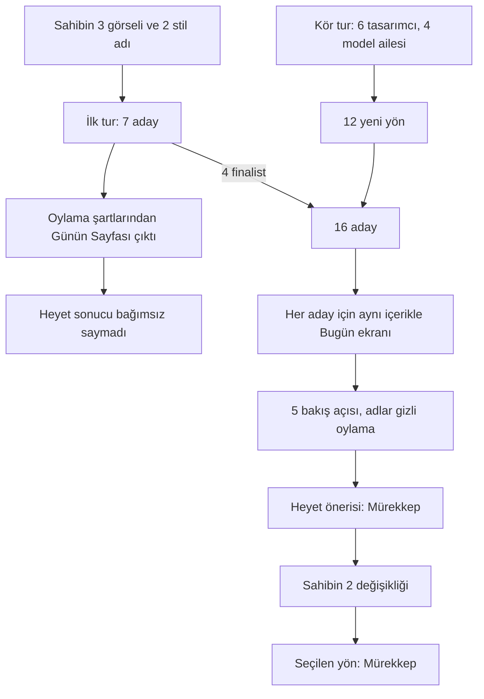
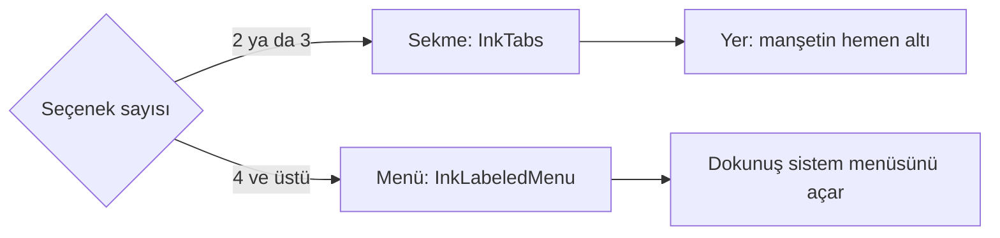
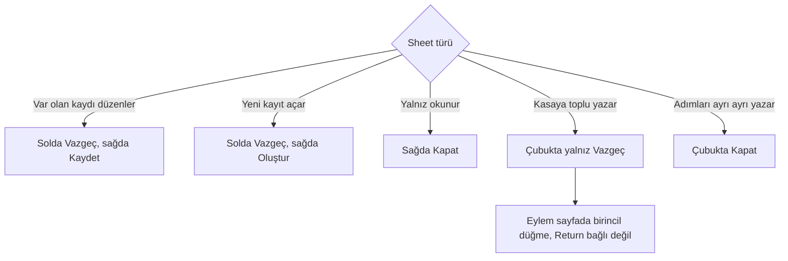
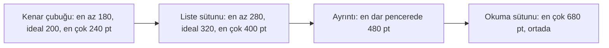
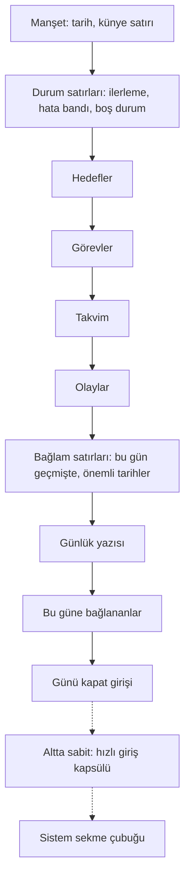
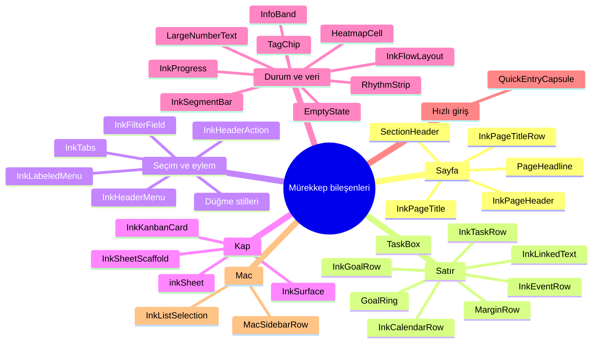

# Tasarım dili

**Amaç:** Bu belge uygulamanın tasarım dilini tanımlar: seçilen yön, kurallar ve belirteçler.

**Kapsam:**

- Mürekkep yönünün seçimi, oylaması ve yedek seçenekleri.
- Bütün ekranlar için ortak kurallar ve denetim kalıpları.
- Renk, yazı, boşluk ve biçim belirteçleri; uygulama simgesi; bileşen ailesi.

## Durum

| Alan | Değer |
|---|---|
| Yön | Mürekkep, proje sahibinin iki değişikliğiyle |
| Seçim tarihi | 2026-10-05 |
| Karar | [Kararlar](decisions.md) tablosu, 2026-10-05 satırı |
| Uygulama | [Yol haritası](roadmap.md), Aşama 9 |
| Belirteç kodu | `App/Design/` ve `App/Resources/Assets.xcassets` |
| Ekran içeriği | [Ekranlar](screens.md) |

Bu belge yönü, kuralları ve belirteçleri tutar. Ekranların içeriği `screens.md` belgesindedir.

## Kısıtlar

| Kısıt | Açıklama |
|---|---|
| Sistem kromu | iOS 26 ve macOS 26'dan beri sekme çubuğu, araç çubuğu ve sheet'ler sistemin Liquid Glass kromudur. HIG camı içerik katmanında istemez. Adaylar bu yüzden içerik katmanında ayrışır. |
| Kullanım | Ürün metin ağırlıklıdır. Kullanıcı ürünü her gün, günde birçok kez açar. |
| Yazarlar | Uygulamayı ekranı göremeyen kodlama ajanları yazar. Ajanlar bir dili ancak kurala bağlanabildiği ölçüde uygular. |

## Seçim süreci

**Seçim iki turda ve bir sahip kararıyla bitti.**

Kör tur, ilk turun sahip girdisine bağlılığını dengeledi. Son karar sahibindir.

### İlk tur

| Adım | Ayrıntı |
|---|---|
| Girdi | Proje sahibi beğendiği 3 görseli paylaştı. Görseller repoda yoktur. |
| Görsel 1 | Tek renkli gri bir soft UI panosu. |
| Görsel 2 | Koyu zeminde tek turuncu vurgulu, bento kartlı bir görev planlayıcı. |
| Görsel 3 | Krem kâğıt üstünde mercan ve kömür renkli, dev rakamlı bir baskı düzeni. |
| Adaylar | 7 aday bu görsellerden ve sahibin andığı 2 stilden türedi: cam ve kil. |
| Sonuç | Oylamanın şartlarından "Günün Sayfası" çıktı. |
| Değer | Aday listesi sahibin girdisine bağlıydı. Heyet bu yüzden sonucu bağımsız bir araştırmanın sonucu saymadı. |

### Kör tur

| Adım | Ayrıntı |
|---|---|
| Tasarımcılar | 6 tasarımcı, 4 ayrı yapay zeka model ailesinden geldi. Tasarımcılar sahibin görsellerini ve ilk turun sonucunu görmedi. |
| Görev | Her tasarımcı aynı ürün için sıfırdan 2 yön önerdi. |
| Birinci tercihler | 6 tasarımcının birinci tercihi aynı çıktı: kâğıt tonunda opak bir sayfa, ince çizgiler ve kullanıcının kendi sözleri için serif yazı. Kâğıt tonu krem, kırık beyaz ya da yeşilimsiydi. |
| Görülmeyenler | Hiçbir tasarımcı dev gün rakamı ya da ters renkli panel kullanmadı. Sıcak turuncu vurguyu yalnız 1 tasarımcı seçti. |
| İkinci tercihler | İkinci yönlerin yazısı sans ya da eş aralıklıydı ve yönler yapı ağırlıklıydı: pano, karo, zaman rayı ya da cihaz paneli. |
| Çizim | Heyet 12 yeni yönü ve ilk turun 4 finalistini aynı içerik ve aynı çerçeveyle Bugün ekranında çizdirdi. |
| Oylama | 5 bakış açısı adayları adları ve kökenleri gizli olarak bağımsız oyladı: erişilebilirlik, platform mühendisliği, marka, günlük kullanım, ürün ruhu. |
| Sahibin zevki | Bu turda hiçbir üye sahibin zevkini temsil etmedi. Zevk oyu sahibindir. |

## Oylama

| Ölçü | Tanım |
|---|---|
| Sıra puanı | Her oyda birinci 15 puan, sonuncu 0 puan alır. En çok 75 puan. |
| İkili | Adayın bire bir karşılaştırmada yendiği aday sayısı. Üst sınır 15. |
| Veto | Adayın aldığı veto sayısı. |

**16 adayın sıra puanı, ikili sayısı ve vetosu.**

| Sıra | Aday | Tur | Tek cümle | Sıra puanı | İkili | Veto |
|---|---|---|---|---|---|---|
| 1 | Mürekkep | kör | Kenar boşluklu kitap sayfası: kullanıcının sözü serif, uygulamanın sözü sans, tek eylem rengi | 67 | 14 | 0 |
| 2 | Derkenar | kör | Aynı iskelet; kırmızımsı kenar çizgisi ve tanınan adların üstünde fosforlu kalem izi | 61 | 15 | 0 |
| 3 | Defter | kör | Krem kâğıt ve koyu yeşil; görev sans, düzyazı serif; hedefler üç sütun | 55 | 11 | 0 |
| 4 | Seyir Defteri (zaman rayı) | kör | Soğuk kayıt dökümü: saat sütunu, zaman rayı, tipine göre renkli bağlantılar | 52 | 13 | 0 |
| 5 | Seyir Defteri (çivit) | kör | Kullanıcının sözü serif, uygulamanın sözü eş aralıklı; ilerleme çeteleyle | 52 | 11 | 0 |
| 6 | Günün Sayfası | ilk | Krem kâğıt, dev gün rakamı, kor vurgu, kömür günlük paneli | 48 | 10 | 0 |
| 7 | Açık Defter | kör | Sakin kâğıt ve orman yeşili; çerçeveli hedef kutuları | 48 | 9 | 0 |
| 8 | Koordinat | kör | Sans; renk yalnız anlam taşır, bekleyen hedefler renkli karo | 44 | 9 | 0 |
| 9 | Gün Işığı | kör | Vurgu günün saatine göre değişir; üstte gün şeridi | 35 | 7 | 0 |
| 10 | Sessiz Kâğıt | kör | Sıkı dizilmiş kâğıt sayfa, 15 pt gövde, kiremit vurgu | 35 | 6 | 0 |
| 11 | Gün İşaretleri | kör | Sans ve mavi, kenarlıklı kartlar | 34 | 5 | 1 |
| 12 | A6 Matbaa | ilk | Krem kâğıt, mercan ve kömür, dev rakam, büyük harfli baskı etiketleri | 18 | 4 | 2 |
| 13 | Modern Monolit | kör | Yoğun pano, çip biçiminde bağlantılar, küçük büyük harfli etiketler | 16 | 2 | 2 |
| 14 | A5 Kor | ilk | Koyu zemin, tek turuncu, bento kartlar, hafta şeridi | 13 | 3 | 2 |
| 15 | Takvim Yaprağı | ilk | Bento iskeleti, sıcak kâğıt ve dev gün rakamı | 11 | 1 | 1 |
| 16 | Gösterge | kör | Cihaz paneli: tuşlar, lambalar, eş aralıklı ve dar yazılar | 11 | 0 | 3 |

### Oylamanın bulguları

| Bulgu | Açıklama |
|---|---|
| Aile | Üyeler adayları kendi gözleriyle ailelere ayırdı. 5 üye de ürüne uygun aile olarak kartsız, serif içerikli sayfayı gösterdi. Platform bakışı, sisteme en yakın ve yalnız belirteçle kurulan aileyi de aynı derecede uygun buldu. Bento, pano ve cihaz paneli aileleri sonda kaldı. Bu aileler ürünü planlayıcı ya da takipçi kategorisine taşıdı ve olayları ilk ekranın dışına itti. |
| İki lider aynı iskelet | 3 üye, birbirinden bağımsız, Derkenar'ı "Mürekkep ve üstüne iki imza" diye tarif etti. Derkenar bire bir karşılaştırmada her adayı yener; Mürekkep'i 3–2 yener. Mürekkep toplam puanda öndedir. Hiçbir üye Mürekkep'i dördüncüden aşağı koymadı. Marka, günlük kullanım ve ürün ruhu bakışları Derkenar'ı birinci koydu. Erişilebilirlik ve platform bakışları Derkenar'ı sekizinci koydu. |
| İlk turun adayları | Günün Sayfası 6., A6 Matbaa 12., A5 Kor 14., Takvim Yaprağı 15. sıradadır. Üyelerin itirazları ortaktı. Ters renkli büyük yüzey, altından geçen sistem camını açık ile koyu arasında çevirir ve bir sheet'e benzer. Sistem dışı yazı ailesi Kalın Metin ayarına uymaz. Küçük, büyük harfli etiketler okunaksızdır. Bento ve hafta şeridi ilk ekranın üst yarısını alır. Heyet Günün Sayfası'nı bu grubun en ölçülü üyesi saydı; Günün Sayfası veto almadı. |
| Model yakınlığı | Jüri üyeleri 3 modeldendi. Aynı 3 model kör turun 12 yönünden 8'ini tasarlamıştı. 5 üyenin 4'ü, kökeni bilmeden, kendi modelinin tasarımını birinci koydu. Her üyenin kendi modelinden gelen adayları sayımdan çıkarınca Mürekkep'in sıraları 2, 4, 2 olur. Derkenar'ın sıraları 8, 8, 1 olur. Heyet bu yüzden bire bir karşılaştırmanın galibini değil, bu düzeltmeden etkilenmeyen adayı önerdi. |

Bulgular Mürekkep'i öne çıkardı. Derkenar aynı iskeletin imzalı biçimi olarak yedekte kaldı.

## Seçilen yön: Mürekkep

| Öğe | Tanım |
|---|---|
| Kullanıcının sözü | Kasadan gelen her söz serif yazıdır: New York. |
| Uygulamanın sözü | Uygulamanın her sözü sans yazıdır: SF Pro. |
| Sayfa | Gün tek bir sayfadır. Saatler ve işaretler sayfanın kenar boşluğunda durur. |

Tek cümleyle: kullanıcının sözü serif, uygulamanın sözü sans; gün, kenar boşluğunda saatleri ve işaretleri duran tek bir sayfadır.

### Sahibin değişiklikleri

| No | Değişiklik | Kaynak aday | Ayrıntı |
|---|---|---|---|
| 1 | Görev işareti köşeli kutudur, öncelik kutunun içindedir | Derkenar | Kutu 22 pt kare, köşe 5 pt. Boş kutu 1,5 pt kontrol çizgisi taşır. Orta öncelikte kutunun içinde "!" durur. Yüksek öncelikte çerçeve 2 pt ve metin rengindedir; içinde "!!" durur. Tamamlanan görevde kutu ikincil metin rengiyle dolar; içinde zemin renginde onay işareti durur. Kenar sütununda ayrı öncelik işareti kalmaz. Hedef işareti halka olarak kalır; böylece görev ile hedef biçimle de ayrışır. |
| 2 | Hızlı girişte kip iki sözcüktür | Defter | "Olay" ve "Görev" yan yana durur. Seçili sözcük yarı kalındır ve altında 2 pt vurgu çizgisi taşır. Ardından "Gününden bir an…" yer tutucusu ve gönder düğmesi gelir. Kapsül Mürekkep'teki gibi kalır. Mac'te sözcükler arasındaki boşluk 12 pt'dir. iPhone'da erişilebilirlik boyutu aynı aralığı kullanır. Varsayılan iPhone satırında 44 pt dokunma alanı aynı görsel boşluğu üretir; o satır değişmez. |

Sahip, heyetin önerdiği Mürekkep'i bu iki değişiklikle seçti. Tasarımcı iki değişikliği de makete çizdi. Sahip Derkenar'ın imzasını eklemedi: kenar çizgisi ve fosfor izi. İmza aşağıda ayrı başlıkta durur.

### Öncelik kutusu itirazı

| Konu | Ayrıntı |
|---|---|
| İtiraz edenler | Platform, günlük kullanım ve marka bakışları |
| İtiraz | Önceliği onay kutusunun içine yazmak tek denetime 2 durum yükler. Kullanıcı kutuyu uyarı rozeti gibi okuyabilir. |
| Karar | Sahibin kararı geçerlidir. Prototip kutuyu dokunma davranışıyla birlikte sınar. |
| Devam eden görev | Tasarımda açık kalan ayrıntıydı: kutu yarı doluyken öncelik işaretinin yeri. Kod bugün kutunun alt yarısını ikincil metin rengiyle doldurur ve "!" ya da "!!" işaretini açık üst yarıya koyar: `TaskBox.swift`. |

### Seçim gerekçeleri

| Gerekçe | Açıklama |
|---|---|
| Sıra | Hiçbir bakış açısı Mürekkep'i dördüncüden aşağı koymadı. Mürekkep veto almadı ve toplam puanda birincidir. Model yakınlığı düzeltmesinden sonra açık ara öndedir. |
| Platform | Mürekkep platform bakışının birincisidir. Platform bakışına göre Bugün ekranı tek `List`, tek satır bileşeni ve yalnız sistem yazı tipleri ister. Özel çizim yalnız hedef halkasındadır. Platform bakışının kaba emek tahmini: temel için 5–7 gün, bütün uygulama için 3–4 hafta. |
| İki ses kuralı | Kural ürünün vaadini görünür kılar. Dosyada duran söz serif yazıdır. Uygulamanın eklediği ya da hesapladığı her şey sans yazıdır. Kural verinin kökenine bağlıdır; bu yüzden ekranı görmeyen ajan kuralı uygular, inceleyen kuralı denetler. |
| Açık yol | Derkenar aynı iskeletin üstüne 2 imza ekler. Mürekkep'le başlamak Derkenar yolunu kapatmaz. |

### Zayıf yanlar

| Zayıf yan | Kaynak bakış | Açıklama |
|---|---|---|
| İmza yok | Marka, ürün ruhu | Marka bakışı ekran görüntüsünü "zevkli ama anonim" buldu. Ürün ruhu bakışına göre 1 piksellik alt çizgi tanımayı fısıldar ve kullanıcı yanlış bağlanan adı gözden kaçırır. |
| Manşet ve aralıklar | Günlük kullanım | Büyük manşet ve bölüm aralıkları olayları ilk ekranın dışına iter. |
| Sessiz hiyerarşi | Erişilebilirlik | Bölüm etiketleri ve kenardaki öncelik işaretleri küçüktür. |
| Veri görünümleri | Heyet | Sayı ve bakışta durum bu dilin güçlü olmadığı yerdir: hedef ilerlemesi, widget, özetler, zaman çizelgesi. Veri görünümleri ikinci, sınırlı bir kural seti ister. |

### Jürinin şartları

| No | Şart | Koddaki durum |
|---|---|---|
| 1 | Bugün tek liste ve tek satır bileşenidir. Kenar sütununun genişliği yazı boyutuyla büyür. Erişilebilirlik boyutlarında saat ve öncelik metnin üstüne iner. | Kenar sütunu `@ScaledMetric` ile büyür: `MarginRow.swift`. Bugün ekranı `List` değil, `ScrollView` içinde tek sütundur: `DayView.swift`. |
| 2 | Uygulama bağlantıyı yalnız standart metin öznitelikleriyle çizer. Bağlantı okuma metninde, hızlı girişte yazarken ve Mac'te aynı görünür. Kontrastı Artır'da yalnız renkler koyulaşır. Alt çizgi kalınlığı sistemin standart alt çizgisidir. Kişi ve konum renkleri Graph ve Harita ile aynı belirteçten gelir. | Kontrastı Artır renkleri koyulaştırır: `InkPalette.swift`. `Text.LineStyle` çizgi kalınlığı almaz; bu yüzden `InkStroke` bağlantı alt çizgisi için değer tutmaz. Hızlı giriş alanı `TextField` ile `String` bağlar; tanınan adlar alanın üstünde ad çipi olur. |
| 3 | Hızlı girişte olay ve görev kipi görünür olur. Artı ve gönder düğmelerinin ve kip sözcüklerinin dokunma alanı 44 pt'dir. | Sahibin ikinci değişikliği kip şartını karşıladı. |
| 4 | Manşet bloğu daralır. Hedef: ilk olay da kaydırmadan görünür. | — |
| 5 | Görev kutusunun çizgisi koyulaşır. Makette kontrast 3,48:1'dir. Erişilebilirlik bakışı denetim çizgilerinde 4,5:1 istedi. | Çizgi koyulaşmaz. Kontrol çizgisi metin dışı bir denetim sınırıdır; alt sınırı 3:1'dir: kural 4. Açık moddaki 3,48:1 bilinçli bir seçimdir: `InkPalette.swift`. `PaletteContrastTests` 3:1 sınırını denetler. |
| 6 | Mac kanbanı çerçeveli, gölgesiz kâğıt kart kullanır. Tablo ve zaman çizelgesi tabular saat sütunu ve "şimdi" çizgisi kullanır. | `InkKanbanCard` yüzey renginde, ince çizgi çerçeveli ve gölgesizdir: `InkSurface.swift`. |

### İmza: eklenmedi

| İmza öğesi | Tanım |
|---|---|
| Kenar çizgisi | Kenar sütunu ile metin sütunu arasında 1 pt'lik gül kurusu çizgi. |
| Fosfor izi | Uygulamanın tanıdığı kişi ve konum adlarının üstünde fosforlu kalem izi. |
| Başlık yeri | Derkenar başlığı araç çubuğu satırına alır. Böylece 17 pt metinle görevler, takvim ve ilk olay kaydırmadan görünür. |

| Taraf | Görüş |
|---|---|
| İsteyenler: marka, günlük kullanım, ürün ruhu | Derkenar, ürünün farkı olan kendiliğinden tanımayı ekranda görünür kılan tek adaydır. Kimlik kartta ya da başlıkta durmaz; metnin işaretlenme biçiminde durur. Bu yüzden metin olan her ekranda imza vardır. Kenar çizgisi "solu uygulamanın, sağı kullanıcının" ayrımını yerleşimle verir. |
| İtiraz edenler: erişilebilirlik, platform | Fosfor zeminin kâğıda kontrastı 1,11:1'dir. Ayrımı gerçekte yarı kalın yazı taşır; Kalın Metin açılınca fark daralır. Sarı zemin sistemin bul ve ara eşleşme vurgusuyla aynı görünür. Önceliği onay kutusunun içine yazmak tek denetime 2 durum yükler. Yoğun günlük yazısında her adın sarı blok olması gürültü yapar. |
| Benimsenirse şartlar | İz hiçbir zaman tek ipucu olmaz; altında Mürekkep'in tipli alt çizgisi durur. Sarı yalnız "uygulama bunu tanıdı" anlamını taşır. Arama eşleşmesi, seçim ve uyarı başka biçim alır. İz yalnız akan metindeki adlarda durur; varlığın kendi sayfasında kendi adı iz taşımaz. Kenar çizgisinin rengi hata ya da gecikme anlatmaz. Çizgi yalnız sayfa görünümlerinde durur; kanban ve zaman çizelgesine geçmez. Kâğıt dokusu, satır çizgisi ve el yazısı yoktur. |

Sahip imzayı istemedi; tanınan adlar alt çizgili kalır. Sahip 2026-10-16'da kararı kesinleştirdi: imza eklenmez ve prototipi yapılmaz. Bu bölüm yalnız gerekçe kaydıdır.

### Mürekkep'le kabul edilen ayrıntılar

| Ayrıntı | Tanım |
|---|---|
| Vurgu rengi | Mürdüm. Vurgu yalnız eylemde görünür: artı, gönder, seçili sekme, kip çizgisi. Sayfa ailesinin öteki üyeleri koyu yeşil, çivit ve çini mavisi kullandı. Renk değişirse yapı değişmez. |
| Kişi ile konumun ayrımı | Kişi düz alt çizgi, konum noktalı alt çizgi taşır. Ürün ruhu bakışı bir öneri verdi: noktalı ve kesik biçim tipi değil "emin değilim, soruyorum" durumunu göstersin; tipi yalnız renk ayırsın. |
| Geciken görevin dili | "Geciken" sözü ve kırmızı yoktur. Görevin altında uyarı rengiyle "30 Eyl'den" yazar. "N devreden daha" satırı üçten fazla geciken görevi toplar. |

Sahip bu ayrıntıları Mürekkep'le birlikte kabul etti. Sahip isterse ayrıntılar değişir.

## Sıradaki seçenekler

| Sıra | Aday | Ne zaman | Gerekçe ve risk |
|---|---|---|---|
| 1 | Derkenar | "Mürekkep fazla sessiz" denirse | Aynı iskelet, imza açık. Bire bir karşılaştırmanın galibidir. |
| 2 | Defter ya da Seyir Defteri (çivit) | Sayfa ailesinin başka bir üyesi istenirse | Defter erişilebilirlik bakışının birincisidir: görev sans, düzyazı serif, koyu yeşil vurgu. Defter hedefleri 3 sütuna dizer; büyük yazıda ikinci bir yerleşim ister. Seyir Defteri (çivit) uygulamanın sözünü eş aralıklı yazıyla verir ve ilerlemeyi çeteleyle gösterir. "Dosyalar senin" vaadini en görünür kılan adaydır. Küçük, eş aralıklı etiketleri okumak zordur. |
| 3 | Seyir Defteri (zaman rayı) | Kâğıt ve serif istenmezse | Aynı kenar sütunu yapısının soğuk, alet halidir ve marka bakışının yedeğidir. Varlık tipini en iyi gösteren adaylardandır. Riskler: bağlantıyı yalnız renk ve kalınlık ayırır; ürün ölçüm paneline yaklaşır. |
| 4 | Günün Sayfası | Sahibin görsellerindeki dev gün rakamı ve kor vurgu istenirse | İlk turun en iyi adayıdır: 16 aday içinde 6., vetosuz. Sahip bu adayı seçerse ters renkli günlük paneli ve sistem dışı yazı ailesi çıkar. |
| 5 | Açık Defter ya da Koordinat | En ucuz ve geri dönüşü en kolay yol istenirse | Platform bakışının üçüncüsü ve ikincisidir. Kimliği en az olan adaylardır. |

| Önerilmeyen aday | Veto |
|---|---|
| Gösterge | 3 |
| A5 Kor, A6 Matbaa, Modern Monolit | 2'şer |
| Takvim Yaprağı, Gün İşaretleri | 1'er |

Seçim değişirse yukarıdaki sıra geçerlidir. Geri dönüş maliyeti düşüktür: sayfa ailesinin üyeleri aynı belirteç rollerini, aynı iki sesli yazı kuralını ve aynı satır bileşenini paylaşır. Üyeler arasında geçiş yalnız belirteç ve birkaç bileşen değişikliğidir.

## Her yönde geçerli kurallar

| No | Kural |
|---|---|
| 1 | Gezinme sistemde kalır: iPhone'da `TabView`, Mac'te `NavigationSplitView`. Uygulama özel sekme çubuğu yazmaz. |
| 2 | İçerik katmanında cam etkisi yoktur. Cam yalnız sistem kromunda ve hızlı giriş çubuğundadır. |
| 3 | Açık ve koyu modda yerleşim aynıdır. Uygulamaya özel görünüm anahtarı yoktur. |
| 4 | Her renk belirtecinin 4 varyantı vardır: açık, koyu ve ikisinin Kontrastı Artır karşılığı. Gövde ve ikincil metin en az 4,5:1 kontrast taşır; hedef 7:1'dir. İri metin ve denetim sınırları en az 3:1 kontrast taşır. |
| 5 | Durumu hiçbir zaman yalnız renk, gölge ya da opaklık anlatmaz. Bağlantı renkten başka bir ipucu daha taşır. Devreden görev işaret ve tarih taşır. Tamamlanan görev dolu onay işareti taşır ve metni okunur kalır. |
| 6 | Geciken tarih kırmızı değildir; uyarı rengini ve işareti taşır. Kırmızı yalnız gerçek hatayı ve yıkıcı eylemi gösterir. |
| 7 | Vurgu kalanı gösterir: yapılmış hedef ve tamamlanan görev geri plana geçer. |
| 8 | Uygulama yalnız sistem yazı tiplerini kullanır: New York ve SF Pro. Metin semantik stilleri kullanır ve Dynamic Type ile büyür. Sabit punto yoktur. |
| 9 | iOS'ta hiçbir metin 12 pt'nin altında değildir. Etiketler cümle düzenindedir. Büyük harfli, geniş aralıklı etiket yoktur. |
| 10 | Dokunma hedefleri en az 44 pt'dir. |
| 11 | İçerikte büyük ters renkli yüzey yoktur. Böyle bir yüzey altından geçtiği sistem camını açık ile koyu arasında çevirir. |
| 12 | Mac'te kenar çubuğu uygulamanın vurgu rengini taşır: mürdüm. Simgeler vurgu rengindedir. Seçili satır vurgu rengiyle dolar; yazısı ve simgesi vurgu üstü mürekkeptedir. Kontrast açıkta 8,70:1, koyuda 9,18:1'dir; alt sınır 4,5:1'dir. Yalnız seçili girdi vurgu alır: Görevler'in altındaki Kanban, Zaman çizelgesi ve projeler ayrı satırdır. Seçimin kendisi sistemindir: ok tuşları, odak, VoiceOver. Yalnız çizim uygulamanındır. |
| 13 | Hareket sistem varsayılanlarıyla sınırlıdır ve Hareketi Azalt ayarına uyar. Tek istisna Graph'tır: düğümler kuvvet benzetimiyle hareket eder, çünkü içerik hareketin kendisidir. Hareketi Azalt açıkken Graph da canlı oynamaz; uygulama oturmuş düzeni tek seferde gösterir. |

**DİKKAT:** Kural numaralarını değiştirme; kod kural 12'ye `MacSidebar.swift` içinde, Mürekkep kuralı 4'e `InkLinkStyle.swift` içinde numarayla gönderme yapar.

## Mürekkep'in kuralları

| No | Kural |
|---|---|
| 1 | Yazı tipini veri türü seçer. Kasadan gelen metin ve sayfa adları New York'tur: olay, görev, günlük yazısı, not, alan değeri. Geri kalan her şey SF Pro'dur. Hiçbir ekran yazı tipini elle seçmez. |
| 2 | İçerikte kart yoktur. Bir bölümün parçaları 1 piksellik süs çizgisi, başlık ve sağdaki sayaçtır. |
| 3 | Her satırın işareti kenar sütununda durur: görev kutusu, hedef halkası, saat. Öncelik görev kutusunun içindedir. Metin tek sütunda akar. |
| 4 | Bağlantı metni metin rengindedir; anlamı alt çizgi taşır. Kişi düz mavi, konum noktalı yeşil, çözülmemiş bağlantı kesik ve ikincil alt çizgi taşır. Türkçe ek çizginin dışında kalır. |
| 5 | Eylem tek renktir: vurgu. Dikkat yalnız uyarı rengiyle ve yalnız devreden tarihinde görünür. |
| 6 | Tamamlanan görev ve yapılmış hedef soluklaşır: ikincil metin, dolu işaret. Bu satırlar listenin sonuna iner; Bugün hedef şeridinde yalnız günün ilk yüklemesinde, çünkü gün ekranda kaldıkça sıra değişmez (`screens.md` Hedefler bölümü). Üstleri çizili olmaz. |

### Bağlantı biçimleri

**Her bağlantı türünün metin rengi ve alt çizgisi.**

| Tür | Metin rengi | Alt çizgi deseni | Alt çizgi rengi |
|---|---|---|---|
| Kişi | Metin | Düz | Kişi |
| Konum | Metin | Noktalı | Konum |
| Öteki çözülmüş bağlantı: proje notu, özel varlık tipi | Metin | Düz | Kontrol çizgisi |
| Çözülmemiş bağlantı | İkincil metin | Kesik | İkincil metin |

`InkLinkStyle` bu tabloyu uygular ve okuma metni ile `TextEditor` aynı yolu kullanır. Yedek yol `coloredText` bağlantı metnini alt çizgisiz, tür renginde yazar.

## Denetim kalıpları

**Ekim 2026 denetiminde aynı işin kaç biçimde kurulduğu.**

| Konu | Biçim sayısı |
|---|---|
| Arama | 2 |
| Birini seç | 5 |
| Sheet başlığı yazısı | 3 |
| Sheet zemini | 4 |

Denetim 84 gerçek ekran görüntüsünü ve kod envanterini inceledi. Aşağıdaki 7 kalıp tek tanımdır. Her ekran kalıpları ortak bileşenlerle kurar; hiçbir ekran bir kalıbı elle yeniden yazmaz. Referans Bugün ekranıdır.

### 1. Sayfa üstü

| Yer | Kural |
|---|---|
| Kök ekran, iPhone | Sayfa adı solda serif manşettir. Sayfanın eylem simgeleri aynı satırın sağında durur. Sistem gezinme çubuğu ve cam kapsül yoktur. |
| Mac | Sayfa adı yine sayfanın içinde serif manşettir. Her liste sütunu manşetle başlar. Pencere araç çubuğunda başlık yoktur. Pencerenin adı seçili kenar çubuğu girdisidir ve yalnız Pencere menüsünde görünür. Araç çubuğunda yalnız arama düğmesi durur. |
| Alt sayfa | Sistem çubuğunda yalnız geri düğmesi kalır. Sayfanın eylemleri yine manşet satırındadır. |
| Kaydırma | Manşet satırı içerikle birlikte kayar. İstisna Ara sayfasıdır: manşet ve arama alanı sabittir, sonuçlar altta kayar. |

Kod karşılığı: `InkPageTitle`, `InkPageTitleRow`, `inkRootPageNavigationTitle` ve `inkPageNavigationTitle`.

### 2. Manşet satırı simgeleri

| Konu | Kural |
|---|---|
| Biçim | Çerçevesiz ve kapsülsüz simge. |
| iPhone alanı | Dokunma alanı 44 pt. |
| Mac alanı | Tıklama alanı en az 28 pt. Simge semantik `title2` boyutundadır. Komşu tıklama alanları arasında 4 pt boşluk vardır. |
| Renk | Yardımcı eylemler ikincil metin rengindedir: ara, sırala, filtrele, Ayarlar. Kayıt açan ya da içeriği değiştiren eylem vurgu rengindedir: ekle, düzenle. "Eylem tek renktir" kuralı bu eylemler içindir. |
| Sayı | Bir satırda en çok 3 simge durur. Fazlası sayfanın en üstünde ayrı satır olur; örneğin Günlük'teki Özetler satırı. |
| Sıra | Sıra sabittir. iPhone'da en sağda ara durur, solunda ekrana özgü simgeler durur. Mac'te manşet satırında arama simgesi yoktur. |
| Büyük yazı | Erişilebilirlik yazı boyutlarında simgeler manşetin üstünde ayrı satıra çıkar. |

Kod karşılığı: `InkHeaderAction`, `InkHeaderMenu` ve `InkHeaderActionChrome`. Sınırlar `maximumCount = 3`, `spacing = 4` ve `macMinimumSide = 28` değerleridir.

### 3. Arama

| Yer | Kural |
|---|---|
| iPhone | Genel arama manşet satırının en sağındadır. Yer ve simge her ekranda aynıdır. |
| Mac | Genel arama pencere araç çubuğundaki tek düğmedir. Seçim olmasa da kullanıcı düğmeye erişir. Manşet satırlarında büyüteç yoktur. |
| Mac, Ara sheet'i | Sonuçlardan açılan sayfada manşet büyüteci Mac'te de durur ve sonuçlara döndürür. Sayfa not, kişi, konum ya da gün olabilir. Neden: pencerenin araç çubuğu sheet'in arkasında kalır. |
| Süzgeç alanı | Sayfa içi süzgeç alanı Ara sayfasındaki alanla aynı bileşendir: çukur zemin, kontrol çizgisi, odakta vurgu çizgisi, italik yer tutucu. |

Kod karşılığı: süzgeç alanı `InkFilterField` bileşenidir.

### 4. Birini seç

**Seçenek sayısı biçimi seçer.**

| Biçim | Görünüm |
|---|---|
| Sekme | Sola yaslı sözcükler. Seçili sözcük metin rengindedir ve altı vurgu rengiyle çizilidir. Ötekiler ikincil renktedir. Hızlı girişteki Olay \| Görev ile aynı bileşendir. |
| Menü | Sola yaslı. Solda ikincil renkte etiket durur: "Dönem", "Bölüm", "Grupla", "Ölçek". Sağda vurgu renginde seçili değer ve ok durur. Dokunuş sistem menüsünü açar. |
| Yasak | Sistem segmentini, onay kutucuğu dizisini, etiketsiz ya da ortalı menüyü ve gezinme çubuğundaki seçiciyi kullanma. |

### 5. Sırala ve filtrele

| Konu | Kural |
|---|---|
| Yer | Manşet satırında simgedir. Simgeye dokunmak menüyü açar. Sırala ve filtrele sayfada ayrı satır tutmaz. |
| Etkin seçim | Varsayılan dışında bir seçim etkinse simge vurgu rengine döner. |

### 6. Sheet

**Sheet türü çubuktaki düğmeleri seçer.**

| Konu | Kural |
|---|---|
| Zemin ve başlık | Zemin kâğıttır. Başlık serif manşettir. İçerik sayfalarla aynı kalıptadır: bölüm başlığı, kâğıt zeminli satır, kart yok. |
| Düğme biçimi | Düğmeler düz yazıdır; dolu kapsül yoktur. "Vazgeç" ikincil renkte düz yazıdır. Onay vurgu renginde, yarı kalın düz yazıdır. "Bitti" yoktur. |
| Toplu yazan akış | Örnek: kasa hazırlığı. Eylem taslak kaydetmek değildir. Çubukta yalnız "Vazgeç" durur. Eylem kendi adıyla sayfada birincil düğmedir ve Return tuşuna bağlı değildir. |
| Adım akışı | Örnek: günü kapat. Uygulama hedef işaretini anında yazar. Görev seçimlerini "Uygula" ile, günlük cümlesini "Yaz" ile yazar. Kapatmak yazılmış adımı geri almaz; bu yüzden çubukta "Vazgeç" yerine "Kapat" durur. |
| Yazma sırasında | Yazma sürerken "Vazgeç" devre dışıdır. Adım akışında "Kapat" da yazma bitene dek bekler. |
| Mac | Sistem pencere başlığı yoktur; tek serif manşet vardır. Araç çubuğu ve alt eylem çubuğu kâğıt zemindedir. Alt çubukta "Vazgeç" solda, onay ya da "Kapat" sağda durur. |
| Boyut | Sheet gövdesinin yüksekliği hiçbir zaman sıfır olmaz; sheet ortak ideal boyutu kullanır. |

Kod karşılığı: `.inkSheet`, `InkSheetScaffold` ve `InkSheetConfirmation`. `InkSheetConfirmation.save` "Kaydet" sözünü, `InkSheetConfirmation.create` "Oluştur" sözünü verir.

### 7. Sistem denetimleri

| Konu | Kural |
|---|---|
| Açma kapama anahtarı | Vurgu rengindedir: `inkToggle()`. |
| Kutu | Kâğıt üstünde beyaz ya da gri kutu yoktur. Alan zemini çukurdur, liste satırı kâğıttır. |
| Yüzey rengi | Yüzey rengi yalnız renk tablosunda sayılan yerlerde görünür. |

### Koruma

**Kalıpları koruyan testler.**

| Yasak ya da şart | Test |
|---|---|
| Stil verilmemiş `Picker`, `.pickerStyle(.segmented)`, `.textFieldStyle(.roundedBorder)` | `ControlPatternUsageTests` |
| iPhone ekranlarında araç çubuğuna konan arama | `ControlPatternUsageTests` |
| Mac'te arama yalnız kabuğun araç çubuğunda, tek düğme | `ControlPatternUsageTests` |
| Ortak bileşen dışında kurulan sheet araç çubuğu ve "Bitti" düğmesi | `ControlPatternUsageTests` |
| `App/Design` dışında hex renk; sistem rengi izin listesi yalnız küçülür | `DesignTokenUsageTests` |
| Her kök ekranın ve her sheet türünün ekran görüntüsü | Adı `SnapshotTests` ile biten kümeler |

Kaynak denetimi yasak kalıpları derlemeden önce yakalar. Ekran görüntüsü testleri kalıbın ekrandaki sonucunu yakalar.

## Renk belirteçleri

**Her renk belirtecinin açık, koyu ve Kontrastı Artır değerleri.**

| Belirteç | Açık | Koyu | KA açık | KA koyu |
|---|---|---|---|---|
| Zemin: kâğıt | `#FAF8F3` | `#181614` | `#FAF8F3` | `#141210` |
| Yüzey | `#FFFFFF` | `#23201C` | `#FFFFFF` | `#1E1B18` |
| Çukur | `#F1EDE4` | `#110F0E` | `#ECE7DC` | `#0C0B0A` |
| Süs çizgisi | `#E2DCCF` | `#302C27` | `#C4BBAB` | `#4C463E` |
| Metin | `#1E1B17` | `#EEE9DF` | `#0E0C0A` | `#FFFDF8` |
| İkincil metin | `#57514A` | `#B5AD9F` | `#403B35` | `#D6CFC2` |
| Vurgu: metin ve simge | `#7A2C6E` | `#E3A3D6` | `#5E1F55` | `#EDC3E5` |
| Vurgu dolgusunun üstündeki metin | `#FFFFFF` | `#1A1022` | `#FFFFFF` | `#12091A` |
| Uyarı | `#7A4E00` | `#E2B865` | `#5C3B00` | `#F0CF8E` |
| Tehlike | `#A11E1E` | `#F07178` | `#7A1010` | `#FFB4B4` |
| Kontrol çizgisi | `#8C8478` | `#7E776C` | `#655E54` | `#A39B8F` |
| Kişi | `#2D5BA6` | `#8FB3F0` | `#1D4689` | `#B3CDF8` |
| Konum | `#386E43` | `#8FCB9C` | `#24562E` | `#AEDDB8` |

KA, Kontrastı Artır demektir. Zemin, yüzey, çukur ve süs çizgisi zemin rolündedir; geri kalan belirteçler zeminin üstünde durur.

### Kontrast

**Her ön plan belirtecinin zemin üstündeki kontrastı.** Vurgu dolgusunun üstündeki metnin kontrastı vurgu dolgusuna göredir.

| Belirteç | Açık | Koyu | KA açık | KA koyu |
|---|---|---|---|---|
| Metin | 16,16 | 14,91 | 18,39 | 18,38 |
| İkincil metin | 7,38 | 8,11 | 10,44 | 12,07 |
| Vurgu: metin ve simge | 8,20 | 9,00 | 10,97 | 12,05 |
| Vurgu dolgusunun üstündeki metin | 8,70 | 9,18 | 11,65 | 12,54 |
| Uyarı | 6,78 | 9,69 | 9,51 | 12,48 |
| Tehlike | 7,27 | 6,31 | 10,36 | 11,07 |
| Kontrol çizgisi | 3,48 | 4,08 | 6,03 | 6,80 |
| Kişi | 6,26 | 8,49 | 8,64 | 11,57 |
| Konum | 5,69 | 9,62 | 8,09 | 12,31 |

Değerler tasarımcının hesabıdır. `PaletteContrastTests` asset catalog değerlerini `InkPalette` ile karşılaştırır ve alt sınırları denetler: metin rolleri 4,5:1, kontrol çizgisi 3:1. 2026-10-12 denetimi kontrastları koddaki değerlerden yeniden hesapladı; sonuçlar tabloyla aynıdır.

**NOT:** Kontrol çizgisi metin dışı bir denetim sınırıdır ve alt sınırı 3:1'dir. Açık moddaki 3,48:1 bilinçli bir seçimdir; uygulama çizgiyi 4,5:1'e koyulaştırmaz.

### Kod adları ve kullanım

| Belirteç | `Color.ink` | Asset | Kullanım |
|---|---|---|---|
| Zemin: kâğıt | `Color.ink.paper` | `InkPaper` | Sayfa, kaydırma alanı |
| Yüzey | `Color.ink.surface` | `InkSurface` | Sheet içi, popover, Mac kanban kartı |
| Çukur | `Color.ink.well` | `InkWell` | Isı haritasının boş hücresi, Mac'te hafta sonu, Mac liste sütununda seçili satır |
| Süs çizgisi | `Color.ink.rule` | `InkRule` | Bölüm çizgisi; bilgi taşımaz |
| Metin | `Color.ink.text` | `InkText` | İçerik, başlık |
| İkincil metin | `Color.ink.secondaryText` | `InkSecondaryText` | Meta, saat, yapılmış |
| Vurgu: metin ve simge | `Color.ink.accent` | `InkAccent`, `AccentColor` | Metin düğmesi, artı, seçili sekme |
| Vurgu dolgusunun üstündeki metin | `Color.ink.onAccent` | `InkOnAccent` | Gönder, birincil düğme |
| Uyarı | `Color.ink.warning` | `InkWarning` | Yalnız devreden tarihi ve işareti |
| Tehlike | `Color.ink.danger` | `InkDanger` | Yalnız yıkıcı eylem ve hata metni; yıkıcı eylem örneği silmedir |
| Kontrol çizgisi | `Color.ink.control` | `InkControl` | Görev kutusu, halka izi, artı konturu |
| Kişi | `Color.ink.person` | `InkPerson` | Düz alt çizgi, simge |
| Konum | `Color.ink.place` | `InkPlace` | Noktalı alt çizgi, simge |

`InkPalette.swift` onaltılık değerleri tutar; `InkColors.swift` `Color.ink` adlarını asset adlarına bağlar. `AccentColor` asset'i `InkAccent` ile aynı değerleri taşır. Sayfa zemini değiştiricisi `.inkPage()` sayfayı kâğıt zemine koyar. Tasarımcı vurgu için mor yerine mürdümü seçti: renk körlüğü benzetiminde mürdüm kişi mavisinden ayrışır. Veri görselleştirme renge ek olarak biçim ipucu taşır: ısı haritası, graph, zaman çizelgesi.

### İmza belirteçleri

**Sahip imzayı benimserse eklenecek belirteçler.**

| Belirteç | Açık | Koyu |
|---|---|---|
| Fosfor izi | `#FFEE99` | `#4F4410` |
| Kenar çizgisi | `#D9796B` | `#A85A50` |

Tasarımcı bu değerleri Derkenar'ın kendi zemininde ölçtü. Sahip imzayı benimserse değerleri Mürekkep zemininde yeniden hesapla.

## Yazı belirteçleri

**Her yazı rolünün ailesi, SwiftUI stili ve varsayılan boyutu.**

| Rol | `Font.ink` | Aile ve ağırlık | Semantik stil | iOS | Mac |
|---|---|---|---|---|---|
| Sayfa adı: manşet | `display` | New York Semibold | `largeTitle` | 34 | 26 |
| İçerik | `content` | New York Regular | `body` | 17; günlük paragrafında satır yüksekliği 26 | 13 |
| Küçük içerik: gün önizlemesi, kısa alıntı | `contentSmall` | New York Regular | `footnote` | 13 | 10 |
| Yer tutucu | `placeholder` | New York Italic | `body` | 17 | 13 |
| Künye satırı | `byline` | SF Pro Regular | `subheadline` | 15 | 11 |
| Bölüm başlığı | `section` | SF Pro Semibold | `footnote` | 13 | 10 |
| Meta | `meta` | SF Pro Regular | `footnote` | 13 | 10 |
| Değer | `value` | SF Pro, tabular rakam | `body` | 17 | 13 |
| Saat | `time` | SF Pro, tabular rakam | `subheadline` | 15 | 11 |
| Büyük rakam: hedef detayı, özet | `largeNumber` | SF Pro Light, tabular rakam | `largeTitle` | 48 | 48 |

`InkFonts.swift` yalnız semantik stilleri kullanır; kod kuraldır. iOS sütunu varsayılan Dynamic Type boyutundaki değerdir. Mac sütunu macOS'un aynı semantik stile verdiği değerdir; Mac için ayrı bir boyut hedefi yoktur. `inkJournalParagraph()` günlük paragrafına 9 pt ek satır aralığı verir: 26 − 17. `LargeNumberText` 48 pt hedefini `@ScaledMetric` ile büyütür; `Font.ink.largeNumber` yalnız yedektir.

## Boşluk ve biçim ölçeği

**Mac ana penceresinin üç sütunu.**

### Boşluk: `InkSpacing`

| Ad | Değer | Kullanım |
|---|---|---|
| `margin` | 16 pt | Sayfa yatay kenar boşluğu; `@ScaledMetric` ile büyür |
| `gutter` | 44 pt | Kenar sütunu; `@ScaledMetric` ile büyür |
| `row` | 6 pt | Bölüm içinde satırlar arası dikey boşluk |
| `section` | 8 pt | Bugün'de bölümler arası dikey boşluk |
| `macPageWidth` | 680 pt | Mac okuma sütununun en çok genişliği |
| `macSidebarMinWidth`, `macSidebarIdealWidth`, `macSidebarMaxWidth` | 180, 200, 240 pt | Mac kenar çubuğu |
| `macListMinWidth`, `macListIdealWidth`, `macListMaxWidth` | 280, 320, 400 pt | Mac liste sütunu |
| `macWindowMinWidth`, `macWindowMinHeight` | 1000 × 560 pt | Mac ana penceresi |
| `macSettingsMinWidth`, `macSettingsMinHeight` | 480 × 520 pt | Mac Ayarlar penceresi |
| `listSelectionHorizontal`, `listSelectionVertical` | 4, 2 pt | Mac liste seçim dolgusunun satır kenarından içe payı |

### Biçim: `InkSize`

| Ad | Değer | Kullanım |
|---|---|---|
| `taskBox`, `taskBoxCorner` | 22 pt, köşe 5 pt | Görev kutusu: kare |
| `goalRing` | 22 pt | Hedef halkası: daire |
| `plus` | 30 pt | Artı düğmesi: daire |
| `send` | 36 pt | Gönder düğmesi: daire |
| `largeNumber` | 48 pt | Büyük rakam hedefi |
| `modeUnderline` | 2 pt | Seçili kip ve sekme çizgisi; Mac liste seçiminin sol çizgisi |
| `listSelectionCorner` | 6 pt | Mac liste seçim dolgusunun köşesi |
| `chipCorner` | 4 pt | Etiket çipi ve öneri şeridi köşesi |
| `kanbanCorner` | 8 pt | Mac kanban kartı, yüzey, Mac kenar çubuğu dolgusu |
| `quickEntryCorner` | 20 pt | Erişilebilirlik boyutunda üst üste dizilen hızlı giriş |

### Çizgi: `InkStroke`

| Ad | Değer | Kullanım |
|---|---|---|
| `control` | 1,5 pt | Boş görev kutusu, halka izi |
| `highPriority` | 2 pt | Yüksek öncelikli görev kutusu çerçevesi; ısı haritasında bugün ve af çerçevesi |
| `rule` | 1 pt | Bölüm çizgisi; `hairline(scale:)` gerçek 1 pikseli verir |

Bağlantı alt çizgisi sistemin standart alt çizgisidir; `InkStroke` bağlantı alt çizgisi için değer tutmaz. Kontrastı Artır'da alt çizgi kalınlaşmaz; yalnız renkler koyulaşır.

Hızlı giriş kapsüldür. Uygulama Mac'te sayfayı en çok 680 pt genişlikte ortalar; kaydırma alanı sütunu doldurur, yalnız içerik daralır. En dar pencerede sütunlar 200 + 320 + 480 pt'dir; liste 280 pt'ye inerse ayrıntı 520 pt olur. İçerik opaktır; gölge, doku ve gradyan yoktur.

## Uygulama simgesi

**Simgenin her görünümdeki renkleri.**

| Görünüm | Zemin | Mürekkep şerit | Mürdüm şerit | Dosya biçimi |
|---|---|---|---|---|
| Açık (varsayılan) | Kâğıt `#FAF8F3` | `#1E1B17` | `#7A2C6E` | Opak, alfa kanalı yok (mağaza şartı) |
| Koyu | Yok: sistemin koyu zemini görünür | `#EEE9DF` | `#E3A3D6` | Saydam zeminli |
| Tonlu | Siyah | Gri 0,52 | Gri 0,95 | Opak, gri tonlamalı; rengi sistem verir |
| Mac | Kâğıt renkli gövde | `#1E1B17` | `#7A2C6E` | Saydam kenar paylı |

| Konu | Kural |
|---|---|
| Ad ve anlam | Simgenin adı "Geçme"dir: iki şerit dik açıyla birbirinin içinden geçer. Mürekkep şerit yazıdır. Mürdüm şerit bağdır: metnin kişi ve konumla kurduğu bağ. Renkler renk tablosundandır; gölge ve gradyan yoktur. |
| Biçim | 1024 birimlik tuvalde şerit kalınlığı 86, geçiş boşluğu 30 birimdir. Betik alttan geçen şeridi üstten geçenin iki yanından gerçekten keser. Boşluk zemin rengini almaz; bu yüzden zemin değişince simge doğru kalır: koyu, tonlu, saydam. |
| Mac gövdesi | Mac simgesi yuvarlak köşeli kare gövdesini ve kenar payını kendi içinde taşır. 1024 tuvalde gövde 824 birimdir; köşe yarıçapı gövdenin 0,225'idir. Gövdenin altında sistem simge şablonundaki hafif gölge vardır; gölge Dock ve Finder'da açık renkli gövdeyi açık zeminden ayırır. Bu gölge işaretin değil gövdenin parçasıdır; arayüzdeki "gölge yok" kuralı sürer. 16 ve 32 piksellik dosyalar ayrı çizimdir: şerit ve boşluk daha kalın, gölge yok. |
| Kaynak | Vektör kaynak `App/Support/AppIcon/app-icon.svg` dosyasıdır. Katmanlar: zemin, mürekkep şerit, mürdüm şerit. Aynı klasörde koyu, tonlu ve Mac çizimleri durur: `app-icon-dark.svg`, `app-icon-tinted.svg`, `app-icon-mac.svg`, `app-icon-mac-16.svg`, `app-icon-mac-32.svg`. |
| Üretim | SVG ve PNG dosyalarını elle düzenleme. `.github/scripts/render-app-icon.swift` hepsini aynı geometriden üretir. Yeniden üretme: `swift .github/scripts/render-app-icon.swift`. Betik belirlenimcidir; değişiklik yoksa dosyalar bayt düzeyinde aynı kalır. |

## Bugün ekranı

**Bugün ekranının yukarıdan aşağı sırası.**

| Bölüm | İçerik |
|---|---|
| Manşet | Tarih ve künye satırı. Künye olayla başlayan, "kaldı" ile biten özettir: "3 olay · 4 görev ve 2 hedef kaldı". |
| Hedefler | Halka, ad, sağda değer ve tek dokunuşluk artı. |
| Görevler | Köşeli kutu ve içinde öncelik; devreden görevde tarih. |
| Takvim | Kasa dışı kaynaktır; bu yüzden sans yazıdır. |
| Olaylar | Kenarda saat. |
| Bağlam satırları | Yalnız bugünün sayfasında durur; satır yoksa yer kaplamaz. |
| Günlük yazısı | 4 satır ve "Devamını yaz". |
| Bu güne bağlananlar | O güne bağlantı veren notlar, varlıklar ve başka günler; boşken yer kaplamaz. |
| Günü kapat girişi | Sayfanın son satırı; ilk olayı ilk ekrandan itmesin diye en alttadır. |
| Hızlı giriş kapsülü | "Olay" ve "Görev" sözcükleri, yer tutucu, gönder. |

`screens.md` taslağı 4 ek aldı: manşet ve künye satırı, bölüm sayaçları ve devreden görevlerin sınırı. Sınır 3 satır ve "N devreden daha" satırıdır. Dördüncü ek, birden çok tamamlanan görevi tek satıra katlar. Adayların hiçbiri 10 geciken görevin görünümünü çizmedi; prototip kuralı sınar. Bölüm sırası `App/Screens/Today/DayView.swift` dosyasındadır.

## Bileşen ailesi

**Bütün ekranları kuran ortak bileşenler, ailelerine göre.**

| Parça | Kod | Dosya |
|---|---|---|
| Manşet | `InkPageTitle`, `InkPageTitleRow`, `PageHeadline` | `App/Design/InkPage.swift`, `App/Design/Components/PageHeadline.swift` |
| Manşet satırı ve eylem simgeleri | `InkPageHeader`, `InkHeaderAction`, `InkHeaderMenu` | `App/Design/Components/InkPageHeader.swift`, `App/Design/Components/InkHeaderAction.swift` |
| Bölüm başlığı | `SectionHeader` | `App/Design/Components/SectionHeader.swift` |
| Kenar sütunlu satır: görev, hedef, olay ve takvim için tek bileşen | `MarginRow`, `InkTaskRow`, `InkGoalRow`, `InkEventRow`, `InkCalendarRow` | `App/Design/Components/MarginRow.swift`, `App/Design/Components/InkRows.swift` |
| Görev kutusu | `TaskBox` | `App/Design/Components/TaskBox.swift` |
| Hedef halkası | `GoalRing` | `App/Design/Components/GoalRing.swift` |
| Bağlantılı metin | `InkLinkedText`, `InkLinkStyle` | `App/Design/Components/InkLinkedText.swift`, `App/Design/Components/InkLinkStyle.swift` |
| Hızlı giriş kapsülü | `QuickEntryCapsule` | `App/Design/Components/QuickEntryCapsule.swift` |
| Sekme | `InkTabs` | `App/Design/Components/InkTabs.swift` |
| Etiketli menü | `InkLabeledMenu` | `App/Design/Components/InkLabeledMenu.swift` |
| Süzgeç alanı | `InkFilterField` | `App/Design/Components/InkFilterField.swift` |
| Sheet iskeleti: başlık ve iki düğme | `.inkSheet`, `InkSheetScaffold` | `App/Design/Components/InkSheet.swift` |
| Düğme stilleri | `InkPrimaryButtonStyle`, `InkTextButtonStyle`, `InkDestructiveButtonStyle` | `App/Design/Components/InkButtonStyles.swift` |
| Etiket çipi | `TagChip` | `App/Design/Components/TagChip.swift` |
| Boş durum | `EmptyState` | `App/Design/Components/EmptyState.swift` |
| İlerleme göstergesi | `InkProgress` | `App/Design/Components/InkProgress.swift` |
| Isı haritası hücresi | `HeatmapCell` | `App/Design/Components/HeatmapCell.swift` |
| Ritim şeridi: dönem birimleri başına olay sayısı | `RhythmStrip` | `App/Design/Components/RhythmStrip.swift` |
| Yığılı çubuk: parçaları bir bütüne eşit olan tek çubuk | `InkSegmentBar` | `App/Design/Components/InkSegmentBar.swift` |
| Akan satır: ad çipi ve açıklama dizisi | `InkFlowLayout` | `App/Design/Components/InkFlowLayout.swift` |
| Bilgi, uyarı ve hata bandı | `InfoBand` | `App/Design/Components/InfoBand.swift` |
| Büyük rakam | `LargeNumberText` | `App/Design/Components/LargeNumberText.swift` |
| Mac kanban kartı | `InkKanbanCard` | `App/Design/Components/InkSurface.swift` |
| Mac liste sütunu seçimi | `InkListSelectionBackground` | `App/Design/Components/InkListSelection.swift` |
| Mac kenar çubuğu satırı | `MacSidebarRow` | `App/Navigation/MacSidebar.swift` |

Bütün ekranlar bu parçaları kullanır. Görev satırının, kartın ve tarih biçiminin eski varyantları tek parçada birleşti. `ComponentGallery` dosyaları parçaları bir arada gösterir.

### Görev kutusu durumları

| Durum | Dolgu | Çerçeve | İçindeki işaret |
|---|---|---|---|
| Açık, öncelik yok ya da düşük | Yok | 1,5 pt kontrol çizgisi | Yok |
| Açık, orta öncelik | Yok | 1,5 pt kontrol çizgisi | "!" |
| Açık, yüksek öncelik | Yok | 2 pt metin rengi | "!!" |
| Devam ediyor | Alt yarı ikincil metin | Önceliğe göre | Öncelik işareti üst yarıda |
| Tamamlandı | İkincil metin | İkincil metin | Zemin renginde onay işareti |
| İptal edildi | İkincil metin | İkincil metin | Zemin renginde yatay çizgi |

Kutu `@ScaledMetric` ile büyür; dokunma alanı en az 44 pt kalır. Öncelik işareti iOS'ta 12 pt'nin altına inmez.

### Isı haritası hücresi

**`HeatmapCell` durumu renge ek olarak biçimle ayırır.**

| Durum | `HeatmapCellKind` | Dolgu | Çerçeve | VoiceOver |
|---|---|---|---|---|
| Boş | `empty` | Çukur | 1,5 pt kontrol çizgisi | — |
| Kısmi katkı | `partial` | Çukur ve alttan %45 vurgu | Yok | — |
| Tam katkı | `full` | Tam vurgu | Yok | — |
| Bugün | `today` ya da `isToday` | Katkıya göre | 2 pt kesiksiz vurgu | — |
| Gelecek gün | `future` | Hücre boştur | Yok | Gizli |
| Affedilen gün, katkısız | `forgiven` | Yok: çukur dolgu da yok | 2 pt kesik vurgu | "Affedildi" |
| Affedilen gün, hedefin altında katkı | `forgivenPartial` | Çukur ve alttan %45 vurgu | 2 pt kesik vurgu | "Kısmi katkı, affedildi" |

Affedilen gün yalnız günlük hedefte olur. Affedilen gün, önceki iki günü ve sonraki günü yapılmış bir kaçırmadır. Affedilen gün yapılmış gün sayılmaz; bu yüzden gün aşırı ikinci kaçırma affedilmez. Kesik çizgi af işaretini bugünün kesiksiz çerçevesinden renge bağlı olmadan ayırır. Af çerçevesi boş hücrenin kontrol çizgisinden renk, kalınlık ve kesiklikle ayrışır. Kesik desen hücre boyuyla büyür: kenar başına 3 çizgi. Hücre köşesi sabit 2 pt'dir; `chipCorner` belirtecini kullanmaz.

### Hedef değer grafiği

| Parça | Biçim | Renk | VoiceOver |
|---|---|---|---|
| Günlük eğilim | 7 günlük hareketli ortalama, 2,5 pt monotone çizgi; üç kayıttan az pencerede boşluk | Vurgu | Aralık, ortalama, hedefe ulaşan gün sayısı ve tepe değerin tarihi |
| Günlük değer | Hedefte ya da üstünde dolu nokta, altında kâğıt dolgulu halka; noktalar bağlanmaz | Vurgu | Grafiğin tek özetinde |
| Hedef çizgisi | 1 pt, 4/3 kesik; Y ekseninde "hedef N" ya da yıllık hedefte "ayda N" | İkincil metin; anlam taşıyan çizgi açık kâğıtta da seçilir | Grafiğin özetinde hedefe ulaşan gün sayısı |
| Bugün | İnce dikey çizgi | Kontrol çizgisi | Aralığın son günü |
| Haftalık / aylık toplam | 12 dolu çubuk, sıfır toplamda iz yok | Vurgu | Aralık, toplam, en yüksek dönem ve değeri |
| Eksen ve özet | `ink.meta`, sayılarda eş aralıklı rakamlar; ızgara yok | İkincil metin; eksen işareti kontrol çizgisi | Görsel özet yinelenmez |

Bölüm `SectionHeader` ile, kartsız çizilir. Grafik yüksekliği 160 pt'dir; erişilebilirlik boyutunda bir eksen etiketi satırı eklenir, böylece çizim alanı 160 pt'e yakın kalır. Y ekseninde hedef etiketi her zaman vardır; 0 ve tepe etiketi hedefe bir etiket satırından (en az eksenin %15'i) yakınsa çizilmez. Günlük grafikte ay başları etiketlidir; erişilebilirlik boyutunda son 30 gün ve iki uç tarih etiketi vardır. Toplam çubuklarında üç dönemde bir, erişilebilirlik boyutunda altı dönemde bir etiket vardır; erişilebilirlik boyutunda son etiket sağa hizalanır ve kesilmez. Özet satırı sarılır. Hareketi Azalt açıkken animasyon yoktur. Isı haritasında ay etiketi bir sonraki aya kadar ayrılan alana sığmazsa atlanır; etiketler çakışmaz. VoiceOver atlanan etiket dahil her ayın tam adını okur.

### Ritim şeridi ve yığılı çubuk

**Özetler'in 2 grafiği durumu renge ek olarak biçimle ayırır.**

| Parça | Biçim | Renk | VoiceOver |
|---|---|---|---|
| Ritim: bu dönemin çubuğu | Dar çubuk, üst köşeleri yuvarlak | Vurgu | Birim adı ve değer: olay sayısı, önceki dönem, yazıldı işareti |
| Ritim: önceki dönemin çubuğu | Geniş çubuk, bu dönemin çubuğunun arkasında | %30 opaklıkta kontrol çizgisi | Aynı sütunun değerinde |
| Ritim: yazıldı | Dolu nokta | Metin | "Yazıldı" |
| Ritim: yarıdan azı yazıldı | Halka | Metin | "Yarıdan azı yazıldı" |
| Ritim: yazılmadı | Kısa çizgi | Kontrol çizgisi | "Yazılmadı" |
| Ritim: başlamamış birim | Çubuk ve işaret yok | — | Yalnız önceki dönem |
| Yığılı çubuk: tamamlanan | Çapraz tarama ve ince çerçeve | İkincil metin | Açıklamada ad ve sayı |
| Yığılı çubuk: devreden | Dolu | Metin: mürekkep tonu | Açıklamada ad ve sayı |
| Yığılı çubuk: tarihsiz açık | Yalnız çerçeve | Kontrol çizgisi | Açıklamada ad ve sayı |

Yığılı çubukta devreden parça uyarı rengini almaz. Uyarı rengi yalnız devreden görevin tarihinde kalır: Mürekkep kuralı 5. Erişilebilirlik boyutunda ritim şeridinin sütunları satıra döner; her satırda birim adı, işaret ve sayı yazar. Önceki dönemin rengi çukur değildir, çünkü çukur koyu kâğıtta görünmez.

Kısa ritim şeridi (`RhythmStrip` `isCompact`) haftalık incelemenin ilk adımında sayıların üstünde durur. Çubuk yüksekliği 40 pt'dir. Sütunların üstündeki sayılar ve açıklama yoktur, çünkü altındaki sayılar aynı bilgiyi verir. Erişilebilirlik boyutunda şerit satıra döner ve her satır sayıyı yazar, çünkü satır düzeninde sayı birim adının yanındaki tek değerdir. Çubuk, önceki dönem ve işaret biçimi yukarıdaki tablodur. Şeridin altındaki fark satırı ikincil metin ve `monospacedDigit()` kullanır.

### Yazılan günler haritası

**Özetler'in yıl haritası durumu `HeatmapCell` biçimiyle ayırır.**

| Parça | Biçim | Renk | VoiceOver |
|---|---|---|---|
| Ay satırı | Satır başında kısa ay adı, ardından 31 hücre yuvası | Ay adı ikincil metin | Ay başına bir öğe: "Mart: 22 gün yazıldı" |
| Yazılmadı | `empty`: çukur ve çerçeve | Çukur, kontrol çizgisi | Ayın öğesinde |
| Yalnız günlük yazısı | `partial`: alttan %45 dolgu | Vurgu | Ayın öğesinde |
| Olaylı gün | `full`: tam dolgu | Vurgu | Ayın öğesinde |
| Bugün | `isToday`: 2 pt kesiksiz çerçeve | Vurgu | Ayın öğesinde |
| Olmayan tarih, gelecek gün | Hücre çizilmez | — | Yok |
| Sayaç | `SectionHeader` sayacı: "243 gün" | İkincil metin | Başlıkla |
| Açıklama | Üç örnek hücre ve ad: Yazılmadı, Günlük yazısı, Olaylı gün | İkincil metin | Tek öğe |

Hücre en çok 9 pt'dir; dar sütunda 31 gün sığacak kadar küçülür. Satırlar arası 4 pt, hücreler arası 1 pt'dir. Haftanın günleri sütunda hizalanmaz; satır ayı, sütun ayın gününü gösterir. Erişilebilirlik boyutunda düzen değişir: sabit hafta harfleri solda durur, hücreler pazartesi haftalarına dizilir. Genişliğe 6 hafta sığar; harita yatay kayar ve son ölçülen haftayla açılır. Ay adı ayın ilk tam haftasının üstündedir.

### Geçiş çubuğu ve 90 gün şeridi

**Kişi ve konum ekranlarındaki 12 aylık dağılım çubuğu ve 90 günlük şerit durumu renge ek olarak biçimle ayırır.**

| Parça | Biçim | Renk | VoiceOver |
|---|---|---|---|
| Geçmiş takvim ayı | Sütun üstü sıfır olmayan sayı, üst köşeleri 3 pt yuvarlak çubuk, taban çizgisi, kısa ay adı | Vurgu | Çubuk tek öğe: "Son 12 ayda 163 gün; en yoğun Haziran, 19 gün" |
| Süren takvim ayı | Sütun üstü sıfır olmayan sayı, 1,5 pt (`InkStroke.control`) çerçeveli boş çubuk (`strokeBorder`), kısa ay adı | Vurgu | Çubuk tek öğe özetinin içinde |
| 90 günlük şerit | İki satır (45+45), en fazla 8 pt genişliğe sığan kare `HeatmapCell` (iPhone'da ≈7 pt), 1 pt boşluk, bugün çerçeveli | Geçilen gün tam vurgu, geçilmeyen gün çukur ve kontrol çerçevesi | Şerit tek öğe: "Son 90 günde 43 gün · ortalama aralık 2,1 gün" |
| Aralık özeti | Şerit altında tek satır metin | İkincil metin | Görünür metin ekran okuyucudan gizlenir; şerit etiketiyle okunur |

Erişilebilirlik boyutunda 12 aylık çubuk grafiğin sütunları satıra döner; her satırda ay adı, sayı ve yatay kapsül çubuk yer alır. 90 günlük şerit her boyutta iki satır (45+45) olarak korunur.

### Mac liste sütunu seçimi

| Konu | Kural |
|---|---|
| Yer | Görevler, Günlük, Kişiler ve Hedefler sütunları ve Mac'teki arama sonuçları. |
| Dolgu | Çukur zemin, satırın içinde 6 pt yuvarlatılmış köşe. Dolgu satırın kenarından yatay 4 pt, dikey 2 pt içeridedir. |
| İşaret | Solda 2 pt vurgu çizgisi. |
| Yazı | Seçili satırdaki yazı belirteçleri çukur zeminde de alt sınır kontrastını taşır. |
| iPhone | Satır kâğıt kalır. Yalnız arama sonucunda klavye seçimi hafif vurgu zemini alır. |
| Görev sütunu | Kutu görevi tamamlar. Metindeki bağlantı kendi sayfasını açar. Satıra tıklamak ayrıntıyı seçer. Bağlam menüsündeki silme onay diyaloğuna gider. |

Kod karşılığı: `InkListSelectionBackground` ve `inkListRow(columnSelected:)`.

### Mac kenar çubuğu satırı

**`MacSidebarRow` kural 12'yi pencere durumuna göre çizer.**

| Satır durumu | Dolgu | Yazı | Simge |
|---|---|---|---|
| Seçili, etkin pencere | Vurgu | Vurgu üstü mürekkep, yarı kalın | Vurgu üstü mürekkep |
| Seçili, etkin olmayan pencere | Süs çizgisi rengi | Metin, yarı kalın | Vurgu |
| Seçili değil | Yok | Metin | Vurgu |

| Konu | Kural |
|---|---|
| Dolgu yeri | Dolgu sistem seçiminin yerindedir: kenarlardan 10 pt içeride ve 8 pt köşeli. |
| Kaydırma göstergesi | Uygulama dikey kaydırma göstergesini çizmez. Fare bağlıyken yer kaplayan çubuk satırı sağdan daraltmaz; dolgu iki kenardan 10 pt içeride kalır. Liste tekerlek, izleme dörtgeni ve ok tuşlarıyla kayar. |
| Odak | Yerleşimi değiştiren her seçimden sonra uygulama odağı yeni kenar çubuğuna bir kez geri verir. Seçim tıklama, ok tuşu ya da VoiceOver olabilir. Uygulama bunu yalnız odak serbestse yapar. |
| Odak serbestliği | Kenar çubuğunun kendi penceresi serbestliği belirler. Odak o pencerede başka bir denetimdeyse uygulama isteği bırakır. |

## Doğrulama

| Adım | Kapsam | Durum |
|---|---|---|
| Prototip | Bugün ve kişi sayfası; seçilen yön; istenirse Derkenar'ın imzası açık ve kapalı. Açık ve koyu mod, büyük yazı AX3 ve AX5, Kontrastı Artır, Mac'te üç sütun. Ünlemli görev kutusunun dokunma davranışı ve devam eden görevdeki hali. | Ekran yazıldı ve ekran görüntüsü testlerinde doğrulandı; gerçek cihazda gözle doğrulama bekliyor. |
| İlk teknik doğrulama | Renkli ve desenli alt çizgi bağlantı parçasında, okuma metninde ve hızlı giriş alanında çiziliyor mu? Çizilmezse yedek yol: bağlantı metnini kişi ya da konum renginde yaz; kontrastlar yeterli. | 2026-10-06: `Text` ve `TextEditor` (`AttributedString`) içinde renkli desenli alt çizgi çiziliyor (`InkLinkStyle.mode == .underline`); `TextField` hâlâ `String` bağlar — yedek yol `InkLinkStyle` içinde durur. |
| CI | Her belirteç çifti için palet kontrast testi, erişilebilirlik denetimi ve ekran görüntüsü testleri. | `PaletteContrastTests`, `Tests/JournalUITests` erişilebilirlik denetimi, adı `SnapshotTests` ile biten kümeler. |

CI, sürekli bütünleştirme demektir. Ajanlar ekranı göremez; bu yüzden ekran görüntüsü testleri bu projede zorunludur.

## Bilinen sınırlar

| Sınır | Açıklama |
|---|---|
| Maketler | Tasarımcılar maketleri HTML ile çizdi; cam ve simgeler yaklaşıktır. Maketler yalnız iPhone'daki Bugün ekranını gösterir. Mac, Dynamic Type, Kontrastı Artır ve öteki ekranların maketi yoktur. |
| Oylanmayan değişiklikler | Sahibin iki değişikliği oylamadan sonra geldi. Tasarımcı değişiklikli hali çizdi, ama jüri o hali oylamadı. |
| Yapay zeka heyeti | Tasarımcıların ve jüri üyelerinin hepsi yapay zeka modeliydi. Jüri tek model ailesindendi ve üyelerin çoğu kendi modelinin tasarımını seçti. Dört model ailesinin kâğıt ve serifte birleşmesi bağımsız bir doğrulama olabilir; bu modellerin ortak bir alışkanlığı da olabilir. Son söz sahibin gözündedir. |
| Tarama hızı | Serif görev listesinin sans listeye göre daha yavaş tarandığına dair ölçüm yoktur. Prototip bu riski gözler. |
| Sıcak zemin | Sıcak özel zemin, HIG'in sistem zemin renklerini tercih etme önerisinden bilinçli bir sapmadır. |

## İlgili belgeler

- [Ekranlar](screens.md)
- [Kararlar](decisions.md)
- [Yol haritası](roadmap.md)
- [Mimari](architecture.md)
