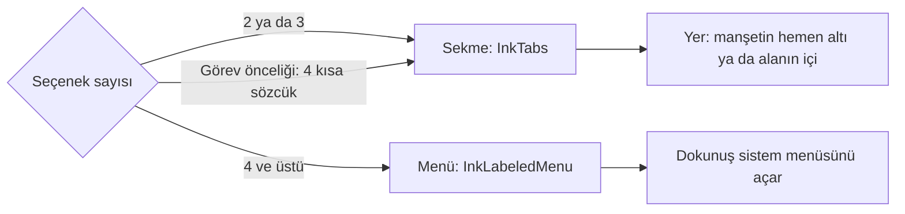
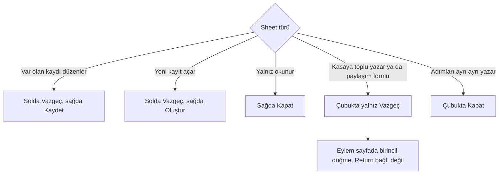
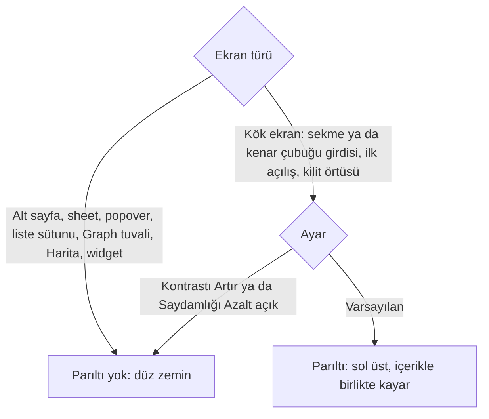
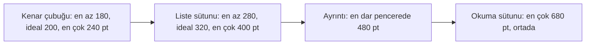
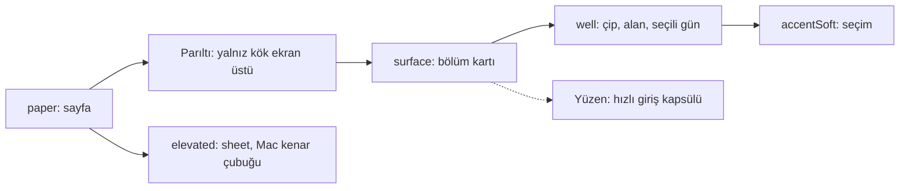
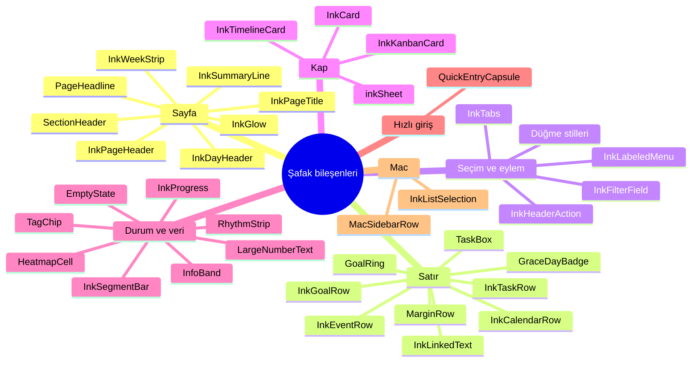

# Tasarım dili

**Amaç:** Bu belge uygulamanın tasarım dilini tanımlar: seçilen yön, kurallar ve belirteçler.

**Kapsam:**

- Şafak yönünün tanımı ve önceki yön Mürekkep'in kısa tarihçesi.
- Bütün ekranlar için ortak kurallar ve denetim kalıpları.
- Renk, parıltı, yazı, yarıçap, boşluk, yüzey ve gölge belirteçleri; uygulama simgesi.
- Bileşen ailesi ve ekran başına uygulama.
- Erişilebilirlik: Kontrastı Artır, Saydamlığı Azalt, Hareketi Azalt.

## Durum

| Alan | Değer |
|---|---|
| Yön | Şafak |
| Seçim tarihi | 2026-11-09 |
| Karar | [Kararlar](decisions.md) tablosu, 2026-11-09 satırları |
| Uygulama | [Yol haritası](roadmap.md), Aşama 17: Tasarım yenileme |
| Önceki yön | Mürekkep, 2026-10-05 |
| Belirteç kodu | `App/Design/` ve `App/Resources/Assets.xcassets` |
| Ekran içeriği | [Ekranlar](screens.md) |

Bu belge yönü, kuralları ve belirteçleri tutar. Ekranların içeriği `screens.md` belgesindedir.

## Yön

| Öğe | Tanım |
|---|---|
| Zemin | Koyu, opak, nötr gri: `#0E0F11`. Koyu birincil tasarım tonudur. Açık mod da vardır ve zorunludur. |
| Parıltı | Kök ekranın sol üstünden yayılan yumuşak mürdüm ışık. Parıltı yalnız sayfanın üst bölgesinde durur. |
| Yüzey | Her bölüm bir karttır: 20 pt köşe, ince sınır, gölge yok. |
| Yazı | SF Pro. Sayılar öne çıkar; geri kalan ikincil renktedir. |
| Eylem | Tek vurgu rengi: mürdüm. Parıltı eylem değildir; yeri gösterir. |

Tek cümleyle: koyu bir sabah sayfası; sol üstte doğan mürdüm ışık günü işaretler, bölümler sessiz kartlarda durur.

Ad "Şafak"tır, çünkü parıltı günün başlangıcını gösterir. Kod adları `Ink` önekini korur, `Journal` kod adı gibi.

## Kısıtlar

| Kısıt | Açıklama |
|---|---|
| Sistem kromu | iOS 26 ve macOS 26'dan beri sekme çubuğu, araç çubuğu ve sheet'ler sistemin Liquid Glass kromudur. HIG camı içerik katmanında istemez. Şafak bu yüzden içerik katmanında ayrışır: parıltı ve kart. |
| Kullanım | Ürün metin ağırlıklıdır. Kullanıcı ürünü her gün, günde birçok kez açar. |
| Yazarlar | Uygulamayı ekranı göremeyen kodlama ajanları yazar. Ajanlar bir dili ancak kurala bağlanabildiği ölçüde uygular. |

Parıltının yeri ve gücü bu yüzden sayıyla tanımlıdır.

## Önceki yön: Mürekkep (2026-10-05 – 2026-11-09)

| Konu | Kayıt |
|---|---|
| Seçim | İki tur, 16 aday, 5 bakış açısıyla adları gizli oylama. Heyet önerisi ve sahibin seçimi Mürekkep'ti. |
| Tanım | Kartsız kâğıt sayfa; kullanıcının sözü New York, uygulamanın sözü SF Pro; işaretler kenar sütununda; bağlantı alt çizgiyle. |
| Sahibin 1. değişikliği | Görev işareti köşeli kutudur; öncelik kutunun içindedir. Şafak bunu korur. |
| Sahibin 2. değişikliği | Hızlı girişte kip iki sözcüktür: "Olay" ve "Görev". Şafak bunu korur. |
| İmza kararı | Derkenar'ın imzası (kenar çizgisi, fosfor izi) eklenmedi. Sahip kararı 2026-10-16'da kesinleştirdi. |
| Yedek sırası | 1 Derkenar, 2 Defter ya da Seyir Defteri (çivit), 3 Seyir Defteri (zaman rayı), 4 Günün Sayfası, 5 Açık Defter ya da Koordinat. |
| Uygulama | Aşama 9; 10 kutu bitti. |
| Bitiş | Sahip 2026-11-09'da yönü Şafak'a çevirdi. |

Seçim sürecinin, oylamanın ve jürinin ayrıntılı gerekçesi git geçmişindedir: bu belgenin 2026-11-09 öncesi sürümü.

## Her yönde geçerli kurallar

| No | Kural |
|---|---|
| 1 | Gezinme sistemde kalır: iPhone'da `TabView`, Mac'te `NavigationSplitView`. Uygulama özel sekme çubuğu yazmaz. |
| 2 | İçerik katmanında cam etkisi yoktur. Kart opaktır. Parıltı cam değildir: bulanıklık ve saydam katman taşımaz, zemine çizilir. Cam yalnız sistem kromundadır; hızlı giriş kapsülü opak `surface` zeminlidir. |
| 3 | Açık ve koyu modda yerleşim aynıdır. Koyu birincil tasarım tonudur; uygulama yine sistem görünümünü izler. Uygulamaya özel görünüm anahtarı yoktur. Parıltının gücü moda göre değişir, yeri değişmez. |
| 4 | Her renk belirtecinin 4 varyantı vardır: açık, koyu ve ikisinin Kontrastı Artır karşılığı. Gövde ve ikincil metin en az 4,5:1 kontrast taşır; hedef 7:1'dir. İri metin ve denetim sınırları en az 3:1 kontrast taşır. |
| 5 | Durumu hiçbir zaman yalnız renk, gölge ya da opaklık anlatmaz. Bağlantı renkten başka bir ipucu daha taşır. Devreden görev işaret ve tarih taşır. Tamamlanan görev dolu onay işareti taşır ve metni okunur kalır. Zaman kartının sol çubuğu rengin yanında metin taşır: "14 Eyl'den", "Bitti". |
| 6 | Geciken tarih kırmızı değildir; uyarı rengini ve işareti taşır. Kırmızı yalnız gerçek hatayı ve yıkıcı eylemi gösterir. |
| 7 | Vurgu kalanı gösterir: yapılmış hedef ve tamamlanan görev geri plana geçer. Biten işin ayrı yeşili yoktur; biten iş ikincil metin rengini alır. Hedef halkası istisnadır: tamamlanan halka tam vurgu halkasıdır. Gün halkasının vurgu yayı ve ortasındaki sayı günün tamamlanan payıdır (yüzde). |
| 8 | Uygulama yalnız sistem yazı tiplerini kullanır: SF Pro; New York yalnız `content` rolü serife dönerse. Metin semantik stilleri kullanır ve Dynamic Type ile büyür. Sabit punto yoktur. |
| 9 | iOS'ta hiçbir metin 12 pt'nin altında değildir. Etiketler cümle düzenindedir: hafta şeridinde "Pzt". Büyük harfli, geniş aralıklı etiket yoktur. |
| 10 | Dokunma hedefleri en az 44 pt'dir. iOS'ta kısa sözcüklü metin düğmesi ("Geri", "İleri") 44 pt genişliğe uzar; sözcük başta kalır. Tek satırlık satır ve anahtar satırı 44 pt yüksekliktedir. Hafta şeridinin her günü 44 × 56 pt'dir. |
| 11 | İçerikte zeminle zıt parlaklıkta büyük yüzey yoktur. Parıltı zeminin parlaklık ailesinde kalır; parıltı üstündeki ikincil metin en az 4,5:1 taşır. Böylece altından geçen sistem camı açık ile koyu arasında çevrilmez. |
| 12 | Mac'te kenar çubuğunun seçili satırı `accentSoft` ile dolar. Seçili satırın simgesi vurgu rengindedir: mürdüm. Seçili satırın yazısı `text` rengindedir ve yarı kalındır. Öteki satırların simgesi `secondaryText` rengindedir. Kontrast `accentSoft` üstünde yazıda açıkta 13,41:1, koyuda 13,50:1'dir. Simgede açıkta 6,45:1, koyuda 5,87:1'dir. Önceki değer: vurgu dolgusu, vurgu üstü yazı ve simge; Şafak çizimi `c-mac` 2026-11-11'de değiştirdi. Kenar çubuğu `elevated` zemindedir; parıltı yoktur. Yalnız seçili girdi vurgu alır: Görevler'in altındaki Kanban, Zaman çizelgesi ve projeler ayrı satırdır. Seçimin kendisi sistemindir: ok tuşları, odak, VoiceOver. Yalnız çizim uygulamanındır. Bölünmüş kabukta (iPhone Duo iç ekranı, iPad) aynı kural geçerlidir: sistemin seçim vurgusu ve odak çerçevesi dolgunun üstüne çizilmez. |
| 13 | Hareket sistem varsayılanlarıyla sınırlıdır ve Hareketi Azalt ayarına uyar. Parıltı ve hale durağandır: nabız, dönme ve renk geçişi yoktur. Tek istisna Graph'tır: düğümler kuvvet benzetimiyle hareket eder, çünkü içerik hareketin kendisidir. Hareketi Azalt açıkken Graph da canlı oynamaz; uygulama oturmuş düzeni tek seferde gösterir. |

**DİKKAT:** Kural numaralarını değiştirme; kod kural 12'ye `MacSidebar.swift` içinde, Şafak kuralı 4'e `InkLinkStyle.swift` içinde numarayla gönderme yapar.

## Şafak'ın kuralları

| No | Kural |
|---|---|
| 1 | Yazı rolünü veri türü seçer. Kasadan gelen metin `content` rolündedir: olay, görev, günlük yazısı, not, alan değeri. `content` rolünün ailesi SF Pro'dur. Rol ayrı kalır; serif tek satırlık değişiklikle geri döner. Hiçbir ekran yazı tipini elle seçmez. |
| 2 | Her bölüm bir karttır. Bölüm başlığı ve sayaç kartın üstünde, kartın dışındadır. Kart içinde satırları `rule` ayraç ayırır. Kart içinde kart yoktur. |
| 3 | Her satırın işareti kartın içinde, sol işaret sütunundadır: görev kutusu, hedef halkası, saat. Sütun 44 pt'dir ve yazıyla büyür. Öncelik görev kutusunun içindedir. |
| 4 | Bağlantı metni metin rengindedir; anlamı alt çizgi taşır. Kişi düz mavi, konum noktalı yeşil, çözülmemiş bağlantı kesik ve ikincil alt çizgi taşır. Türkçe ek çizginin dışında kalır. |
| 5 | Eylem tek renktir: vurgu. Parıltı ve hale eylem değildir. Dikkat yalnız uyarı rengiyle görünür: devreden tarihinde ve yığılı çubuğun devreden parçasında. |
| 6 | Tamamlanan görev ve yapılmış hedef soluklaşır: ikincil metin, dolu işaret. Bu satırlar listenin sonuna iner; Bugün hedef bölümünde yalnız günün ilk yüklemesinde, çünkü gün ekranda kaldıkça sıra değişmez (`screens.md` Hedefler bölümü). Üstleri çizili olmaz. |
| 7 | Künye cümlesi sayıyı öne çıkarır: sayı ve sözcüğü metin renginde ve yarı kalındır; bağlaçlar ikincil renktedir. Örnek: "Günaydın. Bugün **2 olay**, **6 görev** ve **3 hedef** var." |
| 8 | Gün seçimi hafta şeridiyle yapılır. Şerit yarı saydam karttır: 7 gün, olaylı ya da yazılı her günün altında nokta. Bugün vurgu rakam ve vurgu noktadır. Seçili bugün çerçeveli hücredir; seçili başka gün `text` dolgulu hücredir. Şerit Bugün'de ve Gün ekranında aynı bileşendir. |

### Bağlantı biçimleri

**Her bağlantı türünün metin rengi ve alt çizgisi.**

| Tür | Metin rengi | Alt çizgi deseni | Alt çizgi rengi |
|---|---|---|---|
| Kişi | Metin | Düz | Kişi |
| Konum | Metin | Noktalı | Konum |
| Öteki çözülmüş bağlantı: proje notu, özel varlık tipi | Metin | Düz | Kontrol çizgisi |
| Çözülmemiş bağlantı | İkincil metin | Kesik | İkincil metin |

`InkLinkStyle` bu tabloyu uygular ve okuma metni ile `TextEditor` aynı yolu kullanır. Yedek yol `coloredText` bağlantı metnini alt çizgisiz, tür renginde yazar.

### Graph düğümleri

**Her düğüm türünün biçimi ve rengi; tür renge ek olarak biçimle de ayrışır.**

| Tür | Biçim | Renk belirteci |
|---|---|---|
| Kişi | Daire | Kişi |
| Konum | Elmas | Konum |
| Gün | Köşeli kare | İkincil metin |
| Özel tip | Altıgen; düz kenarları üstte ve altta | Kontrol çizgisi |

Özel tip yeni bir renk almaz: düğüm, özel tip bağlantısının alt çizgisiyle aynı belirteci kullanır. Kontrol çizgisi metin dışı öğedir ve 3:1 alt sınırını karşılar. Bütün özel tipler aynı biçimi ve rengi paylaşır; tipi gösterge ve seçili düğümün adı söyler. Gösterge özel tipleri tip adlarıyla tek öğede yazar: "Kitaplar, Filmler". Seçili düğüm çift halka taşır; komşusu olmayan düğümler solar. Tuval `surface` zeminli karttır; parıltı yoktur, çünkü düğümlerin altında renk kayması olur. Her varlık düğümünün altında `caption` boyutunda ikincil renkli ad durur; seçili düğümün adı metin renginde ve yarı kalındır. Kod karşılığı: `GraphNodeShape` ve `GraphNodeStyle`.

### Graph kenarları

| Tür | Çizgi |
|---|---|
| Gün | Saç çizgisi (`InkStroke.hairline`) |
| Açık bağ | Düz, kalın (`InkStroke.highPriority`) |

Ayrım renge dayanmaz; kalınlık anlamı taşır. Graph bir bağ çizdiğinde gösterge "Bağ" öğesini kalın düz çizgi örneğiyle gösterir, örnek çizginin kendi rengindedir (`ink.rule`); özel tip öğesi gibi, bağ yoksa öğe yoktur. "Düğüm seç ⌄" her zaman göstergenin altındadır. Açık bağ dönemden bağımsızdır, yay ağırlığı 1’dir. Birlikte geçme kenarı yoktur: iki varlık arasındaki her çizgi açık bağdır. Gösterge tekil adlarla yazar ve "Gün" öğesini her zaman gösterir: Kişi, Konum, Gün, özel tipler, Bağ.

**Günün grafiği düzeni.** Ana Graph ile aynı sayfa düzenidir: manşet, denetim satırı, tuval, gösterge, açıklama. Manşet "Günün grafiği"dir ve künye günün tam tarihidir. Manşet satırında yalnız arama durur. Denetim satırında dönem yoktur; yalnız yakınlaştırma, uzaklaştırma ve Ortala kalır. Göstergede gün tek öğedir: "Gün". Gün ekranındaki giriş simgesi `point.3.connected.trianglepath.dotted`'dur, Graph kenar çubuğu girdisiyle aynı simgedir.

## Denetim kalıpları

**Ekim 2026 denetiminde aynı işin kaç biçimde kurulduğu.**

| Konu | Biçim sayısı |
|---|---|
| Arama | 2 |
| Birini seç | 5 |
| Sheet başlığı yazısı | 3 |
| Sheet zemini | 4 |

Denetim 84 gerçek ekran görüntüsünü ve kod envanterini inceledi. Aşağıdaki 8 kalıp tek tanımdır. Her ekran kalıpları ortak bileşenlerle kurar; hiçbir ekran bir kalıbı elle yeniden yazmaz. Referans Bugün ekranıdır.

### 1. Sayfa üstü

| Yer | Kural |
|---|---|
| Kök ekran, iPhone | Sayfa adı solda sans manşettir (`display`). Sayfanın eylem simgeleri aynı satırın sağında durur. Sistem gezinme çubuğu ve cam kapsül yoktur. |
| Bugün ve Gün ekranı | Manşet gün başlığıdır: Bugün'de gün halkası, gün rakamı ve gün adı; altında hafta şeridi durur. Gün ekranında üst satır geri, ay seçici, Günün grafiği ve aramadır; altında hafta şeridi durur. |
| Mac | Sayfa adı yine sayfanın içinde sans manşettir. Her liste sütunu manşetle başlar. Pencere araç çubuğunda başlık yoktur. Pencerenin adı seçili kenar çubuğu girdisidir ve yalnız Pencere menüsünde görünür. Araç çubuğunda arama düğmesi yoktur; arama kenar çubuğunun tepesindeki alandır. Araç çubuğu `paper` renginde ve opaktır. |
| Alt sayfa, iPhone | Manşetin üstünde gezinme satırı durur: solda "‹ Üst sayfa" metinli geri öğesi, sağda sayfanın simgeleri. Sistem çubuğu gizlenir; kenardan kaydırma yine üst sayfaya döner. Başlık `title1` boyutundadır (`subpageTitle`); künye tek satır `footnote`tur. |
| Alt sayfa, iPad bölünmüş kabuk, Mac ve sheet | Sistem çubuğunda yalnız geri düğmesi kalır. Sayfanın eylemleri manşet satırındadır. |
| Kaydırma, iPhone ve iPad | Manşet satırı içerikle birlikte kayar. Bugün'de gün başlığı kaydırınca tek satıra iner ve üstte kalır. İstisna Ara sayfasıdır: manşet ve arama alanı sabittir, sonuçlar altta kayar. |
| Kaydırma, Mac | Pencere sütunlarında manşet satırı sütunun üstünde sabittir; içerik altından kayar. İçerik kaydırılınca manşetin altında ince bir çizgi belirir, sayfa en üstteyken çizgi yoktur. Görevler'de sayfa üstünün tamamı sabittir: manşet, görünüm sekmeleri ve menü satırı. Günlük sütununda manşetle birlikte Özetler ve Haftalık inceleme çipleri sabittir; takvim ve günler kayar. Sheet'te açılan sayfa da manşetini sheet'in üstünde sabit tutar: kişi, konum, bulunamayan bağlantı, gün ve not sayfası. Haftalık inceleme ve günlük yazısı sheet'leri bu kalıbı kullanmaz. |
| Kenar çubuğu, Mac | Satırlar arama alanının altına kayınca kenar çubuğunun üstünde aynı ince çizgi belirir. |

Kod karşılığı: `InkPageTitle`, `InkPageTitleRow`, `inkRootPageNavigationTitle` ve `inkPageNavigationTitle`. Sayfa manşeti bir kez tanımlar ve aynı değeri iki yere verir: kaydırılan içerikteki `InkScrolledMasthead` yuvasına ve kaydırma görünümünün üstündeki `inkPinnedMasthead` değiştiricisine. `InkMastheadPlacement` hangisinin çizeceğini platforma göre seçer. Kenar çubuğu çizgisi `inkScrollEdgeRule` değiştiricisidir.

### 2. Manşet satırı simgeleri

| Konu | Kural |
|---|---|
| Biçim | iOS manşet satırında ve alt sayfanın gezinme satırında simge 40 pt yarı saydam yuvarlak çipte durur (`surface` %72, 0,5 pt `line`); simge `subheadline` boyutundadır. Mac'te simge çerçevesizdir. |
| iPhone alanı | Dokunma alanı 44 pt. |
| Mac alanı | Tıklama alanı en az 28 pt. Simge semantik `title2` boyutundadır. Komşu tıklama alanları arasında 4 pt boşluk vardır. |
| Renk | Yardımcı eylemler ikincil metin rengindedir: ara, sırala, filtrele, Ayarlar, günün grafiği. Kayıt açan ya da içeriği değiştiren eylem vurgu rengindedir: ekle, düzenle. "Eylem tek renktir" kuralı bu eylemler içindir. |
| Sayı | Bir satırda en çok 3 simge durur. Fazlası sayfanın en üstünde ayrı satır olur; örneğin Günlük'teki Özetler ve Haftalık inceleme çipleri. |
| Sıra | Sıra sabittir. iPhone'da en sağda ara durur, solunda ekrana özgü simgeler durur. Mac'te manşet satırında arama simgesi yoktur. |
| Büyük yazı | Erişilebilirlik yazı boyutlarında simgeler manşetin üstünde ayrı satıra çıkar. |

Kod karşılığı: `InkHeaderAction`, `InkHeaderMenu` ve `InkHeaderActionChrome`. Sınırlar `maximumCount = 3`, `spacing = 4` ve `macMinimumSide = 28` değerleridir.

### 3. Arama

| Yer | Kural |
|---|---|
| iPhone | Genel arama manşet satırının en sağındadır. Bugün istisnadır: arama Ayarlar'ın solundadır (çizim). Simge her ekranda aynıdır. |
| Mac | Genel arama kenar çubuğunun tepesindeki tek alandır: "Ara" ve ⌘F. ⌘F alana odak verir. Yazılan sorgu Ara sheet'ini sonuçlarla açar. Araç çubuğunda ve manşet satırlarında büyüteç yoktur. |
| Mac, Ara sheet'i | Sonuçlardan açılan sayfada manşet büyüteci Mac'te de durur ve sonuçlara döndürür. Sayfa not, kişi, konum ya da gün olabilir. Neden: kenar çubuğunun arama alanı sheet'in arkasında kalır. |
| Kapsam çipleri | Ara sayfasında sonuç gruplarının üstünde: Hepsi, Olaylar, Görevler, Kişiler, Günler. Çip `well` zeminli, ince çizgili, yaklaşık 28 pt yüksekliğinde kapsüldür; dokunma hedefi 44 pt'dir. Seçili çip `accentSoft` zeminli, vurgu renginde ve kalındır; "Renksiz ayırt et" açıkken onay işareti de taşır. |
| Süzgeç alanı | Sayfa içi süzgeç alanı Ara sayfasındaki alanla aynı bileşendir: `well` zemin, 12 pt köşe, 1 pt `rule` sınır, odakta vurgu çizgisi. Yer tutucu italik değildir. |

Kod karşılığı: süzgeç alanı `InkFilterField` bileşenidir.

### 4. Birini seç

**Seçenek sayısı biçimi seçer.**

| Biçim | Görünüm |
|---|---|
| Sekme | Sola yaslı sözcükler, `subheadline` boyutunda. Seçili sözcük metin rengindedir ve altı vurgu rengiyle çizilidir. Ötekiler ikincil renktedir. Hızlı girişteki Olay \| Görev ile aynı bileşendir. Örnekler: Graph dönemi (Bu ay \| 3 ay \| Yıl), zaman çizelgesi ölçeği (Gün \| Hafta \| Çeyrek), hedef türü (İşaret \| Sayı \| Kilometre taşı). |
| Sekme istisnası | Görev önceliği 4 seçeneklidir ama sekmedir: Düşük · Normal · ! Orta · !! Yüksek. Sözcükler kısadır ve tek satıra sığar. |
| Menü | Sola yaslı, `subheadline` boyutunda. Solda ikincil renkte etiket durur: "Bölüm", "Grupla", "Tür". Sağda vurgu renginde, yarı kalın seçili değer ve ok durur. Dokunuş sistem menüsünü açar. |
| Yasak | Sistem segmentini, onay kutucuğu dizisini, etiketsiz ya da ortalı menüyü ve gezinme çubuğundaki seçiciyi kullanma. |

### 5. Sırala ve filtrele

| Konu | Kural |
|---|---|
| Yer | Manşet satırında simgedir. Simgeye dokunmak menüyü açar. Sırala ve filtrele sayfada ayrı satır tutmaz. |
| Etkin seçim | Varsayılan dışında bir seçim etkinse simge vurgu rengine döner. |

### 6. Sheet

**Sheet türü çubuktaki düğmeleri seçer.**

| Konu | Kural |
|---|---|
| Zemin ve başlık | Zemin `elevated`'dır. Başlık sans manşettir. İçerikte bölümler karttır: bölüm başlığı kartın üstünde, satırlar kartın içinde. |
| Başlık, iOS | Salt okunur sheet'in başlığı sistem çubuğunda, "Kapat" ile aynı satırdadır. Künyeli sheet başlığı sayfada tutar: "Günü kapat". Düzenleme sheet'inde başlık "Vazgeç" ve onay satırının altındadır. |
| Düğme biçimi | Çubuktaki düğmeler düz yazıdır; dolu kapsül yoktur. "Vazgeç" ikincil renkte düz yazıdır. Onay vurgu renginde, yarı kalın düz yazıdır. "Bitti" yoktur. |
| Toplu yazan akış | Örnek: kasa hazırlığı. Eylem taslak kaydetmek değildir. Çubukta yalnız "Vazgeç" durur. Eylem kendi adıyla sayfada birincil düğmedir ve Return tuşuna bağlı değildir. |
| Paylaşım formu | Çubukta yalnız "Vazgeç" durur. Onay sayfada birincil düğmedir: "Kenet'e ekle". |
| Adım akışı | Örnek: günü kapat. Uygulama hedef işaretini anında yazar. Görev seçimlerini "Uygula" ile, günlük cümlesini "Yaz" ile yazar. Kapatmak yazılmış adımı geri almaz; bu yüzden çubukta "Vazgeç" yerine "Kapat" durur. |
| Yazma sırasında | Yazma sürerken "Vazgeç" devre dışıdır. Adım akışında "Kapat" da yazma bitene dek bekler. |
| Mac | Sistem pencere başlığı yoktur; tek sans manşet vardır. Araç çubuğu ve alt eylem çubuğu `elevated` zemindedir. Alt çubukta "Vazgeç" solda, onay ya da "Kapat" sağda durur. |
| Boyut | Sheet gövdesinin yüksekliği hiçbir zaman sıfır olmaz. iOS bölünmüş kabukta kısa tarih, tekrar, metin ve hedef miktarı sheet’leri form genişliğini korur, yüksekliği manşet ve içeriğe göre değişir; uzun sheet’ler ortak ideal boyutu kullanır. Sekme kabuğu ve Mac boyutları değişmez. |
| Seçim sheet'i | Örnek: varlık tipi galerisi. Çubukta yalnız "Vazgeç" durur; satırlar simge, ad ve özetle listelenir, seçim bir sonraki adımı (editörü) sheet içinde açar; kullanılamayan satır soluk ve nedeniyle ("Zaten var") gösterilir. |

Kod karşılığı: `.inkSheet`, `InkSheetScaffold` ve `InkSheetConfirmation`. `InkSheetConfirmation.save` "Kaydet" sözünü, `InkSheetConfirmation.create` "Oluştur" sözünü verir.

### 7. Sistem denetimleri

| Konu | Kural |
|---|---|
| Açma kapama anahtarı | Vurgu rengindedir: `inkToggle()`. |
| Kutu | Liste satırları kartın içindedir (`surface`). Alan zemini `well`'dir. Sistemin gri gruplu liste kutusu yoktur. |
| Yüzey rengi | Kart yalnız bölüm kabıdır. Kart içinde kart yoktur; iç alan `well` rengini alır. |

### 8. Bağlam menüsü

| Konu | Kural |
|---|---|
| Açma | iPhone ve iPad'de satıra uzun basma; iPad ve Mac'te ikincil tık aynı menüyü açar. Satıra normal dokunma seçimi ve gezinmeyi korur. |
| Gruplar | Birincil eylemler (düzenle, işaretle ya da miktar gir), bağlantı (kopyala), yıkıcı (sil). Boş gruplar görünmez; gruplar `Divider` ile ayrılır. |
| Sil | Her zaman sonda ve kırmızıdır (`role: .destructive`). Varlık ve hedef dosyasını silmeden önce kayıtların kalacağını açıklayan onay ister. |
| Erişim | Düzenle, Sil, işaretleme ve Miktar gir ana arayüzde de bulunur; menü onlara kestirme yoldur. Bağlantıyı kopyala yalnız menüdedir: bağlantı yazarken ad yazılarak da kurulur. |
| Sayı | En çok 5 öğe. |

### Koruma

**Kalıpları koruyan testler.**

| Yasak ya da şart | Test |
|---|---|
| Stil verilmemiş `Picker`, `.pickerStyle(.segmented)`, `.textFieldStyle(.roundedBorder)` | `ControlPatternUsageTests` |
| iPhone ekranlarında araç çubuğuna konan arama | `ControlPatternUsageTests` |
| Mac'te arama yalnız kenar çubuğunun tepesindeki tek alan | `ControlPatternUsageTests` |
| Ortak bileşen dışında kurulan sheet araç çubuğu ve "Bitti" düğmesi | `ControlPatternUsageTests` |
| `App/Design` dışında hex renk; sistem rengi izin listesi yalnız küçülür | `DesignTokenUsageTests` <!-- sır değil --> |
| `.inkGlow()` yalnız kök ekran görünümlerinde | `DesignTokenUsageTests` <!-- sır değil --> |
| Her kök ekranın ve her sheet türünün ekran görüntüsü | Adı `SnapshotTests` ile biten kümeler |

Kaynak denetimi yasak kalıpları derlemeden önce yakalar. Ekran görüntüsü testleri kalıbın ekrandaki sonucunu yakalar.

## Renk belirteçleri

**Her renk belirtecinin dört varyantı.** KA, Kontrastı Artır demektir.

| Rol | Kod adı (`Color.ink.…`) | Koyu | Açık | KA koyu | KA açık |
|---|---|---|---|---|---|
| Zemin | `paper` | `#0E0F11` | `#F3F3F6` | `#08090A` | `#F3F3F6` |
| Yükseltilmiş zemin | `elevated` | `#141518` | `#FAFAFC` | `#0E0F11` | `#FFFFFF` |
| Kart | `surface` | `#1A1B1F` | `#FFFFFF` | `#1A1B1F` | `#FFFFFF` |
| İç alan | `well` | `#212228` | `#F1F1F5` | `#212228` | `#F1F1F5` |
| Süs çizgisi | `rule` | beyaz %7 | siyah %7 | beyaz %16 | siyah %16 |
| Güçlü çizgi | `line` | beyaz %12 | siyah %12 | beyaz %24 | siyah %24 |
| Kontrol çizgisi | `control` | `#7C7F88` | `#868991` | `#A3A6AE` | `#5E6169` |
| Metin | `text` | `#F2F2F4` | `#15161A` | `#FFFFFF` | `#050507` |
| İkincil metin | `secondaryText` | `#A7AAB2` | `#53565E` | `#CDD0D6` | `#3A3D44` |
| Üçüncül metin | `tertiaryText` | `#8E9199` | `#5E6168` | `#B4B7BE` | `#4A4D55` |
| Vurgu | `accent` | `#D08BC4` | `#7A2C6E` | `#E8BCE0` | `#5E1F55` |
| Vurgu üstü | `onAccent` | `#1B0E18` | `#FFFFFF` | `#12091A` | `#FFFFFF` |
| Vurgu tonu | `accentSoft` | vurgu %16 | vurgu %12 | vurgu %16 | vurgu %12 |
| Uyarı | `warning` | `#E3B86A` | `#7A4E00` | `#F0CF8E` | `#5C3B00` |
| Tehlike | `danger` | `#FF6B6B` | `#A11E1E` | `#FFB4B4` | `#7A1010` |
| Kişi | `person` | `#8FB3F0` | `#2D5BA6` | `#B8D0F8` | `#1D4689` |
| Konum | `place` | `#7FD1A6` | `#1B6B43` | `#AEE5C6` | `#11522F` |

KA yüzeyleri değiştirmez; ön planı ve çizgileri güçlendirir. Tek istisna koyu zemindir: KA koyuda zemin `#08090A` olur. Biten işin ayrı rengi yoktur: biten iş `secondaryText` kullanır.

### Kontrast

**Ön plan belirteçlerinin kontrastı: zemin üstünde / zemin, kart ve iç alan içinde en düşük.** Vurgu üstünün kontrastı vurgu dolgusuna göredir.

| Belirteç | Koyu | Açık | KA koyu | KA açık | Alt sınır |
|---|---|---|---|---|---|
| Metin | 17,15 / 14,19 | 16,32 / 16,05 | 19,93 / 15,86 | 18,39 / 18,08 | 4,5 |
| İkincil metin | 8,25 / 6,82 | 6,63 / 6,52 | 12,90 / 10,26 | 9,82 / 9,65 | 4,5 |
| Üçüncül metin | 6,08 / 5,03 | 5,60 / 5,51 | 9,92 / 7,90 | 7,63 / 7,50 | 4,5 |
| Vurgu | 7,46 / 6,17 | 7,86 / 7,73 | 12,05 / 9,59 | 10,52 / 10,34 | 4,5 |
| Vurgu üstü (vurgu dolgusunda) | 7,28 | 8,70 | 11,76 | 11,65 | 4,5 |
| Uyarı | 10,35 / 8,56 | 6,50 / 6,39 | 13,31 / 10,59 | 9,11 / 8,96 | 4,5 |
| Tehlike | 6,91 / 5,72 | 6,97 / 6,85 | 11,80 / 9,39 | 9,93 / 9,76 | 4,5 |
| Kişi | 9,02 / 7,46 | 6,00 / 5,90 | 12,73 / 10,13 | 8,28 / 8,14 | 4,5 |
| Konum | 10,57 / 8,74 | 5,87 / 5,77 | 14,07 / 11,19 | 8,35 / 8,21 | 4,5 |
| Kontrol çizgisi | 4,79 / 3,96 | 3,16 / 3,11 | 8,18 / 6,51 | 5,59 / 5,50 | 3,0 |

Değerler WCAG 2.x göreli parlaklık formülüyle hesaplandı: `InkPalette.contrastRatio` ile aynı formül. `PaletteContrastTests` asset catalog değerlerini `InkPalette` ile karşılaştırır ve alt sınırları denetler: metin rolleri 4,5:1, kontrol çizgisi 3:1.

**NOT:** Kart ile zemin arasındaki kontrast iki modda da 1,11:1'dir. `rule` ve `line` süstür ve bilgi taşımaz; ikisi için 3:1 istenmez. Kontrol çizgisi (`control`) metin dışı bir denetim sınırıdır ve alt sınırı 3:1'dir.

Açık modda `tertiaryText` `#5E6168` değerindedir; önceki değer `#666972` idi. Koyulaşma `accentSoft` seçim zemininde 4,60:1 verir. `InkPalette.DocumentedContrast` bu tablodaki değerleri taşır.

### Kod adları ve kullanım

**Kod adları Mürekkep'ten kalır; yalnız değerler değişir.** Dört belirteç yenidir.

| Kod adı | Asset | Kullanım |
|---|---|---|
| `paper` | `InkPaper` | Sayfa, kaydırma alanı, Mac araç çubuğu |
| `elevated` (yeni) | `InkElevated` | Sheet, Mac kenar çubuğu, popover, iPad yüzen kenar çubuğu |
| `surface` | `InkSurface` | Bölüm kartı, liste kartı, kanban kartı, zaman kartı, hızlı giriş kapsülü, Graph tuvali |
| `well` | `InkWell` | Çip, süzgeç alanı, ısı haritasının boş hücresi, Mac'te hafta sonu sütunu |
| `rule` | `InkRule` | Kart sınırı, satır ayracı; bilgi taşımaz |
| `line` (yeni) | `InkLine` | Yüzen öğe sınırı, seçili kart sınırı |
| `control` | `InkControl` | Görev kutusu, halka izi, artı konturu; metin dışı |
| `text` | `InkText` | İçerik, başlık, künyedeki sayılar |
| `secondaryText` | `InkSecondaryText` | Meta, saat, künyenin geri kalanı, yapılmış iş |
| `tertiaryText` (yeni) | `InkTertiaryText` | Yer tutucu, hafta şeridinde geçmiş gün, takvimde gelecek gün |
| `accent` | `InkAccent`, `AccentColor` | Artı, gönder, seçili sekme, kip çizgisi, birincil düğme dolgusu |
| `onAccent` | `InkOnAccent` | Vurgu dolgusundaki yazı ve simge |
| `accentSoft` (yeni) | `InkAccentSoft` | Kart içindeki seçili liste satırı, seçili zaman kartı, seçili gün kartı |
| `warning` | `InkWarning` | Yalnız devreden tarihi ve işareti; geciken zaman kartının çerçevesi |
| `danger` | `InkDanger` | Yalnız yıkıcı eylem ve hata metni; yıkıcı eylem örneği silmedir |
| `person` | `InkPerson` | Düz alt çizgi, simge, Graph dairesi |
| `place` | `InkPlace` | Noktalı alt çizgi, simge, Graph elması, Harita iğnesi |

`InkPalette.swift` onaltılık değerleri tutar; `InkColors.swift` `Color.ink` adlarını asset adlarına bağlar. `AccentColor` asset'i `InkAccent` ile aynı değerleri taşır. Sayfa zemini değiştiricisi `.inkPage()` sayfayı `paper` zemine koyar. Veri görselleştirme renge ek olarak biçim ipucu taşır: ısı haritası, Graph, zaman çizelgesi.

## Parıltı

**Parıltı yalnız kök ekranın üst bölgesinde durur.**

| Özellik | Değer |
|---|---|
| Biçim | `EllipticalGradient`. Yarıçap 900 × 600 pt; çerçeve 1800 × 1200 pt. |
| Merkez | Yatay: genişliğin %12'si. Dikey: referans yüksekliğin −%8'i; merkez ekranın üstündedir. |
| Referans yükseklik | Kap yüksekliği ile 900 pt'nin küçüğü. Parıltı ilk ekrana bağlıdır, uzun içerikle büyümez. |
| Duraklar | 0: renk A; %38: renk B; %70: saydam. |
| Renk A | Mürdüm `#8E3F80`; koyuda %45, açıkta %16 |
| Renk B | Kehribar `#C98B2F`; koyuda %28, açıkta %16 |
| Kaydırma | İçerikle birlikte kayar. Sabit durmaz; kartların altında kalmaz. Durum çubuğunun altına da uzanır. Kabın dışına taşan kısım kırpılır. |
| Platform | iPhone ve iPad kök ekranları; Mac'te ayrıntı sütununun üstü |

**Parıltının en güçlü noktasında kontrast.** Nokta, gradyan merkezindeki karışımdır; ekrandaki gerçek değer bundan yüksektir.

| Belirteç | Koyu, renk A `#482543` | Koyu, renk B `#423219` | Açık, renk A `#E3D6E3` | Açık, renk B `#ECE2D6` |
|---|---|---|---|---|
| Metin | 11,64 | 11,05 | 12,92 | 14,18 |
| İkincil metin | 5,60 | 5,32 | 5,25 | 5,76 |
| Vurgu | 5,07 | 4,81 | 6,22 | 6,82 |
| Uyarı | 7,02 | 6,66 | 5,15 | 5,64 |

| Kural | Ayrıntı |
|---|---|
| İzinli içerik | Parıltı bölgesinde yalnız manşet, gün başlığı, künye cümlesi, hafta şeridi, künye çipleri ve manşet simgeleri durur. Bu öğeler yalnız metin, ikincil metin ve vurgu kullanır. |
| Yasak içerik | Tehlike rengi, kişi ve konum bağlantısı ve üçüncül metin parıltı bölgesinde durmaz. |
| Hale | "+" ve gönder düğmesinin çevresindeki ışık parıltı değildir. Hale yalnız birincil ekleme düğmesinde durur: `glowShadow`. |

Parıltı bilgi taşımaz. Kod karşılığı `.inkGlow()` değiştiricisidir; Kontrastı Artır ve Saydamlığı Azalt'ta boş çizer. iPhone sekme kabuğunda `inkRootPageNavigationTitle` parıltıyı kök sayfaya kendisi verir; `inkPage()` parıltıyı kâğıdın üstüne çizer. Kök sayfanın liste satırları saydamdır; alt sayfa ve sheet parıltı almaz.

## Yazı belirteçleri

**Her yazı rolünün ailesi ve semantik stili.** iOS sütunu varsayılan Dynamic Type boyutudur.

| Rol | `Font.ink` | Aile ve ağırlık | Semantik stil | iOS | Mac |
|---|---|---|---|---|---|
| Gün rakamı | Yok: `InkDayHeader` | SF Pro Bold, tabular | `largeTitle`'a bağlı `@ScaledMetric` | 48 | 34 |
| Manşet: sayfa adı | `display` | SF Pro Bold | `largeTitle` | 34 | 26 |
| Gün adı, ay | `dayName` | SF Pro Semibold, ikincil | `title2` | 22 | 17 |
| Künye cümlesi | `byline` | SF Pro Medium; sayılar Semibold ve metin rengi | `title3` | 20 | 15 |
| Manşet künyesi | `pageByline` | SF Pro Regular, ikincil metin; alt sayfada `meta`, tek satır | `subheadline` | 15 | 13 |
| Bölüm başlığı: kartın üstü | `sectionTitle` | SF Pro Bold | `title3` | 20 | 15 |
| Küçük başlık: sütun, sheet alanı | `section` | SF Pro Semibold | `headline` | 17 | 13 |
| İçerik | `content` | SF Pro Regular | `body` | 17; günlük paragrafında satır yüksekliği 26 | 13 |
| Küçük içerik: gün önizlemesi, kısa alıntı | `contentSmall` | `content` ile aynı aile | `footnote` | 13 | 10 |
| Yer tutucu | `placeholder` | `content` ailesi, italik değil | `body` | 17 | 13 |
| Meta | `meta` | SF Pro Regular | `footnote` | 13 | 10 |
| Saat | `time` | SF Pro, tabular | `subheadline` | 15 | 11 |
| Değer | `value` | SF Pro, tabular | `body` | 17 | 13 |
| Hafta şeridi gün harfi | `weekday` | SF Pro Medium | `caption1` | 12 | 10 |
| Büyük rakam: hedef ayrıntısı, özet | `largeNumber` | SF Pro Bold, tabular | `largeTitle` | 48 | 48 |

`InkFonts.swift` yalnız semantik stilleri kullanır; kod kuraldır. Mac sütunu macOS'un aynı stile verdiği değerdir; Mac için ayrı bir boyut hedefi yoktur. `content` rolü ayrı kalır; serif dönerse yalnız bu rolün ailesi değişir. `inkJournalParagraph()` günlük paragrafına 9 pt ek satır aralığı verir. `LargeNumberText` 48 pt hedefini `@ScaledMetric` ile büyütür. Gün rakamının `Font.ink` rolü yoktur: `InkDayHeader` boyutu kendi `@ScaledMetric` değeriyle çizer.

## Yarıçap, boşluk ve biçim

**Mac ana penceresinin üç sütunu.**

### Yarıçap

| Ad | Değer | Kullanım |
|---|---|---|
| `r-xs` | 8 pt | Küçük rozet, Mac kenar çubuğu dolgusu |
| `r-sm` | 12 pt | İç alan, süzgeç alanı, hafta şeridindeki seçili gün, Mac kanban ve zaman kartı |
| `r-md` | 16 pt | İç kart |
| `r-lg` | 20 pt | Bölüm kartı (iPhone, iPad), iPhone'da iki satırlı hızlı giriş kartı |
| `r-xl` | 24 pt | Sheet içi büyük kart, ilk açılış kartı |
| `r-pill` | Kapsül | Çip, birincil düğme, iPad ve Mac'te tek satırlı hızlı giriş, "+" düğmesi |

### Boşluk: `InkSpacing`

| Ad | Değer | Kullanım |
|---|---|---|
| `margin` | 16 pt | Sayfa yatay kenar boşluğu; `@ScaledMetric` ile büyür |
| `cardPadding` | 16 pt | Kartın iç boşluğu; `@ScaledMetric` ile büyür |
| `gutter` | 44 pt | Kartın içindeki işaret sütunu; `@ScaledMetric` ile büyür |
| `row` | 12 pt | Kart içinde satırlar arası dikey boşluk; satırlar arasında ayraç vardır |
| `section` | 16 pt | Kartlar arası dikey boşluk |
| `tap` | 44 pt | En küçük dokunma hedefi |
| `macPageWidth` | 680 pt | Mac okuma sütununun en çok genişliği |
| `macSidebarMinWidth`, `macSidebarIdealWidth`, `macSidebarMaxWidth` | 180, 200, 240 pt | Mac kenar çubuğu |
| `macListMinWidth`, `macListIdealWidth`, `macListMaxWidth` | 280, 320, 400 pt | Mac liste sütunu |
| `macWindowMinWidth`, `macWindowMinHeight` | 1000 × 560 pt | Mac ana penceresi |
| `macSettingsMinWidth`, `macSettingsMinHeight` | 480 × 520 pt | Mac Ayarlar penceresi |
| `listSelectionHorizontal`, `listSelectionVertical` | 4, 2 pt | Liste seçim dolgusunun satır kenarından içe payı |
| `ShellStyle.threeColumnSidebarWidth` | 200, 240, 280 pt | iOS bölünmüş kabukta üç sütunun kenar çubuğu (iPad, 1000 pt ve üstü) |
| `ShellStyle.accessibilitySidebarWidth` | 240, 280, 320 pt | iOS bölünmüş kabukta erişilebilirlik yazı boyutunda kenar çubuğu: üç sütunda ve iki sütunun yüzen kenar çubuğunda |
| `SearchSheetChrome.idealWidth`, `idealHeight` | 580 × 480 pt | iOS bölünmüş kabukta Ara sheet'i; form üst payıyla yükseklik yaklaşık 490 pt |

### Biçim: `InkSize`

| Ad | Değer | Kullanım |
|---|---|---|
| `taskBox`, `taskBoxCorner` | 22 pt, köşe 6 pt | Görev kutusu: kare |
| `goalRing` | 22 pt | Hedef halkası: daire |
| `dayRing` | 44 pt | Gün halkası: gün rakamının solunda |
| `plus` | 30 pt | Artı düğmesi: daire, kapsülün içinde. Yüzen "+" yoktur. |
| `send` | 36 pt | Gönder düğmesi: daire |
| `largeNumber` | 48 pt | Büyük rakam hedefi |
| `modeUnderline` | 2 pt | Seçili kip ve sekme çizgisi; liste seçiminin sol çizgisi |
| `listSelectionCorner` | 16 pt (`r-md`) | Seçili satır kartının köşesi |
| `chipCorner` | Kapsül | Etiket çipi, künye çipi, kapsam çipi ve öneri şeridi |
| `kanbanCorner` | 12 pt | Kanban kartı, zaman kartı |
| `timelineBar` | 4 pt | Zaman kartının ve kanban kartının sol çubuğu |
| `quickEntryCorner` | 20 pt | iPhone'da iki satırlı ve erişilebilirlik boyutunda üst üste dizilen hızlı giriş |

### Çizgi: `InkStroke`

| Ad | Değer | Kullanım |
|---|---|---|
| `control` | 1,5 pt | Boş görev kutusu, halka izi |
| `highPriority` | 2 pt | Yüksek öncelikli görev kutusu çerçevesi; ısı haritasında bugün ve af çerçevesi |
| `rule` | 1 pt | Kart sınırı, satır ayracı; `hairline(scale:)` gerçek 1 pikseli verir |

Bağlantı alt çizgisi sistemin standart alt çizgisidir; `InkStroke` bağlantı alt çizgisi için değer tutmaz. Kontrastı Artır'da alt çizgi kalınlaşmaz; yalnız renkler koyulaşır. Uygulama Mac'te sayfayı en çok 680 pt genişlikte ortalar; kaydırma alanı sütunu doldurur, yalnız içerik daralır.

## Yüzey katmanları ve gölge

**Yüzeyler aşağıdan yukarı bu sırayla üst üste durur.**

| Katman | Sınır | Gölge |
|---|---|---|
| Bölüm kartı | 1 pt `rule` | Yok |
| Seçili kart | 1 pt `line` ve `accentSoft` dolgu | Yok |
| İç alan, çip | 1 pt `rule` | Yok |
| Yüzen öğe: hızlı giriş kapsülü | 1 pt `line` | `shadow`: koyuda 0 8 28 siyah %45, açıkta 0 6 20 lacivert %10 |
| Birincil ekleme düğmesi: gönder, "+" | 1 pt `line` | `glowShadow`: hale |
| Kanban kartı sürüklenirken | 1 pt `line` | `shadow` |

Kart içinde kart yoktur. Gölge yalnız yüzen öğeyi zeminden ayırır. Doku ve kart zemininde gradyan yoktur.

## Uygulama simgesi

**Simgenin her görünümdeki renkleri.** Simge Şafak'ta aynen kalır; renkleri palet değişiminden etkilenmez.

| Görünüm | Zemin | Mürekkep şerit | Mürdüm şerit | Dosya biçimi |
|---|---|---|---|---|
| Açık (varsayılan) | Kâğıt `#FAF8F3` | `#1E1B17` | `#7A2C6E` | Opak, alfa kanalı yok (mağaza şartı) |
| Koyu | Yok: sistemin koyu zemini görünür | `#EEE9DF` | `#E3A3D6` | Saydam zeminli |
| Tonlu | Siyah | Gri 0,52 | Gri 0,95 | Opak, gri tonlamalı; rengi sistem verir |
| Mac | Kâğıt renkli gövde | `#1E1B17` | `#7A2C6E` | Saydam kenar paylı |

| Konu | Kural |
|---|---|
| Ad ve anlam | Simgenin adı "Geçme"dir: iki şerit dik açıyla birbirinin içinden geçer. Mürekkep şerit yazıdır. Mürdüm şerit bağdır: metnin kişi ve konumla kurduğu bağ. Gölge ve gradyan yoktur. |
| Biçim | 1024 birimlik tuvalde şerit kalınlığı 86, geçiş boşluğu 30 birimdir. Betik alttan geçen şeridi üstten geçenin iki yanından gerçekten keser. Boşluk zemin rengini almaz; bu yüzden zemin değişince simge doğru kalır: koyu, tonlu, saydam. |
| Mac gövdesi | Mac simgesi yuvarlak köşeli kare gövdesini ve kenar payını kendi içinde taşır. 1024 tuvalde gövde 824 birimdir; köşe yarıçapı gövdenin 0,225'idir. Gövdenin altında sistem simge şablonundaki hafif gölge vardır; gölge Dock ve Finder'da açık renkli gövdeyi açık zeminden ayırır. Bu gölge işaretin değil gövdenin parçasıdır. 16 ve 32 piksellik dosyalar ayrı çizimdir: şerit ve boşluk daha kalın, gölge yok. |
| Kaynak | Vektör kaynak `App/Support/AppIcon/app-icon.svg` dosyasıdır. Katmanlar: zemin, mürekkep şerit, mürdüm şerit. Aynı klasörde koyu, tonlu ve Mac çizimleri durur: `app-icon-dark.svg`, `app-icon-tinted.svg`, `app-icon-mac.svg`, `app-icon-mac-16.svg`, `app-icon-mac-32.svg`. |
| Üretim | SVG ve PNG dosyalarını elle düzenleme. `.github/scripts/render-app-icon.swift` hepsini aynı geometriden üretir. Yeniden üretme: `swift .github/scripts/render-app-icon.swift`. Betik belirlenimcidir; değişiklik yoksa dosyalar bayt düzeyinde aynı kalır. |

## Bileşen ailesi

**Bütün ekranları kuran ortak bileşenler, ailelerine göre.**

**`App/Design/Components/` dosyalarının Şafak'taki durumu.** Kod adları `Ink` önekini korur; toplu yeniden adlandırma onay ister.

| Dosya | Durum | Not |
|---|---|---|
| `ComponentGalleryControls.swift`, `ComponentGalleryPatterns.swift`, `ComponentGalleryRows.swift` | Korunur, içerik güncellenir | Yeni bileşenleri de gösterir |
| `EmptyState.swift` | Yeniden çizilir | Kartın içinde: simge rozeti, 1 cümle, eylem. Kartsız seçenek içeriği var olan bir kartın içine koyar: telefon zaman çizelgesinin boş dönemi. |
| `GoalRing.swift` | Korunur | Renkler belirteçten |
| `GraceDayBadge.swift` | Korunur | Kapsül çerçeve |
| `HeatmapCell.swift`, `HeatmapCellKind.swift` | Korunur | Boş hücre `well` |
| `InfoBand.swift`, `InfoBandKind.swift` | Yeniden çizilir | Kart biçimli bant, solda simge |
| `InkButtonChrome.swift`, `InkButtonStyles.swift` | Yeniden çizilir | Birincil düğme vurgu dolgulu kapsül, 44 pt |
| `InkFilterField.swift` | Yeniden çizilir | `well`, 12 pt köşe |
| `InkFlowLayout.swift` | Korunur | Yalnız yerleşim |
| `InkHeaderAction.swift`, `InkHeaderButtonStyle.swift` | Yeniden çizilir | iOS manşette yuvarlak çip; Mac'te çerçevesiz simge |
| `InkLabeledMenu.swift` | Korunur | |
| `InkLinkedText.swift`, `InkLinkStyle.swift` | Korunur | Mürekkep kuralı 4 göndermesi Şafak kuralı 4 olur |
| `InkListSelection.swift` | Yeniden çizilir | Seçili satır `surface` kart olur; içeride 3 pt vurgu çubuğu |
| `InkPageHeader.swift` | Yeniden çizilir | Sans manşet; Bugün'de gün başlığı |
| `InkPinnedMasthead.swift` | Korunur | Zemin `paper` |
| `InkProgress.swift`, `InkProgressMath.swift` | Yeniden çizilir | Kapsül çubuk; hesap değişmez |
| `InkRows.swift` | Yeniden çizilir | Kart içi satır, ayraç |
| `InkSegmentBar.swift` | Korunur | |
| `InkSheet.swift` | Korunur | Zemin `elevated` |
| `InkSurface.swift` | Yeniden çizilir | `InkCard` olur; `InkKanbanCard` sol çubuk alır |
| `InkTabs.swift` | Korunur | |
| `LargeNumberText.swift` | Korunur | Hedef ayrıntısı ve özet sayıları |
| `MarginRow.swift` | Korunur | İşaret sütunu kartın içine girer |
| `PageHeadline.swift` | Yeniden çizilir | Gün rakamı ve gün adı |
| `QuickEntryCapsule.swift`, `QuickEntryMode.swift` | Yeniden çizilir | `surface` zemin, `line` sınır, gönderde hale |
| `RhythmStrip.swift` | Korunur | |
| `SectionHeader.swift` | Yeniden çizilir | Süs çizgisi kalkar; başlık `sectionTitle`, sayaç sağda `meta` |
| `SyncStatusIndicator.swift` | Korunur | |
| `TagChip.swift` | Yeniden çizilir | Kapsül, `well` |
| `TaskBox.swift` | Korunur | Köşeli kutu, öncelik içinde; köşe 6 pt |
| `InkGlow` | Yeni | Parıltı değiştiricisi: `.inkGlow()`; KA ve Saydamlığı Azalt'ta boş |
| `InkWeekStrip` | Yeni | 7 günlük şerit |
| `InkDayHeader` | Yeni | Gün halkası, gün rakamı, gün adı |
| `InkSummaryLine` | Yeni | Künye cümlesi: sayılar öne çıkar |
| `InkCard` | Yeni (`InkSurface`'ten) | Bölüm kartı ve satır ayracı `InkCardDivider`. Segment kalıbı: `InkCardSegment` (`single`, `first`, `middle`, `last`) ve `InkCardSegmentBackground`, kartı birden çok `List` satırına böler. |
| `inkListRow(cardSegment:)` | Yeni değiştirici | Liste satırını kartın bir parçası yapar: ilk satır üstte, son satır altta yuvarlanır; aradaki satırlarda ayraç durur. Görevler bölümleri, proje ekranı ve Kişiler listesi bunu kullanır. Taslaktaki `InkCardRows` yoktur; yerini bu değiştirici alır. |
| `InkTimelineCard` | Yeni | Sol çubuklu zaman kartı: Mac, iPad ve iPhone zaman çizelgesi |

| Dosya dışı | Durum |
|---|---|
| `App/Design/InkPalette.swift` | Değerler değişir; `elevated`, `line`, `tertiaryText`, `accentSoft` eklenir; biten iş için renk eklenmez |
| `App/Design/InkMetrics.swift` | `row`, `section`, `kanbanCorner`, `chipCorner`, `taskBoxCorner` değişir; `cardPadding`, `dayRing`, `timelineBar` eklenir |
| `App/Design/InkFonts.swift` | `display` ve `content` sans olur; `dayName` ve `weekday` eklenir; `dayNumber` yoktur |
| `App/Navigation/MacSidebar.swift` | Kural 12 sürer; zemin `elevated`; tepede arama alanı |

Sayım: 39 dosyadan 22'si korunur, 17'si yeniden çizilir, hiçbiri kalkmaz; 6 yeni bileşen gelir.

### Görev kutusu durumları

| Durum | Dolgu | Çerçeve | İçindeki işaret |
|---|---|---|---|
| Açık, öncelik yok ya da düşük | Yok | 1,5 pt kontrol çizgisi | Yok |
| Açık, orta öncelik | Yok | 1,5 pt kontrol çizgisi | "!" |
| Açık, yüksek öncelik | Yok | 2 pt metin rengi | "!!" |
| Devam ediyor | Alt yarı ikincil metin | Önceliğe göre | Öncelik işareti üst yarıda |
| Tamamlandı | İkincil metin | İkincil metin | Kart renginde onay işareti |
| İptal edildi | İkincil metin | İkincil metin | Kart renginde yatay çizgi |

Kutu `@ScaledMetric` ile büyür; dokunma alanı en az 44 pt kalır. Öncelik işareti iOS'ta 12 pt'nin altına inmez.

### Isı haritası hücresi

**`HeatmapCell` durumu renge ek olarak biçimle ayırır.**

| Durum | `HeatmapCellKind` | Dolgu | Çerçeve | VoiceOver |
|---|---|---|---|---|
| Boş | `empty` | `well` | 1,5 pt kontrol çizgisi | — |
| Kısmi katkı | `partial` | `well` ve alttan %45 vurgu | Yok | — |
| Tam katkı | `full` | Tam vurgu | Yok | — |
| Bugün | `today` ya da `isToday` | Katkıya göre | 2 pt kesiksiz vurgu | — |
| Gelecek gün | `future` | Hücre boştur | Yok | Gizli |
| Affedilen gün, katkısız | `forgiven` | Yok: `well` dolgu da yok | 2 pt kesik vurgu | "Affedildi" |
| Affedilen gün, hedefin altında katkı | `forgivenPartial` | `well` ve alttan %45 vurgu | 2 pt kesik vurgu | "Kısmi katkı, affedildi" |
| Zincir günüyle korunan gün, katkısız | `graceSpent` | Yok; ortada vurgu noktası | 2 pt kesik vurgu | "Zincir günüyle korundu" |
| Zincir günüyle korunan gün, hedefin altında katkı | `graceSpentPartial` | `well`, alttan %45 vurgu; boş kısmın ortasında vurgu noktası | 2 pt kesik vurgu | "Kısmi katkı, zincir günüyle korundu" |

Affedilen gün yalnız günlük hedefte olur. Affedilen gün, önceki iki günü ve sonraki günü yapılmış bir kaçırmadır. Affedilen gün yapılmış gün sayılmaz; bu yüzden gün aşırı ikinci kaçırma affedilmez. Kesik çizgi af işaretini bugünün kesiksiz çerçevesinden renge bağlı olmadan ayırır. Kesik desen hücre boyuyla büyür: kenar başına 3 çizgi. Hücre köşesi sabit 2 pt'dir; `chipCorner` belirtecini kullanmaz.

Zincir günüyle korunan gün de zinciri koruyan bir kaçırmadır; bu yüzden af çerçevesini paylaşır. Affedilen günden noktayla ayrılır: renk değil biçim ayırır. Noktanın çapı hücrenin %30'udur, en az 3 pt. Nokta hücrenin dolgusuz kısmının ortasındadır; kısmi dolgunun üstüne binmez.

**Zincir günü rozeti.** `GraceDayBadge` Bugün hedef bölümünde adın yanında, Hedefler listesinde zincir metninin yanında durur (`InkGoalRow.graceBadgePlacement`). Rozet: `link` simgesi ve sayı, `meta` yazısı, ikincil metin rengi, 1 pt kontrol çizgisi kapsül çerçeve. Rozet bir nottur, eylem değildir; bu yüzden vurgu rengini almaz. Bakiye 0 ise rozet çizilmez.

### Hedef değer grafiği

| Parça | Biçim | Renk | VoiceOver |
|---|---|---|---|
| Günlük eğilim | 7 günlük hareketli ortalama, 2,5 pt monotone çizgi; üç kayıttan az pencerede boşluk | Vurgu | Aralık, ortalama, hedefe ulaşan gün sayısı ve tepe değerin tarihi |
| Günlük değer | Hedefte ya da üstünde dolu nokta, altında `surface` dolgulu halka; noktalar bağlanmaz | Vurgu | Grafiğin tek özetinde |
| Hedef çizgisi | 1 pt, 4/3 kesik; Y ekseninde "hedef N" ya da yıllık hedefte "ayda N" | İkincil metin | Grafiğin özetinde hedefe ulaşan gün sayısı |
| Bugün | İnce dikey çizgi | Kontrol çizgisi | Aralığın son günü |
| Haftalık / aylık toplam | 12 dolu çubuk, sıfır toplamda iz yok | Vurgu | Aralık, toplam, en yüksek dönem ve değeri |
| Eksen ve özet | `ink.meta`, sayılarda eş aralıklı rakamlar; ızgara yok | İkincil metin; eksen işareti kontrol çizgisi | Görsel özet yinelenmez |

Grafik hedef ayrıntısında kendi kartındadır. Grafik yüksekliği 160 pt'dir; erişilebilirlik boyutunda bir eksen etiketi satırı eklenir. Y ekseninde hedef etiketi her zaman vardır; 0 ve tepe etiketi hedefe bir etiket satırından (en az eksenin %15'i) yakınsa çizilmez. Günlük grafikte ay başları etiketlidir; erişilebilirlik boyutunda son 30 gün ve iki uç tarih etiketi vardır. Toplam çubuklarında üç dönemde bir, erişilebilirlik boyutunda altı dönemde bir etiket vardır. Hareketi Azalt açıkken animasyon yoktur. VoiceOver atlanan etiket dahil her ayın tam adını okur.

### Ritim şeridi ve yığılı çubuk

**Özetler'in grafikleri durumu renge ek olarak biçimle ayırır.**

| Parça | Biçim | Renk | VoiceOver |
|---|---|---|---|
| Ritim: bu dönemin çubuğu | Dar çubuk, üst köşeleri yuvarlak | Vurgu | Birim adı ve değer: olay sayısı, önceki dönem, yazıldı işareti |
| Ritim: önceki dönemin çubuğu | Geniş çubuk, bu dönemin çubuğunun arkasında | %30 opaklıkta kontrol çizgisi | Aynı sütunun değerinde |
| Ritim: yazıldı | Dolu nokta | Metin | "Yazıldı" |
| Ritim: yarıdan azı yazıldı | Halka | Metin | "Yarıdan azı yazıldı" |
| Ritim: yazılmadı | Kısa çizgi | Kontrol çizgisi | "Yazılmadı" |
| Ritim: başlamamış birim | Çubuk ve işaret yok | — | Yalnız önceki dönem |
| Ay ritmi: 30 günlük kare | `HeatmapCell`: olaylı gün `full`, yalnız günlük yazısı `partial`, yazılmayan gün `empty`; gelecek günde kare yok | Vurgu, `well` | Tek öğe: "30 günün 22'sinde yazıldı" |
| Yığılı çubuk: tamamlanan | Dolu | İkincil metin | Açıklamada ad ve sayı |
| Yığılı çubuk: devreden | Çapraz tarama ve ince çerçeve | Uyarı | Açıklamada ad ve sayı |
| Yığılı çubuk: tarihsiz açık | `well` dolgu ve çerçeve | Kontrol çizgisi | Açıklamada ad ve sayı |

Yığılı çubukta devreden parça çizimdeki gibi uyarı renginde taranır; tarama rengi tek başına anlam taşımaz. Tamamlanan parça yeşil değildir: biten iş ikincil metin rengini alır. Önceki dönemin rengi `well` değildir, çünkü `well` kart üstünde seçilmez.

Kısa ritim şeridi (`RhythmStrip` `isCompact`) haftalık incelemenin ilk adımında durur. Çubuk yüksekliği 40 pt'dir. Sütunların üstündeki sayılar ve açıklama yoktur. Erişilebilirlik boyutunda şerit satıra döner ve her satır sayıyı yazar. Şeridin altındaki fark satırı ikincil metin ve `monospacedDigit()` kullanır.

### Açık görev eğrisi

**Özetler'in Görevler bölümünde, oluşturulan görev sayısı ile yığılı çubuğun arasında Swift Charts çizimi.**

| Parça | Biçim | Renk | VoiceOver |
|---|---|---|---|
| Bu dönem | `LineMark` + `PointMark`; son noktada sayı | Vurgu (`accent`) | Tek öğe: "Açık görevler: başta 14, sonda 23; en çok 3. hafta 24" |
| Önceki dönem | 2 pt kesikli `LineMark`, bütün birimler | Kontrol çizgisi (`control`) | Eğri özetinde tekrar okunmaz |
| X ekseni | Bütün birim etiketleri; yılda her ikinci ay; `fixedSize()`, iki yanda yarım birim pay | İkincil metin | Birim adı en yüksek değerin özetinde |
| Y ekseni | Sıfırdan başlar; `desiredCount: 3`; yatay ızgara | Etiket ikincil metin, ızgara kontrol çizgisi | Sayılar eğri özetinde |
| Açıklama ve envanter | "— açık görev ┄ Önceki ay/hafta/yıl"; altında "Dönem sonunda 23 açık · dönem başında 14" | İkincil metin | Ayrı öğe değildir |
| Erişilebilirlik boyutu | Grafik yerine birim adı ve sayı listesi | İkincil metin | Aynı tek öğelik özet |

Eksen, açıklama ve sayılar `Font.ink.meta` ve `monospacedDigit()` kullanır. Grafik 164 pt yüksekliğindedir. Çizim işlemi animasyonu kapatır.

### Yazılan günler haritası

**Özetler'in yıl haritası durumu `HeatmapCell` biçimiyle ayırır.**

| Parça | Biçim | Renk | VoiceOver |
|---|---|---|---|
| Ay satırı | Satır başında kısa ay adı, ardından 31 hücre yuvası | Ay adı ikincil metin | Ay başına bir öğe: "Mart: 22 gün yazıldı" |
| Yazılmadı | `empty` | `well`, kontrol çizgisi | Ayın öğesinde |
| Yalnız günlük yazısı | `partial` | Vurgu | Ayın öğesinde |
| Olaylı gün | `full` | Vurgu | Ayın öğesinde |
| Bugün | `isToday`: 2 pt kesiksiz çerçeve | Vurgu | Ayın öğesinde |
| Olmayan tarih, gelecek gün | Hücre çizilmez | — | Yok |
| Sayaç | `SectionHeader` sayacı: "243 gün" | İkincil metin | Başlıkla |

Hücre en çok 9 pt'dir; dar sütunda 31 gün sığacak kadar küçülür. Erişilebilirlik boyutunda hücreler pazartesi haftalarına dizilir; harita yatay kayar ve son ölçülen haftayla açılır.

### Haftanın günleri satırları

| Parça | Biçim | Renk | VoiceOver |
|---|---|---|---|
| Gün satırı | Pazartesi…Pazar 7 satır: gün adı, yatay çubuk ve sağda "3/4" sayacı | Gün adı metin, sayaç ikincil metin | Satır başına tek öğe: "Cumartesi: 4 günün 4'ü yazıldı" |
| En yüksek oranlı gün | Satır başında 6 pt dolu nokta, gün adı ve sayaç yarı kalın | Metin | Satır öğesinde |
| Oran çubuğu | 10 pt yüksekliğinde kapsül ve 1 px çerçeve | Dolu kısım vurgu, boş kısım `well`, çerçeve kontrol çizgisi | Satır öğesinde |

Yazılan günün çubuğu en az 3 pt genişlik alır. Eşit oranda olay sayısı yüksek olan gün, yine eşitse haftanın ilk günü işaretlenir. Erişilebilirlik boyutunda gün adı ve sayaç üst satıra çıkar, çubuk altta tam genişlik alır.

### Geçiş çubuğu ve 90 gün şeridi

| Parça | Biçim | Renk | VoiceOver |
|---|---|---|---|
| Geçmiş takvim ayı | Sütun üstü sıfır olmayan sayı, üst köşeleri 3 pt yuvarlak çubuk, taban çizgisi, kısa ay adı | Vurgu | Çubuk tek öğe: "Son 12 ayda 163 gün; en yoğun Haziran, 19 gün" |
| Süren takvim ayı | 1,5 pt çerçeveli boş çubuk | Vurgu | Çubuk özetinin içinde |
| 90 günlük şerit | İki satır (45+45), en fazla 8 pt kare `HeatmapCell`, bugün çerçeveli | Geçilen gün tam vurgu, geçilmeyen gün `well` ve kontrol çerçevesi | Şerit tek öğe: "Son 90 günde 43 gün · ortalama aralık 2,1 gün" |
| Aralık özeti | Şerit altında tek satır metin | İkincil metin | Şerit etiketiyle okunur |
| Liste satırı mini çubuğu | 12 aylık geçiş çubuğunun etiketsiz küçük biçimi | Vurgu | Satır öğesinde: "son 12 ayda 163 gün" |

Erişilebilirlik boyutunda 12 aylık çubuğun sütunları satıra döner. 90 günlük şerit her boyutta iki satır kalır.

### Zaman kartı

**`InkTimelineCard` saatli olayı ve görevi çizer.**

| Parça | Biçim | Renk |
|---|---|---|
| Kart | `surface`, 12 pt köşe, 1 pt `rule` sınır | — |
| Sol çubuk | 4 pt (`timelineBar`) | Proje rengi; projesiz görevde `control`, olayda kişi bağlantısı varsa `person`, konum varsa `place`, yoksa `accent` |
| Etiket | Kartın içinde proje adı ya da "Olay"; durum metni: "14 Eyl'den", "Bitti" | İkincil metin |
| Seçili | `accentSoft` dolgu, 1 pt `line` sınır | — |
| Geciken | 1 pt uyarı çerçevesi ve "geç" etiketi | `warning` |
| Biten | Metin ikincil renkte; "Bitti" etiketi | `secondaryText` |
| Şimdi çizgisi | Yatay vurgu çizgisi ve saat rozeti | `accent`, rozet yazısı `onAccent` |

**Proje rengi.** Proje adından kararlı türetilir: adın FNV-1a özeti 5 belirteçlik diziye bölünür: `accent`, `person`, `place`, `warning`, `control`. Projesiz görev `control` alır. Renk her zaman proje adı metniyle birlikte görünür; renk tek başına anlam taşımaz. Türetme tek yardımcıdadır: `ProjectColor` (`App/Model/ProjectColor.swift`). Kanban kartı, zaman kartı, zaman çizelgesi çubuğu, proje grubu başlığı ve proje kartı noktası aynı yardımcıyı kullanır.

Renk tek başına anlam taşımaz; proje adı ve durum metni yanında durur. Proje renk dizisi henüz belirteç tablosunda yoktur; D3 dalgasından önce bu tabloya 4 varyantıyla girer.

### Liste seçimi

| Konu | Kural |
|---|---|
| Yer | Mac'te Görevler, Günlük, Kişiler ve Hedefler sütunları ve arama sonuçları. |
| Dolgu | Seçili satır kâğıt üstünde `surface` karttır: 16 pt köşe. Kart satırın kenarından yatay 4 pt, dikey 2 pt içeridedir. Mac'te kartın 1 pt `line` sınırı vardır. |
| Kart içindeki satır | Görevler bölüm kartı zaten `surface` olduğu için seçili satır `accentSoft` dolgu alır. |
| Kart satırı | Hedefler sütununda satır kendisi karttır. Seçilince kart 1 pt `line` sınır ve vurgu çubuğu alır. |
| İşaret | Kartın sol kenarından 4 pt içeride 3 pt kapsül vurgu çubuğu. Çubuk üstten ve alttan 12 pt kısadır. |
| Yazı | Seçili satırdaki yazı belirteçleri `surface` ve `accentSoft` zeminde alt sınır kontrastını taşır. |
| Önceki değer | `accentSoft` dolgu, solda kenara yapışık 2 pt çizgi. Şafak `c-mac` ve `j-mac2` çizimi 2026-11-11'de değiştirdi. |
| iPad ve Duo, bölünmüş kabuk | Liste sütunlarında Mac'teki seçim. Arama sonucunda da aynı çizim. Sistemin odak çerçevesi satıra çizilmez. İşaretçi üstünde durduğu sütun satırını sistemin hafif vurgusuyla gösterir. |
| iPhone | Sekme kabuğunda satır `surface` kalır. Yalnız arama sonucunda klavye seçimi `accentSoft` alır. |
| Görev sütunu | Kutu görevi tamamlar. Metindeki bağlantı kendi sayfasını açar. Satıra tıklamak ayrıntıyı seçer. Bağlam menüsündeki silme onay diyaloğuna gider. |

Kod karşılığı: `InkListSelectionBackground` ve `inkListRow(columnSelected:)`.

### Mac kenar çubuğu satırı

**`MacSidebarRow` kural 12'yi pencere durumuna göre çizer.**

| Satır durumu | Dolgu | Yazı | Simge |
|---|---|---|---|
| Seçili, etkin pencere | `accentSoft` | Metin, yarı kalın | Vurgu |
| Seçili, etkin olmayan pencere | `accentSoft` | Metin, yarı kalın | `secondaryText` |
| Seçili değil | Yok | Metin | `secondaryText` |

| Konu | Kural |
|---|---|
| Zemin | Kenar çubuğu `elevated` zemindedir. Tepede arama alanı, altta hızlı giriş kartı durur. |
| Dolgu yeri | Dolgu sistem seçiminin yerindedir: kenarlardan 10 pt içeride ve 8 pt köşeli. |
| iPad ve Duo, bölünmüş kabuk | Aynı dolgu, yazı ve simge. Simgeler çizgidir; sistemin kenar çubuğu onları doldurmaz. Yüzen panel `elevated` rengindedir. Odak çerçevesi çizilmez; klavyeyle seçim odağı izler, dolgu odağın yerini gösterir. Satır adı tek satırdır, uzun ad sonda "…" ile kısalır. Erişilebilirlik yazı boyutlarında simge gizlenir ve satır yalnız addır: ad kısalmaz, sözcük aralarından sarılır. VoiceOver her boyutta yalnız adı okur. İşaretçi üstünde durduğu satırı sistemin hafif vurgusuyla gösterir. Kanban kartı işaretçi altında hafifçe kalkar. |
| Kaydırma göstergesi | Uygulama dikey kaydırma göstergesini çizmez. Fare bağlıyken yer kaplayan çubuk satırı sağdan daraltmaz. |
| Odak | Yerleşimi değiştiren her seçimden sonra uygulama odağı yeni kenar çubuğuna bir kez geri verir, yalnız odak serbestse. Odak o pencerede başka bir denetimdeyse uygulama isteği bırakır. |

## Ekran başına uygulama

**`screens.md` ekran listesindeki her ekranda ne değişir.** Ayrıntı `screens.md` belgesindedir.

| Ekran | Değişen |
|---|---|
| Bugün | Parıltı; gün başlığı: gün halkası, gün rakamı, gün adı; hafta şeridi; künye cümlesi ve 3 çip; her bölüm kart. İlk olay kaydırmadan görünür kalır. |
| Gün ekranı | Üstte geri, ay seçici, Günün grafiği ve arama; hafta şeridi; saatli program: saat sütunu ve simge kutulu kartlar. Alt sayfa olduğu için parıltı yok. |
| Günü kapat | Sheet, `elevated`; adımlar kart. |
| Hızlı giriş | iPhone'da altta sabit iki satırlı kart: üstte kip, yana kayan ad çipleri ve saat ya da tarih çipi; altta alan ve gönder. Kart klavye açıkken satır eklemez. Zemin `surface`, sınır `line`. Yüzen "+" yok. Mac'te kenar çubuğunun altında kart. |
| Günlük | Parıltı; ay takvimi kartta; Özetler ve Haftalık inceleme iki çip; gün satırları kart içinde. |
| Özetler | Hafta \| Ay \| Yıl sekmesi; sayı kartları; Ay'da 30 günlük kare ritim; grafikler kart içinde. |
| Haftalık inceleme | Sheet, 3 adım; soru kartları. |
| Görevler | Parıltı; haftalık özet kartı ("Bu hafta 3/8 görev" ve ilerleme çubuğu); proje kartları; bölümler kart içinde. |
| Kanban | Sütun başlığı kartın üstünde; iPhone'da sütun kutusu yok. Kart `surface`, 12 pt köşe, sol çubuk projeyi gösterir; Bitti sütunu soluk. |
| Zaman çizelgesi | Gün \| Hafta \| Çeyrek sekmesi; saat ekseni, dikey kesik çizgiler, zaman kartları, "şimdi" çizgisi ve saat rozeti; Çeyrek'te kartlı Gantt. |
| Kişiler ve Konumlar | Parıltı; Graph ve Harita yan yana iki kart; liste kart içinde: baş harf rozeti ve mini geçiş çubuğu. |
| Varlık ekranı | Son görüşme kartı en üstte; bölümler kart; zaman akışı kart satırları. |
| Bağlantı bulunamadı | Sheet, `elevated`; seçenek satırları Graph düğüm biçimini taşır. |
| Rehberden aktar | Özet sheet'inde liste kart içinde. |
| Graph | Tuval `surface` kart; parıltı yok; dönem sekmesi; seçim kartı; Mac'te sağ ayrıntı paneli. |
| Harita | MapKit koyu stil; elmas iğneler; altta yatay konum kartları. |
| Hedefler | Parıltı; günlük hedef halkaları satırı; hedef kartları: çetele, zincir, 44 pt "+". |
| Hedef ayrıntısı | Tek sayfa: büyük değer ve halka, istatistik şeridi, grafik kartı, son kayıtlar, altta "Hedefi düzenle" ve "Hedefi sil". |
| Arama | Süzgeç alanı `well`; kapsam çipleri; sonuçlar kart içinde; parıltı yok. |
| Serbest not | Alt sayfa; okuma metni kart dışında, tam genişlik. |
| Ayarlar | Sheet; en üstte kasa kartı; 6 bölüm satırı kart içinde. Mac Settings sahnesi sistem biçiminde kalır. |
| İlk açılış | Tek ekran; parıltı var; adımlar 24 pt köşeli kart. |
| Uygulama kilidi örtüsü | Parıltılı zemin, "Kenet kilitli", Face ID düğmesi. |
| Paylaşım formu | Sheet; Olay \| Görev kipi, saat çipi, "Kenet'e ekle" birincil düğme. |
| Widget'lar | Ana ekran widget'ı `surface` zemin, parıltı yok; kilit ekranı sistemin vibrant ön planında kalır. |

Mac'te parıltı yalnız ayrıntı sütununun üstündedir. iPad üç sütunda Mac kuralı geçerlidir.

## Erişilebilirlik

**Ayarların Şafak'a etkisi.**

| Ayar | Davranış |
|---|---|
| Kontrastı Artır | KA renkleri; `rule` ve `line` iki kat güç; parıltı kalkar; hale kalkar, yerine 1 pt `line` sınır. |
| Saydamlığı Azalt | Parıltı kalkar. |
| Hareketi Azalt | Parıltı ve hale zaten durağandır. Hafta şeridinde gün değişimi çapraz geçiş olur, kayma olmaz. Graph oturmuş düzeni tek seferde gösterir. |
| Kalın Metin | Sistem yazısı ağırlığı artırır. Künye cümlesinde sayı ile bağlaç arasındaki ayrım renkle de sürer. |
| Dynamic Type, AX boyutları | Hafta şeridi 2 satıra iner: 4 + 3 gün. Gün halkası gün rakamının üstüne çıkar. İşaret sütunu metnin üstüne iner. |
| Renk Olmadan Ayırt Et | Devreden: işaret ve tarih metni. Zaman kartı çubuğu: metin etiketi. Graph: biçim. |
| VoiceOver | Künye cümlesi tek öğedir. Hafta şeridi her gün için "20 Eylül Pazar, bugün, 3 olay" okur. Gün halkası "3 hedef kaldı" okur. Alt sayfanın geri öğesi üst sayfanın adını okur. |

Parıltı bilgi taşımaz. Bu yüzden kalktığında hiçbir bilgi kaybolmaz.

## Widget

| Konu | Kural |
|---|---|
| Ana ekran | `surface` zemin; parıltı yok. Bekleyen hedef öndedir. |
| Kilit ekranı | Accessory aileleri sistem yazı tipini ve sistemin vibrant ön planını kullanır; uygulama renk belirteçleri ve zemin kullanılmaz. Saat ve sayı öne çıkar. |
| Sayılar | Eş aralıklı rakamlarla yazılır; ortak `WidgetTheme.meta` ve `section` yazı belirteçleri kullanılır. |
| Dikdörtgen | Etkinlik tek satıra sığar, görev sayısı alt satırdadır. |
| Daire | Büyük sayı ve altında küçük görev simgesi vardır; VoiceOver görev sayısını okur. |
| Satır | Saat ve görev sayısı orta noktayla ayrılır; boş durum tek kısa metindir. |

## Doğrulama

| Adım | Kapsam |
|---|---|
| Palet testi | `PaletteContrastTests` yeni değerleri, 4 varyantı ve parıltı karışım noktalarını denetler. |
| Kaynak denetimi | `DesignTokenUsageTests`: hex yalnız `App/Design` içinde; `.inkGlow()` yalnız kök ekran görünümlerinde. <!-- sır değil --> |
| Ekran görüntüsü | 317 referans yeniden kaydedilir; dalga başına sayılar yol haritasında, Aşama 17'dedir. Küme listesi [Mimari](architecture.md#ekran-görüntüsü-ve-duman-testleri) belgesindedir. |
| Gerçek cihaz | Koyu ve açık, KA, AX3, Hareketi Azalt; iPhone, iPad ve Mac. |

Ajanlar ekranı göremez; bu yüzden ekran görüntüsü testleri bu projede zorunludur.

## Bilinen riskler

| Risk | Açıklama |
|---|---|
| Kart ailesi | Mürekkep jürisi kartlı aileleri "planlayıcı" kategorisine itti diye sona koydu. Şafak bunu sınırlar: kart yalnız bölüm kabıdır, bento yoktur. |
| İlk ekran yüksekliği | Gün halkası, hafta şeridi ve künye cümlesi ilk ekranı uzatır. İlk olay kaydırmadan görünmelidir; D2 bunu görüntü testiyle ölçer. |
| Parıltı ve fotoğraf | Parıltı kart zemini değildir; kart opak kalır. Kartın altında renk kayması olmaz. |
| Maketler | Maketler HTML'dir; cam ve parıltı yaklaşıktır. Son söz gerçek cihazdadır. |

## Terim sözlüğü

**Belgede, arayüzde ve katalogda kullanılan tek ad.** Yeni terim önce bu tabloya girer; metinde terim icat edilmez.

| Kullan | Kullanma | İngilizce (katalog) | Anlamı |
|---|---|---|---|
| olay | etkinlik, kayıt | Event | Kullanıcının gün dosyasına yazdığı satır |
| takvim etkinliği | olay | Calendar event | Cihaz takviminden okunan, kasaya yazılmayan öğe |
| görev | iş, yapılacak | Task | Kutulu satır: `- [ ]` |
| devreden | geciken, gecikmiş | Carried over | Bitişi geçmiş, açık görev |
| kart | yüzey, kutu | Card | Bölümü taşıyan `surface` kap |
| künye cümlesi | özet cümlesi, alt başlık | Summary line | Bugün'ün gün başlığının altındaki sayılı cümle |
| künye çipi | içgörü çipi | (çipin kendi metni) | Künye cümlesinin altındaki 3 çip |
| hafta şeridi | hafta çubuğu, takvim şeridi | Week strip | Gün başlığının altındaki 7 günlük satır |
| zaman kartı | olay kartı, zaman çubuğu | (kartın kendi metni) | Sol renkli çubuklu, saatli kart |
| hızlı giriş | hızlı ekleme, yazma kutusu | Quick entry | Olay ya da görev yazan kapsül ve panel |
| parıltı | ışık, gradyan, hale | (arayüzde yok) | Kök ekranın sol üstündeki renk; hale ayrı terimdir |
| zincir | seri | Streak | Günlük hedefin art arda yapılan günleri |
| zincir günü | af günü, joker | Streak save | Zinciri koruyan biriken gün |
| konuma girince | check-in | On arrival | Konuma girince çalışan hatırlatma ve kayıt |
| gün ekranı | gün sayfası | (başlık tarih) | Geçmiş günün saatli programı |

## İlgili belgeler

- [Ekranlar](screens.md)
- [Kararlar](decisions.md)
- [Yol haritası](roadmap.md)
- [Mimari](architecture.md)
