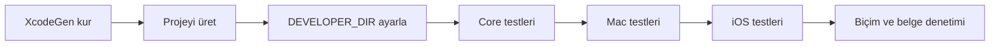
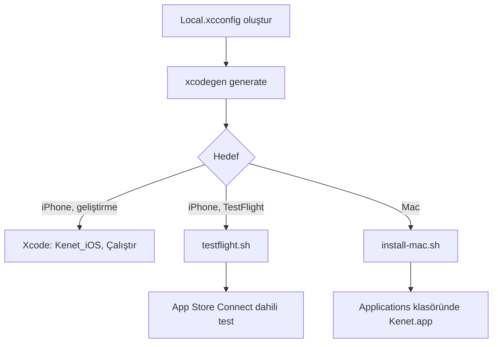
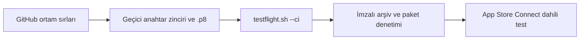
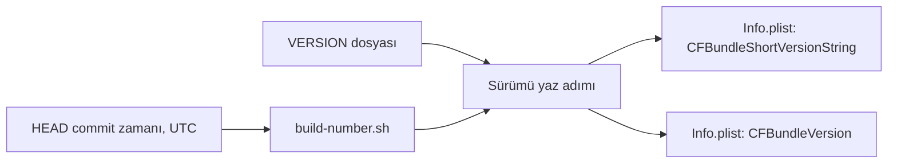

# Geliştirme

**Amaç:** Bu belge yapının nasıl kurulduğunu, sınandığını ve dağıtıldığını adım adım anlatır.

**Kapsam:**

- Araçlar, şemalar ve kurulum adımları.
- Test katmanları, ekran görüntüsü testleri ve ekran turu.
- CI (sürekli bütünleştirme) işleri ve kuralları.
- Cihaza kurulum, TestFlight, CD ve yapı numarası.
- `.github/scripts/` altındaki her betiğin envanteri.

## Araçlar

**Tablo, gereken araçları ve sürümleri verir.**

| Araç | Sürüm | Kullanım |
|---|---|---|
| Xcode | 26 ya da üstü | Uygulama derlemesi ve testleri |
| CI, macOS | `.github/actions/xcode` seçer; sürüm [CI kuralları](#ci-kuralları) tablosunun Xcode satırında | Core ve uygulama testleri; iPhone ve iPad ayrı işlerde |
| CI, Linux | Swift 6.4 | Core derlemesi, biçim ve belge denetimi |
| XcodeGen | Homebrew | `project.yml` dosyasından Xcode projesi üretimi |
| python3 | Sistem sürümü | `check-docs.sh`, `check-catalog-keys.py` ve Python betik testleri |
| `gh` | Homebrew | [CI'dan TestFlight (CD)](#cidan-testflight-cd) kurulum komutları ve `record-snapshots` iş akışını başlatma |
| Ruby | Sistem sürümü | `check-frontmatter-yaml.rb`; isteğe bağlı, CI koşmaz |

**DİKKAT:** `xcodebuild` ve `swift` komutlarından önce `DEVELOPER_DIR` değişkenini ayarla.

**Tablo, Xcode projesindeki şemaları verir.**

| Şema | İçerik |
|---|---|
| `Kenet_iOS` | iPhone ve iPad uygulaması; test eylemi `KenetTests_iOS` ve `KenetUITests` hedeflerini koşar |
| `Kenet_macOS` | Mac uygulaması; test eylemi `KenetTests_macOS` hedefini koşar |
| `Kenet_macOS_ScreenTour` | Mac ekran turu; yalnız `screen-tour.sh --mac` kullanır |
| `VaultFormat` | Core testleri |
| Core paketinin öteki ürün şemaları | Xcode yerel paketten üretir; modül adları `AGENTS.md` "Dizin yapısı" ağacındadır |

Core testlerinin tamamı için `swift test` komutunu kullan. Komut aşağıdaki adımlarda yazılıdır.

## Kurulum adımları

**Şema, ilk kurulumdan ilk test koşusuna kadar olan sırayı gösterir.**



1. Xcode projesini üret. XcodeGen, projeyi `project.yml` dosyasından üretir. `Kenet.xcodeproj` repoya girmez.

```sh
brew install xcodegen
xcodegen generate
open Kenet.xcodeproj
```

2. Komut satırı için Xcode'u seç.

```sh
export DEVELOPER_DIR=/Applications/Xcode.app/Contents/Developer
```

3. Core testlerini koş: `swift test --package-path Packages/Core -Xswiftc -warnings-as-errors`
4. Mac uygulama testlerini koş: `xcodebuild test -project Kenet.xcodeproj -scheme Kenet_macOS -destination 'platform=macOS' CODE_SIGNING_ALLOWED=NO`
5. iOS birim testlerini koş. Komut, CI gibi ekran görüntüsü kümelerini atlar. `pick-simulator.sh` CI ile aynı aygıtı kimliğiyle seçer.

```sh
xcodebuild test -project Kenet.xcodeproj -scheme Kenet_iOS \
  -destination "platform=iOS Simulator,id=$(sh .github/scripts/pick-simulator.sh iPhone | cut -d' ' -f1)" \
  -only-testing:KenetTests_iOS \
  $(sh .github/scripts/snapshot-suites.sh | sed 's#^#-skip-testing:KenetTests_iOS/#' | tr '\n' ' ') \
  CODE_SIGNING_ALLOWED=NO
```

6. iOS arayüz testlerini koş: `Kenet_iOS` şemasına `-only-testing:KenetUITests` ekle.
7. Biçimi denetle: `swift format lint --strict --recursive Packages App Tests Widgets ShareExtension Shared`
8. Belgeleri denetle: `sh .github/scripts/check-docs.sh`

**NOT:** CI ve yerel testler `CODE_SIGNING_ALLOWED=NO` ile imzasız koşar; takım kimliği gerekmez.

## Test katmanları

**Tablo test katmanlarını ve beklentilerini gösterir.**

| Katman | Beklenti |
|---|---|
| Ayrıştırıcı ve yazıcı | Örnek dosya tabanlı testler |
| Gidiş dönüş | Oku ve değiştirmeden yaz; çıktı birebir aynı kalsın |
| İndeks | Örnek kasadan üretilen indeks beklenen sorgu sonuçlarını versin |
| Birleştirme | Sonuç sürümlerin sırasından bağımsız kalsın, tekrarda değişmesin, hiçbir satırı kaybetmesin |
| Dayanıklılık | Bozuk frontmatter, tanınmayan sözdizimi ve boş dosya hata üretmesin |
| Biçim | `swift format lint`; komut "Kurulum adımları" 7. adımdadır |
| Belge biçimi | `check-docs.sh`: karar tablosu, README belge tablosu, String Catalog. Koddaki sabit arayüz metni katalogda yoksa düşer (`check-catalog-keys.py`). `verbatim:`, değişken ve enterpolasyonlu metin sayılmaz |
| Sunum dili | `check-catalog-keys.py`: `locale:` alıp `bundle:` almayan `String(localized:)` çağrısı düşer; yerine `PresentationLocalization.string(localized:locale:)` |
| Uygulama testleri | `KenetTests`, `Kenet_macOS` ve `Kenet_iOS` şemalarında koşar |
| Ekran görüntüsü testleri | `Tests/KenetTests/Snapshots` altındaki `*SnapshotTests` kümeleri; iOS birim katmanı |
| XCUITest dumanı ve erişilebilirlik | `KenetUITests`, `bundle.ui-testing`; `Kenet_iOS` şemasında |
| Mac ekran turu | `KenetMacUITests`; Debug yapılandırmasında, kendi `….screentour` kimliğiyle |

Test verisinin yerini ve sözleşmesini [Örnek dosyalar](fixtures.md) belgesi anlatır.

### Test kimliği

**Tablo, yapılandırmaya göre paket kimliğini ve görünen adı verir.**

| Yapılandırma | Paket kimliği | Görünen ad | Kullanan |
|---|---|---|---|
| `DebugTest` | `$(APP_BUNDLE_IDENTIFIER).testhost` | "Kenet Test" | Birim ve arayüz testleri |
| Debug, Mac ekran turu şeması | `….screentour` | Belge yazmaz | Mac ekran turu |
| Debug ve Release | `com.dogancanyildiz.kenet` | "Kenet" | Geliştirme ve dağıtım |

Ayrı kimlik, test konağının pencere çerçevesini ve tercihlerini kullanıcının alanına yazmasını önler. Ayrı kimlik ayrıca çökme penceresinin gerçek uygulamayla karışmasını önler.

### Tasarım doğrulaması

**Tablo tasarım dilini koruyan doğrulama adımlarını gösterir.**

| Adım | Kapsam |
|---|---|
| Palet testi | `PaletteContrastTests` palet değerlerini, 4 varyantı ve parıltı karışım noktalarını denetler. |
| Kaynak denetimi | `DesignTokenUsageTests`: hex yalnız `App/Design` içinde; `.inkGlow()` yalnız kök ekran görünümlerinde. <!-- sır değil --> |
| Ekran görüntüsü | Her kök ekranın ve her sheet türünün referansı vardır. Referansların kaydı ve tavanı [Ekran görüntüsü testleri](#ekran-görüntüsü-testleri) bölümündedir. |
| Gerçek cihaz | Koyu ve açık, KA, AX3, Hareketi Azalt; iPhone, iPad ve Mac. |

Ajanlar ekranı göremez; bu yüzden ekran görüntüsü testleri bu projede zorunludur. Kuralların kendisi [Tasarım dili](design.md) belgesindedir.

## Ekran görüntüsü testleri

Ekran görüntüsü testleri SwiftUI görünümünü sabit ortamda çizer ve `SnapshotTesting` ile karşılaştırır. CI kapısı iOS'tur.

**Tablo, görüntü referanslarıyla yapılan işleri ve komutlarını verir.**

| İş | Komut |
|---|---|
| iPhone referanslarını yerelde doğrula | `SNAPSHOT_TESTING_RECORD=never sh .github/scripts/record-screen-snapshots.sh` |
| iPad referanslarını yerelde doğrula | `SNAPSHOT_TESTING_RECORD=never sh .github/scripts/record-screen-snapshots.sh --pad` |
| Farkı yerelde incele | `sh .github/scripts/record-screen-snapshots.sh`; yalnız eşleşmeyen ya da eksik referansları yazar |
| iPhone, iPad ve Duo referanslarını yenile | CI `record-snapshots` iş akışı, `target=ios` |
| Mac referanslarını yenile | CI `record-snapshots` iş akışı, `target=mac` |
| iOS ve Mac referanslarını birlikte yenile | CI `record-snapshots` iş akışı, `target=both` |
| Yalnız Duo referanslarını yenile | CI `record-snapshots` iş akışı, `target=duo` |

**DİKKAT:** Referansları yalnız CI kaydeder; yerel koşu incelemedir. Yerel PNG'leri commit etme. Yerel simülatörün çalışma zamanı CI'dakinden farklıysa yerel görüntü farklı çıkar.

**Tablo, görüntü testlerini ayarlayan ortam değişkenlerini verir.**

| Değişken | Etki |
|---|---|
| `SNAPSHOT_TESTING_RECORD` | Kayıt kipi. Betiğin varsayılanı `failed`: yalnız eşleşmeyen ya da eksik referansı yazar. `never` yalnız doğrular. `all` hepsini yeniden yazar |
| `SNAPSHOT_SUITES` | Boşlukla ayrılmış küme adları; doluysa betik yalnız o kümeleri koşar. Boşsa bütün iOS kümeleri koşar |
| `SNAPSHOT_DERIVED_DATA` | Kayıt betiğinin derleme klasörü; varsayılan `.dd/snapshots` |
| `SNAPSHOT_MAC_LOCAL=1` | Mac kümelerini yerelde açar; varsayılan atlanır |
| `SNAPSHOT_MAX_COUNT`, `SNAPSHOT_MAX_MB` | `check-snapshot-budget.sh` tavanlarını geçersiz kılar |

### Küme kuralları

| Konu | Kural |
|---|---|
| Varyantlar | Açık görüntü her kümede durur. Koyu, AX3 ve Kontrastı Artır yalnız temsilci kümelerde kalır. |
| Temsilci kümeler | `TodayScreenSnapshotTests`, `TodayContextSnapshotTests`, `TasksSnapshotTests`, `EntitiesSnapshotTests`, `DiarySheetSnapshotTests`, `ShellSheetSnapshotTests`, `QuickEntryChipsSnapshotTests`, `QuickEntryNameChipSnapshotTests`, `MentionCreatedSnapshotTests`, `ComponentSnapshotTests` |
| Varyant istisnası | Küme başına en çok bir istisna varyanta özgü yerleşimi korur: `PadShellSnapshotTests.todayLandscapeAX3` (geniş kenar çubuğu), `GoalsSummarySnapshotTests.goalDetailAX3` ve `GoalChartSnapshotTests.dailyAX3` (grafik aralığı ve eksen etiketleri), `SummariesSnapshotTests.weekAX3` (sayı listesi), `WeeklyReviewSnapshotTests.numbersAX3` (ritim satırları) |
| Kurala uymayan referanslar | Şu temsilci dışı kümeler de varyant referansı taşır: `CloseDaySnapshotTests`, `DiarySuggestionsSnapshotTests`, `EntityAliasSnapshotTests`, `EntityRelationsSnapshotTests`, `GraceDaySnapshotTests`, `PadLargeTextSnapshotTests`, `ShareFormSnapshotTests`, `SupportSettingsSnapshotTests`, `WidgetViewSnapshotTests`, `TodayMacSnapshotTests`. |
| Referans yeri | `Tests/KenetTests/Snapshots/__Snapshots__/` |
| Referans tavanı | `Tests/**/__Snapshots__/**/*.png` en çok 360 dosya ve 90 MiB. |
| Tavan zorlanırsa | Her referans git geçmişinde kalır. Önce açık/koyu/AX3 üçlüsünü temsilci kümelerin dışında tutarak yer aç. |
| Tavan denetimi | `.github/scripts/check-snapshot-budget.sh`, CI "Biçim ve kurallar" işinde; aşınca dosya listesiyle düşer. Betiğin testi `test-check-snapshot-budget.sh`. |
| Kayıt | CI `record-snapshots` iş akışı kaydeder. Yerel `record-screen-snapshots.sh` koşusu incelemedir. Betik yalnız verilen kümeleri (`SNAPSHOT_SUITES`) ve yalnız eşleşmeyen referansı yazar. |
| Mac kümeleri | Adı `MacSnapshotTests` ile biter; yalnız macOS hedefindedir ve görünümü `NSHostingView` ile çizer. `ci` bu kümeleri atlar; haftalık `mac-snapshots` iş akışı kapı olmadan koşturur. |

### Mac referansları

Mac referanslarının tek yetkili ortamı CI'dır; Xcode sürümü [CI kuralları](#ci-kuralları) tablosunun Xcode satırındadır.

| Konu | Kural |
|---|---|
| Kayıt | `record-snapshots` iş akışında `target=mac` bütün Mac referanslarını `SNAPSHOT_TESTING_RECORD=all` ile baştan çizer; `both` da seçilebilir |
| `failed` kipi | Kullanılmaz: eski ortamdan tolerans içinde kalan PNG'leri koruyabilir |
| Doğrulama ve çıktı | İş ardından `never` ile doğrular ve yalnız Mac referanslarını `mac-snapshot-references` artifact'ına yükler |
| `open_pr` girdisi | Varsayılan `false`. `true` ise ayrı, yazma yetkili iş çıktıyı `dev` üzerine uygular ve `chore/mac-referanslar-<run>` dalından koşu bağlantısıyla PR açar |
| Yetki | Kayıt işleri yalnız okuma yetkilidir |
| Koşma koşulu | `MacSnapshotEnvironment.shouldRun(environment:)` saf işlevi yalnız `CI=true` ya da `SNAPSHOT_MAC_LOCAL=1` için izin verir |
| Atlama | Her Mac kümesinin Swift Testing koşulu aksi durumda gerekçeli atlama bildirir; görüntü dışı testler etkilenmez |
| Değişken aktarımı | Mac şeması bu iki değişkeni test konağına aktarır |
| Yerel kayıt | Yalnız inceleme içindir; yerel PNG'ler commit edilmez |
| Sabit ortam | `MacSnapshotWindow` ekran bulunmasa da 2× ölçeği ve Display P3 renk uzayını sabitler; şema overlay kaydırma çubuklarını seçer |
| Sabit içerik | Kümeler görünümü, takvimi ve saati gerektiği yerde sabitler |

### iOS tuvalleri

**Tablo, iOS görüntü testlerinin tuvallerini gösterir: `SnapshotSupport.swift` içindeki `ShellCanvas`.**

| Tuval | Boyut, pt | Boyut sınıfı | Güvenli alan, pt | Kullanım |
|---|---|---|---|---|
| `.phone` | 390×844 | sıkışık × düzenli | Üst 47, alt 34 | Bütün iOS kümeleri. Varsayılan. |
| `.duoOuter` | 466×678 | sıkışık × düzenli | Üst 47, alt 34 | iPhone Duo dış ekranı, dikey |
| `.duoInner` | 890×626 | düzenli × düzenli | Üst 24, alt 20; sol ve sağ parametre, varsayılan 0 | iPhone Duo iç ekranı, açık |
| `.pad13Landscape` | 1376×1032 | düzenli × düzenli | Üst 24, alt 20 | iPad Pro 13 inç, yatay |
| `.pad13Portrait` | 1032×1376 | düzenli × düzenli | Üst 24, alt 20 | iPad Pro 13 inç, dikey |
| `.pad11Portrait` | 834×1210 | düzenli × düzenli | Üst 24, alt 20 | iPad Pro 11 inç, dikey |
| `.padCompact` | 440×1032 | sıkışık × düzenli | Üst 24, alt 20 | 13 inçte Split View dar yuvası, yatay |

**Varsayım:** Duo ölçüleri ve güvenli alanları tahmindir: piksel ölçüsü 3× ölçekle bölünür. Tuval iPhone simülatöründe çizer ve boyut sınıfını trait geçersiz kılmayla verir. Tuval Duo simülatörünün yerine geçmez.

**Duo kümeleri.** Adı `DuoSnapshotTests` ile biten kümeler Duo tuvallerini çizer: `ChromeSheetsDuoSnapshotTests`, `PhoneScreensDuoSnapshotTests`, `SafeAreaDuoSnapshotTests`.

- Bu kümeler CI kapısıdır: `snapshot-suites.sh` varsayılan listesindedir.
- iOS birim işi bu kümeleri atlar; "iPhone ekran görüntüsü" adımı koşar.
- `record-snapshots` iş akışının `target=ios` kaydı Duo'yu da kapsar.
- `target=duo` yalnız Duo referanslarını `SNAPSHOT_TESTING_RECORD=all` ile yeniden yazar.
- Betik önce kaydeder, sonra yeni referanslara karşı doğrular.
- İş referansları `duo-snapshot-references` artifact'ına yükler.
- Yerel Duo kaydı yalnız inceleme içindir.
- Referanslar `__Snapshots__/` altında test dosyasının adını taşır: `ChromeSheetsDuoSnapshotTests`, `DuoCanvasSnapshotTests`, `SafeAreaDuoSnapshotTests`.
- `ChromeSheetsDuoSnapshotTests` pencereyi 8 bit sRGB çizer: `preferredRange = .standard`.

**iPad kümeleri.** Adı `Pad` ile başlayan kümeler iPad tuvallerini çizer. Liste: `sh .github/scripts/snapshot-suites.sh --pad`.

- Bu kümeler yalnız iPad simülatöründe koşar.
- iPhone'da kendini atlar; bu yüzden iOS birim işi onları ayrıca dışlamaz.
- Kümeler içeriği tuval boyutunda bir pencerede barındırır ve pencerenin kendisini çizer.
- Boyut sınıfı ve Dynamic Type pencerenin trait geçersiz kılmasından gelir; açılan sheet de bunları alır.
- Kabuk vakaları gerçek `AdaptiveNavigation`'ı çizer.
- Kayıt ve doğrulama için `sh .github/scripts/record-screen-snapshots.sh --pad` komutunu kullan.
- Betik iPad Pro 13 inç (M5) simülatörünü seçer.
- Yoksa sıra şudur: M4, iPad Air 13 inç (M4), (M3), iPad Pro 13 inç.
- Referanslar `__Snapshots__/Pad…` klasörlerindedir.

**NOT:** Kabuğun kendi görev modeli ve hedef sayfası duvar saatinin gününü alır; donmuş günü almaz. Bu yüzden Kanban, zaman çizelgesi ve hedef ayrıntısı kabuksuz sayfa olarak, donmuş günle çizilir. Kabuktaki Hedefler vakası hedef seçmez.

**NOT:** iPad referansları dik duran simülatörde çizilir.

- Bölünmüş görünüm sütunlarını pencereden değil sahnenin yönünden de seçer; birim testi aygıtı döndüremez.
- Döndürülmüş simülatörde kümeler piksel karşılaştırmak yerine açık bir hatayla düşer.
- Kayıt betiği iPad simülatörünü yeniden başlatır; yeniden başlayan simülatör dik açılır.
- iOS 26'nın cam denetimleri her koşuda biraz farklı çizilir: kenar çubuğu düğmesi ve sekme çubuğu.
- Yakalama onların karesini gri boyar.
- Ara sheet'i barındırılır ama çizilmez: alanı odak alır ve klavye sheet'i kaydırır.

### Arayüz duman testi

Tam uygulama akışı için XCUITest dumanı kalır. CI dumanı `-only-testing:KenetUITests` ile koşturur.

| Değişken | Etki |
|---|---|
| `KENET_UITEST_VAULT` | DEBUG derlemede verilen klasörü kasa olarak açar; otomatik gerçek kasa, bildirim ya da kilit başlamaz |
| `KENET_UITEST_CLOCK=HH:mm` | Aynı koşulda uygulamanın `clockNow` saatini bugünün o saatine sabitler |

Üretim derlemesi bu değişkenleri okumaz. Erişilebilirlik denetimi (`AccessibilityAuditUITests`) iPad'de de koşar. Denetim bölünmüş kabukta aygıtı yatay döndürür ve bitince dik bırakır.

## Ekran turu

**Tablo, iPhone, iPad ve Mac ekran turlarını karşılaştırır.**

| Konu | iPhone | iPad | Mac |
|---|---|---|---|
| Komut | `sh .github/scripts/screen-tour.sh <çıktı klasörü> [simülatör kimliği]` | `sh .github/scripts/screen-tour.sh --pad <çıktı klasörü> [simülatör kimliği]` | `sh .github/scripts/screen-tour.sh --mac <çıktı klasörü>` |
| Test | `ScreenTourUITests` | `ScreenTourUITests`; sekme yerine kenar çubuğu satırları (`sidebar.<key>`) | `ScreenTourMacUITests` |
| Şema | `Kenet_iOS` | `Kenet_iOS` | `Kenet_macOS_ScreenTour` |
| Aygıt | En eski iOS runtime'ındaki iPhone 17 | `record-screen-snapshots.sh --pad` ile aynı: iPad Pro 13 inç (M5) önce; yatay | Ana ekranda 1280x800 pencere |
| Çıktı | Her ekran için `NN-ekran-durum.png` | iPhone ile aynı adlar; ayrı klasöre yaz | Aynı adlarla pencere görüntüleri; yalnız Mac'te olan ekranlar 30'dan başlar |
| Ulaşılamayan adım | `atlananlar.txt` dosyasına düşer; test düşmez | Aynı | Aynı |
| Koşu | Yalnız betikle; olağan arayüz testi koşusu ve CI turu atlar | Aynı; koşu bitince aygıt dik yöne döner | Yalnız betikle; tur sürerken fare ve klavye testin elindedir |

**Tablo, turu ayarlayan ortam değişkenlerini verir.**

| Değişken | Etki |
|---|---|
| `SCREEN_TOUR_SIMULATOR` | Simülatör kimliği; ikinci bağımsız değişkenin yerine geçer |
| `SCREEN_TOUR_PLATFORM=mac`, `=pad` | `--mac`, `--pad` ile aynı |
| `--store`, `SCREEN_TOUR_STORE=1` | Mağaza boyutu: iPhone 6,9 inç Pro Max, iPad 13 inç, Mac 1440x900 pencere; uymayan görüntüleri listeler |
| `SCREEN_TOUR_ORIENTATION=portrait` | iPad turunu dik koşturur; varsayılan yatay |
| `SCREEN_TOUR_DERIVED_DATA` | iPhone ve iPad turunun derleme klasörü; varsayılan `.dd/screen-tour` |
| `SCREEN_TOUR_WINDOW=1000x700` | Mac penceresinin boyutu; varsayılan 1280x800 |
| `SCREEN_TOUR_ONLY=ayarlar,koyu` | Mac turunda yalnız adı verilen bölümleri koşar |
| `SCREEN_TOUR_TREE=1` | Her görüntünün yanına erişilebilirlik ağacını `<çıktı>/agac/` altına yazar |

**Tablo, turun davranışını verir.**

| Konu | Davranış |
|---|---|
| Amaç | Tasarım işinde önce ve sonra karşılaştırması |
| Saat | Tur uygulama saatini `09:41`'e kendisi sabitler (`KENET_UITEST_CLOCK`); bu değeri betik okumaz. Durum çubuğuyla aynı saat ve sabah selamı görünür |
| iPhone | Tur uygulamayı örnek kasayla simülatörde gezer |
| iPad | Bölünmüş kabukta sekme yoktur. `UITestSupport` her sekme kimliğini kenar çubuğu satırına eşler: `tab.entities` → `sidebar.people` |
| iPad satırları | Kanban, zaman çizelgesi, proje, Konumlar, Özetler, Graph ve harita kendi satırından açılır |
| Açık ve koyu | iPhone ve iPad turu iki koşudur: önce açık görünüm, sonra `20-koyu-*` görüntüleri |
| Koyuya geçiş | Betik ikinci koşudan önce simülatörü `simctl ui appearance dark` ile koyuya alır. Neden: `XCUIDevice.appearance` simülatörü koyuya çevirmedi |
| Mac | Uygulama ayrı bir bundle kimliği ve geçici bir ev klasörü kullanır. Tur gerçek kasaya ve ayarlara dokunmaz |

**NOT:** Çıktı klasörünü depo dışında seç; Kasa ayar sayfası görüntüsü makine yolunu gösterebilir, görüntüleri depoya ve PR'a ekleme.

## CI

**Tablo CI işlerini, adımlarını ve tetiklerini gösterir.**

| İş | Runner | Adımlar | Ne zaman | İş sınırı |
|---|---|---|---|---|
| Değişen dosyalar | Linux | Belge PR'ı mı: `.github/scripts/ci-changes.py` | Her zaman | 5 dk |
| Biçim ve kurallar | Linux kabı, Swift 6.4 | `swift format lint`, dört denetim betiği (`check-docs.sh` kaynak–katalog denetimini de çalıştırır), görüntü tavanı denetimi (`check-snapshot-budget.sh`), CI betiklerinin testleri (`test-record-snapshots.py` hariç; CI onu koşmaz) | Her zaman; belge PR'ında da | 15 dk |
| Core (Linux) | Linux kabı, Swift 6.4 | `swift test` | Belge dışı her koşu | 20 dk |
| Uygulama (macOS ve Core) | macOS | Core `swift test` yalnız Darwin dalı olan kümeler (tamamı Linux'ta), ölçek bütçesi, Mac testleri `TZ=UTC`, Mac testleri `TZ=Pacific/Auckland` (PR'da yalnız `timezone-suites.sh` kümeleri, `dev`'e itmede tam) | Belge dışı her koşu; ölçek bütçesi yalnız `dev` itmesinde koşar ve düşse de iş geçer | 35 dk |
| Uygulama (iPhone) | macOS | Derle, iPhone simülatörünü aç, birim testleri, iPhone görüntü kümeleri | Belge dışı her koşu | 30 dk |
| Uygulama (iPhone arayüz) | macOS | Derle, iPhone simülatörünü aç, arayüz akışı (`KenetUITests`, `ui-audit-suites.sh` kümeleri hariç) | Belge dışı her koşu | 30 dk |
| Uygulama (iPhone arayüz denetimi) | macOS | Derle, iPhone simülatörünü aç, iPhone'a özgü erişilebilirlik denetimi kümeleri (`.github/scripts/ui-audit-suites.sh --iphone`: adı `AccessibilityUITests` ya da `AuditUITests` ile biten sınıflar, iPad'in koştuğu ortak küme hariç) | Belge dışı her koşu | 25 dk |
| Uygulama (iPad) | macOS | Derle, iPad simülatörünü aç, iPad görüntü kümeleri (`--pad`), ortak erişilebilirlik denetimi (`ui-audit-suites.sh --shared`: `AccessibilityAuditUITests`, yatay) | Belge dışı her koşu | 35 dk |
| ci | Linux | Bütün işlerin sonucu: `.github/scripts/ci-gate.py` | PR'da her zaman; `dev`'e itmede koşu iptal edilmediyse | 5 dk |
| `testflight-check` (ayrı iş akışı, iki iş) | macOS | İmzasız arşiv ve paket denetimi: iOS işi `sh .github/scripts/testflight.sh --check`, Mac işi `--check --mac`. Yükleme yapmaz. Arşiv düşerse günlüğü yükler | `dev`'e her itmede; `KENET_CD_ON_PUSH` açıksa atlanır | 30 dk (her iş) |
| `testflight` (ayrı iş akışı, CD) | macOS | İmzalı arşiv, aynı paket denetimi ve TestFlight yüklemesi: `testflight.sh --ci`. Platform girdisi `ios` (varsayılan) ya da `mac`. Ayrıntı: [CI'dan TestFlight (CD)](#cidan-testflight-cd) | Elle; `dev`'e itmede yalnız depo değişkeni `KENET_CD_ON_PUSH=true` ise | 45 dk |
| `mac-snapshots` (ayrı iş akışı) | macOS | Yalnız Mac görüntü kümeleri (`snapshot-suites.sh --mac`; adında `Duo` geçen küme hariç), `SNAPSHOT_TESTING_RECORD=never`. Kapı değildir; düşerse farkları `mac-snapshot-diffs` olarak yükler. Referanslar CI'da kaydedilir (`record-snapshots target=mac`) | Haftada bir (pazartesi 05:00 UTC) ve elle | 40 dk |
| `record-snapshots` (ayrı iş akışı) | macOS | `target` girdisi (`ios`, `mac`, `both`, `duo`) kayıt işlerini seçer: `record`, `pad`, `duo`, `mac`. Ayrıntı: aşağıdaki "Kayıt iş akışı" satırı | Elle | 40 dk (her kayıt işi) |
| `release` (ayrı iş akışı) | Linux | `release.sh`: `VERSION` numarasıyla etiketi ve GitHub Release'i oluşturur. Akış `AGENTS.md` "Sürüm" bölümündedir | `main`'e itme; elle koşu her zaman kuru koşudur | İş akışı sınır yazmaz |
| `codeql` (ayrı iş akışı) | Linux ve macOS | CodeQL çözümlemesi: `actions` Linux'ta, `swift` macOS'ta | `main` PR'ı, `main` itmesi, pazartesi 04:17 UTC | İş akışı sınır yazmaz |

**Vaka süreleri.** Her iOS ve iPad test adımının ardından "Vaka süreleri" adımı koşar. Mac test adımlarında bu adım yoktur.

- `case-durations.py` xcresult paketindeki vaka sürelerini en uzun önce günlüğe ve iş özetine yazar.
- Adım ölçüm içindir; eşik koymaz ve test adımının sonucunu değiştirmez.
- Girdi tanınan şemada değilse (`testNodes` ya da "Test Case" düğümü yok) `::warning::` basar.
- Kısaltma kararları bu sayılarla verilir.

**Erişilebilirlik bulguları.** Arayüz testi adımı düşerse `a11y-issues.py` düşen vakaların "A11Y issue" satırlarını ve hata iletilerini günlüğe yazar. Kanıt, artifact yüklemesi düşse de günlükte kalır.

**macOS iş sayısı.** İş sınırı beklenen sürenin 1,3–1,7 katıdır; iş başına değer `ci.yml` yorumundadır.

| Koşu | macOS işi |
|---|---|
| `dev`'e açılan PR | 5 |
| `main` PR'ı | 6: CodeQL `swift` işiyle |
| `dev` itmesi | 7: iki TestFlight denetimiyle (iOS ve Mac arşivi) |

**Varsayım:** GitHub aynı anda en çok beş macOS işi koşturur; fazlası sıra bekler.

### CI kuralları

| Konu | Kural |
|---|---|
| Xcode | macOS işleri, `ios-build`, `testflight-check` ve `testflight` Xcode'u `.github/actions/xcode` eylemiyle seçer. Sürümü yalnız bu eylem seçer: Xcode 26.6, macOS 26 imajı. `record-snapshots.yml` PR gövdesi ve `mac-snapshots.yml` yorumu aynı sürümü sabit metinle yineler. Eylem sürümü günlüğe yazar; sürüm imajdan kalkarsa iş açık bir hatayla düşer. |
| İş bölme | Her `xcodebuild test-without-building` çağrısının kurulum ve ilk açılış için ~3–4 dk sabit maliyeti vardır. Bu yüzden bölme yalnız uzun test adımında kazandırır. iPhone arayüz testleri iki işe bölünür. Bölme ad kuralıyla yapılır (alt klasörler dahil); bölme süre dengesidir, anlam ayrımı değildir. |
| Ortak denetim kümesi | `AccessibilityAuditUITests` aynı ekranları iPad'de bölünmüş kabukta denetler ve yalnız orada koşar. Denetim çağıran ama adı kurala uymayan kümeler akış işinde koşar. |
| Seçim testi | `test-ui-audit-suites.sh` üç adımın `run` bloğunu sahte depoda çalıştırır ve `xcodebuild`'e giden seçimi ölçer. iPhone denetimi: ortak küme dışındaki liste (`--iphone`, `-only-testing`). iPad denetimi: yalnız ortak küme (`--shared`). Akış: `KenetUITests` eksi tam liste (`-skip-testing`). Kendi listesi boşsa adım düşer. |
| Cihaz ailesi | Her iOS işi tek simülatör kullanır. Her iş kendi derlemesini yapar, simülatörü derlemeden sonra açar ve testleri derlemesiz koşar. Ortak başlangıç `.github/actions/ios-build` içindedir; `family` girdisi `iphone` ya da `ipad` alır. |
| Sıra | Arayüz testleri yeni açılmış simülatörde 2 kattan fazla yavaş koşar. İki arayüz işi de bu bedeli öder ve yine de kısadır. iPhone görüntü adımı önce uygulamayı simülatörden kaldırır: birim testlerinin bıraktığı durum görüntüleri kaydırır. Birim ve görüntü adımları bu yüzden tek `xcodebuild` çağrısında birleşmez. Süreç dili de farklıdır: görüntüler Türkçe çizilir, birim testleri simülatörün dilinde koşar. iPad işinde görüntüler erişilebilirlik denetiminden önce koşar: denetim aygıtı döndürür. Bir test adımı düşse de aynı simülatördeki sonraki adımlar koşar; Core düşse de Mac testleri koşar. |
| Yeniden deneme | iOS test adımları iki simülatör altyapı hatasında bir kez yeniden dener: "Unable to find a device matching the provided destination specifier" ve "hung before establishing connection". Betik aygıtın hazır olmasını bekler ve testi bir kez daha koşar: `.github/scripts/xcodebuild-retry.sh`. Bu hatalar test beklentilerinden kaynaklanmaz. Öteki her hata adımı düşürür. |
| Zaman aşımı | iOS: birim 20 dk, iPhone ve iPad görüntü 20 dk, arayüz akışı 20 dk, iPhone arayüz denetimi 15 dk, iPad erişilebilirlik 15 dk, simülatör açılışı 10 dk. macOS işi: Core 15 dk, ölçek bütçesi 15 dk, Mac testleri UTC 20 dk, Auckland 15 dk. Birim ve arayüz adımlarında test başına sınır 300 sn'dir (`-test-timeouts-enabled YES`). Sessiz asılma adımı öldürmek yerine test adıyla düşer. |
| Önbellek | CI SwiftPM paket indirmelerini önbelleğe alır. iOS ve macOS işleri tek anahtarı paylaşır; anahtar `Packages/Core/Package.resolved` ve `project.yml` dosyalarından türer. Uygulama paketlerinin kilit dosyası repoya girmez: proje üretilir. Bu yüzden `project.yml` SnapshotTesting'i tam sürümle sabitler. |
| Simülatör seçimi | iPhone kapısı (`.github/actions/ios-build`), kayıt betiği ve ekran turu aynı seçiciyi çağırır: `.github/scripts/pick-simulator.sh`. Seçici en eski kurulu iOS runtime'ındaki aygıtı kimliğiyle alır. iPad'de yalnız 13 inçlik tercih listesi sayılır. **Varsayım:** macos-26 imajı iOS 26.2 ve 26.5 taşır (ölçüm 2026-11-10); kapı ve kayıt ikisi de 26.2'yi alır. |
| Referansların yetkili ortamı | iOS ve iPad referansları CI'da, Xcode satırındaki ortamda ve seçicinin aldığı runtime ile kaydedilir. Yerel simülatörün runtime'ı farklıysa yerel görüntü testi farklı çıkar; yerel kayıt commit edilmez. |
| Kayıt iş akışı | `record-snapshots` iş akışında `target=ios` iki iş açar. `record` işi iPhone kümelerini kaydeder: `record-screen-snapshots.sh`. `pad` işi iPad kümelerini kaydeder: `record-screen-snapshots.sh --pad`. Artifact'lar `screen-snapshot-references` ve `pad-snapshot-references` adını taşır. `target=mac` Mac işini açar; `both` üçünü de açar. |
| Erişilebilirlik muafiyeti | Denetimin kabul edilen bulgusu `AccessibilityAuditExemption.all` tablosunda tek satırdır: denetim türü, öğe (kimlik ya da katalog anahtarı) ve gerekçe. Aynı bileşen için var olan kalıp kullanılır; düzeltilmemiş gerçek bulgu `open: true` taşır. |
| Sonuç paketleri | Test adımı düşünce CI sonuç paketini yükler: `mac-test-results`, `ios-test-results`, `screen-snapshot-diffs`, `ui-flow-results`, `ui-audit-results`, `pad-snapshot-diffs`, `pad-a11y-results`. Haftalık iş akışı `mac-snapshot-diffs` yükler. İptal edilen koşu paket yüklemez. |

**Belge PR'ı.** Yalnız belge değiştiren PR'da CI Core ve uygulama işlerini atlar. Belge yolları: `docs/**`, kökteki `*.md`, `LICENSE`.

- Kararı `.github/scripts/ci-changes.py` verir; bilinmeyen her yol koddur.
- `dev`'e itmede atlama yoktur.
- Zorunlu `ci` denetimi atlanan işi yalnız bu durumda başarı sayar.
- Düşen ya da iptal olan işi hiçbir zaman başarı saymaz: `.github/scripts/ci-gate.py`.

**İptal kuralı:** Art arda birleştirmede `concurrency` önceki `dev` koşusunu iptal eder.

- `ci` işi iptal edilen `dev` koşusunda koşmaz; commit kırmızı yerine gri görünür.
- Ruleset `dev` itmesini denetlemez; son koşu ağacın tamamını sınar.
- PR'da `ci` her zaman koşar: iptal edilen PR koşusu kırmızı kalır ve birleşme kapısı kapanır.

### iOS test asılması

**Tablo iOS birim testleri asılınca toplanan teşhis verisini gösterir.**

| Veri | Yer |
|---|---|
| Başlayıp bitmeyen test | `ios-test-diagnostics/xcodebuild.log`, günlüğün sonu |
| Süreç yığın örnekleri | CI örnekleri 12. dakikada alır: `.github/scripts/ios-test-diagnostics.sh` |
| Sonuç paketi | `IOSTests.xcresult` |

CI'da iOS birim testleri adımı asılı kalabilir. **Varsayım:** kök neden belli değildir. Adımın kendi zaman aşımı 20 dk'dır.

- Adım düşünce ya da süre dolunca CI `ios-test-results` paketini yükler.
- Simülatör derlemeden sonra açılır ve ayrı adım hazır olmasını bekler.
- Adım süreleri asılmanın açılışta mı testte mi olduğunu gösterir.

## Cihaza kurulum ve TestFlight

**Şema, imza hazırlığından üç kurulum yoluna kadar olan akışı gösterir.**



1. Yerel imza dosyasını oluştur: `cp Config/Local.xcconfig.example Config/Local.xcconfig`. Dosyada `XXXXXXXXXX` yerine kendi takım kimliğini yaz. Takım kimliği repoya girmez; dosya `.gitignore`'dadır.
2. Projeyi üret: `xcodegen generate`. Bundle kimliği `project.yml` içindeki `APP_BUNDLE_IDENTIFIER` değeridir. Xcode takımı yerel dosyadan okur. XcodeGen projeyi yeniden üretince takım seçimi kaybolmaz.

   **DİKKAT:** Xcode'da takımı elle seçme; Xcode seçimi `Kenet.xcodeproj` içine yazar ve XcodeGen seçimi siler.

3. Cihaza kur. `Kenet_iOS` şemasını seç. Hedef olarak iPhone'u seç. Çalıştır'a bas. Xcode imzalamayı otomatik yapar.
4. TestFlight'a yükle: `dev` dalında `sh .github/scripts/testflight.sh` komutunu çalıştır.

   | Seçenek | Ne yapar |
   |---|---|
   | Seçeneksiz | Arşivler, özeti gösterir, onay gelince yükler |
   | `--yes` | Onay sormadan yükler |
   | `--check` | İmzasız arşivler ve yalnız denetler; yükleme yok |
   | `--mac` | Mac uygulamasını (`Kenet_macOS`) arşivler ve yükler; `--check` ya da `--ci` ile birleşir |
   | `--ci` | CI'da API anahtarıyla onaysız yükler; `--keychain`, `--api-key`, `--api-key-id`, `--api-issuer` ister; `--check` ile birleşmez; "CI'dan TestFlight (CD)" bölümü |

   | Konu | Bilgi |
   |---|---|
   | Temiz kopya | Betik HEAD'i geçici bir kopyaya çıkarır ve arşivi oradan alır. Xcode'un çalışma klasöründe yeniden yazdığı dosyalar yapıya girmez |
   | Paket denetimi | Kimlik, sürüm, yapı numarası ve belge paylaşımı anahtarları |
   | Koşullar | Yerel `dev`, `origin/dev` ile aynıdır; Xcode'da aynı Apple hesabıyla oturum açıktır |
   | `dev` itmesi | `.github/workflows/testflight-check.yml` aynı `--check` denetimini koşar ve yükleme yapmaz |
   | Elle yol | `Kenet_iOS` şeması, hedef "Any iOS Device", Product → Archive, Organizer'da Distribute App → TestFlight Internal Only |

   **DİKKAT:** Elle yolda Xcode'un değiştirdiği dosyalar arşive girer; önce `git status` çıktısının temiz olduğunu denetle.

5. Mac'i TestFlight'a yükle: `dev` dalında `sh .github/scripts/testflight.sh --mac`.

   | Konu | Bilgi |
   |---|---|
   | Betiğin işi | `Kenet_macOS` şemasını Mac App Store paketi olarak arşivler ve aynı hesapla yükler |
   | Paket denetimi | İmzalı pakette App Sandbox ve iCloud kapsayıcı yetkisi |
   | Hazırlık 1 | App Store Connect'te uygulama kaydına macOS platformunu ekle: uygulama sayfası → platform ekle |
   | Hazırlık 2 | Takımda en az bir Mac kayıtlı olsun: Certificates, Identifiers & Profiles → Devices → macOS |
   | Mac UDID | Sistem Bilgisi → Donanım → Provisioning UDID |
   | Kayıtlı Mac yoksa | Arşiv "Your team has no devices" hatasıyla durur; CI'daki Mac yüklemesi de aynı kayda dayanır |
   | Sertifika | Xcode "Mac Installer Distribution" sertifikasını otomatik imzada kendisi oluşturur |
   | `dev` itmesi | `testflight-check.yml` Mac arşivini de imzasız denetler |

6. Mac'e doğrudan kur (geliştirme makinesi): `sh .github/scripts/install-mac.sh`.

   | Konu | Bilgi |
   |---|---|
   | Derleme | Betik HEAD'i geçici bir kopyaya çıkarır ve Release derler |
   | Denetim | Kimlik, sürüm ve imza |
   | Kurulum | Betik uygulamayı `/Applications/Kenet.app` olarak kopyalar |
   | Durma koşulları | Kenet açıksa betik durur. `/Applications/Kenet.app` başka bir uygulamaysa da betik durur |
   | Sınır | Kurulum geliştirici imzalıdır ve yalnız derlendiği Mac'te çalışır; başka Mac'e TestFlight yolu kullanılır |

## CI'dan TestFlight (CD)

**Şema, gizli değerlerden TestFlight yüklemesine kadar olan CI yolunu gösterir.**



`.github/workflows/testflight.yml` yerel yolu CI'da koşar: `testflight.sh --ci`.

- Betik aynı denetimleri yapar ve aynı dışa aktarma ayarıyla yükler.
- Betik Xcode hesabının yerine App Store Connect API anahtarını kullanır.
- Betik takım kimliğini anahtar zincirindeki Apple Distribution kimliğinden okur.
- Repoya ve günlüğe kimlik yazılmaz.

**Tablo, iş akışının beklediği Secrets değerlerini ve kaynaklarını verir.** <!-- sır değil -->

| Secret | İçerik | Kaynak <!-- sır değil --> |
|---|---|---|
| `ASC_KEY_ID` | API anahtarının kimliği, 10 karakter | App Store Connect, anahtar satırı |
| `ASC_ISSUER_ID` | Yayıncı kimliği, UUID | App Store Connect, anahtar tablosunun üstü |
| `ASC_KEY_P8` | `AuthKey_<kimlik>.p8` dosyası, base64 | Anahtar oluşunca bir kez indirilir |
| `DIST_CERT_P12` | Apple Distribution ve Apple Development kimlikleri, tek `.p12`, base64 | Anahtar Zinciri Erişimi, dışa aktarma |
| `DIST_CERT_PASSWORD` | `.p12` parolası | Dışa aktarırken sen seçersin <!-- sır değil --> |

1. API anahtarını oluştur. App Store Connect → Users and Access → Integrations → App Store Connect API → Team Keys → `+`. Ad: `Kenet CI`. Erişim: App Manager. `.p8` dosyasını indir; Apple dosyayı yalnız bir kez verir. Key ID ve Issuer ID değerlerini not et.
2. Dağıtım sertifikasını hazırla. Xcode → Settings → Accounts → takım → Manage Certificates. Listede Apple Distribution yoksa `+` → Apple Distribution.
3. Kimlikleri dışa aktar. Anahtar Zinciri Erişimi → login → My Certificates. "Apple Distribution: …" ve "Apple Development: …" satırlarını birlikte seç → Export 2 items → `.p12`, güçlü bir parolayla.

   **NOT:** Otomatik imzalamada arşiv adımı geliştirme kimliğiyle imzalar; dışa aktarma dağıtım kimliğiyle yeniden imzalar. `.p12` içinde Apple Development yoksa Xcode her koşuda API anahtarıyla yeni bir geliştirme sertifikası oluşturabilir. Betik bu durumda uyarı yazar.

4. Secrets değerlerini yaz. Depo kökünde: <!-- sır değil -->

   ```sh
   # Önce "testflight" ortamını yalnız dev dalına açık olarak oluştur (Settings → Environments:
   # Deployment branches → Selected branches → dev); Secrets bu ortama yazılır, başka dal okuyamaz.  # sır değil
   gh api -X PUT repos/dogancanyildiz/kenet/environments/testflight \
     -F 'deployment_branch_policy[protected_branches]=false' \
     -F 'deployment_branch_policy[custom_branch_policies]=true'
   gh api -X POST repos/dogancanyildiz/kenet/environments/testflight/deployment-branch-policies -f name=dev
   gh secret set ASC_KEY_ID --env testflight  # sır değil
   gh secret set ASC_ISSUER_ID --env testflight  # sır değil
   base64 -i AuthKey_<Key ID>.p8 | gh secret set ASC_KEY_P8 --env testflight  # sır değil
   base64 -i Kenet-imza.p12 | gh secret set DIST_CERT_P12 --env testflight  # sır değil
   gh secret set DIST_CERT_PASSWORD --env testflight  # sır değil
   ```

   Son komut parolayı gizli girişle sorar. Sonra `.p8` ve `.p12` dosyalarını parola yöneticisine taşı ve diskten sil.

5. İlk koşuyu başlat: `gh workflow run testflight.yml --ref dev -f notes='ilk CD denemesi'`. Not koşu adında ve özetinde görünür; TestFlight'a gitmez. Mac için `-f platform=mac` eklenir; itme koşusu yalnız iOS yükler.
6. İsteğe bağlı olarak `dev`'e her itmede yüklemeyi aç: `gh variable set KENET_CD_ON_PUSH --body true`. Varsayılan kapalıdır. Değişken açıkken `testflight-check` atlanır; yükleme koşusu aynı denetimi imzalı arşivde yapar.

**Tablo, CD'nin sınırlarını ve bakımını verir.**

| Konu | Bilgi |
|---|---|
| Dal | Yalnız `dev`. Betik başka dalı ve `origin/dev` geçmişinde olmayan commit'i reddeder |
| Platform | Girdi `ios` (varsayılan) ya da `mac`. `mac`, `--mac` ile `Kenet_macOS` arşivini Mac App Store paketi olarak yükler |
| Kimlik bilgisi | İş akışı geçici anahtar zinciri ve API anahtarı kurar |
| Kuyruk | Aynı anda tek yükleme. Yükleme yarıda kesilmez; bekleyen koşu yenisi gelince iptal olur |
| Yapı numarası | Commit'in UTC işlenme zamanı. Aynı commit'ten ikinci yükleme reddedilir |
| Sertifika süresi | Apple Distribution bir yıl geçerlidir. Yenileyince `DIST_CERT_P12` ve `DIST_CERT_PASSWORD` değerlerini güncelle <!-- sır değil --> |
| API anahtarı | Süresi dolmaz. Sızarsa App Store Connect'te iptal et ve yenisini yaz. İki adımlı doğrulama istemez |
| Düşen koşu | `testflight-logs` artifact'ı arşiv ve yükleme günlüğünü taşır. Takım, anahtar ve yayıncı kimliği günlükte yer tutucuyla değişir |

## Yapı numarası

**Şema, sürüm ve yapı numarasının kaynağını gösterir.**



**Tablo, yapı numarasının durumlara göre değerini verir.**

| Durum | Sonuç |
|---|---|
| Biçim | `YYAAGG.SSDDss`: HEAD commit'inin UTC işlenme zamanı. Örnek `261111.153012` = 2026-11-11 15:30:12 UTC |
| Baştaki sıfır | İkinci parçanın baştaki sıfırları atılır: `000501` → `501` |
| Git var, sığ kopya dahil | Derleme numarayı üretir; iOS, Mac, widget ve paylaşım uzantısı aynı numarayı alır |
| Git yok | Numara `1` kalır ve derleme uyarı verir; o yapıyı yükleme |
| Aynı sürümde aynı numara | App Store Connect ikinci yüklemeyi kabul etmez; yeni yükleme için en az bir yeni commit gerekir |
| `main` ve `dev` | Sürüm birleşmesi kendi zamanını alır; sonraki `dev` commit'leri daha büyük numara alır |
| İş dalı | Squash commit'i yeni zaman alır; arşivi `dev` ya da `main` üzerinden al |

`CFBundleVersion` yapı numarasını elle yazma. Sürüm numarası kökteki `VERSION` dosyasından gelir. Gerekçe [Kararlar](decisions.md) belgesinin 2026-11-11 satırındadır.

## Betik envanteri

**Tablo, `.github/scripts/` altındaki 35 betiği, işini ve koştuğu yeri verir.**

| Betik | Ne yapar | Nerede koşar |
|---|---|---|
| `a11y-issues.py` | Düşen arayüz vakalarının "A11Y issue" satırlarını xcresult paketinden günlüğe yazar | CI: iPhone arayüz, iPhone arayüz denetimi ve iPad işleri, test adımı düşünce |
| `build-number.sh` | Yapı numarasını HEAD commit zamanından üretir | Derleme: `project.yml` "Sürümü yaz" adımı; `testflight.sh` |
| `case-durations.py` | xcresult paketindeki vaka sürelerini en uzun önce yazar | CI: her iOS ve iPad test adımının ardından |
| `check-catalog-keys.py` | Koddaki sabit arayüz metninin String Catalog'da olduğunu denetler | `check-docs.sh` çağırır; CI "Biçim ve kurallar" |
| `check-core-imports.sh` | `Core` içindeki yasak import'ları arar | CI "Biçim ve kurallar"; elle |
| `check-doc-locations.sh` | `.md` dosyalarının yerini denetler | CI "Biçim ve kurallar"; elle |
| `check-docs.sh` | Belge biçimini denetler; kapsam `AGENTS.md` denetim betiği tablosundadır | CI "Biçim ve kurallar"; elle |
| `check-frontmatter-yaml.rb` | Frontmatter fixture'larını bağımsız YAML okuyucularıyla karşılaştırır | Elle; CI koşmaz |
| `check-snapshot-budget.sh` | Görüntü referansı tavanını denetler: dosya sayısı ve toplam boyut | CI "Biçim ve kurallar"; elle |
| `check-team-id.sh` | Belgelerde gerçek takım kimliği arar | CI "Biçim ve kurallar"; elle |
| `ci-changes.py` | Değişen dosyaların tamamı belge mi, onu söyler | CI "Değişen dosyalar" |
| `ci-gate.py` | Zorunlu `ci` denetiminin kararını verir | CI `ci` işi |
| `install-mac.sh` | Mac uygulamasını temiz kopyadan Release derler ve `/Applications` altına kurar | Elle |
| `ios-test-diagnostics.sh` | Asılan iOS test adımının süreç ve yığın örneklerini toplar | CI: iPhone işi, birim testleri adımı |
| `pick-simulator.sh` | En eski kurulu iOS runtime'ındaki aygıtı kimliğiyle seçer | `.github/actions/ios-build`, `record-screen-snapshots.sh`, `screen-tour.sh`; elle |
| `record-screen-snapshots.sh` | iOS görüntü kümelerini koşar; eşleşmeyen referansı yazar ya da doğrular | CI `record-snapshots` iş akışı; elle (inceleme) |
| `release.sh` | `VERSION` numarasıyla etiketi ve GitHub Release'i oluşturur | CI `release` iş akışı |
| `render-app-icon.swift` | Uygulama simgesinin SVG ve PNG dosyalarını koddan üretir | Elle |
| `screen-tour.sh` | Uygulamayı örnek kasayla gezer ve her ekranın PNG'sini yazar | Elle; CI koşmaz |
| `snapshot-suites.sh` | Görüntü test kümelerini listeler: iOS, `--mac`, `--duo`, `--pad` | CI: iPhone, iPad ve macOS işleri, `mac-snapshots`, `record-snapshots`; kayıt betiği |
| `test-a11y-issues.py` | `a11y-issues.py` testleri | CI "Biçim ve kurallar" |
| `test-case-durations.py` | `case-durations.py` testleri | CI "Biçim ve kurallar" |
| `test-check-catalog-keys.py` | `check-catalog-keys.py` testleri | CI "Biçim ve kurallar" |
| `test-check-snapshot-budget.sh` | `check-snapshot-budget.sh` testleri | CI "Biçim ve kurallar" |
| `test-ci-changes.py` | `ci-changes.py` testleri | CI "Biçim ve kurallar" |
| `test-ci-gate.py` | `ci-gate.py` testleri; iş akışının betiğe bağlanışını da denetler | CI "Biçim ve kurallar" |
| `test-record-snapshots.py` | Mac kayıt iş akışını sahte `xcodebuild` ile sınar | Elle; CI koşmaz |
| `test-release.sh` | `release.sh` kararlarını geçici depoda kuru koşuyla sınar | CI "Biçim ve kurallar" |
| `test-testflight.py` | `testflight.sh` testleri: sahte git, Xcode ve anahtar zinciri | CI "Biçim ve kurallar" |
| `test-ui-audit-suites.sh` | `ui-audit-suites.sh` kuralını ve `ci.yml` içindeki üç denetim adımını sınar | CI "Biçim ve kurallar" |
| `test-xcodebuild-retry.sh` | `xcodebuild-retry.sh` yeniden deneme sözleşmesini sınar | CI "Biçim ve kurallar" |
| `testflight.sh` | Temiz kopyadan arşivler, paketi denetler ve TestFlight'a yükler | CI `testflight-check` ve `testflight` iş akışları; elle |
| `timezone-suites.sh` | Saat dilimine duyarlı test kümelerini listeler | CI: macOS işi, PR'daki `TZ=Pacific/Auckland` koşusu |
| `ui-audit-suites.sh` | Erişilebilirlik denetimi kümelerini listeler: kipsiz, `--iphone`, `--shared` | CI: iPhone arayüz, iPhone arayüz denetimi ve iPad işleri |
| `xcodebuild-retry.sh` | iOS test adımını bilinen simülatör altyapı hatasında bir kez yeniden dener | CI: iPhone, iPhone arayüz, iPhone arayüz denetimi ve iPad işleri |

`test-` öneki yalnız betik testlerine ayrılmıştır; `test-*.py` ve `test-*.sh` yalnız testleri seçer. Yeni betik eklersen bu tabloya satır ekle.

## İlgili belgeler

- [Mimari](architecture.md): katmanlar, veri yolları ve proje ayarları.
- [Örnek dosyalar](fixtures.md): test verisi.
- [Kararlar](decisions.md): gerekçeler.
- [Ajan kuralları](../AGENTS.md): dallar, sürüm akışı ve dizin yapısı.
