# Fixtures

**Amaç:** Bu belge `Fixtures/` klasöründeki test verisinin düzenini, girdi ve beklenen çıktı sözleşmesini ve yeni örnek ekleme yolunu tarif eder.

**Kapsam:** `Fixtures/` altındaki 15 küme ve 18 kasa; her kümenin davranış aileleri, test eşlemesi ve yeni fixture ekleme adımları.

Bu belgede **küme**, `Fixtures/` altındaki birinci düzey klasördür. **Örnek**, kümedeki tek vaka klasörü ya da bir JSON dosyasındaki tek vaka kaydıdır. **İstemci**, fixture dosyalarını okuyup sınayan test kodudur. Bugün Swift testleri istemcidir; ileride başka platformlardaki istemciler aynı dosyaları kullanır. Kasa biçiminin kendisi [Kasa biçimi](vault-format.md) belgesindedir.

**NOT:** Bu belge vakaları tek tek değil, davranış ailesine göre listeler. Fixture yazarı bir kümenin güncel vakalarını `find Fixtures/<küme> -maxdepth 1` ile ya da ilgili `cases.json` dosyasında bulur.

## Dizin ağacı

**Şema, `Fixtures/` altındaki kümeleri ve her kümedeki örnek sayısını gösterir.**

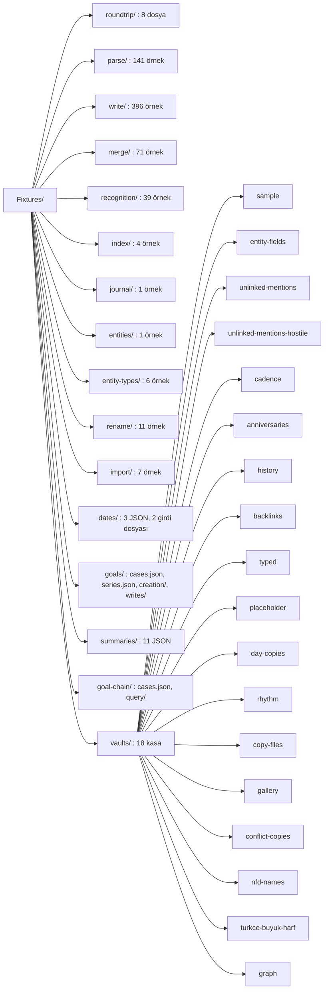

Sayılar `find Fixtures -maxdepth 2` çıktısından gelir. Kasalar `vaults/` altında durur ve birden çok küme aynı kasayı kullanır. Örneğin `recognition/unlinked-mentions/` beklentisi `vaults/unlinked-mentions/` kasasını okur.

## Genel kurallar

| Kural | Ayrıntı |
|---|---|
| Baytları koru | `.gitattributes` içindeki `Fixtures/** -text` satırı git'in satır sonu dönüşümünü kapatır. |
| Özel baytı `printf` ile yaz | Satır sonu, BOM ya da geçersiz bayt taşıyan dosyayı editörle değil `printf` ile oluştur. `xxd` ile doğrula. |
| Ham bayt denetimi | Testler bu özellikleri ham baytlardan ayrıca denetler. Bir araç dosyayı dönüştürürse test kırmızıya döner. |
| Kurgusal içerik | Repo herkese açıktır. Gerçek kişi, konum ya da günlük verisi girmez. |
| Belge yok | Klasörde README ya da açıklama dosyası yoktur. Her `.md` dosyası test verisidir. Açıklama bu belgeye girer. |
| `vault` adı yok | `Vault` ya da `vault` adında klasör açma. `.gitignore` bu adları her derinlikte dışarıda bırakır. |
| `.obsidian/` istisnası | `.gitignore` her `.obsidian/` klasörünü dışlar. `!Fixtures/**/.obsidian/` satırı fixture içindekini geri alır. |
| Kasa yeri | Yeni kasayı `Fixtures/vaults/<ad>/` altına koy. |

**UYARI:** `Fixtures/` altındaki bir dosyayı editörle açıp kaydetme; editör satır sonunu ya da BOM'u değiştirebilir.

**DİKKAT:** `Fixtures/vaults/sample` kasasına dosya ya da alan ekleme; yeni dosya testlerdeki elle sayımları ve ekran görüntüsü referanslarını bozar.

**NOT:** Yeni bir fixture yolunu bitirmeden önce `git check-ignore -v <yol>` ile denetle.

## Kurgusal adlar

| Tür | Adlar |
|---|---|
| Kişi | Deniz Arıkan, Deniz Arıkan Yılmaz (yeniden adlandırma örneği), Selin Korkmaz, Baran Tunç, Ece Yalın, Mert Aksu |
| Konum | Çınaraltı Kafe, Liman Ofis, Tepe Spor Salonu, Ev |
| Hedef | Spor, Kitap, Su |
| Özel tip varlığı | Yeni Kitap, Örnek Kitap, Örnek Film, Örnek Kurum, Örnek Proje, Örnek Etkinlik, Örnek Seyahat, Örnek Tarif, Örnek Ürün, Örnek Evcil Hayvan, Örnek Araç |
| Emoji örneği | Ev 🏠 |

Yalnız bu tablodaki adları kullan. Yeni ad gerekirse önce bu tabloya ekle.

## Klasör bulma

**Şema, bir testin `Fixtures/` klasörünü nasıl bulduğunu gösterir.**

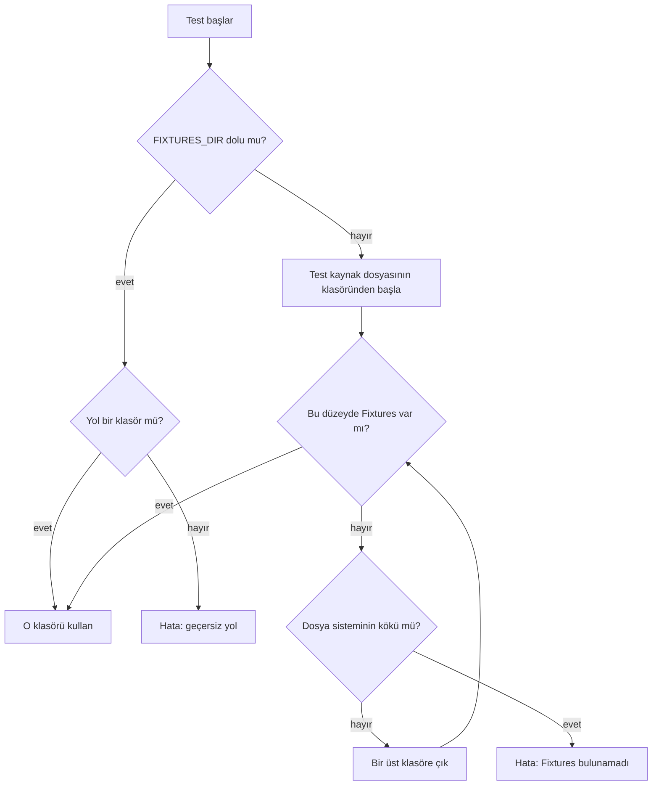

Swift testleri `Fixtures/` klasörünü test kaynak dosyasından yukarı doğru çıkarak bulur. Paket deponun dışında derlenirse `FIXTURES_DIR` ortam değişkeni klasörün yolunu verir. Değişken doluysa test önce onu kullanır.

## Fixture ve test eşlemesi

**Tablo, her kümeyi koşan test dosyasını ve testin örnekleri nasıl bulduğunu verir.**

| Küme ya da kasa | Test dosyası | Örnek bulma |
|---|---|---|
| Bütün `.md` dosyaları | `Packages/Core/Tests/VaultFormatTests/RoundTripTests.swift` | Klasör tarama |
| `roundtrip/` | `VaultFormatTests/FixtureByteGuardTests.swift` | Dosya adı kodda |
| `parse/` | `VaultFormatTests/ParseFixtureTests.swift`, `FixtureCaseGuardTests.swift` | Klasör tarama |
| `write/` | `VaultFormatTests/WriteFixtureTests.swift`, `FixtureCaseGuardTests.swift` | Klasör tarama |
| `write/journal-append-*` | ek olarak `VaultStoreTests/JournalAppendTests.swift` | Klasör tarama |
| `write/relations/` | `VaultStoreTests/RelationsWriteTests.swift` | 86 iç klasörde elle yazılmış önce/sonra baytları ve `operation.json`: `related` tek değerlerinin her türü, boş alanlar, liste biçimleri, kırpılan/geçersiz/türe ayrılmış etiketler, çözülen hedefe göre değişmezlik, güvenli silme, hedef türü ve yol yazımı. `place-target`, `custom-target`, `place-source-label` ve `custom-source-label` konum ve özel tipi hedef ve kaynak olarak yazar. `label-zwj` emoji birleştiricili etiketi kabul eder; `invalid-label-nel` (U+0085) ve `invalid-label-only-newline` reddedilir. `remove-unreadable` çözülemeyen blokta kaldırmayı reddeder. `related-remove-all-block` çok satırlı listenin bütün öğelerini kaldırır, aradaki yorum kalır. `label-unresolved-link` çözülmeyen bağlantılı etiket alanına ekler. |
| `write/mention-*` | ek olarak `VaultStoreTests/UnlinkedMentionTests.swift` | Klasör tarama |
| `write/task-recur-trailing-text` | ek olarak `VaultFormatTests/RecurrenceTests.swift` | Ad kodda |
| `write/cadence-*` | ek olarak `Tests/JournalTests/CadenceTests.swift` | Ad kodda |
| `merge/` | `VaultFormatTests/MergeFixtureTests.swift`, `VaultStoreTests/DayCopyMergeCaseTests.swift` | Klasör tarama |
| `recognition/<ad>/` | `EntityRecognitionTests/Fixtures.swift` | Ad listesi |
| `recognition/attendees/` | `EntityRecognitionTests/AttendeeMatchingTests.swift` | Ad kodda |
| `recognition/unlinked-mentions/` | `VaultStoreTests/UnlinkedMentionTests.swift`, `Tests/JournalTests/UnlinkedMentionsTests.swift` | Ad kodda |
| `recognition/unlinked-mentions-hostile/` | `VaultStoreTests/UnlinkedMentionAdversarialTests.swift` | Ad kodda |
| `index/sample/` | `VaultIndexTests/IndexTests.swift` | Ad kodda |
| `index/continuation/` | `VaultIndexTests/IncrementalTests.swift` | Ad kodda |
| `index/entity-fields/` | `VaultIndexTests/EntityFieldTests.swift` | Ad kodda |
| `index/cadence/` | `VaultIndexTests/CadenceFieldTests.swift` | Ad kodda |
| `journal/edit/` | `Tests/JournalTests/JournalEditingTests.swift` | Ad kodda |
| `entities/fields/` | `Tests/JournalTests/EntityPageTests.swift` | Ad kodda |
| `entity-types/` | `VaultIndexTests/EntityTypeTests.swift`, `VaultStoreTests/EntityTypeStoreTests.swift` | Ad listesi |
| `rename/` | `VaultStoreTests/RenameTests.swift` | Ad listesi |
| `import/` | `Tests/JournalTests/VaultImportFixtureTests.swift` | Ad listesi |
| `dates/cases.json` | `DateParsingTests/DateFixtureTests.swift` | JSON vaka |
| `dates/quick-entry.json` | `DateParsingTests/QuickEntryTests.swift` | JSON vaka |
| `dates/recurrence.json` | `DateParsingTests/RecurrenceTests.swift` | JSON vaka |
| `goals/cases.json` | `GoalTrackingTests/GoalFixtures.swift` | JSON vaka |
| `goals/series.json` | `GoalTrackingTests/GoalSeriesTests.swift` | JSON vaka |
| `goals/writes/` | `VaultStoreTests/GoalStoreFixtures.swift` | JSON vaka |
| `goals/creation/` | `VaultStoreTests/GoalCreationTests.swift`, `MilestoneStoreTests.swift`, `Tests/JournalTests/GoalDefinitionTests.swift` | JSON vaka |
| `goal-chain/cases.json` | `GoalTrackingTests/GraceDayTests.swift`, `SummariesTests/GraceDaySummaryTests.swift` | JSON vaka |
| `goal-chain/query/` | `VaultIndexTests/GraceDayQueryTests.swift` | Markdown kasa, ad kodda |
| `summaries/cases.json` | `SummariesTests/PeriodSummaryTests.swift`, `SummariesTests/TaskFlowSeriesTests.swift` | JSON vaka |
| `summaries/weekly-review-text.json` | `SummariesTests/WeeklyReviewTextTests.swift` | JSON vaka |
| `summaries/cadence.json` | `SummariesTests/MeetingCadenceTests.swift`, `Tests/JournalTests/CadenceTests.swift` | JSON vaka |
| `summaries/important-dates.json` | `SummariesTests/ImportantDatesTests.swift` | JSON vaka |
| `summaries/on-this-day.json` | `SummariesTests/OnThisDayTests.swift` | JSON vaka |
| `summaries/period-rhythm.json` | `SummariesTests/PeriodRhythmTests.swift` | JSON vaka |
| `summaries/year-writing.json` | `SummariesTests/YearWritingCalendarTests.swift` | JSON vaka |
| `summaries/weekly-rhythm.json` | `SummariesTests/WeeklyReviewRhythmTests.swift` | JSON vaka |
| `summaries/task-flow.json` | `SummariesTests/TaskFlowSeriesTests.swift` | JSON vaka |
| `summaries/entity-density.json` | `SummariesTests/EntityMentionDensityTests.swift` | JSON vaka |
| `summaries/weekday-distribution.json` | `SummariesTests/WeekdayDistributionTests.swift` | JSON vaka |
| `vaults/sample/` | `IndexTests`, `PeriodSummaryTests`, `WikiLinkTests`, `MergeTests` ve uygulama testlerinin çoğu | Ad kodda |
| `vaults/typed/` | `EntityTypeTests`, `EntityTypeStoreTests`, `InitialIndexTests`, `Tests/JournalTests/CustomEntityTypeTests.swift` | Ad kodda |
| `vaults/gallery/` | `VaultStoreTests/EntityTypeGalleryTests.swift`, `Tests/JournalTests/EntityTypeGalleryTests.swift` | Ad kodda |
| `vaults/backlinks/` | `VaultIndexTests/DayBacklinksTests.swift` | Ad kodda |
| `vaults/placeholder/` | `VaultStoreTests/PlaceholderTests.swift`, `Tests/JournalTests/CloudDownloadTests.swift`, `Tests/JournalTests/SyncStatusTests.swift` | Ad kodda |
| `vaults/day-copies/` | `VaultStoreTests/DayCopyTests.swift`, `VaultStoreTests/ConflictCopyListingTests.swift`, `Tests/JournalTests/DayCopyMergeWiringTests.swift` | Ad kodda |
| `vaults/copy-files/` | `VaultIndexTests/CopyFileTests.swift`, `Tests/JournalTests/SyncedFolderNoticeTests.swift` | Ad kodda |
| `vaults/conflict-copies/` | `VaultIndexTests/ConflictCopyTests.swift`, `Tests/JournalTests/SyncConflictTests.swift`, `Tests/JournalTests/DiagnosticsConflictWiringTests.swift`, `Tests/JournalTests/Snapshots/ConflictVersionsSnapshotTests.swift` | Ad kodda |
| `vaults/nfd-names/` | `VaultIndexTests/ChangeDetectionTests.swift` | Ad kodda |
| `vaults/turkce-buyuk-harf/` | `VaultStoreTests/TurkishCapitalTests.swift` | Ad kodda |

Tablodaki göreli yollar `Packages/Core/Tests/` altındadır; `Tests/JournalTests/` ile başlayanlar uygulama testleridir. **Klasör tarama** yeni klasörü kendiliğinden bulur. **Ad listesi** yeni klasörü yalnız test dosyasındaki `@Test(arguments:)` listesine eklenince koşar. **JSON vaka** yeni vakayı JSON dizisine eklenince koşar.

## Yeni fixture ekleme

**Şema, yeni bir örneğin hangi kümeye ve hangi bulma yoluna gittiğini gösterir.**

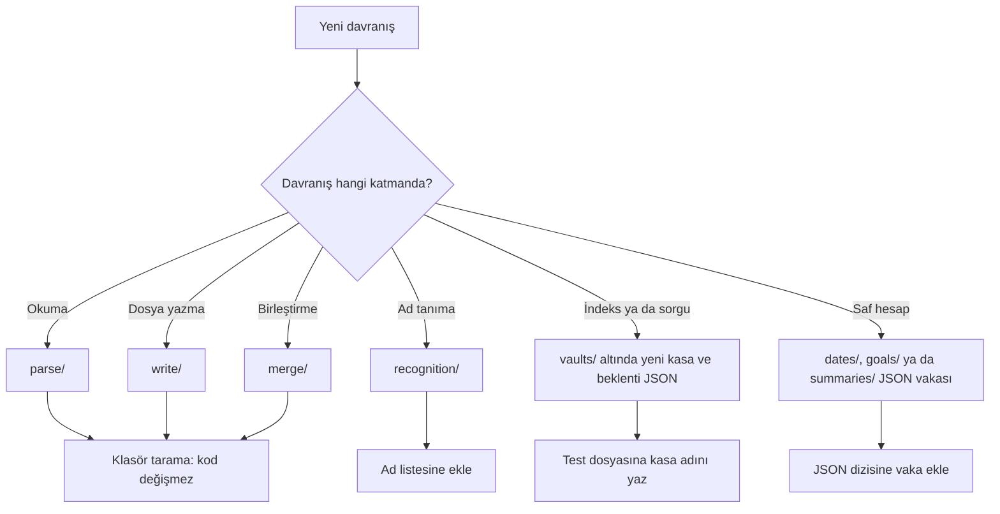

1. Davranışın kuralını önce [Kasa biçimi](vault-format.md) belgesinde bul.
2. Kural belgede yoksa önce belgeyi güncelle.
3. Yukarıdaki şemadan kümeyi seç.
4. Örnek klasörünü küme adlandırma desenine göre adlandır.
5. Ad bir bayt özelliği söylüyorsa dosyaya o özelliği ver.
6. Özel baytları `printf` ile yaz.
7. Baytları `xxd` ile doğrula.
8. Beklenen çıktıyı kurallardan elle yaz.
9. Beklentiyi uygulamanın çıktısından kopyalama.
10. Yeni kurgusal adı önce "Kurgusal adlar" tablosuna ekle.
11. Küme ad listesi kullanıyorsa adı test dosyasındaki listeye ekle.
12. Yeni kasayı `Fixtures/vaults/<ad>/` altına koy.
13. Yeni yolu `git check-ignore -v` ile denetle.
14. `RoundTripTests` testini koş; yeni `.md` dosyası gidiş dönüşten geçmeli.
15. Kümenin testini koş.
16. Bu belgeye kümenin tablosuna bir satır ekle.

Klasör tarayan kümelerde yeni örnek için kod değişmez. Gidiş dönüş testi `Fixtures/` altındaki her `.md` dosyasını okur. Bu yüzden her yeni Markdown dosyası gidiş dönüş denetiminden de geçer.

## `roundtrip/` kümesi

**Şema, gidiş dönüş testinin her Markdown dosyasına uyguladığı adımları gösterir.**

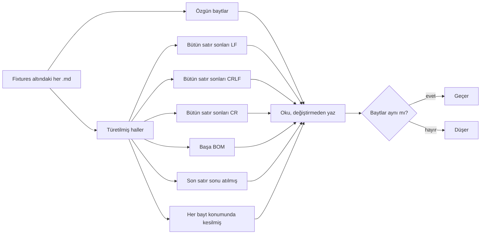

Beklenen çıktı dosyanın kendisidir; ayrı çıktı dosyası yoktur. Test diğer kümelerdeki dosyaları da bu denetimden geçirir. 1.024 bayta kadar dosyayı test her bayt konumunda keser. Daha büyük dosyada test 257 eşit aralıklı konum seçer. Bu kümeye yalnız korunacak bir bayt özelliği taşıyan dosya koy.

Dosyalar ve bayt özellikleri: `day-basic.md` olağan gün dosyasıdır (UTF-8, LF, yeni satırla biter). `crlf.md` bütün satır sonlarını CRLF, `cr.md` tek CR yazar. `bom.md` başta UTF-8 BOM taşır. `no-final-newline.md` yeni satırla bitmez. `mixed-line-endings.md` LF, CRLF ve CR karışık satır sonu ve her biçimden boş satır taşır. `empty.md` sıfır bayttır; `invalid-utf8.md` UTF-8 olarak çözülemeyen baytlar taşır.

## `parse/` kümesi

**Tablo, okuma örneklerini davranış ailesine göre verir.**

| Davranış ailesi | `expected.json` kökü | Örnek vaka | Sayı |
|---|---|---|---|
| Okunabilir frontmatter yapısı | `frontmatter` | `person-basic`, `block-list`, `goals-with-comments` | 14 |
| Frontmatter yok | `frontmatter` | `absent-no-closing`, `absent-plain-note` | 4 |
| Ham alan | `frontmatter` | `raw-block-scalar`, `raw-anchor-alias-tag` | 4 |
| Çözülemeyen blok | `frontmatter` | `unreadable-duplicate-key`, `unreadable-tab-indentation` | 38 |
| Bayt özelliği | `frontmatter` | `bom`, `crlf`, `invalid-utf8-in-body` | 5 |
| Gün dosyası bölümleri | `sections` | `section-duplicate`, `section-out-of-order`, `section-unclosed-fence` | 23 |
| Olay ve görev blokları | `tasks`, `events` | `line-siblings`, `line-statuses`, `line-quote-blocks` | 12 |
| Çitli kod içindeki satırlar | `tasks`, `events` | `line-fence-list`, `line-fence-tab`, `line-indented-fence` | 16 |
| Görev alanları | `tasks`, `events` | `task-fields-mixed`, `task-fields-protected` | 6 |
| Tekrar kuralı | `tasks`, `events` | `task-recurrence-supported`, `task-recurrence-unknown` | 3 |
| Bağlantılar | `links` | `link-frontmatter`, `link-yaml-escapes`, `link-table-separator` | 16 |

Her örnek bir klasördür ve tam olarak `input.md` ile `expected.json` dosyalarını taşır. İstemci `input.md` dosyasını okur ve sonucu `expected.json` ile karşılaştırır. Yeni örnek için yalnız klasör aç.

### Ortak kurallar

| Kural | Değer |
|---|---|
| Kök anahtarlar | `frontmatter`, `sections`, `tasks`, `events`, `links` |
| Karşılaştırılan anahtar | Yalnız dosyada bulunan anahtarlar; boş `expected.json` hatadır |
| Karşılaştırma | Katı: fazla ya da eksik alan hatadır; metinler bayt bayt karşılaştırılır |
| Satır numarası | 1'den başlar; BOM satır sayılmaz |

### Frontmatter beklentisi

```json
{
  "frontmatter": {
    "state": "parsed",
    "firstLine": 1,
    "lastLine": 3,
    "fields": [
      { "key": "name", "firstLine": 2, "lastLine": 2,
        "scalar": { "type": "text", "text": "Deniz Arıkan", "raw": "\"Deniz Arıkan\"" },
        "listItems": ["Deniz Arıkan"] }
    ]
  }
}
```

| Alan | Anlam |
|---|---|
| `state` | `parsed`, `absent` ya da `unreadable`. `absent`: frontmatter yok. `unreadable`: bütünü çözülemiyor. Son ikisinde başka alan yok. |
| `firstLine`, `lastLine` | Blokta açılış ve kapanış `---` satırları. Alanda anahtar satırı ve alanın boş ya da yorum olmayan son satırı. |
| `fields` | Dosya sırasındaki alanlar |
| `scalar` | `type` (`text`, `number`, `boolean`, `date`, `empty`), `text` (tırnağı ve kaçışı çözülmüş metin), `raw` (dosyadaki yazım, tırnaklar dahil) |
| `list` | `style` (`inline` ya da `block`) ve `items` (her biri bir `scalar`) |
| `mapping` | Sırayla `key`, `line` ve `value` (bir `scalar`) taşıyan kayıtlar |
| `raw` | Alt küme dışı alanın ham metni: anahtar satırında anahtardan sonraki kısım, ardından alanın kalan satırları, LF ile birleşik |
| `listItems` | Alanın liste görünümü: öğelerin `text` değerleri. Tek değer tek öğeli, boş değer boş listedir. `mapping` ve `raw` alanlarında yok. |

Her alan `scalar`, `list`, `mapping`, `raw` anahtarlarından tam birini taşır. Hangi bloğun hangi durumda olduğunu `vault-format.md` "Frontmatter" bölümü tanımlar. Türlerin yazımı `vault-format.md` "Türler" başlığındadır.

### Bölüm beklentisi

| Alan | Anlam |
|---|---|
| `sections.preamble` | Ön içerik aralığı; boşsa `null` |
| `sections.items` | Dosya sırasındaki bölümler |
| `kind` | `Tasks`, `Events`, `Journal` ya da tanınmayan veya yinelenen başlık için `null` |
| `headingLine`, `level` | Başlık satırı ve başlık düzeyi |
| `firstLine`, `lastLine` | 1 tabanlı, iki ucu dahil aralık |

`parse/section-<ad>/expected.json` kökü `sections` anahtarını taşır. Aralık başlığı ve sondaki boş satırları içerir. İç başlıklar ayrı öğe değildir. Örnek: `{ "sections": { "preamble": null, "items": [{ "kind": "Tasks", "headingLine": 1, "level": 2, "firstLine": 1, "lastLine": 2 }] } }`.

### Görev ve olay beklentisi

**Tablo, `tasks` ve `events` listelerindeki her öğenin alanlarını verir.**

| Alan | Kimde | Anlam |
|---|---|---|
| `line`, `firstLine`, `lastLine` | ikisi | İlk satır ve iki ucu dahil blok aralığı |
| `id`, `text` | ikisi | Şapkasız kimlik ya da `null`; sadeleşmiş metin |
| `time` | olay | `null` ya da `{ "hour": 9, "minute": 5, "raw": "9:05" }` |
| `dueDate`, `startDate`, `doneDate` | görev | ISO gün ya da `null` |
| `priority` | görev | `"high"`, `"medium"`, `"low"`, `{ "other": "🔺" }`/`{ "other": "⏬" }` ya da `null` |
| `project` | görev | İlk proje adı ya da `null` |
| `recurrenceSource`, `recurrence` | görev | `🔁` alanının özgün yazımı ve okunan kural; okunamayan kuralda `recurrence` değeri `null`. Yalnız alan varsa. |
| `fieldRanges` | görev | Alan aralıkları listesi |
| `rawStatus`, `status` | görev | Tek Unicode skaleri; `todo`, `inProgress`, `done`, `cancelled`, `unknown` |
| `isClosed`, `isOpen` | görev | Durumun kapalı ve açık görünümü |

`parse/line-<ad>/expected.json` kökü dosya sırasındaki `tasks` ve `events` listelerini taşır. Kimlik uzunluğu ve yinelenmesi aynen kalır. Örnek: `{ "tasks": [{ "line": 1, "firstLine": 1, "lastLine": 1, "id": null, "text": "kitap", "dueDate": null, "startDate": null, "doneDate": null, "priority": null, "project": null, "fieldRanges": [], "rawStatus": " ", "status": "todo", "isClosed": false, "isOpen": true }], "events": [] }`.

**Tablo, blok aralığı kurallarını verir.**

| Konu | Kural |
|---|---|
| Aralığın içi | İlk satırdan daha girintili devamlar ve aralarındaki boş satırlar |
| Aralığın dışı | Sondaki boş satırlar |
| İç içe görev | Aralıklar örtüşebilir |
| Kardeş görev | Biri ötekinin aralığına girmez |
| Girinti ölçüsü | Yalnız satır başındaki boşluk ve sekme. Boşluk bir sütun ilerler. Sekme bir sonraki dördün katına ilerler. `>` girinti sayılmaz. |
| Alıntıdaki görev | Tek satırlık blok |

**Tablo, metin sadeleştirme kurallarını verir.**

| Konu | Kural |
|---|---|
| Metnin kaynağı | Yalnız ilk satır |
| Görevde çıkan sözdizimi | Kutuya kadar olan liste ve alıntı sözdizimi |
| Olayda çıkan sözdizimi | Liste işareti ve ardından gelen boşluk ve sekmeler |
| Ayırıcı boşluk | Kutu ve saat sonrasındaki tek ayırıcı boşluk çıkar |
| Olay metni | Diğer boşluklar ve metin aynen kalır |
| Görev metni | Tanınan alanlar çıkar. Kalan boşluk ve sekmeler tek boşluğa iner. Baş ve son kırpılır. |
| Alan benzeri yazım | Bağlantı ve kod içindeyse metindir |
| Kimlik | Önündeki tek boşluk ve sonrasındaki boşluk ya da sekme çıkar |
| Kimlik yoksa | Sondaki boşluklar metinde kalır |

**Tablo, `fieldRanges` öğesinin biçimini verir.**

Aralık biçimi şudur: `{ "kind": "dueDate"|"startDate"|"doneDate"|"priority"|"project", "byteRange": [başlangıç, son] }`.

| Konu | Kural |
|---|---|
| Ek tür | Tekrar alanında `kind` değeri `recurrence` olur |
| Bayt tabanı | Fiziksel ilk satırın UTF-8 baytları |
| Aralık | Sıfır tabanlı, sonu hariç; ayırıcı boşluklar hariç |
| Yinelenen alan | Geçerli yinelenen alanların hepsi aralıklarda yer alır. Değer ilk alandan gelir. |

`task-fields-*` örnekleri karışık sırayı, geçersiz tarihi ve yinelenmeyi sınar. Aynı örnekler kod, satır içi bağlantı ve referans bağlantısı korumasını ve yalnız alan taşıyan görevleri de sınar. `task-recurrence-*` örnekleri destekli, bilinmeyen ve korumalı tekrar kurallarını sınar.

### Bağlantı beklentisi

**Tablo, `links` listesindeki her öğenin alanlarını verir.**

| Alan | Anlam |
|---|---|
| `line` | 1 tabanlı satır |
| `byteRange` | Bağlantı aralığı: `[[` ile `]]` dahil yazım. Gömmenin `!` işaretini kapsamaz. |
| `targetRange` | Hedef aralığı: `.md` dahil özgün hedef yazımı. Çevredeki Unicode boşlukları ve tablo ayırıcısının ters bölüsü hariç. Boş hedefte iki uç eşit. |
| `target` | Çözülmüş hedef. Çevredeki Unicode boşlukları ve tam `.md` soneki atılmış. |
| `rawTarget` | Hedef aralığındaki özgün kaynak yazımı |
| `anchor` | `null` ya da çapa nesnesi. Hash ve blok şapkası hariç. |
| `displayText` | `null` ya da ilk borudan sonraki metin |
| `isEmbedded`, `isSameFile`, `isPath` | Gömme, aynı dosya ve yol hedefi işaretleri |
| `source` | Gövde ya da frontmatter kaynağı |

Hedef aralığı `\|` ayırıcısının ters bölüsünü kapsamaz. Çapa nesnesi `{ "kind": "heading"|"block", "text": "..." }` biçimindedir. Kaynak `{ "kind": "body" }` ya da `{ "kind": "frontmatter", "key": "...", "entry": null|"..." }` biçimindedir.

`parse/link-<ad>/expected.json` kökü fiziksel dosya sırasındaki `links` listesini taşır. `byteRange` ve `targetRange` satır içeriğinin UTF-8 baytlarında 0 tabanlı `[başlangıç, son]` çiftleridir. Başlangıç dahil, son hariçtir. Sayım BOM ve satır sonunu dışarıda bırakır.

`entry` yalnız eşlem kaydında doludur. Okuyucu çapayı ve görünen metni kırpmaz. Dosyada var olan boş değer boş metin olarak kalır.

**Tablo, frontmatter içindeki bağlantı taramasının kurallarını verir.**

| Konu | Kural |
|---|---|
| Taranan metin | Çözülmüş metin; aralıklar fiziksel YAML satırına geri eşlenir |
| Kaçış baytları | Bir kaçışın ürettiği baytlar kaçışın tamamını kapsar |
| `rawTarget` | Kaçışları korur |
| Kaçışlı ayraç | Bağlantı aralığının fiziksel uçları da kaçış yazımıdır |
| Çözülmüş satır sonu | Bağlantıyı böler |
| Kod, kaçış, gömme | Tanıma çözülmüş metinde çalışır |
| Taranmayanlar | Ham alanlar, anahtarlar, yorumlar |
| Yinelenen hedef | Ayrı öğeler |
| `links: []` | Hiç bağlantı olmadığını denetler |

### Başka okuyucularla karşılaştırma

**Tablo, `check-frontmatter-yaml.rb` geliştirici betiğinin karşılaştırdığı okuyucuları verir.**

| Okuyucu | YAML sürümü | Koşul |
|---|---|---|
| Ruby Psych | YAML 1.1 | Her zaman |
| js-yaml | YAML 1.2, Obsidian'ın okuyucusu | İstenirse |

Uygulamanın okuyucusu ve yazıcısı aynı kuralları paylaşır. İkisinde birden yanlış olan bir kural kendi testlerinden geçer. `.github/scripts/check-frontmatter-yaml.rb` betiği `parse/` beklentilerini ve `write/` çıktılarını bu okuyucularla karşılaştırır. `write/relations/` altındaki hatasız bağ işlemlerinde okuyucu, etiket alanında (etiketsizse `related`) hedefe giden bağlantıyı dizgi olarak okumalı; kaldırmada okumamalı. Betik testlerin rastgele ürettiği blokları da aynı okuyuculara gösterebilir.

CI (sürekli bütünleştirme) betiği koşmaz. Frontmatter kuralları ya da örnekler değişince betiği elle çalıştır. Kullanımı betiğin başındadır.

### Adlandırma

**Tablo, klasör adındaki sözcüğün dosyaya yüklediği bayt özelliğini verir.**

| Addaki sözcük | Markdown dosyalarının taşıması gereken özellik |
|---|---|
| `crlf` | Yalnız CRLF satır sonu |
| `cr` | Yalnız CR satır sonu |
| `bom` | Başta UTF-8 BOM |
| `mixed-line-endings` | LF, CRLF ve CR birlikte |
| `no-final-newline` | Son satır sonu yok |
| `invalid-utf8`, `read-only` | Geçersiz UTF-8 |
| `exact-key-match` | Ayrışmış harf baytları |

`parse/` ve `write/` klasör adları taşıdıkları bayt özelliğini söyler. `FixtureCaseGuardTests` bu özelliği ham baytlardan denetler. `crlf`, `cr` ve `bom` adda iki tire arasında tam sözcük olarak geçer. Diğer adlar addın herhangi bir yerinde geçebilir.

## `write/` kümesi

**Şema, bir yazma örneğinin akışını gösterir.**

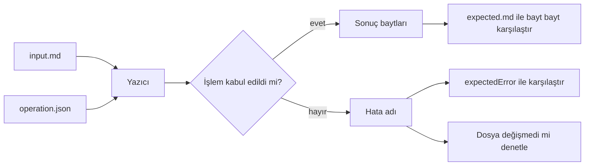

| Davranış ailesi | Kök anahtar | Örnek vaka | Sayı |
|---|---|---|---|
| Tek değer yazma ve tırnaklama | `frontmatter` | `set-value-quotes-text-like-date`, `set-value-creates-frontmatter-crlf` | 59 |
| Liste yazma | `frontmatter` | `set-list-block-adds-item`, `set-list-inline-stays-inline` | 27 |
| Eşlem kaydı yazma ve alan silme | `frontmatter` | `set-entry-crlf`, `remove-entry`, `remove-field-mapping` | 24 |
| Reddedilen frontmatter yazımı | `frontmatter` | `error-raw-field-set-value`, `error-unreadable-duplicate-key` | 20 |
| Ritim alanı | `frontmatter` | `cadence-days-add`, `cadence-snooze-replace` | 11 |
| Bölüme satır ekleme | `sections` | `section-append-end`, `section-unclosed-fence-create` | 39 |
| Günlük yazısını değiştirme | `sections` | `section-journal-replace`, `section-journal-new` | 17 |
| Günlük yazısına ekleme | `sections` | `journal-append-new`, `journal-append-structure-lines` | 36 |
| Olay ve görev satırı: ekle, değiştir, sil, reddet | `lines` | `line-add-middle`, `line-fix-stale-task-text`, `line-reject-stale` | 101 |
| Görev alanı ve durum | `lines` | `task-due-replace-middle`, `task-complete`, `task-cancelled-complete-new-date` | 31 |
| Tekrar kuralı | `lines` | `task-recur-change`, `task-recur-when-done`, `task-recur-month-end` | 15 |
| Bağlanmamış anmayı bağlama | `mention` | `mention-alias`, `mention-nfd-bom-crlf-no-final-newline` | 16 |

Her örnek bir klasördür. Başarılı örnek `input.md`, `operation.json` ve `expected.md` taşır. Ret örneğinde `expected.md` yoktur; `operation.json` içindeki `expectedError` beklenen hatayı adlandırır ve yazıcı dosyaya dokunmaz. Kök anahtar işlemin hedefini söyler; yeni işlem türü yeni kök anahtar getirir.

### Frontmatter işlemleri

```json
{
  "frontmatter": { "operation": "set-entry", "key": "goals", "entry": "kitap", "value": { "integer": 30 } }
}
```

| `operation` | Alanlar | İşlem |
|---|---|---|
| `set-value` | `key`, `value` | Alana tek değer yazar |
| `set-list` | `key`, `items` | Alana liste yazar |
| `set-entry` | `key`, `entry`, `value` | `key` altındaki eşlemde `entry` kaydını yazar |
| `remove-entry` | `key`, `entry` | Eşlemden kaydı siler |
| `remove-field` | `key` | Alanı siler |

**Tablo, değer nesnesinin türlerini verir.**

| Tür | Örnek | Not |
|---|---|---|
| `text` | `{ "text": "..." }` | |
| `boolean` | `{ "boolean": true }` | |
| `integer` | `{ "integer": 25 }` | |
| `number` | `{ "number": "20.029" }` | Yazılacak yazımı metin olarak taşır |
| `date` | `{ "date": "2026-10-02" }` | |

Değer, türünü adlandıran tek anahtarlı bir nesnedir. `number` yazımı metin olarak taşır; böylece beklenen çıktı bir dilin ondalık sayı biçimine bağlı kalmaz. Beklenen çıktının her baytı `vault-format.md` "Tırnaklama" ve "Yazma kuralları" başlıklarından türer.

**Tablo, frontmatter hata adlarını verir.**

| `expectedError` | Neden |
|---|---|
| `read-only-document` | Dosya UTF-8 değil |
| `unreadable-frontmatter` | Frontmatter çözülemiyor |
| `raw-field` | Ham alan |
| `not-a-mapping` | Değeri olan alana kayıt yazma |
| `invalid-key` | Boş anahtar ya da `<<` |
| `invalid-value` | Sayı yazımına uymayan `number` |

**Tablo, istemcinin her frontmatter yazma örneğinde ek olarak denetlediklerini verir.**

| Denetim | Beklenti |
|---|---|
| Frontmatter dışındaki baytlar | Değişmez |
| Frontmatter içi | Yalnız hedef anahtarın satırları değişir |
| Yeniden okuma | Yazılan değer aynı değeri verir |
| Eşgüçlülük | İşlem ikinci kez uygulanınca dosya değişmez |

**Ritim alanı:** `cadence-*` örnekleri ritim alanını eklemeyi, değiştirmeyi ve silmeyi bayt bayt sınar. Yorum satırı, komşu alan, CRLF ve BOM hedef satırın dışında kalır. `cadence-days-replace-text` ve `cadence-paused-replace-text` yok sayılan yazımı (`aylık`, `yes`) seçilen değerle değiştirir ve yalnız o satırı yazar. `cadence-snooze-replace` eski erteleme tarihini yerinde değiştirir. Değerden önceki boşluk, satır sonu yorumu, komşu satırların sondaki boşlukları ve tırnaklar kalır. `cadence-snooze-remove-middle` sürdürmenin yalnız `cadence_paused` satırını sildiğini gösterir.

### Bölüm işlemleri

| Örnek deseni | Biçim | Kural |
|---|---|---|
| `section-journal-<ad>` | `{ "operation": "replace-journal", "text": "..." }` | Günlük yazısının tamamını değiştirir |
| `section-<ad>` | `{ "operation": "append", "kind": "Tasks", "lines": ["- [ ] kitap"] }` | Bölüme satır ekler; en az bir boş olmayan satır gerekir |
| `journal-append-<ad>` | `{ "operation": "append-journal", "lines": ["Yeni"] }` | Journal bölümüne satır ekler; `lines` dizgileri satır sonu taşıyabilir |

**`replace-journal`:** Mevcut bölümde boş metin başlığı ve sondaki boş satırları korur. Bölüm yoksa boş ya da yalnız boşluktan oluşan metin dosyayı değiştirmez; beklenen çıktı girdinin aynısıdır. Gövdedeki `---` bir başarı örneğidir. Test beklenen baytları ve yapı kısıtlarından doğan hataları denetler. Test aynı metinle ikinci uygulamanın ilk uygulamayla bayt bayt aynı kaldığını da doğrular.

**`append`:** Hata adları `section-not-writable`, `empty-section-append`, `line-break-in-content` ve `read-only-document` olur. Fixture yazarı beklenen çıktıyı bağımsız yazar. Test baytları ve yeniden okunan modeli karşılaştırır. Aynı ekleme ikinci kez gelince yazıcı yeni satırları tekrar ekler. Frontmatter işlemlerindeki eşgüçlülük denetimi burada çalışmaz.

**`append-journal`:** Test beklenen tam baytları ve yeniden okumayı denetler. Test eski baytların tek bir yeni parçanın iki yanında aynen kaldığını da denetler. Boş ekleme değişiklik yapmaz; `expected.md` girdiyle aynıdır. Örnekler yeni, eksik, boş ve dolu bölümü ve sondaki boş satırları kapsar. Bayt durumları son satır sonu olmayan dosya, CRLF, CR, karışık satır sonu ve BOM'dur.

Komşu yapılar sonraki bölüm, yorum bloğu, yinelenen ve benzer başlık, alt başlık, liste, çit, tablo ve frontmatter'dır. Girdi durumları çok satır, girintili satır ve satır sonu taşıyan dizgidir. `structure-lines` yapı satırlarının başına `· ` koyar. Ret örnekleri `section-not-writable` ve `read-only-document` hatasını sınar.

### Satır işlemleri

**Tablo, `lines` kökündeki işlemleri ve alanlarını verir.**

| `operation` | Alanlar | İşlem |
|---|---|---|
| `add-event` | `text`, `id`, isteğe bağlı `time` | Olay ekler |
| `add-task` | `text`, `id` | Görev ekler |
| `add-task-fields` | `text`, `id`, isteğe bağlı `due`, `start`, `priority`, `project` | Alanlı görev ekler |
| `text` | `line`, `text`, isteğe bağlı `id` | Metni değiştirir |
| `status` | `line`, `status`, isteğe bağlı `id`, tamamlamada `completionDate` | Durumu değiştirir |
| `time` | `line`, `time`, isteğe bağlı `id` | Olay saatini değiştirir |
| `delete` | `line` | Bloğu siler |
| `due`, `start`, `priority`, `project` | `line`, alanın anahtarında değer, isteğe bağlı `id` | Görev alanını yazar ya da siler |
| `recurrence` | `line`, `rule` (kural ya da `null`), isteğe bağlı `id` | `🔁` alanını yazar ya da siler |
| `complete-recurring` | `line`, `id`, `completionDate` | Tekrarlayan görevi tamamlar ve sonraki görevi ekler |

**Tablo, satır işlemlerindeki değer biçimlerini verir.**

| Alan | Biçim |
|---|---|
| `line` | Hedef bloğun 1 tabanlı ilk satırı |
| `time` | `null` ya da `{ "hour": 9, "minute": 5 }` |
| `status` | `todo`, `inProgress`, `done`, `cancelled`; `unknown` yalnız ret örneğinde |
| `id` | Düzenlemede yeni kimlik; yoksa özgün kimlik yazımı kalır |
| Görev alanı değeri | ISO gün, öncelik adı, proje adı ya da `null` |

**Tablo, özel test işlemlerini verir.**

| Örnek ya da işlem | Ne sınar |
|---|---|
| `stale-delete`, `stale-text` | `replacement` içindeki Markdown belgeye eski bloğu uygulamayı dener |
| `wrong-status`, `wrong-time` | Yanlış türden hedefi sınar |
| `stale` | Hedef okunduktan sonra metni `Su` yapar ve eski hedefle tekrar düzenlemeyi dener |

**Tablo, satır işlemlerinin hata adlarını verir.**

| `expectedError` | Neden |
|---|---|
| `target-not-found` | Hedef blok yok |
| `empty-text` | Boş metin |
| `content-not-representable` | İçerik satırda yazılamıyor |
| `identifier-exhausted` | Kimlik üreticisinin deneme sınırı doldu |
| `invalid-value` | Geçersiz değer |
| `line-break-in-content` | İçerikte satır sonu |
| `read-only-document` | Dosya UTF-8 değil |
| `section-not-writable` | Bölüm yazılamıyor |

Başarıda test beklenen baytları ve yeniden okunan modeli denetler. Test hedef dışında kalan satırların baytlarını da denetler.

`task-*` örnekleri alanın yerinde değişmesini, kaldırmayı, yinelenmeleri ve salt okunur öncelikleri sınar. Tamamlama, yeniden açma ve iptal de bu ailededir. Metin düzenlerken alan konumları, BOM, CRLF ve son satır korunur; örnek `task-text-keeps-positions`. `task-due-reference-link` referans bağlantısında alan silmenin baytları değiştirmediğini doğrular.

`task-add-fields-preserves-spacing` eklemede kod ve bağlantı boşluklarının kaldığını doğrular. `task-cancelled-complete-*` iptalden tamamlanmaya geçişte yeni tarihin zorunlu olduğunu doğrular. `task-recur-*` kuralı değiştirmeyi, kaldırmayı ve onarmayı sınar. Aynı aile ay sonu, taşma, iç içe görev, CRLF ve BOM, yinelenen kimlik ve tamamlanınca tekrar durumlarını taşır.

### Anma bağlama işlemi

**Tablo, `mention` kökünün alanlarını verir.**

| Alan | Anlam |
|---|---|
| `vault` | `vaults/` altındaki kasa |
| `file` | Kasada `input.md` ile değiştirilen gün dosyası |
| `entity` | Bağlanacak varlık dosyası |
| `line` | Sıfır tabanlı satır |
| `byteRange` | Satır içeriğinde UTF-8 aralığı |
| `spelling` | Anmanın yazımı |

`write/mention-<ad>/operation.json` tek bir bağlanmamış anmayı bağlantıya çevirir. İşlem kasa ve indeks gerektirir. Bu yüzden biçim testleri bu örnekleri yalnız dosya düzeni açısından denetler; depo katmanı işlemi uygular. `expected.md` girdiden yalnız o aralıkta farklıdır. Açık anmada aralık önündeki `@` işaretini de kapsar. Fixture yazarı `expected.md` dosyasını uygulamadan bağımsız üretti.

**Tablo, `UnlinkedMentionTests` testinin her anma örneğinde ek olarak denetlediklerini verir.**

| Denetim | Beklenti |
|---|---|
| Kasadaki diğer dosyalar | Değişmez |
| Yeniden okunan belge | Yalnız o bağlantı eklenmiştir |
| Olay saati ve görev alanları | Aynı kalır |
| Sorgu | Anma sorgudan çıkar |
| Aynı satırdaki diğer anmalar | Yeni bayt konumlarıyla kalır |
| Artımlı indeks | Tam yeniden kurulumla eşittir |
| İkinci uygulama | Aynı anma ikinci kez uygulanamaz |

Bayat hedef örneklerini test aynı kasa üzerinde kodda kurar. Hiçbirinde dosya ve indeks değişmez.

| Bayat hedef türü | Örnek durum |
|---|---|
| Satır | Satır ya da yazım değişti |
| Anma | Anma bu arada bağlandı |
| Konum | Satır kaydı ya da silindi |
| Dosya | Dosya ya da varlık silindi |
| Takma ad | Takma ad kalktı | İkiz satır, ilk satırı aynı dosyada bayt bayt yinelenen olay ya da görevdir. İkiz satırı uygulama yalnız dosya sorgunun okuduğu haliyle duruyorsa bağlar. Dosya değiştiyse uygulama hangi ikizin onaylandığını ayırt edemez ve yazmaz. Örnek `vaults/unlinked-mentions-hostile` içindeki `2026-03-01` günüdür.

## `merge/` kümesi

**Şema, bir birleştirme örneğinin iki test yolunu gösterir.**

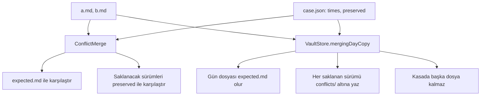

| Davranış ailesi | Örnek vaka | Sayı |
|---|---|---|
| Aynı, boş ya da eş zamanlı sürüm | `identical`, `empty-newer`, `equal-times-tie` | 5 |
| Satır sonu ve BOM | `crlf-newer-keeps-older-endings`, `bom-only`, `no-final-newline-older` | 10 |
| Salt okunur sürüm | `read-only-newer`, `read-only-older` | 2 |
| Frontmatter alanı ve yorumu | `frontmatter-comment-in-both`, `frontmatter-unreadable-newer`, `frontmatter-value-differs` | 17 |
| Hedef ilerlemesi | `goals-progress`, `goals-type-mismatch`, `goals-not-a-mapping` | 6 |
| Görev durumu ve metni | `task-closed-vs-text-changed`, `task-both-closed-date-only` | 8 |
| Olay ve blok | `events-both-added`, `event-text-both-changed`, `blocks-with-children` | 5 |
| Blok kimliği | `duplicate-ids`, `id-kind-mismatch`, `id-less-repeated-lines` | 5 |
| Serbest yazı | `free-text-diverged`, `free-text-reordered` | 5 |
| Bölge ve düzen | `region-only-in-newer`, `code-fence-lines`, `older-layout-keeps-newer-trailing-blank` | 7 |
| Son güvence | `unclosed-fence-falls-back` | 1 |

Her örnek `a.md` ve `b.md` (iki sürümün baytları), `case.json` (zamanlar ve saklanacak sürümler) ve `expected.md` (birleşmiş baytlar) taşır. Kuralların kaynağı [Eşitleme çakışması](vault-format.md#eşitleme-çakışması) bölümüdür. Beklenen çıktılar koddan gelmez; fixture yazarı kuralları elle uygulayarak yazar. **Saklanan sürüm**, birleştirmenin `conflicts/` klasörüne yazdığı eski sürüm dosyasıdır.

```json
{ "times": { "a": 10, "b": 20 }, "preserved": ["a"] }
```

`times` her sürümün değişiklik zamanıdır ve tam sayıdır; birim yoktur, yalnız sıra anlamlıdır. Eşit zamanlar yeni sürümün bayt sırasıyla seçildiğini sınar. `preserved` saklanacak sürümlerin alfabetik adlarıdır; hiçbiri saklanmıyorsa `[]` olur. İstemci iki veriliş sırasının aynı baytları ve aynı saklanacak sürümleri verdiğini denetler. Sonuç, iki zamandan da büyük bir zamanla her sürümle yeniden birleşince değişmez. Sonuç okunup yazılınca da aynı kalır.

Bağımsız kayıp denetimi her sürümün bloklarını, bölge bölge ve sayımlı serbest yazı satırlarını, frontmatter alanlarını ve yorum satırlarını arar. Her biri sonuçta vardır ya da birleştirme o sürümü saklar. Kayıp sayılmayanlar şunlardır: kapalı görevin açık görevin yerini alması, iki kapalı görev arasında yalnız `✅` tarihi farkı, `goals` altında ilerleme ve yalnız yazım farkı. Adında `falls-back` geçmeyen örnekte işlev son güvenceye düşmez; `fellBack` yanlıştır. Adında `crlf`, `cr`, `bom`, `mixed-line-endings`, `no-final-newline`, `invalid-utf8` ya da `read-only` geçen örnekte en az bir Markdown dosyası o özelliği taşır.

**Gün kopyası yolu:** Core her örneği `VaultStore.mergingDayCopy` üzerinden de koşar: önce `a` gün dosyası ve `b` kopyadır, sonra tersi. Zamanlar UTC saniyesidir ve test saniyenin bir kesrini ekler; kesir adı ve sırayı değiştirmemelidir. Gün dosyası `expected.md` olur. Her saklanan sürüm `conflicts/2026-10-02 (conflict 19700101T0000SSZ).md` adıyla bayt bayt kendisi olur ve kasada başka dosya kalmaz. Kopya aynı baytlarla yeniden gelince kasa değişmez; örneğin ikinci cihaz ya da yarım kalan birleştirme.

## `recognition/` kümesi

**Şema, bir tanıma örneğinin akışını gösterir.**

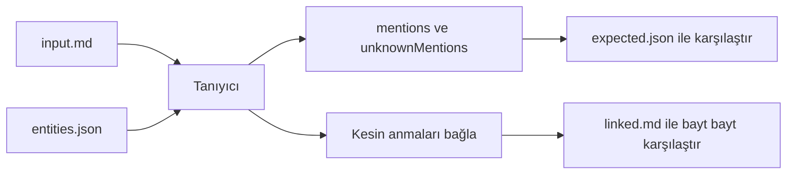

| Davranış ailesi | Örnek vaka | Sayı |
|---|---|---|
| Ad, takma ad ve belirsizlik | `names`, `ambiguous`, `alias-collision` | 8 |
| Türkçe harf, ek ve Unicode | `turkish`, `suffix`, `nfd` | 5 |
| Sözcük sınırı ve örtüşme | `boundaries`, `overlap`, `overlap-tie-first` | 5 |
| Korunan metin | `escaped-code`, `protected-addresses`, `markdown-links` | 7 |
| Bayt özelliği ve boş girdi | `crlf`, `bom-mixed-line-endings`, `table-crlf` | 4 |
| Yol hedefi | `path-link-target`, `root-path-link-target`, `unrepresentable-path-target` | 3 |
| Rakam adlar | `digit-names`, `mixed-digit-names-baseline` | 2 |
| Görev alanlı gün gövdesi | `task-fields` | 1 |
| Özel tip | `custom-book` | 1 |
| Takvim katılımcıları | `attendees` | 1 |
| Bağlanmamış anma sorgusu | `unlinked-mentions`, `unlinked-mentions-hostile` | 2 |

Olağan örnek `entities.json`, `input.md`, `expected.json` ve `linked.md` taşır. `entities.json` kökündeki `entities` öğeleri `file`, `kind` (`person` ya da `place`), `name`, isteğe bağlı `qualifier`, `aliases` ve isteğe bağlı `linkTarget` taşır. `linkTarget` yazılacak wikilink hedefidir; yoksa tanıyıcı uzantısız gövde adını kullanır. İsteğe bağlı `usage` dizisi `file`, `totalCount`, `lastDate` (ISO gün ya da `null`) ve `cooccurrences` taşır. `cooccurrences` dosya yolundan birlikte geçilen gün sayısına bir eşlemdir.

`expected.json` kökündeki `mentions` öğeleri `line` (sıfır tabanlı), `byteRange`, `spelling`, `candidates`, `isAmbiguous`, `isCaseMismatch` ve `isCertain` taşır. `byteRange` satır içeriğinde UTF-8 aralığıdır, başlangıç dahil ve son hariç; `@` işaretini ve ekleri kapsamaz. `candidates` sıralı aday yollarıdır. `unknownMentions` öğeleri aynı konum ve yazım alanlarını taşır, aday içermez. Karşılaştırma anahtarları adlardan türer; fixture yazarı beklentileri uygulamadan bağımsız yazar.

`linked.md` yalnız kesin anmaların bağlandığı bayt çıktısıdır. Yeniden tanımada kesin anma kalmaz; temsil edilemeyen hedef yüzünden düz kalan anmalar istisnadır. Kullanıcı seçimi bekleyen öneri, belirsiz ve bilinmeyen anmalar kalabilir. Rastgele testler bütün bilinen anmalara seçim verir ve tam bağlamanın eşgüçlülüğünü ayrıca denetler.

**Sentetik adlar ve aile ayrıntısı:** `Işık`, yalnız Türkçe harf kuralını sınamak için Deniz'in sentetik takma adıdır. Ek örneğindeki `e`, Ece için eki ayrı ad saymayı engelleyen sentetik takma addır. Örtüşme örneğindeki `Arıkan Selin Korkmaz` kadronun adlarından gelen sentetik konum takma adıdır. Eşit uzunlukta örtüşmedeki `Deniz Ece` ve `Ece Selin` kadronun ad parçalarından gelir. `path-link-target` aynı gövde adı başka klasörde de varsa yol hedefini yazar; benzersiz ad kısa kalır. `root-path-link-target` kasa kökündeki varlığı baştaki `/` ile yazar.

`unrepresentable-path-target` temsil edilemeyen yol hedefinde anmayı düz bırakır ve diğer kesin anmaları bağlar. `escaped-code` içinde kaçışlı wikilink düz metin kalır. E-posta, alan adı, etiket, kimlik, Markdown bağlantısı, sözdizimi komşuları ve frontmatter örnekleri değişmeyen baytları denetler. Tablo örneğinde bağlayıcı görünen metin ayırıcısını kaçırır. `custom-book` `@` anmasının özel tip wikilink'ine dönüşümünü tarif eder.

**Rakam adlar:** `recognition/digit-names/` tamamı rakam olan adların (`12`, `2026`, `7`, `34`, `1907`) yalnız `@` ile bağlandığını sınar. `Sayılar` ve `Rakamlar` sentetik varlıklarının rakam takma adları da aynı kurala uyar. Çıplak yazım düz kalır: tek başına sayı, parantez ve tırnak içi, cümle sonu, `12'de`, `12 Ekim 2026`, `1. Elma`. Telefon numarası, `12—14`, `12+5`, saat, tarih, ondalık, binlik ve aralık yazımları da düz kalır. Tanıyıcı `@12`, `(@12)` ve `@12'de` yazımlarını bağlar ve ardındaki sayı düz kalır; `@12:30` → `[[12]]:30` olur. Takma adla `@30` yazımı `[[Sayılar|30]]`, `Sayılar 30` ise `[[Sayılar]] 30` olur.

Arap-Hint ve tam genişlik rakamlar, karışık ad `Daire 12:30`, NFD komşu metin ve var olan bağlantının yanındaki sayı (`[[12]]:30`, `[[Deniz]]:12`) aynı örnektedir. `recognition/task-fields/` Tasks, Events ve Journal bölümlerindeki görev satırlarını taşıyan tam bir gün gövdesidir. Tanıyıcı liste işaretini, kutuyu, kimliği ve olay satırında baştaki saati taramaz. Tanıyıcı `📅`, `🛫`, `✅`, `⏳`, `➕`, öncelik, okunan ve okunamayan `🔁` kuralı alanlarını da taramaz. Okunamayan kural sonraki alanda biter; ardındaki ad yine metindir: `🔁 her hafta ⏫ Deniz ile`.

Tanıyıcı adı alan yazımıyla çakışan sentetik varlıkları yalnız metinde geçtiklerinde bağlar. Bu varlıklar `2026-10-12` (takma adlar `12:30 Vapuru`, `⏫`) ve `Takvim` (takma adlar `📅`, `⏳`, `every`, `week`, `1`) olur. Rakam adlar `12`, `2026` ve takma ad `1` çıplak yazımda düz kalır; tanıyıcı `@` ile yazılanları alanlara dokunmadan bağlar. Fixture yazarı `digit-names` ve `task-fields` beklentilerini uygulamadan bağımsız, işaretli bir şablondan üretti.

`recognition/mixed-digit-names-baseline/` rakam içeren ama tamamı rakam olmayan adların davranışının değişmediğini kanıtlar: `Daire 12`, `3. Kat`, `2. Dünya Savaşı`, `7/24`, `1.250`, `12:30 Vapuru`, `R2-D2`. Fixture yazarı girdinin ilk 7 satırını elle yazdı; kalan 140 satırı tohumlu rastgele parçalar oluşturur. `expected.json` ve `linked.md`, rakam ad kuralları eklenmeden önceki tanıyıcının çıktısıdır. Bu örnekte beklentiyi bilerek uygulama üretti.

**DİKKAT:** `mixed-digit-names-baseline` beklentisini elle düzeltme; dosya eski tanıyıcının çıktısını kanıt olarak tutar.

### Bağlanmamış anma sorguları

`recognition/unlinked-mentions/expected.json`, `vaults/unlinked-mentions/` kasasındaki her varlık için bağlanmamış anma sorgusunun beklenen çıktısıdır. Bu klasörde `input.md` ve `entities.json` yoktur; girdi kasanın kendisidir. Kökte `vault` ve `queries` vardır. Her sorgu `entity` ile sıralı `mentions` taşır.

Her anma `file`, `date`, sıfır tabanlı `line`, UTF-8 `byteRange`, `spelling`, `isExplicit`, `isAmbiguous`, `isCaseMismatch` taşır. `byteRange` `@` işaretini ve eki kapsamaz. Sıra yeni günden eskiye, gün içinde satır ve bayt sırasıdır. Kasadaki her varlığın bir sorgusu vardır.

Sorgu yalnız gün dosyalarındaki olay ve görev ilk satırlarının metnini tarar. Görev alt satırları, Journal paragrafı ve notlar listede yoktur. Olay saati ve görev alanları da yoktur; örneğin `📅 2026-10-12` içindeki `2026`. Kod, var olan bağlantı, Markdown bağlantısı, URL ve çitli kod da listede yoktur. Var olan bağlantı başka varlığa bağlı aynı yazımı da kapsar.

Kasa Türkçe ek (`Elif'le`, `İstanbul'da`), takma ad ve iki varlığın ortak takma adını taşır. Kasa yalnız harf büyüklüğüyle ayrışan yazımı, aynı satırda iki geçişi ve tireyle bitişik adları da taşır. Ek durumlar `@` ile açık anma, ayırt edicili varlık, emoji takma ad, NFD yazım ve çift boşluklu çok sözcüklü addır. Kasa `İSTANBUL` ve `istanbul` yazımlarını taşır: Türkçe büyük harf eşlemesi ikisini de `İstanbul` okur, `istanbul` harf boyu farkıyla öneridir. Kasa BOM, CRLF ve son satır sonu olmayan bir gün dosyasını da taşır. Fixture yazarı beklentileri uygulamadan bağımsız üretti.

`recognition/unlinked-mentions-hostile/expected.json` aynı biçimde `vaults/unlinked-mentions-hostile/` kasasının beklenen çıktısıdır. Bu kasa sorguyu ve yazıcıyı zorlayan satırları toplar.

| Grup | Durumlar |
|---|---|
| Ad yerleşimi | Aynı adın satırda 4 geçişi; biri ötekinin içinde geçen iki ad (`Ece`, `Ece Yalın`); 2 tür kesme işareti ve ek; noktalamaya bitişik ad |
| Sözdizimi | Satır içi kod, köşeli parantez, takma adlı ve kapanmamış bağlantı, Markdown bağlantısı, URL, e-posta, etiket, HTML yorumu, tablo satırı, alıntı ve iç içe liste, saat biçimleri |
| Özel varlık ve takma ad | Adı sayı ya da alan simgesi (`📅`, `🔁`, `x`) olan varlıklar; `^kimlik` ile ad çakışması; özel karakterli takma adlar |
| Unicode, dosya, kasa | Emoji ve birleşik karakter, NFC/NFD, Unicode satır ayırıcıları; `İ` ve `ı` takma adlı varlıkta `i` ve `I` yazımları, Türkçe büyük harf eşlemesiyle harf boyu farklı öneri; aynı dosya adlı iki varlık (yol hedefi), ayırt edicili varlık, çitli kod, ikiz satırlar, karışık satır sonlu bir gün |
| Listelenmez | Görev alanının içi, yinelenen ikinci `📅` alanı ve `⏳ 2026-10-11` dahil; okunamayan tekrar kuralının içi (`🔁 every week Elif ile`: kural satır sonuna kadar sürer); bağlantı içine yazılamayan yazım (`a]b`, `a[b`) |
| Listelenmez | Çıplak rakam ad ve takma ad: `people/Sayı.md` adı `12`, takma adları `2026`, `7`, `30`; `12 kişi`, `- 12`, `12.30`, `2026-10-12` içindekilerin hiçbiri |
| Listelenir | `people/Sayı.md` dosyasının rakam olmayan takma adı `09:05`; HTML yorumu içindeki olay, çünkü uygulamada da olaydır |

Özel karakterli takma adlar `|`, `^`, `\`, `` ` `` içerir. Fixture yazarı bu beklentiyi çıktıdan üretti ve satır satır elle gözden geçirdi. Testler bu kasada ve tohumlu rastgele satırlarda listedeki her anmayı tek tek bağlar. Sonuç ya yalnız o bağlantının eklendiği dosyadır ya da anma listede hiç yoktur. Sorgu, yazıcının reddettiği anmayı listelemez.

### Takvim katılımcıları

`recognition/attendees/` takvim katılımcılarının kasadaki varlıklarla eşlenmesini sınar. Bu örnekte `input.md` ve `linked.md` yoktur; `entities.json` yukarıdaki biçimdedir. `attendees.json` kökünde sıralı `attendees` dizisi vardır: `name` ve `isCurrentUser`. `name` takvimin verdiği addır; boş ya da e-posta olabilir. `expected.json` katılımcı sırasında 3 dizi taşır.

`certain` öğesi `spelling` ve `file` taşır; `spelling` varlığın kendi ad ya da takma ad yazımıdır. `ambiguous` öğesi katılımcının kırpık adını `spelling` olarak ve `candidates` taşır. `candidates` varlıkların verildiği sırada dosya yollarıdır. `unknown` kırpık adlardır.

Eşleme ad ya da takma adın tamamını tanıyıcının karşılaştırma anahtarıyla karşılaştırır. Anahtar `vault-format.md` ad karşılaştırma kuralıdır: Türkçe büyük harf eşlemesi (`İ` → `i`, `I` → `ı`), yerelden bağımsız küçük harf ve kanonik Unicode eşitliği.

| Durum | Sonuç |
|---|---|
| Adla ya da takma adla (`Selin`) eşleşme; yalnız birinin takma adı (`Mert`) | Kesin |
| Aynı adı taşıyan ayırt edicili iki varlık (`Mert Aksu`) | Belirsiz |
| Bilinmeyen ad; noktalı küçük harfli `irmak ince`, çünkü Türkçe büyük harf eşlemesi `I` harfini `ı` okur | Bilinmeyen |
| E-posta, boş, yalnız boşluk, cihaz sahibi | Hiçbir diziye girmez |
| NFD yazım `Baran Tunc` ve birleşen çengel; büyük harfli `IRMAK İNCE`: anahtarı `ırmak ince` | Eşleşir |
| Baştan sona boşluklu yinelenen ad | İkinci kez listelenmez |

`Irmak İnce` yalnız bu örnekte geçen kurgusal bir kişidir. Fixture yazarı beklentileri uygulamadan bağımsız yazdı.

## `index/` kümesi

**Şema, `index/sample/expected.json` dökümündeki dizileri ve bağlarını gösterir.**

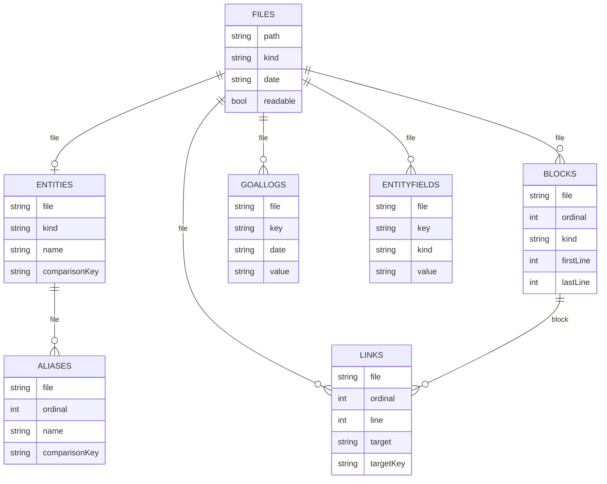

| Örnek | Girdi | Beklenen |
|---|---|---|
| `index/sample/` | `vaults/sample/` | `expected.json`: kanonik indeks dökümü |
| `index/continuation/` | `input.md`: 3 satırlık tek görev bloğu | `expected.json`: kanonik döküm |
| `index/entity-fields/` | `vaults/entity-fields/`, `changed.md`, `added.md`, `removed.md` | `expected.json`: `file/key/kind/value` satırları |
| `index/cadence/` | `vaults/cadence/` | `fields.json`, `anniversaries.json` |

### Örnek kasa dökümü

**Tablo, döküm dizilerinin alanlarını verir.**

| Dizi | Zorunlu alanlar | İsteğe bağlı alanlar |
|---|---|---|
| `files` | `path`, `kind`, `readable` | `date` |
| `entities` | `file`, `kind`, `name`, `comparisonKey` | `qualifier`, `goalKey`, `period`, `goalKind`, `target`, `unit` |
| `aliases` | `file`, `ordinal`, `name`, `comparisonKey` | |
| `blocks` | `file`, `ordinal`, `kind`, `firstLine`, `lastLine`, `text`, `section`, `ownsIdentifier` | `time`, `status`, `rawStatus`, `identifier`, `headingLevel`, `dueDate`, `startDate`, `doneDate`, `priority`, `project` |
| `links` | `file`, `ordinal`, `line`, `byteStart`, `byteEnd`, `target`, `targetKey`, `embedded` | `block`, `key`, `entry`, `anchorKind`, `anchor`, `displayText`, `resolvedFile` |
| `goalLogs` | `file`, `key`, `date`, `kind`, `value` | |
| `entityFields` | `file`, `key`, `kind`, `value` | |

**Tablo, döküm dizilerinin sıra ve aralık kurallarını verir.**

| Konu | Kural |
|---|---|
| `files` sırası | NFC yolun kod noktası sırası |
| Diğer dizilerin sırası | Dosya yolu, ardından kaynak sıra (`ordinal`) ya da hedef anahtarı |
| `entityFields` sırası | Dosya yolu, ardından anahtarın bayt sırası |
| Sıra numarası | Sıfır tabanlı |
| Satır | Bir tabanlı, iki ucu dahil |
| Bayt aralığı | Sıfır tabanlı, sonu hariç |

**Tablo, döküm değerlerinin yazım kurallarını verir.**

| Konu | Kural |
|---|---|
| Eksik isteğe bağlı alan | JSON anahtarı yazılmaz |
| `headingLevel` | `heading` bloğunda 1–6 |
| `dueDate`, `startDate`, `doneDate` | ISO gün |
| `priority` | Kaynak emoji |
| `project` | İlk proje adı |
| Görev `text` | Alanları çıkarılmış sadeleştirilmiş metin |
| `goalLogs.value` | Metin: boolean standart `true`/`false`, sayı özgün yazım, diğer tür ham yazım |
| `entityFields.kind` | `date`, `number` ya da `boolean`; `value` özgün yazım |
| Dökümün dışı | Değişiklik zamanı, boyut ve içerik özeti |

**Tablo, örnek kasanın tam yeniden üretiminden beklenen sayıları verir.**

| Ölçü | Sayı |
|---|---|
| Dosya | 30 |
| Varlık | 13 |
| Olay | 40 |
| Kimlikli görev | 22 |
| Kimliksiz görev | 2 |
| Paragraf | 31 |
| Başlık | 6 |
| Bağlantı | 61 |
| Ayrı hedef adı | 14 |
| Çözülmemiş hedef | 1 |
| Hedef kaydı | 31: `spor` 6, `kitap` 12, `su` 13; 27 Eylül'de kayıt yok |

Tam döküm paragraf metinlerini, kod çitlerini ve frontmatter bağlantılarını da denetler. Sentetik test kasalarını testler geçici dizinlerde kurar. Testler fixture dosyasını test sırasında güncellemez.

`index/continuation/` görev devamındaki girintili başlığın ayrı başlık ya da paragraf üretmediğini kanonik dökümle doğrular.

### Varlık alanları

`vaults/entity-fields/` kasası üst düzey tarih, sayı ve evet/hayır alanlarını sınar. `index/entity-fields/expected.json` dosya ve anahtar bayt sırasındaki `file/key/kind/value` satırlarıdır.

| Grup | Durumlar |
|---|---|
| İndekslenen | Kişi: boşluklu, Türkçe karakterli ve tırnaklı anahtar, satır sonu yorumu, büyük harfli `Name` |
| İndekslenen | BOM ve CRLF taşıyan kişi, konum, `date` alanlı özel kitap tipi |
| Metin olarak okunan, dışarıda | Tırnaklı değer, `2026-13-40`, `2026-02-29`, `2026-1-2`, zaman damgası, `1e3`, `012`, `0x1F`, `.5`, `yes`, `off`, `tRue` |
| Dışarıda | Boş, liste, eşlem, ham ve kimlik alanları; çözülemez frontmatter; hedef, gün ve not dosyaları |
| `changed.md` | Alan değişimi ve silme |
| `added.md` | Alan ekleme |
| `removed.md` | Tüm alanların silinmesi |

Tam ve artımlı eşdeğerlik, dosya silme ve yeniden kurulum aynı kasayı kullanır. Sürüm 6 indeksin silinip doldurulması da aynı kasayı kullanır; güncel şema sürümü 8'dir. Kasa `vaults/` altında durur, çünkü kökteki `.gitignore` `vault/` adlı klasörleri dışlar.

### Ritim alanları

| Dosya | İçerik |
|---|---|
| `index/cadence/fields.json` | Kişi dosyalarındaki ritim alanlarının indeks satırları; dosya, ardından anahtar bayt sırası |
| `index/cadence/anniversaries.json` | Önemli tarih sorgusunun beklenen satırları |

`fields.json` metin ve geçersiz tarih yazımlarını içermez. Kitabın `cadence_snoozed_until` alanı da yoktur, çünkü kitap kişi değildir. `anniversaries.json` içinde doğum günü ve `bitirme` kalır; 3 ritim anahtarı kalmaz.

## Tek dosyalı uygulama kümeleri

`journal/edit/input.md` bir gün dosyasıdır; `expected.md` Journal bölümü değiştikten sonraki tam dosyadır. Frontmatter ve Events bölümü bayt bayt aynı kalır; testi `Tests/JournalTests/JournalEditingTests.swift` koşar. `entities/fields/input.md` kurgusal bir kişi dosyasıdır. `value.md` bir alan değeri değiştikten, `aliases.md` takma ad listesi yazıldıktan sonraki tam dosyadır. Yalnız hedef anahtarın satırı değişir; testi `Tests/JournalTests/EntityPageTests.swift` koşar.

## `entity-types/` kümesi

| Örnek | Girdi | Beklenen | Ne sınar |
|---|---|---|---|
| `valid` | `input.json` | `expected.json`: `ids`, `issue` | Geçerli tanım |
| `invalid` | `input.json` | `expected.json` | Bozuk JSON |
| `collision` | `input.json` | `expected.json` | Ayrılmış id; örnekte `person` |
| `duplicate` | `input.json` | `expected.json` | Yinelenen id |
| `create` | `operation.json` | `expected.md` | Oluşturma için tam Markdown çıktısı |
| `preserve` | `input.json`, `operation.json` | `expected.json` | Bir tanım değişirken hedef dışındaki JSON baytları kalır |

`vaults/typed/` ana örnek kasanın sabit sayılarını değiştirmeden kitap tipini, 2 kurgusal kitabı ve bir şablonu taşır. `.app/types.json` text, date, number, boolean ve link alanlarını tanımlar. Uygulama `templates/` klasörünü indekslemez. `recognition/custom-book/` `@` anmasının özel tip wikilink'ine dönüşümünü dilden bağımsız tanıma biçimiyle tarif eder. Tip tanımı kalkınca uygulama kitapları not olarak indeksler ve dosya baytları değişmez.

`vaults/gallery/` hazır tip galerisinin 10 tipini taşır. `.app/types.json` galerinin tanımlarıdır; `templates/<id>.md` uygulamanın yeni tip için yazdığı şablondur: `type`, boş `name` ve tanımdaki sırayla boş alanlar. Her tipin klasöründeki `Örnek <Ad>.md` o şablondan oluşturulan varlığın tam baytlarıdır. Testler Core galerisini bu dosyalarla karşılaştırır ve her tipi boş kasada oluşturup aynı baytları bekler.

## `rename/` kümesi

| Davranış ailesi | Örnek vaka | Sayı |
|---|---|---|
| Gövde bağlantıları ve bayt özelliği | `body-mixed-line-endings-bom-no-final-newline` | 1 |
| Frontmatter bağlantıları ve ham alan bildirimi | `frontmatter` | 1 |
| Ayırt edici ve aynı dosya adı | `qualifier`, `same-filename` | 2 |
| Geçersiz UTF-8 kaynakta kısmi başarı | `read-only-invalid-utf8` | 1 |
| Aynı satırda tırnaklı çoklu bağlantı | `list-2-grows`, `list-3-shrinks` | 4 |
| Hedef taşımayan alanların korunması | `unrelated-fields`, `empty-list-item` | 2 |

Her örnek `input/` altında küçük girdi kasasını, `expected/` altında tam beklenen dosyaları ve `case.json` taşır. `case.json` alanları `path`, `name`, isteğe bağlı `qualifier`, `newPath`, `failures` (beklenen bildirim sayısı), sıralı `updatedFiles` ve `failureDetails` olur. `failureDetails` öğeleri `path`, `kind`, `detail` taşır; `detail` ham alan adı ya da hata mesajının beklenen parçasıdır. İsteğe bağlı `afterIndex` (`path`, ham bayt dizisi `bytes`) indeksten sonra diskte değişen kaynak dosyayı modeller. Fixture yazarı beklentileri elle yazdı. Test dosya listesini, tüm baytları ve artımlı indeksin sıfırdan üretimle eşdeğerliğini denetler.

`body-mixed-line-endings-bom-no-final-newline` hedef çevresindeki boşluğu, çapayı, görünen metni, `\|` tablo ayırıcısını, `.md` ve yol öneklerini sınar. Aynı örnek gömmeyi, kod korumasını, BOM, CRLF ve sonlandırılmamış satırı da sınar. `frontmatter` scalar, liste ve eşlem bağlantılarını, YAML kaçışını ve ham alan bildirimini sınar. `same-filename` aynı dosya adında yalnız metadata yazar.

`list-2-grows`, `list-2-shrinks`, `list-3-grows` ve `list-3-shrinks` aynı satırda iç içe tırnaklı 2 ya da 3 bağlantıyı günceller. Tırnaksız ve tırnaklı blok öğeleri ve komşu değerler kalır. `unrelated-fields` BOM değerini, kaçışlı tırnağı, yorumları ve hedef taşımayan ham, eşlem ve liste alanlarını bayt bayt korur. `empty-list-item` boş blok liste öğesini yerinde bırakır ve diğer öğelerdeki bağlantıları günceller.

## `import/` kümesi

**Şema, kasa hazırlama örneğinin akışını gösterir.**

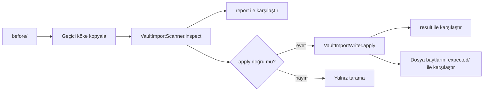

| Örnek | Girdi | Beklenen sonuç |
|---|---|---|
| `empty` | Boş klasör | 6 kasa klasörü, 2 şablon ve `.app/vault.json` oluşur |
| `obsidian-days-only` | Yalnız gün dosyası olan Obsidian kasası | `.obsidian/` kalır; kök ve `daily/` günleri taşınmaz |
| `untyped-entities` | `type` alanı olmayan varlık dosyaları; CRLF ve yorumlu dosya | `type` alanı eklenir |
| `already-prepared` | Zaten hazır kasa | Bayt değişmez |
| `case-variant-journal` | Harf farkıyla `Journal/` | Eksik sayılmaz; `journal/` oluşmaz |
| `unreadable-frontmatter` | Okunamayan frontmatter | Dosya atlanır; uygulama dosyaya dokunmaz |
| `newer-format-version` | Desteklenmeyen `vault.json` sürümü | Hazırlama yazmaz |

Her örnek `before/` altında girdi kasasını, `expected/` altında hazırlama sonrası dosya ağacını ve `case.json` taşır. Örnek, var olan bir klasörü kasa olarak açmayı ve hazırlamayı sınar. Boş girdiyi `emptyBefore: true` işaretler, çünkü git boş `before/` klasörünü tutmaz.

```json
{
  "options": { "folders": true, "settings": true, "types": true },
  "apply": true,
  "emptyBefore": false,
  "report": {
    "missingFolders": ["notes"],
    "caseVariantFolders": ["Journal"],
    "missingTemplates": ["templates/person.md"],
    "needsSettings": true,
    "canPrepare": true,
    "markdownCount": 2,
    "journalDays": [],
    "externalDays": [],
    "typed": { "person": 1 },
    "candidates": [{ "path": "people/Deniz Arıkan.md", "kind": "person" }],
    "skipped": ["people/Broken.md"]
  },
  "result": {
    "created": ["notes/", "templates/person.md", ".app/vault.json"],
    "typed": ["people/Deniz Arıkan.md"],
    "skipped": ["people/Broken.md"],
    "failures": []
  },
  "expectedDirectories": [".app", "Journal", "notes", "people", "templates"],
  "generatedTemplates": { "templates/person.md": "person" }
}
```

`options` yazıcıya verilen onay seçenekleridir (`folders`, `settings`, `types`). `apply` `false` ise test yalnız taramayı karşılaştırır ve yazmaz. `emptyBefore` doğruysa girdi kasası boştur ve test `before/` klasörünü kopyalamaz. `report` `VaultImportScanner.inspect` özetidir: klasörler, şablonlar, adaylar, atlananlar, gün yolları.

`result` `VaultImportWriter.apply` özetidir; `created` içinde sonu `/` olan öğe klasördür. `expectedDirectories` hazırlama sonrası var olması gereken klasör adlarıdır, çünkü git boş klasör tutmaz. `generatedTemplates` yolu `person` ya da `place` değerine eşler. Şablon baytları süreç diline bağlıdır; bu yüzden test beklenen içeriği `VaultImportBootstrap.template` ile üretir ve `expected/` ağaç eşitliği için yer tutucu dosya taşır.

## `dates/` kümesi

| Dosya | İçerik | Vaka sayısı |
|---|---|---|
| `cases.json` | Doğal tarih ayrıştırmanın dilden bağımsız sözleşmesi | 226 |
| `regression-inputs.md` | Aşama 8 tarih, miktar ve gelecek hafta günü düzeltmelerinin kurgusal ham girdileri; beklentileri `cases.json` içinde | |
| `quick-entry.json` | Hızlı giriş görev çözümlemesinin beklenen sonuçları | 26 |
| `quick-entry-inputs.md` | `quick-entry.json` vakalarının ham girdileri | |
| `recurrence.json` | Tekrar kuralından sonraki görev tarihinin hesabı | 11 |

**NOT:** `regression-inputs.md` ve `quick-entry-inputs.md` dosyalarını yalnız gidiş dönüş testi okur; tarih testleri girdiyi JSON dosyasından alır.

**`cases.json`:** Her kayıt `today` (ISO gün), `language` (sıralı `tr`/`en` listesi), `input` ve `expectedDate` (ISO gün ya da `null`) taşır. Kayıt ayrıca `remainder` (ham kalan metin) ve `confidence` (`exact`, `assumed` ya da `null`) taşır. İsteğe bağlı alanlar `expression` (beklenen özgün ifade) ve `weekStartsOnMonday` (varsayılan `true`) olur. Tarih yoksa metin aynen kalır.

Test ifade aralığını özgün ifadenin UTF-8 baytlarıyla bağımsız karşılaştırır. Vaka aileleri göreli, haftalık ve mutlak tarih, geçersiz günler, yıl ve artık yıl sınırları ve dil sırasıdır. Diğer aileler Türkçe harfler, sözcük sınırı, anma, kod ve bağlantı koruması, saatlerin korunması ve silmede boşluk baytlarıdır.

**`quick-entry.json`:** Her vaka `id`, `today`, sıralı `language`, `input`, `suppressed`, `remainder` ve `tokens` taşır. `suppressed` özgün UTF-8 `[başlangıç, bitiş)` çiftleridir. Her simge `range`, `expression`, `kind` (`recurrence`, `priority` ya da `date`), `value` ve `confidence` taşır; `value` tekrar kuralı, öncelik adı ya da ISO gündür. Vaka aileleri Türkçe ve İngilizce zincirler, Türkçe bayt ofsetleri, iki uçtaki ünlemler, miktar ve gelecek hafta günüdür.

Diğer aileler kod, bağlantı ve anma koruması, tam ve kısmi bastırma ve çıkarma sonrası birleşen tarih parçalarıdır. Test özgün aralıkları çıkarır, boşluk birleştirmesini uygular ve kalan metni yeniden kurar. 2.000 belirlenimci rastgele girdi ayrıca mevcut zincirle değer ve metin eşitliğini denetler.

**`recurrence.json`:** Her vaka `rule`, `after`, `completedOn` ve `expected` taşır. `rule` tekrar kuralıdır; örneğin `every month`, `every monday`, `every month when done`. `after` görevin önceki tarihi, `completedOn` tamamlama günüdür. `expected` beklenen sonraki tarihtir; hesap taşarsa `null` olur. Vakalar ay sonunu, artık günü, `when done` kuralını ve yıl geçişini kapsar; son 2 vaka tarih sınırını ve sayı taşmasını sınar.

## `goals/` kümesi

| Parça | Girdi | Beklenen | Vaka sayısı |
|---|---|---|---|
| `cases.json` | Hedef tanımı ve günlük kayıtlar | Hesap sonucu | 75 |
| `series.json` | Günlük değerler ve dönem tanımı | Günlük seri, hareketli ortalama, hafta ve ay toplamları | 18 |
| `writes/` | `cases.json` ve aynı klasördeki Markdown çiftleri | Yazma sonrası tam baytlar | 15 |
| `creation/` | Boş `input.md` | `boolean-expected.md`, `number-expected.md`, `milestone-expected.md` | 3 |

**Hesap vakaları:** Her durum `id`, `definition` (`id`, `key`, `name`, `period`, `kind`, `target`), `logs` (ISO `day` ve boolean ya da sayı `value`) ve `today` taşır. Durum ayrıca iki ucu dahil `heatmapFrom`/`heatmapTo` ve `expected` taşır. Beklenti alanları `done`, `target`, `streak`, `longestStreak`, `isPendingToday`, `score`, `yearDone`, `periodStart`, `periodEnd`, `heatmap` olur. `score` günlük hedefte 0–100 tam sayıdır; haftalık, yıllık, kilometre taşı ve ölçülen günü olmayan günlük hedefte `null` olur. `heatmap` ISO günü `none`, `partial`, `full`, `forgiven` ya da `forgivenPartial` değerine eşler. Fixture yazarı beklentileri Swift hesaplarından değil, sözleşmeden bağımsız sabitler olarak yazar; haftalık ve yıllık zincir afsız kurala uyar.

Vaka aileleri günlük, haftalık ve yıllık boolean ve sayı hedefleri; eşik, boşluk, bugün ve dönem bekliyor; pazartesi ve pazar; yıl ve artık yıldır. Bozuk veri aileleri yinelenen gün, tür uyuşmazlığı ve gelecek kayıtlarıdır. Günlük af ailesi önceki iki günü yapılmış tek kaçırmayı (yapıldı, yapıldı, kaçtı, yapıldı), önünde iki yapılmış gün olmayan kaçırmayı (yapıldı, kaçtı, yapıldı), gün aşırı kaçırmayı (yapıldı, kaçtı, yapıldı, kaçtı, yapıldı: af yok), affedilen günün ardındaki kaçırmayı (yapıldı, yapıldı, kaçtı, yapıldı, kaçtı, yapıldı: yalnız ilk kaçırma affedilir), baştaki kaçırmanın ardından affı (kaçtı, yapıldı, yapıldı, kaçtı, yapıldı), art arda 2 kaçırmayı ve baştaki ve sondaki kaçırmayı kapsar. Dün kaçmış ve bugün bekleyen hedefte zincir yalnız önceki iki gün yapılmışsa düşmez; önceki iki günden biri yapılmamış ya da affedilmişse zincir 0 olur; 2 gün kaçmış ve bugün bekleyende zincir 0 olur. En uzun zincir vakaları gün aşırı geçmişi (en uzun 2) ve iki affı tek koşuda (en uzun 5) sınar.

Diğer af durumları bugün yapılınca süren zincir, hedefin ilk ve ikinci günü, katkısız ve kısmi katkılı affedilen gündür. Skor ailesi 30 günden uzun geçmişi, paydaya girmeyen bugünü, ölçüm günü olmayan hedefi ve skora girmeyen eşik altı günü kapsar. Uç tarih ailesi çok eski tek kaydı, geçmişte kalan af almış en uzun seriyi, yaz saati gün sınırını ve yıl ve artık gün sınırını kapsar.

**Değer grafiği:** `series.json` iki dizi taşır: `daily` (6 vaka) ve `periods` (12 vaka). Günlük girdiler `id`, `today`, `span`, `target`, `logs`; beklentiler `values`, `indices`, `segments`, `average`, `metCount`, `peakIndex`, `averages` (`index`, `value`, `segment`). Boş, seyrek ve dolu seri; görünür aralıktan önceye uzanan 7 günlük pencere, üç kayıt eşiği, çizgi kırılması, eşit hedef, son kayıt, gelecek kayıt, tür uyuşmazlığı, geçersiz sayı (negatif ve NaN), sıfır ve eşit tepede en yeni gün sınanır. Dönem girdileri `period`, `kind`, `target`, `today`, `count`, `logs`; beklentiler `totals`, `starts`, `pace`, `total`, `peakIndex` olur. Her iki dönem için boş, süren dönem sınırı ve dolu veri vardır; haftada pazartesi ve pazar, yılda yıl geçişi, ilk kova ve bugün dahildir. Haftalık dönemde negatif ve NaN kayıt da vardır. Özel dönem sayısı ve grafik gösterilmeyen türlerde `expected: null` da sınanır. JSON NaN taşımadığı için `value` alanında `"nan"`, `"inf"` ve `"-inf"` dizgileri bu sayıları gösterir. Beklentiler sözleşmeden elle hesaplanır; kayıtsız gün sıfır sayılmaz, bir günün son kaydı geçerlidir ve türü uymayan ya da geçersiz son kayıt o günü 0 yapar (`GoalProgress` ile aynı kural).

**Yazma ve oluşturma:** `goals/writes/cases.json` her vakada `id`, `day`, `key`, `value` (boolean, sayı ya da `null`), `input` ve `expected` taşır. `input` ve `expected` aynı klasördeki Markdown yollarıdır; eksik girdi için `input` `null` olur. İsteğe bağlı `error` beklenen hatayı adlandırır; örneğin `notAMapping`. Test tam çıktı baytlarını ve artımlı indeksin yeniden üretimle eşitliğini sınar.

Örnek kasa mevcut 31 kaydı ve Spor, Kitap, Su tanımlarını korur; Spor 14 ve 21 Eylül 2026 haftalarında üçer günle başarılıdır. `milestone-*` vakaları kilometre taşının tamamlanmasını ve geri alınmasını sınar. `goals/creation/input.md` boştur; 3 beklenen dosya yeni hedef dosyasının tam baytlarıdır. `cases.json` her vakada `input`, `expected`, `name`, `period`, `kind` ve isteğe bağlı `target` ve `unit` taşır; kilometre taşı vakası `target` taşımaz. Test her vakayı boş kasada oluşturur, tam baytları ve indeksin okuduğu tanımı sınar. Klasördeki her `*-expected.md` dosyası bir vakaya bağlıdır.

## `goal-chain/` kümesi

`cases.json` karar 67 için 21 bağımsız beklenti taşır. `start` ilk ISO gün, `sequence` gün başına `1` (yapıldı), `0` (yapılmadı), `?` (kayıt yok) dizisidir; son gün bugündür. `period` ve `kind` hedef tanımını seçer. Sayı hedefinde hedef 2, yapılmış katkı 2 ve kaçırılmış katkı 1'dir. `expected` zincir, en uzun zincir, bekleme bayrağı, skor, bakiye ve kesinleşmiş ISO harcama tarihlerini taşır. Beklentiler kuraldan elle sayılmıştır; üretim hesabından üretilmez.

Vakalar 6/7 gün eşiğini, af önceliğini, iki harcamayı, tavanı ve düşen ödülü, 35. gün ödülünü, sıfır bakiyeyi, beklemeyi, tükenen bakiyeyi, kırılınca sayacı sıfırlamayı, yapılmış sayılmayan af/harcamayı, eski harcama tarihlerini, yıl sınırını ve günlük olmayan hedefleri kapsar. `summary: true` vakası 31 Ağustos–20 Eylül geçmişinden bitmiş 14–20 Eylül haftasının zincirini de sınar. `query/` aynı iki ardışık harcama vakasının gerçek Markdown hedefini ve 17 gün dosyasını taşır; indeks sorgusu bakiyeyi ve harcama listesini döndürür. Test dosya baytlarının sorgudan önce ve sonra aynı olduğunu denetler. `sample` kasası değişmez.

## `summaries/` kümesi

| Dosya | Kasa | Vaka sayısı | Ne sınar |
|---|---|---|---|
| `weekly-review-text.json` | yok | | Haftalık gözden geçirme metni |
| `cases.json` | `vaults/sample/` | 4 | Dönem özeti |
| `cadence.json` | `vaults/cadence/` ve satır içi | | Görüşme ritmi |
| `important-dates.json` | `vaults/anniversaries/` | 10 | Önemli tarihler |
| `on-this-day.json` | `vaults/history/` | 9 | Bu gün geçmişte |
| `period-rhythm.json` | `vaults/rhythm/` | 4 | Yıl dönemi, aynı tarihe kadar karşılaştırma, ritim birimleri, ilk kez geçenler, boş dönemde açık görevler |
| `year-writing.json` | `vaults/rhythm/` ve satır içi | 6 | Özetler'in yazılan günler haritası |
| `weekly-rhythm.json` | `vaults/rhythm/` ve satır içi | 5 | Haftalık incelemenin kısa ritmi |
| `task-flow.json` | yok | 8 | Açık görev eğrisinin birim sonu envanteri, başlangıç, bitiş ve en yüksek birim |
| `entity-density.json` | yok | 6 | Kişi ve konum geçiş sıklığı, aylık yoğunluk ve 90 günlük aralık hesabı |
| `weekday-distribution.json` | `vaults/rhythm/` ve satır içi | 6 | Özetler'in haftanın günleri yazma oranı |

**Açık görev eğrisi:** `task-flow.json` elle sayılmış 8 vaka taşır: boş veri, bugüne kadar süren hafta, artık yıldaki bitmiş Şubat, iptal ve tamamlanma tarihsiz görevler, süren yıl, başlamamış dönem, takvimin alt sınırı ve önceki ayından daha fazla dilimi olan süren ay. Her vaka `id`, `period`, `containing`, isteğe bağlı `today`, satır içi `tasks` ve `expected` taşır. Görev `created`, `status`, `due`, `done` alanlarını taşır; olmayan tarih JSON `null` olur. Beklenti `units` ve `previous` için `id`, `range`, `measuredEnd`, `open`; ayrıca `unitCount`, `opening`, `closing`, `peak` (ilk en yüksek birimin kimliği) taşır. Önceki seri bütün dönemi ölçer; süren birim bugünde kesilir, başlamamış birim yoktur. Açık sayımı dönem özetiyle ortak koşulu kullanır; bitiş tarihi gelecekte olan görev de envantere girer.

**Haftalık gözden geçirme metni:** Dosya başlığı, isteğe bağlı `summaryLines`, `selectedLines`, `note` ve beklenen `[String]` `expected` çıktısını taşır. Çıktıda önce hazır yerel özet satırları, sonra seçili satırlar ve not gelir. Test çıktıyı gerçek ayrıştırıcıyla yeniden okur; çıktı görev, olay, bölüm ve frontmatter üretmez. Test günlük ekleme yazıcısının bu satırları değiştirmeden yazdığını da denetler.

**Geçiş yoğunluğu:** `entity-density.json` kişi ve konum içgörülerindeki 12 takvim ayı çubuğu ve 90 günlük şerit hesabını sınar. Her vaka `id`, `description`, `today`, `days` ve `expected` taşır. Beklenti `months` (12 ayın `month`, `count`, `isCurrentMonth` dilimleri), `totalYearDays`, `busiestMonth`, `busiestMonthCount`, `recentDays` (90 günün `date`, `isMentioned`, `isToday` kayıtları), `recentDayCount`, `averageInterval` ve `hasHistory` alanlarıdır. Sınır durumları 90 gün eşiği, 12 ay başlangıç sınırı, süren ay, gelecek tarihlerin dışlanması, 12 ayda 0 gün geçmişi ve tek gün aralık durumunu sınar.

**Dönem özeti:** Yalnız görevleri getiren `summaryTasks()` sorgusu da bu dosyanın dört görev sayısını aynı beklentilerle sınar. Fixture yazarı 4 dönemi `sample/` kasasından elle saydı. 14–20 Eylül ve 21–27 Eylül 2026 pazartesi haftalarında 19 ve 21 olay, 7'şer yazılan gün vardır. Eylül ayında 40 olay ve 14 gün, boş Ekim ayında 0 olay ve 0 gün vardır. Ekim'de de dönem sonu taşınan geciken görev sayısı 11, tarihsiz açık görev sayısı 1'dir. Her durum `period`, `containing` ve `expected` taşır. Beklenti `range`, `previousRange`, `counts`, `previous`, `change`, `people`, `places`, `goals` ve `empty` taşır.

`people` ve `places` ilk 5 öğedir: yol kimliği, görünen ad, `count`, `change`. `goals` öğeleri `done`, `target`, `contribution`, `streak`, `change`, `streakChange`, `score`, `completionDate` taşır. Olmayan tarih ve haftalık, yıllık, kilometre taşı skoru JSON `null` olur. Günlük skor dönemin son günüyle biten 30 günün hesabıdır; fixture yazarı beklentileri bugün vermeden ve dönemi bitmiş sayarak yazdı. Son gün kaçırılmışsa paydaya girer; sayı tanımları `screens.md` Özetler bölümündedir. Eylül'de Spor hedefi 15'tir, çünkü Eylül 5 pazartesi haftasına değer; Kitap 600, Su 240'tır.

Kitap'ta 17 ve 18 Eylül art arda kaçtığı için zincir biter. Su'da 17 ve 24 Eylül af alır ama zincire katkı vermez. 19 Eylül af almaz, çünkü önündeki iki günden 17 Eylül affedilmiş gündür ve yapılmış sayılmaz. Zincir 20 Eylül'de 1, 23 Eylül'de 4, 27 Eylül'de 6'dır. Core testleri JSON'u indeks girdisinden çıkan hesap sonucuyla karşılaştırır. Testler pazartesi, yıl ve artık ay sınırlarını, geçmiş görev envanterini, yıllık ve kilometre taşı katkısını da sınar. Ek denetimler hedef zinciri için dönem öncesi geçmiş, ilk 5'in kararlı sırası ve çözülemeyen bağlantılardır. Sentetik geçici kasa frontmatter bağlantısının dışlanmasını, eski ilk geçiş tarihini ve artımlı indeks eşitliğini kanıtlar; örnek dosyalar değişmez.

**Dönem ritmi:** Fixture yazarı `vaults/rhythm/` kasasının 4 beklentisini elle saydı. Her durum `vault`, `period`, `containing`, isteğe bağlı `today` ve `expected` taşır. Beklenti `cases.json` alanlarına ek olarak ölçülen aralıkları, `isRunning`, `units`, `previousUnits`, `firstPeople` ve `firstPlaces` taşır. Birim `start`, `end`, `events`, `writtenDays`, `measuredDays` ve `writing` taşır.

| Durum | Ne sınar |
|---|---|
| `year-running-to-same-date` | 2026 yılı 7 Ekim'de sürer. Sayılar 1 Ocak–7 Ekim 2026 arasıdır: 10 olay, 7 yazılan gün. Core önceki yılı 7 Ekim 2025'e kadar sayar: 3 olay. 9 Ekim'in 4 olayı sayıya girmez. Kasım ve Aralık başlamamış birimdir. |
| `week-running-to-same-weekday` | 5–11 Ekim haftası çarşamba sürer: 4 olay. Core önceki haftayı çarşambaya kadar sayar: 3 olay. Bütün önceki haftanın değeri 6'dır. |
| `month-slices-from-the-first` | Ekim 2025: 1–7, 8–14, 15–21, 22–28, 29–31. Eylül 2025 dilimlerinin sonuncusu 29–30'dur. İlk kez geçen kişi Nehir Ak, konum Rüzgâr Kafe'dir. |
| `empty-week-carries-open-tasks` | 10–16 Ağustos 2026 boştur. 3 Ağustos'tan 1 devreden ve 1 tarihsiz açık görev kalır. |

Kasada 3 kişi, 1 konum, 1 günlük hedef ve 11 gün dosyası vardır. Fixture yazarı günlük hedefin zincir ve skor değerlerini kodla karşılaştırdı; kurallar `SummaryGoalScoreTests` ile aynıdır.

**Yazılan günler haritası:** Fixture yazarı 6 beklentiyi elle saydı. Her durum `year`, isteğe bağlı `today` ve ya `vault` ya da satır içi `days` taşır. Satır içi gün `date`, `events` ve `hasJournal` taşır. Beklenti `measuredEnd` (`null`: yıl başlamadı), ay başına ölçülen gün sayısı `monthDays`, ay başına yazılan gün `monthWritten`, toplam `writtenDays`, olaylı günler `eventDays` ve yalnız günlük yazısı olan günler `journalDays` taşır.

| Durum | Ne sınar |
|---|---|
| `running-year-ends-today` | 2026 yılı 7 Ekim'de sürer: Ekim'in 7 günü ölçülür, Kasım ve Aralık boştur. 7 yazılan gün `period-rhythm.json` yıl beklentisiyle aynıdır. 4 Ekim yalnız günlük yazısıdır. 3 Ağustos'ta yalnız görev vardır; gün yazılmamıştır. 9 Ekim sayılmaz. |
| `ended-year-counts-every-day` | 2025 bitmiştir: 365 gün ölçülür, 2 olaylı gün. |
| `year-not-begun` | 2027 başlamamıştır: hiçbir gün ölçülmez. |
| `empty-leap-year-without-today` | `today` yoksa bütün yıl ölçülür; 2024'te Şubat 29 gündür. |
| `first-day-adds-rows-of-one-date` | 1 Ocak'ın iki satırı toplanır ve gün olaylıdır. 2025 satırı ve bugünden sonraki 2 Ocak sayılmaz. |
| `last-day-ends-the-year` | 31 Aralık bugündür ve yıl biter. 29 Şubat yalnız günlük yazısıdır. Eksi olay sayısı ve boş dosya yazılmış gün değildir. |

**Haftanın günleri yazma oranı:** Fixture yazarı 6 beklentiyi elle saydı. Her durum `period`, `containing`, isteğe bağlı `today` ve ya `vault` ya da satır içi `days` taşır. Satır içi gün `date`, `events` ve `hasJournal` taşır. Beklenti Pazartesi'den Pazar'a 7 elemanlı üç dizi taşır: ölçülen gün `totalDays`, yazılan gün `writtenDays` ve olay `events`. Beklenti en yüksek yazma oranlı günü de taşır: `leadingWeekday` (0 Pazartesi, 6 Pazar; `null`: yazılan gün yok). Süren dönemde payda bugüne kadarki günlerdir. Eşit oranda olayı çok olan gün, yine eşitse haftanın ilk günü seçilir.

| Durum | Ne sınar |
|---|---|
| `empty-month` | Ağustos 2026'da yazılan gün yoktur: 31 gün ölçülür (Pazartesi, Cumartesi ve Pazar 5'er). 3 Ağustos'ta yalnız görev vardır; gün yazılmamıştır. `leadingWeekday` `null` olur. |
| `running-month-ends-today` | Ekim 2026 çarşamba 7 Ekim'de sürer: her günden 1 gün ölçülür. 4 Ekim yalnız günlük yazısıdır. Beş gün 1/1'dir; Cuma 3 olayla öndedir (`leadingWeekday = 4`). 9 Ekim sayılmaz. |
| `ended-month-higher-ratio-beats-higher-events` | Ekim 2025 bitmiştir: 31 gün ölçülür (Çarşamba–Cuma 5'er). Pazartesi 1/4 ve 1 olayla, Çarşamba 1/5 ve 2 olayla yazılır. Oran olaydan önce gelir: `leadingWeekday = 0`. |
| `running-year-ends-today` | 2026 yılı 7 Ekim'de sürer: 280 gün ölçülür (her günden 40), 7 yazılan gün vardır. Pazartesi ve Çarşamba 2/40 ile eşittir; Pazartesi 3 olayla Çarşamba'yı (2 olay) geçer. |
| `tie-on-ratio-and-events-picks-earlier-weekday` | Şubat 2026'da her günden 4 gün ölçülür. Aynı tarihin satırları toplanır, eksi olay 0 sayılır ve o gün yazılmamıştır. Çarşamba ve Cuma 1/4 ve 2 olayla eşittir; erken gün seçilir (`leadingWeekday = 2`). Dönem dışındaki 31 Ocak ve 1 Mart sayılmaz. |
| `period-not-begun` | Bugün dönemden öncedir: 7 günün her birinde `totalDays` 0 ve `leadingWeekday` `null` olur. |

**Haftalık incelemenin kısa ritmi:** Fixture yazarı 5 beklentiyi elle saydı. Her durum `range`, `previousRange`, isteğe bağlı `today` ve ya `vault` ya da satır içi `days` taşır. Beklenti gün başına `date`, `events`, `previousEvents` ve `writing` (`full`, `none`, `notStarted`) ile toplam `events`, `previousEvents`, `change` ve `isRunning` taşır. Aralığın N. günü önceki aralığın N. günüyle karşılaştırılır. Toplamlar yalnız bugüne kadarki günleri sayar; önceki günün çubuğu bugünden sonraki gün için de durur.

| Durum | Ne sınar |
|---|---|
| `monday-week-running-to-wednesday` | 5–11 Ekim 2026 haftası çarşamba sürer: 4 olay, önceki haftanın pazartesi–çarşambası 3 olay. 9 Ekim'in 4 olayı sayılmaz; arkadaki çubukta 2 Ekim'in 3 olayı durur. |
| `sunday-week-ended-on-saturday` | 4–10 Ekim pazar haftası bugün biter: 8 olay, önceki pazar haftası 6 olay. 4 Ekim yalnız günlük yazısıyla yazılmıştır. |
| `week-not-begun` | Bugün haftadan öncedir: her gün başlamamıştır ve toplamlar 0'dır. |
| `empty-week` | 10–16 Ağustos boştur: her gün yazılmamıştır. |
| `rows-of-one-date-add-up-without-today` | `today` yoksa her gün ölçülür. Aynı günün satırları toplanır; eksi olay sayısı 0'dır. |

**Görüşme ritmi:** Fixture yazarı `cadence.json` sözleşmesini elle yazdı. `spellings` `cadence_days` yazımının pozitif tam sayıya dönüp dönmediğini taşır: `30` ve `+30` döner. `0`, negatif, kesir (`30.0` dahil), başı sıfırlı, başı boşluklu, `Int` sınırını aşan ve metin dönmez. `source: vault` olan 2 gün `vaults/cadence/` kadrosunu kullanır ve `today`, `threshold`, sıralı `overdue` (`id`, `elapsedDays`, `overdueDays`) ve ad sıralı `never` taşır. Erteleme günü (2026-10-11) Fela'yı gizler; ertesi gün Fela ve süresi dolan Sera döner, eşiğe eşit Eda listeye girer. Gizem, daha uzun süredir görülmeyen Tuna'dan önce gelir, çünkü sıra eşiğin ne kadar aşıldığına bakar.

Test `source: inline` vakalarını kasadan okumaz; eşik gününü, hiç görüşülmemiş kişiyi ve eşitlikte yol sırasını sınar. Hiç görüşülmemiş kişi ritmi olsa da ayrı gruptadır ve önce ad, sonra yol sırasındadır. Orada da duraklatma ya da erteleme taşıyan kişi görünmez. Yol sırası girdi sırasından bağımsızdır; taşan ritim yazımı genel eşiğe düşer.

`vaults/cadence/` kişi dosyaları ritimi, ertelemeyi, duraklatmayı ve yok sayılan yazımları (`0`, `-4`, `7.5`, `+30`, `TRUE`, `aylık`, `yes`, `2026-13-40`) taşır. `people/Zeki Mor.md` 3 ritim anahtarına tarih yazar; `books/Fable.md` kayıtlı kitap tipindedir ve `cadence_snoozed_until` yanında `bitirme` tutar. Gün dosyaları son görüşmeyi olay satırında kurar; `journal/2026-10-10.md` içindeki görev `[[Ada Kaya]]` anması son görüşmeyi değiştirmez.

**Önemli tarihler:** Fixture yazarı `vaults/anniversaries/` kasasının 10 yıl dönümü beklentisini elle yazdı. Her durum `vault`, `today` ve `expected` taşır; beklenti tarih, `daysUntil`, `year`, `file` ve `key` satırlarıdır. Sıra tarih, alan adı, dosya yoludur ve pencere bugün dahil 7 gündür. Kasa bugün, yarın, 7. ve 8. gün, yıl sonu, gelecek yıl, 0. yıl ve henüz gelmemiş ilk yıl dönümünü taşır. 29 Şubat artık ve artık olmayan yılda vardır; artık olmayan yılda beklenti 28 Şubat'tır. Geçersiz, tırnaklı ve kısa yazımlar da vardır; `books/Fable.md` pencereye girer, `places/Kıyı.md` aynı gündeki tarih alanıyla dışarıdadır.

**Bu gün geçmişte:** Fixture yazarı `vaults/history/` kasasının 9 beklentisini elle yazdı. Her durum `vault`, `today` ve `expected` taşır. Beklenti `null` ya da `day`, `people`, `place` ve `otherYears` alanlarıdır. `people` en çok 2 öğedir ve yol kimliği ile ad taşır; `place` `null` olabilir.

Kasa 20 Eylül'ü 4 yılda taşır. 2023 bağlantısızdır: not bağlantısı, çözülemeyen bağlantı ve frontmatter kişi bağlantısı. 2024 ve 2025 bağlantılıdır; 2025'te 3 kişi, 2 konum ve yinelenen kişi vardır; 2026 ve 2027 "bugün ve sonrası" içindir. 21 Eylül 2025 bağlantısız, 22 Eylül 2025 yalnız konumlu, 28 Şubat 2026 yalnız kişili, 29 Şubat 2024 artık gün örneğidir.

## `vaults/` kümesi

| Kasa | Dosya | Amaç | Kullanan küme |
|---|---|---|---|
| `sample` | 34 | Uçtan uca örnek kasa | `index/sample`, `summaries/cases.json`, uygulama testleri |
| `entity-fields` | 9 | Üst düzey tarih, sayı, evet/hayır alanları | `index/entity-fields` |
| `unlinked-mentions` | 10 | Bağlanmamış anma sorgusu | `recognition/unlinked-mentions`, `write/mention-*` |
| `unlinked-mentions-hostile` | 22 | Sorguyu ve yazıcıyı zorlayan satırlar | `recognition/unlinked-mentions-hostile` |
| `cadence` | 35 | Görüşme ritmi kadrosu | `summaries/cadence.json`, `index/cadence` |
| `anniversaries` | 18 | Yıl dönümü tarihleri | `summaries/important-dates.json` |
| `history` | 19 | Bu gün geçmişte | `summaries/on-this-day.json` |
| `backlinks` | 5 | Bu güne bağlananlar sorgusu | `DayBacklinksTests` |
| `typed` | 4 | Özel kitap tipi; ayrıntı [`entity-types/` kümesi](#entity-types-kümesi) bölümünde | `entity-types/` |
| `placeholder` | 12 | İndirilmeyi bekleyen yer tutucular | `PlaceholderTests`, `Tests/JournalTests/CloudDownloadTests`, `Tests/JournalTests/SyncStatusTests` |
| `day-copies` | 41 | Gün kopyası birleştirme | `DayCopyTests`, `Tests/JournalTests/DayCopyMergeWiringTests` |
| `rhythm` | 16 | Özetler'in yıl, süren dönem ve ritim hesabı | `summaries/period-rhythm.json`, `summaries/year-writing.json`, `summaries/weekly-rhythm.json`, `summaries/weekday-distribution.json` |
| `copy-files` | 19 | Varlık kopyası ve gün kopyası listesi; birleştirme yok | `VaultIndexTests/CopyFileTests`, `Tests/JournalTests/SyncedFolderNoticeTests` |
| `gallery` | 21 | Hazır tip galerisi: 10 tip, şablonları ve her şablondan bir varlık; ayrıntı [`entity-types/` kümesi](#entity-types-kümesi) bölümünde | `EntityTypeGalleryTests` |
| `conflict-copies` | 20 | Çakışma kopyası ad kuralı ve `conflicts/` listesi; çakışan sürüm sorgusunun kasası | `VaultIndexTests/ConflictCopyTests`, `Tests/JournalTests/SyncConflictTests` |
| `nfd-names` | 4 | Ayrışmış (NFD) dosya adı, ad, takma ad ve bağlantı yazımı | `DecomposedNameTests` |
| `turkce-buyuk-harf` | 6 | Türkçe büyük harf eşlemesi: anahtar, bağlantı, tanıma, ad çakışması | `TurkishCapitalTests` |
| `graph` | 18 | Olay, alt satır, görev ve paragraf bağları; Journal madde listesi, devam satırı, alıntı öbeği ve numaralı liste segmentleri; başlık, frontmatter, özel tip ve indekslenmeyen gün kopyası; tek günün grafiği | `GraphCooccurrenceTests`, `GraphMentionsTests`, `GraphMapTests`, `DayGraphMentionsTests`, `DayGraphTests`, `GraphCustomTypeTests`, `DayGraphSnapshotTests` |

**Çakışma kopyaları:** Fixture yazarı `vaults/conflict-copies/expected.json` beklentisini elle yazdı. `names` saf ad kuralının tablosudur: yol ve gün dosyası (kopya değilse `null`). Tablo sayısı 1 ya da başı sıfırlı, geçersiz gün, geçersiz saat ya da takvim günü, eksik `Z`, büyük harfli `Conflict`, tam genişlikli rakam, alt klasör, kök dizin ve yer tutucu adlarını kopya saymaz. `conflictCopies` diskteki listedir: gün, addaki zaman, sonra sayı sırasıyla 5 kopya; gün dosyası olmayan `2026-09-30` kopyası da listededir. `source/conflicts/` aynı benzer adları, `eski/` alt klasörünü ve bir `.icloud` yer tutucusunu taşır; kökteki benzer adlı dosya sıradan nottur ve indekse girer. Yalnız harf boyu farklı iki ad koyma: büyük ve küçük harf duyarsız birim ikisini tek dosya sayar ve biri ötekinin üzerine yazılır. Uygulama testleri aynı kasayı iCloud Drive yolu altına kopyalar ve sahte sürüm kaynağıyla `IndexStore.computeConflictedFiles` sorgusunu sınar.

**Graph:** `vaults/graph/expected.json` elle sayılmış `totals`, tarih sıralı `days` (`date`, `mentions`, sıralı ve tekil `groups`) ve `edges` (`first`, `second`, `weight`) alanlarını taşır. Çiftin ağırlığı ortak bloğu ya da paragraf segmenti olan farklı gün sayısıdır. Gün kopyası mevcut kasa kuralı gereği indekse girmez; aynı tarihli girdilerin birleşmesi saf hesap testinde ayrıca sınanır. Varlık dosyalarının frontmatter bağları (`related`, `eşi`, kitabın `yazar` alanı) `totals` içinde anma sayılır, grup ve kenar üretmez: Selin 8 gün ve gövde anmasına 3 frontmatter bağlantısıyla 11, Deniz 7 gün anmasına 2 frontmatter bağlantısıyla 9 olur. Özel kitap tipinin kendi tür sorgusunda yalnız tekil anması vardır; ana Graph'ta tipi süzgeçte açılınca düğüm olur. `journal/2026-10-04.md` boş satırsız tek Journal paragrafıdır: tek kişili üç madde birbirine bağlanmaz; girintili devam satırındaki kişi maddedeki konumla, iki satırlık alıntı öbeğindeki kişi ve konum birbiriyle, `2)` numaralı maddedeki kişi ve konum birbiriyle bağlanır; alıntının altındaki düz cümle öbekle bağlanmaz.

**Günün grafiği:** `vaults/graph/day-graph.json` tek gün sorgusunun beklentisini taşır: `kinds` (kişi, konum ve kitap) ve tarih başına elle sayılmış `mentions` ile sıralı ve tekil `groups`. Liste kasada dosyası olmayan bir günü (boş), kitabın tek başına anıldığı 2026-10-01'i ve paragraf segmentli 2026-10-04'ü de içerir. Gün sorgusu bu günlerde `expected.json` günleriyle aynı yanıtı verir; kitap yalnız gün sorgusunda o güne girer.

**Şema, `vaults/sample/` kasasının klasörlerini ve dosya sayılarını gösterir.**

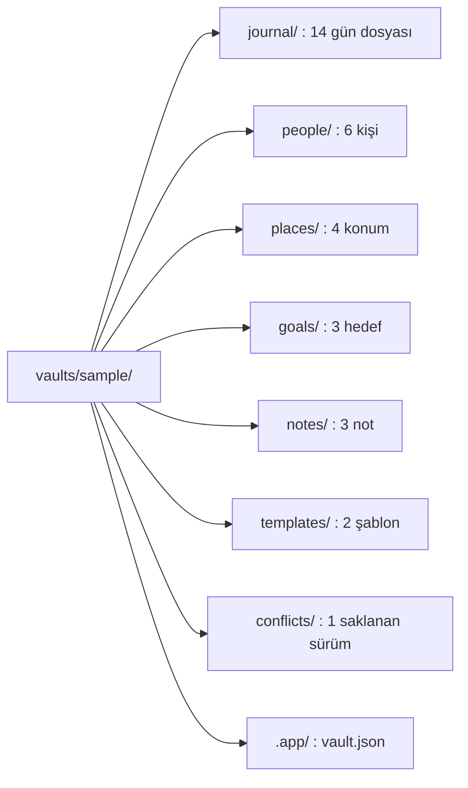

`vaults/sample/` tam ve tutarlı kurgusal örnek kasadır; ayrıştırıcıyı, modelleri, indeksleyiciyi, Obsidian uyumluluğunu, arayüzü ve aramayı uçtan uca sınar. `journal/` 2026-09-14 ile 2026-09-27 arası 14 gün dosyasında 40 olay ve 22 görev taşır. `goals/` `Spor.md`, `Kitap.md`, `Su.md`; `notes/` `Proje Fikirleri.md`, `Okuma Listesi.md`, `Toplantı Notları.md` taşır. `templates/` `person.md` ve `place.md`, `conflicts/` 1 eşitleme çakışmasının saklanan sürümünü taşır. `.app/vault.json` format sürümüdür.

**Tablo, örnek kasanın kurgusal kadrosunu verir.**

| Tür | Ad | Ayrıntı |
|---|---|---|
| Kişi | Deniz Arıkan | Takma adlar: Deniz, Deniz abi |
| Kişi | Selin Korkmaz | Takma ad: Selin |
| Kişi | Baran Tunç | Takma ad: Baran |
| Kişi | Ece Yalın | Takma ad: Ece |
| Kişi | Mert Aksu | İkinci bir Mert Aksu iş ayırt edicisini taşır |
| Konum | Liman Ofis | Takma ad: ofis; koordinat: `[10.5000, 20.0290]`; yarıçap: 100 |
| Konum | Çınaraltı Kafe | |
| Konum | Tepe Spor Salonu | Takma ad: salon; koordinat: `[10.5210, 20.0415]`; yarıçap: 80 |
| Konum | Ev | |
| Hedef | Spor | `spor`; haftada 3 gün; boolean; konum: Tepe Spor Salonu |
| Hedef | Kitap | `kitap`; günde 20; sayı; birim: sayfa |
| Hedef | Su | `su`; günde 8; sayı; birim: bardak |

**Tablo, örnek kasaya bilerek konmuş 6 özel durumu verir.**

| No | Durum | Ayrıntı |
|---|---|---|
| 1 | Aynı adlı iki kişi | `people/Mert Aksu.md` ve ayırt edicili `people/Mert Aksu (iş).md` (`qualifier: iş`). Bağlantı yazımları tablonun altında. |
| 2 | Var olmayan hedefe bağlantı | `journal/2026-09-18.md` içinde `[[Henüz Yazılmamış Not]]`; kasada hedef dosyası olmayan tek bağlantı |
| 3 | Frontmatter'sız not | `notes/Proje Fikirleri.md` frontmatter taşımaz. Not, elle yazılmış gibi blok kimliği olmayan görev satırları (`- [ ]`) ve bağlantılar içerir. Toplam 2 kimliksiz görev var. |
| 4 | Kod bloğu içindeki bağlantı ve başlık | `notes/Toplantı Notları.md` içinde çitli kod bloğunda `[[Deniz Arıkan]]` ve `## Events`. Ayrıştırıcı bunları varlık bağlantısı ya da bölüm başlığı saymamalıdır. |
| 5 | Saklanan sürüm | `conflicts/2026-09-20 (conflict 20260920T183000Z).md`, `journal/2026-09-20.md` dosyasının bir olay metni farklı sürümüdür. Taranmayan klasörler kuralı gereği indekse girmez. |
| 6 | Çok satırlı `aliases` | `people/Deniz Arıkan.md` dosyasında Obsidian'ın yazdığı gibi blok liste biçiminde (`- Deniz\n  - Deniz abi`). Diğer varlıklarda tek satırlı liste (`[Selin]`) biçiminde. |

Aynı adlı iki kişi bağlantılarda `[[Mert Aksu]]` ve `[[Mert Aksu (iş)|Mert]]` olarak geçer.

**Küçük sorgu kasaları:** `vaults/backlinks/` "bu güne bağlananlar" sorgusu ve arayüzü için kasadır. Hedef gün `journal/2026-10-02.md` kendi içine, `journal/2026-10-01.md` hedefe bağlantı verir. `notes/Proje Fikirleri.md` 2 ayrı satırda hedefe bağlantı verir; bir satırda 2 yinelenen bağlantı, kod içi bağlantı ve çözülmeyen hedef taşır. `people/Deniz Arıkan.md` ve `places/Liman Ofis.md` hedefe bağlantılı kişi ve konumdur. Kasa günün kendisinin, kod içi bağlantının ve çözülmeyen hedefin dışarıda kaldığını kanıtlar. Kasa aynı kaynaktan 2 satırın 2 ayrı satır olarak listelendiğini de kanıtlar.

`vaults/placeholder/` gün, kişi, hedef ve kök klasördeki not için indirilmemiş yer tutucular ve bildirilmeyen `.app/.types.json.icloud` taşır. Bir gün hem yer tutucusunu hem yerel özgün dosyasını taşır; diğer dosyalar sıradan gizli Markdown ve kişi yeniden adlandırma kaynağıdır. `expected.json` bekleyen ve indekslenen yolları tanımlar. `names.json` düşman adlar, boşluk ve NFD baytlarını koruyan saf ad eşlemesini tanımlar. Uygulama oluşturma ya da taşıma işlemini reddedince tüm kasa ve SQLite baytları aynı kalır. Uygulama testleri kasayı iCloud kasası, yerel kasa ve seçilen klasör olarak açar; `expected.json` bekleyen listesi indirme isteğinin beklentisidir.

`vaults/nfd-names/` ayrışmış (NFD) yazımın indekste birleşik (NFC) karşılaştırma anahtarına döndüğünü sınar. Git ayrışmış dosya adlarını birleşik biçime döndürür; bu yüzden test her yol parçasını NFD biçimiyle geçici kasada oluşturur ve diskteki adın NFD kaldığını denetler. `people/Baran Tunç.md` ve `places/Çınaraltı Kafe.md` adı ve takma adı NFD baytlarıyla yazar. `journal/2026-10-01.md` 3 bağlantı taşır: NFD `[[Baran Tunç]]`, NFD ve küçük harfli `[[places/çınaraltı kafe]]`, NFC `[[Baran Tunç]]`. `expected.json` NFC yolları, varlık ve takma ad anahtarlarını ve her bağlantının satırını, `targetKey` değerini ve çözülen dosyasını taşır. Test baytları karşılaştırır, çünkü Swift `==` NFC ve NFD yazımını eşit sayar. Test NFD yolu bildirerek kişiyi siler ve geri ekler; gelen bağlantılar iki yönde de yeniden çözülür.

`vaults/turkce-buyuk-harf/` ad karşılaştırma anahtarındaki Türkçe büyük harf eşlemesini (`İ` → `i`, `I` → `ı`) sınar. Kasa kurgusal `people/Deniz.md`, `people/Işık.md` (takma ad `Irmak`), `people/Ian.md` ve `places/İstanbul.md` taşır. `journal/2026-10-05.md` elle yazılmış bağlantılar (`[[DENİZ]]`, `[[IŞIK]]`, `[[işık]]`, `[[istanbul]]`, `[[ISTANBUL]]`, `i` + U+0307 yazımlı `[[i̇stanbul]]`, `[[IAN]]`, `[[ian]]`) ve düz yazımlar (`DENİZ`, `IŞIK`, `İSTANBUL'a`, `IRMAK`, `irmak`) taşır. `expected.json` şu dizileri taşır:

| Dizi | İçerik |
|---|---|
| `keys` | Ad ve beklenen anahtar; NFD yazımlar dahil |
| `files`, `entities`, `aliases` | İndekslenen yollar ve NFC anahtar baytları |
| `links` | Bir tabanlı satır, hedef, `targetKey` ve çözülen dosya; çözülmeyen hedefte `null` |
| `named` | `entities(named:)` sorgusu ve dönen dosyalar |
| `mentions` | Varlık başına bağlanmamış anmalar: sıfır tabanlı satır, UTF-8 `byteRange`, yazım, harf boyu farkı |
| `creations`, `renames` | Oluşturma ya da yeniden adlandırma ve sonucu: yeni yol ya da `nameTaken` |
| `placeholders` | Test kasaya yazdığı yer tutucu, oluşturulan ad ve `awaitingDownload` yolu |

Ad çakışması iki okumayı birden sınar: Türkçe anahtar (`DENİZ`, `ışık`, `istanbul`) ve yalnız varsayılan küçük harf eşlemesi (`ian`, `.SELIN KAYA.md.icloud`). Her oluşturma ve yeniden adlandırma kasanın ayrı kopyasında çalışır. Reddedilen işlem kasanın baytlarını değiştirmez. Test sürüm 8 olarak işaretlenmiş, eski anahtarlı bir indeksin açılışta silindiğini de sınar. Fixture yazarı beklentileri uygulamadan bağımsız, elle yazdı.

**Şema, `vaults/day-copies/` kasasında her gün için kopyaların sonucunu gösterir.**

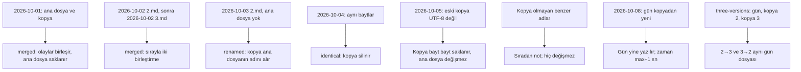

**Gün kopyası**, iCloud'un `journal/` içinde bir gün dosyasının yanına ayırdığı `2026-10-02 2.md` biçimindeki dosyadır. `source/` başlangıç kasası, `expected/` bütün kopyalar sırayla birleştikten sonraki kasanın tamamıdır. `cases.json` değişiklik zamanlarını, beklenen `dayCopies` sırasını, indekslenen yolları ve her kopyanın sonucunu taşır. Sonuç `renamed`, `identical` ya da `merged`, saklanan sürüm yolları ve `fellBack` değeridir. Zamanlar UTC saniyesidir; test zamanları kasanın geçici kopyasına uygular.

| Dosya | İçerik |
|---|---|
| `source/` | Başlangıç kasası |
| `expected/` | Bildirilen bütün kopyalar sırayla birleştikten sonraki kasanın tamamı, bayt bayt |
| `cases.json` | Her dosyanın değişiklik zamanı, beklenen `dayCopies` sırası, indekslenen yollar, her kopyanın sonucu |
| `names.json` | Saf ad kuralının tablosu: yol, gün (kopya değilse `null`) ve `mergeOrder` sırası |

**Tablo, gün kopyası durumlarının ayrıntısını verir.**

| Gün | Ayrıntı |
|---|---|
| `2026-10-01` | Ana dosya ve kopya farklı olaylar ve farklı yönde değişmiş günlük yazısı taşır. Olaylar birleşir; eski sürüm olan ana dosya saklanır. `conflicts/` içinde o ad başka bir nota ait olduğu için kopya `… 20261001T090000Z 2).md` adını alır. Var olan not değişmez. |
| `2026-10-02` | Kopyanın kopyası: önce `2026-10-02 2.md`, sonra `2026-10-02 3.md` birleşir. İkincisi yalnız `## Tasks` bölgesi getirir. |
| `2026-10-03 2.md` | Ana dosya yok; kopya onun adını ve değişiklik zamanını alır. |
| `2026-10-04` | İki sürüm bayt bayt aynı; kopya silinir, `conflicts/` yazılmaz. |
| `2026-10-05` | Eski kopya UTF-8 olarak çözülemez ve salt okunurdur. Ana dosya değişmez; kopya bayt bayt saklanır. |
| `2026-10-08` | Gün kopyadan yenidir. Kopya ayrı bir olay getirir; gün yazılır ve günün zamanı artı 1 saniyeyi alır. |
| `three-versions/` | X/Y/Z aynı olayı değiştirir. `source/` üç sürümü, `expected.md` beklenen günü taşır. `case.json` zamanları, iki sırayı ve her sıranın beklenen `conflicts/` adlarını taşır. İki sıra bu örnekte aynı günü üretir. |
| Benzer adlar | `2026-10-02 2 2.md`, `2026-10-02-2.md`, `2026-10-02 02.md`, `2026-13-40 2.md`, `journal/eski/…`, `notes/…` sıradan not olarak indekse girer ve hiçbir aşamada değişmez. |

Kopya olmayan benzer adlar (`2026-10-02 2 2.md`, `2026-10-02-2.md`, `2026-10-02 02.md`, `2026-13-40 2.md`, `journal/eski/…`, `notes/…`) sıradan not olarak indekse girer ve değişmez. `names.json` saf ad kuralının tablosudur: yol, gün (kopya değilse `null`) ve `mergeOrder`. Tablo ayrışmış (NFD) işaret, tam genişlikli ve Arap-Hint rakamlı, bölünmez boşluklu, büyük harfli klasörlü, yer tutucu ve alt klasör adlarını kopya saymaz. Git ayrışmış adları birleşik biçime döndürür; bu yüzden test o dosyaları geçici kasada oluşturur. `expected/` klasörünü birleştirme kodu üretti; fixture yazarı kuralları elle uygulayıp her dosyayı doğruladı. Testler her adımda gün dosyasını ve `conflicts/` dosyasını `ConflictMerge` sonucuyla karşılaştırır. Uygulama testi `source/` kasasını iCloud kasası olarak açar, birleştirme bayrağını açar ve kasanın sonunda `expected/` ile bayt bayt aynı olduğunu sınar.

## İlgili belgeler

- [Kasa biçimi](vault-format.md): ayrıştırıcı ve yazıcı kuralları.
- [Mimari](architecture.md): Core modülleri ve test hedefleri.
- [Ekranlar](screens.md): özet sayılarının tanımı.

Açık ilişki beklentileri `vaults/graph/relations.json` içindedir; yönlü giden/gelen sorgularını ve yönsüz tekilleştirmeyi `RelationsIndexTests` sınar. Beklentiler biçim kurallarından elle yazılmıştır.

`entity-types/reserved-related/` özel tip şemasında `related` alanını reddeden elle yazılmış JSON sözleşmesidir; `EntityTypeTests.schemaFixtures` tarafından okunur.
