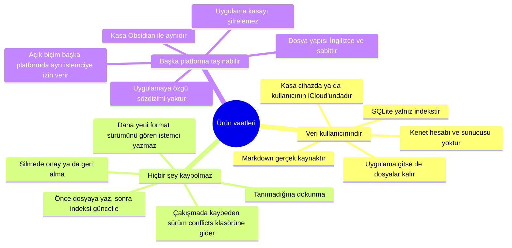
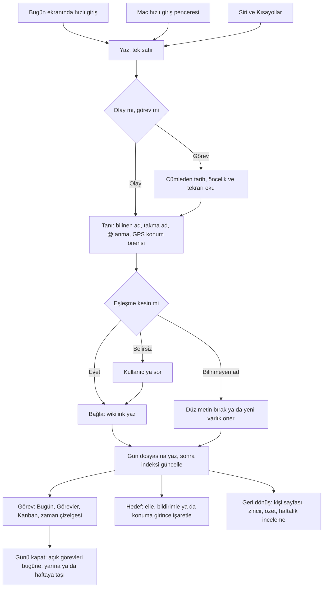
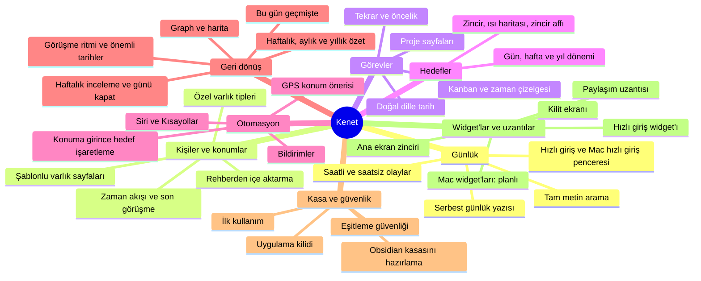

# Ürün

**Amaç:** Bu belge Kenet'in ne olduğunu, neden var olduğunu ve hangi vaatlere dayandığını anlatır.

**Kapsam:**

- Ürün tanımı, ürün vaatleri, ilkeler ve kullanıcı günü akışı
- Özellik ağacı ve modüller
- Konumlanma, kapsam dışı işler, dağıtım ve riskler

Modüllerin durumunu [yol haritası](roadmap.md) izler; bu belge durum tutmaz.

## Ürün tanımı

| Öğe | İçerik |
|---|---|
| Ad | Kenet. Kod adı da Kenet'tir. |
| Tek cümle | Gün içinde yazdığın kısa olayları kişilere, konumlara ve zamana kendiliğinden bağlayan; görevleri ve hedefleri de aynı yerde tutan, verisi düz Markdown olan kişisel günlük. |
| Platform | iPhone, iPad ve Mac. Mac uygulaması iPhone ve iPad ile aynı mağaza kaydından çıkar. |
| Veri | Obsidian uyumlu Markdown kasa. SQLite yalnız indekstir. |
| Arayüz dili | Kullanıcının dili. Başlangıçta Türkçe ve İngilizce. |

Kenet kişisel bir günlüktür. Kullanıcı gün içinde kısa olaylar yazar. Uygulama bu olayları kişilere, konumlara ve zamana bağlar. Görevler ve hedefler aynı kasada durur.

## Ürün gerekçesi

| İhtiyaç | Bugünkü yol | Sorun |
|---|---|---|
| Çevrede olup biteni net görmek: kimlerle, nerede, ne yaşandı | Obsidian'da klasörler ve elle bağlantılar | Yol çalışır ama zahmetlidir. |
| Görev, zincir, takvim, kanban ve not | Birkaç ayrı uygulama | İhtiyaçlar dağınıktır. |

Proje sahibi bu ihtiyaçları tek uygulamada toplamak ister. Kenet'in yerini alacağı uygulamaları [Yerini alacağı uygulamalar](#yerini-alacağı-uygulamalar) tablosu gösterir.

## Ürün vaatleri

**Şema, üç ürün vaadini ve her vaadi koruyan kuralı gösterir.**

Üç vaat, [ajan kurallarındaki](../AGENTS.md) değişmez kuralların gerekçesidir. Bir özellik bir vaadi bozuyorsa, vaat özellikten önce gelir. Kasa biçimini [Kasa biçimi](vault-format.md) belgesi tanımlar.

## İlkeler

| No | İlke | Anlamı |
|---|---|---|
| 1 | Bir satır yazmak 10 saniyeden kısa sürer | Widget, hızlı giriş ve otomatik bağlama süs değildir. Bu üçü uygulamanın yaşama şartıdır. |
| 2 | Sen yaz, uygulama bağlasın | Kullanıcı klasörleme ve etiketleme yapmaz. |
| 3 | Veri kullanıcınındır | Veri düz Markdown'dır ve taşınabilirdir. Kasa cihazda ya da kullanıcının kendi iCloud'unda durur. Kullanıcı uygulamayı silse de dosyalar okunur durumda kalır. |
| 4 | Tek çekirdek, çok ekran | Her yeni özellik aynı dosyaların üstünde yeni bir ekrandır. Hiçbir özellik yeni veri deposu açmaz. |
| 5 | Geri bir şey verir | Uygulama yalnız kayıt tutmaz. Kişi geçmişi, zincirler ve özetler kullanıcıya yazmaya devam etmek için sebep verir. |
| 6 | Belirsizse sor | Yanlış otomatik bağlama, sormaktan kötüdür. |

Başka belgeler ilkeleri numarayla anar: "İlke 6" belirsiz eşleşmede sorma kuralıdır.

## Kullanıcı günü akışı

**Şema, bir satırın yazmadan bağlamaya, sonra görev, hedef ve geri dönüş ekranlarına yolunu gösterir.**

Uygulama satırı önce gün dosyasına yazar, sonra indeksi günceller. Siri ve Kısayollar yolu soru sormaz: kesin anmaları bağlar, belirsiz ve bilinmeyen adları düz bırakır. Hedef işaretleme satırdan bağımsız bir eylemdir.

## Yerini alacağı uygulamalar

| Şu an | Ne için kullanılıyor | Karşılığı |
|---|---|---|
| Alışkanlık uygulaması | Zincir widget'ı | Hedefler ve ana ekran widget'ı |
| Lockday | Kilit ekranında takvim etkinlikleri | Kilit ekranı widget'ı |
| Notion | Kanban, zaman çizelgesi | Görevler'de Kanban ve zaman çizelgesi |
| Obsidian | Notlar | Aynı formatta kasa; uygulama var olan kasayı yerinde açar. Obsidian Mac'te yedek editör olarak kalabilir |

Gerçek kullanım ölçütü iki uygulamanın telefondan silinmesidir: alışkanlık uygulaması ve Lockday.

## Özellik ağacı

**Şema, ürünün modüllerini ve her modülün ana özelliklerini gösterir.**

| Modül | İçerik |
|---|---|
| Günlük | Saat damgalı kısa olaylar ve aynı güne ait serbest uzun yazı; günler arasında gezinme, tam metin arama, Mac hızlı giriş penceresi |
| Kişiler ve konumlar | Düzenlenebilir şablonlu varlık sayfaları, serbest ek alanlar, varlığın geçtiği her şeyin zaman akışı, varlık adını değiştirme |
| Görevler | Bugüne ya da ileri tarihe atanan, kişi ve konumlara bağlanabilen görevler; doğal dille tarih; cihaz takvimini okuma ve takvime etkinlik ekleme |
| Hedefler | Günlük, haftalık ve yıllık hedefler; zincir ve ilerleme takibi. Alışkanlık hedefin günlük biçimidir. |
| Otomasyon | Görev ve hedef bildirimleri, akşam günlük hatırlatması, GPS konum önerisi, konuma girince hedef işaretleme, Siri ve Kısayollar |
| Proje görünümleri | Kanban, zaman çizelgesi, proje sayfaları, tekrarlayan görevler, öncelik |
| Özetler | Haftalık, aylık ve yıllık örüntüler, sayılara dayalı; kişi sayfasında son görüşme özeti; graph ve harita |
| Kasa ve güvenlik | İlk kullanım, var olan Obsidian kasasını yerinde açma, uygulama kilidi, özel varlık tipleri |
| Bağlam ve geri dönüş | Bu gün geçmişte, takvimden olay taslağı, bağlanmamış anmalar, önemli tarihler, görüşme ritmi, zincir affı, suçlamasız taşıma, günü kapat, haftalık inceleme, rehberden kişi içe aktarma, bu güne bağlananlar |
| Eşitleme | iCloud kasası, dosya koordinasyonu, gün kopyası birleştirme, eşitleme durumu göstergesi |
| Widget'lar ve uzantılar | Zincir, vadesi gelen görev sayısı, sıradaki takvim etkinliği, hızlı giriş; kilit ekranı, Denetim Merkezi, paylaşım uzantısı. Mac widget'ları planlıdır; kodda yoktur. |

## Ayırt eden bağlam

| Bağlam | Ne sağlar |
|---|---|
| Kişi sayfası | Bir kişiyle yaşananlar ve o kişiyle ilgili açık görevler birlikte görünür. |
| Konum | Bir konuma girmek bir hedefi işaretleyebilir. |
| Tek veri | Her şey aynı dosyalarda durur. Bu yüzden örüntüler görünür olur. |

Kenet, görev ya da alışkanlık uygulamalarıyla tek tek yarışmaz. Kenet'in farkı bağlamdır.

## Konumlanma

Ekim 2026 sektör taraması benzer ürünlerin o günkü durumunu karşılaştırdı. Taramanın sonucu karar değildir, yön bilgisidir.

### Ayırt eden yönler

| Konu | Tarama sonucu |
|---|---|
| Tanıma | Yazarken kişi ve konumu kendiliğinden tanıyan, emin değilse soran bir ticari ürün bulunmadı. Benzer ürünlerde kullanıcı bağlantıyı elle kurar ya da buluttaki bir yapay zeka kurar. |
| Gerçek kaynak | Dosya gerçek kaynaktır, dışa aktarmaya gerek yoktur ve kasa Obsidian ile aynıdır. Markdown dışa aktarması tek başına fark değildir. |
| Vaat cümlesi önerisi | "Yaz; kim, nerede ve ne zaman kendiliğinden bağlansın. Dosyalar hep senin." |

### Geride kalınan alanlar

| Alan | Yol haritasındaki yer |
|---|---|
| Fotoğraf | "Yayın sonrası", `1.2` ve sonrası |
| Sesle giriş | "Yayın sonrası", `1.1` |
| Başka günlük uygulamalarından içe aktarma | "Yayın sonrası", `1.2` ve sonrası: Day One ve Apple Journal |

Taramanın saydığı beş alan kapandı: bu gün geçmişte, widget ve kilit ekranı girişleri, paylaşım uzantısı, cihazlar arası eşitleme, görsel kimlik.

### Kaçınılacak davranışlar

| Davranış | İlgili kural ya da özellik |
|---|---|
| Veriyi ya da var olan özelliği sonradan kilitlemek | Veri kullanıcınındır vaadi. Yazılı "veri kilidi yok" taahhüdü yol haritasındadır. |
| Zorunlu hesap ve sunucu denetimi | Hesap sistemi kapsam dışıdır. |
| Suçlayan zincirler | Zincir affı ve suçlamasız taşıma. |
| Sormadan kişi oluşturmak | İlke 6. |
| Kullanıcının yazdığını sessizce yeniden yorumlamak | Tanımadığına dokunma kuralı. |
| Uygulamaya özgü sözdizimi | Obsidian uyumlu kasa biçimi. |
| Kasayı uygulama düzeyinde şifrelemek | Şifreleme Obsidian uyumunu bozar. Uygulama kilidi kasayı şifrelemez. |

## Kapsam dışı işler

| İş | Not |
|---|---|
| Genel amaçlı veritabanı oluşturucu | Notion benzeri bir araç değildir. |
| Tam özellikli Markdown editörü | Yoktur. Mac'te serbest not düzenleme yol haritasının "Yayın sonrası" bölümündedir. |
| Kullanıcının var olan Obsidian kasasını yeniden düzenlemek ya da dosyalarını taşımak | Uygulama var olan kasayı yerinde açar ve hazırlar. Ayrıntı [Kasa biçimi](vault-format.md) belgesindedir. |
| Ekip kullanımı, hesap sistemi, kendi eşitleme sunucusu | - |
| Android ve Windows | Ürün tutarsa proje ayrı istemci yazar. Kasa biçimi açık olduğu için kilitlenme yoktur. |

## Ertelenen işler

| İş | Durum |
|---|---|
| Yapay zeka özellikleri | Karar açıktır, [açık soru 4](decisions.md#açık-sorular). Uygulama yapay zeka olmadan tam çalışır. |
| Şirket şema paketi: şirket yapısı, çalışanlar, sorumluluklar | Yol haritasının "Yayın sonrası" bölümündedir. |

## Dağıtım

| Konu | Karar |
|---|---|
| Sıra | Önce yalnız kişisel kullanım, sonra mağaza yayını. |
| Lisans | Tüm hakları saklıdır. Depo herkese açıktır. |
| Gelir modeli | Gönüllü destek: üç tüketilebilir uygulama içi satın alma. Uygulama hiçbir özelliği kilitlemez. |

Gerekçeler [karar günlüğündedir](decisions.md#karar-günlüğü). Sürüm ve kimlik bilgisi [ajan kurallarındadır](../AGENTS.md).

## En büyük riskler

| Risk | Açıklama | Karşı önlem |
|---|---|---|
| Kapsam | Beş ayrı uygulamalık iş. | Her modül gerçek kullanım ölçütüyle sınanır. Ölçütleri yol haritası izler; aşamalar birlikte yürüyebilir. |
| Yazmayı bırakmak | Kullanıcı veri girmezse uygulama boş kalır. | İlke 1 ve İlke 5. |
| Hatalı tanıma | Aynı adlı kişiler ve yanlış bağlantılar. | İlke 6. |
| Başkalarına ait kişisel veri | Günlük başka kişilerin bilgisini taşır. | Kasa cihazda ya da kullanıcının kendi iCloud'unda durur. Kenet sunucusu yoktur. |

## İlgili belgeler

- [Yol haritası](roadmap.md)
- [Kararlar](decisions.md)
- [Kasa biçimi](vault-format.md)
- [Ekranlar](screens.md)
- [Tasarım dili](design.md)
