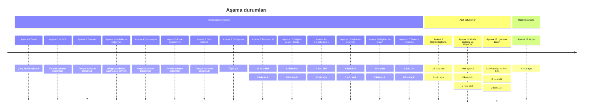
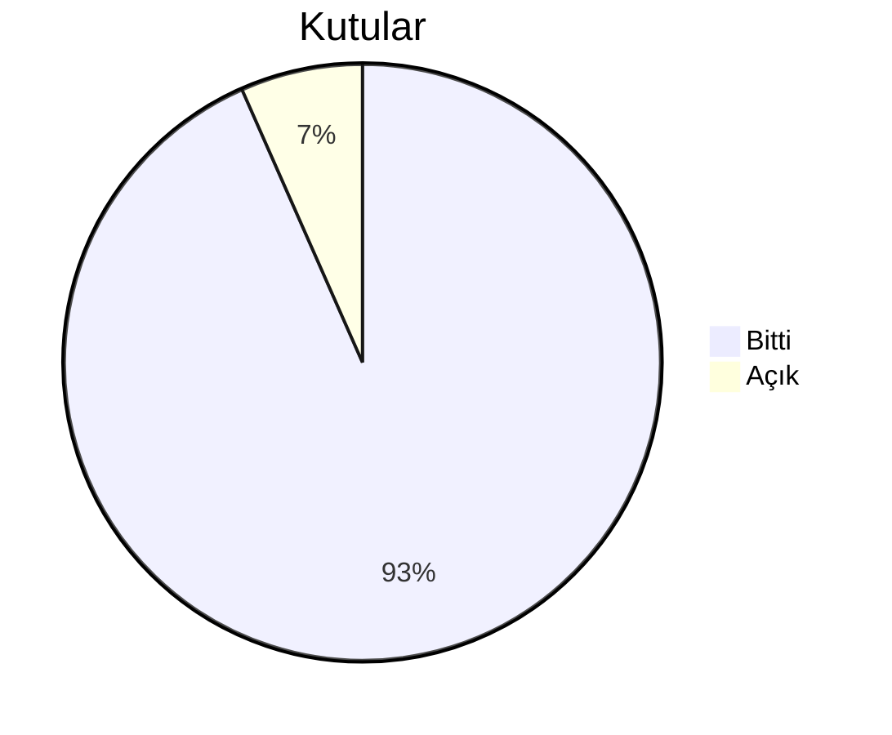
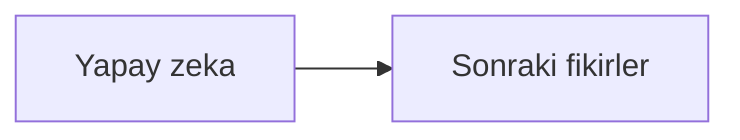
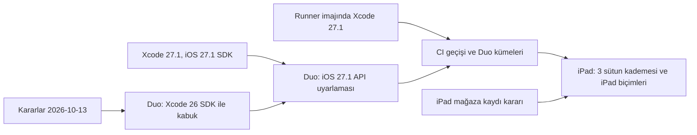

# Yol haritası

**Amaç:** Yol haritası aşamaları, maddeleri ve her maddenin durumunu gösterir.

**Kapsam:**

- Aşama 0–17'nin maddeleri ve kutuları
- Gerçek kullanım ölçütleri ve kullanıcı kararı bekleyen konular
- Sonraki fikirler

| Konu | Değer |
|---|---|
| Son güncelleme | `2026-11-11` |
| Aktif aşama | 11 Kimlik, eşitleme ve widget'lar |
| Aşama 11'in açık kutuları | Eşitlenen kasada güvenli yazma; Mac widget'ları |
| Birlikte yürüyen | Aşama 13'ün Duo dilimi; Xcode 27.1'i bekler |
| Kullanıcıda bekleyen | Aşama 8: kilidin cihaz doğrulaması |

Bitmiş aşamalar "Tamamlanan teknik kapsam" bölümündedir. Açık kutusu olan aşamalar önce gelir.

## Genel durum

**Aşamaların durumu ve açık kutu sayısı:**

**136 kutunun durumu:**

| İşaret | Anlamı |
|---|---|
| `[x]` | Kod `dev` dalında, testlerden ve CI'dan geçti. CI, sürekli bütünleştirme demektir. |
| `[ ]` | Madde açık. Durum tablosu kalan işi söyler. |

İlk sürüm `v0.9.0` `main` dalındadır. TestFlight'ta iPhone, iPad ve Mac için dahili test sürer. Aşamaların gerçek kullanım ölçütleri henüz ölçülmedi.

Kural: Her modülü gerçek kullanımda sına. Aşama 0–7'nin kodu çıkış ölçütlerini beklemeden art arda geldi. Ölçütler geçerlidir ve gerçek kullanımla kapanır. Bir ölçüt kullanımda tutmazsa sonraki işlerin sırasını yeniden kur.

## Gerçek kullanım ölçütleri

| Aşama | Teknik kapsam | Çıkış ölçütü | Durum |
|---|---|---|---|
| 0 Temel | Tamam. iCloud kasa konumu Aşama 11'de geldi: #319 | Uygulama örnek kasayı okuyor ve indeksliyor; değişiklikler ekrana yansıyor; testler geçiyor | Sağlandı |
| 1 Günlük | Tamam | Kullanıcı iki hafta boyunca her gün günlüğünü uygulamada tutuyor | Başlamadı |
| 2 Görevler | Tamam | Kullanıcı günlük görevlerini yalnız uygulamada izliyor | Başlamadı |
| 3 Hedefler ve widget'lar | Tamam. Ana ekran ve kilit ekranı widget'ı Aşama 11'de geldi: #318, #359 | Kullanıcı alışkanlık uygulamasını ve Lockday'i telefondan sildi | Başlamadı |
| 4 Otomasyon | Tamam | İki hafta boyunca hiçbir hatırlatma kaçmıyor; uygulama konuma bağlı hedefleri kullanıcı işaretlemeden yazıyor | Başlamadı |
| 5 Proje görünümleri | Tamam | Kullanıcı Kanban ve zaman çizelgesi için Notion'u açmıyor | Başlamadı |
| 6 Geri bildirim | Sayılara dayanan kısım tamam | Kullanıcı haftalık özeti 4 hafta üst üste okuyor | Başlamadı |
| 7 Genişleme | İlk kullanım, kasa hazırlama, kilit ve özel tipler tamam | Yok | - |
| 9 Tasarım dili | Tamam | Bütün ekranlar aynı bileşen kitaplığını kullanıyor; erişilebilirlik ve görüntü testleri CI'da geçiyor | Sağlandı |
| 10 Bağlam ve geri dönüş | Tamam | Kullanıcı haftalık incelemeyi 4 hafta üst üste tamamlıyor; "Bir süredir görüşmediklerin" listesinden ayda en az 1 görüşme çıkıyor | Başlamadı |
| 14 Görselleştirme | Tamam | Altı grafik iPhone'da açık, koyu ve AX3'te referans görüntüyle korunur; Core hesapları fixture ile sınanır | Sağlandı |
| 15 Kullanım kolaylığı | Tamam | Dört davranış görüntü ve birim testiyle korunur; silme yolları Core testleriyle sınanır; kullanıcı TestFlight'ta doğrular | Testler sağlandı; TestFlight doğrulaması kullanıcıda |
| 16 İlişkiler ve Graph | Tamam | Aynı gün iki ayrı olaydaki varlıklar bağlanmaz; her gün kendi grafiğini açar; elle kurulan bağ Obsidian'da da görünür | Testler sağlandı; gerçek kullanım ölçülmedi |
| 17 Tasarım yenileme | Tamam | Bütün ekranlar Şafak bileşenlerini kullanır; palet testi 4 varyantı denetler; kullanıcı koyu, açık ve KA'yı TestFlight'ta doğrular | Testler sağlandı; TestFlight doğrulaması kullanıcıda |

Gerçek kullanım gerçek cihazda kalıcı kurulum ister. TestFlight yapısı kalıcı kurulumu sağlar.

## Kullanıcı kararı bekleyenler

**Bekleyen kararlar ve açtıkları maddeler:**

| Karar | Neyi açar | Not |
|---|---|---|
| Yapay zeka | Sonraki fikirler | Cihaz üstü model maliyetsiz bir seçenektir. Öneri: varsayılan kapalı. |

**DİKKAT:** Mağazada yayımlanan iPad desteğini geri alamazsın; iPad desteğini sonradan eklemek serbesttir.

## Aşama 8: Sağlamlaştırma

| Grup | Kutu | Bitti | Açık |
|---|---|---|---|
| Doğruluk ve veri güvenliği | 11 | 10 | 1: kilidin cihaz doğrulaması |
| Ölçek | 7 | 7 | 0 |
| Veri sahipliği ve gizlilik | 3 | 3 | 0 |
| Erişilebilirlik ve dil | 4 | 4 | 0 |
| Kapılar | 4 | 4 | 0 |

| Açık kutu | Durum |
|---|---|
| Uygulama kilidi, "Hemen" ayarı | Kod ve test `dev` dalında. Kalan iş: gerçek cihazda doğrulama. |

Aşama 8 Ekim 2026 heyet incelemesinin bulgularını düzeltir. Heyet kod, kullanım, sektör ve tasarım incelemesi yaptı. Her hata düzeltmesi hatayı yakalayan bir test ya da fixture getirir. Ölçümlerin hepsi Mac'te, 5 yıllık sentetik kasalarda koştu. Sentetik kasalar 2.300 ile 2.400 arası dosya taşır. iPhone'da ölçüm yok.

Doğruluk ve veri güvenliği:

- [x] Olay saati: uygulama saati cihazın saat dilimi farkı kadar kaydırıyordu. Uygulama saati dosyadaki değerle gösterir. Testler saati UTC dışı bir saat diliminde sınar. UTC, eşgüdümlü evrensel zaman demektir.
- [x] Satır içi düğmeler: tek dokunuş satırdaki bütün düğmeleri birlikte tetikliyordu. Örnek: takma ad satırında "Kaydet" takma adı siliyordu; günlük takviminde ay okları çalışmıyordu. Uygulama satır içi düğmeleri ayırır.
- [x] Tekrarlayan görev düzenleme: kullanıcı uygulamanın yazdığı görevde tekrarı değiştiremiyordu. Kimlik onarımıyla birlikte uygulama çöküyordu. Yazıcı kuraldan sonraki kullanıcı metnini siliyordu.
- [x] Aynı dosya adı: ad başka klasörde de varsa otomatik bağlantı yanlış dosyaya gidiyordu. İndeks yazmanın hedefini belirler. Kural önce `vault-format.md` belgesine girdi.
- [x] Doğal dilde tarih: ayrıştırıcı ondalık ve kesirli sayıları tarih sanıyor ve metinden siliyordu. Örnek: "2.5 kg un al". Ayrıştırıcı "haftaya salı" ifadesini yanlış güne çözüyordu. Kısayollar yolu varsayımlı tarihi sormadan uyguluyordu.
- [x] Silme: kullanıcı olay, görev, alan ya da hedef kaydı silince uygulama onay ister ya da geri alma sunar. Uygulama günlük yazısında dosyaya girmemiş metni sormadan atmaz.
- [x] Kasaya erişim hatası: uygulama kayıtlı kasaya erişemezse durumu ana ekranda gösterir. Yazmalar sessizce başka kasaya gitmez.
- [x] Yazma sırası: uygulama meşgulken gelen yazmayı sıraya alır. Enter tuşu kaybolmaz. Yanlış "dosya dışarıdan değişti" hatası çıkmaz.
- [ ] Uygulama kilidi: "Hemen" ayarında başarılı doğrulamadan sonra uygulama kendini yeniden kilitlemez. Kullanıcı davranışı gerçek cihazda doğrular.
- [x] Kasa denetimleri: uygulama her yazmada kasa format sürümünü denetler. Kasa hazırlama harf farkı olan klasör adını bildirir, örneğin `Diary/`. Ön bilgideki boş liste öğesi yeniden adlandırmayı durdurmaz.
- [x] Eşitlenen klasör uyarısı: kullanıcı eşitlenen bir klasörü kasa seçerse uygulama bilgi bandı gösterir. Örnek: iCloud Drive.

Ölçek:

- [x] Yeniden adlandırma ölçeği: varlık yeniden adlandırma süresi bağlantı sayısıyla karesel büyüyordu. Ölçüm 139 sn ve yaklaşık 5 GB bellek gösterdi. Süre artık doğrusal büyüyor.
- [x] İlk indeksleme ve tip ekleme: uygulama boş indekste tam kurulum yolunu kullanır. Bir SQLite indeksi kimlik sahipliği sorgusunu hızlandırır. Şema sürümü bu değişiklikle arttı.
- [x] Boş yenileme: dosya değişmemişse yenileme hiçbir şey yayımlamaz. Uygulama bildirimleri her turda silip yeniden kurmaz.
- [x] Arka planda okuma modeli: uygulama yazmadan sonra okuma modelini ana iş parçacığı dışında kurar. Önceki ölçüm olay eklerken 0,45 sn donma gösterdi.
- [x] Hedef işaretleme: işaretleme bütün kasayı okumaz. Yazma başına tam klasör taraması kalktı. İndeks güncellemesi yalnız yazmanın bildirdiği klasörleri tarar.
- [x] Ölçek bütçe testleri: sentetik kasada yenileme, yazma, yeniden adlandırma ve ilk açılış süreleri.
- [x] Artımlı okuma modeli: uygulama okuma modelini dosya başına artımlı kurar. 5 yıllık kasada yazmadan sonraki süre 1,65 sn'den 0,09 sn'ye indi. Ekranların kendi sorgusunu çalıştırması Aşama 11'e geçti.

Veri sahipliği ve gizlilik:

- [x] Varsayılan kasa konumu: kasa iPhone'da Dosyalar'da, Mac'te Finder'da görünür. İlk açılış ekranı kasanın yerini söyler.
- [x] Kilitliyken gizlilik: bildirimlerde içeriği gizleme seçeneği var. Uygulama kilitliyken Siri hedef adlarını listelemez. Uygulama kilitliyken Kısayollar ve bildirim eylemi yazmaz.
- [x] İndeks ve arama geçmişi: uygulama indeksi yedeğin dışında tutar. Veri koruma sınıfı kararı karar günlüğündedir. Kullanıcı arama geçmişini temizleyebilir; arama geçmişi kasaya bağlıdır.

Erişilebilirlik ve dil:

- [x] Dokunma hedefleri en az 44 pt'dir. Hızlı giriş çubuğu büyük yazıda düzenini korur.
- [x] Renk ve opaklık: uygulama geciken tarihi kırmızıyla, tamamlanan görevi opaklıkla göstermez. Gerekçe kontrast ve "cezalandırma yok" ilkesidir.
- [x] VoiceOver: Graph tuvalinin erişilebilir karşılığı, öncelik değeri, günlük önizlemesi, Kanban ve zaman çizelgesi eylemleri.
- [x] Yerelleştirme: katalogda olmayan anahtarlar, ölü anahtarlar, "Her 1 hafta" metni ve Türkçe ek uyumu. Ek uyumu örneği: `Ev'te`.

Kapılar:

- [x] iOS testleri: uygulama testleri iOS simülatöründe de koşar. Fixture kasasıyla arayüz duman testi ve erişilebilirlik denetimi koşar.
- [x] Belge biçim denetimi: karar tablosu, README belge tablosu ve String Catalog tamlığı. `Tests/` klasörü de biçim denetimine girer.
- [x] Kasa hazırlama yazıcıları: testler yazıcıları fixture ile sınar.
- [x] Sürüm akışının kuru koşusu: `VERSION` yükseltme yolu ve etiket varken sessiz atlama.

**Çıkış ölçütü:** Aşama 8'deki her hatayı bir test ya da fixture koruyor. 5 yıllık sentetik kasada olay eklemek arayüzü dondurmuyor. İki haftalık gerçek kullanımda veri kaybı ya da yanlış gösterim çıkmıyor.

## Aşama 11: Kimlik, eşitleme ve widget'lar

| Madde | Durum | Kanıt |
|---|---|---|
| Kasa konumu | Bitti. Kasa iCloud kapsayıcısında `Documents/Kenet` klasöründe durur; iCloud varsa ilk açılışta ilk seçenektir. Yerel kasa ve klasör seçimi kalır. Yerelden iCloud'a taşıma doğrulanmış kopyadır; kaynak silinmez. Gerçek cihazda Dosyalar ve ikinci cihaz denemesi kullanıcıdadır. | #314, #319 |
| Eşitlenen kasada güvenli yazma | Açık. Hazır: Core koordinasyon sınırı ve `.merge` niyeti; App'te `NSFileCoordinator` ve okuma kuyruğu; eşitlenen klasör tespiti ve bandı; yer tutucu tespiti; Core'da gün kopyası birleştirme ve belirlenimci zaman kuralı; kopya dosyalar Tanılama'da; iCloud kasasında indirilmemiş dosya için indirme isteği, eşitleme göstergesi ve gün kopyası birleştirmesinin App bağlantısı (#361, #369); birleştirme bayrağı varsayılan açık (karar 2026-11-09). `NSFileVersion` çakışmaları için tespit ve Tanılama listesi var (#287). Açık: sürüm çözümleme (karar 2026-10-20); indirme isteği, yer tutucu davranışı ve kendiliğinden birleştirme gerçek cihazda doğrulanır. | #187, #189, #200, #203, #206, #207, #234, #238, #287, #319, #361, #369 |
| Ana ekran widget'ı | Bitti. iOS'ta küçük ve orta zincir widget'ı. Widget veriyi App Group'taki anlık görüntüden okur. iCloud kasasında bekleyen evet/hayır hedefi widget içinde işaretlenir; yerel ve seçili kasada dokunma uygulamayı açar ve işaretler. Gerçek cihazda dokunma denemesi kullanıcıdadır. | #318, #325 |
| Ekranlar kendi sorgusunu çalıştırır | Bitti. Bütün ekranlar, bildirim planlayıcı ve proje listeleri kendi sorgusunu çalıştırıyor. 5 yıllık kasada okuma modeli 10,8 MB'tan 1,92 MB'a, yeniden türetme 1.640 ms'den 34 ms'ye indi. Widget hedef durumunu uygulamanın yazdığı anlık görüntüden alır. `entities` okuma modelinde kalır (karar 2026-10-20). | #192, #201, #205, #208, #210, #211, #212, #214, #225, #294, #318 |
| Widget yenilemesinin testi | Bitti. `WidgetRefreshReliabilityTests`: 100 yayım, gece yarısı geçişi, uygulama ile widget yazmasının uzlaşması ve yenileme sayacı. | #325 |
| Kilit ekranı widget'ı | Bitti, iOS. Sıradaki etkinlik ve o güne vadesi gelen görev sayısı üç accessory ailesinde; içerik bildirimin gizlilik tercihine bağlı; veri uygulamanın yazdığı anlık görüntüden. Kilit ekranında gerçek görünüm cihazda denenir. | #359 |
| Hızlı giriş widget'ı ve girişler | Bitti, iOS. Ana ekran ve kilit ekranı "Yaz" widget'ı, Denetim Merkezi kontrolü, Eylem düğmesi ve "Kenet'e yaz" kısayolu Bugün'ü hızlı giriş kutusu odaklı açar. Eylem düğmesi ve kilit ekranı kontrolü cihazda denenir. | #360 |
| Mac widget'ları | Açık. Kapsam: Mac'te hedefler ve Bugün widget'ı. | - |
| Paylaşım uzantısı | Bitti, iOS. Metin ve Safari bağlantısı tek olay olur. iCloud kasasında uzantı gün dosyasına kendisi yazar; öteki durumlarda metin App Group kuyruğunda bekler ve uygulama açılınca işlenir. Mac uzantısı ve görsel paylaşımı kapsam dışı. | #324 |
| Sistemin günlük önerileri | Bitti, iPhone. Hızlı girişte seçici; öneri metne dönüşür, kullanıcı gönderir. Cihaz denemesi bekliyor: yetki ve App ID yeteneği yalnız imzalı yapıda görülür. | #320 |
| Takvim etkinliği ekleme ve düzenleme | Bitti. Bugün, gün ve kişi sayfasından ekleme, düzenleme, silme; kişi sayfasında yaklaşan etkinlikler ve doğum günü. Kullanıcı kararı 2026-11-11. Gerçek takvimle cihaz denemesi kullanıcıdadır. | #382 |

Kimlikler 2026-10-21'de karara bağlandı. Güvenli yazmanın kalanı kullanıcının cihaz denemesini bekler. İşaretli maddelerin gerçek cihaz denemesi kullanıcıdadır.

- [x] Kasa konumu: iCloud kapsayıcısı; yerel kasa yedek seçenek olarak kalır. Madde Aşama 0'dan devretti.
- [ ] Eşitlenen kasada güvenli yazma: dosya koordinasyonu, inmemiş dosyalar, sürüm çakışması, birleştirme, kopya dosya kuralı, eşitleme göstergesi.
- [x] Ana ekran widget'ı: zincir ve tek dokunuşla işaretleme; widget yapılmamış hedefleri vurgular. Madde Aşama 3'ten devretti.
- [x] Ekranlar ve widget kendi sorgusunu çalıştırır: küresel okuma modeli yerine Core sorguları. Gerekçe widget bellek sınırıdır. Madde Aşama 8'den devretti.
- [x] Widget yenilemesinin güvenilirlik testi. Madde Aşama 3'ten devretti.
- [x] Kilit ekranı widget'ı: takvim etkinlikleri ve günün görevleri. Madde Aşama 3'ten devretti.
- [x] Hızlı giriş widget'ı ile kilit ekranı, Denetim Merkezi ve Eylem düğmesi girişi. Madde Aşama 3'ten devretti.
- [ ] Mac widget'ları: hedefler ve Bugün. Madde Aşama 3'ten devretti.
- [x] Paylaşım uzantısı: "olay olarak ekle".
- [x] Sistemin günlük önerileri seçicisi. Apple'daki adı Journaling Suggestions.
- [x] Takvim etkinliği ekleme ve düzenleme: ders, toplantı, doğum günü; tekrar ve hedef takvim; kişi sayfasında yaklaşan etkinlikler. Görev ve olay takvime yazılmaz.

**Çıkış ölçütü:** İki cihazda iki haftalık kullanımda kayıp ya da kopya dosya çıkmıyor. Kullanıcı alışkanlık uygulamasını ve Lockday'i telefondan sildi.

## Aşama 12: Yayın

| Madde | Durum | Kanıt |
|---|---|---|
| Mağaza teknik hazırlığı | Açık. Kalan iş: gizlilik politikası. Adres karara bağlandı: `kenet.app/gizlilik`; alan adını kullanıcı alır. Lisans bildirimi bitti. Yer tutucu bölüm olan Mac "Notlar" girdisi kalktı. Ötekiler ilk TestFlight yüklemesi için bitti. | #130, #151, #188 |
| CD | Açık. Elle yol hazır: `.github/scripts/testflight.sh` temiz kopyadan arşivler ve yükler. İlk yapı 0.9.0 yüklendi. `dev`'e her itmede imzasız arşiv denetimi koşar. CI iş akışı hazır: `testflight.yml` elle tetiklenir; `dev` itmesinde gönderim `KENET_CD_ON_PUSH` ile açılır. İlk koşu kullanıcının GitHub Secrets'a koyacağı App Store Connect API anahtarını ve imza sertifikalarını bekliyor. | #134, #197, #313 <!-- sır değil --> |
| Lisans, ad, gelir modeli | Açık. Ad Kenet, lisans "tüm hakları saklıdır" ve gelir modeli karara bağlandı. Gelir modeli gönüllü destektir: karar günlüğü, 2026-11-13. Kalan iş: üç tüketilebilir ürün, destek sayfası ve yazılı taahhüt. | #131 |
| Mağaza sayfası | Açık | - |

- [ ] Mağaza teknik hazırlığı: gizlilik bildirimi dosyası, ihracat bildirimi, uygulama simgesi, gizlilik politikası, üçüncü taraf lisans bildirimi. Ayrıca derleme numarası, platforma göre ayrı yetki dosyaları, iPad kararı ve yer tutucu bölümleri kaldırma.
- [ ] CD: TestFlight'a otomatik gönderim. CD, sürekli dağıtım demektir. Araç seçenekleri: Xcode Cloud ya da fastlane. Madde Aşama 7'den devretti.
- [ ] Lisans, ad, gelir modeli; gönüllü destek ürünleri ve destek sayfası; yazılı "veri kilidi yok" taahhüdü.
- [ ] Mağaza sayfası: metinler, ekran görüntüleri, yaş derecelendirmesi.

**Çıkış ölçütü:** İlk dış kullanıcı uygulamayı TestFlight'tan kurar ve kendi kasasını açar.

## Aşama 13: Uyarlanır düzen

**Aşamanın iki dilimi ve dış olaylara bağlı sırası:**

| Madde | Durum | Kanıt |
|---|---|---|
| Duo kabuğu, Xcode 26 SDK | Bitti. Uyarlanır kabuk, boyut sınıfıyla görüntü altyapısı, durum köprüsü ve taslak koruma, krom ve dokunma, güvenli alan, sheet ve panel, belgeler. Kalan Duo işi iOS 27.1 SDK'yı bekler. | #233, #236, #240, #241, #242 |
| Duo iOS 27.1 API uyarlaması | Açık. Xcode 27.1'in iOS 27.1 SDK ile çıkmasını bekliyor. | - |
| CI geçişi ve Duo kümeleri | Açık. Runner imajında Xcode 27.1'i bekliyor. | - |
| iPad karma kabuk | Bitti. Üç sütun kademesi, kenar çubuğu ve seçim biçimi, arama ve Rehberden aktar, Kanban ve zaman çizelgesi iPad biçimi, cihaz türü metinleri, iPad görüntü kümeleri ve CI'da iPad adımı. | #265, #266, #267, #268 |
| iPad kalanlar | Bitti. Klavye kısayolları (⌘K hızlı geçiş, ⇧⌘F arama, ⌘T bugün), iPad ekran turu (`screen-tour.sh --pad`), CI'da iPad erişilebilirlik denetimi, işaretçi vurgusu, soğuk açılışta açık kenar çubuğu. | #270, #271, #274, #277 |
| iPad mağaza kaydı | Bitti. Cihaz ailesi `1,2`, iPad dört yön, tek pencere; TestFlight yapısı iPad'e çıkar. Mağaza listesi (iPad ekran görüntüleri) Aşama 12'nin mağaza sayfası maddesinde. | #264 |

iPhone Duo'nun dış ekranı sıkışık, iç ekranı düzenli × düzenli boyut sınıfındadır. Kabuk boyut sınıfına bakar; cihaz türüne bakmaz. Aynı kabuk iPad'de de çalışır; iPad yalnız 1000 pt üstü kademeyi ve cihaz ailesini ekler.

- [x] Duo kabuğu, Xcode 26 SDK: düzenli × düzenli ekranda kenar çubuklu bölünmüş kabuk; seçim ve taslak korunur.
- [ ] Duo iOS 27.1 API uyarlaması: poz turu, hızlı giriş bölgesi, düzenleme görünümü, bölmeye hizalı sütun, Kanban yarıları. Kod CI geçişinden önce `dev`'e girmez.
- [ ] CI geçişi ve Duo kümeleri: xcode-27 runner, simülatör seçicileri, Duo görüntü kümeleri, `testflight.sh` SDK denetimi.
- [x] iPad karma kabuk: 1000 pt ve üstü pencerede 3 sütun, dar pencerede telefon düzeni.
- [x] iPad kalanlar: klavye kısayolları, iPad ekran turu, CI'da iPad erişilebilirlik denetimi, işaretçi vurgusu.
- [x] iPad mağaza kaydı: cihaz ailesine 2'nin eklenmesi ve mağaza listesi. Geri alınamaz; kullanıcı kararı (2026-10-16). Mağaza listesi sürümde.

**Çıkış ölçütü:** Duo simülatöründe 4 pozda bütün ana ekranlar taslak kaybı olmadan çalışır. Var olan iPhone ve Mac görüntü referansları değişmeden geçer.

## Sonraki fikirler

| Fikir | Not |
|---|---|
| Fotoğraf ekleri | Obsidian uyumlu gömme. Biçim önce belgeye girer. |
| Cihaz üstü sesle giriş | - |
| Day One ve Apple Journal'dan içe aktarma | - |
| İsteğe bağlı yapay zeka: haftalık ve aylık yazılı değerlendirme, yeni varlık önerisi, notlara soru | Aşama 6'dan devretti. Karar açık. |
| Apple Watch: hızlı giriş ve hedef işaretleme | - |
| Yıl özeti, paylaşım kartı ve PDF | - |
| Kişi ve konumları Spotlight'a açma; Siri için okuma eylemleri | - |
| Ziyaret önerileri, örneğin "dün şurada mıydın?" | Uygulama sürekli konum izini kasaya yazmaz. |
| Mac: yeni olay ve yeni görev kısayolu; serbest not düzenleme | Mac'te şu an yok. |
| Kilit ekranında tek hedef widget'ı | Aşama 11 kilit ekranı widget'ından kaldı. |
| Şirket şema paketi | Aşama 7'den devretti. |
| Talep olursa Android ve Windows | Aşama 7'den devretti. |

Fikirlerin sırası ve kapsamı kesin değil. Her fikir ayrı karar ister.

## Tamamlanan teknik kapsam

| Aşama | Kutu | Kapsam ve kanıt | Devreden madde |
|---|---|---|---|
| 0 Temel | 9 bitti | Proje, CI, sürüm, ayrıştırıcı, indeks, izleyici | iCloud kasa konumu Aşama 11'e |
| 1 Günlük | 13 bitti | Bugün, olay, tanıma, varlık sayfaları, arama | - |
| 2 Görevler | 7 bitti | Görevler, doğal dille tarih, takvim okuma | - |
| 3 Hedefler ve widget'lar | 3 bitti | Hedef, zincir, ısı haritası | Widget maddeleri Aşama 11'e |
| 4 Otomasyon | 4 bitti | Bildirim, konum, Siri ve Kısayollar | - |
| 5 Proje görünümleri | 4 bitti | Kanban, zaman çizelgesi, proje, tekrar | - |
| 6 Geri bildirim | 3 bitti | Özetler, son görüşme, Graph ve harita; Özetler yeniden tasarımı #228 | Yapay zeka maddeleri "Sonraki fikirler"e |
| 7 Genişleme | 5 bitti | İlk kullanım, kasa hazırlama, kilit, özel tipler | Mağaza hazırlığı ve CD Aşama 12'ye; şirket şema paketi, Android ve Windows "Sonraki fikirler"e |
| 9 Tasarım dili | 10 bitti | Mürekkep dili; #121–#127, #151, #254. Aşama 17 yönü Şafak'a çevirdi | - |
| 10 Bağlam ve geri dönüş | 12 bitti | Sektör taramasının ilk dalgası; #162–#199 | - |
| 14 Görselleştirme | 2 bitti | Altı grafik; #249–#251, #256, #257 | - |
| 15 Kullanım kolaylığı | 5 bitti | TestFlight 249 geri bildirimi; #258–#262, #273, #275, #276 | - |
| 16 İlişkiler ve Graph | 3 bitti | Gün düğümü, günün grafiği, açık bağ; #333, #334, #337, #341, #343, #347, #362 | - |
| 17 Tasarım yenileme | 9 bitti | Şafak dili; D1–D9 #371–#378; çizimle fark turları #380, #381, #383, #384 | - |

Tasarım yönü, belirteçler ve kurallar [Tasarım dili](design.md) belgesindedir. Kararlar karar günlüğünde ilgili tarihli satırlardadır.

### Aşama 0: Temel

- [x] Xcode projesi: iOS ve macOS hedefleri, `Core` Swift paketi.
- [x] CI: GitHub Actions her PR'da derleme, `Core` testleri, biçim ve lint denetimi koşar.
- [x] Sürüm otomasyonu: `main`'e birleşince etiket ve GitHub Release.
- [x] Dal koruması: `main` ve `dev` için PR ve geçen test zorunluluğu.
- [x] Ayrıştırıcı ve yazıcı: frontmatter, bölümler, olay satırı, görev satırı, wikilink, blok kimliği. Görev satırı durum, metin ve kimlik taşır.
- [x] Gidiş dönüş testi ve `Fixtures/` örnek kasası.
- [x] SQLite indeksi ve dosyalardan yeniden üretme. İndeks GRDB ve FTS5 kullanır.
- [x] Dosya değişikliklerini izleme ve artımlı yeniden indeksleme.
- [x] Eşitleme çakışmalarını birleştirme işlevi. İşlevi uygulamaya bağlama işi Aşama 11'dedir.

### Aşama 1: Günlük

- [x] Bugün sayfası ve hızlı giriş kutusu.
- [x] Olay ekleme ve serbest günlük yazısı. Olay saat damgalı bir satırdır.
- [x] `@` ile kişi ve konum için öneri listesi; yeni varlık oluşturma.
- [x] Bilinen adları ve takma adları otomatik tanıma.
- [x] Belirsiz eşleşmede bağlama göre sıralama; emin değilse kullanıcıya sorma.
- [x] Aynı adlı varlık oluştururken ayırt edici sorma; dosya adını otomatik üretme.
- [x] Varlık adını değiştirme ve tüm bağlantıları güncelleme.
- [x] Geçmiş güne olay ekleme; saatsiz olay.
- [x] Kişi ve konum sayfaları: şablon alanları, serbest ek alanlar, zaman akışı.
- [x] Günler arasında gezinme.
- [x] Tam metin arama ve hızlı geçiş.
- [x] Mac'te kenar çubuklu, telefonda sekmeli düzen.
- [x] Mac'te sistem genelinde kısayolla açılan hızlı giriş penceresi.

### Aşama 2: Görevler

- [x] Görev ekleme, tarih verme, tamamlama; hızlı girişte olay ve görev arasında geçiş.
- [x] Görevler sekmesi: yaklaşan, tarihsiz, tamamlanan.
- [x] Doğal dille tarih. Örnek: "yarın", "cuma", "5 ekim".
- [x] Bugün ekranında günün ve geciken görevler.
- [x] Görevleri kişi ve konumlara bağlama; varlık sayfasında açık görevler.
- [x] Cihaz takvimindeki etkinliklerin Bugün ekranında görünmesi. Takvime yazma Aşama 11'de geldi.
- [x] İleri tarihli ajanda listesi.

### Aşama 3: Hedefler ve widget'lar

- [x] Hedef tanımlama: dönem, tür ve miktar. Dönem gün, hafta ya da yıldır. Tür evet/hayır ya da sayıdır.
- [x] Zincir, en uzun seri, ısı haritası; yıllık hedefte ilerleme çubuğu.
- [x] Geçmiş günlerin hedef kaydını düzeltme.

### Aşama 4: Otomasyon

- [x] Görev ve hedef bildirimleri, akşam günlük hatırlatması; bildirimlerin güvenilirlik testi.
- [x] Olay yazarken GPS ile konum önerisi.
- [x] Konuma girince hedefi otomatik işaretleme ya da tek dokunuşluk bildirim.
- [x] Kısayollar ve Siri ile giriş. Uygulama App Intents kullanır.

### Aşama 5: Proje görünümleri

- [x] Kanban: duruma, projeye ya da kişiye göre.
- [x] Zaman çizelgesi: başlangıç ve bitiş tarihli görevler. Ana hedef Mac'tir.
- [x] Proje etiketi ve proje sayfaları; sayı taşımayan yıllık hedefler.
- [x] Tekrarlayan görevler, öncelikler.

### Aşama 6: Geri bildirim

- [x] Haftalık ve aylık özetler: kimlerle, nerelerde, hedef ve görev durumu. Özetler sayılara dayanır ve yapay zeka kullanmaz.
- [x] Kişi sayfasında son görüşme özeti; uzun süredir görüşmediğin kişiler.
- [x] Graph ve harita ekranları.

### Aşama 7: Genişleme

- [x] Yayın öncesi kullanıcı akışları
  - [x] İlk kullanım akışı
  - [x] Var olan Obsidian kasasını yerinde açma ve hazırlama
  - [x] Uygulama kilidi
- [x] Özel varlık tipleri, örneğin kitap ve proje.

### Aşama 9: Tasarım dili

- [x] Bugün prototipi: ayrı prototip yapılmadı; kullanıcı maddeyi 2026-10-16'da kapattı.
- [x] Tasarım belirteçleri ve "Geçme" uygulama simgesi.
- [x] Bileşen kitaplığı.
- [x] Bugün ve hızlı giriş.
- [x] Günlük, gün ve varlık sayfaları.
- [x] Görevler, Kanban ve zaman çizelgesi.
- [x] Hedefler, ısı haritası, özetler; Graph ve harita renkleri.
- [x] Mac geçişi, Ayarlar alt sayfaları, ilk kullanım ve kilit ekranı.
- [x] Ekran görüntüsü testleri: açık, koyu, büyük yazı, Kontrastı Artır.
- [x] Denetim kalıpları: ortak bileşenler ve kalıbı koruyan kaynak denetimi.

### Aşama 10: Bağlam ve geri dönüş

- [x] Bu gün geçmişte: Bugün ekranında kişi ve konum satırı.
- [x] Takvim etkinliğinden olay taslağı; katılımcılar kişi adayı olur.
- [x] Varlık sayfasında bağlanmamış anmalar; onayla bağlama.
- [x] Önemli tarihler: doğum günü ve yıl dönümü satırı.
- [x] Kişi başına görüşme ritmi, erteleme ve duraklatma.
- [x] Giriş yollarını ilk kullanımda ve Ayarlar'da gösterme.
- [x] Hızlı giriş vurgusu: tanınan alanlar kutunun üstünde çip; dokununca geri alma.
- [x] Zincir affı: önceki iki günü ve sonraki günü yapılmış kaçırma zinciri kırmaz.
- [x] Suçlamasız taşıma ve iki dakikalık "günü kapat".
- [x] İsteğe bağlı haftalık inceleme; çıktısı günlük yazısına düşer.
- [x] Rehberden kişi aktarma: tek yönlü ve bir kez.
- [x] Gün sayfasında "bu güne bağlananlar"; günlük takviminde yoğunluk noktaları.

### Aşama 14: Görselleştirme

- [x] Grafikler: yazılan gün haritası, sayısal hedef eğrisi, yıllık çubuk, geçiş çubuğu, haftalık mini ritim.
- [x] Grafikler 2: haftanın günleri oranı ve açık görev eğrisi.

### Aşama 15: Kullanım kolaylığı

- [x] Silme ve ekleme: varlık ve hedef için onaylı silme; Kişiler ve Konumlar'da yeni kayıt.
- [x] Bugün hedef şeridi: işaretleme satırın yerini değiştirmez; satır ayrıntıyı açar.
- [x] Oluşturma gönderimi tamamlamaz: yeni varlık yalnız dosyasını yazar, metni korur.
- [x] Hedef düzenleme formu: bütün alanlar tek sheet'te.
- [x] Şablonlar ve bağlam menüsü: hedef şablonları, varlık tipi galerisi, uzun basma menüsü.

### Aşama 16: İlişkiler ve Graph

- [x] Olay düzeyinde bağ; karar 83 ile varlıklar yalnız güne ve açık bağla bağlanır.
- [x] Günün grafiği: gün ekranındaki Graph simgesi o günün grafiğini açar.
- [x] Açık ilişkiler: "Bağlar" bölümü, "Bağ kur" sheet'i, frontmatter'a wikilink.

### Aşama 17: Tasarım yenileme

- [x] D1 Belirteçler ve bileşen kitaplığı. Kanıt: #371.
- [x] D2 Bugün ve hızlı giriş. Kanıt: #376.
- [x] D3 Görevler, Kanban, zaman çizelgesi. Kanıt: #373.
- [x] D4 Günlük, Gün, Özetler. Kanıt: #376.
- [x] D5 Kişiler, Varlık, Graph, Harita. Kanıt: #372.
- [x] D6 Hedefler. Kanıt: #374.
- [x] D7 Mac ve iPad kabuğu. Kanıt: #377.
- [x] D8 Ayarlar, İlk açılış, kilit, paylaşım, widget. Kanıt: #375.
- [x] D9 Son referans kaydı ve belge kapanışı. Kanıt: #378.

## İlgili belgeler

- [Kasa biçimi](vault-format.md)
- [Tasarım dili](design.md)
- [Kararlar](decisions.md)
