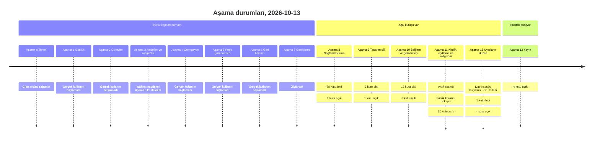
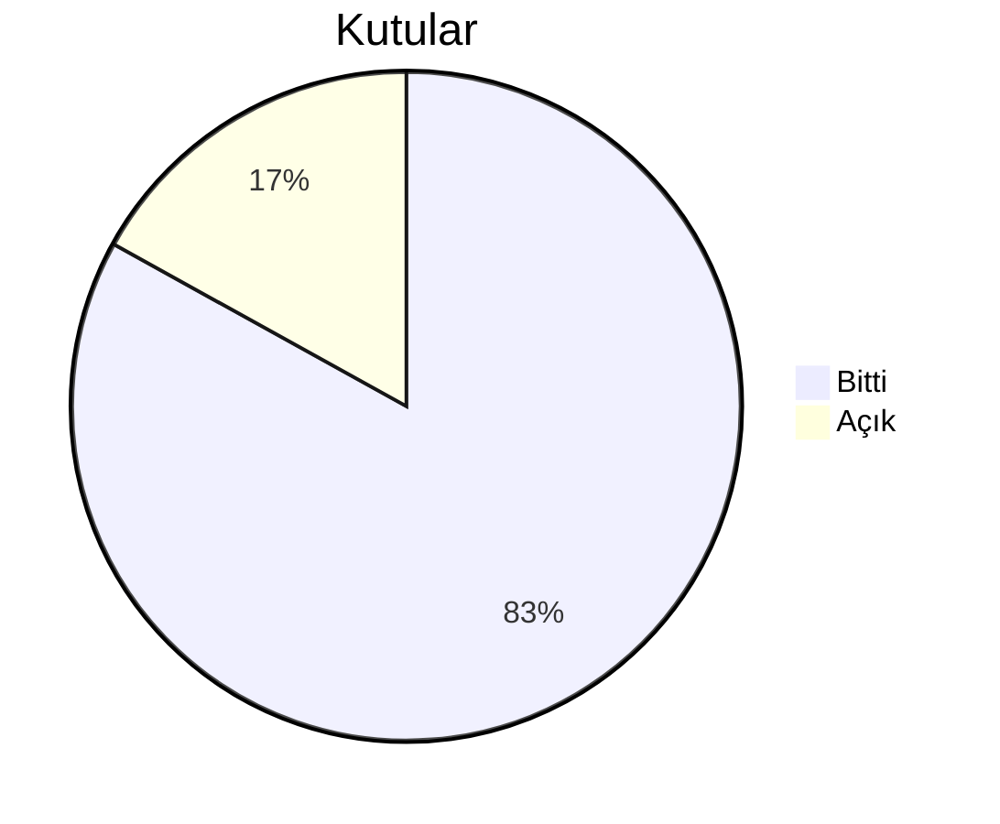
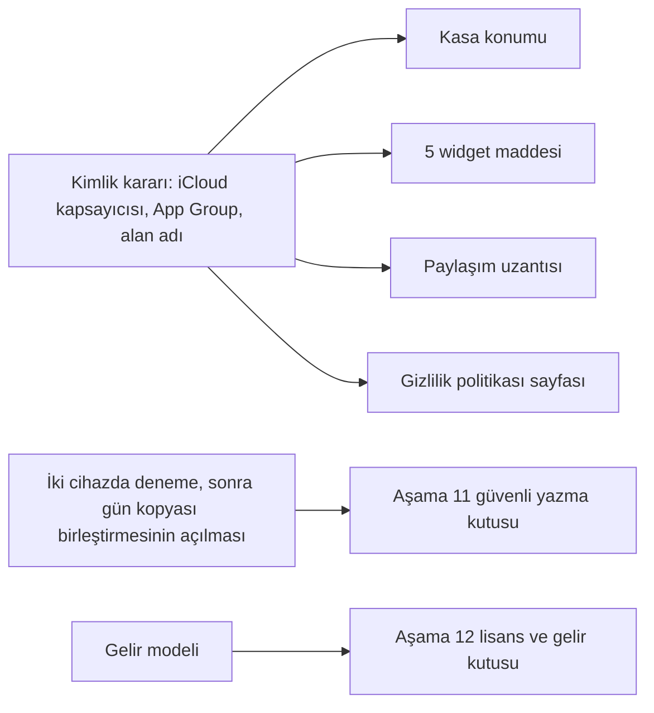
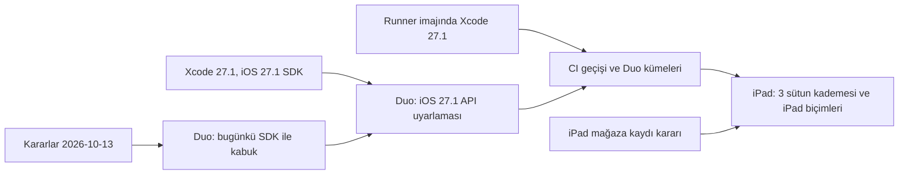

# Yol haritası

**Amaç:** Yol haritası aşamaları, maddeleri ve her maddenin durumunu gösterir.

**Kapsam:**

- Aşama 0–13'ün maddeleri ve kutuları
- Gerçek kullanım ölçütleri ve kullanıcı kararı bekleyen konular
- Sonraki fikirler

**Aktif aşama:** 11

Aşama 11'in kimlik gerektirmeyen dilimleri bitti; kalan maddeler kimlik kararını ve cihaz denemesini bekler. Aşama 13'ün iPhone Duo dilimi bugünkü SDK ile Aşama 11'in bekleyen maddeleriyle birlikte yürür. Karar günlüğü bu sırayı 2026-10-13'te kaydetti. Aşama 8 ve 9'un açık maddeleri kullanıcının elindedir: kilidin ve Bugün ekranının gerçek cihazda doğrulanması.

## Genel durum

**Aşamaların durumu ve açık kutu sayısı:**

**118 kutunun durumu:**

| İşaret | Anlamı |
|---|---|
| `[x]` | Kod `dev` dalında, testlerden ve CI'dan geçti. CI, sürekli bütünleştirme demektir. |
| `[ ]` | Madde açık. Durum tablosu kalan işi söyler. |

**Durum (2026-10-13).** Aşama 0–10'un teknik maddeleri `dev` dalındadır. İlk sürüm `v0.9.0` `main` dalındadır. TestFlight'ta dahili test sürüyor. Aşamaların gerçek kullanım ölçütleri henüz ölçülmedi; "Gerçek kullanım ölçütleri" tablosu ölçütleri ayrıca izler.

Ekim 2026'da çok modelli bir heyet projeyi inceledi. Heyet 4 iş yaptı: kod ve mimari denetimi, ekran görüntülü kullanım gezisi, sektör taraması, tasarım dili araştırması. İnceleme gerçek hatalar, ölçek sorunları ve vaatle uyuşmayan yerler buldu. Bu nedenle heyetten sonraki ilk iş yeni özellik değil, sağlamlaştırmaydı. Aşama 8 ve sonraki aşamalar heyetin önerdiği sırayı izler; kullanıcı onayı kapsamı ve sırayı kesinleştirir.

Kural: Her modülü gerçek kullanımda sına. Aşama 0–7'nin kodu çıkış ölçütlerini beklemeden art arda geldi. Ölçütler geçerlidir ve gerçek kullanımla kapanır. Bir ölçüt kullanımda tutmazsa sonraki işlerin sırasını yeniden kur.

## Gerçek kullanım ölçütleri

| Aşama | Teknik kapsam | Çıkış ölçütü | Durum |
|---|---|---|---|
| 0 Temel | iCloud kasa konumu dışında tamam | Uygulama örnek kasayı okuyor ve indeksliyor; değişiklikler ekrana yansıyor; testler geçiyor | Sağlandı |
| 1 Günlük | Tamam | Kullanıcı iki hafta boyunca her gün günlüğünü uygulamada tutuyor | Başlamadı |
| 2 Görevler | Tamam | Kullanıcı günlük görevlerini yalnız uygulamada izliyor | Başlamadı |
| 3 Hedefler ve widget'lar | Hedefler tamam, widget'lar yok | Kullanıcı alışkanlık uygulamasını ve Lockday'i telefondan sildi | Widget'lar kimlik kararını bekliyor |
| 4 Otomasyon | Tamam | İki hafta boyunca hiçbir hatırlatma kaçmıyor; uygulama konuma bağlı hedefleri kullanıcı işaretlemeden yazıyor | Başlamadı |
| 5 Proje görünümleri | Tamam | Kullanıcı Kanban ve zaman çizelgesi için Notion'u açmıyor | Başlamadı |
| 6 Geri bildirim | Sayılara dayanan kısım tamam | Kullanıcı haftalık özeti 4 hafta üst üste okuyor | Başlamadı |
| 7 Genişleme | İlk kullanım, kasa hazırlama, kilit ve özel tipler tamam | Yok | - |

Gerçek kullanım gerçek cihazda kalıcı kurulum ister. TestFlight yapısı kalıcı kurulumu sağlar.

## Kullanıcı kararı bekleyenler

**Bekleyen kararlar ve açtıkları maddeler:**

| Karar | Neyi açar | Not |
|---|---|---|
| iCloud kapsayıcısı, App Group ve alan adı | iCloud kasası, widget'lar, kilit ekranı ve Denetim Merkezi girişleri, paylaşım uzantısı; alan adı mağaza sayfası için gerekir | Üyelik alındı. Ad "Kenet" ve bundle kimliği `com.dogancanyildiz.kenet` 2026-10-07'de karara bağlandı. TestFlight bu kararları beklemez. Kalıcı bundle kimliği koda girdi ve ilk yükleme yapıldı: #130. |
| Gün kopyasının kendiliğinden birleştirilmesi | Aşama 11'in güvenli yazma kutusu | Core birleştirme işlevi hazır: #206. Uygulama işlevi gerçek kasada çağırmaz. Kullanıcı iki cihazda bir hafta dener, sonra açılmasına karar verir: 2026-10-13. |
| Gelir modeli | Aşama 12 | Lisans karara bağlandı: tüm hakları saklıdır. Sektör taraması bu kategoride reklamı önermiyor. |
| Yapay zeka | Sonraki fikirler | Cihaz üstü model maliyetsiz bir seçenektir. Öneri: varsayılan kapalı. |

**UYARI:** Kimlik değişince uygulamanın kapsayıcısı da değişir; kapsayıcı kararına kadar gerçek veriyi klasör seçiciyle seçilen, kapsayıcının dışındaki bir klasörde tut.

**DİKKAT:** Mağazada yayımlanan iPad desteğini geri alamazsın; iPad desteğini sonradan eklemek serbesttir.

## Aşama 8: Sağlamlaştırma

| Grup | Kutu | Bitti | Açık |
|---|---|---|---|
| Doğruluk ve veri güvenliği | 11 | 10 | 1: kilidin cihaz doğrulaması |
| Ölçek | 7 | 7 | 0 |
| Veri sahipliği ve gizlilik | 3 | 3 | 0 |
| Erişilebilirlik ve dil | 4 | 4 | 0 |
| Kapılar | 4 | 4 | 0 |

| Açık kutu | Durum |
|---|---|
| Uygulama kilidi, "Hemen" ayarı | Kod ve test `dev` dalında. Kalan iş: gerçek cihazda doğrulama. |

Aşama 8 heyet incelemesinin bulgularını düzeltir. Her hata düzeltmesi hatayı yakalayan bir test ya da fixture getirir. Ölçümlerin hepsi Mac'te, 5 yıllık sentetik kasalarda koştu. Sentetik kasalar 2.300 ile 2.400 arası dosya taşır. iPhone'da ölçüm yok.

Doğruluk ve veri güvenliği:

- [x] Olay saati: uygulama saati cihazın saat dilimi farkı kadar kaydırıyordu. Uygulama saati dosyadaki değerle gösterir. Testler saati UTC dışı bir saat diliminde sınar. UTC, eşgüdümlü evrensel zaman demektir.
- [x] Satır içi düğmeler: tek dokunuş satırdaki bütün düğmeleri birlikte tetikliyordu. Örnek: takma ad satırında "Kaydet" takma adı siliyordu; günlük takviminde ay okları çalışmıyordu. Uygulama satır içi düğmeleri ayırır.
- [x] Tekrarlayan görev düzenleme: kullanıcı uygulamanın yazdığı görevde tekrarı değiştiremiyordu. Kimlik onarımıyla birlikte uygulama çöküyordu. Yazıcı kuraldan sonraki kullanıcı metnini siliyordu.
- [x] Aynı dosya adı: ad başka klasörde de varsa otomatik bağlantı yanlış dosyaya gidiyordu. İndeks yazmanın hedefini belirler. Kural önce `vault-format.md` belgesine girdi.
- [x] Doğal dilde tarih: ayrıştırıcı ondalık ve kesirli sayıları tarih sanıyor ve metinden siliyordu. Örnek: "2.5 kg un al". Ayrıştırıcı "haftaya salı" ifadesini yanlış güne çözüyordu. Kısayollar yolu varsayımlı tarihi sormadan uyguluyordu.
- [x] Silme: kullanıcı olay, görev, alan ya da hedef kaydı silince uygulama onay ister ya da geri alma sunar. Uygulama günlük yazısında dosyaya girmemiş metni sormadan atmaz.
- [x] Kasaya erişim hatası: uygulama kayıtlı kasaya erişemezse durumu ana ekranda gösterir. Yazmalar sessizce başka kasaya gitmez.
- [x] Yazma sırası: uygulama meşgulken gelen yazmayı sıraya alır. Enter tuşu kaybolmaz. Yanlış "dosya dışarıdan değişti" hatası çıkmaz.
- [ ] Uygulama kilidi: "Hemen" ayarında başarılı doğrulamadan sonra uygulama kendini yeniden kilitlemez. Kullanıcı davranışı gerçek cihazda doğrular.
- [x] Kasa denetimleri: uygulama her yazmada kasa format sürümünü denetler. Kasa hazırlama harf farkı olan klasör adını bildirir, örneğin `Journal/`. Ön bilgideki boş liste öğesi yeniden adlandırmayı durdurmaz.
- [x] Eşitlenen klasör uyarısı: kullanıcı eşitlenen bir klasörü kasa seçerse uygulama bilgi bandı gösterir. Örnek: iCloud Drive.

Ölçek:

- [x] Yeniden adlandırma ölçeği: varlık yeniden adlandırma süresi bağlantı sayısıyla karesel büyüyordu. Ölçüm 139 sn ve yaklaşık 5 GB bellek gösterdi. Süre artık doğrusal büyüyor.
- [x] İlk indeksleme ve tip ekleme: uygulama boş indekste tam kurulum yolunu kullanır. Bir SQLite indeksi kimlik sahipliği sorgusunu hızlandırır. Şema sürümü bu değişiklikle arttı.
- [x] Boş yenileme: dosya değişmemişse yenileme hiçbir şey yayımlamaz. Uygulama bildirimleri her turda silip yeniden kurmaz.
- [x] Arka planda okuma modeli: uygulama yazmadan sonra okuma modelini ana iş parçacığı dışında kurar. Önceki ölçüm olay eklerken 0,45 sn donma gösterdi.
- [x] Hedef işaretleme: işaretleme bütün kasayı okumaz. Yazma başına tam klasör taraması kalktı. İndeks güncellemesi yalnız yazmanın bildirdiği klasörleri tarar.
- [x] Ölçek bütçe testleri: sentetik kasada yenileme, yazma, yeniden adlandırma ve ilk açılış süreleri.
- [x] Artımlı okuma modeli: uygulama okuma modelini dosya başına artımlı kurar. 5 yıllık kasada yazmadan sonraki süre 1,65 sn'den 0,09 sn'ye indi. Ekranların kendi sorgusunu çalıştırması Aşama 11'e geçti.

Veri sahipliği ve gizlilik:

- [x] Varsayılan kasa konumu: kasa iPhone'da Dosyalar'da, Mac'te Finder'da görünür. İlk açılış ekranı kasanın yerini söyler.
- [x] Kilitliyken gizlilik: bildirimlerde içeriği gizleme seçeneği var. Uygulama kilitliyken Siri hedef adlarını listelemez. Uygulama kilitliyken Kısayollar ve bildirim eylemi yazmaz.
- [x] İndeks ve arama geçmişi: uygulama indeksi yedeğin dışında tutar. Veri koruma sınıfı kararı karar günlüğündedir. Kullanıcı arama geçmişini temizleyebilir; arama geçmişi kasaya bağlıdır.

Erişilebilirlik ve dil:

- [x] Dokunma hedefleri en az 44 pt'dir. Hızlı giriş çubuğu büyük yazıda düzenini korur.
- [x] Renk ve opaklık: uygulama geciken tarihi kırmızıyla, tamamlanan görevi opaklıkla göstermez. Gerekçe kontrast ve "cezalandırma yok" ilkesidir.
- [x] VoiceOver: Graph tuvalinin erişilebilir karşılığı, öncelik değeri, günlük önizlemesi, Kanban ve zaman çizelgesi eylemleri.
- [x] Yerelleştirme: katalogda olmayan anahtarlar, ölü anahtarlar, "Her 1 hafta" metni ve Türkçe ek uyumu. Ek uyumu örneği: `Ev'te`.

Kapılar:

- [x] iOS testleri: uygulama testleri iOS simülatöründe de koşar. Fixture kasasıyla arayüz duman testi ve erişilebilirlik denetimi koşar.
- [x] Belge biçim denetimi: karar tablosu, README belge tablosu ve String Catalog tamlığı. `Tests/` klasörü de biçim denetimine girer.
- [x] Kasa hazırlama yazıcıları: testler yazıcıları fixture ile sınar.
- [x] Sürüm akışının kuru koşusu: `VERSION` yükseltme yolu ve etiket varken sessiz atlama.

**Çıkış ölçütü:** Aşama 8'deki her hatayı bir test ya da fixture koruyor. 5 yıllık sentetik kasada olay eklemek arayüzü dondurmuyor. İki haftalık gerçek kullanımda veri kaybı ya da yanlış gösterim çıkmıyor.

## Aşama 9: Tasarım dili

| Madde | Durum | Kanıt |
|---|---|---|
| Bugün prototipi | Bitti. Ayrı prototip yapılmadı; kullanıcı 2026-10-16'da imzayı istemedi ve maddeyi kapattı. | #254 |
| Belirteçler ve simge | Bitti. Simge "Geçme": mürdüm ve mürekkep; iPhone'da 3 görünüm, Mac'te 10 boy. Kalan iş: küçük boyları gerçek cihazda gözle doğrulama. | #122 |
| Bileşen kitaplığı | Bitti | - |
| Bugün ve hızlı giriş | Bitti | - |
| Günlük, gün ve varlık sayfaları | Bitti | - |
| Görevler, Kanban, zaman çizelgesi | Bitti | - |
| Hedefler, özetler, Graph, harita | Bitti | - |
| Mac, Ayarlar, ilk kullanım, kilit | Bitti | - |
| Ekran görüntüsü testleri | Bitti | - |
| Denetim kalıpları | Bitti. Kalıbı koruyan kaynak denetiminin izin listesi boş. Mac'te arama yalnız pencere araç çubuğundadır: `MacShell.swift`. Arama yeri ve kenar çubuğu vurgusu 2026-10-08'de karara bağlandı. | #121, #124–#127, #151 |

Kullanıcı tasarım yönünü seçti: Mürekkep, kullanıcının 2 değişikliğiyle. Yön, belirteçler ve kurallar [Tasarım dili](design.md) belgesindedir.

- [x] Bugün prototipi: Mürekkep yönünün Bugün ekranı için SwiftUI prototipi. Ayrı prototip yapılmadı: Bugün ekranı Mürekkep kurallarıyla üretimde ve TestFlight'ta cihazda bakılabiliyor. Kullanıcı 2026-10-16'da Derkenar'ın imzasını istemediğini kesinleştirdi ve maddeyi kapattı.
- [x] Tasarım belirteçleri ve uygulama simgesi: renk, tipografi, biçim ve boşluk belirteçleri, asset catalog, uygulama simgesi.
- [x] Bileşen kitaplığı: tarih başlığı, hedef çipi, görev satırı, olay satırı, bölüm başlığı, hızlı giriş çubuğu, yüzey, çip, boş durum, ilerleme göstergesi, ısı haritası hücresi, bilgi bandı.
- [x] Bugün ve hızlı giriş: tarih başlığı, olayların ilk ekranda görünmesi, geciken görevleri sınırlama. Taslak değişikliği önce `screens.md` belgesine girdi.
- [x] Günlük ve gün sayfası; varlık sayfalarında okumayı ve düzenlemeyi ayırma; ham bağlantı sözdizimini ve teknik anahtarları gizleme.
- [x] Görevler, Kanban ve zaman çizelgesi; görünüm değiştirmeyi tek kalıba bağlama.
- [x] Hedefler, ısı haritası ve özetler; Graph ve harita renkleri. Graph ve harita renge ek olarak biçimle de ayırır.
- [x] Mac geçişi; Ayarlar'ı 5 alt sayfaya bölme: Gizlilik, Bildirimler, Takvim ve Konum, Kasa, Tanılama; ilk kullanım ve kilit ekranı.
- [x] Ekran görüntüsü testleri: açık ve koyu mod, büyük yazı, Kontrastı Artır.
- [x] Denetim kalıpları: `design.md` belgesindeki ortak bileşenler ve bütün ekranları ile sheet'leri bu bileşenlere bağlama. Bileşenler: manşet satırı eylemleri, sekme, etiketli menü, süzgeç alanı, sheet iskeleti. Kalıbı koruyan kaynak denetimi; Kişiler, Konumlar ve sheet'ler için ekran görüntüsü testleri.

**Çıkış ölçütü:** Bütün ekranlar aynı bileşen kitaplığını kullanıyor. Erişilebilirlik denetimi ve ekran görüntüsü testleri CI'da geçiyor.

## Aşama 10: Bağlam ve geri dönüş

| Madde | Durum | Kanıt |
|---|---|---|
| Bu gün geçmişte | Bitti | #163 |
| Takvimden olay taslağı | Bitti | #175 |
| Bağlanmamış anmalar | Bitti | #171, #176, #180 |
| Önemli tarihler | Bitti | #166, #170 |
| Görüşme ritmi | Bitti | #179, #186 |
| Giriş yollarını gösterme | Bitti | #165 |
| Hızlı giriş vurgusu | Bitti. Tarih, öncelik, tekrar ve adlar için kutunun üstünde çip ve geri alma var. Kutu içi vurgu yapılmaz; karar 2026-10-13. | #162, #169, #193 |
| Zincir affı | Bitti | #190 |
| Suçlamasız taşıma ve günü kapat | Bitti | #167, #177, #195, #199 |
| Haftalık inceleme | Bitti | #182, #191 |
| Rehberden kişi aktarma | Bitti | #178 |
| Bu güne bağlananlar, yoğunluk noktaları | Bitti | #164, #168 |

Aşama 10 sektör taramasından çıkan ilk dalgadır. Maddeler kimlik kararı gerektirmez ve ürünün farkını büyütür. Biçime dokunan maddeyi önce [Kasa biçimi](vault-format.md) belgesinde tanımla.

- [x] Bu gün geçmişte: Bugün ekranında kişi ve konum taşıyan tek satır. Satır yalnız veri varsa görünür.
- [x] Takvim etkinliğinden olay taslağı; katılımcı adları kişi adayı olur. Uygulama emin değilse kullanıcıya sorar.
- [x] Varlık sayfasında bağlanmamış anmalar; satır satır, kullanıcı onayıyla bağlama.
- [x] Önemli tarihler: kişi ve özel tip dosyalarındaki tarih alanlarından doğum günü ve yıl dönümü satırı.
- [x] Kişi başına görüşme ritmi, erteleme ve duraklatma; isteğe bağlı, günlük tavanı olan hatırlatma.
- [x] Var olan giriş yollarını ilk kullanımda ve Ayarlar'da gösterme. Giriş yolları: Eylem düğmesi ve Siri cümleleri.
- [x] Hızlı giriş vurgusu: uygulama tanıdığı tarih, öncelik, tekrar ve adları kutunun üstünde çiple gösterir. Kullanıcı çipe dokununca uygulama ayrıştırmayı geri alır. Kutu içi vurgu yoktur.
- [x] Zincir affı: önceki iki günü ve sonraki günü yapılmış kaçırma zinciri kırmaz; yumuşak ilerleme skoru. Dinlenme günü yok. Kural karar günlüğünde, 2026-10-11 tarihli.
- [x] Suçlamasız taşıma ve iki dakikalık "günü kapat". Taşıma seçenekleri: bugüne, yarına, haftaya.
- [x] İsteğe bağlı haftalık inceleme; kullanıcı incelemeyi atlayabilir. İncelemenin çıktısı günlük yazısına düşer.
- [x] Rehberden kişi aktarma: kullanıcının seçtiği kişileri tek yönlü ve bir kez içe aktarma.
- [x] Gün sayfasında "bu güne bağlananlar"; günlük takviminde yoğunluk noktaları.

**Çıkış ölçütü:** Kullanıcı haftalık incelemeyi 4 hafta üst üste tamamlıyor. "Bir süredir görüşmediklerin" listesinden ayda en az 1 görüşme çıkıyor.

## Aşama 11: Kimlik, eşitleme ve widget'lar

| Madde | Durum | Kanıt |
|---|---|---|
| Kasa konumu | Açık. Kimlik kararını bekliyor. Yerel kasa ve klasör seçimi hazır. | - |
| Eşitlenen kasada güvenli yazma | Açık. Hazır: Core koordinasyon sınırı ve `.merge` niyeti; App'te `NSFileCoordinator` ve okuma kuyruğu; eşitlenen klasör tespiti ve bandı; yer tutucu tespiti; Core'da gün kopyası birleştirme ve belirlenimci zaman kuralı; kopya dosyalar Tanılama'da. Açık: indirme isteği, birleştirmeyi App'e bağlama, `NSFileVersion` çakışmaları, eşitleme göstergesi. İndirme isteği cihaz doğrulamasını, birleştirme iki cihazda denemeyi bekliyor. | #187, #189, #200, #203, #206, #207, #234, #238 |
| Ana ekran widget'ı | Açık. App Group kararını bekliyor. | - |
| Ekranlar kendi sorgusunu çalıştırır | Açık. Bütün ekranlar, bildirim planlayıcı ve proje listeleri kendi sorgusunu çalıştırıyor. Okuma modelinden `days`, `tasks`, `projects` ve `goalStatuses` çıktı; parçalar blok metni taşımıyor. 5 yıllık kasada okuma modeli 10,8 MB'tan 2,35 MB'a, yeniden türetme 1.640 ms'den 50 ms'ye indi. Kalan: `entities`, `goals`, `goalLogs`; widget App Group kararını bekliyor. | #192, #201, #205, #208, #210, #211, #212, #214, #225 |
| Widget yenilemesinin testi | Açık | - |
| Kilit ekranı widget'ı | Açık | - |
| Hızlı giriş widget'ı ve girişler | Açık | - |
| Mac widget'ları | Açık | - |
| Paylaşım uzantısı | Açık. App Group kararını bekliyor. | - |
| Sistemin günlük önerileri | Açık | - |

Kasa konumu ve widget'lar kimlik kararını bekler. Kimlik gerektirmeyen dilimler Aşama 10 ile birlikte yürüdü ve bitti. Karar günlüğü bu sırayı 2026-10-12'de kaydetti. Güvenli yazmanın kalanı kullanıcının cihaz denemesini bekler.

- [ ] Kasa konumu: iCloud kapsayıcısı; yerel kasa yedek seçenek olarak kalır. Madde Aşama 0'dan devretti.
- [ ] Eşitlenen kasada güvenli yazma: dosya koordinasyonu, cihaza inmemiş dosyalar, çakışan sürümleri tespit, birleştirme işlevini bağlama, kopya dosya kuralı, eşitleme durumu göstergesi.
- [ ] Ana ekran widget'ı: zincir ve tek dokunuşla işaretleme; widget yapılmamış hedefleri vurgular. Madde Aşama 3'ten devretti.
- [ ] Ekranlar ve widget kendi sorgusunu çalıştırır: küresel okuma modeli yerine Core sorguları. Gerekçe widget bellek sınırıdır. Madde Aşama 8'den devretti.
- [ ] Widget yenilemesinin güvenilirlik testi. Madde Aşama 3'ten devretti.
- [ ] Kilit ekranı widget'ı: takvim etkinlikleri ve günün görevleri. Madde Aşama 3'ten devretti.
- [ ] Hızlı giriş widget'ı ile kilit ekranı, Denetim Merkezi ve Eylem düğmesi girişi. Madde Aşama 3'ten devretti.
- [ ] Mac widget'ları. Madde Aşama 3'ten devretti.
- [ ] Paylaşım uzantısı: "olay olarak ekle".
- [ ] Sistemin günlük önerileri seçicisi. Apple'daki adı Journaling Suggestions.

**Çıkış ölçütü:** İki cihazda iki haftalık kullanımda kayıp ya da kopya dosya çıkmıyor. Kullanıcı alışkanlık uygulamasını ve Lockday'i telefondan sildi.

## Aşama 12: Yayın

| Madde | Durum | Kanıt |
|---|---|---|
| Mağaza teknik hazırlığı | Açık. Kalan iş: gizlilik politikası. Lisans bildirimi bitti. Yer tutucu bölüm olan Mac "Notlar" girdisi kalktı. Ötekiler ilk TestFlight yüklemesi için bitti. | #130, #151, #188 |
| CD | Açık. Elle yol hazır: `.github/scripts/testflight.sh` temiz kopyadan arşivler ve yükler. İlk yapı 0.9.0 yüklendi. `dev`'e her itmede imzasız arşiv denetimi koşar. CI'dan otomatik gönderim açık ve App Store Connect anahtarı ister. | #134, #197 |
| Lisans, ad, gelir modeli | Açık. Ad Kenet ve lisans "tüm hakları saklıdır" karara bağlandı. Gelir modeli ve yazılı taahhüt açık. | #131 |
| Mağaza sayfası | Açık | - |

- [ ] Mağaza teknik hazırlığı: gizlilik bildirimi dosyası, ihracat bildirimi, uygulama simgesi, gizlilik politikası, üçüncü taraf lisans bildirimi. Ayrıca derleme numarası, platforma göre ayrı yetki dosyaları, iPad kararı ve yer tutucu bölümleri kaldırma.
- [ ] CD: TestFlight'a otomatik gönderim. CD, sürekli dağıtım demektir. Araç seçenekleri: Xcode Cloud ya da fastlane. Madde Aşama 7'den devretti.
- [ ] Lisans, ad, gelir modeli; yazılı "veri kilidi yok" taahhüdü.
- [ ] Mağaza sayfası: metinler, ekran görüntüleri, yaş derecelendirmesi.

**Çıkış ölçütü:** İlk dış kullanıcı uygulamayı TestFlight'tan kurar ve kendi kasasını açar.

## Aşama 13: Uyarlanır düzen

**Aşamanın iki dilimi ve dış olaylara bağlı sırası:**

| Madde | Durum | Kanıt |
|---|---|---|
| Duo kabuğu, bugünkü SDK | Bitti. Uyarlanır kabuk, boyut sınıfıyla görüntü altyapısı, durum köprüsü ve taslak koruma, krom ve dokunma, güvenli alan, sheet ve panel, belgeler. Kalan Duo işi iOS 27.1 SDK'yı bekler. | #233, #236, #240, #241, #242 |
| Duo iOS 27.1 API uyarlaması | Açık. Xcode 27.1'in iOS 27.1 SDK ile çıkmasını bekliyor. | - |
| CI geçişi ve Duo kümeleri | Açık. Runner imajında Xcode 27.1'i bekliyor. | - |
| iPad karma kabuk | Bitti. Üç sütun kademesi, kenar çubuğu ve seçim biçimi, arama ve Rehberden aktar, Kanban ve zaman çizelgesi iPad biçimi, cihaz türü metinleri, iPad görüntü kümeleri ve CI'da iPad adımı. Kalan: klavye kısayolları (⌘K, ⇧⌘F, ⌘T), iPad ekran turu ve erişilebilirlik denetimi. | #265, #266, #267, #268 |
| iPad mağaza kaydı | Bitti. Cihaz ailesi `1,2`, iPad dört yön, tek pencere; TestFlight yapısı iPad'e çıkar. Mağaza listesi (iPad ekran görüntüleri) Aşama 12'nin mağaza sayfası maddesinde. | #264 |

iPhone Duo'nun dış ekranı sıkışık, iç ekranı düzenli × düzenli boyut sınıfındadır. Kabuk boyut sınıfına bakar; cihaz türüne bakmaz. Aynı kabuk iPad'de de çalışır; iPad yalnız 1000 pt üstü kademeyi ve cihaz ailesini ekler. Plan ve ölçüler kullanıcı raporlarındadır; repo yalnız kararları taşır.

- [x] Duo kabuğu, bugünkü SDK: düzenli × düzenli ekranda Mac biçimli kenar çubuğuyla bölünmüş kabuk; kabuk değişince seçim ve taslak korunur; satır dokunuşu ve manşet kabuğa göre; boyut sınıfıyla görüntü testleri; asimetrik güvenli alan; sheet ve panel düzenli genişlikte; belgeler.
- [ ] Duo iOS 27.1 API uyarlaması: poz turu, hızlı giriş çubuğu için ayrılmış bölge, Bugün için düzenleme görünümü, bölmeye hizalı sütun, eş merkezli köşe, Kanban yarıları, yeniden boyutlanma denetimi. Kod CI geçişinden önce `dev`'e girmez.
- [ ] CI geçişi ve Duo kümeleri: xcode-27 runner, simülatör seçicileri, Duo görüntü kümeleri, `testflight.sh` SDK denetimi, tur ve kayıt betikleri.
- [x] iPad karma kabuk: 1000 pt ve üstü pencerede 3 sütun, dar pencerede telefon düzeni, kenar çubuğu stili, Kanban ve zaman çizelgesi iPad biçimi, iPad görüntü ve arayüz testleri.
- [ ] iPad kalanlar: donanım klavyesi kısayolları (⌘K hızlı geçiş, ⇧⌘F arama, ⌘T bugün; odak değerine bağlı olmayan gizli düğmelerle), iPad ekran turu (`screen-tour.sh --pad`, kenar çubuğu kimlikleri) ve erişilebilirlik denetimi, kenar çubuğu ve kart işaretçi vurgusu.
- [x] iPad mağaza kaydı: cihaz ailesine 2'nin eklenmesi ve mağaza listesi. Geri alınamaz; kullanıcı kararı (2026-10-16). Mağaza listesi sürümde.

**Çıkış ölçütü:** Duo simülatöründe 4 pozda bütün ana ekranlar taslak kaybı olmadan çalışır. Var olan iPhone ve Mac görüntü referansları değişmeden geçer.

## Aşama 14: Görselleştirme

| Madde | Durum | Kanıt |
|---|---|---|
| Grafikler | Bitti. Dört grafik `dev`'de; referanslar açık, koyu ve AX3'te kayıtlı; Core hesapları fixture ile sınanıyor. | #249, #250, #251 |
| Grafikler 2 | Bitti. İki grafik `dev`'de; referanslar açık, koyu ve AX3'te kayıtlı; Core hesapları fixture ile sınanıyor. | #256, #257 |

Kullanıcı bu aşamayı 2026-10-15'te onayladı. Madde kimlik ya da cihaz kararı gerektirmez; bu yüzden Aşama 11 ile birlikte yürür. Prototip kodu `dev`'e girmedi; gerçek dalga Core hesaplarını ve ekranları yeniden yazar.

- [x] Grafikler: Özetler yılında 12 ay × 31 gün yazılan gün haritası; sayısal hedef ayrıntısında son 90 günün 7 günlük ortalama çizgisi, günlük noktalar ve kesik hedef çizgisi, yıllık hedefte 12 ay toplam çubuğu; kişi ve konum ekranında "Son görüşme" kartının içinde 12 aylık geçiş çubuğu ve 90 günlük şerit; haftalık incelemenin ilk adımında yedi günlük mini ritim ve geçen haftayla fark. Hesaplar Core'da, çizim App'te; her grafik renge ek olarak biçim taşır ve VoiceOver özeti okur.
- [x] Grafikler 2: Özetler'in Ay ve Yıl sekmesinde ritmin altında "Haftanın günleri" bölümü: Pazartesi'den Pazar'a yedi yazma oranı satırı (yazılan gün / dönemdeki gün, oran çubuğu, en düzenli gün işaretli); Özetler'in Görevler bölümünde birim sonu açık görev eğrisi (önceki dönem kesikli çizgi, dönem başı ve sonu sayıları). Hesaplar Core'da, çizim App'te; AX3'te liste biçimi; VoiceOver özeti.

**Çıkış ölçütü:** Altı grafik iPhone'da açık, koyu ve AX3'te referans görüntüyle korunur; Core hesapları fixture ile sınanır.

## Aşama 15: Kullanım kolaylığı

| Madde | Durum | Kanıt |
|---|---|---|
| Silme ve ekleme | Bitti | #258 |
| Bugün hedef şeridi | Bitti | #261 |
| Oluşturma gönderimi tamamlamaz | Bitti | #259 |
| Hedef düzenleme formu | Bitti | #262 |
| Şablonlar ve bağlam menüsü | Açık | |

Kullanıcı 2026-10-16'da TestFlight 249 denemesinden sonra dört sorun bildirdi ve aşamayı açtı. Dört madde aynı gün `dev`'e girdi; kullanıcı TestFlight'ta doğrular. Maddeler kimlik ya da cihaz kararı gerektirmez; bu yüzden Aşama 11 ile birlikte yürür. Kararlar karar günlüğünde 2026-10-16 satırlarındadır.

- [x] Silme ve ekleme: kişi, konum ve özel tip varlığının ekranında onaylı "Sil"; yalnız varlık dosyası silinir, gün dosyalarındaki bağlantılar çözülmemiş bağlantı olarak kalır. Hedef ayrıntısında onaylı "Hedefi sil"; yalnız hedef dosyası silinir, gün kayıtları kalır. Kişiler ve Konumlar listesinde "Yeni kişi" ve "Yeni konum". Silme Core'da dosya koordinasyonuyla yapılır ve kasa biçimi belgesine girer.
- [x] Bugün hedef şeridi: işaretleme ya da artırma satırın yerini değiştirmez (sıra güne girişte belirlenir); artı düğmesinin yuvası yazma ve yükleme sırasında sabit kalır; bölüm başlığına yükleme göstergesi gelmez; satıra dokunma hedef ayrıntısını açar.
- [x] Oluşturma gönderimi tamamlamaz: hızlı girişte, olay düzenleyicide ve serbest yazıda yazarken "Yeni kişi / konum oluştur" yalnız varlık dosyasını yazar, metni ve odağı korur. Gönder ya da Kaydet sonrası "Kişi olarak ekle" bugünkü gibi işlemi tamamlar.
- [x] Hedef düzenleme formu: ad, dönem, tür, miktar ve birim tek sheet'te, Vazgeç ve Kaydet ile; sheet'in altında "Hedefi sil". Alan başına sheet kalkar.
- [ ] Şablonlar ve bağlam menüsü: yeni hedef sheet'inde ad alanının altında 15 hazır hedef (yazdıkça süzülür; yalnız formu doldurur, dosya biçimi değişmez, simge yalnız listede). Ayarlar'da ve Kişiler ve Konumlar listesinde 10 hazır varlık tipi galerisi (`types.json` biçiminde, Türkçe alan anahtarları) ve özel tip için "Yeni <tip>" satırı. Kişi, konum, özel varlık ve hedef satırlarında uzun basma menüsü: Düzenle, Bağlantıyı kopyala, Sil; hedefte Bugünü işaretle ya da Miktar gir. Kullanıcı 2026-10-17'de onayladı; araştırma raporu depo dışında.

**Çıkış ölçütü:** Dört davranış iPhone'da görüntü ve birim testiyle korunur; silme yolları Core testleriyle sınanır; kullanıcı TestFlight'ta doğrular.

## Sonraki fikirler

| Fikir | Not |
|---|---|
| Fotoğraf ekleri | Obsidian uyumlu gömme. Biçim önce belgeye girer. |
| Cihaz üstü sesle giriş | - |
| Day One ve Apple Journal'dan içe aktarma | - |
| İsteğe bağlı yapay zeka: haftalık ve aylık yazılı değerlendirme, yeni varlık önerisi, notlara soru | Aşama 6'dan devretti. Karar açık. |
| Apple Watch: hızlı giriş ve hedef işaretleme | - |
| Yıl özeti, paylaşım kartı ve PDF | - |
| Kişi ve konumları Spotlight'a açma; Siri için okuma eylemleri | - |
| Ziyaret önerileri, örneğin "dün şurada mıydın?" | Uygulama sürekli konum izini kasaya yazmaz. |
| Şirket şema paketi | Aşama 7'den devretti. |
| Talep olursa Android ve Windows | Aşama 7'den devretti. |

Fikirlerin sırası ve kapsamı kesin değil. Her fikir ayrı karar ister.

## Tamamlanan teknik kapsam

| Aşama | Kutu | Devreden madde |
|---|---|---|
| 0 Temel | 9 bitti | iCloud kasa konumu Aşama 11'e |
| 1 Günlük | 13 bitti | - |
| 2 Görevler | 7 bitti | - |
| 3 Hedefler ve widget'lar | 3 bitti | Widget maddeleri Aşama 11'e |
| 4 Otomasyon | 4 bitti | - |
| 5 Proje görünümleri | 4 bitti | - |
| 6 Geri bildirim | 3 bitti | Yapay zeka maddeleri "Sonraki fikirler"e |
| 7 Genişleme | 5 bitti | Mağaza hazırlığı ve CD Aşama 12'ye; şirket şema paketi, Android ve Windows "Sonraki fikirler"e |

### Aşama 0: Temel

| Madde | Durum |
|---|---|
| 9 temel madde | Bitti |
| Kasa konumunun iCloud kısmı | Aşama 11'e devretti |

Aşama 0 kullanıcıya görünen bir şey getirmez. Öteki aşamalar Aşama 0'ın üstünde durur.

- [x] Xcode projesi: iOS ve macOS hedefleri, `Core` Swift paketi.
- [x] CI: GitHub Actions her PR'da derleme, `Core` testleri, biçim ve lint denetimi koşar.
- [x] Sürüm otomasyonu: `main`'e birleşince etiket ve GitHub Release.
- [x] Dal koruması: `main` ve `dev` için PR ve geçen test zorunluluğu.
- [x] Ayrıştırıcı ve yazıcı: frontmatter, bölümler, olay satırı, görev satırı, wikilink, blok kimliği. Görev satırı durum, metin ve kimlik taşır.
- [x] Gidiş dönüş testi ve `Fixtures/` örnek kasası.
- [x] SQLite indeksi ve dosyalardan yeniden üretme. İndeks GRDB ve FTS5 kullanır.
- [x] Dosya değişikliklerini izleme ve artımlı yeniden indeksleme.
- [x] Eşitleme çakışmalarını birleştirme işlevi. İşlevi uygulamaya bağlama işi Aşama 11'dedir.

Kasa konumunun iCloud kısmı Aşama 11'e devretti.

### Aşama 1: Günlük

| Madde | Durum |
|---|---|
| 13 madde | Bitti |

- [x] Bugün sayfası ve hızlı giriş kutusu.
- [x] Olay ekleme ve serbest günlük yazısı. Olay saat damgalı bir satırdır.
- [x] `@` ile kişi ve konum için öneri listesi; yeni varlık oluşturma.
- [x] Bilinen adları ve takma adları otomatik tanıma.
- [x] Belirsiz eşleşmede bağlama göre sıralama; emin değilse kullanıcıya sorma.
- [x] Aynı adlı varlık oluştururken ayırt edici sorma; dosya adını otomatik üretme.
- [x] Varlık adını değiştirme ve tüm bağlantıları güncelleme.
- [x] Geçmiş güne olay ekleme; saatsiz olay.
- [x] Kişi ve konum sayfaları: şablon alanları, serbest ek alanlar, zaman akışı.
- [x] Günler arasında gezinme.
- [x] Tam metin arama ve hızlı geçiş.
- [x] Mac'te kenar çubuklu, telefonda sekmeli düzen.
- [x] Mac'te sistem genelinde kısayolla açılan hızlı giriş penceresi.

### Aşama 2: Görevler

| Madde | Durum |
|---|---|
| 7 madde | Bitti |

- [x] Görev ekleme, tarih verme, tamamlama; hızlı girişte olay ve görev arasında geçiş.
- [x] Görevler sekmesi: yaklaşan, tarihsiz, tamamlanan.
- [x] Doğal dille tarih. Örnek: "yarın", "cuma", "5 ekim".
- [x] Bugün ekranında günün ve geciken görevler.
- [x] Görevleri kişi ve konumlara bağlama; varlık sayfasında açık görevler.
- [x] Cihaz takvimindeki etkinliklerin Bugün ekranında görünmesi. Uygulama EventKit ile salt okur.
- [x] İleri tarihli ajanda listesi.

### Aşama 3: Hedefler ve widget'lar

| Madde | Durum |
|---|---|
| 3 hedef maddesi | Bitti |
| Widget maddeleri | Aşama 11'e devretti |

- [x] Hedef tanımlama: dönem, tür ve miktar. Dönem gün, hafta ya da yıldır. Tür evet/hayır ya da sayıdır.
- [x] Zincir, en uzun seri, ısı haritası; yıllık hedefte ilerleme çubuğu.
- [x] Geçmiş günlerin hedef kaydını düzeltme.

Widget maddeleri Aşama 11'e devretti.

### Aşama 4: Otomasyon

| Madde | Durum |
|---|---|
| 4 madde | Bitti |

- [x] Görev ve hedef bildirimleri, akşam günlük hatırlatması; bildirimlerin güvenilirlik testi.
- [x] Olay yazarken GPS ile konum önerisi.
- [x] Konuma girince hedefi otomatik işaretleme ya da tek dokunuşluk bildirim.
- [x] Kısayollar ve Siri ile giriş. Uygulama App Intents kullanır.

### Aşama 5: Proje görünümleri

| Madde | Durum |
|---|---|
| 4 madde | Bitti |

- [x] Kanban: duruma, projeye ya da kişiye göre.
- [x] Zaman çizelgesi: başlangıç ve bitiş tarihli görevler. Ana hedef Mac'tir.
- [x] Proje etiketi ve proje sayfaları; sayı taşımayan yıllık hedefler.
- [x] Tekrarlayan görevler, öncelikler.

### Aşama 6: Geri bildirim

| Madde | Durum |
|---|---|
| 3 madde | Bitti |
| Yapay zeka maddeleri | "Sonraki fikirler"e devretti |
| Özetler yeniden tasarımı | Bitti: Yıl sekmesi, ritim şeridi, aynı tarihe kadar karşılaştırma, ad çipleri, yığılı görev çubuğu, Mac iki sütun (#228) |

- [x] Haftalık ve aylık özetler: kimlerle, nerelerde, hedef ve görev durumu. Özetler sayılara dayanır ve yapay zeka kullanmaz.
- [x] Kişi sayfasında son görüşme özeti; uzun süredir görüşmediğin kişiler.
- [x] Graph ve harita ekranları.

İsteğe bağlı yapay zeka maddeleri "Sonraki fikirler"e devretti.

### Aşama 7: Genişleme

| Madde | Durum |
|---|---|
| 5 kutu | Bitti |
| Mağaza teknik hazırlığı ve CD | Aşama 12'ye devretti |
| Şirket şema paketi, Android ve Windows | "Sonraki fikirler"e devretti |

- [x] Yayın öncesi kullanıcı akışları
  - [x] İlk kullanım akışı
  - [x] Var olan Obsidian kasasını yerinde açma ve hazırlama
  - [x] Uygulama kilidi
- [x] Özel varlık tipleri, örneğin kitap ve proje.

Mağaza teknik hazırlığı ve CD Aşama 12'ye devretti. Şirket şema paketi ile Android ve Windows "Sonraki fikirler"e devretti.

## İlgili belgeler

- [Kasa biçimi](vault-format.md)
- [Tasarım dili](design.md)
- [Kararlar](decisions.md)
