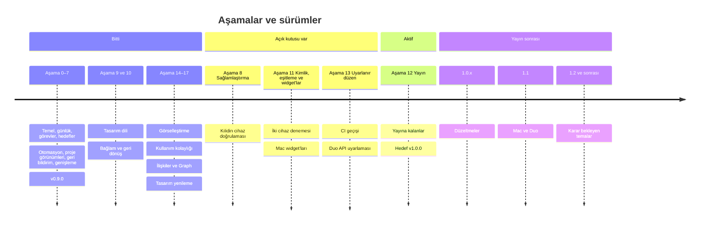
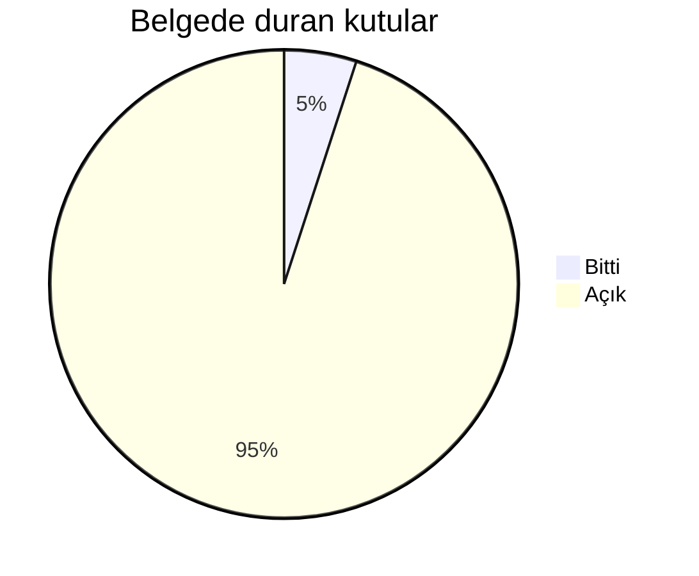
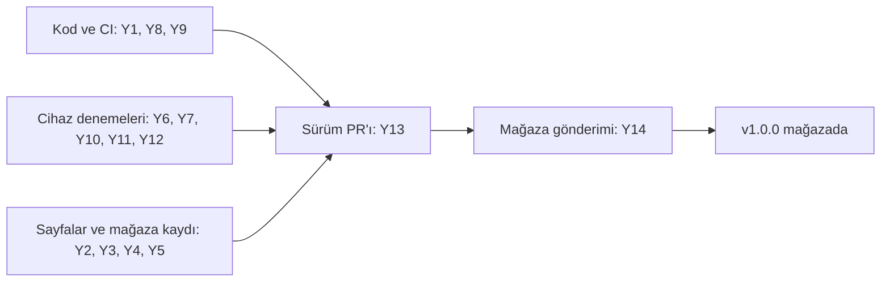

# Yol haritası

**Amaç:** Yol haritası neyin ne zaman yapılacağını ve her işin durumunu gösterir.

**Kapsam:**

- Aktif aşama ve `v1.0.0` için kalan işler
- Açık kutusu olan aşamalar: 8, 11, 12, 13
- Yayın sonrası temalar ve gerçek kullanım ölçütleri
- Tamamlanan aşamaların özeti

| Konu | Değer |
|---|---|
| Son güncelleme | `2026-11-22` |
| Aktif aşama | 12 Yayın |
| Aktif aşamanın işi | "Yayına kalanlar" tablosunun Şart satırları |
| Birlikte yürüyen | Aşama 8, 11 ve 13'ün Şart sınıfındaki açık kutuları: Y6, Y7, Y8, Y10 |
| Kod işi biten aşamalar | 0–7, 9, 10, 14–17 |
| Sürüm | `v0.9.0` `main` dalındadır (`2026-10-07`). Hedef `v1.0.0`: ilk mağaza yayını. |
| Kullanıcıda bekleyen | Sınıf onayı, cihaz denemeleri, mağaza hesabı işleri |

Aktif aşama `2026-11-22` kullanıcı kararıyla 11'den 12'ye geçti. Bitmiş kutuların tek tek listesi git geçmişinde ve [karar günlüğünde](decisions.md) durur.

## Genel durum

**Aşamaların durumu:**

**20 kutunun durumu:**

| İşaret | Anlamı |
|---|---|
| `[x]` | Kod `dev` dalında, testlerden ve CI'dan geçti. CI, sürekli bütünleştirme demektir. |
| `[ ]` | Madde açık. Kalan işi "Yayına kalanlar" tablosu söyler. |

Pasta yalnız bu belgede duran kutuları sayar. Biten 127 kutu "Tamamlanan aşamalar" tablosundadır. TestFlight'ta iPhone, iPad ve Mac için dahili test sürer.

## Aşama 12: Yayın

**Şart satırlarının sırası:**

### Yayına kalanlar

**Varsayım:** Sınıf sütunu öneridir. Sınıfları kullanıcı onaylar. Onay gelene kadar tablo bu işareti taşır.

| No | İş | Kimin işi | Ön koşul | Sınıf | Kaynak |
|---|---|---|---|---|---|
| Y1 | Mağazaya gönderilebilir yapı yolu. `testflight.sh` yalnız `dev` dalından ve yalnız iç test bayrağıyla yükler; `release.yml` yalnız etiket üretir. | Kod | Yükleme yolu kararı: elle ya da CI | Şart | E1 |
| Y2 | Gizlilik politikası sayfası yayında: `kenet.app/gizlilik`, `kenet.app/en/privacy` | Kullanıcı; metin taslağı kod | Alan adı `kenet.app` | Şart | E2; Aşama 12 |
| Y3 | Destek sayfası yayında: `kenet.app/destek`, `kenet.app/en/support` | Kullanıcı | Alan adı `kenet.app` | Şart | E2 |
| Y4 | Üç destek ürünü App Store Connect'te. Seçenek: destek ekranı `1.0`'da gizlenir. | Kullanıcı | App Store Connect uygulama kaydı | Şart | E3; Aşama 12 |
| Y5 | Mağaza kaydı içeriği: metinler, iPhone, iPad ve Mac ekran görüntüleri, yaş derecelendirmesi, gizlilik etiketi yanıtları, inceleme notu | Kod (görüntü, metin taslağı) ve kullanıcı (giriş) | Hazır: `screen-tour.sh --store` | Şart | E4; Aşama 12 |
| Y6 | İki cihazda eşitleme denemesi: kayıp ve kopya dosya çıkmaz. Gün kopyası birleştirmesi varsayılan açıktır. | Kullanıcı | TestFlight yapısı; iki cihaz | Şart | E5; Aşama 11 |
| Y7 | İndirilmemiş iCloud dosyası tespiti. Tespit yalnız `.icloud` yer tutucu adına bakar. Önce cihazda doğrula; yanlışsa düzelt. | Kod ve kullanıcı | Y6 ile aynı deneme | Şart | E6; Aşama 11 |
| Y8 | iOS 27 CI kapısına girer: runner Xcode 27, referansların yeniden kaydı, `SplitShellHostedTests` | Kod | Runner imajında Xcode 27. Bugün `Xcode_26.6`. | Şart | E7; Aşama 13 |
| Y9 | `dev` CI'ı yeşil kalır: iPad `testTasksPassesAccessibilityAudit` ve XCUITest düşüşleri | Kod | - | Şart | E8 |
| Y10 | Kilit "Hemen" ayarının cihaz doğrulaması | Kullanıcı | TestFlight yapısı | Şart | Aşama 8 |
| Y11 | Cihaz kabul turu: widget'ta hedef işaretleme, kilit ekranı widget'ı, Eylem düğmesi ve kilit ekranı kontrolü, günlük önerileri, takvim, Dosyalar'da kasa | Kullanıcı | TestFlight yapısı | Şart | Aşama 11 |
| Y12 | Koyu, açık ve Kontrastı Artır doğrulaması; Aşama 15 davranışları | Kullanıcı | TestFlight yapısı | Şart | Aşama 15 ve 17 |
| Y13 | Sürüm PR'ı: `dev`'den `main`'e, `VERSION` `1.0.0` | Kullanıcı talimatı; hazırlık kod | Y1–Y12 | Şart | E9 |
| Y14 | Mağaza gönderimi ve inceleme onayı | Kullanıcı | Y13 | Şart | İnceleme |
| Y15 | Yazılı "veri kilidi yok" taahhüdü | Kod (taslak) ve kullanıcı (onay) | Y2 | İyi olur | Aşama 12 |
| Y16 | Not gövdesi Markdown başlığını ham gösterir | Kod | - | İyi olur | Test turu |
| Y17 | iPad arama sheet'inde klavye son sonucu keser. **Varsayım:** doğrulanmadı. | Kod | Önce doğrula | İyi olur | Test turu |
| Y18 | iPad arayüz testleri CI kapısına girer: 5 test ve haftalık inceleme denetimi | Kod | - | İyi olur | Test turu |
| Y19 | Hedef `target` türü kararı: ayrıştırıcı metin değeri kabul ediyor | Kullanıcı kararı; sonra kod | - | İyi olur | Belge denetimi |
| Y20 | Çeviri tamlığı denetimi `AppShortcuts.xcstrings` ve `InfoPlist.xcstrings` dosyalarını kapsar | Kod | - | İyi olur | Belge denetimi |
| Y21 | Terim tutarsızlıkları: "Geç" ile "devreden", "Açık işler" ile "Açık görevler" | Kod; karar kullanıcıda | - | İyi olur | Belge denetimi |
| Y22 | İlk kullanım: bildirim izni yalnız Ayarlar'da istenir; ilk açılış ana değeri ve iPad'i anmaz | Kod | - | İyi olur | İnceleme |
| Y23 | İngilizce cilası: 22 tek biçimli çoğul anahtar; arayüzde ham kasa anahtarları | Kod | - | İyi olur | İnceleme |
| Y24 | Veri sağlamlığı: okunamayan tek dosya indeks yenilemesini düşürür; varlık silme onayı notların silineceğini söylemez | Kod | - | İyi olur | İnceleme |
| Y25 | Yükleme taraması: sağlık izni metni ve telif satırı | Kod | - | İyi olur | İnceleme |
| Y26 | Kapı kapsamı: 7 ekranda erişilebilirlik denetimi yok; görüntü referansı tavanı 330/360 dolu; iPhone'da 5 yıllık kasa ölçümü yok | Kod | - | İyi olur | İnceleme |
| Y27 | Hata öğrenme yolu: Tanılama dışa aktarımı ya da benzeri | Kod | Açık soru 16 | İyi olur | İnceleme |
| Y28 | İlk dış kullanıcı uygulamayı TestFlight'tan kurar ve kendi kasasını açar | Kullanıcı | Beta incelemesi | İyi olur | Aşama 12 |
| Y29 | CD'nin ilk koşusu: `testflight.yml`. CD, sürekli dağıtım demektir. | Kullanıcı | GitHub'da App Store Connect anahtarı ve imza sertifikaları | İyi olur | Aşama 12 |
| Y30 | `NSFileVersion` sürüm çözümleme. Y6 kötü çıkarsa sınıf Şart olur. | Kod | Y6 sonucu | Yayın sonrası | Aşama 11 |
| Y31 | Mac widget'ları: hedefler ve Bugün | Kod | Widget hedefinin macOS'a açılması | Yayın sonrası | Aşama 11 |
| Y32 | Duo iOS 27.1 API uyarlaması | Kod | Y8 | Yayın sonrası | Aşama 13 |
| Y33 | Büyük yazıda kalan üç kusur: yıllık çubuk grafik, Kanban sütun başlığı, doğum günü çipi. Erişilebilirlik boyutunda kırpılma denetimi. | Kod | - | Yayın sonrası | Büyük yazı turları |
| Y34 | iPad'de 320 pt sütunda görev satırı, Görevler'in "Yaklaşan"a dönmesi, Graph başlığı; iPhone'da tek satırlık görev başlığı | Kod; iki karar kullanıcıda | - | Yayın sonrası | Test turu |
| Y35 | Mac'te boş ayrıntı kartı; küçük kod kusurları; ekran turunda atlanan kareler | Kod | - | Yayın sonrası | Test turu; belge denetimi |
| Y36 | Core'da indekssiz yazma (açık soru 13); GRDB yükseltmesi (#368) | Kod | - | Yayın sonrası | Karar günlüğü |
| Y37 | Gerçek kullanım ölçütleri | Kullanıcı | Haftalar süren kullanım | Yayın sonrası | "Gerçek kullanım ölçütleri" |

| Kaynak sütunu | Anlamı |
|---|---|
| E1–E9 | `2026-11-22` yayın hazırlığı incelemesinin dokuz engeli. Rapor depoda durmaz. |
| İnceleme | Aynı incelemenin engel sayılmayan bulguları |
| Test turu, büyük yazı turları, belge denetimi | Kasım 2026 turlarının bulguları |
| Aşama N | O aşamanın açık kutusu ya da çıkış ölçütü |

| Kullanıcıda bekleyen karar | Etkilediği satır |
|---|---|
| Sınıfların onayı | Bütün tablo |
| `v1.0.0` iCloud kasasını ilk seçenek sunar mı? | Y6, Y7: yerel kasa ilk seçenek olursa ikisi Şart olmaktan çıkar |
| Destek ekranı `1.0`'da açık mı çıkar? | Y4 |
| Mac ilk sürümle aynı gün mü çıkar? | Y5 |
| Mağaza yapısı elle mi, CI ile mi yüklenir? | Y1, Y29 |
| Runner imajı gecikirse iOS 27 kapısı yayını tutar mı? | Y8 |

Bu kararların ayrıntısı [açık soru 15](decisions.md#açık-sorular) satırındadır. E1–E9 satırlarını inceleme okuyarak buldu; orkestratör kanıtları tek tek yeniden doğrulamadı. #415 uygulama testleri PR koşusunda geçti; `dev` üzerinde tam koşu sonraki kod değişikliğinde oluşur.

### Kutular

- [ ] Y1 Mağazaya gönderilebilir yapı yolu.
- [ ] Y2 Gizlilik politikası sayfası yayında.
- [ ] Y3 Destek sayfası yayında.
- [ ] Y4 Üç destek ürünü App Store Connect'te.
- [ ] Y5 Mağaza kaydı içeriği.
- [ ] Y9 `dev` CI'ı yeşil.
- [ ] Y11 Cihaz kabul turu.
- [ ] Y12 Görünüm ve Aşama 15 doğrulaması.
- [ ] Y13 Sürüm PR'ı: `VERSION` `1.0.0`.
- [ ] Y14 Mağaza gönderimi ve inceleme onayı.
- [ ] Y29 CD: TestFlight'a otomatik gönderimin ilk koşusu. Sınıfı "İyi olur"dur.
- [ ] Yayın öncesi cila turları: büyük yazı dalgaları, tasarım farkı turları ve test turu bulguları (#385–#415). Kalan kusurlar Y16–Y26 ve Y33–Y35 satırlarındadır.
- [x] Gönüllü destek ekranı ve StoreKit katmanı: Ayarlar → Hakkında → Kenet'i destekle. Kanıt: #408, #411.

Y6, Y7, Y8 ve Y10'un kutuları kendi aşamalarındadır. Cila kutusu sürüm PR'ı açılınca kapanır; sınıfı "İyi olur"dur. Cila turlarının PR'ları hiçbir kutuya bağlı değildi; bu kutu o işi adlandırır.

**Çıkış ölçütü:** Şart satırlarının hepsi kapandı; `v1.0.0` mağazada yayında.

## Aşama 8: Sağlamlaştırma

| Açık kutu | Kalan iş | Satır |
|---|---|---|
| Uygulama kilidi, "Hemen" ayarı | Kod ve test `dev` dalında. Kalan iş gerçek cihazda doğrulamadır. | Y10 |

- [ ] Uygulama kilidi: "Hemen" ayarında başarılı doğrulamadan sonra uygulama kendini yeniden kilitlemez. Kullanıcı davranışı gerçek cihazda doğrular.

**Çıkış ölçütü:** Aşama 8'deki her hatayı bir test ya da fixture koruyor. 5 yıllık sentetik kasada olay eklemek arayüzü dondurmuyor. İki haftalık gerçek kullanımda veri kaybı ya da yanlış gösterim çıkmıyor.

## Aşama 11: Kimlik, eşitleme ve widget'lar

| Açık kutu | Kalan iş | Satır |
|---|---|---|
| Eşitlenen kasada güvenli yazma | Koordinasyon, birleştirme, kopya dosya kuralı ve eşitleme göstergesi kodda. Kalan iş iki cihazda doğrulamadır. | Y6 |
| İndirilmemiş dosya tespiti | Tespit yalnız `.icloud` yer tutucu adına bakar. Kalan iş cihazda doğrulama ve gerekirse düzeltmedir. | Y7 |
| `NSFileVersion` sürüm çözümleme | Tespit ve Tanılama listesi var (#287). Çözümleme kodu yok. | Y30 |
| Mac widget'ları | Kod yok. Widget hedefi yalnız iOS'tur. | Y31 |

- [ ] Eşitlenen kasada güvenli yazma: iki cihazda doğrulama.
- [ ] İndirilmemiş iCloud dosyası tespiti: cihazda doğrulama ve gerekirse düzeltme.
- [ ] Çakışan dosya sürümlerini çözümleme: `NSFileVersion`.
- [ ] Mac widget'ları: hedefler ve Bugün.

Önceki tek "güvenli yazma" kutusu üç kutuya bölündü. Biten parçalar "Tamamlanan aşamalar" tablosundadır. Biten maddelerin cihaz denemesi Y11 satırındadır.

**Çıkış ölçütü:** İki cihazda iki haftalık kullanımda kayıp ya da kopya dosya çıkmıyor. Kullanıcı alışkanlık uygulamasını ve Lockday'i telefondan sildi.

## Aşama 13: Uyarlanır düzen

| Açık kutu | Kalan iş | Satır |
|---|---|---|
| CI geçişi | Duo kümeleri `2026-11-16`'da CI kapısı oldu. Runner `Xcode_26.6` kullanır; geçiş runner imajını bekler. | Y8 |
| Duo iOS 27.1 API uyarlaması | Kod yok. SDK yerelde vardır (Xcode `27.2`). Kod CI geçişinden önce `dev`'e girmez. | Y32 |

- [ ] CI geçişi: xcode-27 runner, simülatör seçicileri, referansların yeniden kaydı, `testflight.sh` SDK denetimi.
- [ ] Duo iOS 27.1 API uyarlaması: poz turu, hızlı giriş bölgesi, düzenleme görünümü, bölmeye hizalı sütun, Kanban yarıları.

**Çıkış ölçütü:** Duo simülatöründe 4 pozda bütün ana ekranlar taslak kaybı olmadan çalışır. Var olan iPhone ve Mac görüntü referansları değişmeden geçer.

## Yayın sonrası

| Sürüm | Odak | Koşul |
|---|---|---|
| `1.0.x` | Saha düzeltmeleri ve eşitleme sağlamlığı | İlk kullanıcı geri bildirimi; Y6 sonucu |
| `1.1` | Mac, Duo, otomasyon | Runner imajında Xcode 27 |
| `1.2` ve sonrası | Karar bekleyen temalar | Her tema ayrı karar ister |

**Varsayım:** Sürüm ataması öneridir; kullanıcı sırayı onaylamadı. Temaların kapsamı kesin değildir.

### 1.0.x: Düzeltmeler

| Tema | İçerik | Belgede tanım düzeyi | Bağımlılık |
|---|---|---|---|
| Saha düzeltmeleri | Y33, Y34, Y35; ilk kullanıcı geri bildirimi | Net: kusurlar tek tek sayılı | Yok |
| Eşitleme sağlamlığı | Çakışan sürüm çözümleme (Y30); indirilmemiş dosyanın kalanı (Y7) | Taslak: tespit var, çözüm yolu kararsız | Y6 sonucu |
| İç borç | Core'da indekssiz yazma; GRDB yükseltmesi (Y36) | Net: seçenek açık soru 13'te yazılı | Yok |
| Hata öğrenme yolu | Yayına yetişmezse Y27 | Tanımsız: açık soru 16 | Karar |

### 1.1: Mac, Duo ve otomasyon

| Tema | İçerik | Belgede tanım düzeyi | Bağımlılık |
|---|---|---|---|
| Mac | Mac widget'ları (Y31); yeni olay ve yeni görev kısayolu; serbest not düzenleme; Mac paylaşım uzantısı | Mac widget'ları net; ötekiler yalnız anılmış | Widget hedefinin macOS'a açılması |
| Duo ve katlanır | Duo iOS 27.1 API uyarlaması (Y32) | Net: 5 alt iş sayılı | Y8 |
| Otomasyon ve sistem | Kestirmeler eylemleri: haftayı metin olarak ver, özeti kaydet. Kişi ve konumları Spotlight'a açma; Siri için okuma eylemleri. | Taslak: iki eylem adlı | Yok. Kullanıcı modeli Kestirmeler'de seçer; uygulama ağ kodu taşımaz. |
| Sesle giriş | Cihaz üstü sesle giriş | Yalnız anılmış | Yok |
| Tanıma kalitesi | Sık geçen sözcüğün takma ad olması | Yalnız anılmış: açık soru 10 | Gerçek kasalardan örnek |
| CI kapsamı | Yayına yetişmezse Y18 ve Y26 | Net | Yok |

### 1.2 ve sonrası: Karar bekleyen temalar

| Tema | İçerik | Belgede tanım düzeyi | Bağımlılık |
|---|---|---|---|
| Fotoğraf | Fotoğraf ekleri: Obsidian uyumlu gömme; görsel paylaşımı | Yalnız anılmış | Biçim önce `vault-format.md` belgesine girer |
| İçe ve dışa aktarma | Day One ve Apple Journal'dan içe aktarma; yıl özeti, paylaşım kartı ve PDF | Yalnız anılmış | Yok |
| Yapay zeka ve içgörü | Haftalık ve aylık yazılı değerlendirme, yeni varlık önerisi, notlara soru. Değerlendirmenin kasada saklanması ve Özetler'de gösterimi. Ziyaret önerileri. | Taslak: açık soru 4 ölçüm ve yön taşır | Açık soru 4; biçim kararı. Uygulama metni yalnız kullanıcı kaydederse yazar; sürekli konum izini kasaya yazmaz. |
| Öteki Apple yüzeyleri | Apple Watch: hızlı giriş ve hedef işaretleme. Kilit ekranında tek hedef widget'ı. | Yalnız anılmış | Widget anlık görüntüsü hazır |
| Şirket şema paketi | Şirket yapısı, çalışanlar, sorumluluklar | Yalnız anılmış | Özel tipler bitti |
| Android ve Windows | Ayrı istemci | Yalnız anılmış | Talep |

**Varsayım:** Belgelerin hiç anmadığı beş konu vardır. Konuları [açık sorular](decisions.md#açık-sorular) 16–20 listeler. Kodda karşılıkları aranmadı; hiçbiri karar değildir.

## Gerçek kullanım ölçütleri

| Aşama | Çıkış ölçütü | Durum |
|---|---|---|
| 0 Temel | Uygulama örnek kasayı okuyor ve indeksliyor; değişiklikler ekrana yansıyor; testler geçiyor | Sağlandı |
| 1 Günlük | Kullanıcı iki hafta boyunca her gün günlüğünü uygulamada tutuyor | Başlamadı |
| 2 Görevler | Kullanıcı günlük görevlerini yalnız uygulamada izliyor | Başlamadı |
| 3 Hedefler ve widget'lar | Ölçüt Aşama 11'e devretti | - |
| 4 Otomasyon | İki hafta boyunca hiçbir hatırlatma kaçmıyor; uygulama konuma bağlı hedefleri kullanıcı işaretlemeden yazıyor | Başlamadı |
| 5 Proje görünümleri | Kullanıcı Kanban ve zaman çizelgesi için Notion'u açmıyor | Başlamadı |
| 6 Geri bildirim | Kullanıcı haftalık özeti 4 hafta üst üste okuyor | Başlamadı |
| 7 Genişleme | Yok | - |
| 9 Tasarım dili | Bütün ekranlar aynı bileşen kitaplığını kullanıyor; erişilebilirlik ve görüntü testleri CI'da geçiyor | Sağlandı |
| 10 Bağlam ve geri dönüş | Kullanıcı haftalık incelemeyi 4 hafta üst üste tamamlıyor; "Bir süredir görüşmediklerin" listesinden ayda en az 1 görüşme çıkıyor | Başlamadı |
| 14 Görselleştirme | Grafikler iPhone'da açık, koyu ve AX3'te referans görüntüyle korunur; Core hesapları fixture ile sınanır | Sağlandı |
| 15 Kullanım kolaylığı | Davranışlar görüntü ve birim testiyle korunur; silme yolları Core testleriyle sınanır; kullanıcı TestFlight'ta doğrular | Testler sağlandı; TestFlight doğrulaması Y12 |
| 16 İlişkiler ve Graph | Aynı gün iki ayrı olaydaki varlıklar bağlanmaz; her gün kendi grafiğini açar; elle kurulan bağ Obsidian'da da görünür | Testler sağlandı; gerçek kullanım ölçülmedi |
| 17 Tasarım yenileme | Bütün ekranlar Şafak bileşenlerini kullanır; palet testi 4 varyantı denetler; kullanıcı koyu, açık ve KA'yı TestFlight'ta doğrular | Testler sağlandı; TestFlight doğrulaması Y12 |

Aşama 8, 11, 12 ve 13'ün ölçütleri kendi bölümlerindedir. Gerçek kullanım gerçek cihazda kalıcı kurulum ister; TestFlight yapısı bunu sağlar. Bir ölçüt kullanımda tutmazsa sonraki işlerin sırasını yeniden kur.

## Tamamlanan aşamalar

| Aşama | Biten kutu | Kapsam | Kanıt ya da sürüm |
|---|---|---|---|
| 0 Temel | 9 | Proje, CI, sürüm otomasyonu, ayrıştırıcı ve yazıcı, indeks, dosya izleyici | `v0.9.0`, `2026-10-07` |
| 1 Günlük | 13 | Bugün, olay, ad tanıma, varlık sayfaları, arama, Mac hızlı giriş penceresi | `v0.9.0` |
| 2 Görevler | 7 | Görevler, doğal dille tarih, takvim okuma, ajanda | `v0.9.0` |
| 3 Hedefler ve widget'lar | 3 | Hedef, zincir, ısı haritası; widget maddeleri Aşama 11'e devretti | `v0.9.0` |
| 4 Otomasyon | 4 | Bildirim, konum, Siri ve Kısayollar | `v0.9.0` |
| 5 Proje görünümleri | 4 | Kanban, zaman çizelgesi, proje sayfaları, tekrar ve öncelik | `v0.9.0` |
| 6 Geri bildirim | 3 | Sayılara dayanan özetler, son görüşme, Graph ve harita | `v0.9.0`; #228 |
| 7 Genişleme | 2 ve 3 alt madde | İlk kullanım, var olan kasayı hazırlama, kilit, özel varlık tipleri | `v0.9.0` |
| 8 Sağlamlaştırma | 28 | Ekim 2026 heyet incelemesinin düzeltmeleri: doğruluk, ölçek, gizlilik, erişilebilirlik, kapılar | Her düzeltme bir test ya da fixture taşır |
| 9 Tasarım dili | 10 | Mürekkep dili, bileşen kitaplığı, görüntü testleri; Aşama 17 yönü Şafak'a çevirdi | #121–#127, #151, #254 |
| 10 Bağlam ve geri dönüş | 12 | Bu gün geçmişte, görüşme ritmi, günü kapat, haftalık inceleme, Rehberden aktarma | #162–#199 |
| 11 Kimlik, eşitleme ve widget'lar | 9 | iCloud kasa konumu, iOS widget'ları, paylaşım uzantısı, günlük önerileri, takvime yazma, ekran başına sorgu | #314, #318–#325, #359–#361, #369, #382 |
| 12 Yayın, biten parçalar | 1 | Gizlilik bildirimi, ihracat bildirimi, simge, lisans bildirimi, elle TestFlight yolu; ad, lisans ve gelir modeli kararı; destek ekranı | #130, #131, #134, #151, #188, #197, #313, #408, #411 |
| 13 Uyarlanır düzen | 4 | Duo kabuğu, iPad karma kabuk, iPad kısayolları, iPad cihaz ailesi `1,2` | #233–#242, #264–#277 |
| 14 Görselleştirme | 2 | Yedi grafik | #249–#251, #256, #257 |
| 15 Kullanım kolaylığı | 5 | Onaylı silme, hedef şeridi, tek form, şablonlar ve bağlam menüsü | #258–#262, #273, #275, #276 |
| 16 İlişkiler ve Graph | 3 | Gün düğümü, günün grafiği, açık bağ | #333, #334, #337, #341, #343, #347, #362 |
| 17 Tasarım yenileme | 9 | Şafak dili, D1–D9; çizimle altı fark turu | #371–#378, #380, #381, #383, #384, #387, #407 |

**Varsayım:** Aşama 0–7'nin `v0.9.0` içinde çıktığı sürüm tarihinden çıkarıldı; PR'lar tek tek eşlenmedi. Aşama 12 dışındaki satırlar 127 kutu eder. Betik Aşama 7'nin 3 alt maddesini saymıyordu.

## İlgili belgeler

- [Kasa biçimi](vault-format.md)
- [Tasarım dili](design.md)
- [Kararlar](decisions.md)
