# Ekranlar

**Amaç:** Bu belge uygulamanın ekranlarını, her ekranda ne olduğunu ve ekranlar arası geçişleri tarif eder.

**Kapsam:**

- iPhone sekmeleri, Mac kenar çubuğu ve Mac sütunları.
- iPhone Duo iç ekranındaki ve iPad'deki bölünmüş kabuk.
- Her ekranın öğeleri, yerleri ve davranışı.
- Ekranlar arası geçişler, hızlı giriş akışı ve Ayarlar.

Başlıktaki sayı, o parçanın geldiği aşamadır. Aşamalar [Yol haritası](roadmap.md) belgesindedir. Bu belge neyin nerede olduğunu söyler. Görsel kurallar [Tasarım dili](design.md) belgesindedir.

## Tasarım ilkeleri

| No | İlke | Anlamı |
|---|---|---|
| 1 | Kilit ekranından ilk sözcüğe en kısa yol | Hızlı giriş her zaman bir dokunuş uzaklıktadır. |
| 2 | Sade Bugün ekranı | Uygulama çok şey yapar. Her gün bakılan ekran kalabalıklaşmaz. Ayrıntı öteki sekmelerdedir. |
| 3 | Telefon ve Mac için ayrı rol | Telefon hızlı giriş ve hızlı bakış içindir. Mac düzenleme ve geniş görünümler içindir. |
| 4 | Kalanı vurgula | Listeler ve widget'lar biteni değil, kalanı öne çıkarır. |
| 5 | Cezalandırma yok | Uygulama kaçan günü, geciken görevi ve boş günlük yazısını suçlayıcı dille göstermez. |

## Gezinme haritası

**iPhone'da 5 sekme var; her sekme kendi gezinme yığınını tutar.**

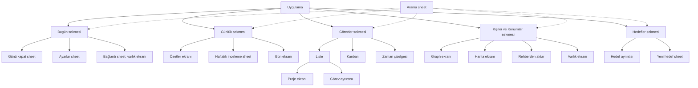

Arama bir sekme değildir. Her kök ekranda arama simgesi manşet satırının en sağında durur. Ayarlar'ı yalnız Bugün manşet satırındaki düğme açar. Ekran üstü, seçici, sıralama ve sheet kalıpları [Tasarım dili](design.md) belgesinin "Denetim kalıpları" bölümündedir.

**Mac'te kenar çubuğu girdisi pencerenin düzenini seçer: üç sütun ya da iki sütun.**

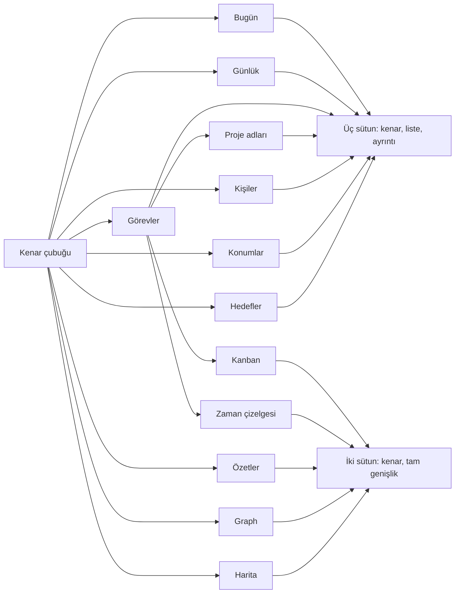

**Her kenar çubuğu girdisinin liste ve ayrıntı sütunu.**

| Kenar çubuğu girdisi | Düzen | Liste sütunu | Ayrıntı sütunu |
|---|---|---|---|
| Bugün | Üç sütun | Günlük sütunu | Bugün ekranı |
| Günlük | Üç sütun | Günlük sütunu | Seçili günün ekranı ya da "Bir gün seç" |
| Görevler | Üç sütun | Görev listesi | Görev ayrıntısı ya da "Bir görev seç" |
| Proje adı | Üç sütun | Proje ekranı | Görev ayrıntısı ya da "Bir görev seç" |
| Kişiler, Konumlar | Üç sütun | Varlık listesi | Varlık ekranı ya da "Bir varlık seç" |
| Hedefler | Üç sütun | Hedef listesi | Hedef ayrıntısı ya da "Bir hedef seç" |
| Kanban, Zaman çizelgesi | İki sütun | Yok | Tam genişlikte pano |
| Özetler, Graph, Harita | İki sütun | Yok | Tam genişlikte ekran |

Bugün girdisi de Günlük sütununu gösterir. Kullanıcı o sütunda bir gün seçerse kenar çubuğu Günlük girdisine geçer. Mac düzeninin ölçüleri [Mac](#mac) bölümündedir.

## Ekran listesi

**Her ekranın yeri, iki platformdaki girişi ve kaynak klasörü.**

| Ekran | iPhone'da yeri | Mac'te yeri | Kaynak | Aşama |
|---|---|---|---|---|
| Bugün | Bugün sekmesi | Bugün girdisi, ayrıntı sütunu | `App/Screens/Today` | 1, 2, 3, 10 |
| Gün ekranı | Günlük listesi iter | Günlük sütununda seçim | `App/Screens/Today` | 1 |
| Günü kapat | Bugün'den sheet | Bugün'den sheet | `App/Screens/Today/CloseDayView.swift` | 10 |
| Hızlı giriş | Bugün ve gün ekranının altında | Ayrıntı sütununun altında ve hızlı giriş penceresi | `App/Screens/Today`, `App/Mac` | 1, 2 |
| Günlük | Günlük sekmesi | Günlük sütunu | `App/Screens/Days` | 1 |
| Özetler | Günlük iter | Kenar çubuğu ve Günlük sütunundaki bağlantı | `App/Screens/Summaries` | 6 |
| Haftalık inceleme | Günlük'ten sheet | Günlük sütunundan sheet | `App/Screens/Summaries/WeeklyReviewView.swift` | 10 |
| Görevler | Görevler sekmesi | Görevler girdisi | `App/Screens/Tasks` | 2, 5 |
| Kanban | Görevler sekmesi | Kanban girdisi | `App/Screens/Tasks/Kanban` | 5 |
| Zaman çizelgesi | Görevler sekmesi | Zaman çizelgesi girdisi | `App/Screens/Tasks/Timeline` | 5 |
| Kişiler ve Konumlar | Kişiler ve Konumlar sekmesi | Kişiler ve Konumlar girdileri | `App/Screens/Entities` | 1, 6, 7 |
| Varlık ekranı | Liste iter | Ayrıntı sütunu | `App/Screens/Entities/EntityView.swift` | 1, 6 |
| Bağlantı bulunamadı | Bağlantı sheet'inde | Bağlantı sheet'inde | `App/Screens/Entities/UnresolvedEntityView.swift` | 1 |
| Rehberden aktar | Kişiler türünde satır | Yok | `App/Screens/Entities/ContactImportView.swift` | 10 |
| Graph | Kişiler ve Konumlar listesinde satır | Graph girdisi | `App/Screens/Graph` | 6 |
| Harita | Kişiler ve Konumlar listesinde satır | Harita girdisi | `App/Screens/Map` | 6 |
| Hedefler | Hedefler sekmesi | Hedefler girdisi | `App/Screens/Goals` | 3 |
| Arama | Manşet satırındaki simge; iPad’de donanım klavyesiyle ⇧⌘F ve ⌘K | Araç çubuğundaki düğme, ⌘F, ⌘K | `App/Screens/Shared/SearchView.swift` | 1 |
| Serbest not | Aramadan ve bağlantıdan | Aramadan ve bağlantıdan | `App/Screens/Shared/SearchNoteView.swift` | 1 |
| Ayarlar | Bugün'den sheet | Sistem Settings sahnesi | `App/Screens/Settings`, `App/Mac/MacSettingsView.swift` | 4, 7 |
| İlk açılış | Kasa yokken | Kasa yokken | `App/Screens/Onboarding` | 7 |
| Uygulama kilidi örtüsü | Kilit açıkken | Kilit açıkken | `App/Screens/Shared/AppLockCover.swift` | 7 |

## Ekranlar arası geçişler

**Bağlantılar, bildirimler ve kısayollar kullanıcıyı başka ekrana götürür.**

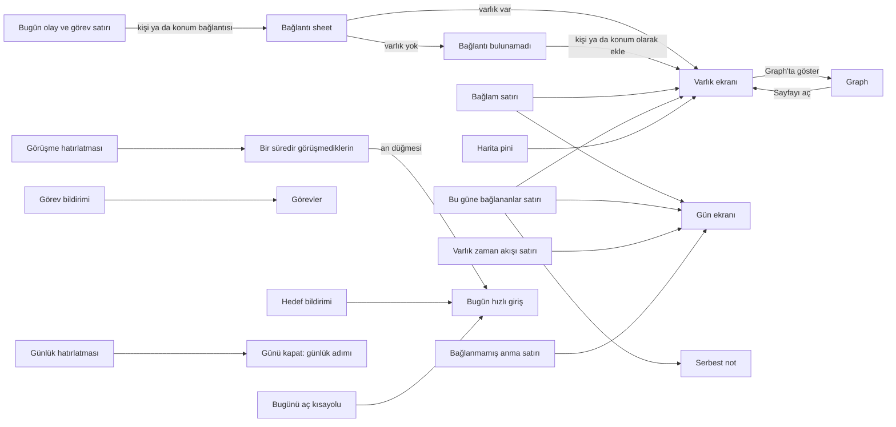

Bildirim ve "Bugünü aç" kısayolu hedef sekmenin gezinme yığınını başa alır. iPhone'da Ayarlar sheet'i de kapanır. Mac'te bildirim ve kısayol ana pencereyi öne getirir. Bildirim kuralları [Ayarlar — Bildirimler](#ayarlar--bildirimler-4) bölümündedir.

## iPhone

### Bugün (1, 2, 3)

**Uygulama Bugün ekranını yukarıdan aşağıya bu sırayla çizer.**

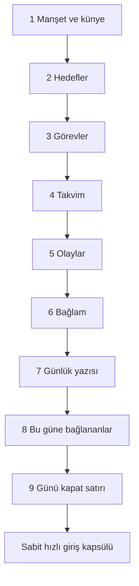

Uygulama açılışta Bugün ekranını gösterir. Geçmiş bir günün ekranı aynı düzeni kullanır. Bağlam ve "Günü kapat" yalnız Bugün'dedir.

**Bugün ekranında nerede ne var.**

| Sıra | Öğe | Aşama | İçerik | Ne zaman görünür |
|---|---|---|---|---|
| 1 | Manşet ve künye | 9 | Günün tarihi New York Semibold manşettir. Altında tek satırlık künye durur. | Her zaman. Künye yalnız sayacak bir şey varken görünür. |
| 2 | Hedefler | 3 | Günlük dönemli hedefler. Altında haftalık ve yıllık hedefler aynı satır bileşeniyle durur. | Hedef varken. |
| 3 | Görevler | 2 | Devreden görevler, bugünün görevleri ve bugün yazılan tarihsiz görevler. | Görev varken. |
| 4 | Takvim | 2, 10 | Cihaz takvimindeki bugünkü etkinlikler. Salt okunur, sans satır. | İzin sorulmadıysa ya da etkinlik varsa. |
| 5 | Olaylar | 1 | Bugün yazılan olaylar, dosyadaki sırayla. Kenarda saat durur. | Olay varken. |
| 6 | Bağlam | 10 | "Bu gün geçmişte" ve "Önemli tarihler" satırları. Başlık yoktur. | Yalnız Bugün'de, söyleyecek bir şey varken. |
| 7 | Günlük yazısı | 1 | Serbest yazının ilk 4 satırı ve "Devamını yaz". | Her zaman. |
| 8 | Bu güne bağlananlar | 10 | Başka dosyalardan bu güne bağlanan satırlar. | Satır varken. |
| 9 | Günü kapat | 10 | İnce çizginin altında tek bağlantı satırı. | Yalnız Bugün'de, kalan bir şey varken. |
| — | Hızlı giriş kapsülü | 1 | En altta sabit, opak kapsül. İçeriğin üstüne binmez. | Her zaman. |
| — | Boş gün metni | 1 | Bugün'de "Gününden bir an yaz; @ ile kişi ekle". Geçmiş günde "Bu gün henüz bir şey yazılmadı." | Gün tümüyle boşken. |

**Bölüm başlıklarındaki sayaçlar.**

| Bölüm | Sayaç |
|---|---|
| Hedefler | Yapılan ve toplam: `m/n`. Sayaç yalnız günlük hedefleri sayar: `countedGoalIDs` ile aynı küme. |
| Görevler | Kalan görev sayısı. |
| Olaylar | Olay sayısı. |

Varsayılan yazı boyutunda hızlı giriş tek satırlı bir kapsüldür. Ölçü 390×844 ekran ve yaklaşık 84 pt alt güvenli alandır. Bu ölçüde manşet, hedefler, görevler ve ilk olay satırı kaydırmadan görünür.

#### Manşet ve künye

| Konu | Davranış |
|---|---|
| Künye metni | Olayla başlar, kalanla biter: "3 olay · 4 görev ve 2 hedef kaldı". Sıfır olan parçayı yazmaz. Hiçbir şey yoksa satır yoktur. |
| Gezinme çubuğu | Bugün sekmesi gezinme çubuğunu gizler. Geçmiş gün ekranı geri düğmesi için çubuğu tutar. |
| Arama ve Ayarlar | Manşet satırının sağında durur. Ayarlar düğmesi yalnız telefondadır: `button.settings`. |
| Büyük yazı boyutları | Erişilebilirlik yazı boyutlarında düğmeler manşetin üstünde, sağa yaslı ayrı bir satırdadır. |
| Dar genişlik | Manşet önce tam biçimi dener. Gerekirse kısa ay biçimini ve en çok %75 ölçeği dener. |
| VoiceOver | VoiceOver her zaman tam biçimi okur. `navigationTitle` VoiceOver ve geçmiş için yine tarih metnidir. |

#### Hedefler bölümü

| Konu | Davranış |
|---|---|
| Liste | Önce günlük hedefler durur. Haftalık ve yıllık hedeflerin meta satırında dönem ilerleme metni vardır. Bu metin sayaca girmez. |
| Sıra | Uygulama sırayı günün ilk yüklemesinde kurar: önce açık hedefler, sonra dönemi biten hedefler; her grup ada göre. Gün ekranda kaldıkça sıra değişmez. Biten hedef yerinde kalır. Yeni hedef sona eklenir. Gün ya da kasa değişince sıra yeniden kurulur. |
| İşaretleme | Tek dokunuşluk artı hedefi işaretler ya da sayısal değeri 1 artırır. |
| Miktar girişi | Sayısal hedefte değer metnine dokunma, basılı tutma ya da menü miktar alanını açar. |
| Dokunma | Ada ya da meta satırına dokunma hedefin ayrıntı ekranını açar. Ekran sayfanın gezinme yığınına girer: iPhone'da Bugün sekmesi, Mac'te ayrıntı sütunu. Kilometre taşı satırı da ayrıntıyı açar. Artı, değer metni ve halka kendi işlerini yapar. VoiceOver satırı ad, değer ve "Ayrıntıları göster" ipucuyla okur; artı ayrı öğedir. |
| Zincir günü rozeti | Günlük hedefin zincir günü bakiyesi 1–3 ise adın yanında küçük rozet durur: zincir simgesi ve sayı, ince kontrol çizgisi çerçevesi. Bakiye 0 ise rozet yoktur ve satır rozetsiz hâliyle aynıdır. VoiceOver satırın değerine "2 zincir günü" ekler. Kural `vault-format.md` Zincir günü bölümündedir. |
| Görünüm | Bekleyen hedefler belirgindir, biten hedefler soluktur. Artı yuvası her satırda yerini korur. Yazma ya da yükleme sürerken artı soluk ve devre dışıdır. İşaretli evet/hayır hedefte yuva boş kalır; işareti halka gösterir. Satır yüksekliği ve genişliği yazmadan önce ve sonra aynıdır. Bölüm başlığında yükleme göstergesi yoktur. |

#### Görevler bölümü

| Konu | Davranış |
|---|---|
| Tamamlama | Kutuya ya da bağlantısız satıra dokunma görevi tamamlar. Basılı tutma düzenleme açar. |
| Devreden görev | Altında geldiği tarih yazar: "30 Eyl'den". En çok 3 tanesi görünür. "N devreden daha" satırı kalanı toplar. Satıra dokununca liste genişler. |
| Tamamlanan görev | Listenin sonuna iner. Uygulama birden çok tamamlanan görevi tek satıra katlar: "N görev tamamlandı". Satıra dokununca liste genişler. |
| Taşıma menüsü | Açık görev satırının menüsünde Bugüne, Yarına ve Haftaya vardır. |
| Gereksiz seçenek | Görevin bitişi zaten o günse menü o eylemi sunmaz. Bugüne ait görevde Bugüne yoktur. Yarına ait görevde Yarına yoktur. |
| Kapalı görev | Tamamlanmış ya da iptal görevde taşıma yoktur. |
| Haftaya | Haftaya, sonraki haftanın başıdır. Hızlı girişte ve kısayolda yazılan "haftaya" ile aynı gündür. Üç yol aynı kuralı okur. |
| Hafta başı | Hafta başı cihaz takviminden gelir. Pazartesi başlayan takvimde pazartesi, öteki takvimlerde pazardır. |
| VoiceOver | VoiceOver eylemleri menüyle aynı listeden gelir. |
| Geçmiş gün | Geçmiş gün ekranında taşıma menüsü ve VoiceOver eylemleri yoktur. |
| Hepsini bugüne | Devreden görev varken Görevler başlığının ve "N devreden daha" satırının menüsünde durur. Katlanmışlar dahil bütün devreden görevleri bugüne yazar. |
| Toplu yazma | Uygulama her görevi yazmadan hemen önce dosyadan yeniden okur ve ayrı yazar. Bir görev değişmişse ya da yazma hata verirse uygulama kalan görevleri yine yazar. |
| Sonuç | Bilgi bandı sayıları gösterir: taşınan, değişmiş olduğu için taşınmayan ve taşınamayan görev. Otomatik yeniden deneme yoktur. |

#### Takvim bölümü (2, 10)

| Konu | Davranış |
|---|---|
| İzin sorulmadı | Bölüm "Takvim etkinliklerini göstermek için izin ver" düğmesini gösterir. |
| İzin var | Bölüm yalnız etkinlik ya da okuma hatası varken görünür. Hata bandında "Yeniden dene" durur. |
| İzin yok | Bölüm, satır ve eylem yoktur. |
| Olay taslağı | Satırın bağlam menüsündeki **Olay taslağı** etkinliği o günün hızlı girişine taslak olarak koyar. VoiceOver'da aynı adlı eylem vardır. Ayrıntı [Hızlı giriş](#hızlı-giriş-1-2) bölümündedir. |

#### Olaylar bölümü

Uygulama saatli olayı dosyada saat sırasındaki yerine yazar. Ekran olayları dosyadaki sırayla gösterir. Kişi ve konum adları dokunma hedefi olan bağlantılardır. Bağlantıya dokunma varlık ekranını sheet içinde açar.

Olay metni düzenleme sheet'indeki anma şeridi hızlı girişteki yeni varlık kuralını kullanır. Yazarken oluşturulan varlık sheet'i kaydetmez ve kapatmaz. Kaydet sonrasında çıkan soruya verilen cevap kaydı tamamlar ve sheet'i kapatır.

#### Bağlam bölümü (10)

| Satır | İçerik | Kural |
|---|---|---|
| Bu gün geçmişte | Önceki yıllarda aynı ay ve günde kişi ya da konum bağlantısı olan en yakın yıl. Tek satırdır. | Kenarda yıl durur. Satırda o günün kaynak sırasındaki ilk 2 kişi ve ilk konum durur. Altında kaç yıl önce olduğu ve başka yıl sayısı yazar: "1 yıl önce bugün · ve 2 yıl daha". |
| Bu gün geçmişte: dışarıda kalan | Kişi ve konum bağlantısı olmayan gün, bugünün kendisi ve ileri tarihli dosyalar. | Özetler'deki gibi frontmatter bağlantıları dışarıdadır. |
| Bu gün geçmişte: 29 Şubat | 29 Şubat yalnız artık yılın 29 Şubat'ında görünür. | Satıra dokunma o günün ekranını açar. |
| Önemli tarihler | Kişi dosyasındaki ve kayıtlı özel tip dosyasındaki her tarih alanı. Bugün dahil sonraki 7 günde yıl dönümüyse bir satırdır. | En çok 3 satır görünür. Fazlası "ve N tarih daha" satırıdır. |
| Önemli tarihler: satır | Kenarda Bugün, Yarın ya da kısa tarih durur. Satırda varlığın adı, altında alanın adı ve yıl yazar: "doğum günü · 31 yıl". | Aynı kişide 2 tarih alanı 2 satırdır. Satıra dokunma varlığın ekranını açar. |
| Önemli tarihler: dışarıda kalan | Konum dosyaları, geçersiz yazımlar, kaynak yılı bu yıldan büyük olanlar, ilk yıl dönümü gelmemiş olanlar ve kaynak tarihin kendisi: 0. yıl. | 29 Şubat tarihi, artık olmayan yılda 28 Şubat'a düşer. Bildirim yoktur. |

Uygulama bağlamı yalnız Bugün'de ve yalnız söyleyecek bir şey varken çizer. Bağlam boşken yer tutmaz ve başlığı da yoktur. Geçmiş gün ekranında bağlam yoktur.

#### Günlük yazısı

Varsa ekran serbest yazının ilk 4 satırını ve "Devamını yaz" bağlantısını gösterir. Dokunma tam ekran yazma alanını açar. Yazma alanındaki `@` önerileri ve belirsiz ya da bilinmeyen açık anma çözümü hızlı girişteki ortak şerittir. Uygulama kesin bağlantıyı yalnız değişen satırlara uygular. Yeni varlık kuralı hızlı girişteki gibidir: yazarken oluşturulan varlık metni kaydetmez, imleç alanda kalır. Kaydetme sonrasında çıkan soruya verilen cevap kaydı tamamlar.

#### Bu güne bağlananlar (10)

| Konu | Davranış |
|---|---|
| Yer | Günlük yazısından sonra, ekranın sonunda. |
| Kaynak | Notlar, varlık dosyaları ve başka günler. Günün kendi dosyası dahil değildir. Bölüm o güne çözülen wikilink satırlarını listeler. |
| Satır | Kaynak adı ve bağlantılı satırın metni. Başlıkta `SectionHeader` ve sayaç durur. |
| Dokunma | Kaynağın ekranını açar: not, varlık ya da gün. |
| Boş ya da hata | Bölüm boşsa ya da sorgu hata verirse uygulama bölümü çizmez. Bölüm yer tutmaz. |
| Geçmiş gün | Bugün'de ve geçmiş gün ekranında aynıdır. |

#### Günü kapat satırı (10)

| Konu | Davranış |
|---|---|
| Yer | Ekranın son öğesi. İnce bir çizginin altında tek bağlantı satırı: "Günü kapat", `button.closeDay`. Bölüm başlığı yoktur. |
| Koşul | Açık görev, işaretlenmemiş günlük hedef ya da bugün henüz günlük yazısı yokken görünür. Üçü de yoksa satır yer tutmaz. |
| Günlük yazısı tanımı | `Journal` bölümündeki düz metin. Ölçü, ekrandaki "Günlük yazısı ekle…" önizlemesiyle aynıdır. Bölüm yoksa, boşsa ya da yalnız başlık taşıyorsa günlük yazısı yoktur. |
| Boş gün | Ekran kısa olduğu için satır ilk ekranda görünür. |
| Geçmiş gün | Satır yoktur. |
| Neden sonda | Yukarıdaki her satır ilk olay satırını ilk ekrandan aşağı iter. |

### Günü kapat (10)

**Günü kapat akışının adımları ve geçişleri.**

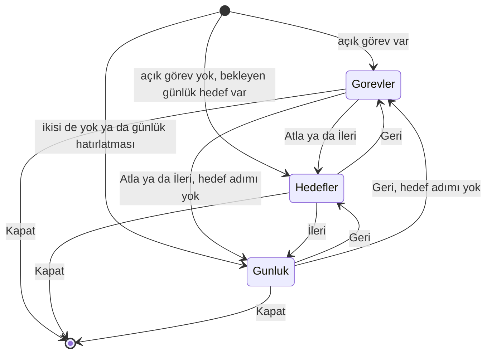

**Akışın girişleri ve genel kuralları.**

| Konu | Davranış |
|---|---|
| Giriş | Bugün'deki "Günü kapat" satırı kısa bir sheet açar. Mac'te sheet aynıdır. |
| Bildirimden giriş | Akşamki günlük hatırlatmasına (`journal-<gün>`) dokunma akışı günlük adımından açar. |
| Bildirim günü | Bildirimdeki gün akışın günü değildir. Dünkü hatırlatma da bugünün akışını açar. O gün için görev ya da hedef adımı varsa akışta durur. "Geri" bu adımlara döner. |
| Tek açılış | Her dokunuş akışı bir kez açar. Bugün ekranı sonradan yenilense de uygulama akışı kendiliğinden yeniden açmaz. |
| Soğuk açılış | Uygulama soğuk açılıyorsa akış kasa okunana kadar bekler. |
| Amaç | Bugün açık kalanların üstünden bir kez geçmek. Suçlayıcı söz yoktur. |
| Kasaya işaret | Akış "gün kapandı" işareti yazmaz. Uygulama yalnız kullanıcının seçtiklerini yazar. Seçim ve cümle yoksa hiçbir dosyaya dokunmaz. |
| Çubuk | Çubukta yalnız "Kapat" vardır. Eylemler ekrandadır. "Vazgeç" yoktur, çünkü işaretlenen hedef, uygulanan görev seçimi ve yazılan cümle anında dosyaya gider. Uygulanmamış seçimi ve boş cümleyi kapatma yazmaz. |
| Yazma sırasında | Görevler uygulanırken ve cümle yazılırken sheet kapanmaz. "Kapat" ve aşağı çekme yazma bitene kadar bekler. Kullanıcı sonucu görür. |
| Gece yarısı | Akış açıldığı günü kapatır. Liste, tamamlanma tarihi, hedef işareti ve cümle o güne aittir. |
| Adım sayacı | Manşetin altında adım yazar: üç adım da varken "Adım 1/3". Akış boş adımı atlar ve sayaç yalnız kalan adımları sayar. |
| Günlük adımı | Günlük adımı her açılışta vardır. |
| Boşalan adım | Akış sırasında boşalan adım yerinde kalır ve tek cümle söyler: "Bugün için açık görev yok." |
| Güncellik | Akış her açılışta kasanın o anki durumunu gösterir. |
| VoiceOver | Adım değişince VoiceOver ekranın başına döner ve yeni adımı okur. |

**Her adımın içeriği.**

| Adım | İçerik | Eylemler ve yazma |
|---|---|---|
| 1 Görevler | Bugün'deki açık görevlerin tamamı: devredenler katlanmadan, bugünün görevleri, bugün yazılan tarihsizler. | Her görevin altında "Karar" menüsü durur: Kalsın (varsayılan), Bitti, Yarına, Haftaya. VoiceOver her görevi tek öğe okur: ad görev metni, değer seçimdir. |
| 1 Görevler: Uygula | "Uygula" seçimleri birlikte yazar. Bitti görevi bugünün tarihiyle tamamlar. Yarına ve Haftaya yalnız bitiş tarihini değiştirir. Kalsın hiçbir şey yazmaz. | Taşıma kuralı ve yazma yolu Bugün'deki taşıma ile aynıdır. |
| 1 Görevler: sonuç | Uygulama her görevi yazmadan hemen önce dosyadan yeniden okur. Değişmiş görevi atlar, kalanı yazar. | Bilgi bandı sayıları gösterir: tamamlanan, taşınan, değişmiş olduğu için yazılmayan, yazılamayan. Yazılan görev listeden çıkar. |
| 1 Görevler: tekrar | Tekrarlayan görev tamamlanınca yeni örnek doğar. Bitişi bugün ya da öncesiyse yeni örnek Bugün'deki gibi listeye açık görev olarak girer. | Seçim yoksa "Uygula" kapalıdır. "Atla" sonraki adıma geçer. Uygulamadan sonra düğmenin adı "İleri" olur. |
| 2 Hedefler | Akış açıldığında bugün hedefine ulaşmamış günlük hedefler. Satır Bugün'deki hedef satırıdır. | Artı hedefi işaretler ya da 1 artırır. Sayısal değere dokunma miktar alanını açar. Uygulama her dokunuşu Bugün'deki gibi hemen yazar. |
| 2 Hedefler: liste | İşaretlenen hedef bu açılışta listede kalır. Kullanıcı işareti geri alabilir. Sonraki açılışta hedef görünmez. | Haftalık ve yıllık hedefler burada yoktur. "Geri" görev adımına, "İleri" günlük adımına gider. Görev adımı yoksa "Geri" yoktur. |
| 3 Günlük | Tek satırlık alan: "Bugünden bir cümle". "Yaz" düğmesi. | Boş ya da yalnız boşluk olan metin hiçbir dosyaya dokunmaz ve dosya oluşturmaz. Bu durumda "Yaz" kapalıdır. |
| 3 Günlük: yazma | Kullanıcı çok satır yapıştırırsa uygulama metni olduğu gibi günlüğün sonuna ekler. Var olan baytlar değişmez. | Görev, başlık ya da kod çiti gibi okunan satır düz metin olarak gider. Görev doğmaz. |
| 3 Günlük: dosya | Gün dosyası yoksa uygulama var olan gün oluşturma yolunu kullanır. | Başarıda alan boşalır ve kısa onay görünür. Kullanıcı aynı açılışta ikinci cümle yazabilir. |
| 3 Günlük: hata | Yazma hata verirse hata türüne göre mesaj durur. | İndeks güncellemesi hata verirse cümle dosyadadır. Uygulama cümleyi yeniden eklemez. "Geri" önceki adıma döner. |

### Hızlı giriş (1, 2)

**Gönderim sırasında kutu, model, kasa ve indeks arasındaki akış.**

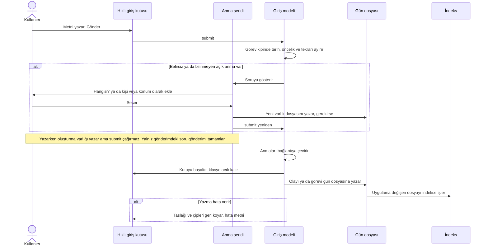

Uygulama önce dosyaya yazar, sonra indeksi günceller. Yazma hata verirse kutu taslağı geri alır. Art arda giriş için kutu gönderimden hemen sonra boşalır.

**Hızlı giriş kutusunda nerede ne var.**

| Öğe | Yer | Davranış |
|---|---|---|
| Kip | Kutunun başı | İki sözcük: **Olay** ve **Görev**. Seçili olan yarı kalındır ve altında vurgu çizgisi taşır. Varsayılan Olay'dır. Mac'te ⌘⇧T kipi değiştirir. |
| Saat | Olay kipinde kutunun başı | Olay varsayılan olarak şu anki saati alır. Kullanıcı saati kaldırabilir ya da değiştirebilir. |
| Çip satırı | Kutunun üstü | Ad çipleri, tarih, öncelik ve tekrar çipleri, takvim katılımcı çipleri ve konum önerisi çipi. Kutunun içinde vurgu yoktur. |
| Tarih denetimi | Görev kipinde çip satırında | Metinden okunan tarihi onay için gösterir. Kullanıcı dokunup düzeltir. |
| Proje önerisi | Kutunun üstü | Görev kipinde `#project/` yazınca var olan proje adları çıkar. |
| Anma şeridi | Kutunun üstü | `@` önerileri, "hangisi?" sorusu ve yeni varlık oluşturma. |
| Gönderim | Kutunun sonu | Kutu boşalır, klavye açık kalır. Kullanıcı art arda giriş yapar. |

**Anma ve ad çipi kuralları.**

| Konu | Davranış |
|---|---|
| `@` önerisi | `@` kişi ve konum önerilerini açar. Aynı `@` şeridi olay metni düzenleme sheet'inde ve günlük yazısı düzenleyicisinde de vardır. |
| `@` olmadan tanıma | Uygulama bilinen adları yazarken de tanır. |
| Rakam adı | Uygulama adı tamamen rakam olan varlığı (`12`) yalnız `@` ile tanır. Öneriden seçilen rakam adı metne `@12` olarak girer. Gönderim onu bağlantıya çevirir. |
| Ad çipi | `@` olmadan yazılıp tanınan her ad, olay ve görev kipinde, kutunun üstündeki tek çip satırında bir çiptir: `Deniz ✕`. |
| Belirsiz ad çipi | Birden çok varlığa uyan adın çipi işaretlidir: `Mert Aksu? ✕`. |
| Çipe dokunma | Uygulama o geçişi bu girişte bağlamaz. Uygulama adı dosyaya düz metin olarak yazar: ekiyle birlikte `Deniz'le`. Hangisi olduğunu sormaz. Uygulama aynı satırdaki başka bir `Deniz` geçişini yine bağlar. |
| Çip almayan adlar | Kullanıcının `@` ile yazdığı ad, öneriden seçtiği ad, takvim taslağının ve konum önerisinin sabitlediği `@Ad`. Kullanıcı bu adları kendisi istedi. Vazgeçmek için metni düzenler. |
| Metin değişimi | Geri alma, görev ifadelerindeki gibi adla birlikte yer değiştirir. Kullanıcı adı silerse ya da değiştirirse uygulama geri almayı unutur. Kullanıcı adın önüne `@` yazarsa uygulama adı bağlar. |
| İfade içindeki ad | Görev kipinde bir ifadenin içindeki ad çip almaz: `Cuma` adlı kişi, `Cuma'yı ara`. Gönderim adı ifadeyle birlikte çıkarır. Kullanıcı ifadenin çipini geri alınca adın çipi gelir. |
| Birleşen ad | İfade çıkınca geri alınan ad yanındaki sözcükle daha uzun bir ada birleşirse birleşen ad da düz kalır: `Mert yarın Aksu` → `Mert Aksu`. |
| Birden çok aday | Uygulama en olası adayı önerir. Emin değilse seçim ister. |
| Tanınmayan `@` adı | Şerit "kişi olarak ekle" ya da "konum olarak ekle" seçeneğini gösterir. Aynı adda varlık varsa kısa bir ayırt edici sorar. |
| Yeni varlık oluşturma | Yazarken: "Yeni kişi oluştur", "Yeni konum oluştur" ya da "… olarak ekle" varlık dosyasını yazar. `@Ad` metinde sabit kalır, kutu ve klavye açık kalır. Uygulama metni göndermez. Sabit ad yeni öneri ya da ikinci oluşturma seçeneği açmaz. Gönderim sonrasında: "Kişi olarak ekle" ya da "Konum olarak ekle" varlığı yazar ve gönderimi tamamlar. |
| Oluşturma onayı | Yazarken oluşturmadan sonra şeritte tek satır durur: "Deniz Arıkan kişi olarak eklendi". Satır 2 saniye sonra ya da bir sonraki tuşta gider. VoiceOver aynı metni duyurur. Gönderim sonrasında onay satırı yoktur; olay listeye girer. |
| Oluşturmada "Vazgeç" | Yazarken: soru kapanır, metin yazıldığı gibi kalır. Gönderim sonrasında: `@` işareti kalkar, ad düz metin olur ve gönderim sürer. |

**Görev kipi kuralları.**

| Konu | Davranış |
|---|---|
| Öncelik | Başta ya da sonda bağımsız `!` orta, `!!` yüksek önceliktir. |
| Tekrar | `her hafta` ya da `every week` gibi tekrar ifadesini uygulama önceden gösterir. Gönderim ifadeyi alanlara çevirir. |
| Tarih | Uygulama tarihi cümleden çıkarır: "yarın Ahmet'i ara". Tarih kutunun üstünde onay için durur. |
| İfade çipi | Tanınan her tarih, öncelik ve tekrar ifadesi tarih denetimiyle aynı satırda bir çiptir: `yarın ✕`, `!! ✕`, `Her hafta ✕`. Tekrar çipi ifadenin nasıl anlaşıldığını gösterir. Ayrı tekrar etiketi yoktur. |
| Çipe dokunma | Uygulama tanımayı geri alır. İfade görev metninde düz sözcük olarak kalır ve alana dönüşmez. |
| Metin değişimi | Geri alma sözcüğüyle birlikte yer değiştirir. Kullanıcı sözcüğü silerse ya da değiştirirse uygulama geri almayı unutur. |
| Taşma | Çipler satıra sığmazsa satır yana kayar. |
| Elle seçilen tarih | Metinden okunan tarih değişene kadar geçerlidir. Başka sözcük yazmak ya da silmek seçimi bozmaz. Metne tarih ifadesi yazmak ya da olanı değiştirmek seçimi düşürür. |
| Tekrar içindeki gün | `her salı` gibi tekrarın içindeki gün adı tarih ifadesi değildir. |

**Takvim etkinliğinden taslak (10).**

| Konu | Davranış |
|---|---|
| Doldurma | Takvim satırındaki "Olay taslağı" eylemi kutuyu olay kipine alır. Metin etkinliğin başlığıdır. Saat etkinliğin başlangıcıdır. |
| Saatsiz taslak | Tüm gün etkinliğinde ve başka bir gün başlamış etkinlikte taslak saatsizdir. |
| Tek eşleşen katılımcı | Kasada tek varlığa uyan katılımcı metne sabitlenmiş `@Ad` olarak girer. Eşleşme adın ya da takma adın tamamıdır. |
| Belirsiz katılımcı | Birden çok varlığa uyan ad sabitlenmeden `@Ad` olarak girer. Gönderimde ortak şerit hangisi olduğunu sorar. |
| Karşılığı olmayan katılımcı | Metne kendiliğinden girmez. Kutunun üstünde `+ Ad` çipi olur. Dokunma `@Ad` ekler. "Kişi olarak ekle" sorusu her `@` anmasındaki gibi gönderimde çıkar. |
| Kullanılmayan bilgi | E-posta biçimindeki ad, boş ad, takvimin kullanıcının kendisi diye işaretlediği katılımcı, oda, kaynak, grup ve etkinliğin konumu. |
| Dolu kutu | Kutuda taslak varsa eylem kutuya dokunmaz. Şerit nedenini söyler. |
| Yazma | Kaydı kullanıcı gönderir. Gönderimden önce uygulama dosyaya yazmaz. Uygulama takvime hiçbir durumda yazmaz. |
| Temizleme | Kullanıcı metni tümüyle silince ya da gönderince taslağın saati ve çipleri de gider. |

**Konum önerisi.**

| Konu | Davranış |
|---|---|
| İzin | Kullanıcı konum iznini Ayarlar → Takvim ve Konum düğmesiyle verir. |
| Ölçüm | Odaklanma ve gönderim en çok dakikada bir, tek seferlik GPS ölçümü ister. |
| Çip | Kutunun üstündeki en yakın konum çipi dokunmayla sabit `@Konum` anması ekler. |
| Kapatma | Kapatma o taslak oturumu boyunca geçerlidir. Gönderim kapatmayı sıfırlar. |
| Kip | Olay ve görev aynı davranışı kullanır. |
| Ayar | Konum önerisi anahtarı ve sistem ayarları bağlantısı Ayarlar → Takvim ve Konum'dadır. |

### Günlük (1)

**Günlük ekranında nerede ne var.**

| Öğe | Yer | Davranış |
|---|---|---|
| Manşet | Listenin içinde | Serif manşet. Gezinme çubuğunda büyük başlık yoktur. Sağda arama simgesi durur. |
| Özetler | Manşetin altı | Özetler ekranını iter. |
| Haftalık inceleme | Özetler'in altı | `button.weeklyReview`. Sheet açar, ok işareti taşımaz. Bu hafta yapıldıysa altında "Bu hafta yapıldı" yazar. |
| Bilgi bandı | Haftalık inceleme satırının altı | İnceleme yazıldıktan sonra görünür. Kapatma düğmesi vardır. |
| Ay takvimi | Satırların altı | Güne atlar. Günün altında yoğunluk düzeyine göre 1–3 nokta durur. Boş gün işaretsizdir. Bugün halkalıdır; rakam ile halka arasında boşluk kalır. |
| Gün listesi | Takvimin altı | Ters kronolojik. Her günde olay sayısı ve günlük yazısının ilk satırı. Gün yoksa "Henüz gün yok". |

Bir güne dokunma gün ekranını açar. Gün ekranı Bugün ile aynı düzendir: olaylar, görevler, hedef kayıtları ve serbest yazı. Kullanıcı geçmiş bir güne olay ekler ve o günün hedef kayıtlarını düzeltir.

### Özetler (6)

**Özetler ekranının yukarıdan aşağı sırası.**

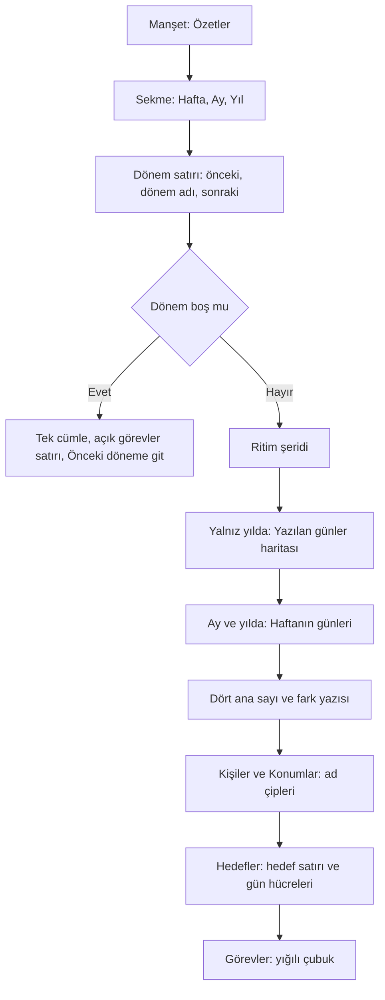

| Öğe | Davranış |
|---|---|
| Giriş | Günlük ve Mac kenar çubuğu Özetler'i açar. |
| Dönem sekmesi | Hafta \| Ay \| Yıl. Hafta pazartesi–pazar haftasıdır. Ay takvim ayıdır. Yıl takvim yılıdır. |
| Dönem düğmeleri | Önceki ve sonraki dönem. Bugünün döneminden sonraki döneme geçiş yoktur. Gösterilen dönem bugünü içermiyorsa "Bu hafta", "Bu ay" ya da "Bu yıl" düğmesi görünür. iPhone'da yatay kaydırma da dönemi değiştirir. |
| Ritim şeridi | Dönemin birimleri başına olay sayısı. Hafta birimi gündür. Ay birimi ayın 1'inden başlayan 7 günlük dilimdir: 1–7, 8–14, 15–21, 22–28, kalan günler. Yıl birimi aydır. Önceki dönemin aynı sıradaki birimi arkada geniş ve soluk çubuktur. |
| Yazıldı işareti | Her birimin altında durur. Dolu nokta: gün yazıldı ya da birimin ölçülen günlerinin en az yarısı yazıldı. Halka: yarıdan azı yazıldı. Kısa çizgi: hiç yazılmadı. İşaret yok: birim henüz başlamadı. |
| Yazılan günler | Yalnız Yıl sekmesinde, ritim şeridinin altında. 12 satır: satır başında kısa ay adı, ardından ayın 1'inden 31'ine kadar birer ısı haritası hücresi. Yazılmayan gün boş hücredir. Yalnız `Journal` yazısı olan gün kısmi hücredir. En az bir olayı olan gün tam hücredir. Bugün çerçevelidir. Ayda olmayan tarih ve bugünden sonraki gün çizilmez. Başlığın sayacı yılın "Yazılan gün" sayısıdır: "243 gün". Erişilebilirlik boyutunda hücreler büyür ve pazartesi haftalarına dizilir; harita yatay kayar ve son ölçülen haftayla açılır. |
| Haftanın günleri | Ay ve Yıl sekmelerinde, ritim şeridinin (yılda yazılan günler haritasının) altında, ana sayıların üstünde. Pazartesi'den Pazar'a 7 satır: gün adı, 1 px çerçeveli yazma oranı çubuğu ve sağda eş aralıklı rakamlarla "3/4" sayacı. En yüksek yazma oranlı günün başında nokta işareti durur, adı ve sayacı yarı kalındır; eşitlikte olay sayısı yüksek olan, yine eşitse haftanın ilk günü seçilir. Hafta sekmesinde ve ölçülen günü sıfır olan dönemde çizilmez. |
| Ana sayılar | Olay sayısı, yazılan gün, kişi geçişi, konum geçişi. iPhone'da 2 × 2 düzendedir; erişilebilirlik boyutunda tek sütundur. |
| Fark | Uygulama farkı yazıyla verir: "önceki haftaya göre +4", "önceki haftayla aynı". Ok yoktur. |
| Süren dönem farkı | Süren dönemde uygulama önceki dönemi aynı tarihe kadar sayar. Etiket bunu söyler: "geçen yılın aynı tarihine göre +12". |
| Kişiler ve Konumlar | İlk 5 kişi ve konum ad çipidir. Çipte geçiş sayısı durur. Çip varlığın kendi ekranını açar. Sıra geçiş sayısına göre azalandır. Eşitlikte ad, sonra yol sırası geçerlidir. |
| İlk kez işareti | Dönemde ilk kez geçen adın çipinde yıldız işareti durur. Bölümün altındaki "İlk kez:" satırı bu adları sayar. İlk 5'in dışındaki adlar da satırdadır. Satır en çok 10 ad gösterir, kalanı sayıyla söyler: "ve 3 kişi daha". |
| Hedefler | Hedefler ekranındaki satır: halka, ad, değer, ilerleme çubuğu. Değer süren dönemde bugüne kadar sayılır. Hafta ve ayda günlük hedefin günleri tek satır ısı haritası hücresidir. |
| Hedef farkı | Satırın altında küçük yazı: "önceki haftaya göre +12 sayfa · zincir +2". Uygulama yalnız sıfır olmayan farkı yazar. İki fark da sıfırsa satır yoktur. Kilometre taşında fark yoktur; yıllık hedefte zincir farkı yoktur. |
| Görevler | "N görev oluşturuldu" ve fark. Altında, yığılı çubuğun üstünde üç sekmede de açık görev eğrisi durur: ritim birimlerinin ölçülen son günündeki açık envanter; önceki dönemin bütün birimleri kesikli çizgidir. Başlamamış birim çizilmez. Son noktada sayı, altında "— açık görev ┄ Önceki ay/hafta/yıl" ve "Dönem sonunda 23 açık · dönem başında 14" satırları durur. Başlangıç, dönemden önceki günün sonudur. Ardından tek yığılı çubuk gelir: tamamlanan, devreden, tarihsiz açık. Her parçanın sayısı açıklamada yazar. Erişilebilirlik boyutunda eğri birim adı ve sayı listesine döner; VoiceOver tek öğede "Açık görevler: başta 14, sonda 23; en çok 3. hafta 24" okur. Eşit en yüksek değerde ilk birim okunur. |
| Sıfır bölüm | Sayısı sıfır olan bölümü uygulama çizmez. |
| Boş dönem | "Bu dönemde kayıt yok." yazar. Açık görev varsa altında tek satır durur: "Açık görevler: 6 devreden, 4 tarihsiz". En altta "Önceki döneme git" düğmesi durur. Uygulama öteki bölümleri çizmez. |
| Mac düzeni | İki sütun. Sol sütun: ritim, yılda yazılan günler, ay ve yılda haftanın günleri, ana sayılar, hedefler. Sağ sütun: kişiler, konumlar, görevler. |
| Erişilebilirlik | Ritim şeridinin her sütunu birim adını ve değeri okur: olay sayısı, önceki dönem, yazıldı işareti. Erişilebilirlik boyutunda sütunlar satıra döner. Yazılan günler haritası ay başına bir öğe okur: "Mart: 22 gün yazıldı". Haftanın günleri satır başına bir öğe okur: "Cumartesi: 4 günün 4'ü yazıldı"; erişilebilirlik boyutunda gün adı ve sayaç üstte, çubuk altta tam genişliktedir. Yığılı çubuğun sayıları açıklamada yazar. Ad çipi sayıyı birimiyle okur: "Deniz Arıkan, 7 geçiş". |
| Yükleme | Dönem değişince ekran eski içeriği yeni yanıt gelene kadar gösterir. Gösterilecek içerik yoksa yükleme göstergesi çıkar. |
| Gün dönümü | Ekran açıkken gün değişirse uygulama özeti yeni günle yeniden yükler. |

**Ölçülen günler: uygulama süren dönemi aynı tarihe kadar karşılaştırır.**

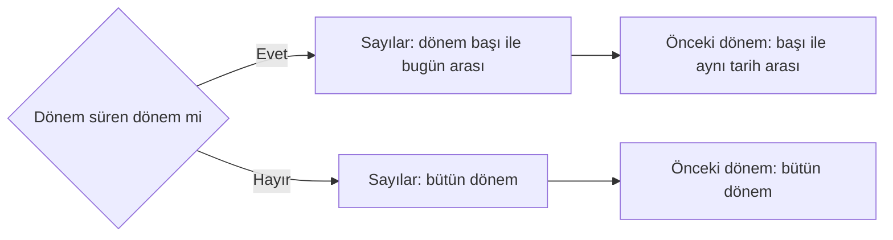

| Kural | Tanım |
|---|---|
| Süren dönem | Dönem bugünü içerir ve son günü bugünden sonradır. Bugün dönemin son günüyse dönem süren dönem değildir. |
| Aynı tarih | Önceki haftanın aynı günü, önceki ayın aynı tarihi, önceki yılın aynı tarihi. Önceki ayda o tarih yoksa ayın son günü geçerlidir: 31 Mart'ın karşılığı 28 Şubat'tır. |
| Ölçülen günler | Süren dönemde sayılar, ilk 5, ilk kez geçenler, ritim, açık envanter ve hedef ilerlemesi bugünde biter. Bugünden sonraki gün dosyaları sayıya girmez. |
| Artık gün | 29 Şubat'ın önceki yıldaki karşılığı 28 Şubat'tır. 1 Mart 2029'da süren yıl 60 günü 2028'in 61 günüyle karşılaştırır, çünkü 2028 yılı 29 Şubat'ı içerir. 30 Mart'ta süren ay 30 günü Şubat'ın bütün günleriyle karşılaştırır. |
| Hedef ilerlemesi | Hedef satırının değeri ve çubuğu bütün dönemin hedefine göredir. Yapılan miktar süren dönemde bugüne kadar sayılır. Örnek: haftada 3 kez hedefinde pazartesi ve salı yapıldı, cuma dosyasında da bir kayıt var. Çarşamba günü satır 2/3 gösterir. Yıllık hedef ve kilometre taşı da bugünde biter. Hedef farkı ölçülen günlerden gelir. |
| Ritimde önceki dönem | Arkadaki soluk çubuklar önceki dönemin bütün birimlerini gösterir. |
| Başlamamış dönem | Bugünden sonraki dönemi Core bütün olarak sayar. Ekran bu döneme geçmez. |

**Sayıların tanımı.**

| Sayı | Tanım |
|---|---|
| Olay sayısı | Olay bloklarının sayısı. |
| Yazılan gün | En az bir olay ya da boş olmayan `Journal` paragrafı veya başlığı olan farklı gün tarihleri. Yalnız görev ya da hedef kaydı olan gün bu sayıya girmez. |
| Kişi ve konum geçişi | Gün dosyalarının gövdesindeki her çözülen bağlantı. Her tekrar ayrı bir geçiştir. Frontmatter bağlantıları bu sayıya girmez. Bölüm toplamı ilk beşin dışındakileri de içerir. |
| İlk kez geçenler | Bütün günlük geçmişinde ilk gövde bağlantısı bu döneme düşen varlıklar. Kasada oluşturma tarihi yoktur. Bu sayı dosya oluşturma sayısı değildir. Liste önce güne, sonra ada göre sıralıdır. |
| Görev oluşturma günü | Kaynak gün dosyasının tarihi. Tekrarlayan görevin de oluşturma günü kaynak günüdür. |
| Tamamlanan görev | Durumu tamamlanmış ve `✅` tarihi dönemde olan görev. |
| Dönem sonu açık envanteri | Ölçülen son güne kadar kaynak gün dosyasında olan ve tamamlanmamış görevler. Tamamlanma tarihi o günden sonraysa görev o dönemde açıktır. Süren dönemde ölçülen son gün bugündür. |
| Birim sonu açık | Dönem sonu açık envanteri kuralının her ritim biriminin ölçülen son gününe uygulanmasıdır. Hafta birimi gün, ay birimi 1'inden başlayan 7 günlük dilim, yıl birimi aydır. Süren birim bugünde biter; başlamamış birimin noktası yoktur. Bitiş tarihi gelecekte olan açık görevler de dahildir. Önceki çizgi önceki dönemin bütün birim sonlarını gösterir. |
| Devreden ve tarihsiz | Bitiş tarihi ölçülen son günden önceyse görev devredendir. Bitiş tarihi yoksa görev tarihsiz açıktır. |
| Envanter dışı | İptaller ve tamamlanma tarihi olmayan tamamlanmış görevler. |
| Kaynak günü olmayan görev | Oluşturma ve açık sayısına girmez. Geçerli tamamlanma tarihi varsa tamamlanan sayısına girer. |
| Geri kurulamayan bilgi | Dosyalar durum ve değişiklik geçmişi tutmaz. Yeniden açma, iptal tarihi ve eski bitiş tarihi geri kurulamaz. |
| Günlük hedef | Dönem katkısı ve hedef × dönemin gün sayısı. Yılda gün sayısı 365 ya da 366'dır. |
| Haftalık hedef | Katkı ve hedef × dönemin değdiği pazartesi haftalarının sayısı. Ay ve yıl kenarlarındaki kısmi haftalar dahildir. 2026 yılı 53 haftaya değer. |
| Yıllık hedef | Dönem sonunda yıl başından ilerleme. Fark yalnız seçilen dönemin katkısını gösterir. |
| Zincir | Uygulama zinciri bütün geçmişten hesaplar. Bitmiş dönemde dönem sonuna göre, süren dönemde bugüne göre. Hedefler'deki zincirle aynı sayıdır. Günlük hedefte af kuralı geçerlidir. Satır bitmiş dönemde "Dönem sonu zinciri", süren dönemde "Güncel zincir" yazar. |
| Günlük hedef skoru | Zincirin altında son 30 günün skoru: "Son 30 gün %87". Bitmiş dönemde dönemin son günüyle biten 30 gün. Süren dönemde Hedefler'deki bugünkü skor. Ölçülen gün yoksa skor satırı yoktur. |
| Haftalık ve yıllık skor | Haftalık ve yıllık hedefin satırında skor yoktur. |
| Kilometre taşı | Yıl içindeki ilk tamamlanma ve tarihi. Aynı yıl tekrarlanan kayıt katkıyı artırmaz. Zincir yoktur. |
| İlerleme farkı | İki dönemin ölçülen günlerindeki katkı farkı. |
| Zincir farkı | Dönem sonlarındaki zincirlerin farkı. |

### Haftalık inceleme (10)

**Haftalık inceleme akışının 6 adımı.**

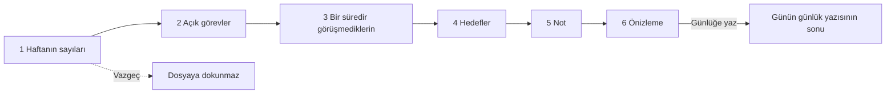

Akış bir taslaktır. Tek yazma eylemi son adımdaki "Günlüğe yaz" düğmesidir. "Vazgeç" hiçbir dosyaya dokunmaz ve gün dosyası oluşturmaz.

**Akışın genel kuralları.**

| Konu | Davranış |
|---|---|
| Giriş | Günlük'teki "Haftalık inceleme" satırı sheet açar. Mac'te Günlük sütunundaki bağlantı aynı sheet'i açar. |
| İsteğe bağlılık | Uygulama hatırlatmaz. Hiçbir adım zorunlu değildir. Suçlayıcı söz yoktur. |
| Çubuk | Çubukta yalnız "Vazgeç" vardır. Not yazılmışsa "Vazgeç" önce sorar. |
| Adım sayacı | Manşetin altında adım yazar: "Adım 1/6". |
| Gezinme | "Geri" ve "İleri" adımlar arasında gezer. Adım çıktıya bir şey katmıyorsa düğmenin adı "Atla" olur: anahtar kapalı, gösterecek bir şey yok ya da not boş. |
| Düğme yeri | iPhone'da düğmeler ekranın sonundadır. Mac'te sheet sabit boyuttadır. Düğmeler alt çubuğun hemen üstünde sabit durur. Uzun önizlemede "Günlüğe yaz" kaydırmadan görünür. |
| Hafta | İncelenen hafta cihaz takviminin hafta başına göre 7 gündür: pazartesi ya da pazar. Özetler'in sabit pazartesi haftasından ayrıdır. |
| Hafta seçimi | İlk adımdaki "Bu hafta \| Geçen hafta" sekmesi haftayı seçer. |
| Çıktının günü | Seçili hafta ne olursa olsun çıktı incelemenin yapıldığı günün günlük yazısının sonuna gider. Sheet açıkken gece yarısı geçerse açılış günü geçerlidir. |

**Her adımın içeriği.**

| Adım | İçerik |
|---|---|
| 1 Haftanın sayıları | Sayıların üstünde kısa ritim şeridi: incelenen haftanın 7 günü, cihaz takviminin hafta başından. Her günün arkasında önceki haftanın aynı sıradaki günü soluk çubuktur. Gün altında yazıldı işareti durur. Bugünden sonraki günde günün çubuğu ve işareti yoktur; önceki haftanın soluk çubuğu durur. Şeridin altında olay farkı yazar: "Önceki haftaya göre +4 olay". Süren haftada uygulama önceki haftayı aynı güne kadar sayar: "Geçen haftanın aynı gününe göre +4 olay". Bugünden sonraki tarihli dosyanın olayları şeritte ve farkta sayılmaz; "Olay sayısı" ve çıktı haftanın bütün dosyalarını sayar. "Geçen hafta" sekmesinde karşılaştırma ondan önceki haftayladır. Ardından olay sayısı, tamamlanan görev ve yazılan gün. Tanımlar Özetler'deki tanımlardır. Sıfır olan sayı ve cümlesi görünmez. Üçü de sıfırsa "Bu dönemde kayıt yok." yazar ve şerit yoktur. Şerit ve fark çıktıya girmez. |
| 2 Açık görevler | Haftadan kalan açık görevlerin sayısı ve ilk 3 görev. Bitişi haftanın son günü ya da öncesi olanlar ve o hafta yazılan tarihsizler. Adım yalnız gösterir. Taşıma ve tamamlama "Günü kapat" akışındadır. |
| 3 Bir süredir görüşmediklerin | Kişiler'deki listenin vadesi gelen ilk 3 kişisi. Ritim, erteleme ve duraklatma dahildir. Hiç görüşülmeyenler yoktur. |
| 4 Hedefler | Günlük hedefte haftanın inceleme gününe kadarki günlerinden kaçında hedefe ulaşıldığı: "2/6 gün". Haftalık hedefte incelenen haftanın günlerindeki miktar: "25 / 100 sayfa". Pazar takviminde de adım incelenen pazar–cumartesi günlerini sayar. Hedefin kendi pazartesi haftası geçerli değildir. Yıllık hedef yoktur. |
| 5 Not | Çok satırlı serbest metin. |
| 6 Önizleme | Dosyaya gidecek satırlar, baştaki `· ` işaretleriyle aynen. Seçim yoksa ve not boşsa "Yazılacak bir şey seçilmedi." yazar ve "Günlüğe yaz" kapalıdır. |

**Çıktı ve yazma kuralları.**

| Konu | Davranış |
|---|---|
| Anahtar | İlk 4 adımın her birinde "Çıktıya ekle" anahtarı vardır. Varsayılan açıktır. Kapalı adımın cümleleri çıktıya girmez. |
| Biçim | Kullanıcının dilinde bir `### Haftalık inceleme` alt başlığı ve düz satırlar. Biçim [Kasa biçimi](vault-format.md) belgesindedir. |
| Sıra | Adımların sırası. Not sondadır. Sayı cümlelerinin başında haftanın tarih aralığı durur. |
| Kişi adı | Kişiler düz adla gider. Bağlantı sözdizimi yoktur. Niteliği olan kişinin adının ardında nitelik durur: "Mert Aksu (iş)". Nitelik, Özetler'deki gibi aynı adlı 2 kişiyi ayırır. |
| Not içeriği | Notta görev, saatli olay ya da başlık gibi görünen satır yazı olarak kalır. Çıktı görev ya da olay üretmez. |
| İkinci yazma | İkinci yazma ikinci blok ekler. |
| Yazma sırasında | Düğmeler kapalıdır ve sheet kapanmaz. Bir geçiş bir kez yazar. |
| Başarı | Sheet kapanır. Günlük'te kapatma düğmeli bir bilgi bandı durur: "Haftalık inceleme günlüğe yazıldı." |
| Hata: dosyaya dokunmaz | Günün dosyasında günlük bölümü kapanmamış kod bloğunun içindeyse ya da uygulama dosyayı metin olarak okuyamıyorsa uygulama dosyaya dokunmaz. Sheet açık kalır ve nedeni söyler. |
| Hata: salt okunur kasa | Önizleme bunu baştan söyler. Düğme kapalıdır. |
| Hata: dışarıdan değişiklik | Dosya dışarıdan değiştiyse kullanıcı yeniden dener. |
| İndeks hatası | Metin dosyadaysa ve yalnız indeks güncellemesi hata verdiyse inceleme tamamdır. Sheet kapanır, bant uyarı olarak söyler. Uygulama yazmayı yinelemez. |
| Bu hafta yapıldı | Yalnız cihaz tercihidir: incelenen haftanın ilk günü. Kasaya işaret gitmez. iPhone'da satırın altında, Mac'te bağlantının yanında yazar. |

### Görevler (2, 5)

**Kullanıcı Görevler ekranında görünümü iki katmanda seçer.**

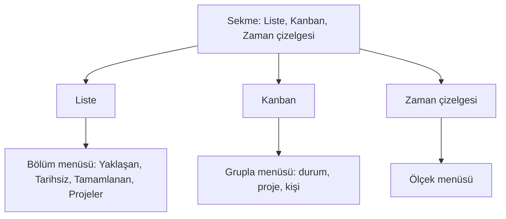

Manşetin altında sekme durur. Sekmenin altında görünüme göre değişen tek menü durur. iPhone son sekmeyi ve her sekmenin son menü seçimini hatırlar.

**Görevler ekranında nerede ne var.**

| Öğe | Yer | Davranış |
|---|---|---|
| Manşet | Listenin içinde | Serif manşet. Gezinme çubuğunda büyük başlık yoktur. Proje ve görev ayrıntısı ekranları aynı kalıbı kullanır. |
| Filtre ve arama | Manşet satırı | Simge. Filtreler: kişi, konum, proje. |
| Sekme | Manşetin altı | Liste \| Kanban \| Zaman çizelgesi. |
| Menü | Sekmenin altı | Liste'de "Bölüm", Kanban'da "Grupla", Zaman çizelgesi'nde "Ölçek". |
| Geniş yüzey | Kanban ve Zaman çizelgesi | 680 pt sütun sınırına girmez. |
| Mac kenar çubuğu | Mac | Kanban, Zaman çizelgesi ve proje girdileri gezinme düzenidir ve değişmez. |

**Liste bölümleri ve panolar.**

| Bölüm | Aşama | İçerik |
|---|---|---|
| Yaklaşan | 2 | Tarihli görevler, güne göre gruplu ajanda listesi. Grup başlığı bölüm başlığı ve sayaçtır. "Devreden" grubu vardır; eski adı "Geciken". |
| Tarihsiz | 2 | Bitiş tarihi olmayan açık görevler. |
| Tamamlanan | 2 | Son tamamlananlar. Satır soluktur. Üstünde çizgi yoktur. |
| Projeler | 5 | Etiketlerden türeyen proje listesi ve açık görev sayısı. |
| Proje ekranı | 5 | Bitiş gününe göre gruplu açık görevler. Tarihsizler ayrıdır. Tamamlananlar, görevlerdeki kişi ve konumlar ve son etkinlik. Satırlar Görevler ile aynı görev satırı bileşenidir. |
| Proje: son etkinlik | 5 | Gün dosyasının ya da tamamlanma tarihinin en yenisi. Planlanan başlangıç ve bitiş tarihi etkinlik değildir. |

**Kanban (5).**

| Konu | Davranış |
|---|---|
| Sütunlar | Durum, proje ya da kişi sütunları. Sütun başlığı sayaçlı bölüm başlığıdır. Kişisiz ve projesiz sütunlar vardır. |
| Kart | Çerçeveli, gölgesiz kâğıt kart. Öncelik kutunun içindedir. |
| İptal ve tamamlanan | İptal edilenler seçenekle görünür. Tamamlanan görevler son 30 takvim günüyle sınırlıdır: bugün dahil. Tarihsiz ve gelecek tarihli tamamlanmalar dışarıdadır. |
| Filtre | Kişi, konum ve proje filtreleri ortaktır. |
| Çok kişili görev | Birden çok çözülen kişiye bağlı görev her kişi sütununda görünür. |
| Kart sırası | Bitiş tarihi (tarihsiz en son), öncelik, metin, eşitlikte kimlik. Dosya sırası değişmez. |
| Bilinmeyen durum | Bilinmeyen açık durumlar Yapılacak sütununda kalır. |
| Telefon | Yatay kaydırmalı sütunlar, kart menüsünden taşıma ve ayrıntı sheet'i. |
| Mac | Sürükle bırak ve sağ ayrıntı paneli. |
| iPad (bölünmüş kabuk) | Mac panosu. iPhone Duo iç ekranı da bu panoyu kullanır. Sütunlar genişliği paylaşır. Sütun en az 240 pt'dir. Sütunlar sığmazsa pano serbest kayar ve sayfa sayfa durmaz. 13" yatay ekranda üç durum sütunu ve 340 pt ayrıntı paneli yan yana tam görünür. Panel açılınca manşet yerinde kalır. Panel, yanında en az iki 240 pt sütun, aralarındaki 16 pt boşluk ve panonun iki yanındaki 12 pt iç boşluk sığarsa açılır (toplam alan en az 860 pt). Daha dar alanda ayrıntı sheet'te açılır; panel açıkken alan daralırsa seçili görev sheet'e geçer. "Grupla" menüsü etiketi kadar geniştir. Uzun basılan kart kalkar ve başka sütuna sürüklenir. Parmağın altındaki sütun vurgulanır. Vurgu çizgisi kartın kart sırasına göre ineceği yeri gösterir. Sürükleme Mac ile aynı satırı yazar. Kart menüsündeki "Taşı" kalır. Sekmeli kabukta (Split View, Slide Over) telefon panosu durur. |
| Yazma | Durum ve proje taşıması var olan dosya yazıcılarını kullanır. Kişi sütunları bağlantı metnini değiştirmez ve taşıma kabul etmez. |
| Tarih | Tarih kart menüsündeki seçiciden değişir. |

**Zaman çizelgesi (5).**

| Konu | Davranış |
|---|---|
| İçerik | Ortak kişi, konum ve proje filtreleriyle tarihli görevler. Tarihsizler ayrı listededir. |
| Mac gruplama | Proje (varsayılan), kişi ya da gruplamasız satırlar. Gruplar açılıp kapanır. Ölçek hafta, ay ya da çeyrektir. Çok kişili görev kişi gruplarında tekrar eder. |
| Biçim | Başlangıç ve bitiş varsa çubuk. Yalnız bitiş varsa tek günlük elmas. Yalnız başlangıç varsa bugüne kadar açık uçlu çubuk. Gelecekteki başlangıç tek noktadan başlar. |
| Eksen | Tabular saat ve tarih sütunu. Vurgu rengi ve etiketle "bugün" çizgisi. Hafta sonu sütunu çukur renktedir. |
| Durum | Tamamlananlar soluk ve dolu uçludur. İptaller gizlidir. Devreden bitişler uyarı rengi ve işaret taşır. |
| Ters aralık | Başka bir uygulamanın yazdığı ters aralık kaynakta kalır ve uyarıyla görünür. Yeni değişiklikler ters aralık üretmez. |
| Aralık | Varsayılan: bugün -4 hafta / +12 hafta. Eksen ±365 gündür. Bugün düğmesi vardır. |
| Telefon | Hafta ve ay başlıkları, küçük çubuklu dikey liste, dönem düğmeleri ve tarih menüsü. Sürükleme yoktur. |
| iPad (bölünmüş kabuk) | Mac çizelgesi: etiket sütunu, kayan gün ekseni, manşet satırında "Grupla" menüsü. iPhone Duo iç ekranı da bu çizelgeyi kullanır. Dönem düğmesi yoktur; çizelge kayar. Parmak çubuğun ucunu sürükler ve tarihi Mac ile aynı satıra yazar. Ucun dokunma alanı çizilen tutamaktan geniştir. Kısa çubukta iki ucun alanı çubuğun ortasında ayrılır. Çubuğun gövdesine dokunmak ayrıntıyı açar. Gövdeden başlayan kaydırma çizelgeyi kaydırır; gövde sürüklenmez. Tek tarihli elmasın tarihi menüden değişir. Ayrıntı 340 pt paneldedir. Panel açılınca manşet yerinde kalır. Alan 800 pt'den darsa ayrıntı sheet'te açılır. Sekmeli kabukta telefon listesi durur. |

**Görev satırı ve sheet'ler.**

| Konu | Davranış |
|---|---|
| Sıra | Aynı gündeki görevler yüksek, orta, normal, düşük öncelik sırasındadır. Eşitlikte dosya ve satır sırası geçerlidir. |
| Satır | Öncelik kutunun içindedir. Tekrar rozeti vardır. |
| Düzenleme menüsü | Bugüne, Yarına, Haftaya, Tekrar ve Öncelik. Taşıma kuralları Bugün'deki görev satırıyla aynıdır: bitişin zaten olduğu gün yoktur, kapalı görevde taşıma yoktur. |
| Tekrar sheet'i | Ortak sheet kalıbı, kâğıt zemin, "Vazgeç / Kaydet". |
| Tarih sheet'i | Ortak sheet kalıbı, kâğıt zemin, "Kapat". Tarih seçici yalnız hızlı girişteki küçük pencerede yüzey üstündedir. |
| Görev ayrıntısı | Alanlar etiket-değer satırlarıdır. |

### Kişiler ve Konumlar (1)

**Kişiler ve Konumlar ekranında nerede ne var.**

| Öğe | Yer | Davranış |
|---|---|---|
| Manşet | Listenin içinde | Serif manşet. Gezinme çubuğunda büyük başlık yoktur. Sekme adı ve Mac kenar çubuğu değişmez. |
| Sıralama ve arama | Manşet satırı | Simge. Sıra ada göre ya da son geçtiği tarihe göredir. |
| Tür seçici | Manşetin altı | Yalnız Kişiler ve Konumlar varken sekmedir. Kasada özel tip varsa seçenek sayısı 4'e ulaşınca "Tür" menüsü olur. Özel tipler de seçicide durur. |
| Süzgeç alanı | Tür seçicinin altı | Ara ekranındaki alanla aynı bileşen. Alan Bir süredir görüşmediklerin bölümünü de süzer. |
| Graph ve Harita | Listenin en üstü | İki satır. Aynı gezinme yığınında tam ekran açar. Yeni sekme yoktur. |
| Yeni kişi, Yeni konum ve Yeni <tip> | iPhone'da Graph ve Harita satırlarının altı. Mac'te ve iPad bölünmüş kabukta liste sütununda tür seçicinin altı. | Kişiler türünde "Yeni kişi", Konumlar türünde "Yeni konum", özel tipte "Yeni <tipin tekil adı>" satırı; örnek "Yeni kitap". Satır ad ve gerektiğinde ayırt edici isteyen küçük sheet açar. Vazgeç dosya yazmaz. Oluştur varlığı tipin klasörüne, varsa tipin şablonuyla kaydeder ve varlık ekranını açar. Mac'te yeni varlık listede seçili olur. |
| Rehberden aktar | "Yeni kişi" satırının altı | Yalnız iPhone'da, Kişiler türü seçiliyken. |
| Yeni tip… | Oluşturma satırlarının en altı; her türde durur | Varlık tipi galerisini açar ([Özel varlık tipleri](#özel-varlık-tipleri-7)). Kaydedilen tip tür seçicide seçili olur. Tip tanımı dosyası okunamıyorsa satır devre dışıdır. |
| Bir süredir görüşmediklerin | Kişi listesinin üstü | Katlanan bölüm. Mac'te ve telefonda vardır. |
| Ayırt edici | Satırda adın altı | Aynı adlı varlıklarda görünür. |
| Uzun basma | Kişi, konum ve özel varlık satırı | Düzenle, Bağlantıyı kopyala (`[[Ad]]`), Sil. İkincil tık aynı menüyü açar. Sil onay ister; günlük kayıtlarındaki geçişler kalır. |

**Rehberden aktar (10).**

| Konu | Davranış |
|---|---|
| Giriş | "Rehberden aktar" satırı rehber seçicisini açar. Mac'te giriş yoktur. |
| Simge yok | Uygulama manşet satırına simge eklemez. Sırala ve ara ile üçüncü simge uzun ekran adını keser. |
| İzin | Uygulama sistemin süreç dışı seçicisini kullanır. Rehber izni istemez. |
| Yön | Tek yönlü ve bir kerelik. Eşitleme yoktur. Uygulama rehber kimliğini tutmaz. |
| Okunan alanlar | Yalnız kişinin sistemce biçimlenen tam adı ve varsa lakabı. Lakap takma ad olur. Uygulama telefon, e-posta, adres, doğum günü, şirket, not ve fotoğraf okumaz. |
| Geçersiz kart | Şirket kartı ve adı olmayan kart geçersizdir. Yalnız lakabı olan kartta lakap ad olur. |
| Özet sheet'i | Oluşacak kişiler (lakabıyla), kasada adı, takma adı ya da dosya adı zaten olanlar ve geçersiz adlar, sayılarıyla. Uygulama var olanları, türü ne olursa olsun, atlar. |
| Lakap çakışması | Lakap kasadaki ya da seçimdeki başka bir adla çakışırsa uygulama lakabı eklemez. Kişi yine oluşur. |
| İçe aktar | "İçe aktar" kişileri sırayla yazar. Var olan dosyanın üzerine yazmayan oluşturma yolunu kullanır. Biri hata verirse uygulama kalanları dener. |
| Sonuç | Sonuç ekranı oluşan, atlanan ve hata veren kişileri adlarıyla listeler. |
| Vazgeç | Hiçbir dosya oluşmaz. |

#### Varlık ekranı

**Varlık ekranının okuma düzeni, yukarıdan aşağıya.**

| Sıra | Öğe | Davranış |
|---|---|---|
| 1 | Manşet ve künye | Manşet ekranın içindedir: ad. Künye tip, takma adlar ve son görülme tarihini yazar. Sağda "Düzenle" ve arama durur. Gezinme çubuğunda büyük başlık yoktur. |
| 2 | Ayırt edici ve gelen bağlantılar | Etiket-değer satırları. |
| 3 | Yıl dönümü | Kişide ve özel tipte, tarih alanı varsa sıradaki yıl dönümü tek satırdır: "doğum günü · 12 Nis · 31 yıl". Pencere yoktur. Konumda bu satır yoktur. |
| 4 | Graph'ta göster | Yalnız kişi ve konumda. Graph o düğümü seçer ve ortaya alır. |
| 5 | Son görüşme ya da Son ziyaret kartı | Yalnız kişi ve konumda. Ayrıntı [Kişi ve konum içgörüleri](#kişi-ve-konum-içgörüleri-6) bölümündedir. |
| 6 | Alanlar ve Diğer alanlar | Şablon alanları etiket-değer satırlarıdır. Tanınmayan ön bilgi anahtarları "Diğer alanlar" altında ham adıyla, ikincil renkte durur. Uygulama frontmatter'ı okuyamıyorsa "Frontmatter okunamıyor." yazar. |
| 7 | Açık görevler (2) | Bu varlığa bağlı tamamlanmamış görevler. |
| 8 | Bağlanmamış anmalar | Zaman akışının hemen üstünde. |
| 9 | Zaman akışı | Bu varlığın geçtiği olaylar ve günlük paragrafları, gün başlıklarıyla, yeniden eskiye. Başlıkta gün sayacı durur. Her satır ait olduğu günü açar. Boşsa "Henüz günlük kaydı yok." yazar. |
| 10 | Serbest notlar | Okumada ham wikilink ve blok kimliği gizlidir. Boşsa "—" yazar. |

Konumda koordinat, Alanlar tablosunda bir satırdır. Okuma ekranında harita yoktur. Konumların haritası Harita ekranındadır.

**Düzenleme sheet'i.**

| Konu | Davranış |
|---|---|
| Giriş | "Düzenle" ayrı bir kip olarak sheet açar. Alan ve takma ad düzenleyicileri sheet'tedir. |
| Kalıp | Ortak sheet kalıbı: serif manşet, kâğıt zemin, tek "Kapat". Her alan kendi "Kaydet" düğmesiyle yazar. "Kapat" yazmaz. |
| Kirli taslak | Kullanıcı Kaydet ile yazmadığı alanı "Alanı kaldır" ile silerse taslak kirli değildir. Kaydı bekleyen alan metni varken sheet kapanmaz. `JournalView` ile aynı `UnsavedDraftDecision` kalıbı "At" / "Vazgeç" sorar. |
| Ad değiştirme | Düzenleme sheet'i ad değiştirmeyi ikinci sheet olarak açar. |
| Varlığı sil | Sheet'in en altında kırmızı düğme. Kişi, konum ve özel tipte onay ister: "<Ad> silinsin mi? Günlük kayıtlarındaki geçişler kalır." Yalnız varlık dosyasını siler. Başarılı silme önce sheet'i, sonra varlık ekranını kapatır. Mac'te ayrıntı sütunu "Bir varlık seç" durumuna döner. Hata sheet'te kalır. |
| Görüşme ritmi | Yalnız kişide. Menü: Yok, 7, 14, 30, 60, 90 gün ve özel sayı. Özel sayı pozitif tam sayıdır. Boş, 0, harf ve taşan sayı "geçerli bir değer gir" uyarısı alır. |
| Ritim yazma | Ritim kendi "Kaydet" düğmesiyle yazar. Seçim tek başına yazmaz. Kaydı bekleyen seçimi "Kapat" sorar. |
| Yok seçimi | Yok `cadence_days` alanını siler. Dosyadaki değer zaten geçerli bir ritim değilse Yok hiçbir şey yazmaz. |
| Ritim anahtarları | 3 ritim anahtarı kişide serbest alan listesinde ham görünmez. Konumda ve özel tiplerde menü yoktur. Bu anahtarlar orada sıradan alandır. |
| Koordinat bölümü | Yalnız konumda. Enlem ve boylam alanları, "Şu anki konumumu kullan", Kaydet ve Koordinatı kaldır. Alanların etiketi doluyken de görünür. |
| Şu anki konum | Alanları o anki ölçümle doldurur. Yalnız var olan izinle çalışır. İzin istemez. |
| Koordinat yazma | Dosyaya yalnız Kaydet yazar. Değişiklik yoksa yazmaz. Kullanıcının dokunmadığı alanda dosyadaki sayı yazımı aynı kalır. |
| Ölçüm yok | Ölçüm gelmezse ya da izin yoksa bunu söyler. Elle giriş açık kalır. Kullanıcı alana elle yazınca bekleyen ölçüm alanı doldurmaz. |
| Okunamayan değer | Okunamayan kayıtlı değer dosyadaki haliyle görünür. |

**Bağlanmamış anmalar.**

| Konu | Davranış |
|---|---|
| İçerik | Gün dosyalarındaki olay ve görev satırlarında adı geçen ama bağlı olmayan her geçiş ayrı satırdır. |
| Başlık | Sayaçlıdır. Bölüm boşsa ya da sorgu hata verirse uygulama bölümü çizmez. Bölüm yer tutmaz. |
| Satır | Tarih, olayın ya da görevin metni ve "Bağla". Metinde liste işareti, saat ve blok kimliği yoktur. Wikilink'ler etiketiyle görünür. |
| Vurgu | Bağlantıya dönüşecek yazım vurguludur. Açık anmada silinecek `@` vurguya dahildir. |
| Notlar | Belirsiz geçiş "Başka bir kayıtla da eşleşiyor" notunu taşır. Harfi farklı geçiş "Yazımı farklı" notunu taşır. Bağla ikisini de yalnız bu varlığa bağlar. |
| Dokunma | Satıra dokunma o günü açar. |
| Uzun liste | 5'ten fazla satırda ilk 5 satır ve "Tümünü göster (N)" görünür. Liste aynı ekranda genişler. Hepsini bağla yoktur. |
| Bağla | Bağla yalnız o geçişi dosyaya yazar. Açık anmada önündeki `@` de gider. Sonra uygulama listeyi yeniden sorgular. |
| Dışarıda değişmiş satır | Uygulama yazmaz. Başlığın altındaki kapatma düğmeli bilgi bandı bunu söyler ve uygulama listeyi yeniler. Liste boşalsa da başlık bant kapanana kadar kalır. |
| Hata | Yazılamayan bağlama ve "kaydedildi, indeks güncellenemedi" durumu aynı banttadır. İkincisinde uygulama yazmayı yinelemez. |
| Bekleme | Yazma bitip liste yeniden gelene kadar bütün Bağla düğmeleri kapalıdır. |
| VoiceOver | Her Bağla düğmesi tarihini ve satırını söyler. |
| Yükleme | Ekran açılışı sorguyu beklemez. Bölüm doluysa sonradan belirir. |

#### Bağlantı sheet'i ve Bağlantı bulunamadı ekranı

| Durum | Ekran |
|---|---|
| Bugün'deki olay ya da görev satırında bağlantıya dokunma | Sheet varlık ekranını açar. Mac'te de sheet'tir. |
| Bağlantı bir varlığa çözülmedi | Sheet "Bağlantı bulunamadı" ekranını açar: "Bu ad için bir varlık oluştur." |
| Bağlantının hedefi bir dosya ama kişi ya da konum değil | Sheet "Bu bağlantı kişi veya konum değil" yazar. |
| Bağlantı bulunamadı: eylemler | Ad alanı, "Kişi olarak ekle", "Konum olarak ekle" ve her özel tip için "… olarak ekle". |
| Bağlantı bulunamadı: aynı ad | Aynı adda varlık varsa ekran "Ayırt edici (ör. iş)" alanını ve "Oluştur" düğmesini gösterir. |
| Bağlantı bulunamadı: sonuç | Aynı sheet oluşan varlığın ekranını gösterir. |

#### Özel varlık tipleri (7)

| Konu | Davranış |
|---|---|
| Tür seçici | Kişi ve konuma ek olarak kasanın özel tiplerini gösterir. Sekme adı ve Mac kenar çubuğu değişmez. |
| Özel varlık ekranı | Tanımın text, date, number, boolean ve link alanlarına uygun düzenleyiciler. Bilinmeyen alanlar, görevler, günlük zaman akışı ve serbest notlar. |
| Yerleşik tipe özgü | Graph ve görüşme kartı yalnız kişi ve konumdadır. |
| Anma | `@` önerileri özel tipleri de içerir. Bilinmeyen adın oluşturma menüsünde tanımlı tipler durur. |
| Ayarlar → Varlık tipleri | Yerleşik tipler salt okunurdur. Kullanıcı özel tip oluşturur, düzenler ve siler. "Yeni varlık tipi" galeriyi açar. |
| Galeri | "Varlık tipi ekle" sheet'i. Çubukta yalnız Vazgeç. 10 hazır tip: Kitap, Film, Kurum, Proje, Etkinlik, Seyahat, Tarif, Ürün, Evcil hayvan, Araç. Satırda simge, ad ve alan anahtarları. Kimliği ya da klasörü kasada olan tip "Zaten var" yazar ve seçilmez. En altta "Boş tip…" boş formu açar. |
| Hazır tip seçimi | Tip formu hazır değerlerle dolu açılır; kullanıcı her değeri değiştirebilir. Formun Vazgeç düğmesi galeriye döner. Oluştur tanımı yazar, sonra şablon dosyasını yazar ve galeriyi kapatır. |
| Şablon dosyası | Yeni tipin şablon yolu kökteki `templates/` altındaysa ve dosya yoksa uygulama şablonu tipin alanlarından yazar: `type`, boş `name` ve boş alanlar. Var olan şablona dokunmaz. Hazır tipte yol, kullanıcı yolu elle değiştirmedikçe kimliği izler (`templates/<kimlik>.md`). Yol `templates/` dışındaysa formda yolun altında uyarı durur. Şablon yazılmazsa (yol `templates/` dışında, şablon iCloud'dan inmeyi bekliyor ya da yazma hatası) tip yine kaydedilir ve form "Tip kaydedildi, şablon dosyası yazılamadı." der. |
| Tip formu | Kimlik, tr ve en tekil ve çoğul ad, klasör, SF Symbol, alanlar ve isteğe bağlı şablon yolu. Tip kimliği düzenlemede sabittir. |
| Bozuk tanım dosyası | Bozuk `types.json` uyarı verir. Uygulama dosyanın üzerine yazmaz. Kullanıcı dosyayı dışarıda onarır. |
| Silme | Silme onayı yalnız tanımı kaldırır. Varlık dosyaları kalır. |

### Kişi ve konum içgörüleri (6)

**Son görüşme ya da Son ziyaret kartının içeriği.**

| Konu | Davranış |
|---|---|
| Kapsam | Zaman akışıyla aynı kapsam: gün dosyalarındaki olaylar ve `Journal` paragraflarının çözülen bağlantıları. |
| Dışarıda kalan | Görev, frontmatter, serbest not ve gelecek tarihli geçişler görüşme değildir. |
| Uyarı metni | Kart, günlük kaydının görüşme kanıtı olmadığını nötr dille söyler. |
| Satırlar | Son ve ilk geçiş tarihleri. Son günün varlığa bağlı metinleri, bağlantıları dokunma hedefiyle. O gün bütün olay ve `Journal` yazılarında geçen öteki kişi ve konumlar. |
| Çıkarım yok | Kart aynı olayda karşılaşma çıkarımı yapmaz. |
| Geçişler bölümü | Kartın içinde yer alır. 12 takvim ayı çubuğu ve altında 90 günlük `HeatmapCell` şeridi (iki satır, 45+45). Sayaç son 12 ayda geçilen gün sayısıdır. Eşit aylarda en erken ay en yoğun sayılır. Hiç geçmemiş varlıkta bu bölüm görünmez. Konum ekranında aynıdır. |
| Sıklık ve ortalama aralık | Şerit altında tek satırdır: "Son 90 günde 43 gün · ortalama aralık 2,1 gün" (eski iki ayrı satır yerine). Sıklık bugün dahil son 90 takvim gününde (`bugün -89` … bugün) geçilen farklı gün sayısıdır; aynı gündeki tekrarlar tek gündür. Ortalama aralık bu penceredeki son ve ilk gün farkının `gün sayısı -1` değerine bölümüdür; 2 günden az geçiş varsa aralık parçası görünmez. |
| İlk geçiş | Bütün geçmişten gelir. |
| Ritim satırı | Kişide ritim varsa: "Ritim: 30 günde bir". |
| Erteleme satırı | Erteleme sürüyorsa kısa tarihle: "1 Kas tarihine kadar ertelendi". |
| Duraklatma | Duraklatılmışsa "Duraklatıldı" ve "Sürdür" eylemi. Sürdür `cadence_paused` alanını siler. |
| Yıl dönümü dışı | 3 ritim anahtarı yıl dönümü değildir. |

**Bir süredir görüşmediklerin bölümü.**

| Konu | Davranış |
|---|---|
| Yer | Kişiler listesinin üstünde katlanan bölüm. Mac'te ve telefonda vardır. |
| Eşik | Ritmi olan kişinin eşiği kendi `cadence_days` değeridir. Ritmi olmayan kişinin eşiği Ayarlar'daki genel eşiktir. Son geçişten bu yana gün sayısı eşiğe ulaştıysa kişi listededir. |
| Sıra | Eşiği en çok aşan baştadır: geçen gün eksi ritim ya da genel eşik. Eşitlikte yol sırası geçerlidir. Hiçbir kişide ritim yokken sıra eski "eski kayıt önce" sırasıyla aynıdır. |
| Duraklatılan | `cadence_paused: true` olan kişi listede hiç yoktur. |
| Ertelenen | `cadence_snoozed_until` günü dahil kişi listede yoktur. Ertesi gün döner. Uygulama dolmuş erteleme alanını silmez, yalnız yok sayar. |
| Geçersiz ritim | Uygulama geçersiz ritmi yok sayar. |
| Hiç geçmemişler | Ayrı gruptadır, ritmi olsa da. Ad sırasıyladır. Ertelenen ve duraklatılan burada da görünmez. Gelecekteki kayıt tek başına geçmiş görüşme değildir. |
| Süzgeç | Arama süzgeci bu bölümü de süzer. |
| Satır | Ad ve geçen tam hafta ya da gün sayısı, nötr dille. Satır kişiyi açar. |
| Menü | Bağlam menüsü ve aynı VoiceOver eylemleri: "1 hafta ertele", "1 ay ertele" ve "Duraklat". 1 hafta: bugünden 7 gün sonrası, o gün dahil. 1 ay: bugünden bir takvim ayı sonrası; ay sonu kısalır. |
| Hata | Yazılamayan eylemi bölümün başındaki hata bandı söyler. |
| An düğmesi | Bugün'e geçer ve taslağın sonuna `@Ad ` ekler. Var olan taslak kalır. Düğme aynı adlı kişinin yolunu sabitler. |
| An isteği | İstek yalnız Bugün'deki girişte bir kez ve aynı kasada geçerlidir. Menü çubuğundaki giriş isteği almaz. |

**Eşik ve hatırlatma ayarları.**

| Konu | Davranış |
|---|---|
| Eşik | Ayarlar → Gizlilik → Kişi hatırlatmaları. 1–365 gün. Varsayılan 30 gün. |
| Saklama | Cihaz tercihidir. Kasa alanı değildir. Ritmi olmayan kişiler için yedek eşiktir. |
| Yenileme | Değişiklik listeye hemen yansır. Uygulama tarihi gece yarısından sonra periyodik olarak yeniler. |
| Görüşme hatırlatması | Ayrı cihaz tercihi: Ayarlar → Bildirimler, varsayılan kapalı. Yalnız ritmi olup vadesi gelen kişiler girer. Ritimsiz eşik aşımı bu bildirime girmez. |

### Graph ve Harita (6)

**Graph ekranında nerede ne var.**

| Öğe | Yer | Davranış |
|---|---|---|
| Giriş | Mac kenar çubuğu, telefonda Kişiler ve Konumlar listesinin en üstü | Telefonda aynı gezinme yığınında tam ekran. Yeni sekme yoktur. |
| Tür süzgeci | Manşet satırındaki filtre menüsü | Kişi, konum, gün; çoklu seçim. Varsayılan dışında vurgu rengine döner. |
| Dönem | Manşetin altındaki "Dönem" menüsü | Son 30, 90, 365 gün ya da tümü. |
| Eşik | Adımlayıcı | En az ortak gün ağırlığı. |
| Yakınlaştırma | Düğmeler, pinch, Mac'te tekerlek ve trackpad kaydırması | Görüşü büyütür ve küçültür. |
| Ortala | Düğme | Düzeni o anki haliyle yeniden çerçeveler. |
| Düğüm seç | Menü | Klavye ve erişilebilirlik için aynı seçimi sunar. Seçilen düğümü ortaya alır. |
| Sayfayı aç | Seçili düğüm | Varlık ya da gün ekranını açar. |

**Graph verisinin kuralları.**

| Konu | Davranış |
|---|---|
| Düğümler | Varsayılan: bütün kişi ve konumlar. Bağlanmamış varlıklar da düğümdür. |
| Gün düğümleri | İsteğe bağlı. Bağlantı içeren her gün bir düğümdür. |
| Kenar ağırlığı | Aynı takvim gününün dosyalarında birlikte geçen farklı gün sayısı. Yinelenen bağlantılar ve aynı tarihli dosyalar ortak günü artırmaz. Gün–varlık kenarı 1 gündür. |
| Kaynak | Gövde ve frontmatter ayrımı yoktur. Graph çözülen kişi ve konum bağlantılarını kullanır. Bilinmeyen hedefler dışarıdadır. |
| Son N gün | Bugün dahil `bugün -(N-1)` … bugün. Tümü gelecek günleri ve tarihsiz kaynak bağlantılarını da içerir. |
| Düğüm boyutu | Tümü seçiliyken bütün kasadaki geçiş sayısı. Tarih filtresinde seçilen günlerin geçiş sayısı. |
| Eşik | Eşik kenarları kaldırır. İzole düğümleri silmez. |
| Renk ve biçim | Kişi ve konum renkleri Bugün bağlantı alt çizgileriyle aynı belirteçten gelir. Kişi daire, konum elmas, gün köşeli karedir. |
| Açıklama | Açıklama birlikte geçmeyi gerçek karşılaşma diye yorumlamaz. |

**Graph yerleşimi ve etkileşimi.**

| Konu | Davranış |
|---|---|
| Benzetim | Canlı kuvvet benzetimi. Düğümler birbirini iter. Bağlantılar yay gibi çeker: ortak günü çok olan çiftler daha yakındır. Hafif merkez çekimi bağlantısız düğümleri görüş alanında tutar. |
| Oturma | Düzen açılışta ekranda oturur. Düzen durunca hesap da durur. |
| Düğüm sürükleme | Düğümün üstünde başlayan sürükleme düğümü taşır. Düğüm parmağı ya da fareyi izler. Komşular yayla peşinden gelir. Bırakınca düğüm serbest kalır ve düzen yeniden oturur. |
| Tuval kaydırma | Boşlukta başlayan sürükleme tuvali kaydırır. |
| Tutma alanı | Sürükleme düğümü yalnız çizilen biçimin hemen yakınından tutar: en az 8 nokta yarıçap. 44 noktalık geniş hedef yalnız dokunmada geçerlidir. Yoğun ya da yakın graph'ta kaydıracak boşluk kalır. |
| Seçim | Dokunma düğümü seçer. Uygulama düğümün adını ve komşularını vurgular. Görüş yerinde kalır. |
| Belirlenimcilik | Benzetimin tohumu sabittir. Aynı graph her zaman aynı düzende oturur. Oturmuş düzende daireler arasında en az 8 nokta boşluk kalır. |
| Süzgeç değişimi | Graph düğümleri baştan dizmez. Bulundukları yerden yeni düzene geçer. |
| Kasa yenilemesi | Graph aynı kalırsa kullanıcının elle kurduğu düzen yerinde kalır. Kasa ya da filtre değişirse uygulama eski sonucu kullanmaz. |
| Hareketi Azalt | Canlı animasyon yoktur. Düzen arka planda oturur ve tek seferde görünür. Kullanıcı sürüklenen düğümü bırakınca yeni düzen yine tek seferde gelir. |

**Harita ekranı.**

| Konu | Davranış |
|---|---|
| Pinler | Geçerli koordinatı olan konumlar. Pin boyutu bütün kasadaki çözülen geçiş sayısına bağlıdır. Konum önerisi yarıçapı pin için gerekli değildir. |
| İşaretçi | Tam opak konum rengi, elmas biçim. Seçili pin vurgu çerçevesi taşır. Sayı pinin içindedir. |
| Dokunma | Pin konum ekranını açar. |
| Boş durum | Hiçbir konumda koordinat yoksa boş görünüm nedenini söyler: konum izni konumlara koordinat eklemez. Koordinatı olmayan konumları listeler. Satır konum ekranını açar. Kullanıcı koordinatı oradaki Düzenle ile girer. |
| Beni göster | Yalnız var olan konum izni ve etkin konum tercihiyle tek ölçüm ister. Yeni izin istemez. Son geçerli konumu gösterir ve ortaya alır. Pin yokken de ölçüm gelince haritayı açar. |
| Beni göster: sınır | Dakikada bir sınırı yoktur. Ölçüm hata verdiyse yeni dokunuş yeniden ister. Ölçüm kasaya gitmez. |
| Manşet satırı | Sabit: ekran adı, "Beni göster" ve arama. |
| Sistem öğeleri | Harita döşemeleri MapKit ve sistem kromudur. Günlük metni MapKit'e gitmez. |

### Hedefler (3)

**Hedefler ekranında nerede ne var.**

| Öğe | Yer | Davranış |
|---|---|---|
| Manşet | Listenin içinde | Serif manşet. Sağda "Yeni hedef" (artı) ve arama durur. |
| Hedef satırı | Liste | Halka, ad, sağda değer, altında zincir ya da dönem ilerlemesi. |
| Skor | Günlük hedef satırı | Zincirin altında ikincil metin: "Son 30 gün %87". Ölçülen gün yoksa (yeni hedef) skor yoktur. Haftalık ve yıllık satırda skor yoktur. |
| Zincir günü rozeti | Günlük hedef satırı | Zincir günü bakiyesi 1–3 ise "Güncel zincir" metninin yanında Bugün şeridindeki rozetin aynısı durur: zincir simgesi ve sayı, ince kontrol çizgisi çerçevesi. Skor alt satırda kalır. Zincir metniyle rozet tek satıra sığmazsa (büyük yazı) rozet zincir metninin altına iner. Bakiye 0 ise rozet yoktur ve satır rozetsiz hâliyle aynıdır. Haftalık, yıllık ve kilometre taşı satırında rozet yoktur. VoiceOver satırı okurken "2 zincir günü" der. Özetler'in günlük şeridinde rozet yoktur. |
| Haftalık hedef | Satır | "bu hafta 2/3". |
| Yıllık hedef | Satır | İlerleme çubuğu. |
| Kilometre taşı (5) | Satır | Yıllık, miktarsız satır: yapıldı ya da yapılmadı ve tarih. Dokunma bugünü işaretler ya da bugünkü kaydı kaldırır. Önceki gün tamamlanmış satır salt okunurdur. Zincir ve ısı haritası yoktur. |
| Uzun basma | Hedef satırı | Boolean hedefte Bugünü işaretle ya da İşareti kaldır; sayısal hedefte Miktar gir; ardından Düzenle ve Sil. Kilometre taşında yalnız Düzenle ve Sil. İkincil tık aynı menüyü açar. Sil onay ister; gün kayıtları kalır. |

**Zincir kuralı.** Günlük hedefte önceki iki günü ve sonraki günü yapılmış bir kaçırma affedilir. Affedilen gün zinciri korur, zincire eklenmez ve yapılmış gün sayılmaz. Örnek: "yapıldı, yapıldı, kaçtı, yapıldı" zinciri 3'tür. "Yapıldı, yapıldı, kaçtı, yapıldı, kaçtı, yapıldı" zinciri 1, en uzun zinciri 3'tür: ilk kaçırma affedilir; ikinci kaçırmanın önündeki iki günden biri affedilmiş gündür. "Yapıldı, kaçtı, yapıldı, kaçtı, yapıldı" zinciri 1'dir: hiçbir kaçırmanın önünde iki yapılmış gün yoktur. Bugün henüz yapılmamışken dünkü kaçırma, önceki iki gün yapılmışsa zinciri düşürmez. İki gün üst üste kaçırıldıysa zincir 0'dır. Zincir günü varsa af olmayan kaçırmayı zincir günü korur: zincirdeki her 7 yapılmış gün 1 zincir günü kazandırır, bakiye en çok 3'tür (`vault-format.md`, Zincir günü).

**Hedef ayrıntısı.**

| Öğe | Davranış |
|---|---|
| Manşet | Kaydırılan manşet ve büyük rakam. Sağda "Düzenle" (kalem) ve arama durur. "Düzenle" tanım formunu açar. Kasa yazılamıyorsa "Düzenle" yoktur. |
| Değer grafiği | Sayısal hedefte ısı haritasının üstünde. Günlük hedefte son 90 gün (erişilebilirlik boyutunda 30 gün), haftalık hedefte son 12 hafta toplamı, yıllık hedefte son 12 ay toplamı. Boolean ve kilometre taşında yoktur. |
| Isı haritası | Başlık döneme göre hafta sayısı söylemez. Yoğunluk renge ek olarak biçimle görünür. Bugün çerçevelidir. Isı haritası geleceği çizmez. Sığmazsa en yeni hafta açık gelir. |
| Affedilen gün | Kesik çizgili vurgu çerçevesi. Kısmi katkısı varsa dolgusu kalır. VoiceOver "affedildi" ya da "kısmi katkı, affedildi" der. |
| Zincir günüyle korunan gün | Affedilen günün kesik çerçevesi ve hücrenin boş kısmında vurgu noktası. Kısmi katkısı varsa dolgusu kalır; nokta dolgunun üstünde durur. VoiceOver "zincir günüyle korundu" ya da "kısmi katkı, zincir günüyle korundu" der. Lejantta "Zincir günü" ayrı satırdadır ve yalnız haritada böyle bir gün görünürken çıkar. |
| Sayılar | En uzun zincir ve günlük hedefte skor. |
| Zincir günü | Günlük hedefte zincir sayılarının altında: zincir simgesi ve "2 zincir günü", altında tek cümle kural: "Zincirdeki her 7 yapılmış gün 1 zincir günü kazandırır; kaçırılan gün zincir günüyle korunur. En çok 3." Bakiye 0 ise satır ve cümle yoktur. Skor satırı bunun altına iner. |
| Geçmiş kayıtlar | Kullanıcı geçmiş günlerin kaydını düzeltir. |
| Tanım | Salt okunur özet: ad, dönem, tür, hedef miktar, birim ve anahtar. Kilometre taşında hedef miktar yoktur. Birim yalnız dosyada varsa görünür. Bloğun herhangi bir yerine dokunma tanım formunu açar. |
| Tanım formu | Sheet. Ortak kalıp: kâğıt zemin, solda "Vazgeç", sağda "Kaydet". Alanlar: ad, anahtar (salt okunur), dönem (sekme), tür (sekme: evet / hayır, sayı), hedef miktar, birim. Birim sayı türünde ya da dosyada birim varsa görünür. Kilometre taşında dönem ve tür salt okunur satırdır. Altında "Kilometre taşının dönemi ve türü değişmez." yazar. Hedef miktar yoktur. |
| Formda kaydetme | "Kaydet" yalnız değişen alanları yazar; öteki satırlar ve tanınmayan alanlar bayt düzeyinde kalır. Ad değişse de dosya adı değişmez. Değişen alanlardan biri geçersizse hiçbir alan yazılmaz. Hata alanın altında yazar: boş ad, kullanılan ad, sıfır ya da sayı olmayan miktar. Hiçbir alan değişmediyse "Kaydet" kapalıdır. |
| Formdan çıkma | Kaydedilmemiş değişiklik varsa "Vazgeç" ve aşağı kaydırma soru sorar: "Değişiklikleri at" ya da "Düzenlemeye devam et". Değişiklik yoksa sheet hemen kapanır. |
| Hedefi sil | Tanım formunun son satırında kırmızı düğme. Onay ister: "<Ad> silinsin mi? Gün kayıtları kalır." Yalnız hedef dosyasını siler. Sonra form kapanır, ardından ayrıntı kapanır ve Hedefler listesi görünür. Mac'te ayrıntı sütunu "Bir hedef seç" durumuna döner. Silme başarısız olursa form açık kalır ve nedeni yazar. |

Grafikte "Ortalama", görünür aralıkta kaydı olan günlerin değer ortalamasıdır; kayıtsız gün sıfır değildir. "Hedefin üstünde" sayısı hedefe eşit ya da üstünde kaydı olan günleri sayar. Bir günün son kaydı geçerlidir; türü uymayan ya da geçersiz (negatif, sonsuz) son kayıt o günü 0 yapar. Kural ilerleme ve ısı haritasıyla aynıdır. Tepe eşitse en yeni gün seçilir. Çizgi her günün ve önceki altı günün kayıt ortalamasıdır; en az üç kayıt gerekir, aksi hâlde çizgi kırılır. İlk günün penceresi görünür aralıktan önceye uzanır. Haftalar pazartesi başlar; son hafta ve ay yalnız bugüne kadarki kayıtları toplar. Aylık hız çizgisi yıllık hedefin on ikide biridir; haftalık çizgi haftalık hedeftir. Gelecek kayıtları hesaba girmez.

**Yeni hedef sheet'i.**

| Konu | Davranış |
|---|---|
| Düzen | Ayarlar ana ekranı gibi düz liste, kâğıt zemin: `SectionHeader`, `.inkListRow()`. Kart yoktur. |
| Hazır hedefler | Ad alanının altında 15 şablon: simge, yerelleştirilmiş ad ve miktar/dönem özeti. Ad yazıldıkça yerel dilde büyük/küçük harf ve aksan duyarsız süzülür; eşleşme yoksa bölüm gizlenir. Dokunma ad, tür, dönem, miktar ve birimi doldurur; kullanıcı düzenleyebilir. Seçili şablon onay işaretiyle vurgulanır; alan değişince seçim kalkmaz. Liste sheet içinde kayar; şablon seçmeden de hedef oluşturulur. Şablon kimliği ve simgesi dosyaya yazılmaz. |
| Alanlar | Hedef miktar etiketli alandır. Kullanıcı türü seçer: kilometre taşı dahil. |
| Çubuk | Ortak kalıp: solda "Vazgeç", sağda "Oluştur". Her yazı boyutunda üstte durur. |

### Arama (1)

| Öğe | Davranış |
|---|---|
| Giriş | Her kök ekranın üstündeki simge. |
| Manşet | Ekran adı serif manşet olarak ekranın içindedir. |
| Kutu | Tek kutu, `ink.well` zemin. |
| Sonuçlar | Türe göre gruplu: kişiler, konumlar, olaylar, görevler, notlar. |
| Not önizlemesi | Düz metin. Başlık işaretleri ve liste tireleri yoktur. Sıra sayısı gibi içerik kalır. Kod çitinin içi olduğu gibi görünür. |
| Hızlı geçiş | Arama aynı zamanda hızlı geçiş ekranıdır. |

### Serbest notlar

Telefonda serbest not okuma ve basit düzenleme vardır. Kullanıcı nota aramadan ve bağlantılardan ulaşır. Notların ayrı sekmesi yoktur. Zengin düzenleme Mac'tedir.

## Mac

**Mac penceresinde nerede ne var.**

| Öğe | Davranış |
|---|---|
| Kenar çubuğu | Bugün, Günlük, Görevler, Kişiler, Konumlar, Hedefler, Özetler, Graph, Harita. Görevler'in altında ayrı satırlar: Kanban, Zaman çizelgesi ve proje adları. |
| Kenar çubuğu seçimi | Kenar çubuğu yalnız seçili girdiyi vurgular: mürdüm dolgu. Ok tuşları alt girdiler dahil bütün satırları gezer. |
| Kenar çubuğu genişliği | En az 180, ideal 200, en çok 240 pt. |
| Arama | Her ekranda pencere araç çubuğundaki tek düğme ve ⌘F. Manşet satırlarında arama simgesi yoktur. |
| Arama istisnası | Arama penceresinin içinde açılan not, varlık ve gün ekranında büyüteç durur. Büyüteç sonuçlara döndürür. |
| Pencere adı | Araç çubuğunda başlık yoktur. Pencerenin adı seçili kenar çubuğu girdisidir. |
| Liste sütunu | En az 280, ideal 320, en çok 400 pt. Her liste sütunu serif manşetle başlar: Günlük, Görevler, proje adı, Kişiler / Konumlar, Hedefler. |
| Günlük sütunu | Manşetin altında sola yaslı, alt alta Özetler ve Haftalık inceleme bağlantıları. Altında ay takvimi ve gün listesi. |
| Kişiler / Konumlar sütunu | Manşet satırında sıralama simgesi. Altında tür seçici ve süzgeç alanı. |
| Ekran genişliği | Uygulama ekranları en çok 680 pt genişlikte ortalar. |
| Pencere boyutu | Ana pencerenin en küçük boyutu belirteçlerle sabittir: 1000 × 560 pt. |
| Seçili satır | Görev, gün, kişi ve hedef listelerinde seçili satır çukur zemindedir. Solda vurgu çizgisi vardır. |
| Görev ayrıntısı | Satır seçimi ayrıntıyı açar. Kutu görevi tamamlar. Metindeki bağlantı kendi ekranını açar. |
| Görev bağlam menüsü | Metin, tarih, bugüne, yarına ya da haftaya taşıma, tekrar, öncelik ve silme. Silme onay diyaloğuna gider. |
| Seçimin kalkması | Bölüm ya da süzgeç değişince, görev listeden çıkınca seçim kalkar. |

**Kanban ve Zaman çizelgesi (5).**

| Konu | Davranış |
|---|---|
| Kanban | Liste sütununu kullanmaz. Kanban kenar çubuğunun yanında tam genişlikte durur. Sürükle bırak durumu ve projeyi değiştirir. Tarih kart menüsünden değişir. Seçili kart sağ ayrıntı panelindedir. |
| Zaman çizelgesi | Aynı geniş alanda tarih taşıma ve uç sürükleyerek uzatma ya da kısaltma. Ayrıntı sağ paneldedir. |
| Yapışma | Sürükleme gün ızgarasına yapışır. Çubukta iki tarih alanı aynı farkla kayar. Uç yalnız kendi alanını değiştirir. |
| Doğrulama | Uygulama sürükleme başlangıcındaki görevi ve kasayı doğrular. |
| İki tarih | Var olan yazıcı iki tarihi iki kez yazar. İkinci yazma ilkinden dönen görev hedefini kullanır. |
| Yazma sırasında | Çubuk geçici konumda durur. Hata ya da başarıdan sonra uygulama dosyayı yeniden okur. Kısmi yazma bildirimi otomatik tekrar göndermez. |

**Hızlı giriş penceresi ve kısayollar.**

| Öğe | Davranış |
|---|---|
| Hızlı giriş penceresi (1) | Sistem genelinde klavye kısayoluyla açılan küçük pencere. Davranışı telefondaki hızlı giriş kutusuyla aynıdır. Uygulama öne gelmeden kayıt yapar. |
| Kısayol ayarı | Settings → Hızlı giriş sekmesi. Sekme Siri cümlelerini ve Kısayollar'ı da listeler. Eylem düğmesi metni Mac'te yoktur. |
| Menü çubuğu | Menü çubuğu simgesinin menüsünde "Hızlı giriş" (kısayoluyla), "Uygulamayı aç" ve "Çıkış" vardır. Kısayol kaydı hata verirse menü hata metnini gösterir. |
| Klavye kısayolları | Mac’te arama ⌘F; hızlı geçiş ⌘K aynı arama ekranını açar; bugüne git ⌘T. iPad’de donanım klavyesiyle ⇧⌘F ve ⌘K aramayı, ⌘T Bugün’ü açar; iPadOS ⌘F’yi sistem "Bul" komutuna ayırdığı için arama ⇧⌘F kullanır. Uygulama kilidi örtüsü açıkken bu üç komut kapalıdır. Hızlı giriş kutusunda kip değiştirme ⌘⇧T. Sheet’te Esc kapatır, Return birincil eylemi yapar. Donanım klavyesi bağlı iPhone’da da aynı kod çalışır; iPhone’da görünür kısayol yoktur. |
| Eksik kısayollar | Yeni olay ve yeni görev kısayolları henüz yok. |
| Notlar | Serbest notlar için düzenleme alanı henüz yok. Kenar çubuğunda girdisi de yoktur. Düzenleme gelince girdi döner. Kullanıcı notları aramadan açar. |
| Ayarlar | Sistem Settings sahnesinde sekmeler, bu sırayla: Hızlı giriş, Gizlilik, Bildirimler, Takvim ve Konum, Kasa, Tanılama. |

## Bölünmüş kabuk: iPhone Duo iç ekranı ve iPad

**Uygulamanın iPhone Duo iç ekranında ve iPad'de hangi kabuğu ve hangi sütunları açtığını gösterir.**

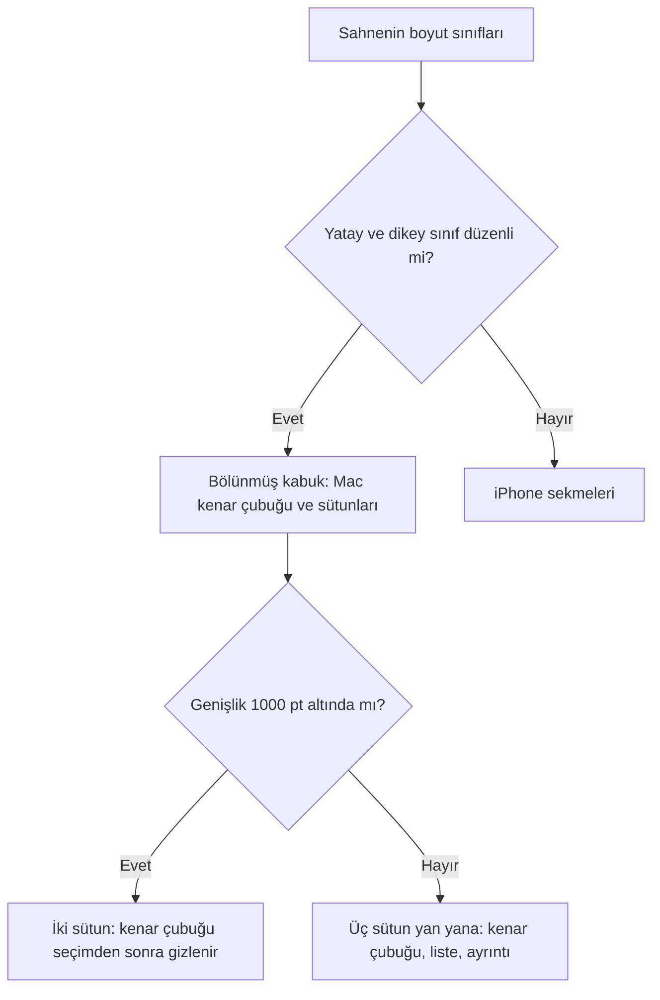

| Sahne | Boyut sınıfı | Kabuk |
|---|---|---|
| iPhone dikey, Duo dış ekranı | Sıkışık × düzenli | iPhone sekmeleri |
| iPhone yatay | Sıkışık × sıkışık | iPhone sekmeleri |
| Pro Max yatay | Düzenli × sıkışık | iPhone sekmeleri |
| Duo iç ekranı: açık, kitap, çadır | Düzenli × düzenli | Bölünmüş kabuk |
| iPad tam ekran, her yön | Düzenli × düzenli | Bölünmüş kabuk |
| iPad dar Split View ve Slide Over | Sıkışık × düzenli | iPhone sekmeleri |

Kabuk cihaz türüne bakmaz; yalnız boyut sınıflarına ve genişliğe bakar. Genişlik değişince (döndürme, Split View) kademe yeniden hesaplanır. Seçim ve taslaklar kalır. Bölünmüş görünüm ilk genişlik ölçümünden sonra kurulur; o ana kadar kâğıt çizilir, böylece soğuk açılışta sistem sütun seçimini ezemez.

| Pencere genişliği | Örnek | Sütunlar |
|---|---|---|
| 1000 pt altı | Duo iç ekranı (yaklaşık 890 × 626 pt), iPad 11" dikey (834 pt), iPad mini | İki sütun: liste ve ayrıntı. Kenar çubuğu düğmeyle açılır, seçimden sonra gizlenir. |
| 1000 pt ve üstü | iPad 13" dikey (1032 pt) ve yatay (1376 pt), iPad 11" yatay (1210 pt) | Üç sütun yan yana: kenar çubuğu, liste, ayrıntı. Pano ve tam sayfa: kenar çubuğu ve sayfa. |

| Ekran | Liste sütunu | Ayrıntı sütunu |
|---|---|---|
| Bugün | Günlük listesi | Bugün; hızlı giriş sayfanın altında |
| Günlük | Günlük listesi | Seçili gün |
| Görevler ve projeler | Görev listesi ya da proje | Seçili görevin ayrıntısı |
| Kişiler, Konumlar | Varlık listesi | Seçili varlık |
| Hedefler | Hedef listesi | Seçili hedefin ayrıntısı |
| Kanban, Zaman çizelgesi | Tam genişlikte pano | Yok |
| Özetler, Graph, Harita | Tam genişlikte sayfa | Yok |

| Öğe | Davranış |
|---|---|
| Kenar çubuğu | Mac kenar çubuğunun girdileri ve çizimi: mürdüm seçim. Sistem sekme kenar çubuğu değildir. iPad'in yüzen paneli kâğıt rengindedir. |
| Kenar çubuğu genişliği | İki sütunda Mac'teki gibi. Üç sütunda en az 200, ideal 240, en çok 280 pt. Erişilebilirlik yazı boyutunda iki ve üç sütunda 240, 280, 320 pt. Uzun ad sonda "…" ile kısalır. Erişilebilirlik yazı boyutunda simge gizlenir ve ad sözcük aralarından sarılır. |
| Kenar çubuğu düğmesi | Sol sütunun gezinme çubuğundadır. Kök sayfalar bu kabukta gezinme çubuğunu gizlemez. |
| Kenar çubuğu seçimi | İki sütunda bir girdi seçilince kenar çubuğu gizlenir; liste ve ayrıntı yeniden yan yana durur. Seçili Görevler'e yeniden dokunmak listeyi ilk bölümüne döndürür. Üç sütunda kullanıcının düğmeyle gizlediği kenar çubuğu, düzen değişince ya da pencere aynı kademede boyut değiştirince gizli kalır; sütunlu düzene geçişte liste sütunu her zaman ayrıntıyla birlikte açılır; panoya ya da tam sayfaya geçişte sayfa bütün genişliği alır. Kademeye yeniden girilince (1000 pt altından dönünce) üç sütun geri gelir. |
| Liste seçimi | Satıra dokunmak satırı seçer ve ayrıntıyı açar; görev kutusu görevi tamamlar. Seçili satır Mac'teki gibi çukur zemindedir. Bölüm ya da süzgeç değişince, görev listeden çıkınca seçim kalkar. |
| Ayarlar | Bugün manşetindeki dişli Ayarlar sheet'ini açar. |
| Arama | Manşet satırındaki büyüteç. Seçim yokken boş ayrıntı sütununun sağ üstünde de büyüteç durur. Gezinme çubuğunda arama düğmesi yoktur. Arama sheet'i form boyutundadır (ideal 580 × 480 pt; form üst payıyla yaklaşık 580 × 490); yazılım klavyesi sonuçları örtmez. |
| Rehberden aktar | Kişiler sütununda "Yeni kişi"nin altında. iPhone'daki akışın aynısı: rehber seçici, sonra aktarma sheet'i. Mac'te yoktur. |
| Sekme ve bölüm | Her sekme bir bölümü açar: Kişiler ve Konumlar sekmesi Kişiler bölümünü açar. Sekmesi olmayan bölüm onu barındıran sekmeye düşer: Özetler Günlük'e; Konumlar, Graph ve Harita Kişiler ve Konumlar'a. |

**NOT:** Seçim, Ayarlar ve günlük editörü sheet'leri, hızlı giriş ve günlük taslakları iki kabuk arasında taşınır: kabuk üstünde tek bir `ShellNavigationState` nesnesi durur. Taslaklar yalnız bellektedir ve o kasaya aittir; başka kasa seçilince düşer.

## Ayarlar

**Ayarlar'da 6 bölüm var; sıra iki platformda aynıdır.**

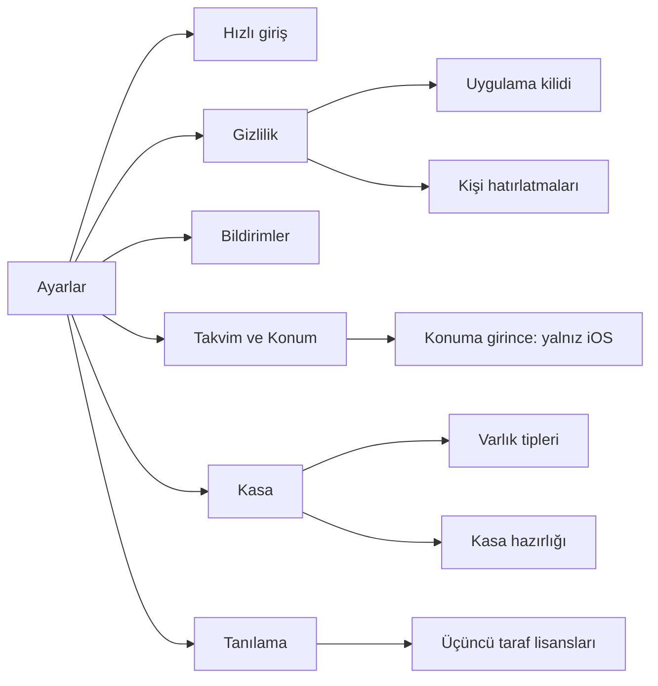

iPhone'da Ayarlar, Bugün manşet satırındaki düğmenin açtığı sheet'tir. Ekran adı ve alt ekran adları serif manşet olarak listenin içindedir. Satır zemini kâğıttır. Mac'te aynı 6 bölüm Settings sekmeleridir ve Hızlı giriş ilk sekmedir. Hiçbir ayar kaybolmaz.

### Ayarlar — Hızlı giriş

| Öğe | Davranış |
|---|---|
| Kapsam | Var olan giriş yollarını gösterir. Yeni yol eklemez. iPhone'da bölüm bir ekrandır. Mac'te aynı satırlar Hızlı giriş sekmesindedir. Klavye kısayolu kaydı sekmenin başındadır. |
| Siri cümleleri | `JournalShortcuts` cümleleri, uygulama adıyla, kayıtlı sırada. Metin kısayol kataloğundan gelir. Kod cümleleri ekrana elle yazmaz. |
| Kısayollar | Aynı cümleler Kısayollar uygulamasında da çalışır. |
| Eylem düğmesi | Yalnız iPhone'da (cihaz türü `phone`). Kullanıcı bu kısayollardan birini sistem Ayarlar'ındaki Eylem düğmesine atar. iPad'de ve Mac'te bu başlık ve metin yoktur. Kapı yalnız metin içindir, yerleşim boyut sınıfına bakar. |
| İlk kullanım ipucu | Ana ekranda, kasa açıldıktan sonra kapatma düğmeli bir ipucu durur. Tercih cihazdadır. Kullanıcı kapatınca ipucu bir daha görünmez. |
| İpucunun görünmediği durum | UI testinde ve `AppLaunchPolicy` otomatik başlatmaya izin vermediğinde. |
| İpucu içeriği | iPhone ipucu Siri, Kısayollar ve Eylem düğmesini adlandırır. iPad ipucu Siri ve Kısayollar'ı adlandırır. Mac ipucu Siri, Kısayollar ve klavye kısayolunu adlandırır. |

### Ayarlar — Gizlilik (7)

| Öğe | Davranış |
|---|---|
| Uygulama kilidi | Anahtar. Açmak bir kez Face ID, Touch ID ya da cihaz parolası ister. Kullanıcı iptal ederse anahtar kapalı kalır. |
| Şu kadar sonra kilitle | Hemen, 1 dk, 5 dk ya da 15 dk. Tercihler cihazdadır. |
| Bildirim içeriği | Yalnız iPhone'da, Bildirimler ayarına bağlantı. Anahtar ("Bildirimde içeriği göster", varsayılan kapalı) ve açıklama Bildirimler'dedir. Mac'te Bildirimler sekmesini kullan. |
| Kişi hatırlatmaları | Görüşülmeyenler eşiği: 1–365 gün, varsayılan 30. Cihaz tercihi. |

**Uygulama kilidinin durumları.**

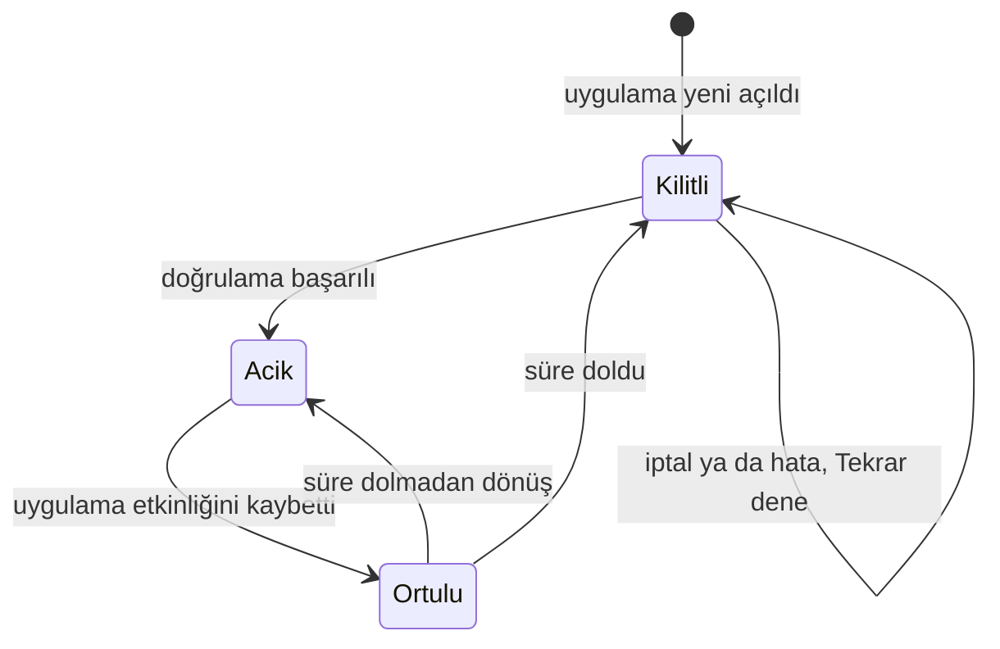

| Konu | Davranış |
|---|---|
| Örtü | Kilit açıkken uygulama etkinliğini kaybedince opak örtü içeriği gizler. Açık ekranlar ve taslaklar kalır. |
| Süre başlangıcı | iOS'ta arka plana geçiş. Mac'te uygulamanın etkinliğini kaybetmesi. |
| Dönüş | Süre dolmadan dönüşte örtü kalkar. Süre dolduysa ya da uygulama yeni açıldıysa doğrulama gerekir. |
| Kilit ekranı | "Günlük kilitli". İptal ya da hata durumunda **Tekrar dene** düğmesi. |
| Mac paneli | Mac menü çubuğu ve klavye kısayoluyla açılan hızlı giriş paneli de aynı kilidi denetler. |
| Kilitliyken | Kilit etkin ve doğrulama yokken Siri hedef adlarını listelemez. Kısayollar ve bildirimdeki İşaretle eylemi yazmaz. |
| Şifreleme | Uygulama kilidi kasayı şifrelemez. |

### Ayarlar — Bildirimler (4)

**Bildirim türleri.**

| Tür | Varsayılan saat | Varsayılan durum | İçerik | Dokunma |
|---|---|---|---|---|
| Görev | 09:00 | Açık | Sabah tek görev özeti: o gün biten açık görevler, tek görevde metni (içerik gösterilirken; gizliyken "1 görev bugün"). Önceki günlerden açık görev sayısı da özettedir. | Görevler'in Bugün grubu; yoksa önceki günlerden açık grup. |
| Günlük hedef | 20:00 | Açık | Yalnız o gün tamamlanmamış günlük hedefler. Haftalık ve yıllık hedefler yoktur. | Bugün. |
| Günlük yazısı | 21:00 | Açık | Olay ve günlük yazısı olmayan güne gelir. | Bugün ve Günü kapat akışının günlük adımı. |
| Görüşme | 10:00 | Kapalı | Ritmi olup vadesi gelen kişiler: `people-<gün>`. | Kişiler'de açık "Bir süredir görüşmediklerin" bölümü. |

**Bildirim kuralları.**

| Konu | Davranış |
|---|---|
| İzin | Uygulama izni yalnız kullanıcının izin düğmesiyle ister. Açılışta sistem diyaloğu yoktur. |
| Tercihler | Kullanıcı her türü ayrı açar ve kapatır. Saatler cihazdadır. |
| İçeriği göster | Anahtar: "Bildirimde içeriği göster", varsayılan kapalı. Kapalıyken afiş, bildirim merkezi ve kilit ekranı yalnız sayı ve genel başlık gösterir: "N görev bugün", "Bugün bekleyen hedefler var", "Görüşme zamanı gelen N kişi var", "Bir hedefin yakınındasın". Görev metni, hedef adları ve kişi adları girmez. Anahtarın altındaki açıklama bunu söyler. Tercih cihazdadır. Seçimi kaydedilmiş cihazda seçim korunur. Kaydı olmayan ya da kaydında bu alan olmayan cihazda içerik gizlidir. |
| Pencere | Bugün dahil 7 gün, yerel takvim saatleriyle. |
| Görev özeti | Yalnız önceki günlerden açık görev varsa da tek sabah özeti gelir. Ayrı gecikme bildirimi yoktur. Tarihsiz, tamamlanan ve iptal görevler bildirime girmez. |
| Günlük yazısı | Görev ya da hedef kaydı tek başına hatırlatmayı kapatmaz. |
| Görüşme: sıklık | 7 günlük pencerede günde en çok 1 bildirim. |
| Görüşme: kimler | Yalnız `cadence_days` değeri olan ve o gün vadesi gelen kişiler. Vade: son görüşmeden bu yana geçen gün ritme eşit ya da büyük. |
| Görüşme: dışarıda kalan | Ritmi olmayanlar, hiç görüşülmemişler, duraklatılanlar ve erteleme günü (o gün dahil). Erteleme pencere içinde biterse kişi ertesi gün hesaba yeniden girer. |
| Görüşme: gövde | En çok 3 ad. Fazlası: "Ad, Ad, Ad ve N kişi daha". İçerik gizliyken gövde: "Görüşme zamanı gelen N kişi var". |
| Görüşme: yineleme | Bildirilen kişi, o günden sonra görüşülmediyse en erken ritminin dörtte biri kadar gün sonra yeniden girer. Tam bölme, en az 3 gün. |
| Görüşme: son bildirim günü | Cihazda, kasa yoluna göre durur. Uygulama planlanan her bildirimin çalma anını tutar. Uygulama anı geçmiş bildirimi çalmış kabul eder. Neden: uygulama kapalıyken teslimatı göremez. |
| Görüşme: geri çekilen | Plan yenilemesinde geri çekilen ve çalmamış bildirim sayıma girmez. Saat tercihi ya da kasa değişse de kural aynıdır. |
| Görüşme: kayıt düşmesi | Ritmi kalmayan, silinen ya da yeniden adlandırılan kişinin kaydı düşer. |
| Görüşme: yenileme | Yeni görüşme ya da ritim, erteleme veya duraklatma değişikliği planı öteki hatırlatmalarla aynı yenilemede kurar. Tercih kapanınca uygulama planlı `people-` bildirimlerini siler. |
| Plan yenileme | Açılış, ön plana dönüş, indeks yenilemesi (2 saniye birleştirme) ve tercih değişimi planı yeniler. Arka plana geçiş bekleyen planlamayı bitirir. Plan bugünün geçmiş saatlerini atlar. |
| Kapalı uygulama | Uygulama kapalıyken planlı içeriği yeniden hesaplamaz. Yeni değişiklik sonraki açılışta ya da yenilemede yansır. 7 günlük pencere de yalnız uygulama çalışırken ileri gider. |
| Günlük hatırlatması | Dokunma Bugün'ü ve Günü kapat akışını günlük adımından açar. Uygulama bildirimin kendi gününü kullanmaz. Dünkü hatırlatma da bugünün akışını açar. |
| Ön plan | Uygulama ön plandayken de banner görünür. |
| Planlananlar | "Planlananlar" listesi kimlik, tarih ve başlığı gösterir. "Şimdi yeniden planla" teşhis ve yeniden deneme içindir. |
| Yer | Mac'te Bildirimler ayar sekmesi. iPhone'da Ayarlar listesi. |

### Ayarlar — Takvim ve Konum

| Öğe | Davranış |
|---|---|
| Takvim izni | İzin düğmesi ve sistem ayarları bağlantısı. |
| Takvim okuma | Uygulama etkinlikleri okur. Takvime hiçbir zaman yazmaz. Gün dosyasına yalnız kullanıcının gönderdiği olay taslağı gider. |
| Konum önerisi | Anahtar, konum izni ve sistem ayarları bağlantısı. |
| Konuma girince | Yalnız iOS'ta, bu bölümün altında. macOS'ta gizlidir. Ayrıntı [Ayarlar — Konuma girince](#ayarlar--konuma-girince-4-ios) bölümündedir. |

### Ayarlar — Kasa

| Öğe | Davranış |
|---|---|
| Konum türü | iCloud, Bu cihazda veya Seçilen klasör. Altında kasa yolu görünür. |
| Kasa yolu | Ekran uzun yolu ortadan kırpar. Kullanıcı yolu seçer ve kopyalar. |
| iCloud’a taşı | Varsayılan yerel kasada ve iCloud kullanılabiliyorsa görünür; taşıma onay sheet’ini açar. Doğrulanmış kopya tamamlanınca yeni kasa açılır. Kaynak cihazda korunur; bilgi satırı kalır. |
| Eşitlenen klasör | Kasa eşitlenen bir klasördeyse yolun altında kalıcı bilgi bandı durur. Ayrıntı: [Eşitlenen klasör bandı](#eşitlenen-klasör-bandı). |
| Mac'e özgü | Finder'da göster. |
| Klasör | Klasör seç ya da değiştir. |
| Kasa hazırlığı | İçe aktarma alt ekranı. |
| Uyarılar ve ilerleme | İzlenmeyen dizin uyarısı ve indeksleme ilerlemesi. |
| Varlık tipleri | Alt ekrana bağlantı. Yerleşik tipler salt okunurdur. Kullanıcı özel tip oluşturur, değiştirir ve siler. "Yeni varlık tipi" hazır tip galerisini açar; Kişiler ve Konumlar'daki "Yeni tip…" aynı galeridir. |
| Alt ekranlar | iPhone Varlık tipleri ve Kasa hazırlığı ekranlarını gezinme yığınına iter. Mac'te alt ekran Kasa sekmesinin içeriğinin yerine geçer. En üstteki "Kasa" düğmesi geri döndürür. Sekme şeridi değişmez. |

### Ayarlar — Tanılama

| Öğe | Davranış |
|---|---|
| İndeks eylemleri | İndeksi yeniden üret. Arama geçmişini temizle. |
| İndeks sayıları | Dosya, gün, kişi, konum, hedef, not, olay, görev, varlık, bağlantı, çözülmemiş. Son güncelleme. Sayılar tabulardır. |
| Atlanan yollar | Sembolik bağlantı ya da yinelenen yol. Ekran uzun yolu kırpar. Kullanıcı yolu kopyalar. |
| Kopya dosyalar | Gün kopyaları ve varlık kopyaları. Her satır kopyanın yolunu ve altında özgün dosyanın yolunu gösterir. Kopya yoksa bölüm görünmez. Uygulama kopyayı birleştirmez. Kural: [Varlık kopyası](vault-format.md#varlık-kopyası). |
| Çakışan sürümler | Yalnız iCloud Drive kasasında. iCloud'un çözülmemiş sürüm sakladığı dosyalar. Her satır dosyanın yolunu, "N sürüm" ve en yeni sürümün zamanını, altında sürümü kaydeden cihazların adlarını gösterir. Bölümün altında tek cümle: "Kenet sürümleri birleştirmez ve silmez." Cümle bir çözüm yolu vaat etmez. Dosya yoksa bölüm görünmez. Liste ön plana dönüşte yenilenir. Kural: [Çakışan sürümün listesi](vault-format.md#çakışan-sürümün-listesi). |
| Çakışma kopyaları | Gün kopyası birleştirmesinin `conflicts/` altına sakladığı sürümler. Her satır kopyanın yolunu ve altında gün dosyasının yolunu gösterir. Kopya yoksa bölüm görünmez. Uygulama kopyayı açmaz ve silmez. Kural: [Çakışma kopyası](vault-format.md#çakışma-kopyası). |
| Üçüncü taraf lisansları | Salt okunur alt ekran. Uygulamaya giren her paketin adı, lisans türü ve paketlenmiş lisans metni. Uygulama metni çevirmez. |
| Lisans alt ekranı | iPhone alt ekranı gezinme yığınına iter. Mac'te alt ekran Tanılama sekmesinin içeriğinin yerine geçer. En üstteki "Tanılama" düğmesi geri döndürür. Sekme şeridi değişmez. |

### Ayarlar — Konuma girince (4, iOS)

**Bölgeye girişte hedefin işlenmesi.**

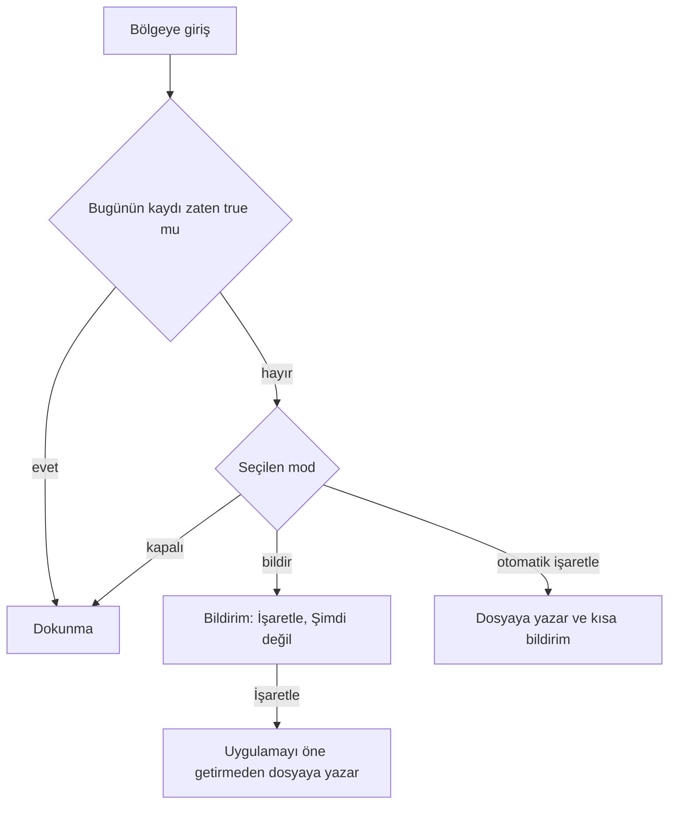

| Konu | Davranış |
|---|---|
| Yer | Ayarlar → Takvim ve Konum içinde, Konum bölümünün altında. macOS'ta bu bölüm ve bölge izleme gizlidir. |
| İzin | Açık düğmesi Her zaman iznini ister. İzin olmadan uygulama bölge izlemez. Bildirim izni ayrı olarak Bildirimler ayarından gelir. |
| Uygun hedef | Konum bağlantısı çözülen, koordinat ve açık yarıçap alanı olan boolean hedef. |
| Mod | Kapalı, bildir ya da otomatik işaretle. Varsayılan bildir. |
| Liste | Liste izlenen bölgeleri hedef, konum ve yarıçapla gösterir. 20 sınırını aşan hedef sayısı görünür. Uygulama hedef dosya yolu sırasındaki ilk 20 açık hedefi izler. |
| Günde bir | Uygulama girişi bugünün hedef kaydı için günde bir kez işler. Uygulama zaten true olan kayda dokunmaz. |
| Bildirim eylemleri | Bildirimde İşaretle ve Şimdi değil eylemleri durur. İşaretle uygulamayı öne getirmeden dosyaya yazar. |
| Otomatik mod | Uygulama hedefi doğrudan işaretler ve kısa bildirim gönderir. Uygulama kilitliyken de işaretler. |
| Kilit etkinken | Bildirimde eylem yoktur. Bildirim yalnız uygulamayı açar. |
| Geçersiz eylem | Uygulama eski güne ait eylemi, farklı kasayı, kapanmış ya da değişmiş bölgeyi işlemez. |
| Yer imi hatası | Yer imi erişimi başarısızsa uygulama başka kasaya geçmez. Sonraki girişte yeniden dener. |

## Kısayollar ve Siri (4)

| Cümle | Davranış |
|---|---|
| Günlüğe olay ekle | Saat verilmezse şimdi. |
| Görev ekle | Tarih metinden çıkar. Açık tarih parametresi önceliklidir. Siri ve Kısayollar varsayımlı (yılsız) tarihi onaysız uygulamaz. |
| Hedefi işaretle | Seçim listesi güncel tanımları gösterir. Boolean hedefe true yazar. Sayısal hedefe miktarı bugünün toplam kaydı olarak yazar; artırma değildir. |
| Bugünü aç | Uygulamayı öne getirir ve Bugün sekmesini ya da bölümünü seçer. Ayrıntı, arama ve telefondaki Ayarlar kapanır. Ana gezinme değişmez. |

"Journal ile" başlayan cümleler Türkçe ve İngilizce App Shortcuts olarak gelir. Kasa eksikse ya da erişilemiyorsa kısayol uygulamadan kasayı açmasını isteyen hata verir. Yazma işlemleri uygulamayı öne getirmez ve kısa onay metni döndürür. Uygulama kesin anmaları hızlı girişteki gibi bağlar. Belirsiz ya da bilinmeyen `@` anmasında kısayol soru soramaz. Uygulama `@` işaretini kaldırır, metin düz kalır ve yeni varlık oluşmaz.

## Giriş noktaları

**Yazma yolları ve her yolun açtığı davranış.**

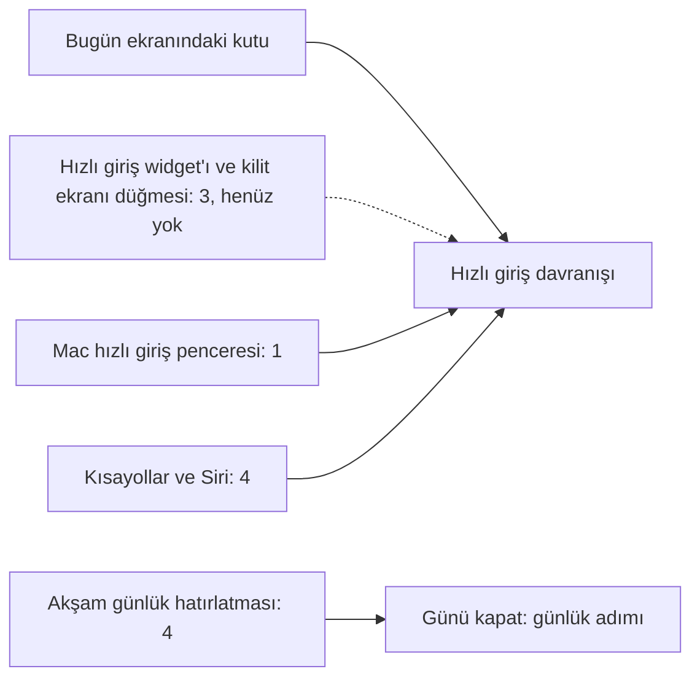

Kısayollar ve Siri arayüz göstermez, ama anmaları hızlı girişteki kuralla bağlar. Akşam günlük hatırlatması hızlı giriş kutusunu değil, Günü kapat akışının günlük adımını açar. Bu adım tek cümleyi günlüğün sonuna ekler. Widget ve kilit ekranı düğmesi henüz yok: [Widget'lar](#widgetlar-3) bölümüne bak.

Bugün çalışan yollar Ayarlar → Hızlı giriş'te ve ilk kullanım ipucunda görünür: Siri cümleleri, Kısayollar, Eylem düğmesi ve Mac klavye kısayolu. Widget, kilit ekranı düğmesi, Denetim Merkezi ve paylaşım uzantısı bu gösterimde yoktur.

## Widget'lar (3)

**Durum:** henüz uygulanmadı. Widget'lar App Group kimliği kararını bekler. Tablo hedeflenen kapsamdır.

| Widget | Yer | İçerik |
|---|---|---|
| Hedefler | Ana ekran, Mac | Günün hedefleri. Dokunma hedefi işaretler. Bekleyen hedefler vurguludur. |
| Bugün | Ana ekran, Mac | Günün görevleri ve sıradaki etkinlik. Göreve dokunma görevi tamamlar. |
| Kilit ekranı | Kilit ekranı | Sıradaki etkinlik ve kalan görev sayısı ya da tek hedefin durumu. |
| Hızlı giriş | Ana ekran, kilit ekranı, Denetim Merkezi | Dokunma uygulamayı yazma ekranında, klavye açık olarak açar. |

## Boş durumlar

**Uygulama açılışta hangi kök ekranı gösterir.**

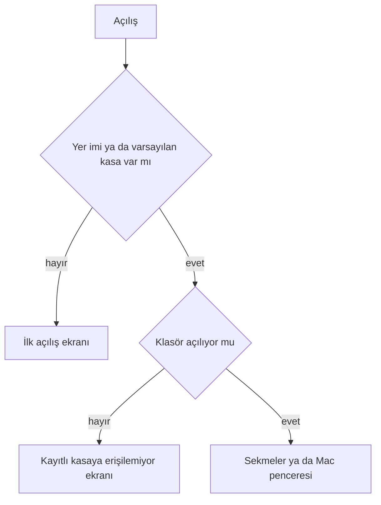

| Durum | Ekran |
|---|---|
| İlk açılış | Tek ekran Markdown veri sahipliğini anlatır. iCloud varsa ilk ve birincil seçenek “iCloud’da sakla”, altında “iPhone ve Mac aynı klasörü paylaşır.” açıklaması; sonra “Bu cihazda” ve “Var olan klasörü seç” gelir. iCloud yoksa ilk seçenek ve açıklaması görünmez; “Bu cihazda” birincil dolu düğme olur. |
| Yerel kasayı iCloud’a taşıma | Güncellemeden sonraki açılışta varsayılan yerel kasa önce açılıp indekslenir; sonra iCloud varsa ana ekranın üstünde bir kez sorulur. Onboarding yalnız kasa yokken görünür. “Kasayı iCloud’a taşı?” sheet’i `.inkSheet` kullanır; araç çubuğunda tek eylem çifti “Taşı” ve “Vazgeç” bulunur. Gövdedeki açıklama Vazgeç’in kasayı bu cihazda tuttuğunu ve daha sonra Ayarlar’dan taşınabileceğini söyler. Taşırken düğmeler ve kapatma devre dışıdır. Hata aynı sheet’te görünür; tekrar denenebilir. Başka cihazın kasası varsa açılan kasa ve yerel kopyanın ayrı yolu bildirilir. |
| iCloud kapalı | Kayıtlı tür iCloud ise “iCloud kapalı” ve erişim açıklaması gösterilir. Önce birincil “Yeniden dene”, sonra “Bu cihazda devam et”, ardından “Başka klasör seç” gelir. Sessizce yerel kasaya geçilmez; veri silinmez. |
| İlk kasa | Kullanıcı kasayı açınca boş Bugün ekranında ipucu görünür: "Gününden bir an yaz; @ ile kişi ekle". İlk kişi ve konum yazarken oluşur. |
| Kayıtlı kasaya erişilemiyor | Yer imi var ama klasör açılmıyorsa ya da yer imi bozuksa sekmelerin yerine durum ekranı gelir. "Yeniden dene" ve "Başka klasör seç" düğmeleri durur. Yerel kasaya sessiz geçiş yoktur. |
| Boş gün | Suçlayıcı olmayan kısa metin. Giriş kutusu hazırdır. |
| Kasa eşitlenirken | Eldeki içerik görünür. Küçük gösterge eşitleme durumunu söyler. Bu durum iCloud eşitlemesiyle gelecek; henüz yok. |

## Var olan klasörü seçme

**Kasa hazırlığı akışı.**

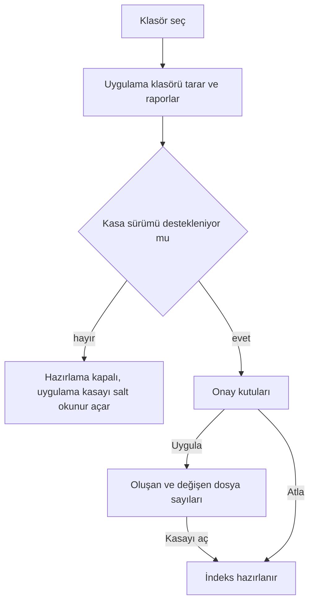

| Konu | Davranış |
|---|---|
| Seçici | İlk açılışta ve Ayarlar'da aynı klasör seçici çalışır. |
| Rapor | Kasa yapısı eksikse rapor şunları gösterir: bulunan klasörler, Markdown dosya sayısı, gün dosyaları, kişi, konum ve hedef sayıları, eksik `type` alanları ve atlanan dosyalar. |
| Kökteki gün dosyaları | Rapor kökteki ve `daily/` altındaki gün dosyalarını bilgi olarak listeler. Uygulama bu dosyaları taşımaz. |
| Harf farkı | Rapor, standart klasör adının yalnız harf farkı olan biçimini ayrıca söyler, örneğin `Journal/`. Kullanıcı adı Obsidian'da düzeltir. Uygulama taşımaz ve yeniden adlandırmaz. |
| Teklifler | Eksik klasör ve şablonları oluşturma, eksik kasa ayarını yazma ve kişi ve konum türlerini ekleme. Her teklif ayrı onay kutusudur. Varsayılan açıktır. |
| Uygula | Sonrasında oluşan ve değişen dosya sayıları, atlanan ve hatalı yollar görünür. "Kasayı aç" indeksi hazırlar. |
| Atla | Dosyalara yazmadan indeksi açar. |
| Desteklenmeyen sürüm | Desteklenmeyen ya da okunamayan kasa sürümünde hazırlama kapalıdır. Uygulama kasayı salt okunur açar. |
| Eşitlenen klasör | Seçilen klasör eşitlenen bir klasördeyse Kasa hazırlığı raporu yolun altında bilgi bandı gösterir. İlk açılış ekranı da kasa açılırken aynı bandı gösterir. Ayrıntı: [Eşitlenen klasör bandı](#eşitlenen-klasör-bandı). |
| İlk indeksleme | Toplam dosya sayısıyla ilerleme göstergesi görünür. İndeks API'si dosya başına bildirim üretmez, bu yüzden gösterge belirsizdir. Bitince gerçek indeks sayıları Ayarlar → Tanılama'dadır. |

### Eşitlenen klasör bandı

**Bandın kaynağı ve göründüğü yerler.**

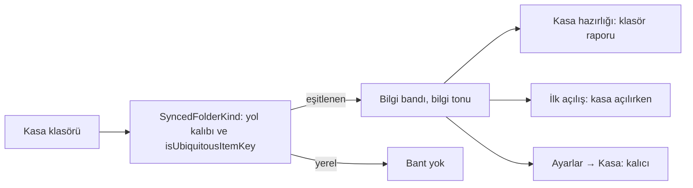

| Konu | Davranış |
|---|---|
| Metin | "Bu klasör {hizmet} ile eşitleniyor. Kenet dosyaları koordineli yazar; iki cihaz aynı günü düzenlerse gün kopyası oluşabilir ve kopya Tanılama'da görünür." |
| Hizmet adı | iCloud Drive, Dropbox, OneDrive ya da Google Drive. Bilinmeyen dosya sağlayıcısında "bir eşitleme hizmeti". |
| Ton | Bilgi tonu. Uyarı tonu yok, kapatma düğmesi yok, izin isteği yok. |

## İlgili belgeler

- [Tasarım dili](design.md)
- [Kasa biçimi](vault-format.md)
- [Mimari](architecture.md)
- [Yol haritası](roadmap.md)
- [Kararlar](decisions.md)
