# Kasa formatı

**Sürüm:** 0.3 (taslak)

**Amaç:** Kasa dosyalarının biçimini, uygulamanın her sürümünün ve gelecekteki her istemcinin uyduğu platformlar arası sözleşme olarak tanımlamak.

**Kapsam:**

- Kasa düzeni, adlar, frontmatter, bağlantılar ve blok kimliği.
- Gün, kişi, konum, hedef, not ve özel tip dosyaları; olay ve görev satırları.
- Eşitleme çakışmasında birleştirme ve çakışma kopyası.

**NOT:** Biçimi değiştirmeden önce bu belgeyi güncelle. Ayrıştırıcıyı ve yazıcıyı belgeden sonra değiştir.

**Belge haritası: bölümler ve konuları.**

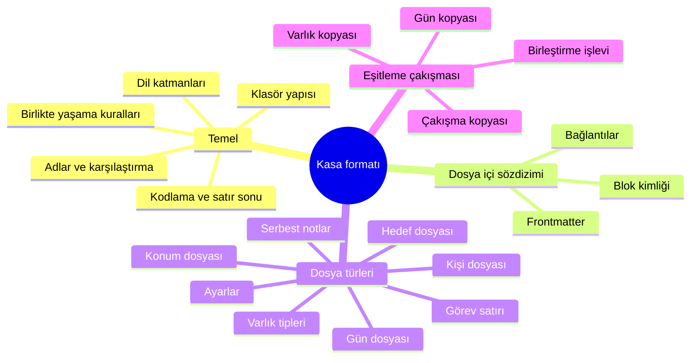

## Kodlama ve satır sonu

| Konu | Kural |
|---|---|
| Yeni dosya | Uygulama oluşturduğu dosyayı BOM'suz UTF-8 ile ve LF satır sonuyla yazar. |
| Satır sonu tanımı | Satır sonu LF, CRLF ya da ardından LF gelmeyen tek CR'dir. Obsidian ve CommonMark da satır sonunu böyle sayar. |
| Okuma | Uygulama 3 satır sonu biçimini, baştaki BOM'u ve satır sonuyla bitmeyen son satırı kabul eder. Uygulama hepsini aynen korur. |
| Var olan dosyaya satır ekleme | Uygulama dosyadaki ilk satır sonunun biçimini kullanır. Dosyada hiç satır sonu yoksa uygulama LF kullanır. |
| Sonlanmamış son satır | Son satır yeni satırla bitmiyorsa uygulama yeni satırı eklemeden önce son satırı sonlandırır. |
| Baştaki BOM | BOM dosyanın özelliğidir ve her zaman en başta kalır. Uygulama dosyanın başına içerik eklediğinde de BOM en başta kalır. Örnek: yeni frontmatter. |
| Baş dışındaki BOM | Baş dışındaki BOM baytları sıradan içeriktir. |
| Çözülemeyen UTF-8 | UTF-8 olarak çözülemeyen dosya salt okunurdur. Uygulama böyle dosyanın içine yazmaz. |
| Çözülemeyen bayt dizisi | Unicode'a göre iyi biçimli olmayan bayt dizisidir: aşırı uzun kodlama, vekil kod noktası, yarım dizi. NUL ve U+FFFD geçerlidir. |
| Çözülemeyen dosyanın gösterimi | Uygulama geçerli satırları olduğu gibi gösterir. Uygulama geçersiz bayt dizilerini U+FFFD olarak gösterir. |

## Sözdizimi ve kasa konumu

| Konu | Kural |
|---|---|
| Sözdizimi | Obsidian uyumludur: YAML frontmatter, `[[wikilink]]`, `#etiket`, blok kimliği, Obsidian Tasks görev biçimi. |
| Kasa konumu | Kasa bugün uygulamanın yerel klasöründe ya da kullanıcının seçtiği klasörde durur. Uygulamanın kendi iCloud klasörü planlıdır ve henüz yoktur. |
| Obsidian ile açma | Kullanıcı Mac'te kasayı Obsidian ile kasa olarak açabilir. |

## Dil katmanları

| Katman | Dil | Örnek |
|---|---|---|
| Dosyadaki yapı: klasör adları, frontmatter anahtarları, `type` değerleri, gün dosyasındaki bölüm başlıkları | İngilizce ve sabit; kullanıcının dili ne olursa olsun aynı | `people/`, `aliases`, `## Events` |
| Arayüz | Kullanıcının dili | Kullanıcı `people/` klasörünü "Kişiler", `aliases` alanını "Takma adlar" olarak görür. |
| İçerik: varlık adları, notlar, kullanıcının eklediği serbest alanlar, şablon alan adları | Kullanıcının istediği dil | `doğum günü`, `tanışma` |

Dosyadaki yapı her dilde aynı kalır. Böylece her istemci kasayı her dilde aynı biçimde okur.

## Birlikte yaşama kuralları

| No | Kural | Anlamı |
|---|---|---|
| 1 | Tanımadığına dokunma. | Uygulama bir dosyada yalnız kullanıcının işleminin hedeflediği satırı ya da alanı değiştirir. Dosyanın geri kalanı bayt düzeyinde aynı kalır. |
| 2 | Tanımadığını gösterebil. | Beklenmeyen dosya ya da sözdizimi hata üretmez. Uygulama onu düz not olarak gösterir. |
| 3 | Dosyada olmayan bilgiyi tutma. | Kasa tek başına bütün veriyi geri getirmeye yeter. |

Kural 1'in ayrıntıları:

- Hedef satır uygulamanın üretmediği bir satır da olabilir. Örnek: kullanıcının Obsidian'da yazdığı bir görevi tamamlamak. O durumda da yalnız o satır değişir.
- Birden çok dosyaya dokunan işlemler 2 tanedir: varlık adını değiştirme ve çakışma birleştirme. Ad değiştirmede uygulama bağlantıları da günceller.
- Uygulama, kendi dışında yazılan metni kendiliğinden yeniden yazmaz. Uygulama o metnin biçimini düzeltmez. Uygulama o metindeki adları sonradan bağlantıya çevirmez.

### Tek geçişi bağlantıya çevirme

**Kural 1'in tek istisnası: kullanıcının onayladığı tek bir ad geçişi.**

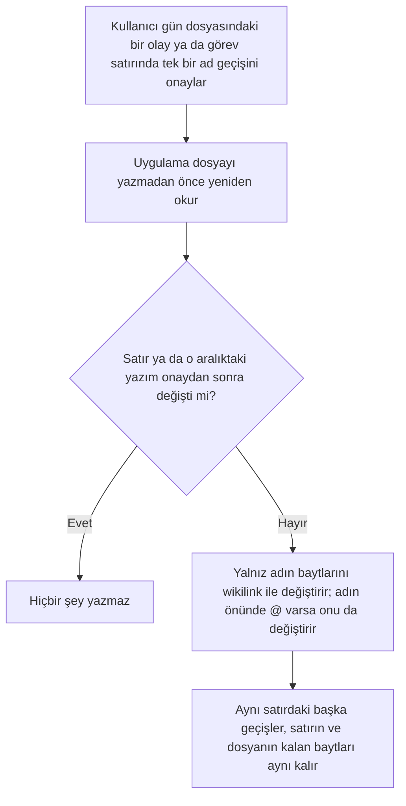

Wikilink yazımını "Otomatik tanıma ve belirsizlik" kuralları üretir. Her onay tek bir geçiş içindir. Uygulama toplu çevirme yapmaz. Uygulama kendiliğinden çevirme yapmaz.

### Var olan kasayı açma ve hazırlama

**Hazırlama akışı: rapor, ayrı onaylar ve atlama.**

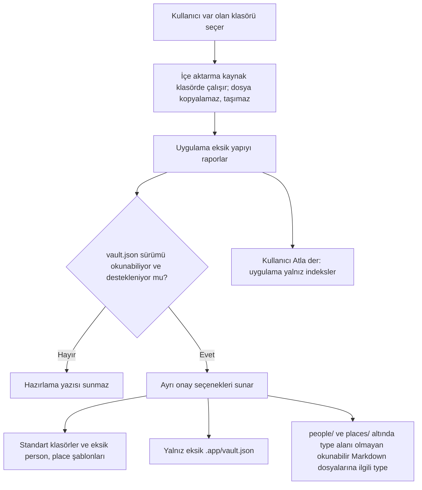

| Durum | Uygulamanın davranışı |
|---|---|
| Var olan `type` değeri, şablon, ayar, bilinmeyen alanlar, gövde | Korur. |
| Çözülemeyen frontmatter ya da UTF-8 | Değiştirmez. Raporlar. |
| Sembolik bağlantı | Değiştirmez. Raporlar. |
| Kullanıcı Atla der | Yalnız indeksler. `.obsidian/` klasörünü ve diğer dosyaları korur. |
| Kökte ya da `daily/` altında aynı tarih adlı dosya | Raporda yalnız bilgi olarak gösterir. Dosyayı taşımaz. Farklı yol için gün kimliği kuralını değiştirmez. |
| Yalnız harfi farklı standart klasör: `Journal/`, `People/` | Hazırlama raporunda bildirir. Eksik klasör olarak oluşturmaz. Klasörü yeniden adlandırmaz. |
| Format sürümü | Hazırlama format sürümünü yükseltmez. Var olan vault.json dosyasını yeniden yazmaz. |
| Desteklenmeyen ya da okunamayan sürüm dosyası | Hazırlama yazısı sunmaz. |

`journal/YYYY-MM-DD.md` tanınan gün yoludur. Kökteki ya da `daily/` altındaki tarih adlı dosyaları kullanıcı isterse Obsidian'da kendisi düzenler. Standart klasör adları (`journal`, `people`, `places`, `goals`, `notes`, `templates`) bayt düzeyinde tam yazım ister. Yalnız harfi farklı bir klasör varsa uygulama yalnız o klasörü hedefleyen yazmayı reddeder. Örnek: `Journal/` varken uygulama `journal/…` yazmaz; `People/` varken gün olayı yazar ama `people/` altına yeni kişi oluşturmaz. Uygulama var olan dosyayı kendi gerçek yolunda düzenler; klasörü doğru ada kullanıcı çevirir.

## Klasör yapısı

**Kasa dizin ağacı: standart klasörler ve görevleri.**

```
Vault/
  journal/       Gün dosyaları (YYYY-MM-DD.md)
  people/        Kişi dosyaları
  places/        Konum dosyaları
  goals/         Hedef tanımları
  notes/         Serbest notlar
  templates/     Varlık şablonları (person.md, place.md)
  conflicts/     Çakışma kopyaları (bkz. Senkronizasyon çakışması)
  .app/          Ayarlar ve görünüm tercihleri (JSON)
```

**NOT:** Ağaçtaki "Senkronizasyon çakışması" göndermesi [Eşitleme çakışması](#eşitleme-çakışması) bölümüdür.

**Tarama kararı: uygulama bir yolu nasıl sınıflandırır.**

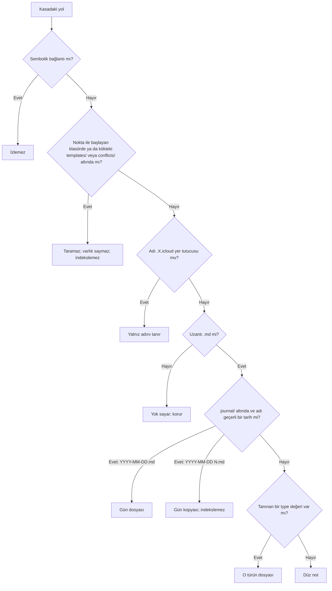

- Bir dosyanın türünü klasör değil frontmatter'daki `type` belirler. Klasörler yalnız uygulamanın yeni dosyayı nereye koyacağını söyler. Tek istisna gün dosyalarıdır: gün dosyasının kimliği yoludur. Ayrıntı: [Gün dosyası](#gün-dosyası).
- Standart klasör adları ağaçtaki yazımla birebir aynıdır: `journal/`, `Journal/` değil. Uygulama yalnız harfi farklı klasördeki dosyayı gün dosyası saymaz. Uygulama böyle klasörü hazırlamada bildirir ve yalnız o klasörü hedefleyen yazmayı reddeder. Ayrıntı: [Var olan kasayı açma ve hazırlama](#var-olan-kasayı-açma-ve-hazırlama).
- `type` alanı olmayan ya da tanınmayan bir `type` taşıyan dosya düz nottur.
- Uygulama yalnız `.md` uzantılı dosyaları okur. Uygulama diğer dosyaları yok sayar ve korur. Örnek: görsel, PDF.
- Uygulama şu klasörleri taramaz: adı nokta ile başlayan klasörler (`.app/`, `.obsidian/`, `.trash/`), kökteki `templates/` ve `conflicts/`. Uygulama bu klasörlerdeki dosyaları varlık saymaz ve indekslemez.
- Uygulama, kullanıcının açtığı diğer klasörleri ve alt klasörleri tarar.
- Uygulama sembolik bağlantıları izlemez.
- Adları aynı NFC biçimine dönüşen 2 dosya varsa uygulama bayt sırasında önce geleni indeksler. Uygulama diğerini bildirir.
- İndeks kasanın içinde durmaz.

### İndirilmeyi bekleyen sistem dosyaları

**Yer tutucu adları: hangi ad sistem yer tutucusudur.**

| Ad | Yer tutucu mu | Neden |
|---|---|---|
| `.X.icloud` | Evet | Aynı klasördeki `X` dosyasının indirilmesini bekleyen sistem yer tutucusu. |
| `.Selin.md.icloud` | Evet | Nokta öneki, boş olmayan özgün ad `Selin.md` ve küçük harfli `.icloud` soneki var. |
| `.hidden.md` | Hayır | Sıradan gizli dosya. `.icloud` soneki yok. |
| `.Selin.md.ICLOUD` | Hayır | Sonek küçük harfli `.icloud` değil. |
| `..icloud` | Hayır | Nokta öneki ile sonek arasındaki özgün ad boş. |

Yer tutucu biçimi 3 parça ister: nokta öneki, küçük harfli `.icloud` soneki ve aralarında boş olmayan özgün ad. Uygulama eşlemeyi bayt düzeyinde yapar ve NFC ya da NFD yazımını korur. Uygulama yer tutucuyu yazmaz, ayrıştırmaz ve indekslemez; yalnız adını tanır.

**İndirilmemiş dosyanın üstüne oluşturma denetimi.**

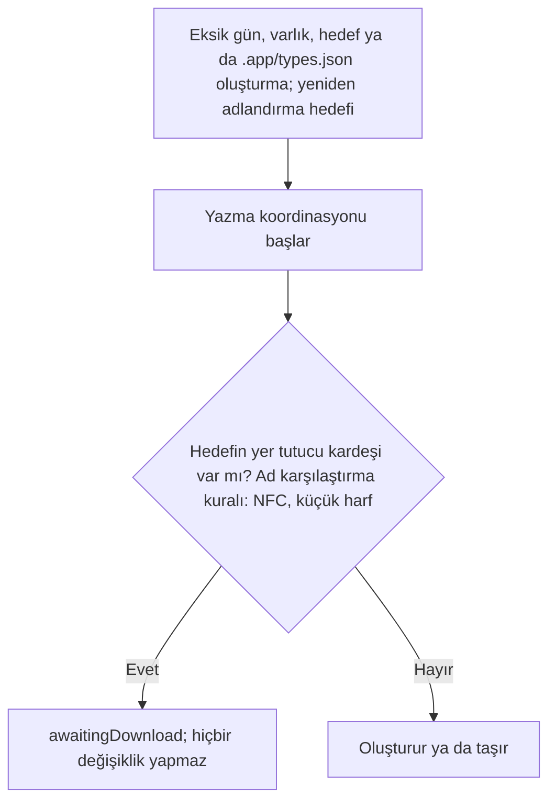

| Konu | Kural |
|---|---|
| Bekleyen indirmeler | Tarama, taranan klasörlerde özgün adı `.md` ile biten yer tutucuları `pendingDownloads` listesinde bildirir. Liste özgün yolları kasaya göreli, diskteki yazımıyla ve bayt sırasında taşır. |
| Artımlı tarama | Artımlı tarama yalnız bildirilen kapsamdaki yer tutucuları bildirir. |
| Gizli klasörler | Tarama gizli klasörlerdeki yer tutucuları bildirmez. `.app/` da gizli klasördür. |
| İndeks satırı | İndeks indirilmemiş dosyanın satırını tutmaz. Böylece indeksi yalnız okunabilen dosyalardan yeniden üretmek mümkündür. |
| Yer tutucuya dönüş | Dosya yer tutucuya dönünce uygulama indeks satırını siler. Dosya indirilince satır geri gelir. |
| Özgün dosya da var | Aynı yerde indirilmiş özgün dosya da varsa özgün dosya kazanır. Uygulama onu indeksler ve düzenler. Özgün dosya bekleyen listesine girmez. |
| Yer tutucu kardeşi | Hedefin yer tutucu kardeşi varken uygulama eksik gün, varlık, hedef ya da `.app/types.json` dosyası oluşturmaz. Uygulama o hedefi yeniden adlandırma hedefi olarak da kullanmaz. Hata: `awaitingDownload`. |
| Kardeş arama | Uygulama kardeşi ad karşılaştırma kuralıyla arar: NFC ve küçük harf. Büyük ve küçük harfe duyarlı birimde de uygulama `selin.md` dosyasını `.Selin.md.icloud` yanında oluşturmaz. |
| Denetim zamanı | Uygulama denetimi yazma koordinasyonunun içinde, herhangi bir değişiklikten önce yapar. |

## Adlar ve karşılaştırma

| Karşılaştırılan | Normalleştirme | Büyük ve küçük harf |
|---|---|---|
| Dosya adları ve varlık adları | Unicode NFC | Duyarsız. Unicode'un varsayılan, yerelden bağımsız küçük harf eşlemesi. |
| Satırlar ve frontmatter değerleri | Yok. Bayt düzeyinde. | Duyarlı |

| Ad çifti | Sonuç | Neden |
|---|---|---|
| `I` ve `i` | Aynı harf | Türkçeye özel eşleme yok. |
| `İ` ve `i` | Farklı harf | Türkçeye özel eşleme yok. |
| `I` ve `ı` | Farklı harf | Türkçeye özel eşleme yok. |
| `Işık` ve `işık` | Aynı ad | Varsayılan küçük harf eşlemesi. |
| `Işık` ve `ışık` | Ayrı ad | `ı` ile `i` farklı harftir. |

- Uygulama dosya adlarını ve adlarla yapılan bütün karşılaştırmaları NFC'ye normalleştirir. Gerekçe: macOS ve iCloud dosya adlarını farklı biçimde döndürebilir. Farklı biçim Türkçe karakterlerde eşleşme hatası doğurur.
- NFC kuralı yalnız dosya adlarını ve varlık adlarını kapsar. Uygulama satırları ve frontmatter değerlerini normalleştirme yapmadan, bayt düzeyinde karşılaştırır.
- Karşılaştırma cihazın dilinden bağımsızdır. Uygulama 2 adı NFC'ye çevirir. Sonra uygulama adları Unicode'un varsayılan küçük harf eşlemesiyle karşılaştırır.
- Mac dosya sistemi ve Obsidian büyük ve küçük harfe duyarsızdır. iPhone dosya sistemi duyarlıdır. Bu nedenle uygulama karşılaştırmayı dosya sistemine bırakmaz.
- Uygulamanın yazdığı bağlantılar dosya adını birebir taşır. Bu nedenle Türkçe harf kuralı yalnız elle yazılan bağlantıları etkiler.
- Uzantısız dosya adları kasa genelinde benzersizdir. Uygulama kendi oluşturduğu dosyalarda benzersizliği sağlar.
- Kasanın dışından aynı ad 2 dosyaya verilmişse bağlantı, kasa köküne göre yolu kod noktası sırasında önce gelen dosyaya gider. Uygulama durumu kullanıcıya bildirir.
- Dosya adı şu karakterleri içermez: `/ \ : * ? " < > |`. Dosya adı bağlantı sözdizimini bozan `# ^ [ ]` karakterlerini de içermez. Görünen ad bu karakterleri içeriyorsa `name` alanında aynen durur. Uygulama dosya adını üretirken bu karakterleri atar.

## Dosya türleri

**Dosya türleri, alanları ve aralarındaki bağlar.**

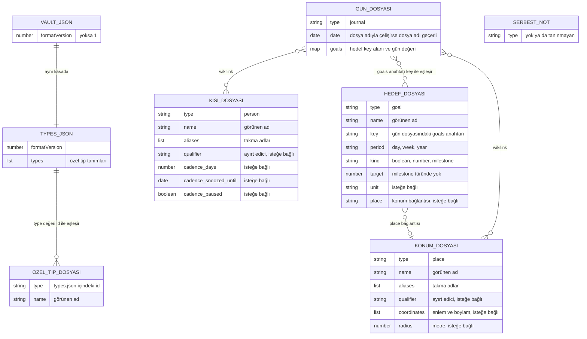

| `type` değeri | Yeni dosyanın klasörü | Yol örneği | Ayrıntı |
|---|---|---|---|
| `journal` | `journal/` | `journal/2026-10-02.md` | [Gün dosyası](#gün-dosyası) |
| `person` | `people/` | `people/Ahmet Yılmaz.md` | [Kişi dosyası](#kişi-dosyası) |
| `place` | `places/` | `places/Kadıköy Ofis.md` | [Konum dosyası](#konum-dosyası) |
| `goal` | `goals/` | `goals/Spor.md` | [Hedef dosyası](#hedef-dosyası) |
| Yok ya da tanınmayan | `notes/` ya da kullanıcının klasörü | — | [Serbest notlar](#serbest-notlar) |
| `.app/types.json` içindeki `id` | Tipin `folder` değeri | — | [Varlık tipleri](#varlık-tipleri) |

## Frontmatter

**Frontmatter bloğunun 3 durumu.**

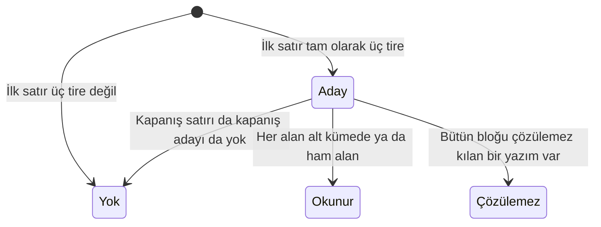

| Durum | Tanım | Uygulamanın davranışı |
|---|---|---|
| Yok | Dosya `---` ile başlamıyor. Ya da dosyada kapanış satırı da kapanış adayı da yok. Kapanış adayı, ardında boşluk ya da sekme olan `---` satırıdır. | Kapanışı olmayan `---` ile başlayan dosyaya alan yazarken uygulama başa yeni bir blok ekler. Eski `---` satırı gövdede kalır. |
| Okunur | Her alan desteklenen alt kümededir ya da ham alandır. | Uygulama alanları okur ve düzenler. |
| Çözülemez | Blokta [Çözülemeyen bloklar](#çözülemeyen-bloklar) tablosundaki bir yazım var. | Uygulama frontmatter'ı yok sayar: `type` okumaz ve frontmatter'a yazmaz. Alan yazma isteği hata döndürür. Uygulama başa yeni blok da eklemez. |

Dosyanın ilk satırı `---` ise frontmatter başlar. Dosyada BOM varsa ilk satır BOM'dan sonraki satırdır. Blok sonraki ilk `---` satırında biter ve sınır satırı tam olarak `---` olur. Uygulama bir bloğu yalnız bütün YAML okuyucularının aynı okuyacağından eminse okur; Obsidian da bu okuyuculardandır. İki uygulama aynı dosyayı aynı görür; uygulama Obsidian'ın okuyamadığı bloğa yazmaz.

### Desteklenen YAML alt kümesi

**Alt kümenin bütün yazımları, tek örnekte.**

```yaml
name: Ahmet Yılmaz            # düz değer
place: "[[Spor Salonu]]"      # tırnaklı değer (tek ya da çift tırnak)
radius: 100                   # sayı
date: 2026-10-02              # tarih
aliases: [Ahmet, Ahmet abi]   # tek satırlı liste
diller:                       # çok satırlı liste
  - Türkçe
  - İngilizce
etiketler:                    # çok satırlı liste, anahtarla aynı girintide
- günlük
goals:                        # tek düzey iç içe eşlem
  spor: true                  # evet/hayır
  kitap: 25
"iki nokta: içeren": değer    # tırnaklı anahtar
```

| Konu | Kural |
|---|---|
| Anahtarın yeri | Anahtar satır başında durur. Anahtar boşluk ve Türkçe karakter içerebilir: `doğum günü`. |
| Anahtardan sonrası | Anahtardan sonra `:` ve ardından boşluk, sekme ya da satır sonu gelir. `anahtar : değer` yazımı da geçerlidir. Anahtar tırnaklı olabilir. |
| Anahtar karşılaştırması | Uygulama anahtarları Unicode normalleştirmesi yapmadan, bayt bayt karşılaştırır. Bir anahtar blokta ve bir eşlemde yalnız 1 kez geçer. |
| Yorum | Satır başındaki `#` ya da öncesinde boşluk olan `#` yorumu başlatır. Uygulama yorumları ve boş satırları korur. |
| Liste biçimleri | Tek satırlı ve çok satırlı liste eşdeğerdir. Obsidian bir özelliği düzenlerken listeyi çok satırlı biçimde yeniden yazar. |
| Liste bekleyen alan | Uygulama tek değeri tek öğeli liste, boş değeri boş liste olarak okur. |
| Liste öğesi ve eşlem kaydı | Her biri tek satırlık tek değerdir. |
| Girinti | Girinti boşluktur. Bir listenin ya da eşlemin bütün satırları aynı girintidedir. |

### Türler

**Tırnaksız değerin türü: yazıma göre.**

| Tür | Kabul edilen yazım |
|---|---|
| Sayı | `[-+]?(0\|[1-9][0-9]*)(\.[0-9]+)?` (örnek: `25`, `-3`, `+5`, `29.0290`) |
| Evet/hayır | `true`, `True`, `TRUE`, `false`, `False`, `FALSE` |
| Boş | değer yok, `null`, `Null`, `NULL`, `~` |
| Tarih | `YYYY-MM-DD`; var olan bir gün, yıl 0100 ile 9999 arası |
| Metin | diğer her şey |

| Tırnak | Uygulamanın okuduğu kaçışlar |
|---|---|
| Çift tırnak | `\0 \a \b \t \n \v \f \r \e \" \/ \\ \N \_ \L \P`, ters bölüden sonra boşluk ya da sekme, `\xHH`, `\uHHHH`, `\UHHHHHHHH` |
| Tek tırnak | Yalnız `''`: tek tırnak karakteri. Başka kaçış yok. |

Tırnaklı değer her zaman metindir. Uygulama tırnaksız değerin türünü yazımından okur. YAML okuyucularının birbirinden farklı okuduğu yazımları uygulama metin olarak okur: `yes`, `no`, `on`, `off`, `012`, `0x1F`, `.5`, `5.`, `1_000`, `14:30`, üstel sayılar (`1e-5`), `2026-1-2`, zaman damgaları (`2026-10-02T10:00:00`), var olmayan tarihler.

### Ham alanlar

**Ham alan yapıları: geçerli YAML, alt kümenin dışında.**

| Yapı | Yazım |
|---|---|
| Blok metin | `\|`, `>` |
| Çapa ve takma ad | Çapa `&ad`. Takma ad `*ad` ve daha önce tanımlı bir çapaya gider. Ad yalnız ASCII harf, rakam, `-` ve `_` içerir. |
| `!!str` etiketi | Tek satırlık tek değerin önünde. |
| Akış yapıları | Tek satırda akış eşlemi (`{a: 1}`), iç içe akış (`[a, [b]]`, `[a: b]`) ve sonunda virgül olan liste (`[a, b,]`). |
| Daha derin iç içelik | Eşlem içinde eşlem ya da liste. Liste içinde eşlem ya da liste. |
| Süren metin | Tırnaksız bir değerin sonraki girintili satırlarda süren metni. |

Ham alan yalnız kendi anahtarını etkiler. Uygulama ham alanı ham metin olarak gösterir. Uygulama ham alanı değiştirmez ve silmez. Uygulama diğer alanları okur ve düzenler.

### Çözülemeyen bloklar

**Bütün bloğu çözülemez kılan yazımlar.**

| No | Konu | Yazım |
|---|---|---|
| 1 | Sınır satırları | Açılış ya da kapanış adayında `---` ardından boşluk ya da sekme. Blok içinde `---` ya da `...` ile başlayıp boşlukla süren ya da biten satır. |
| 2 | Anahtar tekrarı | Yinelenen anahtar: üst düzeyde ya da aynı eşlem içinde. `<<` anahtarı. |
| 3 | Satır başı | Satır başında anahtar olmayan içerik. Girintili ilk anahtar. |
| 4 | Tırnaksız anahtar | Metinden başka okunabilecek tırnaksız anahtar: [Türler](#türler) tablosunda metin olmayan bir yazım; [Tırnaklama](#tırnaklama) 7 ve 8'deki tarih ve `...` yazımları; `-`, `?`, `:` ile başlayan anahtar; sayıya benzeyen anahtar. `yes`, `no`, `on`, `off` anahtar olarak geçerlidir. |
| 5 | Sayıya benzeyen anahtar | İsteğe bağlı `+` işaretinden sonra `.` ile başlayıp Tırnaklama 6'ya uyan anahtar. Ya da rakamla başlayıp yalnız rakam, `a`-`f`, `A`-`F`, `x`, `X`, `o`, `O`, `_`, `.`, `+`, `-`, `:` içeren anahtar. |
| 6 | Kapanmayan ayraç | Satırında kapanmayan tırnak, köşeli ya da süslü parantez. |
| 7 | Değerden sonraki içerik | Tırnaklı değerden ya da tek satırlı listeden sonra yorum dışında içerik (`"a" b`). Araya boşluk koymadan yazılmış yorum (`"a"# yorum`). |
| 8 | İkinci iki nokta | Tırnaksız değerde ikinci `: ` (`a: b: c`) ya da sondaki `:`. |
| 9 | Kaçış | Türler bölümünde sayılmayan kaçış (`"\q"`). |
| 10 | Girintili alt satır | Değeri olan satırın altında girintili `-` ya da `anahtar: değer` satırı. Tırnaklı değerin, tek satırlı listenin ya da ham değerin altında girintili içerik. |
| 11 | Süren metin | Süren metnin bir satırı `-`, `?`, `:` ya da Tırnaklama 2'deki karakterlerden biriyle başlıyor. Ya da satır `:` ardından boşluk ya da yorum içeriyor. Ya da süren metnin satırları arasında yorum var. |
| 12 | Düzey ve girinti | Liste ile eşlemin aynı düzeyde karışması. Tutarsız girinti. |
| 13 | Sekme | Girintide sekme, `-` işaretinden sonra sekme, yalnız sekme içeren boş satır, sekmeyle girintilenmiş yorum. |
| 14 | Değerin başı | Değerin başında `, ] } % @` ya da ters tırnak. Değer olarak tek başına `-`, `?`, `:` ya da bunlardan sonra boşluk. |
| 15 | Tek satırlı liste | Boş öğe. Öğe içinde yorum. Tırnaksız öğede `?` ya da ardından boşluk gelmeyen `:` (`[a:b]`). Öğede çapa, takma ad ya da etiket. |
| 16 | Çapa ve etiket | Tanımsız çapaya takma ad. Takma addan sonra içerik. Art arda 2 çapa. `!!str` dışında etiket. `!!str` ardından tek satırlık tek değerden başka bir şey. |
| 17 | Blok metin | Blok metin başlığından sonra yorum dışında içerik (`> metin`). Blok metnin ilk satırından daha az girintili satırı; başlık girinti belirtiyorsa ölçü o girintidir. Blok metni bölen satır başı yorumu. İlk satırdan önce ondan uzun, yalnız boşluktan oluşan satır. |
| 18 | Derin yapı | Derin yapının içinde sonraki satırda süren metin. Derin yapıda girinti belirten blok metin başlığı (`\|2`). Derin yapıda blok metinli alanda araya giren yorum ya da yalnız boşluktan oluşan satır. |
| 19 | Karakter | Kontrol karakteri: sekme dışında U+0000 ile U+001F arası, U+007F ile U+009F arası. U+2028, U+2029, U+FEFF, U+FFFE, U+FFFF. UTF-8 olarak çözülemeyen bayt. |

Tablodaki yazımlardan biri bloğun bütününü çözülemez kılar. Çözülemeyen bloğa uygulama hiçbir koşulda yazmaz.

### Tırnaklama

**Değer yazımı: uygulama değeri türüne göre nasıl yazar.**

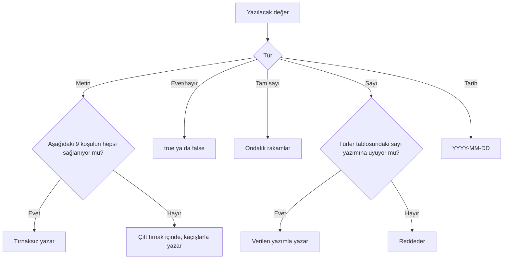

Uygulama metni, şu koşulların hepsini sağlıyorsa tırnaksız yazar. Sağlamıyorsa uygulama metni çift tırnak içinde yazar.

1. Metin boş değildir. Metnin ilk ve son karakteri boşluk ya da sekme değildir.
2. İlk karakter şunlardan biri değildir: `- ? : , [ ] { } # & * ! | > ' " % @` ve ters tırnak.
3. Metin `:` ardından boşluk ya da sekme içermez ve `:` ile bitmez. Metin boşluk ya da sekme ardından `#` içermez.
4. Metin kaçış gerektiren karakter içermez. Kaçışlar aşağıdaki tablodadır.
5. Metin, büyük ve küçük harf ayrımı olmadan, şunlardan biri değildir: `true`, `false`, `yes`, `no`, `on`, `off`, `y`, `n`, `null`, `~`, `<<`, `=`.
6. Metin sayıya benzemez. İsteğe bağlı bir `+` ya da `-` işaretinden sonra şu 3 durum sayıya benzer: rakamla başlayan ve hiç boşluk ya da sekme içermeyen metin; `.` ile başlayıp ardından rakam gelen metin; kalanı harf ayrımı olmadan `inf` ya da `nan` olan metin.
7. Metin tarihe benzemez. Metin şu dizi ile başlamaz: 4 rakam, `-`, 1 ya da 2 rakam, `-`, 1 ya da 2 rakam. Devamı ne olursa olsun kural geçerlidir.
8. Metin `...` değildir. Metin `...` ardından boşluk ya da sekme ile başlamaz.
9. Metin tek satırlı liste içindeyse ayrıca `, [ ] { } : ?` karakterlerinden hiçbirini içermez.

| Karakter | Çift tırnak içindeki yazım |
|---|---|
| Ters bölü | `\\` |
| Çift tırnak | `\"` |
| LF | `\n` |
| CR | `\r` |
| Sekme | `\t` |
| U+0000 | `\0` |
| U+0085 | `\N` |
| U+2028 | `\L` |
| U+2029 | `\P` |
| Kalan U+0001 ile U+001F arası, U+007F ile U+009F arası | `\xHH`: 2 büyük harfli onaltılık hane |
| U+FEFF, U+FFFE, U+FFFF | `\uHHHH` |

Uygulama başka hiçbir karakteri kaçışla yazmaz. Böylece satır sonu içeren metin de tek satırda kalır. Uygulama anahtarı da 1 ile 8 arası koşullarla tırnaksız ya da çift tırnakla yazar. Boş anahtarı ve `<<` anahtarını uygulama yazamaz.

### Yazma kuralları

**Alan yazarken uygulamanın değiştirdiği ve koruduğu satırlar.**

| İşlem | Kural |
|---|---|
| Alan değiştirme | Uygulama yalnız o anahtarın satırlarını yeniden yazar. Diğer satırlar, sıraları, tırnak biçimleri ve yorumlar aynı kalır. Uygulama değerleri yeniden üretmez: `29.0290`, `29.029` olmaz. |
| Yeniden yazılan satır | Anahtar, `:` ve değerden önceki boşluklar aynen kalır. Değer yoksa uygulama tek boşluk koyar. Satır sonundaki yorum önündeki boşluklarla kalır. Yorum yoksa uygulama sondaki boşlukları atar. Satır kendi satır sonunu korur. |
| Aynı değer | Aynı değeri yeniden yazmak dosyayı değiştirmez. Uygulama metni bayt bayt ve yalnız metinle karşılaştırır. |
| Sayı eşitliği | Uygulama sayıları değerce karşılaştırır. İşaret, tam kısım ve sondaki sıfırları atılmış kesir aynıysa sayı aynıdır: `20.029` ile `20.0290`, `+5` ile `5`, `-0` ile `0`. |
| Diğer eşitlikler | Uygulama evet/hayır ve tarih değerlerini değerce karşılaştırır. Uygulama listeyi sırayla, öğe öğe karşılaştırır. |
| Liste biçimi | Değişen listenin mevcut biçimi kalır: tek satırlı ya da çok satırlı. |
| Var olan yazım | Listede ya da listeye dönen tek değerde, yeni öğeyle aynı olan mevcut değer dosyadaki yazımıyla kalır. Uygulama sırayla ilk eşleşeni kullanır. Tek satırlı listeye girecek tırnaksız yazım 9. koşulu sağlamıyorsa uygulama yazımı yeniden üretir. |
| Tek satırlı liste | Uygulama `[a, b]` biçiminde yazar ve öğeleri `, ` ile ayırır. Boşalan liste `[]` olur. |
| Çok satırlı liste | Baştaki ve sondaki aynı kalan öğelerin satırları değişmez. Uygulama aradaki satırları sırayla yeniden yazar; girinti, `-` sonrası boşluk ve yorum kalır. Uygulama fazla eski satırları siler. Boşalan listede `anahtar:` satırı kalır. |
| Çok satırlı listeye yeni öğe | Uygulama fazla yeni öğeleri mevcut girintiyle ve `- ` ile ekler. Yer: son yeniden yazılan satırın ardı. Öyle bir satır yoksa aynı kalan önceki öğenin ardı. O da yoksa ilk öğenin önü. |
| Eşlem | Yalnız hedef kaydın satırı değişir. Uygulama yeni kaydı son kaydın ardına mevcut girintiyle ekler. Son kaydı silinen eşlemin `anahtar:` satırı kalır. |
| Değersiz anahtara kayıt | Uygulama kaydı anahtarın altına 2 boşluk girintiyle ekler. Değeri olan bir alana uygulama kayıt yazmaz. |
| Biçim değişimi | Çok satırlı liste olmayan bir alana uygulama listeyi tek satırlı yazar. Örnek alanlar: tek değer, boş değer, eşlem. Liste ya da eşlem olan alana uygulama tek değeri anahtar satırına yazar. 2 durumda da uygulama eski öğe ve kayıt satırlarını siler. |
| Silme | Uygulama bir alanı silerken ya da alanın biçimini değiştirirken aradaki yorum ve boş satırlar yerinde kalır. Olmayan alanı ya da kaydı silmek dosyayı değiştirmez. |
| Yeni anahtar | Uygulama yeni anahtarı frontmatter'ın sonuna, kapanış satırının hemen önüne ekler. Uygulama yeni listeyi tek satırlı, yeni eşlemi 2 boşluk girintiyle yazar. |
| Frontmatter'ı olmayan dosya | Uygulama dosyanın başına yeni blok ekler: `---`, alan satırları, `---`. Uygulama blok ile gövde arasına boş satır eklemez. |
| Ham alan ve çözülemeyen blok | Uygulama ham alanı değiştirmez ve silmez. Uygulama çözülemeyen bloğa yazmaz. |

#### Silme

| Konu | Kural |
|---|---|
| Varlık | Kullanıcı onayından sonra yalnız `people/` içindeki `type: person`, `places/` içindeki `type: place` ya da tanımlı özel tipin klasöründeki aynı tip dosyası silinir. |
| Hedef | Kullanıcı onayından sonra yalnız `goals/` altındaki `type: goal` dosyası silinir. |
| Sınır | Gün dosyası, not, başka tip, gizli yol, sembolik bağlantı ve `conflicts/` dosyası bu işlemle silinmez. Çakışma kopyaları yerinde kalır. |
| Kayıtlar | Gün dosyaları bayt düzeyinde korunur. Varlık bağlantıları çözülmemiş kalır; hedefin gün kayıtları kalır. |
| Sıra | Silme ortak yazma kuyruğunda dosya koordinasyonuyla yapılır. İndirilmemiş dosya reddedilir. Önce dosya silinir; sonra izleyicinin artımlı indeks yolu dosyayı ve bağlı satırlarını kaldırır, gelen bağlantıları yeniden çözer. |
| Yeniden kullanım | Silinen dosyanın adı ve hedef anahtarı yeniden kullanılabilir. Aynı hedef anahtarıyla oluşturulan tanım kalan gün kayıtlarını kullanır. |

## Bağlantılar

**Bağlantı sözdizimi: tanınan ve tanınmayan yazımlar.**

| Yazım | Anlamı |
|---|---|
| `[[Ahmet Yılmaz]]` | Varlığa bağlantı. |
| `[[hedef#çapa]]` | Başlığa ya da `^` ile başlayan blok kimliğine bağlantı. |
| `[[#Başlık]]` | Hedefi boş bağlantı. Aynı dosyanın içine gider. Varlık bağlantısı değildir. |
| `![[hedef]]` | Gömme. Uygulama gömmeyi aynı kurallarla bağlantı sayar. |
| `\![[hedef]]` | Kaçırılmış ünlem. Gömme değildir. |
| `\[[` | Ters bölüyle kaçırılmış açılış. Bağlantı değildir. |
| `[metin](dosya.md)` | Markdown biçimli bağlantı. Uygulama korur ama varlık bağlantısı saymaz ve yeniden adlandırmada güncellemez. |

Sözdizimi: `[[hedef]]`, `[[hedef|görünen metin]]`, `[[hedef#çapa]]`, `[[hedef#çapa|görünen metin]]`.

- Varlığa bağlantı: `[[Ahmet Yılmaz]]`
- Metinde takma ad geçiyorsa görünen metin kalır: `[[Ahmet Yılmaz|Ahmet abi]]`
- Kullanıcı arayüzde `@` ile seçim yapınca uygulama dosyaya wikilink yazar. `@` işareti dosyada yer almaz.

### Bağlantı ayrıştırma

| Parça | Kural |
|---|---|
| Hedef | İlk `#` ya da `\|` karakterine kadar olan kısım. Uygulama baştaki ve sondaki boşlukları atar. |
| Hedefin biçimi | Hedef uzantısız dosya adıdır. Uygulama sondaki `.md` parçasını yok sayar. Uygulama `.md` parçasını attıktan sonra boşlukları yeniden atar. |
| Yol hedefi | `/` içeren hedef kasa köküne göre yoldur. Uygulama baştaki `/` ya da `./` parçasını yok sayar. |
| Görünen metin | İlk `\|` karakterinden sonraki her şey. |
| Tablo içinde ayırıcı | Tablo içinde görünen metin ayırıcısının önünde ters bölü olabilir. Ters bölü ayırıcının parçasıdır, hedefe dahil değildir. |
| Çapa | Bir başlık ya da `^` ile başlayan blok kimliği. |
| Boş bağlantı | Hedefi ve çapası birlikte boş olan yazım bağlantı değildir. |
| Satır | Bağlantı tek satırdadır. Bağlantının içinde `[[` ya da `]]` bulunmaz. |
| Kod | Çitli kod bloğu ve satır içi kod içindeki `[[...]]` bağlantı değildir. Çitli kod bloğunun açılışı ```` ``` ```` ya da `~~~` işaretidir. |
| Satır içi kod | Açılış: bir ya da daha çok ters tırnak. Kapanış: aynı satırda aynı sayıda ters tırnak. |
| Bulunmayan hedef | Hedefi kasada bulunmayan bağlantı geçerlidir ve kalır. Taranmayan klasörlerdeki dosyalar hedef olamaz. |
| Frontmatter | Uygulama bağlantıyı çözülmüş değerlerin metninde arar. Uygulama ham alanlarda ve çözülemeyen blokta bağlantı aramaz. |

Tablo içindeki ayırıcı yazımı `\|` biçimindedir. Örnek: Markdown tablosunun hücresindeki `[[Ahmet Yılmaz\|Ahmet]]` yazımının hedefi `Ahmet Yılmaz` olur.

### Yeniden adlandırma

**Varlık adı değişince uygulamanın izlediği akış.**

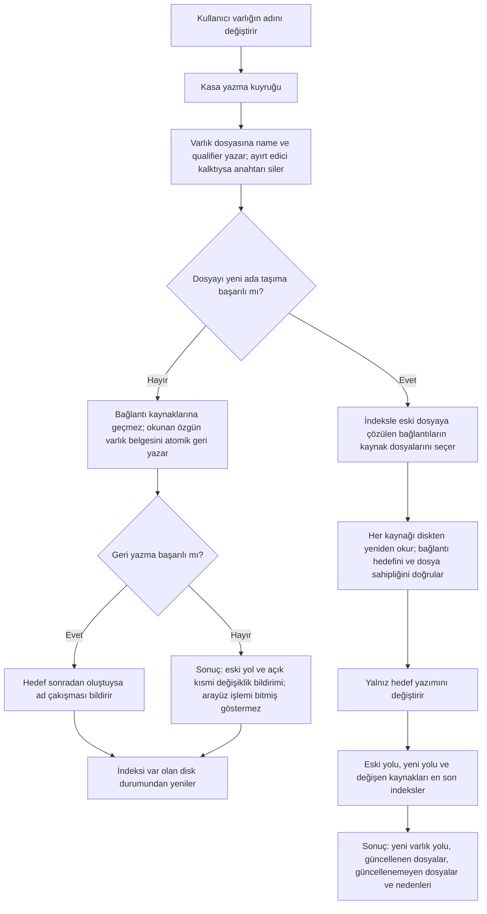

| Konu | Kural |
|---|---|
| Yeni dosya adı | Yeni ad, ad üretme ve kasa genelinde benzersizlik kurallarına uyar. Uygulama başka dosyanın üzerine yazmaz. |
| Değişen parça | Yalnız hedef yazımı değişir. Çapa, gömme işareti, hedef çevresindeki boşluklar, `.md` soneki, yol hedefinin yol biçimi ve tablo ayırıcı kaçışı aynı kalır. |
| Gövde | Uygulama gövdede hedefin bayt aralığını değiştirir. |
| Frontmatter | Uygulama çözülmüş metin değerini ilgili alan, liste ya da eşlem girdisi yazıcısıyla yazar. YAML kaçışlarını yazıcı doğru kodlar. |
| Ham alan | Uygulama ham alanları değiştirmez. Uygulama eski hedefe benzeyen bağlantı içeren ham alanları sonuçta bildirir. |
| İndeksin rolü | İndeks yalnız kaynakları ve çözülmüş hedefi seçer. Uygulama indeksteki eski satırı ya da bayt aralığını yazmak için kullanmaz. |
| Aynı yazımlı başka hedef | Aynı yazımla başka dosyaya giden bağlantı aynı kalır. |
| Çok satırlı liste | Uygulama çıplak `-` satırını boş öğe olarak sayar. Listedeki diğer bağlantıları günceller. |
| Yazılamayan liste | Bir frontmatter listesini uygulama yeniden yazamazsa gövdeyi ve diğer alanları yine günceller. Sonuç o listeyi `frontmatterList` nedeniyle bildirir: eşleşmeyen öğe ya da beklenmeyen hata. |
| Okunamayan kaynak | Uygulama bir kaynak dosyayı okuyamaz ya da yazamazsa diğer kaynaklarla sürer. |
| Atomiklik | Çok dosyalı işlem kasa genelinde atomik değildir. Kesintiden sonra varlık taşınmış ve bazı bağlantılar eski kalmış olabilir. |
| Kesintiden sonra | Sonraki yeniden adlandırma hâlâ çözülen bağlantıları günceller. Artık çözülmeyen eski hedefleri kullanıcı elle düzeltir. |
| Geçmiş | Uygulama işlem geçmişi ya da gizli yönlendirme bilgisi tutmaz. |

Açık görünen metin kullanıcınındır: `[[Eski|Eski]]` → `[[Yeni|Eski]]`; görünen metinsiz `[[Eski]]` → `[[Yeni]]`. Görünen metni kullanıcı ayrıca düzeltir. Yeniden adlandırmada yalnız hedef değişir; çapa ve görünen metin aynı kalır.

## Blok kimliği

**Blok kimliğinin yazımı, okunması ve sahipliği.**

| Konu | Kural |
|---|---|
| Kapsam | Uygulamanın ürettiği her olay ve görev satırı sonunda bir kimlik taşır: `^a1b2c3` |
| Yazma biçimi | Satırın sonunda, bir boşluktan sonra `^` ve ardından 6 karakter: küçük harf `a-z` ve rakam. |
| Anlam | Kimlik opaktır. Tür ya da başka anlam taşıyan önek içermez. Satırın olay mı görev mi olduğunu kimlik değil satırın yazımı belirler. |
| Üretim | Uygulama kimliği rastgele üretir. Uygulama kasadaki mevcut kimliklerle çakışmayı denetler. |
| Düzenleme | Satır değişse de kimlik değişmez. |
| Kimliksiz satır | Kullanıcının elle ya da Obsidian'da yazdığı satırda kimlik olmayabilir. Uygulama o satırı ilk kez değiştirdiğinde kimlik ekler. |
| Okuma | Uygulama Obsidian'ın kabul ettiği her kimliği tanır ve değiştirmez: harf, rakam ve `-`, her uzunlukta. |
| Yinelenen kimlik | Benzersizlik amaçtır ama garanti değildir: dışarıdaki kopyalama aynı kimliği çoğaltabilir. Kimliğin sahibi ilk geçen satırdır: önce dosya yolu sırası, sonra dosya içi sıra. |
| Yinelenen kimliğin onarımı | Uygulama diğer satırları kendiliğinden değiştirmez. Uygulama onlardan birini değiştirdiğinde o satıra yeni kimlik verir. |

**Satır bloğu:** bir olay ya da görev satırı ve altındaki daha girintili satırlar.

- Bir olay ya da görev satırının altındaki, daha girintili satırlar o satırın parçasıdır. Örnek: alt madde, devam satırı. Uygulama bu satırları üst satırla birlikte taşır, birleştirir ve siler.
- Uygulama bu satırları üretmez, yalnız korur.
- Aradaki boş satırlar, ardından yine girintili bir satır geliyorsa bloğa dahildir.
- Uygulama girintiyi yalnız satır başındaki boşluk ve sekmelerle, sütun olarak ölçer. Sekme bir sonraki 4'ün katına ilerler.
- Alıntı içindeki görevler tek satırlık bloklardır. `>` girinti değildir.
- Alt satırı olan bir görevi uygulama silince yalnız görevin kendi satırlarını siler. Üst blok o kadar kısalır. Sonda kalan boş satırlar blok aralığından çıkar ama dosyada kalır.

## Gün dosyası

Yol: `journal/2026-10-02.md`

```markdown
---
type: journal
date: 2026-10-02
goals:
  spor: true
  kitap: 25
---

## Tasks
- [ ] [[Ahmet Yılmaz]]'a teklifi gönder 📅 2026-10-05 ^k7m2p9
- [x] Market alışverişi ✅ 2026-10-02 ^q3w8e1

## Events
- 14:30 [[Ahmet Yılmaz|Ahmet]] ile [[Kadıköy Ofis]]'te teklifi konuştuk ^a1b2c3
- [[Elif]] ile yemek ^d4e5f6

## Journal
Bugün genel olarak verimli geçti...
```

**Gün dosyasının parçaları ve içerikleri.**

| Parça | İçerik | Kural |
|---|---|---|
| `type`, `date` | Dosya türü ve gün | Uygulama dosyayı oluştururken `type` ve `date` alanlarını yazar. `date` ile dosya adı çelişirse dosya adı geçerlidir. |
| `goals` | Hedef gün kayıtları | Anahtar, hedef dosyasının `key` alanıdır. Değer evet/hayır hedefinde `true`, sayısal hedefte sayıdır. |
| `## Tasks` | O gün oluşturulan görevler | Görev, bitiş tarihi ne olursa olsun oluşturulduğu günün dosyasında kalır. Uygulama yeni görevi bölümün sonuna ekler. |
| `## Events` | Olaylar | Hızlı giriş ve widget buraya satır ekler. |
| `## Journal` | Serbest yazı | Kullanıcı uygulamada yazarken uygulama tanınan varlık adlarını bağlantıya çevirir. Uygulama başka değişiklik yapmaz. |

Gün dosyasının kimliği yoludur. `journal/` altında adı geçerli bir tarih olan dosya o günün dosyasıdır: `YYYY-MM-DD.md`. Frontmatter'ı olmayan dosya da o günün dosyasıdır; örneğin kullanıcı dosyayı Obsidian'da açtıysa. Bir günün tek dosyası vardır.

### Hedef gün kayıtları

| Kayıt | Anlamı |
|---|---|
| `true` | Yapıldı. |
| `false` ya da anahtarın yokluğu | Yapılmadı. |
| Sayı | O günün miktarı. |
| `0` ya da yokluk | İlerleme sağlamaz. |

- Kaldırma ilgili anahtarı siler; uygulama `false` yazmaz.
- Gün dosyası yoksa kaldırma hiçbir şey yazmaz. Değer yazarken uygulama gün dosyasını `type: journal` ve `date` ile oluşturur.
- Yalnız hedef eşlem kaydı değişir. Komşu değerler, yorumlar ve gövde baytları aynı kalır.
- Aynı anlamdaki değeri yazmak hiçbir şey değiştirmez.
- Eksik `goals` alanını ya da değersiz `goals:` alanını uygulama eşlem olarak açar.
- Ham, tek değerli, liste ya da açık `null` olan `goals` alanına yazma ve silme `notAMapping` hatası verir.
- Miktarlar sonlu ve negatif olmayan sayılardır.
- Negatif, taşan, ham ya da tanımla türü uyuşmayan dış kayıtlar dosyada kalır. Uygulama bu kayıtları hesaplara katmaz.
- Aynı güne birden çok kayıt varsa son kayıt geçerlidir. Uygulama kayıtları 2 kez toplamaz.
- Hesaplar verilen günün sonuna kadarki kayıtları kullanır. Gelecek kayıtlar güncel ilerlemeyi ve zinciri artırmaz.

### Bölümler

**Bölüm sözdizimi.**

| Öğe | Tanım |
|---|---|
| Başlık satırı | Satır başında en çok 3 boşluktan sonra 1 ile 6 arası `#` ve ardından boşluk, sekme ya da satır sonu. Altı çizili başlıkları uygulama tanımaz. |
| Tanınan bölüm başlığı | Tam olarak `## Tasks`, `## Events` ya da `## Journal` satırı. `##` ile ad arasında tek boşluk bulunur. Uygulama sondaki boşlukları yok sayar. |
| Bölüm sınırı | Bölüm, aynı ya da daha üst düzeydeki bir sonraki başlığa kadar sürer. |
| Yinelenen başlık | Aynı başlık birden çok geçerse ilki geçerlidir. |
| Tanınmayan başlık ve ilk başlıktan önceki içerik | Uygulama korur ve düz metin olarak gösterir. |
| Çitli kod bloğu açılışı | Satır başında en çok 3 boşluktan sonra en az 3 `` ` `` ya da `~`. Liste öğesinin içindeki çitte uygulama girintiyi öğenin içerik sütununa göre ölçer. Ters tırnaklı çitin açılış satırında başka ters tırnak bulunmaz. |
| Çitli kod bloğu kapanışı | Aynı işaretten en az açılıştaki kadar taşıyan ve başka içeriği olmayan satır. Kapanmayan çit dosya sonuna kadar sürer. |
| Çitin içi | Çitin içindeki satırlar başlık, olay, görev ya da bağlantı değildir. |

**Bölüm açma yeri.**

| Kural | Ayrıntı |
|---|---|
| Açılma zamanı | Uygulama bölümü ilk gerektiğinde açar. Uygulama boş bölüm yazmaz. İçi sonradan boşalan bölümün başlığını uygulama silmez. |
| Sıra | Tasks, Events, Journal. Uygulama yeni bölümü bu sırada kendinden sonra gelen ilk mevcut bölümün önüne açar. Öyle bir bölüm yoksa dosyanın sonuna açar. |
| Önceki boş satır | Uygulama yeni bölümden önce 1 boş satır bırakır. Bölüm frontmatter'dan hemen sonra açılıyorsa da bırakır. Bölüm dosyanın ilk içeriğiyse bırakmaz. |
| Bölüm sonuna ekleme | Uygulama yeni satırı bölümdeki son boş olmayan satırın ardına yazar. |
| Boş ekleme | Uygulama yalnız boş satırlardan oluşan ekleme yapmaz. |
| Reddedilen ekleme | Uygulama dosyaya dokunmadan reddeder: yeniden okumada satır hedef bölümde görünmeyecekse ya da eklenen metin belgenin yapısını değiştirecekse. |
| Görünmeme nedenleri | Kapanmayan kod çiti, çözülemeyen frontmatter. |
| Yapı değiştiren metin | 1. ya da 2. düzey başlık, kapanmayan kod çiti, frontmatter sınırı. |
| İzin verilen yapı | Alt başlık: `###` ve aşağısı. Kapalı kod bloğu. |

### Journal bölümüne ekleme

**Journal bölümünün sonuna metin ekleme akışı.**

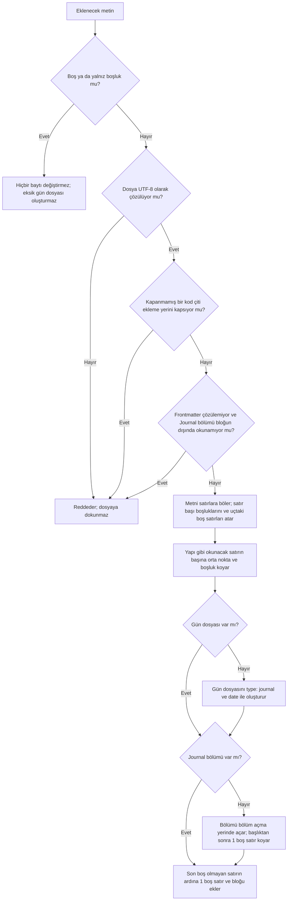

| Eklenen satır | Uygulamanın yazdığı |
|---|---|
| Görev: `- [ ] `, `* [x] `, `1. [ ] `, alıntı içindeki `> - [ ] ` | Başına `· ` koyar: U+00B7 ve boşluk. |
| 1. ya da 2. düzey başlık | Başına `· ` koyar. |
| Kod çiti: `` ``` ``, `~~~` | Başına `· ` koyar. |
| Düz cümle, `###` alt başlık, `- ` liste öğesi, `>` alıntı, `---` | Olduğu gibi yazar. |

- Eklenen metin yapı değil yazıdır. Ekleme hiçbir zaman görev, olay, hedef kaydı, bölüm ya da frontmatter üretmez. Ekleme var olan görev ve olayların satırlarını değiştirmez. Uygulama bunu sağlayamayan eklemeyi reddeder.
- `· ` öneki içeriği korur. Satır düz yazı olur.
- Var olan baytların hiçbiri değişmez. Yeni baytlar tek bir yere girer.
- Ekleme yeri: bölümün son boş olmayan satırının ardı. Boş bölümde ekleme yeri başlığın ardıdır. Ekleme yeri bölümün sondaki boş satırlarından, sonraki bölümden ve dosyanın kalanından öncedir.
- Journal başlığı 2 kez geçiyorsa uygulama ilkine ekler.
- `## journal` ya da `##Journal` bölüm başlığı değildir. Böyle dosyada Journal bölümü yoktur.
- Uygulama bloktan önce tam 1 boş satır koyar. Uygulama bölümün eski sondaki boş satırlarını silmez; satırlar bloğun ardında aynen kalır.
- Satır sonu olmayan son satıra uygulama önce satır sonu ekler. Yeni satırlar dosyanın ilk satır sonu biçimini kullanır; yoksa LF. BOM yerinde kalır.
- Gün dosyası yoksa uygulama dosyayı normal oluşturma yoluyla `type: journal` ve `date` alanlarıyla açar. Var olan boş dosyaya uygulama frontmatter eklemez.
- Satır bölme: uygulama her dizgiyi şu satır sonlarında böler: LF, CRLF, CR, U+000B, U+000C, U+0085, U+2028, U+2029.
- Uygulama her satırın başındaki boşluk ve sekmeleri atar. Gerekçe: girintili satır üstündeki görevin devam satırı olurdu.
- Uygulama bloğun başındaki ve sonundaki boş satırları atar. Aradaki boş satırlar kalır.
- Frontmatter'ı çözülemeyen dosyada öteki bölüm eklemelerinin kuralı geçerlidir. Journal bölümü bloğun dışında okunabiliyorsa uygulama ekler. Okunamıyorsa uygulama reddeder.
- Kapanmamış `%%` ya da `<!--` yorumu uygulama için yazıdır. Ardına eklenen metin Obsidian'da gizli görünebilir.

### Haftalık inceleme

| Kural | Ayrıntı |
|---|---|
| Yer | Uygulama haftalık incelemeyi, incelemenin yapıldığı günün Journal bölümüne Journal ekleme kuralıyla yazar. |
| Biçim | `### <yerelleştirilmiş başlık>` ve düz gövde satırları. |
| İkinci yazma | İkinci yazma ikinci bir blok ekler. Önceki bloğun üzerine yazmaz. |
| Dil | Çağıran taraf başlığı ve sayı cümlelerini kullanıcının dilinde verir. Core dil seçmez ve sayı cümlesi kurmaz. |
| Sıra | Hazır özet cümleleri, seçilmiş satırlar, serbest not. |
| Satır temizliği | Uygulama metni aynı satır sonlarında böler. Uygulama satırların baş ve son boşluklarını ve boş satırları atar. |
| Gövde satırı | Her gövde satırı `· ` ile başlar. Kullanıcının yazdığı onay kutusu, saatli olay, `##`, `---`, kod çiti, alıntı ya da tablo satırı da `· ` ile başlar. Böylece blok tek biçimli kalır ve hiçbir satır yapı olmaz. |
| İşaretler | Kullanıcının yazdığı işaretler ve alan emojileri metin olarak kalır. |
| Başlık | Uygulama başlığı aynı temizlikten sonra tek satırda birleştirir. Başlık boşsa uygulama alt başlık yazmaz. |
| Boş gövde | Gövde boşsa uygulama başlık dahil hiçbir şey yazmaz. |

### Journal yazısını değiştirme

| Durum | Uygulamanın davranışı |
|---|---|
| Bölüm var | Uygulama başlıktan sonraki satırları yeni metinle değiştirir. Bölümün sonundaki boş satırlar aynı kalır. |
| Bölüm var, metin boş | Başlık ve sondaki boş satırlar kalır. |
| Bölüm yok, metin boş olmayan | Uygulama bölümü açar. |
| Bölüm yok, metin boş ya da yalnız boşluk | Uygulama dosyaya dokunmaz. Eksik gün dosyasını oluşturmaz. |
| Metnin sondaki boş satırları | Uygulama yazmaz. Yalnız boşluk ya da sekme içeren satırlar da dahildir. |
| Yapı kısıtları | Journal eklemedeki yapı kısıtları burada da geçerlidir. |
| `---` yatay çizgisi | Gövdedeki `---` frontmatter oluşturmaz. Bu nedenle uygulama kabul eder. |

### Olay satırı

**Olay satırı dilbilgisi.**

| Öğe | Yazma biçimi | Okuma kabulü |
|---|---|---|
| Yer | Events bölümü | Events bölümündeki, girintisiz ve görev olmayan her liste satırı. |
| Liste işareti | `- ` | `- `, `* `, `+ ` |
| Saat | `HH:MM`: 24 saat, 2 haneli | Tek haneli saat de geçerlidir: `9:05`. Uygulama yazımı olduğu gibi korur. |
| Saat aralığı | Saat 0-23, dakika 00-59 | Geçersiz yazım saat değildir. Satır saatsiz olaydır ve yazım metnin parçası kalır. |
| Ayırıcılar | Saat, metin ve kimlik arasında tek boşluk | Liste işaretinden sonraki boşluk ve sekmeler metne dahil değildir. Düzenlemede ayırıcıların özgün yazımı kalır. |
| Kimlik | `^kimlik` | [Blok kimliği](#blok-kimliği) kuralları. |

Saatli: `- HH:MM metin ^kimlik` (24 saat, iki haneli). Saatsiz: `- metin ^kimlik` (saat isteğe bağlıdır).

**Yeni olayın yeri.**

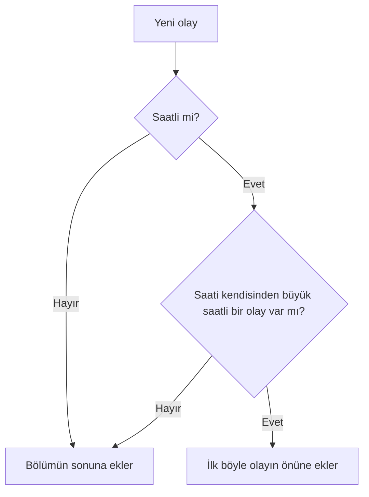

- Saat, olayın yazıldığı yerin yerel saatidir. Uygulama saat dilimi tutmaz.
- Kullanıcı geçmiş bir güne sonradan olay ekleyebilir. Uygulama satırı o günün dosyasına yazar.
- Mevcut satırların yeri değişmez.
- Olayın saati değişirse ya da saatsiz olaya saat gelirse uygulama satırı altındaki satırlarla birlikte aynı kuralla yeni yerine taşır. Kural satırı zaten bulunduğu yere koyuyorsa satırlar yer değiştirmez.
- Saati kalkan olay yerinde kalır.
- Taşınan satırların içeriği aynı kalır. Satır sonları yeni satır kuralına uyar.
- Saati küçülen olayı, kendisinden büyük saatli olay yoksa, kural saatsiz olayların da arkasına koyar.
- Uygulama yeni olayı `- ` işaretiyle yazar.
- Uygulama mevcut satırı düzenlerken yalnız değişen parçayı yeniden yazar: metin, saat ya da kimlik. Girinti, liste işareti ve altındaki satırlar aynı kalır.
- Gösterim sırası dosyadaki sıradır.

## Görev satırı

**Görev durumları ve alanları.**

| Öğe | Yazım |
|---|---|
| Yapılacak | `- [ ]` |
| Devam ediyor | `- [/]` |
| Bitti | `- [x]` |
| İptal | `- [-]` |
| Bitiş tarihi | `📅 2026-10-05` |
| Başlangıç tarihi | `🛫 2026-10-01` |
| Tamamlanma tarihi | `✅ 2026-10-02` |
| Öncelik | `⏫` yüksek, `🔼` orta, `🔽` düşük |
| Tekrar | `🔁 every week` |
| Proje | `#project/portfolyo` |

Örnek: `- [/] Portfolyo sitesini bitir 🛫 2026-10-05 📅 2026-10-20 #project/portfolyo ^z5n4r2`

**Görev satırı dilbilgisi: okuma kabulü.**

| Öğe | Kural |
|---|---|
| Biçim | Obsidian Tasks biçimi. |
| Görev tanımı | Onay kutusu taşıyan her liste satırı görevdir. Dosya ve bölüm fark etmez. |
| Alt görev | Girintili görev satırı da görevdir. |
| Liste işaretleri | `-`, `*`, `+`, numaralı liste: `1.` ya da `1)`. Numara en çok 9 rakamdır. |
| İşaretten sonra | Birden çok boşluk geçerlidir. |
| Alıntı | Alıntı içindeki görev geçerlidir: `> - [ ] ...` |
| Kutu | Kutunun içinde tek karakter bulunur. `]` işaretinden sonra boşluk ya da satır sonu gelir. |
| Tanınmayan durum karakteri | Uygulama karakteri korur ve görevi açık sayar. |
| `[X]` | Bitti. |
| Çit ve frontmatter | Çitli kod bloğu ve frontmatter içindeki satırlar olay ya da görev değildir. |

### Görev alanları

| Konu | Kural |
|---|---|
| Ayırıcı | Alanlar arasında boşluk vardır. Tarih işareti ile ISO tarih arasında tek boşluk vardır. |
| Yeni satırdaki sıra | Metinden sonra, kimlikten önce: `🛫 başlangıç`, `📅 bitiş`, `✅ tamamlanma`, öncelik, `🔁 tekrar`, `#project/...`. |
| Okumadaki sıra | Sıra serbesttir. Alanlar metnin herhangi bir yerinde olabilir. |
| Görev metni | Tanınan alanlar çıktıktan sonra kalan parçalar. Uygulama parçalardaki boşluk ve sekmeleri sadeleştirir. Ham satır baytları değişmez. |
| Metin kalan yazımlar | Geçersiz tarih (`📅 2026-13-40`) ve tanınmayan emoji metindir. |
| Alan olmayan yazımlar | Satır içi kod, wikilink, satır içi Markdown bağlantısı ya da referans bağlantısı içindeki alan benzeri yazım alan değildir. Referans bağlantısı: `[metin][etiket]`, `[metin][]`. |
| Yinelenen alan | Tarih, öncelik, tekrar ya da proje yinelenirse değer ilk geçerli alandır. Uygulama bütün tanınan parçaların UTF-8 aralıklarını saklar. |
| Proje | `#project/` ardından boş olmayan bir ad. Ad boşluk ve Markdown ayraçları içermez. Uygulama tek proje kullanır; birden çoksa ilkini. |
| Alt proje | `/` ile alt projeler serbesttir. Alt proje ayrı projedir; üst projenin görevlerine kendiliğinden katılmaz. |
| Proje karşılaştırması | NFC ve yerelden bağımsız küçük harf eşlemesi. Özgün yazım dosyada kalır. |
| Diğer öncelikler | Uygulama `🔺` ve `⏬` önceliklerini `other` olarak okur. Uygulama yalnız `⏫`, `🔼`, `🔽` yazar. |
| Tanınmayan alanlar | Uygulamanın ayrıştırmadığı alanlar metnin parçası olarak kalır. Tanımadığı emoji alanları da dahildir. |

### Görev düzenleme

| İşlem | Kural |
|---|---|
| Alan düzenleme | Mevcut konum ve çevredeki diğer baytlar aynı kalır. Uygulama eksik alanı kimlikten önce sona ekler. |
| Alan kaldırma | Uygulama parçayı ve önündeki tek boşluğu ya da sekmeyi siler. Uygulama yinelenen aynı alanların hepsini kaldırır. |
| Metin düzenleme | Alanlar ve sıraları aynı kalır. Yeni metin ilk mevcut metin parçasının yerini alır. |
| Yeni görev | Ham metnin boşlukları, kod ve bağlantı yazımı aynen kalır. Uygulama boşluk sadeleştirmesini yalnız okunan görev metnine uygular. |
| Tamamlama: `done` | Uygulama çağıranın verdiği yerel günle `✅ YYYY-MM-DD` yazar. Görev zaten `done` durumundaysa ve çağıran yeni tarih vermediyse var olan tarih kalır. |
| Başka durumdan `done` | Çağıranın tarihi zorunludur. Uygulama tarihsiz tamamlama isteğini reddeder. |
| Yeniden açma: `todo` ya da `inProgress` | Uygulama tanınan `✅` alanlarını kaldırır. |
| İptal: `cancelled` | Uygulama tamamlanma tarihine dokunmaz. Tarih yoksa eklemez. |
| Korunanlar | Diğer baytlar, girinti, liste işareti, kutu yazımı ve alt satırlar aynı kalır. |
| Yanlış okunacak metin | Uygulama, yeniden okunduğunda istenenden farklı okunacak metni yazmaz. İşlemi reddeder ve dosyaya dokunmaz. Örnekler: saatsiz olayda saatle başlayan metin, olayda onay kutusuyla başlayan metin, kimlik gibi biten metin. |

### Tarihsiz görevler

| Yer | Tarihsiz görev |
|---|---|
| Oluşturulduğu günün ekranı | Görünür. Gün ekranı, o günün `journal/` dosyasında yazılı tarihsiz görevleri listeler. |
| Sonraki günlerin ekranı | Görünmez. |
| Görevler ekranı, "Tarihsiz" listesi | Görev açık kaldıkça, oluşturulduğu günden başlayarak görünür. |
| `notes/` altındaki tarihsiz görev | Hiçbir gün ekranında görünmez. "Tarihsiz" listesinde görünür. |

### Tekrarlayan görevler

**NOT:** Tekrarlayan görevler aşama 5'te geldi.

**Desteklenen `🔁` kuralları.**

| Kural | Anlamı |
|---|---|
| `every day`, `every N days` | Her gün, her N günde bir. |
| `every week`, `every N weeks` | Her hafta, her N haftada bir. |
| `every month`, `every N months` | Her ay, her N ayda bir. |
| `every year`, `every N years` | Her yıl, her N yılda bir. |
| `every monday\|tuesday\|wednesday\|thursday\|friday\|saturday\|sunday` | Tek gün. |
| `every week on monday` | Tek gün; günler `every monday` ile aynıdır. |
| `when done` soneki | İsteğe bağlı. Sonraki tarihi tamamlanma gününden hesaplar. |

- N pozitif tam sayıdır.
- Uygulama İngilizce sözcükleri harf duyarsız okur ve küçük harfle yazar.
- `when done` yoksa sonraki tarihin dayanağı referans bitiş tarihidir. Bitiş tarihi yoksa dayanak başlangıç tarihidir. İkisi de yoksa dayanak tamamlanma günüdür.
- Alan, `🔁` ile sonraki tarih, öncelik, proje ya da tekrar alanı ya da satır sonu arasında kalan kuraldır.
- Alt küme dışındaki yazım düz metin olarak kalır. Arayüz "Tanınmayan tekrar" gösterir. Uygulama yeni görev üretmez.
- Kod ve bağlantı içindeki yazım alan değildir.
- Yinelenen geçerli tekrarda uygulama ilk kuralı kullanır.
- Kullanıcı Tekrar alanını açıkça düzenlerse uygulama tanınan kuralı hedef alır ve değiştirir ya da kaldırır. Satırın geri kalanı bayt bayt aynı kalır.
- Uygulama tanınmayan kuralı değiştirmez ve kaldırmaz. Yinelenen alanlardan yalnız biri tanınmasa da kural geçerlidir. Gerekçe: kural satır sonuna kadar uzanabilir ve kullanıcının metnini içerebilir. Kullanıcı kuralı dosyada elle düzeltir.
- Yeni görevde yazım sırası: `🛫`, `📅`, `✅`, öncelik, `🔁`, `#project/...`, kimlik. Mevcut görevde uygulama yalnız hedef alanı yerinde değiştirir.

**Açık tekrarlayan görevi tamamlama.**

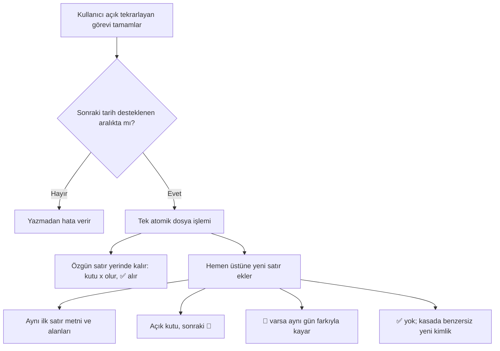

| Durum | Davranış |
|---|---|
| Özgün satır | `[x]` ve `✅` alır ve yerinde kalır. |
| Yeni satır | Açık `[ ]` ile başlar. |
| Devam satırları ve alt görevler | Özgün görevde kalır. Uygulama yeni örneğe kopyalamaz. |
| Kapalı görevi yeniden tamamlama ya da iptal | Yeni örnek üretmez. |
| Geri açma | Var olan sonraki örneği silmez. |

**Sonraki tarih hesabı.**

| Kural | Sonraki tarih |
|---|---|
| Haftanın günü | Sonraki o gün. Referans gün aynı gün ise 7 gün sonrası. |
| Gün, hafta | Tam aralık kadar ilerler. |
| Ay, yıl | Taşma ayın son gününe sıkışır: 31 Ocak → 28/29 Şubat; 29 Şubat → sonraki yıl 28 Şubat. |
| Desteklenen tarih sınırı | Sonraki tarih üretilemiyorsa uygulama yazmadan hata verir. |

### Hızlı girişte öncelik ve tekrar

| Yazım | Sonuç |
|---|---|
| Metnin başında ya da sonunda bağımsız `!` | Orta: `🔼` |
| Metnin başında ya da sonunda bağımsız `!!` | Yüksek: `⏫` |
| `!!!`, sözcük içi işaretler, kod ve bağlantı içindekiler | Metinde kalır. |
| Baş ve son işaret birlikte | Uygulama yüksek olanı seçer. |
| Açık emoji önceliği | Kalır. |
| Düşük öncelik | Yalnız öncelik seçicisinden gelir. |
| `her gün/hafta/ay/yıl`, `her N gün/hafta/ay/yıl`, `her pazartesi/.../pazar`, İngilizce eşdeğerleri | Tekrar alanı. |
| `tamamlanınca`/`when done` | Tekrar alanının `when done` soneki. |

- Kurallar yalnız hızlı girişin görev modunda geçerlidir.
- Uygulama tekrar sözcüklerini tarih ayrıştırmasından önce tüketir.
- Uygulama bilinen ve korunan bağlantıya, koda, etikete ve `🔁` alanına dokunmaz.

### Tarih ifadesindeki ekler

| Girdi | Bitiş | Kalan metin |
|---|---|---|
| `Cuma'ya kadar raporu bitir` | Cuma | `kadar raporu bitir` |
| `5 Ekim'e` | 5 Ekim | Ek ifadeyle birlikte çıkar. |
| `15 Mart'tan sonra` | 15 Mart | Ek ifadeyle birlikte çıkar. |
| `Cuma'da`, `Cuma'yı`, `Cuma'nın` | Cuma | Ek metinde kalır. |
| `yarın'a` | Yarın | Ek metinde kalır. |
| `25.10'a` | `25.10` | Ek metinde kalır. |
| `Friday's` | Cuma | Ek metinde kalır. |

Tarih ifadesi Türkçe gün ya da ay adıyla bitiyorsa, ada kesme işaretiyle bitişik yönelme ya da çıkma eki ifadenin parçasıdır. Kesme işareti `'` ya da `’` olabilir. Tanınan ekler: `'a`, `'e`, `'ya`, `'ye`, `'dan`, `'den`, `'tan`, `'ten`. Uygulama eki ifadeyle birlikte çıkarır; `kadar` ayrı bir ifade değildir ve metinde kalır. Başka ekler, göreli sözcükler, sayısal tarihler ve İngilizce adlar için uygulama ifadeyi eksiz çıkarır ve ek metinde kalır.

## Kişi dosyası

Yol: `people/Ahmet Yılmaz.md`

```markdown
---
type: person
name: Ahmet Yılmaz
aliases: [Ahmet, Ahmet abi]
tanışma: Üniversite
doğum günü: 1995-04-12
---

Serbest notlar...
```

**Kişi dosyasındaki alanlar.**

| Alan | Kaynak | Kural |
|---|---|---|
| `type` | Uygulama | `person` |
| `name` | Uygulama | Uygulama yeni varlık oluştururken `name` alanını her zaman yazar. `name` yoksa, boşsa ya da yalnız boşluk içeriyorsa görünen ad dosya adıdır. |
| `aliases` | Uygulama | Takma adlar. Uygulama boş takma adları atar. |
| `qualifier` | Uygulama | Ayırt edici. Ayrıntı: [Aynı adlı varlıklar](#aynı-adlı-varlıklar). |
| `cadence_days`, `cadence_snoozed_until`, `cadence_paused` | Uygulama, isteğe bağlı | Görüşme ritmi. Ayrıntı: [Görüşme ritmi](#görüşme-ritmi). |
| Diğer alanlar | `templates/person.md` şablonu ya da kullanıcı | Uygulama tanımadığı alanları korur ve kişi sayfasında gösterir. |

| Konu | Kural |
|---|---|
| Ad temizliği | Uygulama `name` ve `qualifier` değerlerinin başındaki ve sonundaki boşlukları ve satır sonlarını kırpar. Uygulama içteki satır sonlarını ve kontrol karakterlerini reddeder. |
| Dosya adı sınırı | Üretilen dosya adı uzantısıyla birlikte en çok 255 UTF-8 baytıdır. Uygulama boş ya da kontrol karakteri içeren adları reddeder. |
| Şablon | Uygulama varsayılan şablonu kasayı oluştururken kullanıcının dilinde yazar. Kullanıcı şablonu değiştirebilir. Kullanıcı kişi bazında istediği alanı ekleyebilir. |

### Görüşme ritmi

**Ritim alanları: geçerli ve yok sayılan değerler.**

| Anahtar | Tür | Geçerli değer | Anlamı | Yok sayılan değer |
|---|---|---|---|---|
| `cadence_days` | Sayı | Pozitif tam sayı: `cadence_days: 30`. `+30` da 30'dur. | Kişinin kendi görüşme aralığı, gün cinsinden. | `0`, negatif, kesirli yazım (`7.5`, `30.0`), metin, tırnaklı değer (`"30"`) |
| `cadence_snoozed_until` | Tarih | `cadence_snoozed_until: 2026-11-01` | O gün dahil kişi "bir süredir görüşmediklerin" listesinde yer almaz. Uygulama kişiyi ertesi gün yeniden değerlendirir. Süre dolunca uygulama alanı silmez, yalnız yok sayar. | Tarih olmayan yazım: var olmayan gün, tırnaklı değer |
| `cadence_paused` | Evet/hayır | `true`, `True`, `TRUE` | Kişi bu listede hiç yer almaz. `false` alanın yokluğuyla aynıdır. | Başka yazım: `yes`, `1`, tırnaklı değer |

**Ritim işlemleri: her işlem tek anahtara dokunur.**

| İşlem | Uygulamanın yazdığı |
|---|---|
| Ritim seçimi | `cadence_days` değerini tam sayı olarak yazar. |
| "Yok" | `cadence_days` anahtarını siler. |
| Erteleme: bir hafta | `cadence_snoozed_until`: bugünden 7 gün sonrası. |
| Erteleme: bir ay | `cadence_snoozed_until`: 1 takvim ayı sonrası. Hedef ayda o gün yoksa ayın son günü: 31 Ocak → 28 ya da 29 Şubat. |
| Duraklatma | `cadence_paused: true` |
| Sürdürme | `cadence_paused` anahtarını siler. `false` yazmaz. |

- Görüşme ritmi kişi dosyasında 3 isteğe bağlı düz alandır. Anahtarlar İngilizce ve sabittir.
- Obsidian ritim alanlarını sıradan özellik olarak gösterir. Kullanıcı alanları Obsidian'da elle düzenleyebilir.
- Ritim alanları ekleyicidir. Alanlar yokken davranış önceki sürümle aynıdır. `formatVersion` artmaz. Eski istemci alanları diğer alan olarak görür ve korur.
- Varsayılan ritim yoktur. Değer kişi başınadır.
- Yok sayılan değer dosyada olduğu gibi kalır. Uygulama onu kendiliğinden silmez ve düzeltmez. Uygulama okurken dosyaya yazmaz.
- Kullanıcı o alan için açıkça yeni değer seçerse uygulama yalnız o anahtarın satırını [Yazma kuralları](#yazma-kuralları) ile yeniden yazar. Yeni değer kaynakları: ritim menüsünden bir gün sayısı, ertele, duraklat.
- Ritim anahtarının değeri liste, eşlem ya da ham alan ise uygulama anahtarı yok sayar.
- "Bugün", kullanıcının o anki saat dilimindeki takvim günüdür. Uygulama dosyaya yalnız `YYYY-MM-DD` yazar.
- Ritim anahtarları yalnız kişi dosyasında ritim anlamı taşır. Konum ya da özel tip dosyasında bu anahtarlar sıradan alandır. Uygulama onları ritim hesabına katmaz, diğer alanlar gibi gösterir ve düzenler.

### Yıl dönümleri

| Durum | Yıl dönümü |
|---|---|
| Kişi dosyasında tarih türündeki alan | Evet. Değer `YYYY-MM-DD` yazımıyla tarih okunmalıdır. |
| Kayıtlı özel tip dosyasında tarih türündeki alan | Evet. Kişi dosyasıyla aynı yorum. |
| Konum dosyasındaki tarih alanı | Hayır. |
| `cadence_days`, `cadence_snoozed_until`, `cadence_paused` | Hayır, hangi dosyada olursa olsun. `cadence_snoozed_until` tarih türündedir ama yıl dönümü değildir. |
| Kaynak yılı bu yıldan büyük | Satır yok. |
| İlk yıl dönümü henüz gelmedi | Satır yok. |
| Karşılaşılan gün kaynak tarihin kendisi: 0. yıl | Satır yok. |
| 29 Şubat, artık olmayan yıl | Uygulama 28 Şubat'ta anar. |

Yıl dönümünün etiketi alanın kendi adıdır. Uygulama doğum günü gibi bir anlam çıkarmaz ve anahtar adına göre dallanmaz. Yıl dönümü bir yorum kuralıdır; yeni alan ya da sözdizimi eklemez.

### Aynı adlı varlıklar

**Var olan bir adla ikinci varlık oluşturma.**

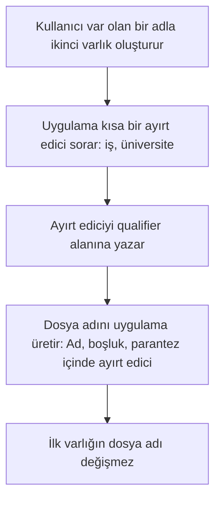

```markdown
people/Ahmet Yılmaz (iş).md
---
type: person
name: Ahmet Yılmaz
qualifier: iş
aliases: [Ahmet]
---
```

| Konu | Kural |
|---|---|
| Neden | Bağlantılar dosya adına gider. Bu nedenle dosya adları farklıdır. Ama kullanıcı dosya adı düşünmez. |
| Görünen ad | `name` alanındadır. Arayüz her yerde `name` değerini gösterir. |
| Arayüz | 2 varlık da "Ahmet Yılmaz" görünür. Arayüz ayırt ediciyi adın altında küçük yazıyla gösterir. |
| Bağlantı | `[[Ahmet Yılmaz (iş)\|Ahmet]]` |
| İlk varlık | Dosya adı değişmez. Kullanıcı isterse ilk varlığa da ayırt edici ekleyebilir. |
| Konumlar | Aynı kural konumlar için de geçerlidir. |

### Otomatik tanıma ve belirsizlik

**Bir eşleşmenin sonucu: kesin, öneri, belirsiz ya da bilinmeyen.**

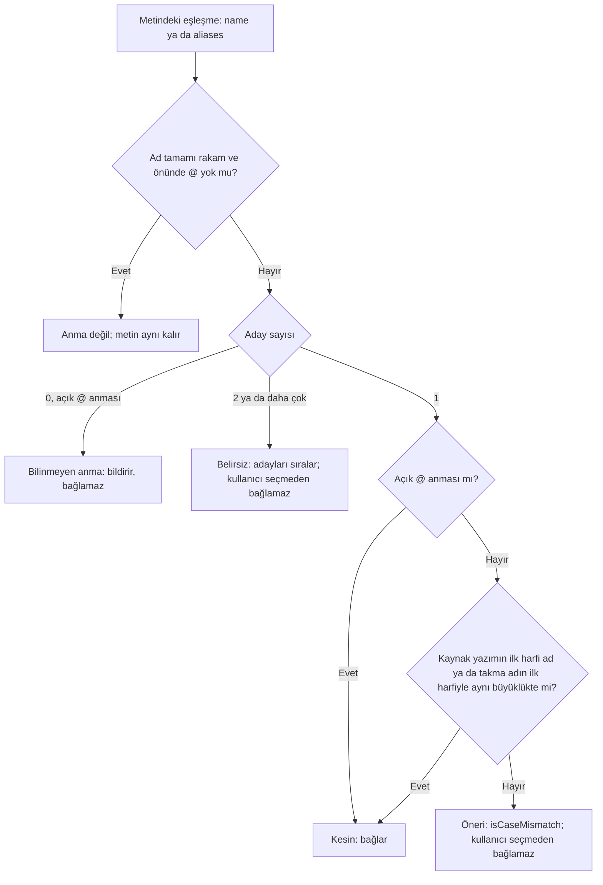

**Eşleşme kuralları.**

| Konu | Kural |
|---|---|
| Kaynak | Uygulama `name` ve `aliases` üzerinden tanır. |
| Sınır | Eşleşme Unicode harf ve rakam sınırlarındadır. Sözcük içindeki ad eşleşmez. |
| Karşılaştırma | NFC ve yerelden bağımsız küçük harf karşılaştırması. |
| Çok sözcüklü ad | Sözcükler arasında 1 ya da daha çok Unicode boşluk olabilir. Satır sonu olamaz. U+2028 ve U+0085 satır sonudur ve boşluğun yerine geçmez. |
| Örtüşme | Uygulama en uzun eşleşmeyi seçer. Eşit uzunlukta ad takma addan önce gelir. Sonra metinde önce başlayan eşleşme gelir. |
| Adaylar | Aynı yazıma uyan bütün farklı varlıklar aday kalır. |
| Ek | Adın hemen ardından gelen ve `'` ya da `’` ile başlayan ek bağlantının dışında kalır. |

**Taranmayan yazımlar.**

| Yazım | Neden |
|---|---|
| Var olan wikilinkler ve `[metin](hedef)` Markdown bağlantılarının tamamı | Zaten bağlantı. |
| Satır içi kod, kod çiti satırları | Kod. |
| Belge düzeyindeki çağrıda frontmatter satırları | Yapı. |
| `://` içeren boşluksuz parça | Adres. |
| İçinde `@` geçen boşluksuz parça, örneğin e-posta | Adres. Sözcük başındaki açık anmanın `@` işareti bu dışlamanın istisnasıdır. |
| Harf.harf biçiminde noktayla birleşen boşluksuz parça | Alan adı benzeri. |
| `#` ya da `^` ile başlayan boşluksuz parça | Etiket ya da kimlik. |
| Önünde boşluk olmadan `[`, `!`, `\`, `#`, `^` ya da `\|` bulunan anma | Kaçırılmış ya da kapanmamış bağlantı yazımı. Düz metin kalır. |
| Hemen arkasında `]` bulunan anma | Kapanmamış bağlantı yazımı. Düz metin kalır. |

**Uygulama tamamı rakam olan adı yalnız `@` ile bağlar.**

| Yazım | Sonuç |
|---|---|
| `12 kişi`, `12 Ekim 2026`, `(12)`, `12'de`, `1. Elma`, `Tel: 0212 555 12 12`, `12:30`, `12.10.2026`, `12+5`, `34 plakalı araç` | Anma değil. Metin olduğu gibi kalır. |
| `@12` | `[[12]]` |
| `@12'de` | `[[12]]'de` |
| `@12:30` | `[[12]]:30`. Uygulama yalnız adı bağlar; ardındaki `30` çıplak yazımdır. |
| `Daire 12` | `[[Daire 12]]` |
| `Daire 12:30` | `[[Daire 12]]:30` |
| `[[12]]`, `[[Hedef\|12]]` | Var olan bağlantı. Uygulama okur ve değiştirmez. |
| `[[12]]:30`, `[[Deniz]]:12` | Yeniden taramada yeni anma çıkmaz. |

- Kural, tamamı rakam olan ad ya da takma ad içindir: `12`, `2026`, `34`. Böyle bir ad çıplak yazıldığında anma değildir. Yazma yolu ve çevredeki karakterler fark etmez.
- Böyle bir yazımı uygulama yalnız açık anmayla bağlar.
- Açık anma birden çok varlığa uyuyorsa öteki adlardaki gibi belirsizdir. Uygulama kullanıcı seçmeden bağlamaz.
- Rakam, hangi yazıda olursa olsun Unicode ondalık rakamıdır: ASCII `12`, Arap-Hint `١٢`, tam genişlik `１２`.
- Kesir, üst simge, Roma rakamı ve tuş emojisi rakam değildir: `½`, `²`, `Ⅻ`, `1️⃣`. Bunlardan oluşan ad bu kurala girmez.
- Kural varlığa değil yazıma bakar. Örnek: adı `Otoyol`, takma adı `34` olan varlıkta yalnız `34` yazımı `@` ister. `Otoyol` eskisi gibi eşleşir.
- İçinde rakamdan başka karakter bulunan adlar kurala girmez ve öteki adlar gibi eşleşir: `Daire 12`, `3. Kat`, `7/24`, `12 5`.
- Bağlanmamış anmalar sorgusu da çıplak rakam yazımlarını listelemez. Sorgu, `@` ile yazılıp bağlanmamış olanı listeler.

**Uygulama satırın yapısını taramaz.**

| Satır | Taranan | Taranmayan |
|---|---|---|
| Görev satırı: hangi dosyada ya da bölümde olursa olsun, Journal bölümü dahil | Yalnız görevin metni | Liste işareti, kutu, tanınan alanlar, uygulamanın okumadığı `⏳` ve `➕` tarihleri, sondaki `^kimlik` |
| Events bölümündeki olay satırı | Olay metni | Liste işareti, baştaki saat, kimlik |

- Tanınan alanlar: `📅`, `🛫`, `✅` ile tarihleri, öncelik işaretleri, `#project/...`, `🔁` ile kuralı.
- Uygulamanın okuyamadığı `🔁` kuralı da bittiği yere kadar alandır: sonraki alan, bağlantı, satır içi kod ya da satır sonu. Uygulama kuraldaki adı tanımaz. Uygulama kuraldaki açık `@` anmasını da tanımaz. Örnek: `🔁 her hafta Deniz ile` olduğu gibi kalır.
- Obsidian Tasks'ın `⏳` ve `➕` tarihleri: işaret, tek boşluk, geçerli ISO tarih.
- Alan gibi görünen ama alan olmayan yazım metindir. Uygulama o yazımı öteki kurallarla tarar. Örnekler: ardından geçerli tarih gelmeyen `📅`; görev olmayan satırdaki `📅 2026-10-12`.
- Bu tanım tektir. Yazarken tanıma da bağlanmamış anmalar sorgusu da aynı tanımı kullanır.

**Açık anma ve kesinlik.**

| Konu | Kural |
|---|---|
| Açık anma | `@` yalnız önünde harf ya da rakam yokken açık anmadır. |
| Bilinen adda `@` | Uygulama `@` işaretini kaldırır ve yalnız adı bağlar. |
| Bilinmeyen açık anma | Uygulama `@` sonrasındaki, büyük harfle başlayan en çok 4 sözcüğü bildirir. Satır sonu, noktalama ya da küçük harfle başlayan sözcük diziyi bitirir. Kesmeyle başlayan ek dışarıda kalır. Uygulama bilinmeyen açık anmayı bağlamaz. |
| Kesin eşleşme | Tek aday var ve kaynak yazımın ilk harfi adın ya da eşleşen takma adın ilk harfiyle aynı büyüklükte. |
| Harf büyüklüğü farkı | Uygulama eşleşmeyi `isCaseMismatch` ile öneri olarak bildirir. Kullanıcı seçmeden bağlamaz. Açık `@` anmasında bu fark kesinliği bozmaz. |
| Birden çok aday | Puan ne olursa olsun belirsizdir. Uygulama kullanıcı seçmeden bağlamaz. |
| Otomatik bağlama | Ad ya da takma ad tek bir varlığa aitse ve kesinlik koşulunu sağlıyorsa uygulama otomatik bağlar. |
| Aday sıralaması | Bağlama göre: o konumda daha önce birlikte geçmek, yakın zamanda geçmek, geçme sıklığı. Uygulama en olası adayı üstte önerir. |
| Emin olmama | Uygulama emin değilse bağlamaz ve kullanıcıya sorar. |
| Sıralama ölçütleri | Dosyada durmaz. Uygulama ölçütleri indeksten hesaplar. |
| Bağlanmış anma | Uygulama yeniden tanımaz. |
| Bekleyen anmalar | Öneri, belirsiz ve bilinmeyen anmalar metinde kalır. Uygulama onları yeniden bildirir. |

**Bağlantı yazımı.**

| Konu | Kural |
|---|---|
| Hedef | Uzantısız dosya adı seçilen varlığa çözülüyorsa hedef o gövde adıdır. Çözülmüyorsa hedef klasörlü yoldur: `people/Ahmet`. Yol hedefi sözdiziminde zaten vardır. |
| Kök yolu | Yol hedefinde `/` yoksa uygulama başına `/` ekler: `[[/Baran\|Baran]]`. Çözümleyici baştaki `/` parçasını yok sayar. |
| Hedef seçimi | İndeks hedefi, seçilen dosyaya çözülecek biçimde belirler. |
| Görünen metin | Kaynak yazım hedefle bayt bayt aynıysa uygulama `[[hedef]]` yazar. Diğer durumda uygulama `[[hedef\|yazım]]` yazar. |
| Ayırt edicili varlık | Uygulama görünen metni her zaman yazar. |
| Takma ad | Takma ad hedefle bayt bayt aynıysa ve hedefte ayırt edici yoksa uygulama görünen metni ayrıca yazmaz. |
| Korunan baytlar | Yazımın harfleri, boşlukları, ekler ve metnin diğer bütün baytları aynı kalır. |
| Eski anma | Kaynak yazım artık aralıkla uyuşmuyorsa bağlantıya çevirme eski anma hatası verir. |
| Temsil edilemeyen hedef | Hedef wikilink sözdizimiyle temsil edilemiyorsa uygulama anmayı bağlamaz. Anma düz metin kalır. |
| Temsil edilemeyen görünen metin | Görünen metin temsil edilemiyorsa uygulama işlemi reddeder ve kısmi çıktı üretmez. Örnek: köşeli ayraç içeren metin. |

Tablo satırında ayırıcı farklıdır. Başındaki boşluklardan sonra `|` ile başlayan satırda uygulama görünen metin ayırıcısını `\|` olarak yazar. Bu bölümdeki tablolarda `\|` yazımı yalnız tablo kaçışıdır; dosyadaki karakter `|` olur.

## Konum dosyası

Yol: `places/Kadıköy Ofis.md`

```markdown
---
type: place
name: Kadıköy Ofis
aliases: [ofis]
coordinates: [10.5000, 20.0290]
radius: 100
---
```

| Alan | Anlamı | Kural |
|---|---|---|
| `coordinates` | Enlem ve boylam | İsteğe bağlı. Koordinat yoksa konum yalnız adla eşleşir. |
| `radius` | Metre | İsteğe bağlı. GPS önerisinde yarıçap yoksa uygulama 100 metre kullanır. |
| Geçersiz koordinat ya da yarıçap | — | Uygulama konumu öneriye almaz. Uygulama dosyayı değiştirmez. |

## Hedef dosyası

Yol: `goals/Spor.md`

```markdown
---
type: goal
name: Spor
key: spor
period: week
kind: boolean
target: 3
place: "[[Spor Salonu]]"
---
```

| Alan | Değerler | Açıklama |
|---|---|---|
| `key` | küçük harf, boşluksuz | Gün dosyasındaki `goals` anahtarı |
| `period` | `day`, `week`, `year` | Hedefin dönemi |
| `kind` | `boolean`, `number`, `milestone` | Kayıt türü; milestone sayılamayan yıllık hedeftir |
| `target` | sayı; milestone türünde yok | Dönem başına hedef. Örnek: haftada 3 gün, yılda 24 kitap, günde 20 sayfa. |
| `unit` | metin, isteğe bağlı | Sayısal hedefte birim. Örnek: sayfa, bardak. |
| `place` | bağlantı, isteğe bağlı | Boolean hedefin konumu. Konumda koordinat ve açık `radius` alanı gerekir. Kullanıcı konuma girince uygulama bugünün kaydı için cihaz tercihine göre bildirim gösterir ya da otomatik işaretler. |

### Hedef oluşturma

| Konu | Kural |
|---|---|
| Dosya | Uygulama yeni hedefi şablonsuz `goals/<Ad>.md` dosyasında oluşturur. |
| Benzersizlik | Ad ve dosya gövde adı NFC ve harf duyarsız karşılaştırmada benzersizdir. |
| Dosya adı | Kişi ve konum oluşturmadaki güvenli karakter kuralları geçerlidir. |
| Anahtar sabitliği | Tanım düzenleyicisi anahtarı oluşturulduktan sonra değiştirmez. Ad değişikliği dosyayı taşımaz. Geçmiş kayıtlar kalır. |

**Otomatik anahtar üretimi.**

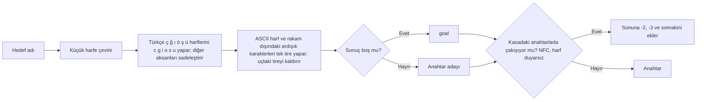

Türkçe `ç/ğ/ı/ö/ş/ü` harfleri `c/g/i/o/s/u` olur. Örnek: `Su İçme` → `su-icme`. Çakışmada uygulama `-2`, `-3`, … ekler. Uygulama tanımı geçersiz hedeflerin anahtarlarını da dolu sayar. Yalnız gün kayıtlarında kalan sahipsiz anahtarlar yeniden kullanılabilir.

### Dönemler ve geçerli tanım

| Konu | Kural |
|---|---|
| Hafta | Pazartesi–pazar. |
| Yıl | 1 Ocak–31 Aralık takvim yılı. |
| Gün | Günlük dönem tek gündür. |
| Aralık kenarı | Uygulama dönem sınırlarını 0100-01-01 ve 9999-12-31 ile kırpar. |
| Boolean ve sayısal tanım | `period`: `day`, `week`, `year`. `kind`: `boolean`, `number`. `key`: boş olmayan metin. `target`: sonlu, sıfırdan büyük sayı. |
| Geçersiz tanım | Dosyada kalır. Uygulama tanımı hesaplanabilir tanımlar listesine almaz. |
| Katkı | Boolean `true` katkısı 1, diğer boolean katkısı 0. Sayı katkısı gün miktarıdır. |
| Dönem başarısı | Dönem toplamı ≥ `target` ise dönem başarılıdır. Örnek: haftalık boolean 3, haftada 3 farklı gün. Yıllık sayısal 24, yıl kayıtlarının toplamı. |
| Türü uymayan kayıt | Dosyada kalır. Katkısı 0'dır. Yapılmış değildir. |

### Kilometre taşı hedefi

| Konu | Kural |
|---|---|
| Geçerlilik | `kind: milestone` yalnız `period: year` ile geçerlidir. `target` bulunmaz. Örnek: "Portfolyo sitesini bitir". |
| Tamamlama | Tamamlandığı gün uygulama gün dosyasına `goals.<key>: true` kaydını 1 kez yazar. Geri alma o kaydı kaldırır. |
| İlerleme | Yapıldı ya da yapılmadı, ve tamamlanma tarihi. Zincir ve ısı haritası yoktur. |
| Hesap | Verilen güne kadarki, aynı yıl içindeki boolean `true` kayıtlarının ilk tarihi. Uygulama yinelenen dış kayıtları saymaz. `false` ve sayılar tamamlanma değildir. |
| Tekrar | Uygulama aynı yıl içinde ikinci kayıt oluşturmaz. Bugünkü kart başka güne ait tamamlanmayı geri almaz. |

### Zincir

**Günlük hedefte kaçırma affı: örnekler.**

| Günler | Sonuç |
|---|---|
| Pzt yapıldı, Sal yapıldı, Çar kaçtı, Per yapıldı, Cum yapıldı | Uygulama Çar'ı affeder. Zincir 4. |
| Yapıldı, kaçtı, yapıldı | Af yok: kaçırmanın önünde iki yapılmış gün yok. Zincir 1. |
| Yapıldı, kaçtı, kaçtı, yapıldı | Art arda 2 kaçırma. Af yok. Kaçırmalar zinciri keser. |
| Yapıldı, kaçtı, yapıldı, kaçtı, yapıldı | Af yok: hiçbir kaçırmanın önünde iki yapılmış gün yok. Zincir 1. En uzun zincir 1. |
| Yapıldı, yapıldı, kaçtı, yapıldı, kaçtı, yapıldı | Uygulama ilk kaçırmayı affeder. İkinci kaçırmanın önündeki iki günden biri affedilmiş gündür ve yapılmış sayılmaz: af yok. Zincir 1. En uzun zincir 3. |
| Kaçtı, yapıldı, yapıldı, kaçtı, yapıldı | Uygulama ikinci kaçırmayı affeder. Zincir 3. |
| Pzt–Cum yapıldı, Cmt kaçtı, Pazar sabahı, bugün henüz yapılmadı | Zincir 5. `isPendingToday` döner. |
| Aynı hafta, Pazar yapıldı | Uygulama Cmt'yi affeder. Zincir 6. |
| Aynı hafta, Pazar da yapılmadı, ertesi gün | Art arda 2 kaçırma. Zincir 0. |
| Dün ve önceki gün birlikte kaçtı, bugün henüz yapılmadı | Bekleme zinciri korumaz. Zincir 0. |

| Konu | Kural |
|---|---|
| Zincir tanımı | Verilen günün döneminden geriye ardışık başarılı dönem sayısı. |
| Bekleyen güncel dönem | Güncel dönem henüz başarılı değilse sayım önceki dönemden başlar. `isPendingToday` bayrağı döner. Haftalık ve yıllık hedeflerde güncel dönem bekliyor demektir. |
| Haftalık ve yıllık hedef | Başarısız ya da kayıtsız dönem zinciri keser. Af yoktur. |
| En uzun zincir | Verilen güne kadarki en uzun ardışık başarılı dönem dizisi. |
| Günlük hedefte başlangıç | Aynı kural: bugün henüz başarılı değilse sayım dünden başlar ve `isPendingToday` döner. |
| Yapılmış gün | Gün katkısı ≥ `target`. Dönem kuralıyla aynı eşik. |
| Kaçırma | Gün yapılmamış: `false`, eşik altı, `0`, kayıt yok ya da tür uyuşmazlığı. |
| Kaçırma affı | Bir takvim günü yapılmamışsa ve önceki iki takvim günü ile sonraki takvim günü yapılmışsa uygulama o günü affeder. Affedilen gün yapılmış gün sayılmaz: başka bir kaçırmanın önceki iki gününden biri olamaz. Uygulama affedilen günü zincir sayısına eklemez. |
| Art arda 2 kaçırma | İkinci kaçırmanın önündeki gün yapılmamıştır. Uygulama bu kaçırmaları affetmez. Kaçırmalar zinciri keser. |
| Af zamanı | Af yalnız bugünden önceki günlere geçerlidir. |
| Dün kaçtı, önceki iki gün yapıldı, bugün henüz yok | Dün henüz affedilmiş değildir ama zinciri de düşürmez. Bugün dünü hâlâ affettirebilir. Bu nedenle uygulama zinciri dünden önceki günden sayar ve `isPendingToday` döner. |
| Dün kaçtı, önceki iki günden biri yapılmadı ya da affedildi, bugün henüz yok | Bekleme zinciri korumaz. Zincir 0. `isPendingToday` döner. |
| Beklemenin etkisi | Bekleme yalnız güncel zinciri etkiler. En uzun zincir ve ısı haritası yalnız kesinleşmiş affı sayar. Dün haritada `none` ya da kısmi kalır. |
| Affedilmeyen kaçırmalar | Hedefin ilk ve ikinci günü, önünde iki yapılmış gün olmayan kaçırma, baştaki kaçırma ve arkası yapılmamış sondaki kaçırma. |
| Günlük hedefte en uzun zincir | Aynı af kuralıyla, ilk kayıttan verilen güne kadar. |
| Gün tanımı | Gün `CalendarDate` değeridir. Saat dilimi bir takvim gününü bölmez ya da birleştirmez. Yaz saati geçişi de tek gündür. |
| Dinlenme günü | Yoktur. Af kuralı her zaman açıktır ve ayar değildir. |

### İlerleme skoru

| Konu | Kural |
|---|---|
| Kapsam | Yalnız günlük hedef. Haftalık ve yıllık hedeflerde skor yoktur. |
| Değer | Son 30 takvim gününün başarı yüzdesi: 0–100 tam sayı, `(başarılı gün × 100) / gün sayısı`. Uygulama kesri atar. |
| Pencere sonu | Bugün başarılıysa bugün, değilse dün. Bugün henüz yapılmadıysa paydaya girmez. |
| Pencere başı | İlk kaydın günü. Daha önceki günler paydaya girmez. Geçmiş 30 günden kısaysa payda penceredeki gün sayısıdır. |
| Affedilen ve kısmi gün | Affedilen gün başarılı değildir ve paydaya girer. Eşik altı gün de başarılı değildir. |
| Ölçülen gün yok | Hiç kayıt yoksa ya da ilk kayıt henüz yapılmamış bugünse skor yoktur. Arayüz skoru göstermez ve 0 yazmaz. |
| Dönem özeti: bitmiş dönem | Pencere dönemin son günüyle biter. O gün kaçırılmış olsa da paydaya girer. Uygulama zinciri dönemin son günü itibarıyla hesaplar. |
| Dönem özeti: süren ya da başlamamış dönem | Bugünkü skor görünür. Henüz gelmemiş günler kaçırma değildir. Uygulama zinciri bugün itibarıyla hesaplar. |
| Zincir farkı | Bu 2 zincir sayısının farkı. |

### Isı haritası

| Gün katkısı | İşaret |
|---|---|
| Boolean `true` | Tam |
| `false`, eksik kayıt, sayısal `0` | Yok |
| Pozitif sayı, `target` altında | Kısmi |
| Pozitif sayı, `target` ya da üstü | Tam |
| Günlük hedef, bugünden önceki affedilen gün, katkı yok | `forgiven` |
| Günlük hedef, bugünden önceki affedilen gün, katkı sıfırdan büyük ama hedefin altında | `forgivenPartial`: kısmi emek görünür kalır. |

- Harita iki ucu dahil aralıktaki her gün için işaret verir.
- Haftalık ve yıllık haritada af işareti yoktur. Başarı ayrı dönem toplamıdır; harita günlük katkıyı gösterir.
- Açık harita aralığı gelecek kayıtlarını da gösterebilir.
- Yıl toplamı, güncel yılın verilen güne kadarki katkılarıdır. Yıllık ilerleme bu toplamı hedef miktarla karşılaştırır.

Zincir, en uzun zincir ve ilerleme dosyada durmaz. Uygulama hepsini gün dosyalarındaki kayıtlardan hesaplar.

## Serbest notlar

| Konu | Kural |
|---|---|
| Yer | `notes/` altındaki dosyalar. |
| Yapı | Notlar herhangi bir yapıya uymak zorunda değildir. |
| İndeks | Uygulama notlardaki bağlantıları ve görev satırlarını indeksler. |

## Ayarlar

| Dosya | İçerik |
|---|---|
| `.app/*.json` | Veri olmayan ayarlar. Örnek: görünüm tercihleri, kanban sütun düzeni. |
| `.app/vault.json` | Kasanın format sürümü. |
| `.app/types.json` | Özel varlık tipleri. Ayrıntı: [Varlık tipleri](#varlık-tipleri). |

Obsidian nokta ile başlayan klasörleri göstermez. `.app/vault.json` kasanın format sürümünü taşır:

```json
{ "formatVersion": 1 }
```

**Her yazmadan önce format sürümü denetimi.**

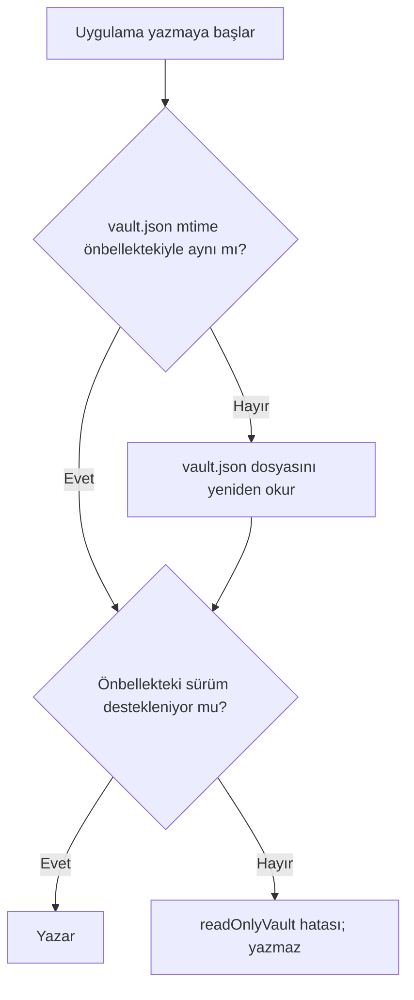

| Konu | Kural |
|---|---|
| Oluşturma | Uygulama kasayı oluştururken `vault.json` yazar. |
| Dosya yok | Uygulama sürümü 1 kabul eder. |
| Sürüm artışı | Sürüm, eski bir istemcinin veriyi bozabileceği format değişikliklerinde artar. |
| Büyük sürüm | Desteklediğinden büyük sürüm gören istemci kasaya yazmaz. İstemci kasayı salt okunur açar ve güncelleme gerektiğini bildirir. |
| Denetim | Her yazma `.app/vault.json` sürümünü denetler. Uygulama dosyanın değişiklik zamanını, yani mtime değerini önbelleğe alır. mtime değişmedikçe uygulama dosyayı yeniden okumaz. Uygulama bütün kasayı taramaz. |
| Hata | Okunamayan ya da desteklenmeyen sürüm `readOnlyVault` hatası verir. |

## Varlık tipleri

**`.app/types.json` örneği: isteğe bağlı özel varlık tipleri.**

```json
{
  "formatVersion": 1,
  "types": [{
    "id": "book", "folder": "books",
    "name": { "tr": "Kitap", "en": "Book" },
    "plural": { "tr": "Kitaplar", "en": "Books" },
    "icon": "book",
    "fields": [{ "key": "yazar", "kind": "text" }, { "key": "bitirme", "kind": "date" }],
    "template": "templates/book.md"
  }]
}
```

**Tip tanımının alanları.**

| Alan | Kural |
|---|---|
| `id` | `[a-z][a-z0-9_-]*` biçiminde ve benzersiz. Ayrılmış: `person`, `place`, `goal`, `journal` ve indeksin iç türleri `day`, `note`. Düzenlemede id değişmez; yeni id yeni tiptir. |
| `folder` | Kasa köküne göre göreli, boş olmayan dizin yolu. Boş bileşen, `.`, `..`, noktayla başlayan bileşen, ters bölü ve kontrol karakterleri geçersizdir. Kökte `templates`, `conflicts`, `journal` hedef klasör olamaz. Uygulama sembolik bağlantıları izlemez. |
| `name`, `plural` | Türkçe ve İngilizce, boş olmayan görünen adlar. |
| `icon` | Boş olmayan SF Symbol adı. Arayüz tanınmayan simgeyi genel simgeyle gösterebilir. |
| `fields` | Sıralı, benzersiz anahtarlı arayüz tanımları. `kind`: `text`, `date`, `number`, `boolean`, `link`. |
| `template` | İsteğe bağlı, kasa köküne göre göreli `.md` yolu. Gizli bileşen, `.`, `..`, ters bölü, kontrol karakteri ve sembolik bağlantı geçersizdir. |

| Konu | Kural |
|---|---|
| Dosyanın yokluğu | Uygulama yalnız yerleşik kişi ve konum tiplerini sunar. |
| Kasa sürümü | `types.json` kasa sürümünü değiştirmez. Eski istemciler özel tip dosyalarını düz not olarak okuyabilir. |
| Klasör ve tür | Uygulama yeni dosyayı tipin klasörüne yazar. Uygulama mevcut dosyaları taşımaz. Türü frontmatter'daki `type: <id>` belirler. |
| Ayrılmış alan anahtarları | `type`, `name`, `qualifier`, `aliases` ve boş ya da geçersiz frontmatter anahtarları. |
| Alan tanımı | Alan tanımı dosyada değer yaratmaz. Boş ya da eksik alan için arayüz uygun düzenleyiciyi sunar. |
| Tür uyuşmazlığı | Var olan değerin türü tanımla uyuşmazsa arayüz ham ya da mevcut alan düzenleyicisini kullanır. Uygulama kendiliğinden dönüşüm yapmaz. Bilinmeyen alanlar kalır. |
| `link` alanı | Tek wikilink metni. Uygulama kullanıcının seçtiği hedefi kayıtta `[[hedef]]` olarak yazar. |
| Şablonla oluşturma | Yeni dosyada şablonun gövdesi ve diğer alanları kalır. `type` hedef id, `name` kullanıcının adı olur. |
| Eksik şablon | Uygulama asgari frontmatter üretir. |
| Okunamayan ya da çözülemeyen şablon | Uygulama oluşturmayı reddeder. Şablon değişmez. |
| Bozuk dosya | Bozuk, okunamayan, desteklenmeyen sürümlü ya da çakışan tanımlı dosyada bütün özel tipler devre dışı kalır. Uygulama yalnız yerleşik tipleri ve bir uyarı gösterir. |
| Özgün JSON | Uygulama özgün JSON'un üzerine sessizce yazmaz. |
| Silinen tanım | Tanımı silinen ya da eksik dosyalar düz not olarak kalır. Uygulama dosyaları ve bağlantıları silmez. |
| Yeniden sınıflandırma | `types.json` değişince uygulama indeksi dosyalardan yeniden sınıflandırır. |
| Tip düzenleme | Oluşturma, düzenleme ve silme yalnız hedef tip tanımını değiştirir. Diğer tipler ve bilinmeyen JSON anahtar ve değerleri bayt düzeyinde aynı kalır. |
| Yazma yolu | Yazma atomiktir. Tek istisna: birim sabit bağlantıyı ve dışlayıcı adlandırmayı desteklemiyorsa dosyanın ilk oluşturulması atomik değildir ([Mimari](architecture.md), atomik yazma tablosu). Uygulama yazmayı ortak kasa yazma kuyruğunda yapar. |
| Tip silme | Tip silme varlık Markdown dosyalarına dokunmaz. |

## Eşitleme çakışması

**Aynı içeriğin 2 sürümü: 2 kaynak.**

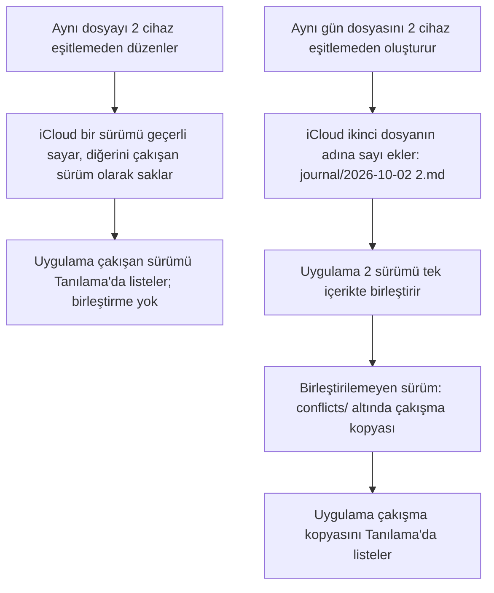

**Çakışan sürüm:** iCloud'un aynı dosya için geçerli sürümün yanında sakladığı, çözülmemiş öteki sürüm. Sürüm kasada ayrı dosya değildir. **Gün kopyası:** iCloud'un aynı gün için ayırdığı, adının sonunda sayı taşıyan dosya. **Çakışma kopyası:** uygulamanın `conflicts/` altına bayt bayt sakladığı sürüm.

Uygulama 2 sürümü tek içerikte birleştirir. Uygulama gün kopyasını birleştirdikten sonra siler. Ana dosya yoksa gün kopyası ana dosyanın adını alır.

**NOT:** Birleştirme işlevi ve gün kopyası birleştirme bugün Core'da hazırdır. Uygulama bu işlevi henüz çağırmaz; bağlantı [yol haritasında](roadmap.md) açık maddedir. Uygulama gün kopyalarını, çakışma kopyalarını ve çakışan sürümleri Ayarlar → Tanılama ekranında listeler. Ayrıntı: [Varlık kopyası](#varlık-kopyası) ve [Çakışan sürümün listesi](#çakışan-sürümün-listesi).

### Çakışan sürümün listesi

| Konu | Kural |
|---|---|
| Kapsam | Yalnız iCloud Drive'daki kasa. Öteki kasada uygulama hiçbir dosyaya sormaz ve liste boştur. |
| Sorulan dosyalar | İndeksteki her dosya ve `journal/` altındaki her gün kopyası. `conflicts/` ve `templates/` sorulmaz. |
| Okuma | Uygulama önce dosyanın "çözülmemiş çakışma var" bayrağına bakar. Yalnız bayraklı dosyanın sürümlerini koordineli okumayla okur. Uygulama kasaya hiçbir şey yazmaz. |
| Satır | Dosyanın yolu, sürüm sayısı, en yeni sürümün kayıt zamanı ve sürümü kaydeden cihazların adları. Zamanı bilinmeyen sürümün satırında zaman yoktur. |
| Sıra | Dosyalar yolun bayt sırasıyla gelir. Sürümler yeniden eskiye gelir. Aynı saniyedeki sürümler cihaz adına göre gelir; adsız sürüm sondadır. |
| Çözümleme | Uygulama sürümü birleştirmez, seçmez ve silmez. Bölümün altındaki cümle yalnız bunu söyler; bir çözüm yolu vaat etmez. Dosyalar'ın ya da Finder'ın düz bir dosya için çözüm ekranı sunduğu doğrulanmadı; çözüm yolu iki cihaz denemesinden sonra kararlaştırılır. |
| Yenileme | Tanılama listeyi her indeks yenilemesinde ve uygulama ön plana her dönüşte yeniden okur. iCloud çakışması kasa klasöründe olay üretmeyebilir. |

### Gün kopyası adları

| Ad | Gün kopyası mı | Neden |
|---|---|---|
| `journal/2026-10-02 2.md` | Evet | Geçerli gün, tek boşluk, 2. |
| `journal/2026-10-02 10.md` | Evet | Geçerli gün, tek boşluk, 10. |
| `2026-10-02 2 2.md` | Hayır | İkinci sayı. |
| `2026-10-02-2.md` | Hayır | Boşluk yerine tire. |
| `2026-10-02 02.md` | Hayır | Sayının başında sıfır. |
| `2026-10-02 1.md` | Hayır | Sayı 2'den küçük. |
| `2026-13-40 2.md` | Hayır | Geçersiz gün. |
| Alt klasördeki ve `journal/` dışındaki benzer adlar | Hayır | Yer `journal/` klasörünün hemen altı değil. |

- Gün kopyası adı `journal/` klasörünün hemen altındadır. Biçim: `YYYY-MM-DD` biçiminde geçerli bir gün, tek boşluk ve başında sıfır olmayan, 2 ya da daha büyük bir ASCII sayı. Örnek: `2026-10-02 2.md`, `2026-10-02 10.md`.
- Gün kopyası olmayan benzer adlar sıradan not olarak kalır.
- Uygulama gün kopyasını indekslemez. Gün kopyasındaki satırlar olay ya da görev değildir. Satırlar gün dosyasına ancak birleştirmeyle girer.
- Bir günün birden çok gün kopyası varsa uygulama sayısı küçük olandan başlar ve kopyaları birer birer birleştirir: `2026-10-02 2.md`, sonra `2026-10-02 3.md`. Böylece 2 cihaz sürümleri aynı sırayla birleştirir.

**Gün kopyasının yaşam döngüsü.**

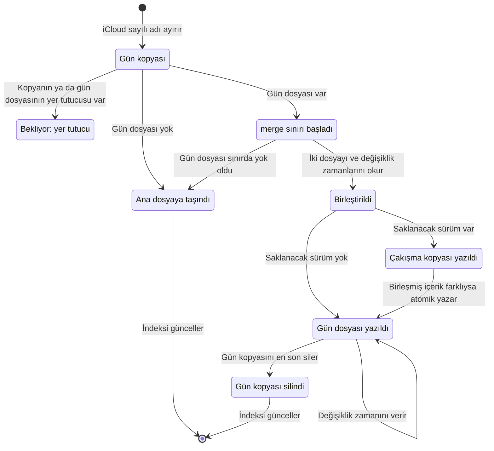

Gün dosyası `.merge` sınırı içinde yok olursa uygulama kopyayı aynı sınırda gün adına taşır.

Uygulama birleşmiş içeriği ve gerekiyorsa çakışma kopyasını yazmadan hiçbir sürümü silmez. Gün dosyası değişmeden önceki her hata, o çağrının yazdığı çakışma kopyalarını geri alır.

**Birleşmiş gün dosyasının değişiklik zamanı.**

| Durum | Gün dosyasının değişiklik zamanı |
|---|---|
| Uygulama birleşmiş içeriği gün dosyasına yazdı | 2 sürümün değişiklik zamanından büyüğü artı 1 saniye. Birim tam saniyedir. |
| Gün dosyası yoktu; gün kopyası ana dosyanın adını aldı | Gün kopyasının zamanı. Uygulama zamanı değiştirmez. |
| Birleşmiş içerik gün dosyasıyla bayt bayt aynı | Gün dosyasının zamanı. Uygulama gün dosyasını yazmaz. |

Uygulama birleşmiş gün dosyasına değişiklik zamanı olarak yazma anını vermez. Gerekçe: yazma anı 3. bir sürümün zamanından da büyük olabilir. Örnek: gün dosyası 10:00, gün kopyası 2 10:30, gün kopyası 3 11:00. Uygulama 2'yi birleştirince gün dosyası 10:30:01 olur. Bu yüzden 3. sürüm yeni sürüm kalır ve 11:00'deki düzenleme kazanır. Bu örnekte sıra 3, sonra 2 olsa da 11:00'deki düzenleme kazanır.

Yakınsama iki cihazın kopyaları aynı numara sırasıyla birleştirmesine ve her sürümün kendi zamanıyla gelmesine bağlıdır. Eşit saniyeli sürümler ya da sıra dışı gelen kopya farklı gün dosyası üretebilir. İçerik `conflicts/` altında kalır; kayıp olmaz.

### Birleştirme işlevi

| Özellik | Kural |
|---|---|
| Girdiler | Yalnız 2 sürümün içeriği ve değişiklik zamanları. İşlev cihazın durumuna ya da indekse bağlı değildir. |
| Değişiklik zamanı | Tam sayı. Birimini çağıran belirler. |
| Sıra | Sürümlerin veriliş sırası sonucu değiştirmez. |
| Kararlılık | Sonucu sürümlerden biriyle, 2 sürümden de büyük bir zamanla yeniden birleştirmek içeriği değiştirmez. Gerekçe: uygulama birleşmiş gün dosyasına 2 sürümün büyük zamanından 1 saniye sonrasını verir. |
| Yakınsama | 2 cihaz aynı 2 sürümü kendi zamanlarıyla birleştirirse aynı içeriğe varır. Birden çok kopyada yukarıdaki sıra sınırı geçerlidir. |
| Yeni sürüm | Değişiklik zamanı büyük olan. Zamanlar eşitse içeriği bayt sırasında büyük olan. Diğeri eski sürümdür. |
| Aynı sürümler | Bayt bayt aynı 2 sürümün sonucu kendileridir. Çakışma kopyası yoktur. |
| Yalnız satır sonu ya da BOM farkı | Sonuç yeni sürümdür. Çakışma kopyası yoktur. |
| Salt okunur sürüm | Bir sürüm UTF-8 olarak çözülemiyorsa birleştirme olmaz. Sonuç yeni sürümdür. Uygulama eski sürümü çakışma kopyası olarak saklar. |
| BOM ve satır sonu | Birleşmiş dosyanın BOM'u ve yeni eklenen satırların satır sonu yeni sürümden gelir. 2 sürümden aynen alınan satırlar kendi satır sonlarını korur. |
| CR istisnası | CR ile biten bir satırın ardına gelen, LF ile biten boş satırı uygulama CR ile sonlandırır. Gerekçe: aksi hâlde 2 bayt tek CRLF olur ve boş satır kaybolur. |
| Eşleştirme | Uygulama satırları ve değerleri eşleştirirken satır sonu biçimine bakmaz. |

**Kayıp yok kuralı.** Bir sürümdeki herhangi bir içerik sonuçta yoksa uygulama o sürümü çakışma kopyası olarak saklar. İçerik örnekleri: bir blok, boş olmayan bir serbest yazı satırı, bir frontmatter alanı.

| İstisna: kopya gerektirmeyen farklar |
|---|
| Kapalı görevin açık görevi yenmesindeki durum işareti ve tamamlanma tarihi farkı. |
| 2 kapalı görev arasındaki yalnız tamamlanma tarihi farkı. |
| `goals` altında ilerleyen değerin alınması. |
| Yalnız yazımı farklı frontmatter değerleri. |
| Satır sonu biçimi. |

- Uygulama denetimi bölge bölge ve satır sayılarıyla yapar.
- Bir bölgedeki serbest yazı satırı ancak sonuçta aynı bölgenin serbest yazısında, en az o kadar sayıda bulunuyorsa vardır. Frontmatter ya da blok satırı serbest yazı satırının yerine geçmez.
- İşlev sonucu vermeden önce sonucu yeniden okur. İşlev kayıp yok koşulunu ve yapının kurulduğu gibi okunduğunu kendi üzerinde denetler. Yapı: frontmatter sınırı, bölgeler, bloklar. Örnek: bir sürümdeki kapanmayan kod çiti diğerinin satırlarını yutmamıştır.
- Denetim tutmazsa işlev birleştirmeyi yok sayar. Sonuç yeni sürümdür. Uygulama eski sürümü saklar.

**UYARI:** Eksik kopya veri kaybıdır; fazladan kopya zararsızdır.

### Bölgeler

**Bölge birleştirme kararı.**

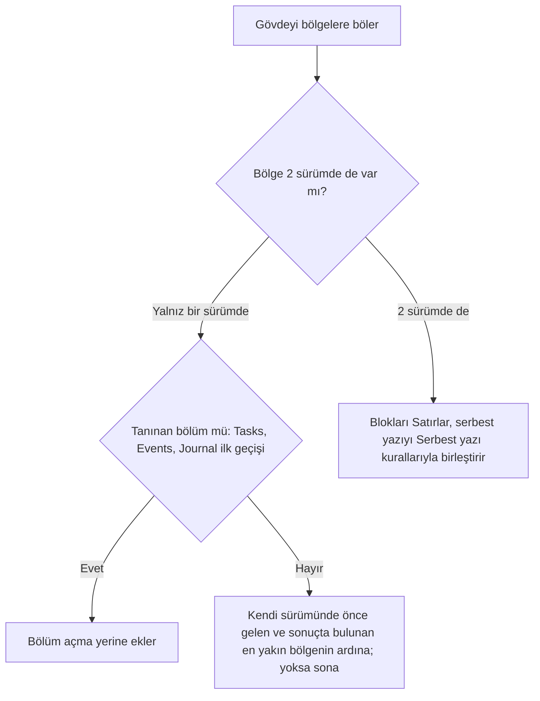

| Konu | Kural |
|---|---|
| Bölgeye bölme | Uygulama gövdeyi, yani frontmatter'dan sonrasını, kod çiti dışındaki 1. ve 2. düzey başlıklarla böler. |
| Bölge | Başlık satırından bir sonraki böyle başlığa kadar olan satırlar. |
| Bölge anahtarı | Başlık satırının içeriği; sondaki boşluklar hariç. |
| Başlıksız bölge | İlk başlıktan önceki kısım. Her sürümde vardır; boş da olabilir. |
| Eşleşme | Aynı anahtar 2 sürümde eşleşir. Bir sürümde birden çok geçiyorsa sırayla eşleşir: birinci birinciyle. |
| Eklenen bölgenin önü | Önceki satır boş değilse uygulama 1 boş satır koyar. Önceki satır frontmatter'ın kapanışı da olabilir. |
| Eklenen bölgenin ardı | Ardından satır geliyorsa ve bölgenin son satırı boş değilse uygulama 1 boş satır koyar. |
| Ortak bölgenin düzeni | Düzen yeni sürümünkidir. Serbest yazısı kapsayan taraf yalnız eski sürümse o bölgede eski sürümün düzeni esastır. Yeni sürümün bölge sonundaki boş satırı kalır. |
| Yalnız diğer sürümdeki olay | Olay ekleme kuralı: saati kendisinden büyük ilk saatli olayın önüne. Öyle bir olay yoksa bölgenin sonuna. Saatsiz olay sona. |
| Yalnız diğer sürümdeki görev | Kendi sırasıyla, bölgenin son boş olmayan satırının ardına. |
| Mevcut satırlar | Yerleri değişmez. |

### Satırlar

**Aynı kimlikli 2 bloktan hangisi kalır.**

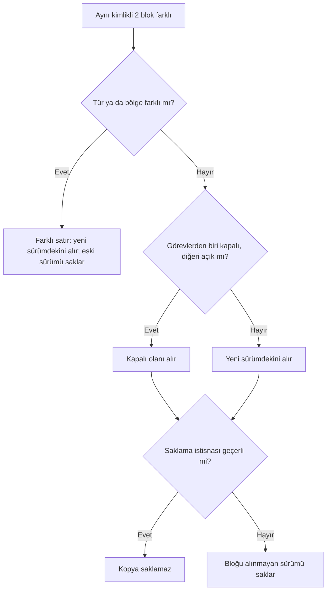

| Konu | Kural |
|---|---|
| Blok | Girintisiz bir olay ya da görev satırı ve altındaki daha girintili satırlar. Ayrıntı: [Blok kimliği](#blok-kimliği). |
| Serbest yazı sayılan satırlar | Girintisiz bir bloğa ait olmayan girintili görevler, alıntı içindeki görevler ve kod çiti içindeki satırlar. |
| Karşılaştırma | Uygulama blokları bölge içinde, satır içerikleriyle eşleştirir. |
| Kimlikle eşleşme | Önce blok kimliğine göre. Bir kimlik 2 sürümden birinde birden çok geçiyorsa o kimliği taşıyan bütün satırlar 2 sürümde de kimliksizdir. |
| Kimliksiz bloklar | Bütün satırlarının içeriği birebir aynıysa eşleşir. Aynı blok bir sürümde k, diğerinde m kez geçiyorsa sırayla eşleşir. Sonuçta büyük sayı kadar bulunur. |
| Tek sürümdeki blok | Sonuca girer. |
| Aynı blok | Tek kez girer. Satırlar düzeni esas alınan sürümden gelir. |
| Kapalı ve açık | Kapalı: `x`, `-`. Açık: ` `, `/` ya da tanınmayan karakter. |

**Saklama istisnası:** bloğu alınmayan sürümü uygulama 2 durumda saklamaz.

| Durum | Koşul |
|---|---|
| a | Kapalı görev açık görevi yendi ve normalize metinleri aynı. |
| b | 2 görev de kapalı, durum karakterleri aynı ve yalnız tamamlanma tarihi farklı. `X` ile `x` aynıdır. |

- Normalize metin: uygulama ilk satırdan kutunun içindeki karakteri çıkarır. Uygulama ilk satırın sonunda, kimlikten önce duran `✅ YYYY-MM-DD` yazımını önündeki tek boşlukla birlikte çıkarır. Uygulama blokların diğer satırlarını aynen karşılaştırır.
- Metnin ortasındaki `✅` tarihi metnin parçasıdır.
- `/` ile ` `, `x` ile `-` ve tanınmayan karakterler arasındaki fark, her metin farkı gibi, saklamayı gerektirir.
- Olaylarda her fark saklamayı gerektirir.

### Frontmatter birleştirme

| Konu | Kural |
|---|---|
| Birim | Uygulama alanları anahtar bazında birleştirir. Yorumlar ve boş satırlar yeni sürümün bloğundan gelir. |
| Eski sürümün satırları | Eski sürümün bloğundaki boş olmayan bir satır sonucun bloğunda birebir yoksa uygulama eski sürümü saklar. Satır türleri: yorum satırı, satır sonu yorumu taşıyan alan satırı. İstisna: yorum aynı alanın aynı anahtar parçalı satırında yeniden bulunuyorsa saklamaz. Liste öğesinde koşul aynı öğeli satırdır. Sonuçtaki her satır yalnız bir satırın yerine geçer. |
| Anahtar sırası | Yeni sürümünki. |
| Yalnız eski sürümdeki anahtar | Uygulama anahtarı eski sürümdeki sırasıyla ve satırlarıyla aynen, kapanış satırının önüne ekler. Ham alanlar da dahildir. |
| Yeni sürümde frontmatter yok | Uygulama dosyanın başına yeni blok açar. |
| Değer karşılaştırması | Anlamca. [Yazma kuralları](#yazma-kuralları) tablosundaki "Aynı değer" tanımına uyan değerler aynıdır. Örnekler: tırnaklı ve tırnaksız metin, `+5` ile `5`, tek satırlı ve çok satırlı liste, tek değer ile tek öğeli liste. |
| Eşlem karşılaştırması | Kayıt bazında, sıraya bakmadan. Uygulama ham alanları ham metinleriyle karşılaştırır. |
| `goals`: 2 sürümde de eşlem | Kayıtlar da anahtar bazında birleşir. Yalnız eski sürümdeki kaydı uygulama eski satırıyla, son kaydın ardına ekler. Girinti yeni sürümün eşlemine uyar. |
| `goals`: aynı kayıt farklı | İlerleyen değer kalır. 2 sayıdan büyüğü kalır; yazım kazananınkidir. 2 evet/hayırdan `true` kalır. |
| `goals`: türler farklı ya da başka tür | Uygulama yeni sürümdeki değeri alır ve eski sürümü saklar. |
| `goals`: 2 sürümde de eşlem değil | Sıradan anahtar gibi davranır. |
| Başka anahtar farklı | Uygulama yeni sürümdeki değeri alır ve eski sürümü çakışma kopyası olarak saklar. |
| Çözülemeyen blok | Bir sürümün bloğu çözülemiyorsa ve blokların satır içerikleri aynı değilse uygulama yeni sürümün bloğunu aynen alır ve eski sürümü saklar. |
| Yeniden okuma denetimi | Birleşmiş blok yeniden okununca okunur değilse ya da beklenen alanları taşımıyorsa uygulama aynı biçimde davranır. |

### Serbest yazı

| Durum | Sonuç |
|---|---|
| Bir sürümün yazısı diğerinin bütün satırlarını aynı sırayla içeriyor; diğeri yalnız eksik | Kapsayan sürüm kalır. |
| 2 sürüm farklı yönde değişmiş | Yeni sürümün yazısı kalır. Uygulama eski sürümü çakışma kopyası olarak saklar. |

Serbest yazı, bölgede başlık satırı ve bloklar dışındaki her şeydir. Uygulama serbest yazıyı bölge bölge ve satır içerikleriyle karşılaştırır. Uygulama boş satırları saymaz. Yalnız boş satır farkı kopya gerektirmez.

### Çakışma kopyası

**Çakışma kopyası adlandırma akışı.**

```mermaid
flowchart TD
  A["Saklanacak sürüm"] --> B["Ad: conflicts/GÜN, boşluk, conflict ve UTC zaman, .md"]
  B --> C{"Ad alınmış mı? Başka dosya ya da onun yer tutucusu"}
  C -- Hayır --> D["Bayt bayt yazar"]
  C -- Evet --> E{"Bu ad dizisinde aynı baytları taşıyan kopya var mı?"}
  E -- Evet --> F["Yeniden yazmaz"]
  E -- Hayır --> G["Parantezin içine sonraki sayıyı ekler: 2, sonra 3"]
  G --> C
```

| Konu | Kural |
|---|---|
| Saklanan sürüm | Çoğunlukla eski sürüm. Kapalı görev kuralında yeni sürüm de olabilir. |
| İçerik | Uygulama sürümü bayt bayt aynen `conflicts/` klasörüne yazar. |
| Ad | `conflicts/2026-10-02 (conflict 20261002T110533Z).md`. Addaki zaman, o sürümün UTC değişiklik zamanıdır; tam saniye. |
| Alınmış ad | `conflicts/2026-10-02 (conflict 20261002T110533Z 2).md`, sonra `3`. Uygulama var olan dosyanın üstüne yazmaz. |
| Aynı baytlar | Ad dizisinde aynı baytları taşıyan kopya varsa uygulama yeniden yazmaz. Böylece yarım kalmış bir birleştirmenin tekrarı yeni kopya üretmez. |
| Tarama | Uygulama `conflicts/` klasörünü taramaz. Kopyalar indekste yoktur. Kopyalardaki satırlar olay ya da görev değildir. Tanılama listesi yalnız klasördeki adları okur. |
| Kullanıcı | Uygulama kopyaları Ayarlar → Tanılama ekranında "Çakışma kopyaları" bölümünde gösterir. Kullanıcı gerekeni ana dosyaya aldıktan sonra kopyayı siler. |
| Liste | Liste yalnız tam `conflicts/` klasörünün doğrudan içindeki, ad kuralına uyan sıradan dosyaları gösterir. Alt klasör, sembolik bağlantı, yer tutucu ve kuralı tutmayan ad listeye girmez. Her satır kopyanın yolunu ve gün dosyasının yolunu gösterir. Sıra: gün, addaki zaman, sonra sayı; sayısız ad önce gelir. Kural: `ConflictCopyName`. |
| Silme sırası | Uygulama birleşmiş içeriği ve gerekiyorsa çakışma kopyasını yazmadan hiçbir sürümü silmez. Hiçbir içerik sessizce kaybolmaz. |

### Bilinen sonuçlar

| Bir cihazdaki işlem | Çakışmadan sonraki sonuç |
|---|---|
| Satır silme | Silinen satır geri gelebilir. |
| İşaret geri alma: yeniden açılan görev, kaldırılan hedef işareti, küçültülen sayı | İşaret eski hâline dönebilir. |
| Başlığı yeniden adlandırma | Başlık 2 bölge olarak geri gelir. Eski adlı bölge, içindeki bloklar kimlikle eşleşirse boş kalır. Uygulama diğer sürümü saklar. |
| Aynı kimlikli bloğu farklı bölgeye taşıma | İçerik aynı olsa da uygulama kopya saklar. |

Uygulama 2 sürümün ortak atasını bilmez. Bu nedenle uygulama çakışma anında silmeyi eklemeden, geri almayı ilerlemeden ayıramaz. Tablodaki sonuçların hepsi kurala uygun, gürültülü sonuçlardır.

### Varlık kopyası

**Varlık kopyası:** iCloud'un aynı varlık dosyası için ayırdığı, adının sonunda sayı taşıyan dosya. Örnek: `people/Elif 2.md`.

**Kasadaki yol: uygulama yolu ne zaman varlık kopyası sayar.**

```mermaid
flowchart TD
  A["İndeksteki dosya: Klasör/Ad N.md"] --> B{"Ad boş değil, tek boşluk, N 2 ya da daha büyük bir ASCII sayı ve başında sıfır yok mu?"}
  B -- Hayır --> B1["Sıradan dosya"]
  B -- Evet --> C{"Aynı klasörde Klasör/Ad.md varlık dosyası var mı?"}
  C -- Hayır --> C1["Sıradan dosya; örnek: Kaan 2 adlı kişi"]
  C -- Evet --> D["Varlık kopyası: Tanılama listeler"]
```

| Ad | Kasadaki öteki dosya | Varlık kopyası mı | Neden |
|---|---|---|---|
| `people/Elif 2.md` | `people/Elif.md` | Evet | Aynı klasörde özgün varlık dosyası var. |
| `people/Elif 10.md` | `people/Elif.md` | Evet | Sayı 10. |
| `Ada 2.md` | `Ada.md` | Evet | Kasa kökü de bir klasördür. |
| `people/selin 2.md` | `people/Selin.md` | Evet | Ad karşılaştırma kuralı: NFC, küçük harf. |
| `people/Kaan 2.md` | `people/Kaan.md` yok | Hayır | Özgün dosya yok. Dosya "Kaan 2" adlı varlıktır. |
| `people/Deniz 1.md` | `people/Deniz.md` | Hayır | Sayı 2'den küçük. |
| `places/Liman Kafe 02.md` | `places/Liman Kafe.md` | Hayır | Sayının başında sıfır. |
| `notes/Plan 2.md` | `notes/Plan.md`, `type` alanı yok | Hayır | Özgün dosya varlık dosyası değil. |

| Konu | Kural |
|---|---|
| Varlık dosyası | İndekste varlık satırı olan dosya: kişi, konum, hedef ya da özel tip dosyası. |
| Birleştirme | Uygulama varlık kopyasını birleştirmez, taşımaz ve silmez. Kullanıcı kopyayı Obsidian'da ya da Dosyalar'da kendisi düzenler. |
| İndeks | Uygulama varlık kopyasını sıradan bir dosya gibi indeksler. Kopyada `type` alanı varsa kopya ayrı bir varlıktır. |
| Liste | Uygulama varlık kopyalarını ve gün kopyalarını Ayarlar → Tanılama ekranında "Kopya dosyalar" bölümünde listeler. Her satır kopyanın yolunu ve özgün dosyanın yolunu gösterir. |
| Sıra | Önce gün kopyaları birleştirme sırasıyla gelir. Sonra varlık kopyaları özgün yola ve sayıya göre gelir. |

## İlgili belgeler

- [Mimari](architecture.md): Core katmanı, indeks ve eşitleme durumu.
- [Fixture'lar](fixtures.md): biçim kurallarının sözleşme testleri.
- [Kararlar](decisions.md): biçim kararlarının gerekçeleri ve açık sorular.
- [Yol haritası](roadmap.md): aktif aşama ve açık maddeler.
